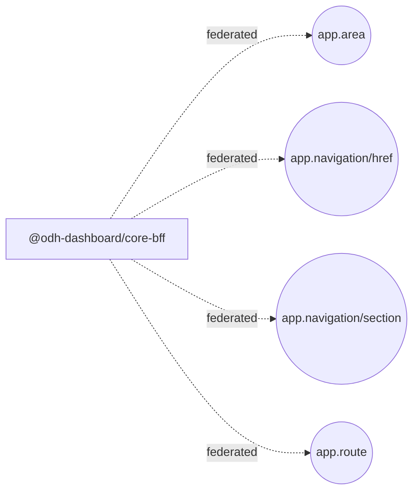

<!-- AUTO-GENERATED by @odh-dashboard/extension-map. Do not edit by hand. -->

> Generated file. Regenerate with `pnpm docs:extension-map`.

## Loading paths

| Entry | Path | Source |
| --- | --- | --- |
| @odh-dashboard/core-bff#mf:./extensions | federated | `distributions/core-bff/frontend/src/odh/extensions.ts` |

## Contributes

### app

| Node | Link |
| --- | --- |
| @odh-dashboard/core-bff | [@odh-dashboard/core-bff](#contributes) |
| app.area | [app.area](../../../packages/plugin-core/docs/extensions.md#apparea) [app.area](../frontend/src/odh/extensions.ts#L10-L16) |
| app.navigation/href | [app.navigation/href](../../../packages/plugin-core/docs/extensions.md#appnavigationhref) [app.navigation/href](../frontend/src/odh/extensions.ts#L29-L42) |
| app.navigation/section | [app.navigation/section](../../../packages/plugin-core/docs/extensions.md#appnavigationsection) [app.navigation/section](../frontend/src/odh/extensions.ts#L17-L28) |
| app.route | [app.route](../../../packages/plugin-core/docs/extensions.md#approute) [app.route](../frontend/src/odh/extensions.ts#L43-L52) |

- `-->` declared or type-resolved contribution
- `==>` derived relationship
- `-. "rendered in" .->` rendered in one hop
- `-. "federated" .->` federated contribution
- `--x` suppression
- `-- "patch" -->` patch

#### app.area

| devFlags | id | Requires | Disallows | CodeRef target | Included in | Source |
| --- | --- | --- | --- | --- | --- | --- |
| `CORE_BFF` (`"core-bff-module"`) | `CORE_BFF` (`"core-bff-module"`) |  |  |  |  | [app.area](../frontend/src/odh/extensions.ts#L10-L16) |

#### app.navigation/href

- **id**: `"core-bff-view"`
- **title**: `"Core Bff"`
- **section**: `"core-bff"`
- **label**: `"Tech Preview"`
- **href**: `"/core-bff/main-view"`
- **path**: `"/core-bff/main-view/*"`
- **Requires**: `CORE_BFF` (`"core-bff-module"`)
- **Disallows**: 
- **CodeRef target**: 
- **Included in**: 
- **Source**: [app.navigation/href](../frontend/src/odh/extensions.ts#L29-L42)

#### app.navigation/section

- **id**: `"core-bff"`
- **title**: `"Core Bff"`
- **group**: `"7_core_bff_studio"`
- **iconRef**: distributions/core-bff/frontend/src/odh/CoreBffNavIcon.ts#[CoreBffNavIcon](../frontend/src/odh/CoreBffNavIcon.ts#L3-L11)
- **Requires**: `CORE_BFF` (`"core-bff-module"`)
- **Disallows**: 
- **CodeRef target**: distributions/core-bff/frontend/src/odh/CoreBffNavIcon.ts#[CoreBffNavIcon](../frontend/src/odh/CoreBffNavIcon.ts#L3-L11)
- **Included in**: 
- **Source**: [app.navigation/section](../frontend/src/odh/extensions.ts#L17-L28)

#### app.route

| component | path | Requires | Disallows | CodeRef target | Included in | Source |
| --- | --- | --- | --- | --- | --- | --- |
| distributions/core-bff/frontend/src/odh/CoreBffWrapper.tsx#[CoreBffWrapper](../frontend/src/odh/CoreBffWrapper.tsx#L18-L26) | `"/core-bff/main-view/*"` |  |  | distributions/core-bff/frontend/src/odh/CoreBffWrapper.tsx#[CoreBffWrapper](../frontend/src/odh/CoreBffWrapper.tsx#L18-L26) |  | [app.route](../frontend/src/odh/extensions.ts#L43-L52) |
