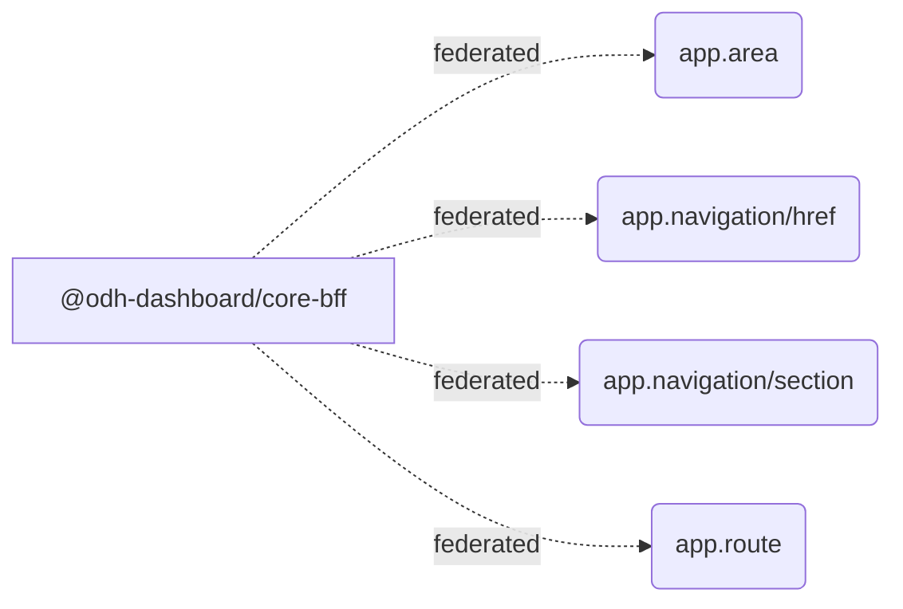

<!-- AUTO-GENERATED by @odh-dashboard/extension-map. Do not edit by hand. -->

> Generated file. Regenerate with `pnpm docs:extension-map`.

## Contents
- [Loading paths](#loading-paths)
- [Contributes](#contributes)
  - [app](#app)
    - [app.area](#apparea)
    - [app.navigation/href](#appnavigationhref)
    - [app.navigation/section](#appnavigationsection)
    - [app.route](#approute)

## Loading paths

| Entry | Path | Source |
| --- | --- | --- |
| @odh-dashboard/core-bff#mf:./extensions | federated | `distributions/core-bff/frontend/src/odh/extensions.ts` |

## Contributes

### app

| Node | Contract | Registration sources |
| --- | --- | --- |
| [@odh-dashboard/core-bff](#loading-paths) | — | — |
| app.area | [app.area](../../../packages/plugin-core/docs/extensions.md#apparea) | [../frontend/src/odh/extensions.ts:10](../frontend/src/odh/extensions.ts#L10-L16) |
| app.navigation/href | [app.navigation/href](../../../packages/plugin-core/docs/extensions.md#appnavigationhref) | [../frontend/src/odh/extensions.ts:29](../frontend/src/odh/extensions.ts#L29-L42) |
| app.navigation/section | [app.navigation/section](../../../packages/plugin-core/docs/extensions.md#appnavigationsection) | [../frontend/src/odh/extensions.ts:17](../frontend/src/odh/extensions.ts#L17-L28) |
| app.route | [app.route](../../../packages/plugin-core/docs/extensions.md#approute) | [../frontend/src/odh/extensions.ts:43](../frontend/src/odh/extensions.ts#L43-L52) |

- `-->` declared or type-resolved contribution
- `==>` derived relationship
- `-. "rendered in" .->` rendered in one hop
- `-. "federated" .->` federated contribution
- `--x` suppression
- `-- "patch" -->` patch

#### app.area

| devFlags | id | Source |
| --- | --- | --- |
| `CORE_BFF` (`"core-bff-module"`) | `CORE_BFF` (`"core-bff-module"`) | [app.area](../frontend/src/odh/extensions.ts#L10-L16) |

#### app.navigation/href

**Contribution:** `app.navigation/href` at `distributions/core-bff/frontend/src/odh/extensions.ts:29`

- **id**: `"core-bff-view"`
- **title**: `"Core Bff"`
- **section**: `"core-bff"`
- **label**: `"Tech Preview"`
- **href**: `"/core-bff/main-view"`
- **path**: `"/core-bff/main-view/*"`
- **Requires**: `CORE_BFF` (`"core-bff-module"`)
- **Source**: [app.navigation/href](../frontend/src/odh/extensions.ts#L29-L42)

#### app.navigation/section

| id | title | group | iconRef | Requires | CodeRef target | Source |
| --- | --- | --- | --- | --- | --- | --- |
| `"core-bff"` | `"Core Bff"` | `"7_core_bff_studio"` | distributions/core-bff/frontend/src/odh/CoreBffNavIcon.ts#[CoreBffNavIcon](../frontend/src/odh/CoreBffNavIcon.ts#L3-L11) | `CORE_BFF` (`"core-bff-module"`) | distributions/core-bff/frontend/src/odh/CoreBffNavIcon.ts#[CoreBffNavIcon](../frontend/src/odh/CoreBffNavIcon.ts#L3-L11) | [app.navigation/section](../frontend/src/odh/extensions.ts#L17-L28) |

#### app.route

| component | path | CodeRef target | Source |
| --- | --- | --- | --- |
| distributions/core-bff/frontend/src/odh/CoreBffWrapper.tsx#[CoreBffWrapper](../frontend/src/odh/CoreBffWrapper.tsx#L18-L26) | `"/core-bff/main-view/*"` | distributions/core-bff/frontend/src/odh/CoreBffWrapper.tsx#[CoreBffWrapper](../frontend/src/odh/CoreBffWrapper.tsx#L18-L26) | [app.route](../frontend/src/odh/extensions.ts#L43-L52) |
