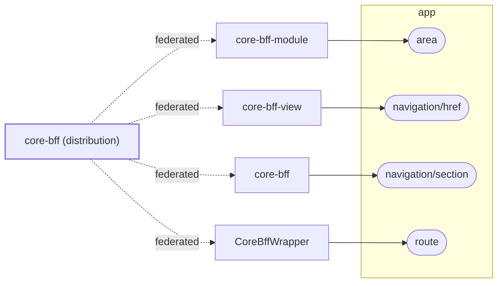

<!-- AUTO-GENERATED by @odh-dashboard/extension-map. Do not edit by hand. -->

> Generated file. Regenerate with `pnpm docs:extension-map`.

# Extensions in core-bff

Package `@odh-dashboard/core-bff` (distribution) at `distributions/core-bff`. Everything below is read out of this repository's sources by static analysis.

## Loading paths

- [extensions.ts](../frontend/src/odh/extensions.ts) (`mf:./extensions`) — loaded at runtime by the host as a Module Federation remote

## Contributes

The extensions this package declares, grouped by the namespace of the extension point they target.

### Namespace `app`

| Node | What | Link |
| --- | --- | --- |
| core-bff (distribution) | this package | [distributions/core-bff](..) |
| core-bff-module | extension of app.area — federated | [extensions.ts](../frontend/src/odh/extensions.ts#L10-L16) |
| core-bff-view | extension of app.navigation/href — federated | [extensions.ts](../frontend/src/odh/extensions.ts#L29-L42) |
| core-bff | extension of app.navigation/section — federated | [extensions.ts](../frontend/src/odh/extensions.ts#L17-L28) |
| CoreBffWrapper | extension of app.route — federated | [extensions.ts](../frontend/src/odh/extensions.ts#L43-L52) |
| area | extension point | [app.area](../../../packages/plugin-core/docs/extensions.md#apparea) |
| navigation/href | extension point | [app.navigation/href](../../../packages/plugin-core/docs/extensions.md#appnavigationhref) |
| navigation/section | extension point | [app.navigation/section](../../../packages/plugin-core/docs/extensions.md#appnavigationsection) |
| route | extension point | [app.route](../../../packages/plugin-core/docs/extensions.md#approute) |

#### Contributes to app.area

Defined in [app.area](../../../packages/plugin-core/docs/extensions.md#apparea).

| devFlags | id | Source |
| --- | --- | --- |
| `CORE_BFF` (`'core-bff-module'`) | `CORE_BFF` (`'core-bff-module'`) | [extensions.ts](../frontend/src/odh/extensions.ts#L10-L16) |

#### Contributes to app.navigation/href

Defined in [app.navigation/href](../../../packages/plugin-core/docs/extensions.md#appnavigationhref).

##### core-bff-view

- **id:** `'core-bff-view'`
- **title:** `'Core Bff'`
- **section:** `'core-bff'`
- **label:** `'Tech Preview'`
- **href:** `'/core-bff/main-view'`
- **path:** `'/core-bff/main-view/*'`
- **Requires:** `CORE_BFF` (`'core-bff-module'`)
- **Source:** [extensions.ts](../frontend/src/odh/extensions.ts#L29-L42)

#### Contributes to app.navigation/section

Defined in [app.navigation/section](../../../packages/plugin-core/docs/extensions.md#appnavigationsection).

| id | title | group | Requires | CodeRef target | Source |
| --- | --- | --- | --- | --- | --- |
| `'core-bff'` | `'Core Bff'` | `'7_core_bff_studio'` | `CORE_BFF` (`'core-bff-module'`) | [CoreBffNavIcon#default](../frontend/src/odh/CoreBffNavIcon.ts#L3-L11) | [extensions.ts](../frontend/src/odh/extensions.ts#L17-L28) |

#### Contributes to app.route

Defined in [app.route](../../../packages/plugin-core/docs/extensions.md#approute).

| path | CodeRef target | Source |
| --- | --- | --- |
| `'/core-bff/main-view/*'` | [CoreBffWrapper#default](../frontend/src/odh/CoreBffWrapper.tsx#L18-L26) | [extensions.ts](../frontend/src/odh/extensions.ts#L43-L52) |

## Legend

| Edge | What it means in these diagrams |
| --- | --- |
| `A --> B` | A is declared by this package and bundled into an app at build time. It may also be exposed through Module Federation — the node table beside each diagram names every loading path. |
| `A -. "federated" .-> B` | A reaches the host only through a Module Federation remote, loaded at runtime. |
| `A ==> B` | Derived: proven through a type or a JSDoc tag rather than a direct reference. |
| `A -. "rendered in" .-> B` | B renders A (one hop). |
| `A --x B` | A suppresses B. |
| `A -- "patch" --> B` | A patches B. |

A node with a dashed border stands for several extensions of the same point; its `×N` label is
the number of extensions, and the table beside the diagram always lists every one of them.
Anything the analysis could not resolve is never drawn — it is listed in a "Not resolved" table
instead.
