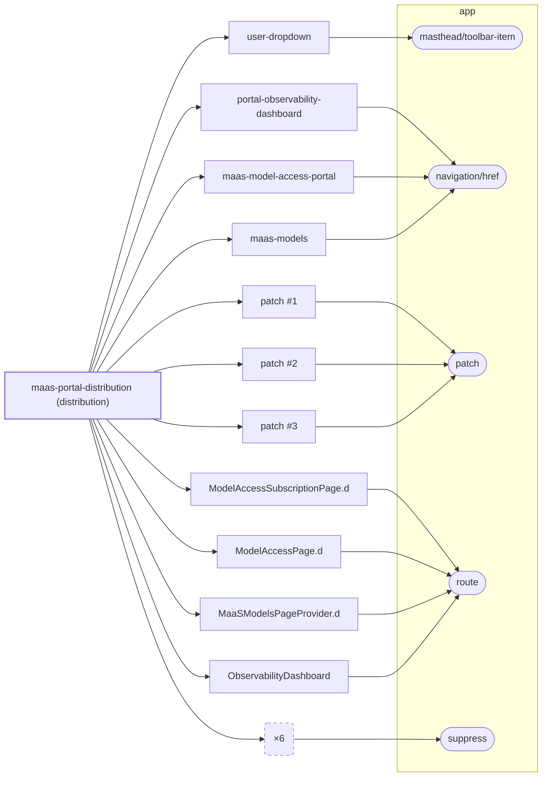

<!-- AUTO-GENERATED by @odh-dashboard/extension-map. Do not edit by hand. -->

> Generated file. Regenerate with `pnpm docs:extension-map`.

# Extensions in maas-portal-distribution

Package `@odh-dashboard/maas-portal-distribution` (distribution) at `distributions/maas-portal`. Everything below is read out of this repository's sources by static analysis.

## Loading paths

- [extensions.ts](../src/extensions.ts) (`local:./extensions`) — local to one distribution

## Contributes

The extensions this package declares, grouped by the namespace of the extension point they target.

### Namespace `app`

| Node | What | Link |
| --- | --- | --- |
| maas-portal-distribution (distribution) | this package | [distributions/maas-portal](..) |
| user-dropdown | extension of app.masthead/toolbar-item — local to a distribution | [extensions.ts](../src/extensions.ts#L26-L33) |
| portal-observability-dashboard | extension of app.navigation/href — local to a distribution | [extensions.ts](../src/extensions.ts#L107-L117) |
| maas-model-access-portal | extension of app.navigation/href — local to a distribution | [extensions.ts](../src/extensions.ts#L118-L127) |
| maas-models | extension of app.navigation/href — local to a distribution | [extensions.ts](../src/extensions.ts#L163-L172) |
| patch #1 | extension of app.patch — local to a distribution | [extensions.ts](../src/extensions.ts#L91-L98) |
| patch #2 | extension of app.patch — local to a distribution | [extensions.ts](../src/extensions.ts#L99-L106) |
| patch #3 | extension of app.patch — local to a distribution | [extensions.ts](../src/extensions.ts#L128-L135) |
| ModelAccessSubscriptionPage.d | extension of app.route — local to a distribution | [extensions.ts](../src/extensions.ts#L140-L147) |
| ModelAccessPage.d | extension of app.route — local to a distribution | [extensions.ts](../src/extensions.ts#L148-L155) |
| MaaSModelsPageProvider.d | extension of app.route — local to a distribution | [extensions.ts](../src/extensions.ts#L156-L162) |
| ObservabilityDashboard | extension of app.route — local to a distribution | [extensions.ts](../src/extensions.ts#L16-L23) |
| ×6 | 6 extensions of app.suppress | [see the table below](#contributes-to-appsuppress) |
| masthead/toolbar-item | extension point | [app.masthead/toolbar-item](../../../packages/plugin-core/docs/extensions.md#appmastheadtoolbar-item) |
| navigation/href | extension point | [app.navigation/href](../../../packages/plugin-core/docs/extensions.md#appnavigationhref) |
| patch | extension point | [app.patch](../../../packages/plugin-core/docs/extensions.md#apppatch) |
| route | extension point | [app.route](../../../packages/plugin-core/docs/extensions.md#approute) |
| suppress | extension point | [app.suppress](../../../packages/plugin-core/docs/extensions.md#appsuppress) |

#### Contributes to app.masthead/toolbar-item

Defined in [app.masthead/toolbar-item](../../../packages/plugin-core/docs/extensions.md#appmastheadtoolbar-item).

| id | position | CodeRef target | Included in | Source |
| --- | --- | --- | --- | --- |
| `'user-dropdown'` | `'trailing'` | [UserDropdown#default](../src/components/UserDropdown.tsx#L71) | maas-portal | [extensions.ts](../src/extensions.ts#L26-L33) |

#### Contributes to app.navigation/href

Defined in [app.navigation/href](../../../packages/plugin-core/docs/extensions.md#appnavigationhref).

##### portal-observability-dashboard

- **id:** `'portal-observability-dashboard'`
- **title:** `'Observability'`
- **group:** `'4_dashboard'`
- **href:** `'/observe-and-monitor/dashboard'`
- **path:** `'/observe-and-monitor/dashboard/*'`
- **Requires:** `observabilityDashboard`
- **Included in:** maas-portal
- **Source:** [extensions.ts](../src/extensions.ts#L107-L117)

##### maas-model-access-portal

- **id:** `'maas-model-access-portal'`
- **title:** `'Model access'`
- **group:** —
- **href:** `PORTAL_MODEL_ACCESS_PATH` (`'/maas/model-access'`)
- **path:** `'/maas/model-access/*'`
- **Requires:** `MAAS_MODEL_ACCESS_ADMIN`
- **Included in:** maas-portal
- **Source:** [extensions.ts](../src/extensions.ts#L118-L127)

##### maas-models

- **id:** `'maas-models'`
- **title:** `'Model endpoints'`
- **group:** `'1_models'`
- **href:** `'/maas/models'`
- **path:** `'/maas/models/*'`
- **Requires:** —
- **Included in:** maas-portal
- **Source:** [extensions.ts](../src/extensions.ts#L163-L172)

#### Contributes to app.patch

Defined in [app.patch](../../../packages/plugin-core/docs/extensions.md#apppatch).

| targetType | targetId | patch | Included in | Source |
| --- | --- | --- | --- | --- |
| `'app.navigation/href'` | `'ai-assets'` | `{ section: null, group: '1_ai_assets', label: null }` | maas-portal | [extensions.ts](../src/extensions.ts#L91-L98) |
| `'app.navigation/href'` | `'maas-tokens-subscriptions-view'` | `{ section: null, group: '2_api_keys' }` | maas-portal | [extensions.ts](../src/extensions.ts#L99-L106) |
| `'app.navigation/href'` | `'maas-governance-view'` | `{ section: null, group: '5_maas_governance' }` | maas-portal | [extensions.ts](../src/extensions.ts#L128-L135) |

#### Contributes to app.route

Defined in [app.route](../../../packages/plugin-core/docs/extensions.md#approute).

| path | Requires | CodeRef target | Included in | Source |
| --- | --- | --- | --- | --- |
| `'/maas/model-access/view/:subscriptionName'` | `MAAS_MODEL_ACCESS_ADMIN` | [ModelAccessSubscriptionPage.d#default](../../../packages/maas/types/ModelAccessSubscriptionPage.d.ts#L2) | maas-portal | [extensions.ts](../src/extensions.ts#L140-L147) |
| `'/maas/model-access/*'` | `MAAS_MODEL_ACCESS_ADMIN` | [ModelAccessPage.d#default](../../../packages/maas/types/ModelAccessPage.d.ts#L2) | maas-portal | [extensions.ts](../src/extensions.ts#L148-L155) |
| `'/maas/models/*'` | — | [MaaSModelsPageProvider.d#default](../../../packages/gen-ai/types/MaaSModelsPageProvider.d.ts#L3) | maas-portal | [extensions.ts](../src/extensions.ts#L156-L162) |
| `'/observe-and-monitor/dashboard/*'` | `observabilityDashboard` | [ObservabilityDashboard#default](../src/observability/ObservabilityDashboard.tsx#L74-L184) | maas-portal | [extensions.ts](../src/extensions.ts#L16-L23) |

#### Contributes to app.suppress

Defined in [app.suppress](../../../packages/plugin-core/docs/extensions.md#appsuppress).

| targetType | targetId | Included in | Source |
| --- | --- | --- | --- |
| `'app.navigation/section'` | `'gen-ai-studio'` | maas-portal | [extensions.ts](../src/extensions.ts#L36-L42) |
| `'app.route'` | `'gen-ai-routes'` | maas-portal | [extensions.ts](../src/extensions.ts#L45-L51) |
| `'app.navigation/href'` | `'maas-governance-view'` | maas-portal | [extensions.ts](../src/extensions.ts#L55-L61) |
| `'gen-ai.ai-assets/tab'` | `'mcpservers'` | maas-portal | [extensions.ts](../src/extensions.ts#L64-L70) |
| `'app.navigation/href'` | `'ai-assets'` | maas-portal | [extensions.ts](../src/extensions.ts#L73-L79) |
| `'app.navigation/href'` | `'chat-playground'` | maas-portal | [extensions.ts](../src/extensions.ts#L82-L88) |

## Diagnostics

What the analysis could not prove, or thought worth reporting, about this package. Warnings are gaps in the generated map; info entries are observations.

| Code | Severity | Message | Source |
| --- | --- | --- | --- |
| `patch-noop-suppressed` | warning | In maas-portal: every registration of ["app.navigation/href","ai-assets"] is suppressed, so this patch has nothing to apply to. | [extensions.ts:91](../src/extensions.ts#L91-L98) |
| `patch-noop-suppressed` | warning | In maas-portal: every registration of ["app.navigation/href","maas-governance-view"] is suppressed, so this patch has nothing to apply to. | [extensions.ts:128](../src/extensions.ts#L128-L135) |

## Legend

| Edge | What it means in these diagrams |
| --- | --- |
| `A --> B` | Proven by a declaration or by the type checker. In a Contributes diagram: A is declared by this package and bundled into an app at build time; it may also be exposed through Module Federation, and the node table beside each diagram names every loading path. In a point's flow diagram: package A contributes extensions of point B, bundled into an app at build time. |
| `A -- "how" --> B` | In a point's flow diagram: consumer B queries or uses point A, proven by the type checker. The label names the query hook (or the wrapper it goes through) and the kinds of use: `lazy-render`, `jsx-render`, `hook-run`, `call`, `read`, `filter`, `type-check`. |
| `A -. "federated" .-> B` | A reaches the host only through a Module Federation remote, loaded at runtime. |
| `A ==> B` | Derived: proven through a type or a JSDoc tag rather than a direct reference. |
| `A -. "rendered in" .-> B` | B renders A as a JSX element (one hop up). |
| `A -. "called in" .-> B` | B calls A (one hop up). |
| `A --x B` | A suppresses B. |
| `A -- "patch" --> B` | A patches B. |

A node with a dashed border stands for several extensions of the same point; its `×N` label is
the number of extensions, and the table beside the diagram always lists every one of them.
Anything the analysis could not resolve is never drawn — it is listed in a "Not resolved" table
instead.
