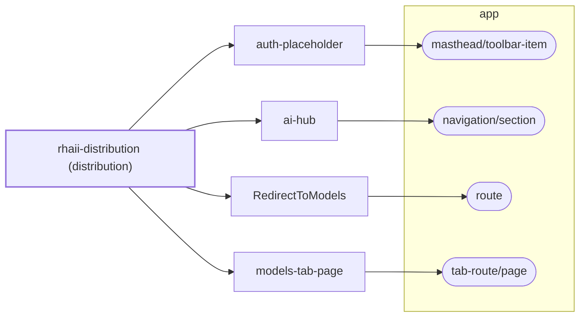

<!-- AUTO-GENERATED by @odh-dashboard/extension-map. Do not edit by hand. -->

> Generated file. Regenerate with `pnpm docs:extension-map`.

# Extensions in rhaii-distribution

Package `@odh-dashboard/rhaii-distribution` (distribution) at `distributions/rhaii`. Everything below is read out of this repository's sources by static analysis.

## Loading paths

- [extensions.ts](../src/extensions.ts) (`local:./extensions`) — local to one distribution

## Contributes

The extensions this package declares, grouped by the namespace of the extension point they target.

### Namespace `app`

| Node | What | Link |
| --- | --- | --- |
| rhaii-distribution (distribution) | this package | [distributions/rhaii](..) |
| auth-placeholder | extension of app.masthead/toolbar-item — local to a distribution | [extensions.ts](../src/extensions.ts#L36-L43) |
| ai-hub | extension of app.navigation/section — local to a distribution | [extensions.ts](../src/extensions.ts#L10-L17) |
| RedirectToModels | extension of app.route — local to a distribution | [extensions.ts](../src/extensions.ts#L29-L35) |
| models-tab-page | extension of app.tab-route/page — local to a distribution | [extensions.ts](../src/extensions.ts#L18-L28) |
| masthead/toolbar-item | extension point | [app.masthead/toolbar-item](../../../packages/plugin-core/docs/extensions.md#appmastheadtoolbar-item) |
| navigation/section | extension point | [app.navigation/section](../../../packages/plugin-core/docs/extensions.md#appnavigationsection) |
| route | extension point | [app.route](../../../packages/plugin-core/docs/extensions.md#approute) |
| tab-route/page | extension point | [app.tab-route/page](../../../packages/plugin-core/docs/extensions.md#apptab-routepage) |

#### Contributes to app.masthead/toolbar-item

Defined in [app.masthead/toolbar-item](../../../packages/plugin-core/docs/extensions.md#appmastheadtoolbar-item).

| id | position | CodeRef target | Included in | Source |
| --- | --- | --- | --- | --- |
| `'auth-placeholder'` | `'trailing'` | [AuthPlaceholder#default](../src/components/AuthPlaceholder.tsx#L4-L8) | rhaii | [extensions.ts](../src/extensions.ts#L36-L43) |

#### Contributes to app.navigation/section

Defined in [app.navigation/section](../../../packages/plugin-core/docs/extensions.md#appnavigationsection).

| id | title | group | Included in | Source |
| --- | --- | --- | --- | --- |
| `'ai-hub'` | `'AI hub'` | `'3_ai_hub'` | rhaii | [extensions.ts](../src/extensions.ts#L10-L17) |

#### Contributes to app.route

Defined in [app.route](../../../packages/plugin-core/docs/extensions.md#approute).

| path | CodeRef target | Included in | Source |
| --- | --- | --- | --- |
| `'/'` | [RedirectToModels#default](../src/RedirectToModels.tsx#L4) | rhaii | [extensions.ts](../src/extensions.ts#L29-L35) |

#### Contributes to app.tab-route/page

Defined in [app.tab-route/page](../../../packages/plugin-core/docs/extensions.md#apptab-routepage).

##### models-tab-page

- **id:** `'models-tab-page'`
- **title:** `'Models'`
- **section:** `'ai-hub'`
- **group:** `'1_models'`
- **href:** `'/ai-hub/models'`
- **path:** `'/ai-hub/models/*'`
- **Included in:** rhaii
- **Source:** [extensions.ts](../src/extensions.ts#L18-L28)

## Legend

| Edge | What it means in these diagrams |
| --- | --- |
| `A --> B` | Proven by a declaration or by the type checker. In a Contributes diagram: A is declared by this package and bundled into an app at build time; it may also be exposed through Module Federation, and the node table beside each diagram names every loading path. In a point's flow diagram: package A contributes extensions of point B, bundled into an app at build time. |
| `A -- "how" --> B` | In a point's flow diagram: consumer B queries or uses point A, proven by the type checker. The label names the query hook (or the wrapper it goes through) and the kinds of use: `lazy-render`, `jsx-render`, `hook-run`, `call`, `read`, `filter`, `type-check`. |
| `A -. "federated" .-> B` | A reaches the host only through a Module Federation remote, loaded at runtime. |
| `A ==> B` | Derived: proven through a type or a JSDoc tag rather than a direct reference. |
| `A -. "rendered in" .-> B` | B renders A as a JSX element (one hop up). |
| `A -. "called in" .-> B` | B calls A (one hop up). |
| `A --x B` | A suppresses B. |
| `A -- "patch" --> B` | A patches B. |

A node with a dashed border stands for several extensions of the same point; its `×N` label is
the number of extensions, and the table beside the diagram always lists every one of them.
Anything the analysis could not resolve is never drawn — it is listed in a "Not resolved" table
instead.
