<!-- AUTO-GENERATED by @odh-dashboard/extension-map. Do not edit by hand. -->

> Generated file. Regenerate with `pnpm docs:extension-map`.

# Extensions in frontend (core app)

Package `@odh-dashboard/internal` (host) at `frontend/src`. Everything below is read out of this repository's sources by static analysis.

## Loading paths

- [index.ts](../src/plugins/extensions/index.ts) (`./extensions`) — bundled into the host at build time (the `./extensions` export)

## Contributes

The extensions this package declares, grouped by the namespace of the extension point they target.

### Namespace `app`

```mermaid
flowchart LR
  classDef collapsed stroke-dasharray: 5 5
  classDef pkg stroke-width:2px
  classDef point stroke-width:1px
  n__odh_dashboard_internal_b20f2b["internal (host)"]:::pkg
  n_frontend_src_plugins_extensions_connection_types_ts_1187_6d9eff["DefaultValueTextRenderer"]
  n__odh_dashboard_internal_b20f2b --> n_frontend_src_plugins_extensions_connection_types_ts_1187_6d9eff
  n_frontend_src_plugins_extensions_connection_types_ts_984_2ee14f["ConnectionDetailsHelperText"]
  n__odh_dashboard_internal_b20f2b --> n_frontend_src_plugins_extensions_connection_types_ts_984_2ee14f
  n_frontend_src_plugins_extensions_connection_types_ts_1395_041892["ConnectionTypeForm"]
  n__odh_dashboard_internal_b20f2b --> n_frontend_src_plugins_extensions_connection_types_ts_1395_041892
  n_frontend_src_plugins_extensions_connection_types_ts_810_4919d9["ConnectionTypeFormFields"]
  n__odh_dashboard_internal_b20f2b --> n_frontend_src_plugins_extensions_connection_types_ts_810_4919d9
  n_frontend_src_plugins_extensions_connection_types_ts_517_4a5f4f["fetchConnectionTypes"]
  n__odh_dashboard_internal_b20f2b --> n_frontend_src_plugins_extensions_connection_types_ts_517_4a5f4f
  n_app_navigation_href_collapsed_bf01d6("×17"):::collapsed
  n__odh_dashboard_internal_b20f2b --> n_app_navigation_href_collapsed_bf01d6
  n_app_navigation_section_collapsed_07dd9a("×10"):::collapsed
  n__odh_dashboard_internal_b20f2b --> n_app_navigation_section_collapsed_07dd9a
  n_app_route_collapsed_a2cd4d("×41"):::collapsed
  n__odh_dashboard_internal_b20f2b --> n_app_route_collapsed_a2cd4d
  n_frontend_src_plugins_extensions_navigation_ts_1177_deb5ea["models-tab-page"]
  n__odh_dashboard_internal_b20f2b --> n_frontend_src_plugins_extensions_navigation_ts_1177_deb5ea
  n_frontend_src_plugins_extensions_navigation_ts_1446_369051["mcp-servers-tab-page"]
  n__odh_dashboard_internal_b20f2b --> n_frontend_src_plugins_extensions_navigation_ts_1446_369051
  n_frontend_src_plugins_extensions_navigation_ts_1734_c1c1a9["agents-tab-page"]
  n__odh_dashboard_internal_b20f2b --> n_frontend_src_plugins_extensions_navigation_ts_1734_c1c1a9
  n_frontend_src_plugins_extensions_tasks_ts_388_dc2801["ai-hub"]
  n__odh_dashboard_internal_b20f2b --> n_frontend_src_plugins_extensions_tasks_ts_388_dc2801
  n_frontend_src_plugins_extensions_tasks_ts_718_38e7bc["develop-and-train"]
  n__odh_dashboard_internal_b20f2b --> n_frontend_src_plugins_extensions_tasks_ts_718_38e7bc
  n_frontend_src_plugins_extensions_tasks_ts_1117_1a6616["ai-hub-models"]
  n__odh_dashboard_internal_b20f2b --> n_frontend_src_plugins_extensions_tasks_ts_1117_1a6616
  n_frontend_src_plugins_extensions_tasks_ts_1361_ba9d39["ai-hub-mcp-servers"]
  n__odh_dashboard_internal_b20f2b --> n_frontend_src_plugins_extensions_tasks_ts_1361_ba9d39
  n_frontend_src_plugins_extensions_tasks_ts_1658_0f4b82["develop-workbenches"]
  n__odh_dashboard_internal_b20f2b --> n_frontend_src_plugins_extensions_tasks_ts_1658_0f4b82
  subgraph n_ns_app_679587 ["app"]
    n_app_connection_types_default_value_renderer_01627c(["connection-types/default-value-renderer"]):::point
    n_app_connection_types_details_helper_f68622(["connection-types/details-helper"]):::point
    n_app_connection_types_form_81f66d(["connection-types/form"]):::point
    n_app_connection_types_form_fields_cb02ad(["connection-types/form-fields"]):::point
    n_app_connection_types_service_2eb1aa(["connection-types/service"]):::point
    n_app_navigation_href_67179c(["navigation/href"]):::point
    n_app_navigation_section_34ff18(["navigation/section"]):::point
    n_app_route_2735df(["route"]):::point
    n_app_tab_route_page_976575(["tab-route/page"]):::point
    n_app_task_group_64e4cf(["task/group"]):::point
    n_app_task_item_001b33(["task/item"]):::point
  end
  n_frontend_src_plugins_extensions_connection_types_ts_1187_6d9eff --> n_app_connection_types_default_value_renderer_01627c
  n_frontend_src_plugins_extensions_connection_types_ts_984_2ee14f --> n_app_connection_types_details_helper_f68622
  n_frontend_src_plugins_extensions_connection_types_ts_1395_041892 --> n_app_connection_types_form_81f66d
  n_frontend_src_plugins_extensions_connection_types_ts_810_4919d9 --> n_app_connection_types_form_fields_cb02ad
  n_frontend_src_plugins_extensions_connection_types_ts_517_4a5f4f --> n_app_connection_types_service_2eb1aa
  n_app_navigation_href_collapsed_bf01d6 --> n_app_navigation_href_67179c
  n_app_navigation_section_collapsed_07dd9a --> n_app_navigation_section_34ff18
  n_app_route_collapsed_a2cd4d --> n_app_route_2735df
  n_frontend_src_plugins_extensions_navigation_ts_1177_deb5ea --> n_app_tab_route_page_976575
  n_frontend_src_plugins_extensions_navigation_ts_1446_369051 --> n_app_tab_route_page_976575
  n_frontend_src_plugins_extensions_navigation_ts_1734_c1c1a9 --> n_app_tab_route_page_976575
  n_frontend_src_plugins_extensions_tasks_ts_388_dc2801 --> n_app_task_group_64e4cf
  n_frontend_src_plugins_extensions_tasks_ts_718_38e7bc --> n_app_task_group_64e4cf
  n_frontend_src_plugins_extensions_tasks_ts_1117_1a6616 --> n_app_task_item_001b33
  n_frontend_src_plugins_extensions_tasks_ts_1361_ba9d39 --> n_app_task_item_001b33
  n_frontend_src_plugins_extensions_tasks_ts_1658_0f4b82 --> n_app_task_item_001b33
```

| Node | What | Link |
| --- | --- | --- |
| internal (host) | this package | [frontend/src](../src) |
| DefaultValueTextRenderer | extension of app.connection-types/default-value-renderer — bundled | [connection-types.ts](../src/plugins/extensions/connection-types.ts#L38-L44) |
| ConnectionDetailsHelperText | extension of app.connection-types/details-helper — bundled | [connection-types.ts](../src/plugins/extensions/connection-types.ts#L31-L37) |
| ConnectionTypeForm | extension of app.connection-types/form — bundled | [connection-types.ts](../src/plugins/extensions/connection-types.ts#L45-L50) |
| ConnectionTypeFormFields | extension of app.connection-types/form-fields — bundled | [connection-types.ts](../src/plugins/extensions/connection-types.ts#L25-L30) |
| fetchConnectionTypes | extension of app.connection-types/service — bundled | [connection-types.ts](../src/plugins/extensions/connection-types.ts#L17-L24) |
| ×17 | 17 extensions of app.navigation/href | [see the table below](#contributes-to-appnavigationhref) |
| ×10 | 10 extensions of app.navigation/section | [see the table below](#contributes-to-appnavigationsection) |
| ×41 | 41 extensions of app.route | [see the table below](#contributes-to-approute) |
| models-tab-page | extension of app.tab-route/page — bundled | [navigation.ts](../src/plugins/extensions/navigation.ts#L50-L61) |
| mcp-servers-tab-page | extension of app.tab-route/page — bundled | [navigation.ts](../src/plugins/extensions/navigation.ts#L62-L73) |
| agents-tab-page | extension of app.tab-route/page — bundled | [navigation.ts](../src/plugins/extensions/navigation.ts#L74-L86) |
| ai-hub | extension of app.task/group — bundled | [tasks.ts](../src/plugins/extensions/tasks.ts#L11-L22) |
| develop-and-train | extension of app.task/group — bundled | [tasks.ts](../src/plugins/extensions/tasks.ts#L23-L34) |
| ai-hub-models | extension of app.task/item — bundled | [tasks.ts](../src/plugins/extensions/tasks.ts#L38-L47) |
| ai-hub-mcp-servers | extension of app.task/item — bundled | [tasks.ts](../src/plugins/extensions/tasks.ts#L48-L57) |
| develop-workbenches | extension of app.task/item — bundled | [tasks.ts](../src/plugins/extensions/tasks.ts#L61-L73) |
| connection-types/default-value-renderer | extension point | [app.connection-types/default-value-renderer](../../packages/plugin-core/docs/extensions.md#appconnection-typesdefault-value-renderer) |
| connection-types/details-helper | extension point | [app.connection-types/details-helper](../../packages/plugin-core/docs/extensions.md#appconnection-typesdetails-helper) |
| connection-types/form | extension point | [app.connection-types/form](../../packages/plugin-core/docs/extensions.md#appconnection-typesform) |
| connection-types/form-fields | extension point | [app.connection-types/form-fields](../../packages/plugin-core/docs/extensions.md#appconnection-typesform-fields) |
| connection-types/service | extension point | [app.connection-types/service](../../packages/plugin-core/docs/extensions.md#appconnection-typesservice) |
| navigation/href | extension point | [app.navigation/href](../../packages/plugin-core/docs/extensions.md#appnavigationhref) |
| navigation/section | extension point | [app.navigation/section](../../packages/plugin-core/docs/extensions.md#appnavigationsection) |
| route | extension point | [app.route](../../packages/plugin-core/docs/extensions.md#approute) |
| tab-route/page | extension point | [app.tab-route/page](../../packages/plugin-core/docs/extensions.md#apptab-routepage) |
| task/group | extension point | [app.task/group](../../packages/plugin-core/docs/extensions.md#apptaskgroup) |
| task/item | extension point | [app.task/item](../../packages/plugin-core/docs/extensions.md#apptaskitem) |

#### Contributes to app.connection-types/default-value-renderer

Defined in [app.connection-types/default-value-renderer](../../packages/plugin-core/docs/extensions.md#appconnection-typesdefault-value-renderer).

| CodeRef target | Included in | Source |
| --- | --- | --- |
| [DefaultValueTextRenderer#default](../../packages/ui-core/src/components/connectionTypes/DefaultValueTextRenderer.tsx#L15-L22) | host | [connection-types.ts](../src/plugins/extensions/connection-types.ts#L38-L44) |

#### Contributes to app.connection-types/details-helper

Defined in [app.connection-types/details-helper](../../packages/plugin-core/docs/extensions.md#appconnection-typesdetails-helper).

| CodeRef target | Included in | Source |
| --- | --- | --- |
| [ConnectionDetailsHelperText#default](../../packages/ui-core/src/components/connectionTypes/ConnectionDetailsHelperText.tsx#L26-L73) | host | [connection-types.ts](../src/plugins/extensions/connection-types.ts#L31-L37) |

#### Contributes to app.connection-types/form

Defined in [app.connection-types/form](../../packages/plugin-core/docs/extensions.md#appconnection-typesform).

| CodeRef target | Included in | Source |
| --- | --- | --- |
| [ConnectionTypeForm#default](../src/concepts/connectionTypes/ConnectionTypeForm.tsx#L126-L244) | host | [connection-types.ts](../src/plugins/extensions/connection-types.ts#L45-L50) |

#### Contributes to app.connection-types/form-fields

Defined in [app.connection-types/form-fields](../../packages/plugin-core/docs/extensions.md#appconnection-typesform-fields).

| CodeRef target | Included in | Source |
| --- | --- | --- |
| [ConnectionTypeFormFields#default](../src/concepts/connectionTypes/fields/ConnectionTypeFormFields.tsx#L113) | host | [connection-types.ts](../src/plugins/extensions/connection-types.ts#L25-L30) |

#### Contributes to app.connection-types/service

Defined in [app.connection-types/service](../../packages/plugin-core/docs/extensions.md#appconnection-typesservice).

| CodeRef target | Included in | Source |
| --- | --- | --- |
| `fetchConnectionTypes`: [connectionTypesService#fetchConnectionTypes](../src/services/connectionTypesService.ts#L12-L29) `fetchConnections`: [fetchConnections#default](../src/services/fetchConnections.ts#L5-L14) | host | [connection-types.ts](../src/plugins/extensions/connection-types.ts#L17-L24) |

#### Contributes to app.navigation/href

Defined in [app.navigation/href](../../packages/plugin-core/docs/extensions.md#appnavigationhref).

##### pipeline-definitions

- **id:** `'pipeline-definitions'`
- **title:** `'Pipeline definitions'`
- **section:** `'pipelines'`
- **group:** —
- **href:** `'/develop-train/pipelines/definitions'`
- **accessReview:** —
- **path:** `'/develop-train/pipelines/definitions/*'`
- **Requires:** `SupportedArea.DS_PIPELINES` (`'ds-pipelines'`)
- **Disallows:** —
- **CodeRef target:** —
- **Included in:** host
- **Source:** [navigation.ts](../src/plugins/extensions/navigation.ts#L105-L117)

##### runs

- **id:** `'runs'`
- **title:** `'Runs'`
- **section:** `'pipelines'`
- **group:** —
- **href:** `'/develop-train/pipelines/runs'`
- **accessReview:** —
- **path:** `'/develop-train/pipelines/runs/*'`
- **Requires:** `SupportedArea.DS_PIPELINES` (`'ds-pipelines'`)
- **Disallows:** —
- **CodeRef target:** —
- **Included in:** host
- **Source:** [navigation.ts](../src/plugins/extensions/navigation.ts#L118-L130)

##### artifacts

- **id:** `'artifacts'`
- **title:** `'Artifacts'`
- **section:** `'pipelines'`
- **group:** —
- **href:** `'/develop-train/pipelines/artifacts'`
- **accessReview:** —
- **path:** `'/develop-train/pipelines/artifacts/*'`
- **Requires:** `SupportedArea.DS_PIPELINES` (`'ds-pipelines'`)
- **Disallows:** —
- **CodeRef target:** —
- **Included in:** host
- **Source:** [navigation.ts](../src/plugins/extensions/navigation.ts#L131-L143)

##### executions

- **id:** `'executions'`
- **title:** `'Executions'`
- **section:** `'pipelines'`
- **group:** —
- **href:** `'/develop-train/pipelines/executions'`
- **accessReview:** —
- **path:** `'/develop-train/pipelines/executions/*'`
- **Requires:** `SupportedArea.DS_PIPELINES` (`'ds-pipelines'`)
- **Disallows:** —
- **CodeRef target:** —
- **Included in:** host
- **Source:** [navigation.ts](../src/plugins/extensions/navigation.ts#L144-L156)

##### home

- **id:** `'home'`
- **title:** `'Home'`
- **section:** —
- **group:** `'1_home'`
- **href:** `'/'`
- **accessReview:** —
- **path:** —
- **Requires:** `SupportedArea.HOME` (`'home'`)
- **Disallows:** —
- **CodeRef target:** [HomeNavIcon#default](../src/images/icons/HomeNavIcon.ts#L3-L11)
- **Included in:** host
- **Source:** [navigation.ts](../src/plugins/extensions/navigation.ts#L12-L24)

##### workloadMetrics

- **id:** `'workloadMetrics'`
- **title:** `'Workload metrics'`
- **section:** `'observe-and-monitor'`
- **group:** —
- **href:** `'/observe-monitor/workload-metrics'`
- **accessReview:** —
- **path:** `'/observe-monitor/workload-metrics/*'`
- **Requires:** `SupportedArea.DISTRIBUTED_WORKLOADS` (`'distributed-workloads'`)
- **Disallows:** —
- **CodeRef target:** —
- **Included in:** host
- **Source:** [navigation.ts](../src/plugins/extensions/navigation.ts#L166-L178)

##### learning-resources

- **id:** `'learning-resources'`
- **title:** `'Learning resources'`
- **section:** —
- **group:** `'7_other'`
- **href:** `'/learning-resources'`
- **accessReview:** —
- **path:** —
- **Requires:** —
- **Disallows:** —
- **CodeRef target:** [LearningResourcesNavIcon#default](../src/images/icons/LearningResourcesNavIcon.ts#L3-L11)
- **Included in:** host
- **Source:** [navigation.ts](../src/plugins/extensions/navigation.ts#L180-L189)

##### apps-installed #1

- **id:** `'apps-installed'`
- **title:** `'Enabled'`
- **section:** `'applications'`
- **group:** —
- **href:** `'/applications/enabled'`
- **accessReview:** —
- **path:** —
- **Requires:** `SupportedArea.HOME` (`'home'`)
- **Disallows:** —
- **CodeRef target:** —
- **Included in:** host
- **Source:** [navigation.ts](../src/plugins/extensions/navigation.ts#L200-L211)

##### apps-installed #2

- **id:** `'apps-installed'`
- **title:** `'Enabled'`
- **section:** `'applications'`
- **group:** —
- **href:** `'/'`
- **accessReview:** —
- **path:** —
- **Requires:** —
- **Disallows:** `SupportedArea.HOME` (`'home'`)
- **CodeRef target:** —
- **Included in:** host
- **Source:** [navigation.ts](../src/plugins/extensions/navigation.ts#L212-L223)

##### apps-explore

- **id:** `'apps-explore'`
- **title:** `'Explore'`
- **section:** `'applications'`
- **group:** —
- **href:** `'/applications/explore'`
- **accessReview:** —
- **path:** —
- **Requires:** —
- **Disallows:** —
- **CodeRef target:** —
- **Included in:** host
- **Source:** [navigation.ts](../src/plugins/extensions/navigation.ts#L224-L232)

##### settings-general-cluster-settings

- **id:** `'settings-general-cluster-settings'`
- **title:** `'General settings'`
- **section:** `'cluster-settings'`
- **group:** —
- **href:** `'/settings/cluster/general'`
- **accessReview:** —
- **path:** —
- **Requires:** `SupportedArea.CLUSTER_SETTINGS` (`'cluster-settings'`), `ADMIN_USER`
- **Disallows:** —
- **CodeRef target:** —
- **Included in:** host
- **Source:** [navigation.ts](../src/plugins/extensions/navigation.ts#L252-L263)

##### settings-storage-classes

- **id:** `'settings-storage-classes'`
- **title:** `'Storage classes'`
- **section:** `'cluster-settings'`
- **group:** —
- **href:** `'/settings/cluster/storage-classes'`
- **accessReview:** —
- **path:** `'/settings/cluster/storage-classes/*'`
- **Requires:** `SupportedArea.STORAGE_CLASSES` (`'storage-classes'`), `ADMIN_USER`
- **Disallows:** —
- **CodeRef target:** —
- **Included in:** host
- **Source:** [navigation.ts](../src/plugins/extensions/navigation.ts#L264-L276)

##### projects

- **id:** `'projects'`
- **title:** `'Projects'`
- **section:** —
- **group:** `'2_projects'`
- **href:** `'/projects'`
- **accessReview:** —
- **path:** `'/projects/*'`
- **Requires:** `SupportedArea.DS_PROJECTS_VIEW` (`'ds-projects'`)
- **Disallows:** —
- **CodeRef target:** [ProjectsNavIcon#default](../src/images/icons/ProjectsNavIcon.ts#L3-L11)
- **Included in:** host
- **Source:** [navigation.ts](../src/plugins/extensions/navigation.ts#L26-L39)

##### settings-workbench-images

- **id:** `'settings-workbench-images'`
- **title:** `'Workbench images'`
- **section:** `'settings-environment-setup'`
- **group:** —
- **href:** `'/settings/environment-setup/workbench-images'`
- **accessReview:** —
- **path:** `'/settings/environment-setup/workbench-images/*'`
- **Requires:** `SupportedArea.BYON` (`'bring-your-own-notebook'`), `ADMIN_USER`
- **Disallows:** —
- **CodeRef target:** —
- **Included in:** host
- **Source:** [navigation.ts](../src/plugins/extensions/navigation.ts#L286-L298)

##### settings-connection-types

- **id:** `'settings-connection-types'`
- **title:** `'Connection types'`
- **section:** `'settings-environment-setup'`
- **group:** —
- **href:** `'/settings/environment-setup/connection-types'`
- **accessReview:** —
- **path:** `'/settings/environment-setup/connection-types/*'`
- **Requires:** `SupportedArea.ADMIN_CONNECTION_TYPES` (`'connection-types'`), `ADMIN_USER`
- **Disallows:** —
- **CodeRef target:** —
- **Included in:** host
- **Source:** [navigation.ts](../src/plugins/extensions/navigation.ts#L299-L311)

##### settings-model-registry

- **id:** `'settings-model-registry'`
- **title:** `'Model registry settings'`
- **section:** `'settings-model-resources-and-operations'`
- **group:** `'3_model-resources'`
- **href:** `'/settings/model-resources-operations/model-registry'`
- **accessReview:** —
- **path:** `'/settings/model-resources-operations/model-registry/*'`
- **Requires:** `SupportedArea.MODEL_REGISTRY` (`'model-registry'`), `ADMIN_USER`
- **Disallows:** —
- **CodeRef target:** —
- **Included in:** host
- **Source:** [navigation.ts](../src/plugins/extensions/navigation.ts#L330-L343)

##### settings-group-settings

- **id:** `'settings-group-settings'`
- **title:** `'User management'`
- **section:** `'settings'`
- **group:** —
- **href:** `'/settings/user-management'`
- **accessReview:** `{ group: 'services.platform.opendatahub.io', resource: 'auths', verb: 'update' }`
- **path:** —
- **Requires:** `SupportedArea.USER_MANAGEMENT` (`'user-management'`)
- **Disallows:** —
- **CodeRef target:** —
- **Included in:** host
- **Source:** [navigation.ts](../src/plugins/extensions/navigation.ts#L345-L361)

#### Contributes to app.navigation/section

Defined in [app.navigation/section](../../packages/plugin-core/docs/extensions.md#appnavigationsection).

| id | title | section | group | CodeRef target | Included in | Source |
| --- | --- | --- | --- | --- | --- | --- |
| `'develop-and-train'` | `'Develop & train'` | — | `'5_develop_and_train'` | [DevelopAndTrainNavIcon#default](../src/images/icons/DevelopAndTrainNavIcon.ts#L3-L11) | host | [navigation.ts](../src/plugins/extensions/navigation.ts#L87-L95) |
| `'pipelines'` | `'Pipelines'` | `'develop-and-train'` | `'2_pipelines'` | — | host | [navigation.ts](../src/plugins/extensions/navigation.ts#L96-L104) |
| `'observe-and-monitor'` | `'Observe & monitor'` | — | `'6_observe_and_monitor'` | [ObserveAndMonitorNavIcon#default](../src/images/icons/ObserveAndMonitorNavIcon.ts#L3-L11) | host | [navigation.ts](../src/plugins/extensions/navigation.ts#L157-L165) |
| `'applications'` | `'Applications'` | — | `'8_other'` | [ApplicationsNavIcon#default](../src/images/icons/ApplicationsNavIcon.ts#L3-L11) | host | [navigation.ts](../src/plugins/extensions/navigation.ts#L191-L199) |
| `'settings'` | `'Settings'` | — | `'8_settings'` | [SettingsNavIcon#default](../src/images/icons/SettingsNavIcon.ts#L3-L11) | host | [navigation.ts](../src/plugins/extensions/navigation.ts#L234-L242) |
| `'cluster-settings'` | `'Cluster settings'` | `'settings'` | `'1_cluster_settings'` | — | host | [navigation.ts](../src/plugins/extensions/navigation.ts#L243-L251) |
| `'settings-environment-setup'` | `'Environment setup'` | `'settings'` | `'2_environment_setup'` | — | host | [navigation.ts](../src/plugins/extensions/navigation.ts#L277-L285) |
| `'settings-model-resources-and-operations'` | `'Model resources and operations'` | `'settings'` | `'3_model_resources_and_operations'` | — | host | [navigation.ts](../src/plugins/extensions/navigation.ts#L312-L320) |
| `'settings-mcp-resources'` | `'MCP resources'` | `'settings'` | `'4_mcp_resources'` | — | host | [navigation.ts](../src/plugins/extensions/navigation.ts#L321-L329) |
| `'ai-hub'` | `'AI hub'` | — | `'3_ai_hub'` | [AiHubNavIcon#default](../src/images/icons/AiHubNavIcon.ts#L3-L11) | host | [navigation.ts](../src/plugins/extensions/navigation.ts#L41-L49) |

#### Contributes to app.route

Defined in [app.route](../../packages/plugin-core/docs/extensions.md#approute).

| path | Requires | Disallows | CodeRef target | Included in | Source |
| --- | --- | --- | --- | --- | --- |
| `'/'` | — | `SupportedArea.HOME` (`'home'`) | [EnabledApplications#default](../src/pages/enabledApplications/EnabledApplications.tsx#L57-L91) | host | [routes.ts](../src/plugins/extensions/routes.ts#L44-L53) |
| `'/external/*'` | — | — | [ExternalRoutes#default](../src/pages/external/ExternalRoutes.tsx#L11-L18) | host | [routes.ts](../src/plugins/extensions/routes.ts#L54-L60) |
| `'/applications/explore'` | — | — | [ExploreApplications#default](../src/pages/exploreApplication/ExploreApplications.tsx#L103-L158) | host | [routes.ts](../src/plugins/extensions/routes.ts#L61-L67) |
| `'/explore'` | — | — | `component`: [not resolved](../src/plugins/extensions/routes.ts#L72) | host | [routes.ts](../src/plugins/extensions/routes.ts#L68-L74) |
| `'/learning-resources'` | — | — | [LearningCenter#default](../src/pages/learningCenter/LearningCenter.tsx#L36-L173) | host | [routes.ts](../src/plugins/extensions/routes.ts#L75-L81) |
| `'/resources'` | — | — | `component`: [not resolved](../src/plugins/extensions/routes.ts#L86) | host | [routes.ts](../src/plugins/extensions/routes.ts#L82-L88) |
| `'/projects/*'` | — | — | [ProjectViewRoutes#default](../src/pages/projects/ProjectViewRoutes.tsx#L20-L62) | host | [routes.ts](../src/plugins/extensions/routes.ts#L89-L95) |
| `'/notebook-controller/*'` | — | — | [NotebookController#default](../src/pages/notebookController/NotebookController.tsx#L10-L24) | host | [routes.ts](../src/plugins/extensions/routes.ts#L96-L102) |
| `'/notebookController/*'` | — | — | `component`: [not resolved](../src/plugins/extensions/routes.ts#L107-L110) | host | [routes.ts](../src/plugins/extensions/routes.ts#L103-L112) |
| `'/notebook/:namespace/:notebookName/logout'` | — | — | [NotebookLogoutRedirect#default](../src/pages/notebookController/NotebookLogoutRedirect.tsx#L9-L63) | host | [routes.ts](../src/plugins/extensions/routes.ts#L113-L119) |
| `'/ai-hub/models/deployments/*'` | — | `SupportedArea.PLUGIN_MODEL_SERVING` (`'plugin-model-serving'`) | [ModelServingRoutes#default](../src/pages/modelServing/ModelServingRoutes.tsx#L13-L44) | host | [routes.ts](../src/plugins/extensions/routes.ts#L120-L129) |
| `'/modelServing/*'` | — | `SupportedArea.PLUGIN_MODEL_SERVING` (`'plugin-model-serving'`) | `component`: [not resolved](../src/plugins/extensions/routes.ts#L134-L137) | host | [routes.ts](../src/plugins/extensions/routes.ts#L130-L142) |
| `'/develop-train/pipelines/definitions/*'` | — | — | [GlobalPipelinesRoutes#default](../src/pages/pipelines/GlobalPipelinesRoutes.tsx#L17-L42) | host | [routes.ts](../src/plugins/extensions/routes.ts#L143-L149) |
| `'/pipelines/*'` | — | — | `component`: [not resolved](../src/plugins/extensions/routes.ts#L154-L157) | host | [routes.ts](../src/plugins/extensions/routes.ts#L150-L159) |
| `'/develop-train/pipelines/runs/*'` | — | — | [GlobalPipelineRunsRoutes#default](../src/pages/pipelines/GlobalPipelineRunsRoutes.tsx#L34-L118) | host | [routes.ts](../src/plugins/extensions/routes.ts#L160-L166) |
| `'/pipelineRuns/*'` | — | — | `component`: [not resolved](../src/plugins/extensions/routes.ts#L171-L174) | host | [routes.ts](../src/plugins/extensions/routes.ts#L167-L176) |
| `'/develop-train/experiments/*'` | — | — | [GlobalPipelineExperimentsRoutes#default](../src/pages/pipelines/GlobalPipelineExperimentsRoutes.tsx#L11-L15) | host | [routes.ts](../src/plugins/extensions/routes.ts#L177-L183) |
| `'/experiments/*'` | — | — | `component`: [not resolved](../src/plugins/extensions/routes.ts#L188-L191) | host | [routes.ts](../src/plugins/extensions/routes.ts#L184-L193) |
| `'/develop-train/pipelines/artifacts/*'` | — | — | [GlobalArtifactsRoutes#default](../src/pages/pipelines/GlobalArtifactsRoutes.tsx#L17-L48) | host | [routes.ts](../src/plugins/extensions/routes.ts#L194-L200) |
| `'/artifacts/*'` | — | — | `component`: [not resolved](../src/plugins/extensions/routes.ts#L205-L208) | host | [routes.ts](../src/plugins/extensions/routes.ts#L201-L210) |
| `'/develop-train/pipelines/executions/*'` | — | — | [GlobalPipelineExecutionsRoutes#default](../src/pages/pipelines/GlobalPipelineExecutionsRoutes.tsx#L16-L47) | host | [routes.ts](../src/plugins/extensions/routes.ts#L211-L217) |
| `'/executions/*'` | — | — | `component`: [not resolved](../src/plugins/extensions/routes.ts#L222-L225) | host | [routes.ts](../src/plugins/extensions/routes.ts#L218-L227) |
| `'/'` | `SupportedArea.HOME` (`'home'`) | — | [Home#default](../src/pages/home/Home.tsx#L12-L44) | host | [routes.ts](../src/plugins/extensions/routes.ts#L14-L23) |
| `'/ai-hub/model-customization/*'` | `SupportedArea.FINE_TUNING` (`'fine-tuning'`) | — | [GlobalModelCustomizationRoutes#default](../src/pages/pipelines/GlobalModelCustomizationRoutes.tsx#L9-L23) | host | [routes.ts](../src/plugins/extensions/routes.ts#L228-L237) |
| `'/modelCustomization/*'` | `SupportedArea.FINE_TUNING` (`'fine-tuning'`) | — | `component`: [not resolved](../src/plugins/extensions/routes.ts#L245-L248) | host | [routes.ts](../src/plugins/extensions/routes.ts#L238-L250) |
| `'/observe-monitor/workload-metrics/*'` | — | — | [GlobalDistributedWorkloadsRoutes#default](../src/pages/distributedWorkloads/GlobalDistributedWorkloadsRoutes.tsx#L10-L39) | host | [routes.ts](../src/plugins/extensions/routes.ts#L251-L257) |
| `'/distributedWorkloads/*'` | — | — | `component`: [not resolved](../src/plugins/extensions/routes.ts#L262-L265) | host | [routes.ts](../src/plugins/extensions/routes.ts#L258-L267) |
| `'/settings/environment-setup/workbench-images/*'` | `ADMIN_USER` | — | [BYONImageRoutes#default](../src/pages/BYONImages/BYONImageRoutes.tsx#L8-L23) | host | [routes.ts](../src/plugins/extensions/routes.ts#L268-L277) |
| `'/workbenchImages/*'` | `ADMIN_USER` | — | `component`: [not resolved](../src/plugins/extensions/routes.ts#L285-L288) | host | [routes.ts](../src/plugins/extensions/routes.ts#L278-L290) |
| `'/settings/cluster/general'` | `ADMIN_USER` | — | [ClusterSettings#default](../src/pages/clusterSettings/ClusterSettings.tsx#L38-L262) | host | [routes.ts](../src/plugins/extensions/routes.ts#L291-L300) |
| `'/applications/enabled'` | `SupportedArea.HOME` (`'home'`) | — | [EnabledApplications#default](../src/pages/enabledApplications/EnabledApplications.tsx#L57-L91) | host | [routes.ts](../src/plugins/extensions/routes.ts#L24-L33) |
| `'/clusterSettings'` | `ADMIN_USER` | — | `component`: [not resolved](../src/plugins/extensions/routes.ts#L308-L311) | host | [routes.ts](../src/plugins/extensions/routes.ts#L301-L313) |
| `'/settings/environment-setup/connection-types/*'` | `ADMIN_USER` | — | [ConnectionTypeRoutes#default](../src/pages/connectionTypes/ConnectionTypeRoutes.tsx#L11-L19) | host | [routes.ts](../src/plugins/extensions/routes.ts#L314-L323) |
| `'/connectionTypes/*'` | `ADMIN_USER` | — | `component`: [not resolved](../src/plugins/extensions/routes.ts#L331-L334) | host | [routes.ts](../src/plugins/extensions/routes.ts#L324-L336) |
| `'/settings/cluster/storage-classes/*'` | `ADMIN_USER` | — | [StorageClassesPage#default](../src/pages/storageClasses/StorageClassesPage.tsx#L75-L83) | host | [routes.ts](../src/plugins/extensions/routes.ts#L337-L346) |
| `'/storageClasses/*'` | `ADMIN_USER` | — | `component`: [not resolved](../src/plugins/extensions/routes.ts#L354-L357) | host | [routes.ts](../src/plugins/extensions/routes.ts#L347-L359) |
| `'/settings/model-resources-operations/model-registry/*'` | `SupportedArea.MODEL_REGISTRY` (`'model-registry'`), `ADMIN_USER` | — | [ModelRegistrySettingsRoutes#default](../src/pages/modelRegistrySettings/ModelRegistrySettingsRoutes.tsx#L6-L12) | host | [routes.ts](../src/plugins/extensions/routes.ts#L360-L369) |
| `'/modelRegistrySettings/*'` | `SupportedArea.MODEL_REGISTRY` (`'model-registry'`), `ADMIN_USER` | — | `component`: [not resolved](../src/plugins/extensions/routes.ts#L377-L380) | host | [routes.ts](../src/plugins/extensions/routes.ts#L370-L382) |
| `'/settings/user-management'` | `ADMIN_USER` | — | [GroupSettings#default](../src/pages/groupSettings/GroupSettings.tsx#L13-L94) | host | [routes.ts](../src/plugins/extensions/routes.ts#L383-L392) |
| `'/groupSettings'` | `ADMIN_USER` | — | `component`: [not resolved](../src/plugins/extensions/routes.ts#L400-L403) | host | [routes.ts](../src/plugins/extensions/routes.ts#L393-L405) |
| `'/enabled'` | `SupportedArea.HOME` (`'home'`) | — | `component`: [not resolved](../src/plugins/extensions/routes.ts#L41) | host | [routes.ts](../src/plugins/extensions/routes.ts#L34-L43) |

**Not resolved** (never drawn in a diagram):

| Contribution | Property | Reason | Source |
| --- | --- | --- | --- |
| route #4 | component | CallExpression is not a resolvable value | [routes.ts:72](../src/plugins/extensions/routes.ts#L72) |
| route #6 | component | CallExpression is not a resolvable value | [routes.ts:86](../src/plugins/extensions/routes.ts#L86) |
| route #9 | component | CallExpression is not a resolvable value | [routes.ts:107](../src/plugins/extensions/routes.ts#L107-L110) |
| route #12 | component | CallExpression is not a resolvable value | [routes.ts:134](../src/plugins/extensions/routes.ts#L134-L137) |
| route #14 | component | CallExpression is not a resolvable value | [routes.ts:154](../src/plugins/extensions/routes.ts#L154-L157) |
| route #16 | component | CallExpression is not a resolvable value | [routes.ts:171](../src/plugins/extensions/routes.ts#L171-L174) |
| route #18 | component | CallExpression is not a resolvable value | [routes.ts:188](../src/plugins/extensions/routes.ts#L188-L191) |
| route #20 | component | CallExpression is not a resolvable value | [routes.ts:205](../src/plugins/extensions/routes.ts#L205-L208) |
| route #22 | component | CallExpression is not a resolvable value | [routes.ts:222](../src/plugins/extensions/routes.ts#L222-L225) |
| route #25 | component | CallExpression is not a resolvable value | [routes.ts:245](../src/plugins/extensions/routes.ts#L245-L248) |
| route #27 | component | CallExpression is not a resolvable value | [routes.ts:262](../src/plugins/extensions/routes.ts#L262-L265) |
| route #29 | component | CallExpression is not a resolvable value | [routes.ts:285](../src/plugins/extensions/routes.ts#L285-L288) |
| route #32 | component | CallExpression is not a resolvable value | [routes.ts:308](../src/plugins/extensions/routes.ts#L308-L311) |
| route #34 | component | CallExpression is not a resolvable value | [routes.ts:331](../src/plugins/extensions/routes.ts#L331-L334) |
| route #36 | component | CallExpression is not a resolvable value | [routes.ts:354](../src/plugins/extensions/routes.ts#L354-L357) |
| route #38 | component | CallExpression is not a resolvable value | [routes.ts:377](../src/plugins/extensions/routes.ts#L377-L380) |
| route #40 | component | CallExpression is not a resolvable value | [routes.ts:400](../src/plugins/extensions/routes.ts#L400-L403) |
| route #41 | component | CallExpression is not a resolvable value | [routes.ts:41](../src/plugins/extensions/routes.ts#L41) |

#### Contributes to app.tab-route/page

Defined in [app.tab-route/page](../../packages/plugin-core/docs/extensions.md#apptab-routepage).

##### models-tab-page

- **id:** `'models-tab-page'`
- **title:** `'Models'`
- **section:** `'ai-hub'`
- **group:** `'2_models'`
- **label:** —
- **href:** `'/ai-hub/models'`
- **path:** `'/ai-hub/models/*'`
- **objectType:** `'registered-models'`
- **Included in:** host
- **Source:** [navigation.ts](../src/plugins/extensions/navigation.ts#L50-L61)

##### mcp-servers-tab-page

- **id:** `'mcp-servers-tab-page'`
- **title:** `'MCP servers'`
- **section:** `'ai-hub'`
- **group:** `'3_mcp_servers'`
- **label:** —
- **href:** `'/ai-hub/mcp-servers'`
- **path:** `'/ai-hub/mcp-servers/*'`
- **objectType:** `'mcp-catalog'`
- **Included in:** host
- **Source:** [navigation.ts](../src/plugins/extensions/navigation.ts#L62-L73)

##### agents-tab-page

- **id:** `'agents-tab-page'`
- **title:** `'Agents'`
- **section:** `'ai-hub'`
- **group:** `'1_agents'`
- **label:** `'Dev Preview'`
- **href:** `'/ai-hub/agents'`
- **path:** `'/ai-hub/agents/*'`
- **objectType:** `'agent-ops'`
- **Included in:** host
- **Source:** [navigation.ts](../src/plugins/extensions/navigation.ts#L74-L86)

#### Contributes to app.task/group

Defined in [app.task/group](../../packages/plugin-core/docs/extensions.md#apptaskgroup).

##### ai-hub

- **id:** `'ai-hub'`
- **title:** `'AI hub'`
- **description:** `'Browse, manage, and deploy models and MCP servers.'`
- **label:** `'Manage models and MCP servers'`
- **type:** `'serving'`
- **order:** `'1_ai_hub'`
- **CodeRef target:** [AiHubNavIcon#default](../src/images/icons/AiHubNavIcon.ts#L3-L11)
- **Included in:** host
- **Source:** [tasks.ts](../src/plugins/extensions/tasks.ts#L11-L22)

##### develop-and-train

- **id:** `'develop-and-train'`
- **title:** `'Develop & train'`
- **description:** `'Iterate in experiments and track results across runs.'`
- **label:** `'Develop & train models'`
- **type:** `'training'`
- **order:** `'3_develop_and_train'`
- **CodeRef target:** [DevelopAndTrainNavIcon#default](../src/images/icons/DevelopAndTrainNavIcon.ts#L3-L11)
- **Included in:** host
- **Source:** [tasks.ts](../src/plugins/extensions/tasks.ts#L23-L34)

#### Contributes to app.task/item

Defined in [app.task/item](../../packages/plugin-core/docs/extensions.md#apptaskitem).

##### ai-hub-models

- **id:** `'ai-hub-models'`
- **group:** `'ai-hub'`
- **title:** `'Find, register, and deploy models'`
- **destination:** `{ tabRoutePageId: 'models-tab-page' }`
- **order:** `'1_models'`
- **Requires:** —
- **Included in:** host
- **Source:** [tasks.ts](../src/plugins/extensions/tasks.ts#L38-L47)

##### ai-hub-mcp-servers

- **id:** `'ai-hub-mcp-servers'`
- **group:** `'ai-hub'`
- **title:** `'Deploy and discover MCP servers'`
- **destination:** `{ tabRoutePageId: 'mcp-servers-tab-page' }`
- **order:** `'2_mcp_servers'`
- **Requires:** —
- **Included in:** host
- **Source:** [tasks.ts](../src/plugins/extensions/tasks.ts#L48-L57)

##### develop-workbenches

- **id:** `'develop-workbenches'`
- **group:** `'develop-and-train'`
- **title:** `'Code in workbenches'`
- **destination:** `{ href: '/projects' }`
- **order:** `'4_workbenches'`
- **Requires:** `SupportedArea.WORKBENCHES` (`'workbenches'`)
- **Included in:** host
- **Source:** [tasks.ts](../src/plugins/extensions/tasks.ts#L61-L73)

## Consumes

The extension points this package's code queries or uses, one table per point. A use is a property read from an extension, followed wherever the extension is passed; "rendered in" is one hop up: where the consumer itself is rendered or called.

### Consumes app.area

Defined in [app.area](../../packages/plugin-core/docs/extensions.md#apparea).

| Consumer | Query | Uses | Rendered in |
| --- | --- | --- | --- |
| [useDevFlags](../src/app/featureFlags/useDevFeatureFlags.ts#L19-L35) | [useExtensions](../src/app/featureFlags/useDevFeatureFlags.ts#L20) | `properties.devFlags` — read, direct ([useDevFeatureFlags.ts:27](../src/app/featureFlags/useDevFeatureFlags.ts#L27)) | FeatureFlagModal (called at [FeatureFlagModal.tsx:25](../src/app/featureFlags/FeatureFlagModal.tsx#L25)) useDevFeatureFlags (called at [useDevFeatureFlags.ts:67](../src/app/featureFlags/useDevFeatureFlags.ts#L67)) |
| [Inner](../src/concepts/areas/AreaContext.tsx#L36-L102) | [useExtensions](../src/concepts/areas/AreaContext.tsx#L48) | `properties` — read, direct ([AreaContext.tsx:67](../src/concepts/areas/AreaContext.tsx#L67)) `properties.id` — read, direct ([AreaContext.tsx:67](../src/concepts/areas/AreaContext.tsx#L67)) | AreaContextProvider ([AreaContext.tsx:141](../src/concepts/areas/AreaContext.tsx#L141-L147)) |

### Consumes app.cluster-storage/connected-resources

Defined in [app.cluster-storage/connected-resources](../../packages/plugin-core/docs/extensions.md#appcluster-storageconnected-resources).

| Consumer | Query | Uses | Rendered in |
| --- | --- | --- | --- |
| [getConnectedResourceLabels](../src/pages/projects/screens/detail/storage/useClusterStorageConnectedResources.tsx#L45-L52) | — | `properties.getConnectedResources` — call, direct ([useClusterStorageConnectedResources.tsx:49](../src/pages/projects/screens/detail/storage/useClusterStorageConnectedResources.tsx#L49)) | — |
| [useClusterStorageConnectedResources](../src/pages/projects/screens/detail/storage/useClusterStorageConnectedResources.tsx#L26-L69) | [useExtensions](../src/pages/projects/screens/detail/storage/useClusterStorageConnectedResources.tsx#L29) [useResolvedExtensions](../src/pages/projects/screens/detail/storage/useClusterStorageConnectedResources.tsx#L30-L32) | `properties.useConnectedResources` — hook-run, direct ([useClusterStorageConnectedResources.tsx:57](../src/pages/projects/screens/detail/storage/useClusterStorageConnectedResources.tsx#L57)) | StorageTable (called at [StorageTable.tsx:61](../src/pages/projects/screens/detail/storage/StorageTable.tsx#L61)) |

### Consumes app.cluster-storage/storage-context

Defined in [app.cluster-storage/storage-context](../../packages/plugin-core/docs/extensions.md#appcluster-storagestorage-context).

| Consumer | Query | Uses | Rendered in |
| --- | --- | --- | --- |
| [useStorageContextType](../src/pages/projects/screens/detail/storage/useStorageContextType.tsx#L33-L60) | [useResolvedExtensions](../src/pages/projects/screens/detail/storage/useStorageContextType.tsx#L37-L39) | — | StorageList (called at [StorageList.tsx:22](../src/pages/projects/screens/detail/storage/StorageList.tsx#L22)) |

### Consumes app.navigation/href

Defined in [app.navigation/href](../../packages/plugin-core/docs/extensions.md#appnavigationhref).

| Consumer | Query | Uses | Rendered in |
| --- | --- | --- | --- |
| [ExtensibleNav](../src/app/navigation/ExtensibleNav.tsx#L18-L35) | [useExtensions](../src/app/navigation/ExtensibleNav.tsx#L19) | `properties.id` — read, direct, one of: app.navigation/href, app.navigation/section, app.tab-route/page ([ExtensibleNav.tsx:30](../src/app/navigation/ExtensibleNav.tsx#L30)) | NavSidebar ([NavSidebar.tsx:8](../src/app/NavSidebar.tsx#L8)) |
| [NavSection](../src/app/navigation/NavSection.tsx#L57-L214) | [useExtensions](../src/app/navigation/NavSection.tsx#L64) | `properties.section` — read, direct, one of: app.navigation/href, app.navigation/section, app.tab-route/page ([NavSection.tsx:83](../src/app/navigation/NavSection.tsx#L83)) `properties.id` — read, direct, one of: app.navigation/href, app.navigation/section, app.tab-route/page ([NavSection.tsx:90](../src/app/navigation/NavSection.tsx#L90) (+2 more)) | NavItem ([NavItem.tsx:20](../src/app/navigation/NavItem.tsx#L20)) |
| [collectDescendants](../src/app/navigation/NavSection.tsx#L92-L105) | — | `properties.section` — read, direct, one of: app.navigation/href, app.navigation/section, app.tab-route/page ([NavSection.tsx:99](../src/app/navigation/NavSection.tsx#L99)) `properties.id` — read, direct, one of: app.navigation/href, app.navigation/section, app.tab-route/page ([NavSection.tsx:101](../src/app/navigation/NavSection.tsx#L101)) | collectDescendants (called at [NavSection.tsx:102](../src/app/navigation/NavSection.tsx#L102)) NavSection (called at [NavSection.tsx:108](../src/app/navigation/NavSection.tsx#L108)) |
| [getLeafAccessReview](../src/app/navigation/NavSection.tsx#L43-L51) | — | `properties.accessReview` — read, direct ([NavSection.tsx:45](../src/app/navigation/NavSection.tsx#L45)) | NavSection (called at [NavSection.tsx:115](../src/app/navigation/NavSection.tsx#L115)) |
| [getLeafPath](../src/app/navigation/NavSection.tsx#L32-L40) | — | `properties.href` — read, direct ([NavSection.tsx:34](../src/app/navigation/NavSection.tsx#L34)) `properties.path` — read, direct ([NavSection.tsx:34](../src/app/navigation/NavSection.tsx#L34)) | NavSection (called at [NavSection.tsx:159](../src/app/navigation/NavSection.tsx#L159)) |

### Consumes app.navigation/section

Defined in [app.navigation/section](../../packages/plugin-core/docs/extensions.md#appnavigationsection).

| Consumer | Query | Uses | Rendered in |
| --- | --- | --- | --- |
| [ExtensibleNav](../src/app/navigation/ExtensibleNav.tsx#L18-L35) | [useExtensions](../src/app/navigation/ExtensibleNav.tsx#L19) | `properties.id` — read, direct, one of: app.navigation/href, app.navigation/section, app.tab-route/page ([ExtensibleNav.tsx:30](../src/app/navigation/ExtensibleNav.tsx#L30)) | NavSidebar ([NavSidebar.tsx:8](../src/app/NavSidebar.tsx#L8)) |
| [NavSection](../src/app/navigation/NavSection.tsx#L57-L214) | [useExtensions](../src/app/navigation/NavSection.tsx#L64) | `properties.section` — read, direct, one of: app.navigation/href, app.navigation/section, app.tab-route/page ([NavSection.tsx:83](../src/app/navigation/NavSection.tsx#L83)) `properties.id` — read, direct, one of: app.navigation/href, app.navigation/section, app.tab-route/page ([NavSection.tsx:90](../src/app/navigation/NavSection.tsx#L90) (+3 more)) | NavItem ([NavItem.tsx:20](../src/app/navigation/NavItem.tsx#L20)) |
| [collectDescendants](../src/app/navigation/NavSection.tsx#L92-L105) | — | `properties.id` — read, direct ([NavSection.tsx:97](../src/app/navigation/NavSection.tsx#L97) (+1 more)) `properties.section` — read, direct, one of: app.navigation/href, app.navigation/section, app.tab-route/page ([NavSection.tsx:99](../src/app/navigation/NavSection.tsx#L99)) | collectDescendants (called at [NavSection.tsx:102](../src/app/navigation/NavSection.tsx#L102)) NavSection (called at [NavSection.tsx:108](../src/app/navigation/NavSection.tsx#L108)) |

### Consumes app.project-details/overview-section

Defined in [app.project-details/overview-section](../../packages/plugin-core/docs/extensions.md#appproject-detailsoverview-section).

| Consumer | Query | Uses | Rendered in |
| --- | --- | --- | --- |
| [OverviewModelsSection](../src/concepts/projects/overviewTab/ServeModels.tsx#L7-L18) | [useExtensions](../src/concepts/projects/overviewTab/ServeModels.tsx#L8) | `properties.component` — lazy-render, direct ([ServeModels.tsx:9](../src/concepts/projects/overviewTab/ServeModels.tsx#L9-L11)) `properties.id` — read, direct ([ServeModels.tsx:10](../src/concepts/projects/overviewTab/ServeModels.tsx#L10)) | ProjectOverview ([ProjectOverview.tsx:21](../src/pages/projects/screens/detail/overview/ProjectOverview.tsx#L21)) |

### Consumes app.project-details/settings-card

Defined in [app.project-details/settings-card](../../packages/plugin-core/docs/extensions.md#appproject-detailssettings-card).

| Consumer | Query | Uses | Rendered in |
| --- | --- | --- | --- |
| [ProjectSettingsPage](../src/pages/projects/projectSettings/ProjectSettingsPage.tsx#L10-L39) | [useExtensions](../src/pages/projects/projectSettings/ProjectSettingsPage.tsx#L13) | `properties.id` — read, direct ([ProjectSettingsPage.tsx:29](../src/pages/projects/projectSettings/ProjectSettingsPage.tsx#L29)) `properties.component` — lazy-render, direct ([ProjectSettingsPage.tsx:31](../src/pages/projects/projectSettings/ProjectSettingsPage.tsx#L31)) | ProjectDetails ([ProjectDetails.tsx:290](../src/pages/projects/screens/detail/ProjectDetails.tsx#L290)) |
| [ProjectDetails](../src/pages/projects/screens/detail/ProjectDetails.tsx#L53-L312) | [useExtensions](../src/pages/projects/screens/detail/ProjectDetails.tsx#L67) | — | ProjectViewRoutes ([ProjectViewRoutes.tsx:29](../src/pages/projects/ProjectViewRoutes.tsx#L29)) |

### Consumes app.project-details/tab

Defined in [app.project-details/tab](../../packages/plugin-core/docs/extensions.md#appproject-detailstab).

| Consumer | Query | Uses | Rendered in |
| --- | --- | --- | --- |
| [useDeploymentsTab](../src/concepts/projects/projectDetails/useDeploymentsTab.tsx#L9-L32) | [useExtensions](../src/concepts/projects/projectDetails/useDeploymentsTab.tsx#L12) | `properties.component` — lazy-render, direct ([useDeploymentsTab.tsx:13](../src/concepts/projects/projectDetails/useDeploymentsTab.tsx#L13-L15)) `properties.id` — read, direct ([useDeploymentsTab.tsx:14](../src/concepts/projects/projectDetails/useDeploymentsTab.tsx#L14)) | ProjectDetails (called at [ProjectDetails.tsx:69](../src/pages/projects/screens/detail/ProjectDetails.tsx#L69)) |
| [useWorkbenchesV2Tab](../src/concepts/projects/projectDetails/useWorkbenchesV2Tab.tsx#L9-L37) | [useExtensions](../src/concepts/projects/projectDetails/useWorkbenchesV2Tab.tsx#L11) | `properties.component` — lazy-render, direct ([useWorkbenchesV2Tab.tsx:12](../src/concepts/projects/projectDetails/useWorkbenchesV2Tab.tsx#L12-L14)) `properties.id` — read, direct ([useWorkbenchesV2Tab.tsx:13](../src/concepts/projects/projectDetails/useWorkbenchesV2Tab.tsx#L13)) | ProjectDetails (called at [ProjectDetails.tsx:70](../src/pages/projects/screens/detail/ProjectDetails.tsx#L70)) |

### Consumes app.route

Defined in [app.route](../../packages/plugin-core/docs/extensions.md#approute).

| Consumer | Query | Uses | Rendered in |
| --- | --- | --- | --- |
| [AppRoutes](../src/app/AppRoutes.tsx#L23-L77) | [useExtensions](../src/app/AppRoutes.tsx#L25) | `properties.path` — read, direct ([AppRoutes.tsx:33](../src/app/AppRoutes.tsx#L33)) `properties.component` — lazy-render, direct ([AppRoutes.tsx:37](../src/app/AppRoutes.tsx#L37)) | App ([App.tsx:191](../src/app/App.tsx#L191)) |

### Consumes app.status-provider

Defined in [app.status-provider](../../packages/plugin-core/docs/extensions.md#appstatus-provider).

| Consumer | Query | Uses | Rendered in |
| --- | --- | --- | --- |
| [StatusReportLoader](../src/app/status-provider/StatusReportLoader.tsx#L14-L57) | [useResolvedExtensions](../src/app/status-provider/StatusReportLoader.tsx#L15) | `properties.id` — read, direct ([StatusReportLoader.tsx:19](../src/app/status-provider/StatusReportLoader.tsx#L19)) `properties.statusProviderHook` — hook-run, direct ([StatusReportLoader.tsx:52](../src/app/status-provider/StatusReportLoader.tsx#L52)) | NavItemHref ([NavItemHref.tsx:68](../src/app/navigation/NavItemHref.tsx#L68-L74)) |

### Consumes app.tab-route/page

Defined in [app.tab-route/page](../../packages/plugin-core/docs/extensions.md#apptab-routepage).

| Consumer | Query | Uses | Rendered in |
| --- | --- | --- | --- |
| [AppRoutes](../src/app/AppRoutes.tsx#L23-L77) | [useExtensions](../src/app/AppRoutes.tsx#L26) | `properties.path` — read, direct ([AppRoutes.tsx:51](../src/app/AppRoutes.tsx#L51)) | App ([App.tsx:191](../src/app/App.tsx#L191)) |
| [ExtensibleNav](../src/app/navigation/ExtensibleNav.tsx#L18-L35) | [useExtensions](../src/app/navigation/ExtensibleNav.tsx#L20) | `properties.id` — read, direct, one of: app.navigation/href, app.navigation/section, app.tab-route/page ([ExtensibleNav.tsx:30](../src/app/navigation/ExtensibleNav.tsx#L30)) | NavSidebar ([NavSidebar.tsx:8](../src/app/NavSidebar.tsx#L8)) |
| [NavSection](../src/app/navigation/NavSection.tsx#L57-L214) | [useExtensions](../src/app/navigation/NavSection.tsx#L65) | `properties.id` — read, direct ([NavSection.tsx:71](../src/app/navigation/NavSection.tsx#L71) (+3 more)) `properties.section` — read, direct, one of: app.navigation/href, app.navigation/section, app.tab-route/page ([NavSection.tsx:83](../src/app/navigation/NavSection.tsx#L83)) | NavItem ([NavItem.tsx:20](../src/app/navigation/NavItem.tsx#L20)) |
| [collectDescendants](../src/app/navigation/NavSection.tsx#L92-L105) | — | `properties.section` — read, direct, one of: app.navigation/href, app.navigation/section, app.tab-route/page ([NavSection.tsx:99](../src/app/navigation/NavSection.tsx#L99)) `properties.id` — read, direct, one of: app.navigation/href, app.navigation/section, app.tab-route/page ([NavSection.tsx:101](../src/app/navigation/NavSection.tsx#L101)) | collectDescendants (called at [NavSection.tsx:102](../src/app/navigation/NavSection.tsx#L102)) NavSection (called at [NavSection.tsx:108](../src/app/navigation/NavSection.tsx#L108)) |
| [getLeafAccessReview](../src/app/navigation/NavSection.tsx#L43-L51) | — | `properties.accessReview` — read, direct ([NavSection.tsx:48](../src/app/navigation/NavSection.tsx#L48)) | NavSection (called at [NavSection.tsx:115](../src/app/navigation/NavSection.tsx#L115)) |
| [getLeafPath](../src/app/navigation/NavSection.tsx#L32-L40) | — | `properties.path` — read, direct ([NavSection.tsx:37](../src/app/navigation/NavSection.tsx#L37)) | NavSection (called at [NavSection.tsx:159](../src/app/navigation/NavSection.tsx#L159)) |
| [MultiTabContent](../src/app/navigation/TabRoutePage.tsx#L92-L146) | — | `properties.href` — read, direct ([TabRoutePage.tsx:115](../src/app/navigation/TabRoutePage.tsx#L115)) | TabRoutePage ([TabRoutePage.tsx:263](../src/app/navigation/TabRoutePage.tsx#L263-L269)) |
| [TabRoutePage](../src/app/navigation/TabRoutePage.tsx#L148-L278) | — | `properties.id` — read, direct ([TabRoutePage.tsx:149](../src/app/navigation/TabRoutePage.tsx#L149)) `properties.objectType` — read, direct ([TabRoutePage.tsx:150](../src/app/navigation/TabRoutePage.tsx#L150)) `properties.href` — read, direct ([TabRoutePage.tsx:166](../src/app/navigation/TabRoutePage.tsx#L166) (+4 more)) `properties.alwaysShowTabBar` — read, direct ([TabRoutePage.tsx:188](../src/app/navigation/TabRoutePage.tsx#L188)) `properties.title` — read, direct ([TabRoutePage.tsx:196](../src/app/navigation/TabRoutePage.tsx#L196)) `properties.hidePageTitleOnPaths` — read, direct ([TabRoutePage.tsx:204](../src/app/navigation/TabRoutePage.tsx#L204)) `properties.description` — read, direct ([TabRoutePage.tsx:220](../src/app/navigation/TabRoutePage.tsx#L220) (+1 more)) | AppRoutes ([AppRoutes.tsx:52](../src/app/AppRoutes.tsx#L52)) |
| [useTaskAssistantData](../src/pages/home/taskAssistant/useTaskAssistantData.ts#L15-L92) | [useExtensions](../src/pages/home/taskAssistant/useTaskAssistantData.ts#L24) | `properties.href` — read, direct ([useTaskAssistantData.ts:35](../src/pages/home/taskAssistant/useTaskAssistantData.ts#L35)) `properties.id` — read, direct ([useTaskAssistantData.ts:35](../src/pages/home/taskAssistant/useTaskAssistantData.ts#L35)) | TaskAssistantSection (called at [TaskAssistantSection.tsx:32](../src/pages/home/taskAssistant/TaskAssistantSection.tsx#L32)) |

### Consumes app.tab-route/tab

Defined in [app.tab-route/tab](../../packages/plugin-core/docs/extensions.md#apptab-routetab).

| Consumer | Query | Uses | Rendered in |
| --- | --- | --- | --- |
| [NavItemTabRoute](../src/app/navigation/NavItemTabRoute.tsx#L17-L46) | [useExtensions](../src/app/navigation/NavItemTabRoute.tsx#L22) | `properties.pageId` — read, direct ([NavItemTabRoute.tsx:24](../src/app/navigation/NavItemTabRoute.tsx#L24)) | NavItem ([NavItem.tsx:23](../src/app/navigation/NavItem.tsx#L23)) |
| [NavSection](../src/app/navigation/NavSection.tsx#L57-L214) | [useExtensions](../src/app/navigation/NavSection.tsx#L66) | `properties.pageId` — read, direct ([NavSection.tsx:71](../src/app/navigation/NavSection.tsx#L71)) | NavItem ([NavItem.tsx:20](../src/app/navigation/NavItem.tsx#L20)) |
| [MultiTabContent](../src/app/navigation/TabRoutePage.tsx#L92-L146) | — | `properties.id` — read, direct ([TabRoutePage.tsx:102](../src/app/navigation/TabRoutePage.tsx#L102) (+10 more)) `properties.title` — read, direct ([TabRoutePage.tsx:122](../src/app/navigation/TabRoutePage.tsx#L122)) `properties.component` — lazy-render, direct ([TabRoutePage.tsx:138](../src/app/navigation/TabRoutePage.tsx#L138)) | TabRoutePage ([TabRoutePage.tsx:263](../src/app/navigation/TabRoutePage.tsx#L263-L269)) |
| [TabRoutePage](../src/app/navigation/TabRoutePage.tsx#L148-L278) | [useExtensions](../src/app/navigation/TabRoutePage.tsx#L153) | `properties.pageId` — read, direct ([TabRoutePage.tsx:159](../src/app/navigation/TabRoutePage.tsx#L159)) `properties.id` — read, direct ([TabRoutePage.tsx:171](../src/app/navigation/TabRoutePage.tsx#L171) (+2 more)) `properties.singleTabTitle` — read, direct ([TabRoutePage.tsx:196](../src/app/navigation/TabRoutePage.tsx#L196)) `properties.objectType` — read, direct ([TabRoutePage.tsx:197](../src/app/navigation/TabRoutePage.tsx#L197)) `properties.component` — lazy-render, direct ([TabRoutePage.tsx:241](../src/app/navigation/TabRoutePage.tsx#L241)) | AppRoutes ([AppRoutes.tsx:52](../src/app/AppRoutes.tsx#L52)) |
| [getDefaultTab](../src/app/navigation/TabRoutePage.tsx#L70-L79) | — | `properties.id` — read, direct ([TabRoutePage.tsx:75](../src/app/navigation/TabRoutePage.tsx#L75) (+1 more)) | TabRoutePage (called at [TabRoutePage.tsx:186](../src/app/navigation/TabRoutePage.tsx#L186)) |
| [tabSortComparator](../src/app/navigation/TabRoutePage.tsx#L20-L26) | — | `properties.group` — read, direct ([TabRoutePage.tsx:25](../src/app/navigation/TabRoutePage.tsx#L25) (+1 more)) | — |
| [useTaskAssistantData](../src/pages/home/taskAssistant/useTaskAssistantData.ts#L15-L92) | [useExtensions](../src/pages/home/taskAssistant/useTaskAssistantData.ts#L25) | `properties.pageId` — read, direct ([useTaskAssistantData.ts:28](../src/pages/home/taskAssistant/useTaskAssistantData.ts#L28)) | TaskAssistantSection (called at [TaskAssistantSection.tsx:32](../src/pages/home/taskAssistant/TaskAssistantSection.tsx#L32)) |

### Consumes app.task/group

Defined in [app.task/group](../../packages/plugin-core/docs/extensions.md#apptaskgroup).

| Consumer | Query | Uses | Rendered in |
| --- | --- | --- | --- |
| [TaskAssistantSection](../src/pages/home/taskAssistant/TaskAssistantSection.tsx#L30-L156) | — | `properties` — read, direct ([TaskAssistantSection.tsx:105](../src/pages/home/taskAssistant/TaskAssistantSection.tsx#L105) (+2 more)) `properties.id` — read, direct ([TaskAssistantSection.tsx:129](../src/pages/home/taskAssistant/TaskAssistantSection.tsx#L129) (+3 more)) | Home ([Home.tsx:37](../src/pages/home/Home.tsx#L37)) |
| [useTaskAssistantData](../src/pages/home/taskAssistant/useTaskAssistantData.ts#L15-L92) | [useResolvedExtensions](../src/pages/home/taskAssistant/useTaskAssistantData.ts#L21) | `properties.id` — read, direct ([useTaskAssistantData.ts:78](../src/pages/home/taskAssistant/useTaskAssistantData.ts#L78)) `properties.order` — read, direct ([useTaskAssistantData.ts:79](../src/pages/home/taskAssistant/useTaskAssistantData.ts#L79) (+1 more)) | TaskAssistantSection (called at [TaskAssistantSection.tsx:32](../src/pages/home/taskAssistant/TaskAssistantSection.tsx#L32)) |

### Consumes app.task/item

Defined in [app.task/item](../../packages/plugin-core/docs/extensions.md#apptaskitem).

| Consumer | Query | Uses | Rendered in |
| --- | --- | --- | --- |
| [TaskAssistantSection](../src/pages/home/taskAssistant/TaskAssistantSection.tsx#L30-L156) | — | `properties` — read, direct ([TaskAssistantSection.tsx:129](../src/pages/home/taskAssistant/TaskAssistantSection.tsx#L129) (+1 more)) | Home ([Home.tsx:37](../src/pages/home/Home.tsx#L37)) |
| [useTaskAssistantData](../src/pages/home/taskAssistant/useTaskAssistantData.ts#L15-L92) | [useResolvedExtensions](../src/pages/home/taskAssistant/useTaskAssistantData.ts#L23) | `properties.destination` — read, direct ([useTaskAssistantData.ts:47](../src/pages/home/taskAssistant/useTaskAssistantData.ts#L47)) `properties.group` — read, direct ([useTaskAssistantData.ts:61](../src/pages/home/taskAssistant/useTaskAssistantData.ts#L61)) `properties.order` — read, direct ([useTaskAssistantData.ts:72](../src/pages/home/taskAssistant/useTaskAssistantData.ts#L72) (+1 more)) | TaskAssistantSection (called at [TaskAssistantSection.tsx:32](../src/pages/home/taskAssistant/TaskAssistantSection.tsx#L32)) |

## Diagnostics

What the analysis could not prove, or thought worth reporting, about this package. Warnings are gaps in the generated map; info entries are observations.

| Code | Severity | Message | Source |
| --- | --- | --- | --- |
| `unresolved-value` | warning | Cannot resolve 'component' of extension 'app.route': CallExpression is not a resolvable value. | [routes.ts:41](../src/plugins/extensions/routes.ts#L41) |
| `unresolved-value` | warning | Cannot resolve 'component' of extension 'app.route': CallExpression is not a resolvable value. | [routes.ts:72](../src/plugins/extensions/routes.ts#L72) |
| `unresolved-value` | warning | Cannot resolve 'component' of extension 'app.route': CallExpression is not a resolvable value. | [routes.ts:86](../src/plugins/extensions/routes.ts#L86) |
| `unresolved-value` | warning | Cannot resolve 'component' of extension 'app.route': CallExpression is not a resolvable value. | [routes.ts:107](../src/plugins/extensions/routes.ts#L107-L110) |
| `unresolved-value` | warning | Cannot resolve 'component' of extension 'app.route': CallExpression is not a resolvable value. | [routes.ts:134](../src/plugins/extensions/routes.ts#L134-L137) |
| `unresolved-value` | warning | Cannot resolve 'component' of extension 'app.route': CallExpression is not a resolvable value. | [routes.ts:154](../src/plugins/extensions/routes.ts#L154-L157) |
| `unresolved-value` | warning | Cannot resolve 'component' of extension 'app.route': CallExpression is not a resolvable value. | [routes.ts:171](../src/plugins/extensions/routes.ts#L171-L174) |
| `unresolved-value` | warning | Cannot resolve 'component' of extension 'app.route': CallExpression is not a resolvable value. | [routes.ts:188](../src/plugins/extensions/routes.ts#L188-L191) |
| `unresolved-value` | warning | Cannot resolve 'component' of extension 'app.route': CallExpression is not a resolvable value. | [routes.ts:205](../src/plugins/extensions/routes.ts#L205-L208) |
| `unresolved-value` | warning | Cannot resolve 'component' of extension 'app.route': CallExpression is not a resolvable value. | [routes.ts:222](../src/plugins/extensions/routes.ts#L222-L225) |
| `unresolved-value` | warning | Cannot resolve 'component' of extension 'app.route': CallExpression is not a resolvable value. | [routes.ts:245](../src/plugins/extensions/routes.ts#L245-L248) |
| `unresolved-value` | warning | Cannot resolve 'component' of extension 'app.route': CallExpression is not a resolvable value. | [routes.ts:262](../src/plugins/extensions/routes.ts#L262-L265) |
| `unresolved-value` | warning | Cannot resolve 'component' of extension 'app.route': CallExpression is not a resolvable value. | [routes.ts:285](../src/plugins/extensions/routes.ts#L285-L288) |
| `unresolved-value` | warning | Cannot resolve 'component' of extension 'app.route': CallExpression is not a resolvable value. | [routes.ts:308](../src/plugins/extensions/routes.ts#L308-L311) |
| `unresolved-value` | warning | Cannot resolve 'component' of extension 'app.route': CallExpression is not a resolvable value. | [routes.ts:331](../src/plugins/extensions/routes.ts#L331-L334) |
| `unresolved-value` | warning | Cannot resolve 'component' of extension 'app.route': CallExpression is not a resolvable value. | [routes.ts:354](../src/plugins/extensions/routes.ts#L354-L357) |
| `unresolved-value` | warning | Cannot resolve 'component' of extension 'app.route': CallExpression is not a resolvable value. | [routes.ts:377](../src/plugins/extensions/routes.ts#L377-L380) |
| `unresolved-value` | warning | Cannot resolve 'component' of extension 'app.route': CallExpression is not a resolvable value. | [routes.ts:400](../src/plugins/extensions/routes.ts#L400-L403) |

## Legend

| Edge | What it means in these diagrams |
| --- | --- |
| `A --> B` | Proven by a declaration or by the type checker. In a Contributes diagram: A is declared by this package and bundled into an app at build time; it may also be exposed through Module Federation, and the node table beside each diagram names every loading path. In a point's flow diagram: package A contributes extensions of point B, bundled into an app at build time. |
| `A -- "how" --> B` | In a point's flow diagram: consumer B queries or uses point A, proven by the type checker. The label names the query hook (or the wrapper it goes through) and the kinds of use: `lazy-render`, `jsx-render`, `hook-run`, `call`, `read`, `filter`, `type-check`. |
| `A -. "federated" .-> B` | A reaches the host only through a Module Federation remote, loaded at runtime. |
| `A ==> B` | Derived: proven through a type or a JSDoc tag rather than a direct reference. |
| `A -. "rendered in" .-> B` | B renders A as a JSX element (one hop up). |
| `A -. "called in" .-> B` | B calls A (one hop up). |
| `A --x B` | A suppresses B. |
| `A -- "patch" --> B` | A patches B. |

A node with a dashed border stands for several extensions of the same point; its `×N` label is
the number of extensions, and the table beside the diagram always lists every one of them.
Anything the analysis could not resolve is never drawn — it is listed in a "Not resolved" table
instead.
