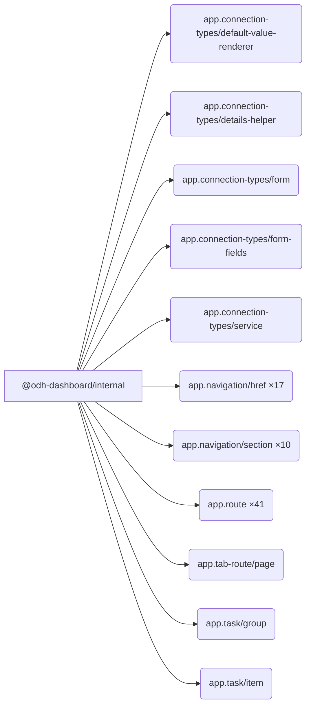

<!-- AUTO-GENERATED by @odh-dashboard/extension-map. Do not edit by hand. -->

> Generated file. Regenerate with `pnpm docs:extension-map`.

## Contents
- [Loading paths](#loading-paths)
- [Contributes](#contributes)
  - [app](#app)
    - [app.connection-types/default-value-renderer](#appconnection-typesdefault-value-renderer)
    - [app.connection-types/details-helper](#appconnection-typesdetails-helper)
    - [app.connection-types/form](#appconnection-typesform)
    - [app.connection-types/form-fields](#appconnection-typesform-fields)
    - [app.connection-types/service](#appconnection-typesservice)
    - [app.navigation/href](#appnavigationhref)
    - [app.navigation/section](#appnavigationsection)
    - [app.route](#approute)
    - [app.tab-route/page](#apptab-routepage)
    - [app.task/group](#apptaskgroup)
    - [app.task/item](#apptaskitem)
- [Diagnostics](#diagnostics)

## Loading paths

| Entry | Path | Source |
| --- | --- | --- |
| @odh-dashboard/internal#./extensions | static | `frontend/src/plugins/extensions/index.ts` |

## Contributes

### app

| Node | Contract | Registration sources |
| --- | --- | --- |
| [@odh-dashboard/internal](#loading-paths) | — | — |
| app.connection-types/default-value-renderer | [app.connection-types/default-value-renderer](../../packages/plugin-core/docs/extensions.md#appconnection-typesdefault-value-renderer) | [../src/plugins/extensions/connection-types.ts:38](../src/plugins/extensions/connection-types.ts#L38-L44) |
| app.connection-types/details-helper | [app.connection-types/details-helper](../../packages/plugin-core/docs/extensions.md#appconnection-typesdetails-helper) | [../src/plugins/extensions/connection-types.ts:31](../src/plugins/extensions/connection-types.ts#L31-L37) |
| app.connection-types/form | [app.connection-types/form](../../packages/plugin-core/docs/extensions.md#appconnection-typesform) | [../src/plugins/extensions/connection-types.ts:45](../src/plugins/extensions/connection-types.ts#L45-L50) |
| app.connection-types/form-fields | [app.connection-types/form-fields](../../packages/plugin-core/docs/extensions.md#appconnection-typesform-fields) | [../src/plugins/extensions/connection-types.ts:25](../src/plugins/extensions/connection-types.ts#L25-L30) |
| app.connection-types/service | [app.connection-types/service](../../packages/plugin-core/docs/extensions.md#appconnection-typesservice) | [../src/plugins/extensions/connection-types.ts:17](../src/plugins/extensions/connection-types.ts#L17-L24) |
| app.navigation/href ×17 | [app.navigation/href](../../packages/plugin-core/docs/extensions.md#appnavigationhref) | [../src/plugins/extensions/navigation.ts:105](../src/plugins/extensions/navigation.ts#L105-L117) [../src/plugins/extensions/navigation.ts:118](../src/plugins/extensions/navigation.ts#L118-L130) [../src/plugins/extensions/navigation.ts:131](../src/plugins/extensions/navigation.ts#L131-L143) [../src/plugins/extensions/navigation.ts:144](../src/plugins/extensions/navigation.ts#L144-L156) [../src/plugins/extensions/navigation.ts:12](../src/plugins/extensions/navigation.ts#L12-L24) [../src/plugins/extensions/navigation.ts:166](../src/plugins/extensions/navigation.ts#L166-L178) [../src/plugins/extensions/navigation.ts:180](../src/plugins/extensions/navigation.ts#L180-L189) [../src/plugins/extensions/navigation.ts:200](../src/plugins/extensions/navigation.ts#L200-L211) [../src/plugins/extensions/navigation.ts:212](../src/plugins/extensions/navigation.ts#L212-L223) [../src/plugins/extensions/navigation.ts:224](../src/plugins/extensions/navigation.ts#L224-L232) [../src/plugins/extensions/navigation.ts:252](../src/plugins/extensions/navigation.ts#L252-L263) [../src/plugins/extensions/navigation.ts:264](../src/plugins/extensions/navigation.ts#L264-L276) [../src/plugins/extensions/navigation.ts:26](../src/plugins/extensions/navigation.ts#L26-L39) [../src/plugins/extensions/navigation.ts:286](../src/plugins/extensions/navigation.ts#L286-L298) [../src/plugins/extensions/navigation.ts:299](../src/plugins/extensions/navigation.ts#L299-L311) [../src/plugins/extensions/navigation.ts:330](../src/plugins/extensions/navigation.ts#L330-L343) [../src/plugins/extensions/navigation.ts:345](../src/plugins/extensions/navigation.ts#L345-L361) |
| app.navigation/section ×10 | [app.navigation/section](../../packages/plugin-core/docs/extensions.md#appnavigationsection) | [../src/plugins/extensions/navigation.ts:87](../src/plugins/extensions/navigation.ts#L87-L95) [../src/plugins/extensions/navigation.ts:96](../src/plugins/extensions/navigation.ts#L96-L104) [../src/plugins/extensions/navigation.ts:157](../src/plugins/extensions/navigation.ts#L157-L165) [../src/plugins/extensions/navigation.ts:191](../src/plugins/extensions/navigation.ts#L191-L199) [../src/plugins/extensions/navigation.ts:234](../src/plugins/extensions/navigation.ts#L234-L242) [../src/plugins/extensions/navigation.ts:243](../src/plugins/extensions/navigation.ts#L243-L251) [../src/plugins/extensions/navigation.ts:277](../src/plugins/extensions/navigation.ts#L277-L285) [../src/plugins/extensions/navigation.ts:312](../src/plugins/extensions/navigation.ts#L312-L320) [../src/plugins/extensions/navigation.ts:321](../src/plugins/extensions/navigation.ts#L321-L329) [../src/plugins/extensions/navigation.ts:41](../src/plugins/extensions/navigation.ts#L41-L49) |
| app.route ×41 | [app.route](../../packages/plugin-core/docs/extensions.md#approute) | [../src/plugins/extensions/routes.ts:44](../src/plugins/extensions/routes.ts#L44-L53) [../src/plugins/extensions/routes.ts:54](../src/plugins/extensions/routes.ts#L54-L60) [../src/plugins/extensions/routes.ts:61](../src/plugins/extensions/routes.ts#L61-L67) [../src/plugins/extensions/routes.ts:68](../src/plugins/extensions/routes.ts#L68-L74) [../src/plugins/extensions/routes.ts:75](../src/plugins/extensions/routes.ts#L75-L81) [../src/plugins/extensions/routes.ts:82](../src/plugins/extensions/routes.ts#L82-L88) [../src/plugins/extensions/routes.ts:89](../src/plugins/extensions/routes.ts#L89-L95) [../src/plugins/extensions/routes.ts:96](../src/plugins/extensions/routes.ts#L96-L102) [../src/plugins/extensions/routes.ts:103](../src/plugins/extensions/routes.ts#L103-L112) [../src/plugins/extensions/routes.ts:113](../src/plugins/extensions/routes.ts#L113-L119) [../src/plugins/extensions/routes.ts:120](../src/plugins/extensions/routes.ts#L120-L129) [../src/plugins/extensions/routes.ts:130](../src/plugins/extensions/routes.ts#L130-L142) [../src/plugins/extensions/routes.ts:143](../src/plugins/extensions/routes.ts#L143-L149) [../src/plugins/extensions/routes.ts:150](../src/plugins/extensions/routes.ts#L150-L159) [../src/plugins/extensions/routes.ts:160](../src/plugins/extensions/routes.ts#L160-L166) [../src/plugins/extensions/routes.ts:167](../src/plugins/extensions/routes.ts#L167-L176) [../src/plugins/extensions/routes.ts:177](../src/plugins/extensions/routes.ts#L177-L183) [../src/plugins/extensions/routes.ts:184](../src/plugins/extensions/routes.ts#L184-L193) [../src/plugins/extensions/routes.ts:194](../src/plugins/extensions/routes.ts#L194-L200) [../src/plugins/extensions/routes.ts:201](../src/plugins/extensions/routes.ts#L201-L210) [../src/plugins/extensions/routes.ts:211](../src/plugins/extensions/routes.ts#L211-L217) [../src/plugins/extensions/routes.ts:218](../src/plugins/extensions/routes.ts#L218-L227) [../src/plugins/extensions/routes.ts:14](../src/plugins/extensions/routes.ts#L14-L23) [../src/plugins/extensions/routes.ts:228](../src/plugins/extensions/routes.ts#L228-L237) [../src/plugins/extensions/routes.ts:238](../src/plugins/extensions/routes.ts#L238-L250) [../src/plugins/extensions/routes.ts:251](../src/plugins/extensions/routes.ts#L251-L257) [../src/plugins/extensions/routes.ts:258](../src/plugins/extensions/routes.ts#L258-L267) [../src/plugins/extensions/routes.ts:268](../src/plugins/extensions/routes.ts#L268-L277) [../src/plugins/extensions/routes.ts:278](../src/plugins/extensions/routes.ts#L278-L290) [../src/plugins/extensions/routes.ts:291](../src/plugins/extensions/routes.ts#L291-L300) [../src/plugins/extensions/routes.ts:24](../src/plugins/extensions/routes.ts#L24-L33) [../src/plugins/extensions/routes.ts:301](../src/plugins/extensions/routes.ts#L301-L313) [../src/plugins/extensions/routes.ts:314](../src/plugins/extensions/routes.ts#L314-L323) [../src/plugins/extensions/routes.ts:324](../src/plugins/extensions/routes.ts#L324-L336) [../src/plugins/extensions/routes.ts:337](../src/plugins/extensions/routes.ts#L337-L346) [../src/plugins/extensions/routes.ts:347](../src/plugins/extensions/routes.ts#L347-L359) [../src/plugins/extensions/routes.ts:360](../src/plugins/extensions/routes.ts#L360-L369) [../src/plugins/extensions/routes.ts:370](../src/plugins/extensions/routes.ts#L370-L382) [../src/plugins/extensions/routes.ts:383](../src/plugins/extensions/routes.ts#L383-L392) [../src/plugins/extensions/routes.ts:393](../src/plugins/extensions/routes.ts#L393-L405) [../src/plugins/extensions/routes.ts:34](../src/plugins/extensions/routes.ts#L34-L43) |
| app.tab-route/page | [app.tab-route/page](../../packages/plugin-core/docs/extensions.md#apptab-routepage) | [../src/plugins/extensions/navigation.ts:50](../src/plugins/extensions/navigation.ts#L50-L61) [../src/plugins/extensions/navigation.ts:62](../src/plugins/extensions/navigation.ts#L62-L73) [../src/plugins/extensions/navigation.ts:74](../src/plugins/extensions/navigation.ts#L74-L86) |
| app.task/group | [app.task/group](../../packages/plugin-core/docs/extensions.md#apptaskgroup) | [../src/plugins/extensions/tasks.ts:11](../src/plugins/extensions/tasks.ts#L11-L22) [../src/plugins/extensions/tasks.ts:23](../src/plugins/extensions/tasks.ts#L23-L34) |
| app.task/item | [app.task/item](../../packages/plugin-core/docs/extensions.md#apptaskitem) | [../src/plugins/extensions/tasks.ts:38](../src/plugins/extensions/tasks.ts#L38-L47) [../src/plugins/extensions/tasks.ts:48](../src/plugins/extensions/tasks.ts#L48-L57) [../src/plugins/extensions/tasks.ts:61](../src/plugins/extensions/tasks.ts#L61-L73) |

- `-->` declared or type-resolved contribution
- `==>` derived relationship
- `-. "rendered in" .->` rendered in one hop
- `-. "federated" .->` federated contribution
- `--x` suppression
- `-- "patch" -->` patch

#### app.connection-types/default-value-renderer

| component | CodeRef target | Source |
| --- | --- | --- |
| packages/ui-core/src/components/connectionTypes/DefaultValueTextRenderer.tsx#[DefaultValueTextRenderer](../../packages/ui-core/src/components/connectionTypes/DefaultValueTextRenderer.tsx#L15-L22) | packages/ui-core/src/components/connectionTypes/DefaultValueTextRenderer.tsx#[DefaultValueTextRenderer](../../packages/ui-core/src/components/connectionTypes/DefaultValueTextRenderer.tsx#L15-L22) | [app.connection-types/default-value-renderer](../src/plugins/extensions/connection-types.ts#L38-L44) |

#### app.connection-types/details-helper

| component | CodeRef target | Source |
| --- | --- | --- |
| packages/ui-core/src/components/connectionTypes/ConnectionDetailsHelperText.tsx#[ConnectionDetailsHelperText](../../packages/ui-core/src/components/connectionTypes/ConnectionDetailsHelperText.tsx#L26-L73) | packages/ui-core/src/components/connectionTypes/ConnectionDetailsHelperText.tsx#[ConnectionDetailsHelperText](../../packages/ui-core/src/components/connectionTypes/ConnectionDetailsHelperText.tsx#L26-L73) | [app.connection-types/details-helper](../src/plugins/extensions/connection-types.ts#L31-L37) |

#### app.connection-types/form

| component | CodeRef target | Source |
| --- | --- | --- |
| frontend/src/concepts/connectionTypes/ConnectionTypeForm.tsx#[ConnectionTypeForm](../src/concepts/connectionTypes/ConnectionTypeForm.tsx#L126-L244) | frontend/src/concepts/connectionTypes/ConnectionTypeForm.tsx#[ConnectionTypeForm](../src/concepts/connectionTypes/ConnectionTypeForm.tsx#L126-L244) | [app.connection-types/form](../src/plugins/extensions/connection-types.ts#L45-L50) |

#### app.connection-types/form-fields

| component | CodeRef target | Source |
| --- | --- | --- |
| frontend/src/concepts/connectionTypes/fields/ConnectionTypeFormFields.tsx#[React](../src/concepts/connectionTypes/fields/ConnectionTypeFormFields.tsx#L113-L113) | frontend/src/concepts/connectionTypes/fields/ConnectionTypeFormFields.tsx#[React](../src/concepts/connectionTypes/fields/ConnectionTypeFormFields.tsx#L113-L113) | [app.connection-types/form-fields](../src/plugins/extensions/connection-types.ts#L25-L30) |

#### app.connection-types/service

| fetchConnectionTypes | fetchConnections | CodeRef target | Source |
| --- | --- | --- | --- |
| frontend/src/services/connectionTypesService.ts#[fetchConnectionTypes](../src/services/connectionTypesService.ts#L12-L29) | frontend/src/services/fetchConnections.ts#[fetchConnections](../src/services/fetchConnections.ts#L5-L14) | frontend/src/services/connectionTypesService.ts#[fetchConnectionTypes](../src/services/connectionTypesService.ts#L12-L29), frontend/src/services/fetchConnections.ts#[fetchConnections](../src/services/fetchConnections.ts#L5-L14) | [app.connection-types/service](../src/plugins/extensions/connection-types.ts#L17-L24) |

#### app.navigation/href

**Contribution:** `app.navigation/href` at `frontend/src/plugins/extensions/navigation.ts:105`

- **id**: `"pipeline-definitions"`
- **title**: `"Pipeline definitions"`
- **section**: `"pipelines"`
- **group**: —
- **iconRef**: —
- **href**: `"/develop-train/pipelines/definitions"`
- **accessReview**: —
- **path**: `"/develop-train/pipelines/definitions/*"`
- **Requires**: `SupportedArea.DS_PIPELINES` (`"ds-pipelines"`)
- **Disallows**: —
- **CodeRef target**: —
- **Source**: [app.navigation/href](../src/plugins/extensions/navigation.ts#L105-L117)

**Contribution:** `app.navigation/href` at `frontend/src/plugins/extensions/navigation.ts:118`

- **id**: `"runs"`
- **title**: `"Runs"`
- **section**: `"pipelines"`
- **group**: —
- **iconRef**: —
- **href**: `"/develop-train/pipelines/runs"`
- **accessReview**: —
- **path**: `"/develop-train/pipelines/runs/*"`
- **Requires**: `SupportedArea.DS_PIPELINES` (`"ds-pipelines"`)
- **Disallows**: —
- **CodeRef target**: —
- **Source**: [app.navigation/href](../src/plugins/extensions/navigation.ts#L118-L130)

**Contribution:** `app.navigation/href` at `frontend/src/plugins/extensions/navigation.ts:131`

- **id**: `"artifacts"`
- **title**: `"Artifacts"`
- **section**: `"pipelines"`
- **group**: —
- **iconRef**: —
- **href**: `"/develop-train/pipelines/artifacts"`
- **accessReview**: —
- **path**: `"/develop-train/pipelines/artifacts/*"`
- **Requires**: `SupportedArea.DS_PIPELINES` (`"ds-pipelines"`)
- **Disallows**: —
- **CodeRef target**: —
- **Source**: [app.navigation/href](../src/plugins/extensions/navigation.ts#L131-L143)

**Contribution:** `app.navigation/href` at `frontend/src/plugins/extensions/navigation.ts:144`

- **id**: `"executions"`
- **title**: `"Executions"`
- **section**: `"pipelines"`
- **group**: —
- **iconRef**: —
- **href**: `"/develop-train/pipelines/executions"`
- **accessReview**: —
- **path**: `"/develop-train/pipelines/executions/*"`
- **Requires**: `SupportedArea.DS_PIPELINES` (`"ds-pipelines"`)
- **Disallows**: —
- **CodeRef target**: —
- **Source**: [app.navigation/href](../src/plugins/extensions/navigation.ts#L144-L156)

**Contribution:** `app.navigation/href` at `frontend/src/plugins/extensions/navigation.ts:12`

- **id**: `"home"`
- **title**: `"Home"`
- **section**: —
- **group**: `"1_home"`
- **iconRef**: frontend/src/images/icons/HomeNavIcon.ts#[HomeNavIcon](../src/images/icons/HomeNavIcon.ts#L3-L11)
- **href**: `"/"`
- **accessReview**: —
- **path**: —
- **Requires**: `SupportedArea.HOME` (`"home"`)
- **Disallows**: —
- **CodeRef target**: frontend/src/images/icons/HomeNavIcon.ts#[HomeNavIcon](../src/images/icons/HomeNavIcon.ts#L3-L11)
- **Source**: [app.navigation/href](../src/plugins/extensions/navigation.ts#L12-L24)

**Contribution:** `app.navigation/href` at `frontend/src/plugins/extensions/navigation.ts:166`

- **id**: `"workloadMetrics"`
- **title**: `"Workload metrics"`
- **section**: `"observe-and-monitor"`
- **group**: —
- **iconRef**: —
- **href**: `"/observe-monitor/workload-metrics"`
- **accessReview**: —
- **path**: `"/observe-monitor/workload-metrics/*"`
- **Requires**: `SupportedArea.DISTRIBUTED_WORKLOADS` (`"distributed-workloads"`)
- **Disallows**: —
- **CodeRef target**: —
- **Source**: [app.navigation/href](../src/plugins/extensions/navigation.ts#L166-L178)

**Contribution:** `app.navigation/href` at `frontend/src/plugins/extensions/navigation.ts:180`

- **id**: `"learning-resources"`
- **title**: `"Learning resources"`
- **section**: —
- **group**: `"7_other"`
- **iconRef**: frontend/src/images/icons/LearningResourcesNavIcon.ts#[LearningResourcesNavIcon](../src/images/icons/LearningResourcesNavIcon.ts#L3-L11)
- **href**: `"/learning-resources"`
- **accessReview**: —
- **path**: —
- **Requires**: —
- **Disallows**: —
- **CodeRef target**: frontend/src/images/icons/LearningResourcesNavIcon.ts#[LearningResourcesNavIcon](../src/images/icons/LearningResourcesNavIcon.ts#L3-L11)
- **Source**: [app.navigation/href](../src/plugins/extensions/navigation.ts#L180-L189)

**Contribution:** `app.navigation/href` at `frontend/src/plugins/extensions/navigation.ts:200`

- **id**: `"apps-installed"`
- **title**: `"Enabled"`
- **section**: `"applications"`
- **group**: —
- **iconRef**: —
- **href**: `"/applications/enabled"`
- **accessReview**: —
- **path**: —
- **Requires**: `SupportedArea.HOME` (`"home"`)
- **Disallows**: —
- **CodeRef target**: —
- **Source**: [app.navigation/href](../src/plugins/extensions/navigation.ts#L200-L211)

**Contribution:** `app.navigation/href` at `frontend/src/plugins/extensions/navigation.ts:212`

- **id**: `"apps-installed"`
- **title**: `"Enabled"`
- **section**: `"applications"`
- **group**: —
- **iconRef**: —
- **href**: `"/"`
- **accessReview**: —
- **path**: —
- **Requires**: —
- **Disallows**: `SupportedArea.HOME` (`"home"`)
- **CodeRef target**: —
- **Source**: [app.navigation/href](../src/plugins/extensions/navigation.ts#L212-L223)

**Contribution:** `app.navigation/href` at `frontend/src/plugins/extensions/navigation.ts:224`

- **id**: `"apps-explore"`
- **title**: `"Explore"`
- **section**: `"applications"`
- **group**: —
- **iconRef**: —
- **href**: `"/applications/explore"`
- **accessReview**: —
- **path**: —
- **Requires**: —
- **Disallows**: —
- **CodeRef target**: —
- **Source**: [app.navigation/href](../src/plugins/extensions/navigation.ts#L224-L232)

**Contribution:** `app.navigation/href` at `frontend/src/plugins/extensions/navigation.ts:252`

- **id**: `"settings-general-cluster-settings"`
- **title**: `"General settings"`
- **section**: `"cluster-settings"`
- **group**: —
- **iconRef**: —
- **href**: `"/settings/cluster/general"`
- **accessReview**: —
- **path**: —
- **Requires**: `SupportedArea.CLUSTER_SETTINGS` (`"cluster-settings"`), `ADMIN_USER` (`"ADMIN_USER"`)
- **Disallows**: —
- **CodeRef target**: —
- **Source**: [app.navigation/href](../src/plugins/extensions/navigation.ts#L252-L263)

**Contribution:** `app.navigation/href` at `frontend/src/plugins/extensions/navigation.ts:264`

- **id**: `"settings-storage-classes"`
- **title**: `"Storage classes"`
- **section**: `"cluster-settings"`
- **group**: —
- **iconRef**: —
- **href**: `"/settings/cluster/storage-classes"`
- **accessReview**: —
- **path**: `"/settings/cluster/storage-classes/*"`
- **Requires**: `SupportedArea.STORAGE_CLASSES` (`"storage-classes"`), `ADMIN_USER` (`"ADMIN_USER"`)
- **Disallows**: —
- **CodeRef target**: —
- **Source**: [app.navigation/href](../src/plugins/extensions/navigation.ts#L264-L276)

**Contribution:** `app.navigation/href` at `frontend/src/plugins/extensions/navigation.ts:26`

- **id**: `"projects"`
- **title**: `"Projects"`
- **section**: —
- **group**: `"2_projects"`
- **iconRef**: frontend/src/images/icons/ProjectsNavIcon.ts#[ProjectsNavIcon](../src/images/icons/ProjectsNavIcon.ts#L3-L11)
- **href**: `"/projects"`
- **accessReview**: —
- **path**: `"/projects/*"`
- **Requires**: `SupportedArea.DS_PROJECTS_VIEW` (`"ds-projects"`)
- **Disallows**: —
- **CodeRef target**: frontend/src/images/icons/ProjectsNavIcon.ts#[ProjectsNavIcon](../src/images/icons/ProjectsNavIcon.ts#L3-L11)
- **Source**: [app.navigation/href](../src/plugins/extensions/navigation.ts#L26-L39)

**Contribution:** `app.navigation/href` at `frontend/src/plugins/extensions/navigation.ts:286`

- **id**: `"settings-workbench-images"`
- **title**: `"Workbench images"`
- **section**: `"settings-environment-setup"`
- **group**: —
- **iconRef**: —
- **href**: `"/settings/environment-setup/workbench-images"`
- **accessReview**: —
- **path**: `"/settings/environment-setup/workbench-images/*"`
- **Requires**: `SupportedArea.BYON` (`"bring-your-own-notebook"`), `ADMIN_USER` (`"ADMIN_USER"`)
- **Disallows**: —
- **CodeRef target**: —
- **Source**: [app.navigation/href](../src/plugins/extensions/navigation.ts#L286-L298)

**Contribution:** `app.navigation/href` at `frontend/src/plugins/extensions/navigation.ts:299`

- **id**: `"settings-connection-types"`
- **title**: `"Connection types"`
- **section**: `"settings-environment-setup"`
- **group**: —
- **iconRef**: —
- **href**: `"/settings/environment-setup/connection-types"`
- **accessReview**: —
- **path**: `"/settings/environment-setup/connection-types/*"`
- **Requires**: `SupportedArea.ADMIN_CONNECTION_TYPES` (`"connection-types"`), `ADMIN_USER` (`"ADMIN_USER"`)
- **Disallows**: —
- **CodeRef target**: —
- **Source**: [app.navigation/href](../src/plugins/extensions/navigation.ts#L299-L311)

**Contribution:** `app.navigation/href` at `frontend/src/plugins/extensions/navigation.ts:330`

- **id**: `"settings-model-registry"`
- **title**: `"Model registry settings"`
- **section**: `"settings-model-resources-and-operations"`
- **group**: `"3_model-resources"`
- **iconRef**: —
- **href**: `"/settings/model-resources-operations/model-registry"`
- **accessReview**: —
- **path**: `"/settings/model-resources-operations/model-registry/*"`
- **Requires**: `SupportedArea.MODEL_REGISTRY` (`"model-registry"`), `ADMIN_USER` (`"ADMIN_USER"`)
- **Disallows**: —
- **CodeRef target**: —
- **Source**: [app.navigation/href](../src/plugins/extensions/navigation.ts#L330-L343)

**Contribution:** `app.navigation/href` at `frontend/src/plugins/extensions/navigation.ts:345`

- **id**: `"settings-group-settings"`
- **title**: `"User management"`
- **section**: `"settings"`
- **group**: —
- **iconRef**: —
- **href**: `"/settings/user-management"`
- **accessReview**: group: `"services.platform.opendatahub.io"`, resource: `"auths"`, verb: `"update"`
- **path**: —
- **Requires**: `SupportedArea.USER_MANAGEMENT` (`"user-management"`)
- **Disallows**: —
- **CodeRef target**: —
- **Source**: [app.navigation/href](../src/plugins/extensions/navigation.ts#L345-L361)

#### app.navigation/section

| id | title | section | group | iconRef | CodeRef target | Source |
| --- | --- | --- | --- | --- | --- | --- |
| `"develop-and-train"` | `"Develop & train"` | — | `"5_develop_and_train"` | frontend/src/images/icons/DevelopAndTrainNavIcon.ts#[DevelopAndTrainNavIcon](../src/images/icons/DevelopAndTrainNavIcon.ts#L3-L11) | frontend/src/images/icons/DevelopAndTrainNavIcon.ts#[DevelopAndTrainNavIcon](../src/images/icons/DevelopAndTrainNavIcon.ts#L3-L11) | [app.navigation/section](../src/plugins/extensions/navigation.ts#L87-L95) |
| `"pipelines"` | `"Pipelines"` | `"develop-and-train"` | `"2_pipelines"` | — | — | [app.navigation/section](../src/plugins/extensions/navigation.ts#L96-L104) |
| `"observe-and-monitor"` | `"Observe & monitor"` | — | `"6_observe_and_monitor"` | frontend/src/images/icons/ObserveAndMonitorNavIcon.ts#[ObserveAndMonitorNavIcon](../src/images/icons/ObserveAndMonitorNavIcon.ts#L3-L11) | frontend/src/images/icons/ObserveAndMonitorNavIcon.ts#[ObserveAndMonitorNavIcon](../src/images/icons/ObserveAndMonitorNavIcon.ts#L3-L11) | [app.navigation/section](../src/plugins/extensions/navigation.ts#L157-L165) |
| `"applications"` | `"Applications"` | — | `"8_other"` | frontend/src/images/icons/ApplicationsNavIcon.ts#[ApplicationsNavIcon](../src/images/icons/ApplicationsNavIcon.ts#L3-L11) | frontend/src/images/icons/ApplicationsNavIcon.ts#[ApplicationsNavIcon](../src/images/icons/ApplicationsNavIcon.ts#L3-L11) | [app.navigation/section](../src/plugins/extensions/navigation.ts#L191-L199) |
| `"settings"` | `"Settings"` | — | `"8_settings"` | frontend/src/images/icons/SettingsNavIcon.ts#[SettingsNavIcon](../src/images/icons/SettingsNavIcon.ts#L3-L11) | frontend/src/images/icons/SettingsNavIcon.ts#[SettingsNavIcon](../src/images/icons/SettingsNavIcon.ts#L3-L11) | [app.navigation/section](../src/plugins/extensions/navigation.ts#L234-L242) |
| `"cluster-settings"` | `"Cluster settings"` | `"settings"` | `"1_cluster_settings"` | — | — | [app.navigation/section](../src/plugins/extensions/navigation.ts#L243-L251) |
| `"settings-environment-setup"` | `"Environment setup"` | `"settings"` | `"2_environment_setup"` | — | — | [app.navigation/section](../src/plugins/extensions/navigation.ts#L277-L285) |
| `"settings-model-resources-and-operations"` | `"Model resources and operations"` | `"settings"` | `"3_model_resources_and_operations"` | — | — | [app.navigation/section](../src/plugins/extensions/navigation.ts#L312-L320) |
| `"settings-mcp-resources"` | `"MCP resources"` | `"settings"` | `"4_mcp_resources"` | — | — | [app.navigation/section](../src/plugins/extensions/navigation.ts#L321-L329) |
| `"ai-hub"` | `"AI hub"` | — | `"3_ai_hub"` | frontend/src/images/icons/AiHubNavIcon.ts#[AiHubNavIcon](../src/images/icons/AiHubNavIcon.ts#L3-L11) | frontend/src/images/icons/AiHubNavIcon.ts#[AiHubNavIcon](../src/images/icons/AiHubNavIcon.ts#L3-L11) | [app.navigation/section](../src/plugins/extensions/navigation.ts#L41-L49) |

#### app.route

| component | path | Requires | Disallows | CodeRef target | Source |
| --- | --- | --- | --- | --- | --- |
| frontend/src/pages/enabledApplications/EnabledApplications.tsx#[EnabledApplications](../src/pages/enabledApplications/EnabledApplications.tsx#L57-L91) | `"/"` | — | `SupportedArea.HOME` (`"home"`) | frontend/src/pages/enabledApplications/EnabledApplications.tsx#[EnabledApplications](../src/pages/enabledApplications/EnabledApplications.tsx#L57-L91) | [app.route](../src/plugins/extensions/routes.ts#L44-L53) |
| frontend/src/pages/external/ExternalRoutes.tsx#[ExternalRoutes](../src/pages/external/ExternalRoutes.tsx#L11-L18) | `"/external/*"` | — | — | frontend/src/pages/external/ExternalRoutes.tsx#[ExternalRoutes](../src/pages/external/ExternalRoutes.tsx#L11-L18) | [app.route](../src/plugins/extensions/routes.ts#L54-L60) |
| frontend/src/pages/exploreApplication/ExploreApplications.tsx#[ExploreApplications](../src/pages/exploreApplication/ExploreApplications.tsx#L103-L158) | `"/applications/explore"` | — | — | frontend/src/pages/exploreApplication/ExploreApplications.tsx#[ExploreApplications](../src/pages/exploreApplication/ExploreApplications.tsx#L103-L158) | [app.route](../src/plugins/extensions/routes.ts#L61-L67) |
| [not resolved](#diagnostics) | `"/explore"` | — | — | — | [app.route](../src/plugins/extensions/routes.ts#L68-L74) |
| frontend/src/pages/learningCenter/LearningCenter.tsx#[LearningCenter](../src/pages/learningCenter/LearningCenter.tsx#L36-L173) | `"/learning-resources"` | — | — | frontend/src/pages/learningCenter/LearningCenter.tsx#[LearningCenter](../src/pages/learningCenter/LearningCenter.tsx#L36-L173) | [app.route](../src/plugins/extensions/routes.ts#L75-L81) |
| [not resolved](#diagnostics) | `"/resources"` | — | — | — | [app.route](../src/plugins/extensions/routes.ts#L82-L88) |
| frontend/src/pages/projects/ProjectViewRoutes.tsx#[ProjectViewRoutes](../src/pages/projects/ProjectViewRoutes.tsx#L20-L62) | `"/projects/*"` | — | — | frontend/src/pages/projects/ProjectViewRoutes.tsx#[ProjectViewRoutes](../src/pages/projects/ProjectViewRoutes.tsx#L20-L62) | [app.route](../src/plugins/extensions/routes.ts#L89-L95) |
| frontend/src/pages/notebookController/NotebookController.tsx#[NotebookController](../src/pages/notebookController/NotebookController.tsx#L10-L24) | `"/notebook-controller/*"` | — | — | frontend/src/pages/notebookController/NotebookController.tsx#[NotebookController](../src/pages/notebookController/NotebookController.tsx#L10-L24) | [app.route](../src/plugins/extensions/routes.ts#L96-L102) |
| [not resolved](#diagnostics) | `"/notebookController/*"` | — | — | — | [app.route](../src/plugins/extensions/routes.ts#L103-L112) |
| frontend/src/pages/notebookController/NotebookLogoutRedirect.tsx#[NotebookLogoutRedirect](../src/pages/notebookController/NotebookLogoutRedirect.tsx#L9-L63) | `"/notebook/:namespace/:notebookName/logout"` | — | — | frontend/src/pages/notebookController/NotebookLogoutRedirect.tsx#[NotebookLogoutRedirect](../src/pages/notebookController/NotebookLogoutRedirect.tsx#L9-L63) | [app.route](../src/plugins/extensions/routes.ts#L113-L119) |
| frontend/src/pages/modelServing/ModelServingRoutes.tsx#[ModelServingRoutes](../src/pages/modelServing/ModelServingRoutes.tsx#L13-L44) | `"/ai-hub/models/deployments/*"` | — | `SupportedArea.PLUGIN_MODEL_SERVING` (`"plugin-model-serving"`) | frontend/src/pages/modelServing/ModelServingRoutes.tsx#[ModelServingRoutes](../src/pages/modelServing/ModelServingRoutes.tsx#L13-L44) | [app.route](../src/plugins/extensions/routes.ts#L120-L129) |
| [not resolved](#diagnostics) | `"/modelServing/*"` | — | `SupportedArea.PLUGIN_MODEL_SERVING` (`"plugin-model-serving"`) | — | [app.route](../src/plugins/extensions/routes.ts#L130-L142) |
| frontend/src/pages/pipelines/GlobalPipelinesRoutes.tsx#[GlobalPipelinesRoutes](../src/pages/pipelines/GlobalPipelinesRoutes.tsx#L17-L42) | `"/develop-train/pipelines/definitions/*"` | — | — | frontend/src/pages/pipelines/GlobalPipelinesRoutes.tsx#[GlobalPipelinesRoutes](../src/pages/pipelines/GlobalPipelinesRoutes.tsx#L17-L42) | [app.route](../src/plugins/extensions/routes.ts#L143-L149) |
| [not resolved](#diagnostics) | `"/pipelines/*"` | — | — | — | [app.route](../src/plugins/extensions/routes.ts#L150-L159) |
| frontend/src/pages/pipelines/GlobalPipelineRunsRoutes.tsx#[GlobalPipelineRunsRoutes](../src/pages/pipelines/GlobalPipelineRunsRoutes.tsx#L34-L118) | `"/develop-train/pipelines/runs/*"` | — | — | frontend/src/pages/pipelines/GlobalPipelineRunsRoutes.tsx#[GlobalPipelineRunsRoutes](../src/pages/pipelines/GlobalPipelineRunsRoutes.tsx#L34-L118) | [app.route](../src/plugins/extensions/routes.ts#L160-L166) |
| [not resolved](#diagnostics) | `"/pipelineRuns/*"` | — | — | — | [app.route](../src/plugins/extensions/routes.ts#L167-L176) |
| frontend/src/pages/pipelines/GlobalPipelineExperimentsRoutes.tsx#[GlobalPipelineExperimentsRoutes](../src/pages/pipelines/GlobalPipelineExperimentsRoutes.tsx#L11-L15) | `"/develop-train/experiments/*"` | — | — | frontend/src/pages/pipelines/GlobalPipelineExperimentsRoutes.tsx#[GlobalPipelineExperimentsRoutes](../src/pages/pipelines/GlobalPipelineExperimentsRoutes.tsx#L11-L15) | [app.route](../src/plugins/extensions/routes.ts#L177-L183) |
| [not resolved](#diagnostics) | `"/experiments/*"` | — | — | — | [app.route](../src/plugins/extensions/routes.ts#L184-L193) |
| frontend/src/pages/pipelines/GlobalArtifactsRoutes.tsx#[GlobalArtifactsRoutes](../src/pages/pipelines/GlobalArtifactsRoutes.tsx#L17-L48) | `"/develop-train/pipelines/artifacts/*"` | — | — | frontend/src/pages/pipelines/GlobalArtifactsRoutes.tsx#[GlobalArtifactsRoutes](../src/pages/pipelines/GlobalArtifactsRoutes.tsx#L17-L48) | [app.route](../src/plugins/extensions/routes.ts#L194-L200) |
| [not resolved](#diagnostics) | `"/artifacts/*"` | — | — | — | [app.route](../src/plugins/extensions/routes.ts#L201-L210) |
| frontend/src/pages/pipelines/GlobalPipelineExecutionsRoutes.tsx#[GlobalPipelineExecutionsRoutes](../src/pages/pipelines/GlobalPipelineExecutionsRoutes.tsx#L16-L47) | `"/develop-train/pipelines/executions/*"` | — | — | frontend/src/pages/pipelines/GlobalPipelineExecutionsRoutes.tsx#[GlobalPipelineExecutionsRoutes](../src/pages/pipelines/GlobalPipelineExecutionsRoutes.tsx#L16-L47) | [app.route](../src/plugins/extensions/routes.ts#L211-L217) |
| [not resolved](#diagnostics) | `"/executions/*"` | — | — | — | [app.route](../src/plugins/extensions/routes.ts#L218-L227) |
| frontend/src/pages/home/Home.tsx#[Home](../src/pages/home/Home.tsx#L12-L44) | `"/"` | `SupportedArea.HOME` (`"home"`) | — | frontend/src/pages/home/Home.tsx#[Home](../src/pages/home/Home.tsx#L12-L44) | [app.route](../src/plugins/extensions/routes.ts#L14-L23) |
| frontend/src/pages/pipelines/GlobalModelCustomizationRoutes.tsx#[GlobalModelCustomizationRoutes](../src/pages/pipelines/GlobalModelCustomizationRoutes.tsx#L9-L23) | `"/ai-hub/model-customization/*"` | `SupportedArea.FINE_TUNING` (`"fine-tuning"`) | — | frontend/src/pages/pipelines/GlobalModelCustomizationRoutes.tsx#[GlobalModelCustomizationRoutes](../src/pages/pipelines/GlobalModelCustomizationRoutes.tsx#L9-L23) | [app.route](../src/plugins/extensions/routes.ts#L228-L237) |
| [not resolved](#diagnostics) | `"/modelCustomization/*"` | `SupportedArea.FINE_TUNING` (`"fine-tuning"`) | — | — | [app.route](../src/plugins/extensions/routes.ts#L238-L250) |
| frontend/src/pages/distributedWorkloads/GlobalDistributedWorkloadsRoutes.tsx#[GlobalDistributedWorkloadsRoutes](../src/pages/distributedWorkloads/GlobalDistributedWorkloadsRoutes.tsx#L10-L39) | `"/observe-monitor/workload-metrics/*"` | — | — | frontend/src/pages/distributedWorkloads/GlobalDistributedWorkloadsRoutes.tsx#[GlobalDistributedWorkloadsRoutes](../src/pages/distributedWorkloads/GlobalDistributedWorkloadsRoutes.tsx#L10-L39) | [app.route](../src/plugins/extensions/routes.ts#L251-L257) |
| [not resolved](#diagnostics) | `"/distributedWorkloads/*"` | — | — | — | [app.route](../src/plugins/extensions/routes.ts#L258-L267) |
| frontend/src/pages/BYONImages/BYONImageRoutes.tsx#[BYONImageRoutes](../src/pages/BYONImages/BYONImageRoutes.tsx#L8-L23) | `"/settings/environment-setup/workbench-images/*"` | `ADMIN_USER` (`"ADMIN_USER"`) | — | frontend/src/pages/BYONImages/BYONImageRoutes.tsx#[BYONImageRoutes](../src/pages/BYONImages/BYONImageRoutes.tsx#L8-L23) | [app.route](../src/plugins/extensions/routes.ts#L268-L277) |
| [not resolved](#diagnostics) | `"/workbenchImages/*"` | `ADMIN_USER` (`"ADMIN_USER"`) | — | — | [app.route](../src/plugins/extensions/routes.ts#L278-L290) |
| frontend/src/pages/clusterSettings/ClusterSettings.tsx#[ClusterSettings](../src/pages/clusterSettings/ClusterSettings.tsx#L38-L262) | `"/settings/cluster/general"` | `ADMIN_USER` (`"ADMIN_USER"`) | — | frontend/src/pages/clusterSettings/ClusterSettings.tsx#[ClusterSettings](../src/pages/clusterSettings/ClusterSettings.tsx#L38-L262) | [app.route](../src/plugins/extensions/routes.ts#L291-L300) |
| frontend/src/pages/enabledApplications/EnabledApplications.tsx#[EnabledApplications](../src/pages/enabledApplications/EnabledApplications.tsx#L57-L91) | `"/applications/enabled"` | `SupportedArea.HOME` (`"home"`) | — | frontend/src/pages/enabledApplications/EnabledApplications.tsx#[EnabledApplications](../src/pages/enabledApplications/EnabledApplications.tsx#L57-L91) | [app.route](../src/plugins/extensions/routes.ts#L24-L33) |
| [not resolved](#diagnostics) | `"/clusterSettings"` | `ADMIN_USER` (`"ADMIN_USER"`) | — | — | [app.route](../src/plugins/extensions/routes.ts#L301-L313) |
| frontend/src/pages/connectionTypes/ConnectionTypeRoutes.tsx#[ConnectionTypeRoutes](../src/pages/connectionTypes/ConnectionTypeRoutes.tsx#L11-L19) | `"/settings/environment-setup/connection-types/*"` | `ADMIN_USER` (`"ADMIN_USER"`) | — | frontend/src/pages/connectionTypes/ConnectionTypeRoutes.tsx#[ConnectionTypeRoutes](../src/pages/connectionTypes/ConnectionTypeRoutes.tsx#L11-L19) | [app.route](../src/plugins/extensions/routes.ts#L314-L323) |
| [not resolved](#diagnostics) | `"/connectionTypes/*"` | `ADMIN_USER` (`"ADMIN_USER"`) | — | — | [app.route](../src/plugins/extensions/routes.ts#L324-L336) |
| frontend/src/pages/storageClasses/StorageClassesPage.tsx#[StorageClassesPage](../src/pages/storageClasses/StorageClassesPage.tsx#L75-L83) | `"/settings/cluster/storage-classes/*"` | `ADMIN_USER` (`"ADMIN_USER"`) | — | frontend/src/pages/storageClasses/StorageClassesPage.tsx#[StorageClassesPage](../src/pages/storageClasses/StorageClassesPage.tsx#L75-L83) | [app.route](../src/plugins/extensions/routes.ts#L337-L346) |
| [not resolved](#diagnostics) | `"/storageClasses/*"` | `ADMIN_USER` (`"ADMIN_USER"`) | — | — | [app.route](../src/plugins/extensions/routes.ts#L347-L359) |
| frontend/src/pages/modelRegistrySettings/ModelRegistrySettingsRoutes.tsx#[ModelRegistrySettingsRoutes](../src/pages/modelRegistrySettings/ModelRegistrySettingsRoutes.tsx#L6-L12) | `"/settings/model-resources-operations/model-registry/*"` | `SupportedArea.MODEL_REGISTRY` (`"model-registry"`), `ADMIN_USER` (`"ADMIN_USER"`) | — | frontend/src/pages/modelRegistrySettings/ModelRegistrySettingsRoutes.tsx#[ModelRegistrySettingsRoutes](../src/pages/modelRegistrySettings/ModelRegistrySettingsRoutes.tsx#L6-L12) | [app.route](../src/plugins/extensions/routes.ts#L360-L369) |
| [not resolved](#diagnostics) | `"/modelRegistrySettings/*"` | `SupportedArea.MODEL_REGISTRY` (`"model-registry"`), `ADMIN_USER` (`"ADMIN_USER"`) | — | — | [app.route](../src/plugins/extensions/routes.ts#L370-L382) |
| frontend/src/pages/groupSettings/GroupSettings.tsx#[GroupSettings](../src/pages/groupSettings/GroupSettings.tsx#L13-L94) | `"/settings/user-management"` | `ADMIN_USER` (`"ADMIN_USER"`) | — | frontend/src/pages/groupSettings/GroupSettings.tsx#[GroupSettings](../src/pages/groupSettings/GroupSettings.tsx#L13-L94) | [app.route](../src/plugins/extensions/routes.ts#L383-L392) |
| [not resolved](#diagnostics) | `"/groupSettings"` | `ADMIN_USER` (`"ADMIN_USER"`) | — | — | [app.route](../src/plugins/extensions/routes.ts#L393-L405) |
| [not resolved](#diagnostics) | `"/enabled"` | `SupportedArea.HOME` (`"home"`) | — | — | [app.route](../src/plugins/extensions/routes.ts#L34-L43) |

**Not resolved**

| Location | Reason | Link |
| --- | --- | --- |
| properties.component | expression is not a statically resolvable value | [diagnostics](#diagnostics) |
| properties.component | expression is not a statically resolvable value | [diagnostics](#diagnostics) |
| properties.component | expression is not a statically resolvable value | [diagnostics](#diagnostics) |
| properties.component | expression is not a statically resolvable value | [diagnostics](#diagnostics) |
| properties.component | expression is not a statically resolvable value | [diagnostics](#diagnostics) |
| properties.component | expression is not a statically resolvable value | [diagnostics](#diagnostics) |
| properties.component | expression is not a statically resolvable value | [diagnostics](#diagnostics) |
| properties.component | expression is not a statically resolvable value | [diagnostics](#diagnostics) |
| properties.component | expression is not a statically resolvable value | [diagnostics](#diagnostics) |
| properties.component | expression is not a statically resolvable value | [diagnostics](#diagnostics) |
| properties.component | expression is not a statically resolvable value | [diagnostics](#diagnostics) |
| properties.component | expression is not a statically resolvable value | [diagnostics](#diagnostics) |
| properties.component | expression is not a statically resolvable value | [diagnostics](#diagnostics) |
| properties.component | expression is not a statically resolvable value | [diagnostics](#diagnostics) |
| properties.component | expression is not a statically resolvable value | [diagnostics](#diagnostics) |
| properties.component | expression is not a statically resolvable value | [diagnostics](#diagnostics) |
| properties.component | expression is not a statically resolvable value | [diagnostics](#diagnostics) |
| properties.component | expression is not a statically resolvable value | [diagnostics](#diagnostics) |

#### app.tab-route/page

**Contribution:** `app.tab-route/page` at `frontend/src/plugins/extensions/navigation.ts:50`

- **id**: `"models-tab-page"`
- **title**: `"Models"`
- **section**: `"ai-hub"`
- **group**: `"2_models"`
- **label**: —
- **href**: `"/ai-hub/models"`
- **path**: `"/ai-hub/models/*"`
- **objectType**: `"registered-models"`
- **Source**: [app.tab-route/page](../src/plugins/extensions/navigation.ts#L50-L61)

**Contribution:** `app.tab-route/page` at `frontend/src/plugins/extensions/navigation.ts:62`

- **id**: `"mcp-servers-tab-page"`
- **title**: `"MCP servers"`
- **section**: `"ai-hub"`
- **group**: `"3_mcp_servers"`
- **label**: —
- **href**: `"/ai-hub/mcp-servers"`
- **path**: `"/ai-hub/mcp-servers/*"`
- **objectType**: `"mcp-catalog"`
- **Source**: [app.tab-route/page](../src/plugins/extensions/navigation.ts#L62-L73)

**Contribution:** `app.tab-route/page` at `frontend/src/plugins/extensions/navigation.ts:74`

- **id**: `"agents-tab-page"`
- **title**: `"Agents"`
- **section**: `"ai-hub"`
- **group**: `"1_agents"`
- **label**: `"Dev Preview"`
- **href**: `"/ai-hub/agents"`
- **path**: `"/ai-hub/agents/*"`
- **objectType**: `"agent-ops"`
- **Source**: [app.tab-route/page](../src/plugins/extensions/navigation.ts#L74-L86)

#### app.task/group

**Contribution:** `app.task/group` at `frontend/src/plugins/extensions/tasks.ts:11`

- **id**: `"ai-hub"`
- **title**: `"AI hub"`
- **description**: `"Browse, manage, and deploy models and MCP servers."`
- **label**: `"Manage models and MCP servers"`
- **icon**: frontend/src/images/icons/AiHubNavIcon.ts#[AiHubNavIcon](../src/images/icons/AiHubNavIcon.ts#L3-L11)
- **type**: `"serving"`
- **order**: `"1_ai_hub"`
- **CodeRef target**: frontend/src/images/icons/AiHubNavIcon.ts#[AiHubNavIcon](../src/images/icons/AiHubNavIcon.ts#L3-L11)
- **Source**: [app.task/group](../src/plugins/extensions/tasks.ts#L11-L22)

**Contribution:** `app.task/group` at `frontend/src/plugins/extensions/tasks.ts:23`

- **id**: `"develop-and-train"`
- **title**: `"Develop & train"`
- **description**: `"Iterate in experiments and track results across runs."`
- **label**: `"Develop & train models"`
- **icon**: frontend/src/images/icons/DevelopAndTrainNavIcon.ts#[DevelopAndTrainNavIcon](../src/images/icons/DevelopAndTrainNavIcon.ts#L3-L11)
- **type**: `"training"`
- **order**: `"3_develop_and_train"`
- **CodeRef target**: frontend/src/images/icons/DevelopAndTrainNavIcon.ts#[DevelopAndTrainNavIcon](../src/images/icons/DevelopAndTrainNavIcon.ts#L3-L11)
- **Source**: [app.task/group](../src/plugins/extensions/tasks.ts#L23-L34)

#### app.task/item

| id | group | title | destination | order | Requires | Source |
| --- | --- | --- | --- | --- | --- | --- |
| `"ai-hub-models"` | `"ai-hub"` | `"Find, register, and deploy models"` | tabRoutePageId: `"models-tab-page"` | `"1_models"` | — | [app.task/item](../src/plugins/extensions/tasks.ts#L38-L47) |
| `"ai-hub-mcp-servers"` | `"ai-hub"` | `"Deploy and discover MCP servers"` | tabRoutePageId: `"mcp-servers-tab-page"` | `"2_mcp_servers"` | — | [app.task/item](../src/plugins/extensions/tasks.ts#L48-L57) |
| `"develop-workbenches"` | `"develop-and-train"` | `"Code in workbenches"` | href: `"/projects"` | `"4_workbenches"` | `SupportedArea.WORKBENCHES` (`"workbenches"`) | [app.task/item](../src/plugins/extensions/tasks.ts#L61-L73) |

## Diagnostics

| Code | Message | Link |
| --- | --- | --- |
| `unresolved-value` | extension property 'component' contains a value that could not be resolved | [component](../src/plugins/extensions/routes.ts#L41-L41) |
| `unresolved-value` | extension property 'component' contains a value that could not be resolved | [component](../src/plugins/extensions/routes.ts#L72-L72) |
| `unresolved-value` | extension property 'component' contains a value that could not be resolved | [component](../src/plugins/extensions/routes.ts#L86-L86) |
| `unresolved-value` | extension property 'component' contains a value that could not be resolved | [component](../src/plugins/extensions/routes.ts#L107-L110) |
| `unresolved-value` | extension property 'component' contains a value that could not be resolved | [component](../src/plugins/extensions/routes.ts#L134-L137) |
| `unresolved-value` | extension property 'component' contains a value that could not be resolved | [component](../src/plugins/extensions/routes.ts#L154-L157) |
| `unresolved-value` | extension property 'component' contains a value that could not be resolved | [component](../src/plugins/extensions/routes.ts#L171-L174) |
| `unresolved-value` | extension property 'component' contains a value that could not be resolved | [component](../src/plugins/extensions/routes.ts#L188-L191) |
| `unresolved-value` | extension property 'component' contains a value that could not be resolved | [component](../src/plugins/extensions/routes.ts#L205-L208) |
| `unresolved-value` | extension property 'component' contains a value that could not be resolved | [component](../src/plugins/extensions/routes.ts#L222-L225) |
| `unresolved-value` | extension property 'component' contains a value that could not be resolved | [component](../src/plugins/extensions/routes.ts#L245-L248) |
| `unresolved-value` | extension property 'component' contains a value that could not be resolved | [component](../src/plugins/extensions/routes.ts#L262-L265) |
| `unresolved-value` | extension property 'component' contains a value that could not be resolved | [component](../src/plugins/extensions/routes.ts#L285-L288) |
| `unresolved-value` | extension property 'component' contains a value that could not be resolved | [component](../src/plugins/extensions/routes.ts#L308-L311) |
| `unresolved-value` | extension property 'component' contains a value that could not be resolved | [component](../src/plugins/extensions/routes.ts#L331-L334) |
| `unresolved-value` | extension property 'component' contains a value that could not be resolved | [component](../src/plugins/extensions/routes.ts#L354-L357) |
| `unresolved-value` | extension property 'component' contains a value that could not be resolved | [component](../src/plugins/extensions/routes.ts#L377-L380) |
| `unresolved-value` | extension property 'component' contains a value that could not be resolved | [component](../src/plugins/extensions/routes.ts#L400-L403) |
