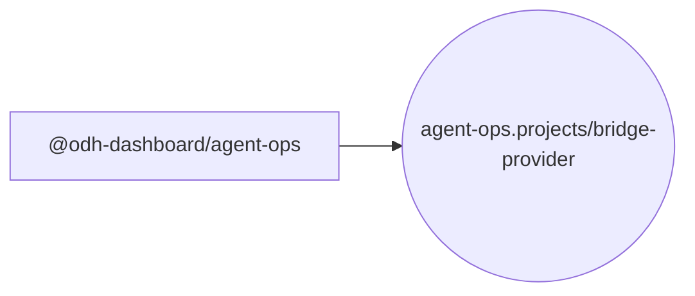
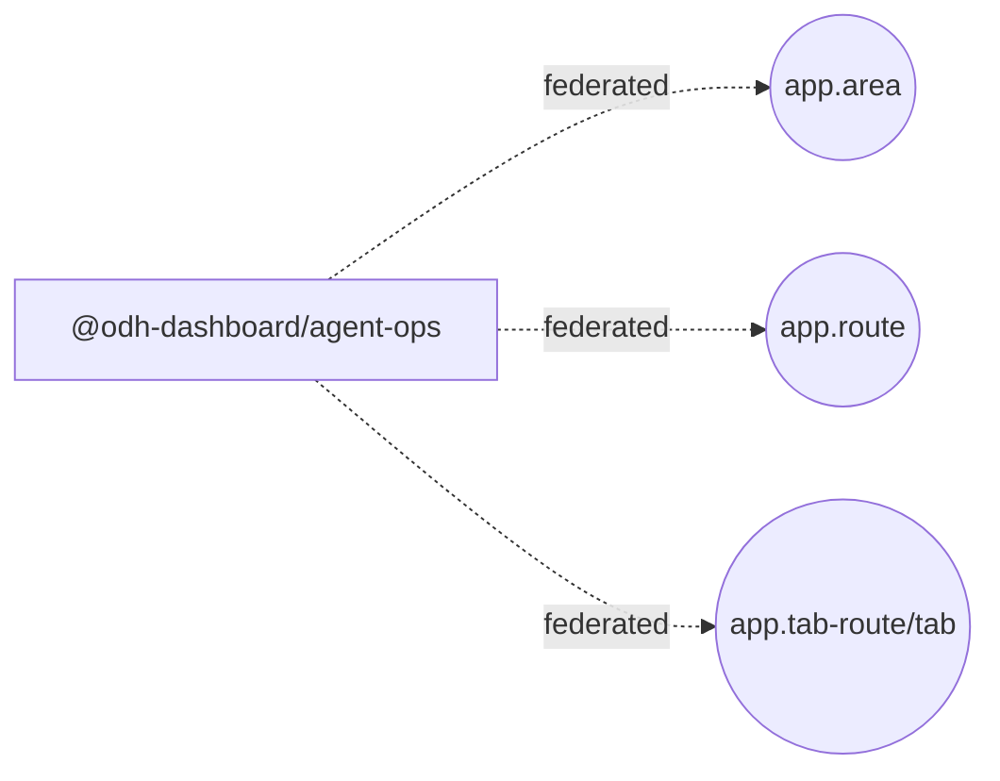

<!-- AUTO-GENERATED by @odh-dashboard/extension-map. Do not edit by hand. -->

> Generated file. Regenerate with `pnpm docs:extension-map`.

## Loading paths

| Entry | Path | Source |
| --- | --- | --- |
| @odh-dashboard/agent-ops#./extensions | static | `packages/agent-ops/extensions.ts` |
| @odh-dashboard/agent-ops#mf:./extensions | federated | `packages/agent-ops/frontend/src/odh/extensions.ts` |

## Defines

### agent-ops.projects/bridge-provider

Host-side bridge: reads ProjectsContext in the host bundle and passes filtered
Active project data into the federated agent-ops UI.

| Property | Type | Required | Description |
| --- | --- | --- | --- |
| `component` | `ComponentCodeRef<ProjectsBridgeProviderProps>` | Yes |  |

**Implemented by:** [@odh-dashboard/agent-ops](extensions.md#agent-opsprojectsbridge-provider)

## Contributes

### agent-ops

| Node | Link |
| --- | --- |
| @odh-dashboard/agent-ops | [@odh-dashboard/agent-ops](#contributes) |
| agent-ops.projects/bridge-provider | [agent-ops.projects/bridge-provider](extensions.md#agent-opsprojectsbridge-provider) [agent-ops.projects/bridge-provider](../extensions.ts#L4-L9) |

- `-->` declared or type-resolved contribution
- `==>` derived relationship
- `-. "rendered in" .->` rendered in one hop
- `-. "federated" .->` federated contribution
- `--x` suppression
- `-- "patch" -->` patch

### app

| Node | Link |
| --- | --- |
| @odh-dashboard/agent-ops | [@odh-dashboard/agent-ops](#contributes) |
| app.area | [app.area](../../plugin-core/docs/extensions.md#apparea) [app.area](../frontend/src/odh/extensions.ts#L15-L21) [app.area](../frontend/src/odh/extensions.ts#L22-L28) |
| app.route | [app.route](../../plugin-core/docs/extensions.md#approute) [app.route](../frontend/src/odh/extensions.ts#L44-L53) [app.route](../frontend/src/odh/extensions.ts#L54-L63) |
| app.tab-route/tab | [app.tab-route/tab](../../plugin-core/docs/extensions.md#apptab-routetab) [app.tab-route/tab](../frontend/src/odh/extensions.ts#L29-L41) |

- `-->` declared or type-resolved contribution
- `==>` derived relationship
- `-. "rendered in" .->` rendered in one hop
- `-. "federated" .->` federated contribution
- `--x` suppression
- `-- "patch" -->` patch

#### agent-ops.projects/bridge-provider

| component | Requires | Disallows | CodeRef target | Included in | Source |
| --- | --- | --- | --- | --- | --- |
| packages/agent-ops/src/ProjectsBridgeProvider.tsx#[ProjectsBridgeProvider](../src/ProjectsBridgeProvider.tsx#L13-L61) |  |  | packages/agent-ops/src/ProjectsBridgeProvider.tsx#[ProjectsBridgeProvider](../src/ProjectsBridgeProvider.tsx#L13-L61) |  | [agent-ops.projects/bridge-provider](../extensions.ts#L4-L9) |

#### app.area

| featureFlags | id | Requires | Disallows | CodeRef target | Included in | Source |
| --- | --- | --- | --- | --- | --- | --- |
| `"agentOps"` | `AGENT_OPS` (`"agent-ops"`) |  |  |  |  | [app.area](../frontend/src/odh/extensions.ts#L15-L21) |
| `"agentOpsDeploy"` | `"agent-ops-deploy"` |  |  |  |  | [app.area](../frontend/src/odh/extensions.ts#L22-L28) |

#### app.route

| component | path | Requires | Disallows | CodeRef target | Included in | Source |
| --- | --- | --- | --- | --- | --- | --- |
| packages/agent-ops/frontend/src/odh/AgentDeploymentDetailRoutes.tsx#[AgentDeploymentDetailRoutes](../frontend/src/odh/AgentDeploymentDetailRoutes.tsx#L7-L15) | `"/ai-hub/agents/deployments/:namespace/:agentId/*"` | `AGENT_OPS` (`"agent-ops"`), `"agent-ops-deploy"` |  | packages/agent-ops/frontend/src/odh/AgentDeploymentDetailRoutes.tsx#[AgentDeploymentDetailRoutes](../frontend/src/odh/AgentDeploymentDetailRoutes.tsx#L7-L15) |  | [app.route](../frontend/src/odh/extensions.ts#L44-L53) |
| packages/agent-ops/frontend/src/odh/AgentDeployWizardRoutes.tsx#[AgentDeployWizardRoutes](../frontend/src/odh/AgentDeployWizardRoutes.tsx#L7-L15) | `agentDeployWizardPath` (`"/ai-hub/agents/deployments/deploy"`) | `AGENT_OPS` (`"agent-ops"`), `"agent-ops-deploy"` |  | packages/agent-ops/frontend/src/odh/AgentDeployWizardRoutes.tsx#[AgentDeployWizardRoutes](../frontend/src/odh/AgentDeployWizardRoutes.tsx#L7-L15) |  | [app.route](../frontend/src/odh/extensions.ts#L54-L63) |

#### app.tab-route/tab

- **pageId**: `AGENTS_TAB_PAGE` (`"agents-tab-page"`)
- **id**: `"deployments"`
- **title**: `"Deployments"`
- **component**: packages/agent-ops/frontend/src/odh/AgentDeploymentsWrapper.tsx#[AgentDeploymentsWrapper](../frontend/src/odh/AgentDeploymentsWrapper.tsx#L6-L12)
- **group**: `"1_deployments"`
- **Requires**: `AGENT_OPS` (`"agent-ops"`)
- **Disallows**: 
- **CodeRef target**: packages/agent-ops/frontend/src/odh/AgentDeploymentsWrapper.tsx#[AgentDeploymentsWrapper](../frontend/src/odh/AgentDeploymentsWrapper.tsx#L6-L12)
- **Included in**: 
- **Source**: [app.tab-route/tab](../frontend/src/odh/extensions.ts#L29-L41)
