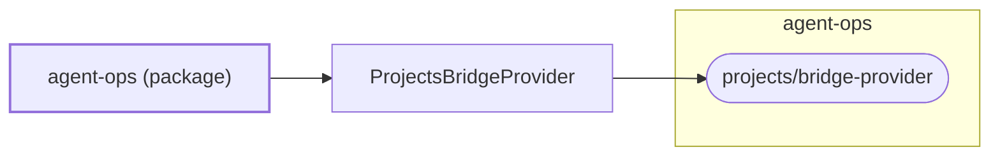
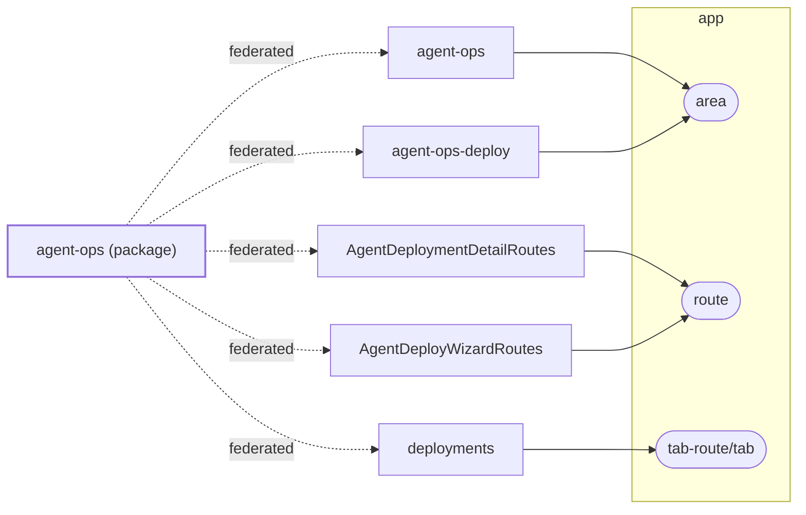

<!-- AUTO-GENERATED by @odh-dashboard/extension-map. Do not edit by hand. -->

> Generated file. Regenerate with `pnpm docs:extension-map`.

# Extensions in agent-ops

Package `@odh-dashboard/agent-ops` (package) at `packages/agent-ops`. Everything below is read out of this repository's sources by static analysis.

## Loading paths

- [extensions.ts](../extensions.ts) (`./extensions`) — bundled into the host at build time (the `./extensions` export)
- [extensions.ts](../frontend/src/odh/extensions.ts) (`mf:./extensions`) — loaded at runtime by the host as a Module Federation remote

## Defines

The extension points this package declares. Each heading is the point ID other packages use as an extension's `type`.

### agent-ops.projects/bridge-provider

Host-side bridge: reads ProjectsContext in the host bundle and passes filtered
Active project data into the federated agent-ops UI.

Declared as [ProjectsBridgeProviderExtension](../frontend/src/odh/extension-points/projects-bridge.ts#L26-L31).

**Properties:**

| Property | Required | Type | CodeRef of | Description |
| --- | --- | --- | --- | --- |
| `component` | yes | `ComponentCodeRef<ProjectsBridgeProviderProps>` | `{ default: ComponentType<ProjectsBridgeProviderProps>; }` |  |

**Implemented by:** [agent-ops](#contributes-to-agent-opsprojectsbridge-provider)

**Consumed in:** [agent-ops](#consumes-agent-opsprojectsbridge-provider)

```mermaid
flowchart LR
  classDef pkg stroke-width:2px
  classDef point stroke-width:1px
  n_pkg__odh_dashboard_agent_ops_64201e["agent-ops (package)"]:::pkg
  n_agent_ops_projects_bridge_provider_e5b4cf(["agent-ops.projects/bridge-provider"]):::point
  n_pkg__odh_dashboard_agent_ops_64201e --> n_agent_ops_projects_bridge_provider_e5b4cf
  n_symbol_packages_agent_ops_frontend_src_odh_components_ProjectsBridgeProviderWrapper_tsx_ProjectsBridgeProviderWrapper_9d87fd["ProjectsBridgeProviderWrapper"]
  n_agent_ops_projects_bridge_provider_e5b4cf -- "useResolvedExtensions, read" --> n_symbol_packages_agent_ops_frontend_src_odh_components_ProjectsBridgeProviderWrapper_tsx_ProjectsBridgeProviderWrapper_9d87fd
  n_symbol_packages_agent_ops_frontend_src_odh_AgentDeploymentsWrapper_tsx_AgentDeploymentsWrapper_f349ee("AgentDeploymentsWrapper")
  n_symbol_packages_agent_ops_frontend_src_odh_AgentDeployWizardRoutes_tsx_AgentDeployWizardRoutes_dd38ee("AgentDeployWizardRoutes")
  n_symbol_packages_agent_ops_frontend_src_odh_components_ProjectsBridgeProviderWrapper_tsx_ProjectsBridgeProviderWrapper_9d87fd -. "rendered in" .-> n_symbol_packages_agent_ops_frontend_src_odh_AgentDeploymentsWrapper_tsx_AgentDeploymentsWrapper_f349ee
  n_symbol_packages_agent_ops_frontend_src_odh_components_ProjectsBridgeProviderWrapper_tsx_ProjectsBridgeProviderWrapper_9d87fd -. "rendered in" .-> n_symbol_packages_agent_ops_frontend_src_odh_AgentDeployWizardRoutes_tsx_AgentDeployWizardRoutes_dd38ee
```

| Node | What | Link |
| --- | --- | --- |
| agent-ops (package) | contributes extensions of this point | [agent-ops](#contributes-to-agent-opsprojectsbridge-provider) |
| agent-ops.projects/bridge-provider | this extension point | [agent-ops.projects/bridge-provider](#agent-opsprojectsbridge-provider) |
| ProjectsBridgeProviderWrapper | consumer in @odh-dashboard/agent-ops — useResolvedExtensions, read | [ProjectsBridgeProviderWrapper](../frontend/src/odh/components/ProjectsBridgeProviderWrapper.tsx#L74-L136) |
| AgentDeploymentsWrapper | renders ProjectsBridgeProviderWrapper (one hop up) | renders ProjectsBridgeProviderWrapper at [AgentDeploymentsWrapper.tsx:8](../frontend/src/odh/AgentDeploymentsWrapper.tsx#L8) |
| AgentDeployWizardRoutes | renders ProjectsBridgeProviderWrapper (one hop up) | renders ProjectsBridgeProviderWrapper at [AgentDeployWizardRoutes.tsx:9](../frontend/src/odh/AgentDeployWizardRoutes.tsx#L9) |

## Contributes

The extensions this package declares, grouped by the namespace of the extension point they target.

### Namespace `agent-ops`

| Node | What | Link |
| --- | --- | --- |
| agent-ops (package) | this package | [packages/agent-ops](..) |
| ProjectsBridgeProvider | extension of agent-ops.projects/bridge-provider — bundled | [extensions.ts](../extensions.ts#L4-L9) |
| projects/bridge-provider | extension point | [agent-ops.projects/bridge-provider](#agent-opsprojectsbridge-provider) |

#### Contributes to agent-ops.projects/bridge-provider

Defined in [agent-ops.projects/bridge-provider](#agent-opsprojectsbridge-provider).

| CodeRef target | Included in | Source |
| --- | --- | --- |
| [ProjectsBridgeProvider#default](../src/ProjectsBridgeProvider.tsx#L13-L61) | host | [extensions.ts](../extensions.ts#L4-L9) |

### Namespace `app`

| Node | What | Link |
| --- | --- | --- |
| agent-ops (package) | this package | [packages/agent-ops](..) |
| agent-ops | extension of app.area — federated | [extensions.ts](../frontend/src/odh/extensions.ts#L15-L21) |
| agent-ops-deploy | extension of app.area — federated | [extensions.ts](../frontend/src/odh/extensions.ts#L22-L28) |
| AgentDeploymentDetailRoutes | extension of app.route — federated | [extensions.ts](../frontend/src/odh/extensions.ts#L44-L53) |
| AgentDeployWizardRoutes | extension of app.route — federated | [extensions.ts](../frontend/src/odh/extensions.ts#L54-L63) |
| deployments | extension of app.tab-route/tab — federated | [extensions.ts](../frontend/src/odh/extensions.ts#L29-L41) |
| area | extension point | [app.area](../../plugin-core/docs/extensions.md#apparea) |
| route | extension point | [app.route](../../plugin-core/docs/extensions.md#approute) |
| tab-route/tab | extension point | [app.tab-route/tab](../../plugin-core/docs/extensions.md#apptab-routetab) |

#### Contributes to app.area

Defined in [app.area](../../plugin-core/docs/extensions.md#apparea).

| featureFlags | id | Included in | Source |
| --- | --- | --- | --- |
| `'agentOps'` | `AGENT_OPS` (`'agent-ops'`) | host | [extensions.ts](../frontend/src/odh/extensions.ts#L15-L21) |
| `'agentOpsDeploy'` | `'agent-ops-deploy'` | host | [extensions.ts](../frontend/src/odh/extensions.ts#L22-L28) |

#### Contributes to app.route

Defined in [app.route](../../plugin-core/docs/extensions.md#approute).

| path | Requires | CodeRef target | Included in | Source |
| --- | --- | --- | --- | --- |
| `'/ai-hub/agents/deployments/:namespace/:agentId/*'` | `AGENT_OPS` (`'agent-ops'`), `agent-ops-deploy` | [AgentDeploymentDetailRoutes#default](../frontend/src/odh/AgentDeploymentDetailRoutes.tsx#L7-L15) | host | [extensions.ts](../frontend/src/odh/extensions.ts#L44-L53) |
| `agentDeployWizardPath` (`'/ai-hub/agents/deployments/deploy'`) | `AGENT_OPS` (`'agent-ops'`), `agent-ops-deploy` | [AgentDeployWizardRoutes#default](../frontend/src/odh/AgentDeployWizardRoutes.tsx#L7-L15) | host | [extensions.ts](../frontend/src/odh/extensions.ts#L54-L63) |

#### Contributes to app.tab-route/tab

Defined in [app.tab-route/tab](../../plugin-core/docs/extensions.md#apptab-routetab).

##### deployments

- **pageId:** `AGENTS_TAB_PAGE` (`'agents-tab-page'`)
- **id:** `'deployments'`
- **title:** `'Deployments'`
- **group:** `'1_deployments'`
- **Requires:** `AGENT_OPS` (`'agent-ops'`)
- **CodeRef target:** [AgentDeploymentsWrapper#default](../frontend/src/odh/AgentDeploymentsWrapper.tsx#L6-L12)
- **Included in:** host
- **Source:** [extensions.ts](../frontend/src/odh/extensions.ts#L29-L41)

## Consumes

The extension points this package's code queries or uses, one table per point. A use is a property read from an extension, followed wherever the extension is passed; "rendered in" is one hop up: where the consumer itself is rendered or called.

### Consumes agent-ops.projects/bridge-provider

Defined in [agent-ops.projects/bridge-provider](#agent-opsprojectsbridge-provider).

| Consumer | Query | Uses | Rendered in |
| --- | --- | --- | --- |
| [ProjectsBridgeProviderWrapper](../frontend/src/odh/components/ProjectsBridgeProviderWrapper.tsx#L74-L136) | [useResolvedExtensions](../frontend/src/odh/components/ProjectsBridgeProviderWrapper.tsx#L77) | `properties.component.default` — read, direct ([ProjectsBridgeProviderWrapper.tsx:100](../frontend/src/odh/components/ProjectsBridgeProviderWrapper.tsx#L100)) | AgentDeploymentsWrapper ([AgentDeploymentsWrapper.tsx:8](../frontend/src/odh/AgentDeploymentsWrapper.tsx#L8)) AgentDeployWizardRoutes ([AgentDeployWizardRoutes.tsx:9](../frontend/src/odh/AgentDeployWizardRoutes.tsx#L9)) |

## Legend

| Edge | What it means in these diagrams |
| --- | --- |
| `A --> B` | Proven by a declaration or by the type checker. In a Contributes diagram: A is declared by this package and bundled into an app at build time; it may also be exposed through Module Federation, and the node table beside each diagram names every loading path. In a point's flow diagram: package A contributes extensions of point B, bundled into an app at build time. |
| `A -- "how" --> B` | In a point's flow diagram: consumer B queries or uses point A, proven by the type checker. The label names the query hook (or the wrapper it goes through) and the kinds of use: `lazy-render`, `jsx-render`, `hook-run`, `call`, `read`, `filter`, `type-check`. |
| `A -. "federated" .-> B` | A reaches the host only through a Module Federation remote, loaded at runtime. |
| `A ==> B` | Derived: proven through a type or a JSDoc tag rather than a direct reference. |
| `A -. "rendered in" .-> B` | B renders A as a JSX element (one hop up). |
| `A -. "called in" .-> B` | B calls A (one hop up). |
| `A --x B` | A suppresses B. |
| `A -- "patch" --> B` | A patches B. |

A node with a dashed border stands for several extensions of the same point; its `×N` label is
the number of extensions, and the table beside the diagram always lists every one of them.
Anything the analysis could not resolve is never drawn — it is listed in a "Not resolved" table
instead.
