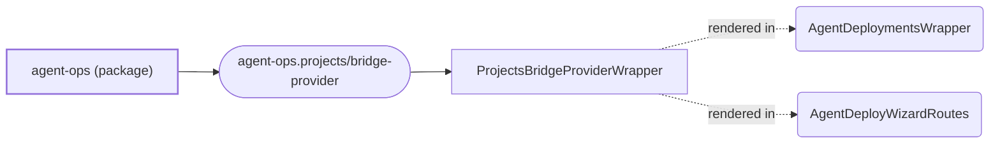

<!-- AUTO-GENERATED by @odh-dashboard/extension-map. Do not edit by hand. -->

> Generated file. Regenerate with `pnpm docs:extension-map`.

# Extensions in agent-ops

Package `@odh-dashboard/agent-ops` (package) at `packages/agent-ops`. Everything below is read out of this repository's sources by static analysis.

[Loading paths](#loading-paths) · [Defines](#defines) · [Contributes](#contributes) · [Consumes](#consumes) · [Legend](#legend)

## On this page

Every extension point, extension and consumer on this page, each linking to its own section. Links to the code are in those sections.

**Defines**

| Extension point | Implemented by | Consumed in |
| --- | --- | --- |
| [agent-ops.projects/bridge-provider](#agent-opsprojectsbridge-provider) | [agent-ops](#contributes-to-agent-opsprojectsbridge-provider) | [agent-ops](#consumes-agent-opsprojectsbridge-provider) |

**Contributes**

| Extension | Extension point | Included in |
| --- | --- | --- |
| [ProjectsBridgeProvider](#contributes-to-agent-opsprojectsbridge-provider) | [agent-ops.projects/bridge-provider](#agent-opsprojectsbridge-provider) | host |
| [agent-ops](#contributes-to-apparea) | [app.area](../../plugin-core/docs/extensions.md#apparea) | host |
| [agent-ops-deploy](#contributes-to-apparea) | [app.area](../../plugin-core/docs/extensions.md#apparea) | host |
| [AgentDeploymentDetailRoutes](#contributes-to-approute) | [app.route](../../plugin-core/docs/extensions.md#approute) | host |
| [AgentDeployWizardRoutes](#contributes-to-approute) | [app.route](../../plugin-core/docs/extensions.md#approute) | host |
| [deployments](#contributes-to-apptab-routetab) | [app.tab-route/tab](../../plugin-core/docs/extensions.md#apptab-routetab) | host |

**Consumes**

| Consumer | Extension point |
| --- | --- |
| [ProjectsBridgeProviderWrapper](#consumes-agent-opsprojectsbridge-provider) | [agent-ops.projects/bridge-provider](#agent-opsprojectsbridge-provider) |

## Loading paths

- [extensions.ts](../extensions.ts) (`./extensions`) — bundled into the host at build time (the `./extensions` export)
- [extensions.ts](../frontend/src/odh/extensions.ts) (`mf:./extensions`) — loaded at runtime by the host as a Module Federation remote

## Defines

The extension points this package declares. Each heading is the point ID other packages use as an extension's `type`.

### agent-ops.projects/bridge-provider

Host-side bridge: reads ProjectsContext in the host bundle and passes filtered
Active project data into the federated agent-ops UI.

Declared as [ProjectsBridgeProviderExtension](../frontend/src/odh/extension-points/projects-bridge.ts#L26-L31).

**Properties:**

| Property | Required | Type | CodeRef of | Description |
| --- | --- | --- | --- | --- |
| `component` | yes | `ComponentCodeRef<ProjectsBridgeProviderProps>` | `{ default: ComponentType<ProjectsBridgeProviderProps>; }` |  |

**Implemented by:** [agent-ops](#contributes-to-agent-opsprojectsbridge-provider)

**Consumed in:** [agent-ops](#consumes-agent-opsprojectsbridge-provider)

**Consumers:**

| Consumer | Package | Query | Uses | Rendered or called in |
| --- | --- | --- | --- | --- |
| [ProjectsBridgeProviderWrapper](../frontend/src/odh/components/ProjectsBridgeProviderWrapper.tsx#L74-L136) | agent-ops | [useResolvedExtensions](../frontend/src/odh/components/ProjectsBridgeProviderWrapper.tsx#L77) | `properties.component.default` — read, direct ([ProjectsBridgeProviderWrapper.tsx:100](../frontend/src/odh/components/ProjectsBridgeProviderWrapper.tsx#L100)) | AgentDeploymentsWrapper ([AgentDeploymentsWrapper.tsx:8](../frontend/src/odh/AgentDeploymentsWrapper.tsx#L8)) AgentDeployWizardRoutes ([AgentDeployWizardRoutes.tsx:9](../frontend/src/odh/AgentDeployWizardRoutes.tsx#L9)) |

## Contributes

The extensions this package declares, grouped by the namespace of the extension point they target.

### Namespace `agent-ops`

#### Contributes to agent-ops.projects/bridge-provider

Defined in [agent-ops.projects/bridge-provider](#agent-opsprojectsbridge-provider).

| CodeRef target | Included in | Source |
| --- | --- | --- |
| [ProjectsBridgeProvider#default](../src/ProjectsBridgeProvider.tsx#L13-L61) | host | [extensions.ts](../extensions.ts#L4-L9) |

### Namespace `app`

#### Contributes to app.area

Defined in [app.area](../../plugin-core/docs/extensions.md#apparea).

| featureFlags | id | Included in | Source |
| --- | --- | --- | --- |
| `'agentOps'` | `AGENT_OPS` (`'agent-ops'`) | host | [extensions.ts](../frontend/src/odh/extensions.ts#L15-L21) |
| `'agentOpsDeploy'` | `'agent-ops-deploy'` | host | [extensions.ts](../frontend/src/odh/extensions.ts#L22-L28) |

#### Contributes to app.route

Defined in [app.route](../../plugin-core/docs/extensions.md#approute).

| path | Requires | CodeRef target | Included in | Source |
| --- | --- | --- | --- | --- |
| `'/ai-hub/agents/deployments/:namespace/:agentId/*'` | `AGENT_OPS` (`'agent-ops'`), `agent-ops-deploy` | [AgentDeploymentDetailRoutes#default](../frontend/src/odh/AgentDeploymentDetailRoutes.tsx#L7-L15) | host | [extensions.ts](../frontend/src/odh/extensions.ts#L44-L53) |
| `agentDeployWizardPath` (`'/ai-hub/agents/deployments/deploy'`) | `AGENT_OPS` (`'agent-ops'`), `agent-ops-deploy` | [AgentDeployWizardRoutes#default](../frontend/src/odh/AgentDeployWizardRoutes.tsx#L7-L15) | host | [extensions.ts](../frontend/src/odh/extensions.ts#L54-L63) |

#### Contributes to app.tab-route/tab

Defined in [app.tab-route/tab](../../plugin-core/docs/extensions.md#apptab-routetab).

##### deployments

- **pageId:** `AGENTS_TAB_PAGE` (`'agents-tab-page'`)
- **id:** `'deployments'`
- **title:** `'Deployments'`
- **group:** `'1_deployments'`
- **Requires:** `AGENT_OPS` (`'agent-ops'`)
- **CodeRef target:** [AgentDeploymentsWrapper#default](../frontend/src/odh/AgentDeploymentsWrapper.tsx#L6-L12)
- **Included in:** host
- **Source:** [extensions.ts](../frontend/src/odh/extensions.ts#L29-L41)

## Consumes

The extension points this package's code queries or uses, one table per point. A use is a property read from an extension, followed wherever the extension is passed; "rendered in" is one hop up: where the consumer itself is rendered or called.

### Consumes agent-ops.projects/bridge-provider

Defined in [agent-ops.projects/bridge-provider](#agent-opsprojectsbridge-provider).

| Consumer | Query | Uses | Rendered in |
| --- | --- | --- | --- |
| [ProjectsBridgeProviderWrapper](../frontend/src/odh/components/ProjectsBridgeProviderWrapper.tsx#L74-L136) | [useResolvedExtensions](../frontend/src/odh/components/ProjectsBridgeProviderWrapper.tsx#L77) | `properties.component.default` — read, direct ([ProjectsBridgeProviderWrapper.tsx:100](../frontend/src/odh/components/ProjectsBridgeProviderWrapper.tsx#L100)) | AgentDeploymentsWrapper ([AgentDeploymentsWrapper.tsx:8](../frontend/src/odh/AgentDeploymentsWrapper.tsx#L8)) AgentDeployWizardRoutes ([AgentDeployWizardRoutes.tsx:9](../frontend/src/odh/AgentDeployWizardRoutes.tsx#L9)) |

## Legend

Every diagram on this page is one extension point's flow: the packages that contribute
extensions of it, the point, the code that queries or uses it, and where that code is itself
rendered or called. The Consumers table above each diagram carries a link for every node.

| Edge | What it means in these diagrams |
| --- | --- |
| `A --> B` | Proven use: package A contributes extensions of point B, or consumer B queries or uses point A. |
| `A -. "rendered in" .-> B` | B renders A as a JSX element (one hop up). |

Anything the analysis could not resolve is never drawn — it is listed in a "Not resolved" table
instead.
