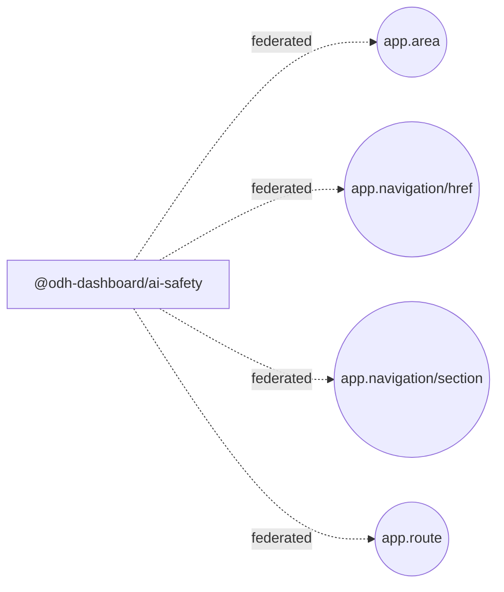

<!-- AUTO-GENERATED by @odh-dashboard/extension-map. Do not edit by hand. -->

> Generated file. Regenerate with `pnpm docs:extension-map`.

## Loading paths

| Entry | Path | Source |
| --- | --- | --- |
| @odh-dashboard/ai-safety#mf:./extensions | federated | `packages/ai-safety/frontend/src/odh/extensions.ts` |

## Contributes

### app

| Node | Link |
| --- | --- |
| @odh-dashboard/ai-safety | [@odh-dashboard/ai-safety](#contributes) |
| app.area | [app.area](../../plugin-core/docs/extensions.md#apparea) [app.area](../frontend/src/odh/extensions.ts#L11-L17) |
| app.navigation/href | [app.navigation/href](../../plugin-core/docs/extensions.md#appnavigationhref) [app.navigation/href](../frontend/src/odh/extensions.ts#L30-L43) |
| app.navigation/section | [app.navigation/section](../../plugin-core/docs/extensions.md#appnavigationsection) [app.navigation/section](../frontend/src/odh/extensions.ts#L18-L29) |
| app.route | [app.route](../../plugin-core/docs/extensions.md#approute) [app.route](../frontend/src/odh/extensions.ts#L44-L53) |

- `-->` declared or type-resolved contribution
- `==>` derived relationship
- `-. "rendered in" .->` rendered in one hop
- `-. "federated" .->` federated contribution
- `--x` suppression
- `-- "patch" -->` patch

#### app.area

| featureFlags | id | Requires | Disallows | CodeRef target | Included in | Source |
| --- | --- | --- | --- | --- | --- | --- |
| `"aiSafety"` | `SupportedArea.PLUGIN_AI_SAFETY` (`"plugin-ai-safety"`) |  |  |  |  | [app.area](../frontend/src/odh/extensions.ts#L11-L17) |

#### app.navigation/href

- **id**: `"ai-safety-view"`
- **title**: `"AI Safety Studio"`
- **section**: `"ai-safety"`
- **label**: `"Dev Preview"`
- **href**: `"/ai-safety/main-view"`
- **path**: `"/ai-safety/main-view/*"`
- **Requires**: `SupportedArea.PLUGIN_AI_SAFETY` (`"plugin-ai-safety"`)
- **Disallows**: 
- **CodeRef target**: 
- **Included in**: 
- **Source**: [app.navigation/href](../frontend/src/odh/extensions.ts#L30-L43)

#### app.navigation/section

- **id**: `"ai-safety"`
- **title**: `"AI Safety Studio"`
- **group**: `"7_ai_safety_studio"`
- **iconRef**: packages/ai-safety/frontend/src/odh/AiSafetyNavIcon.ts#[ModArchNavIcon](../frontend/src/odh/AiSafetyNavIcon.ts#L3-L11)
- **Requires**: `SupportedArea.PLUGIN_AI_SAFETY` (`"plugin-ai-safety"`)
- **Disallows**: 
- **CodeRef target**: packages/ai-safety/frontend/src/odh/AiSafetyNavIcon.ts#[ModArchNavIcon](../frontend/src/odh/AiSafetyNavIcon.ts#L3-L11)
- **Included in**: 
- **Source**: [app.navigation/section](../frontend/src/odh/extensions.ts#L18-L29)

#### app.route

| component | path | Requires | Disallows | CodeRef target | Included in | Source |
| --- | --- | --- | --- | --- | --- | --- |
| packages/ai-safety/frontend/src/odh/AiSafetyWrapper.tsx#[ModArchWrapper](../frontend/src/odh/AiSafetyWrapper.tsx#L18-L26) | `"/ai-safety/main-view/*"` | `SupportedArea.PLUGIN_AI_SAFETY` (`"plugin-ai-safety"`) |  | packages/ai-safety/frontend/src/odh/AiSafetyWrapper.tsx#[ModArchWrapper](../frontend/src/odh/AiSafetyWrapper.tsx#L18-L26) |  | [app.route](../frontend/src/odh/extensions.ts#L44-L53) |
