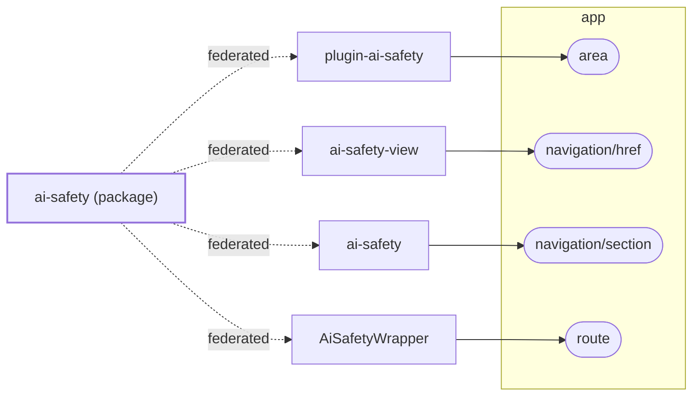

<!-- AUTO-GENERATED by @odh-dashboard/extension-map. Do not edit by hand. -->

> Generated file. Regenerate with `pnpm docs:extension-map`.

# Extensions in ai-safety

Package `@odh-dashboard/ai-safety` (package) at `packages/ai-safety`. Everything below is read out of this repository's sources by static analysis.

## Loading paths

- [extensions.ts](../frontend/src/odh/extensions.ts) (`mf:./extensions`) — loaded at runtime by the host as a Module Federation remote

## Contributes

The extensions this package declares, grouped by the namespace of the extension point they target.

### Namespace `app`

| Node | What | Link |
| --- | --- | --- |
| ai-safety (package) | this package | [packages/ai-safety](..) |
| plugin-ai-safety | extension of app.area — federated | [extensions.ts](../frontend/src/odh/extensions.ts#L11-L17) |
| ai-safety-view | extension of app.navigation/href — federated | [extensions.ts](../frontend/src/odh/extensions.ts#L30-L43) |
| ai-safety | extension of app.navigation/section — federated | [extensions.ts](../frontend/src/odh/extensions.ts#L18-L29) |
| AiSafetyWrapper | extension of app.route — federated | [extensions.ts](../frontend/src/odh/extensions.ts#L44-L53) |
| area | extension point | [app.area](../../plugin-core/docs/extensions.md#apparea) |
| navigation/href | extension point | [app.navigation/href](../../plugin-core/docs/extensions.md#appnavigationhref) |
| navigation/section | extension point | [app.navigation/section](../../plugin-core/docs/extensions.md#appnavigationsection) |
| route | extension point | [app.route](../../plugin-core/docs/extensions.md#approute) |

#### Contributes to app.area

Defined in [app.area](../../plugin-core/docs/extensions.md#apparea).

| featureFlags | id | Included in | Source |
| --- | --- | --- | --- |
| `'aiSafety'` | `SupportedArea.PLUGIN_AI_SAFETY` (`'plugin-ai-safety'`) | host | [extensions.ts](../frontend/src/odh/extensions.ts#L11-L17) |

#### Contributes to app.navigation/href

Defined in [app.navigation/href](../../plugin-core/docs/extensions.md#appnavigationhref).

##### ai-safety-view

- **id:** `'ai-safety-view'`
- **title:** `'AI Safety Studio'`
- **section:** `'ai-safety'`
- **label:** `'Dev Preview'`
- **href:** `'/ai-safety/main-view'`
- **path:** `'/ai-safety/main-view/*'`
- **Requires:** `SupportedArea.PLUGIN_AI_SAFETY` (`'plugin-ai-safety'`)
- **Included in:** host
- **Source:** [extensions.ts](../frontend/src/odh/extensions.ts#L30-L43)

#### Contributes to app.navigation/section

Defined in [app.navigation/section](../../plugin-core/docs/extensions.md#appnavigationsection).

| id | title | group | Requires | CodeRef target | Included in | Source |
| --- | --- | --- | --- | --- | --- | --- |
| `'ai-safety'` | `'AI Safety Studio'` | `'7_ai_safety_studio'` | `SupportedArea.PLUGIN_AI_SAFETY` (`'plugin-ai-safety'`) | [AiSafetyNavIcon#default](../frontend/src/odh/AiSafetyNavIcon.ts#L3-L11) | host | [extensions.ts](../frontend/src/odh/extensions.ts#L18-L29) |

#### Contributes to app.route

Defined in [app.route](../../plugin-core/docs/extensions.md#approute).

| path | Requires | CodeRef target | Included in | Source |
| --- | --- | --- | --- | --- |
| `'/ai-safety/main-view/*'` | `SupportedArea.PLUGIN_AI_SAFETY` (`'plugin-ai-safety'`) | [AiSafetyWrapper#default](../frontend/src/odh/AiSafetyWrapper.tsx#L18-L26) | host | [extensions.ts](../frontend/src/odh/extensions.ts#L44-L53) |

## Legend

| Edge | What it means in these diagrams |
| --- | --- |
| `A --> B` | Proven by a declaration or by the type checker. In a Contributes diagram: A is declared by this package and bundled into an app at build time; it may also be exposed through Module Federation, and the node table beside each diagram names every loading path. In a point's flow diagram: package A contributes extensions of point B, bundled into an app at build time. |
| `A -- "how" --> B` | In a point's flow diagram: consumer B queries or uses point A, proven by the type checker. The label names the query hook (or the wrapper it goes through) and the kinds of use: `lazy-render`, `jsx-render`, `hook-run`, `call`, `read`, `filter`, `type-check`. |
| `A -. "federated" .-> B` | A reaches the host only through a Module Federation remote, loaded at runtime. |
| `A ==> B` | Derived: proven through a type or a JSDoc tag rather than a direct reference. |
| `A -. "rendered in" .-> B` | B renders A as a JSX element (one hop up). |
| `A -. "called in" .-> B` | B calls A (one hop up). |
| `A --x B` | A suppresses B. |
| `A -- "patch" --> B` | A patches B. |

A node with a dashed border stands for several extensions of the same point; its `×N` label is
the number of extensions, and the table beside the diagram always lists every one of them.
Anything the analysis could not resolve is never drawn — it is listed in a "Not resolved" table
instead.
