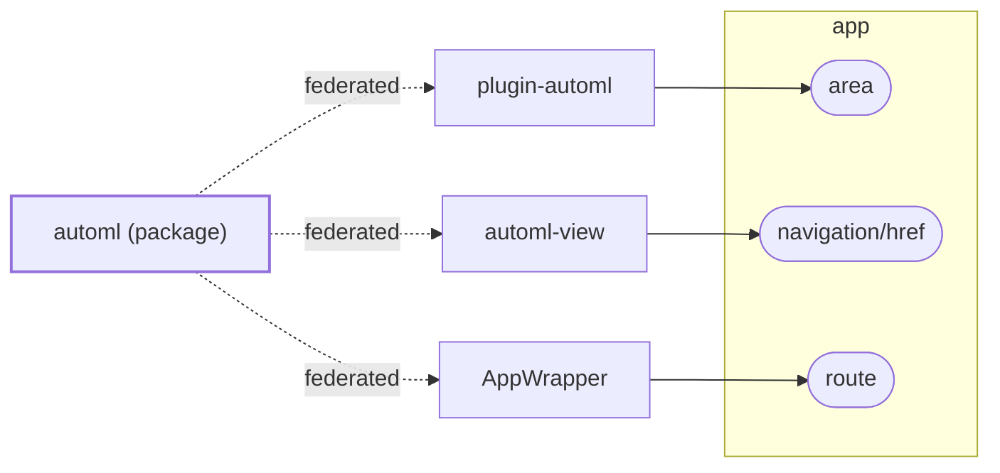

<!-- AUTO-GENERATED by @odh-dashboard/extension-map. Do not edit by hand. -->

> Generated file. Regenerate with `pnpm docs:extension-map`.

# Extensions in automl

Package `@odh-dashboard/automl` (package) at `packages/automl`. Everything below is read out of this repository's sources by static analysis.

## Loading paths

- [extensions.ts](../frontend/src/odh/extensions.ts) (`mf:./extensions`) — loaded at runtime by the host as a Module Federation remote

## Contributes

The extensions this package declares, grouped by the namespace of the extension point they target.

### Namespace `app`

| Node | What | Link |
| --- | --- | --- |
| automl (package) | this package | [packages/automl](..) |
| plugin-automl | extension of app.area — federated | [extensions.ts](../frontend/src/odh/extensions.ts#L12-L20) |
| automl-view | extension of app.navigation/href — federated | [extensions.ts](../frontend/src/odh/extensions.ts#L21-L33) |
| AppWrapper | extension of app.route — federated | [extensions.ts](../frontend/src/odh/extensions.ts#L34-L43) |
| area | extension point | [app.area](../../plugin-core/docs/extensions.md#apparea) |
| navigation/href | extension point | [app.navigation/href](../../plugin-core/docs/extensions.md#appnavigationhref) |
| route | extension point | [app.route](../../plugin-core/docs/extensions.md#approute) |

#### Contributes to app.area

Defined in [app.area](../../plugin-core/docs/extensions.md#apparea).

| reliantAreas | featureFlags | requiredComponents | id | Included in | Source |
| --- | --- | --- | --- | --- | --- |
| (empty) | `'automl'`, `'disablePipelines'` | `DataScienceStackComponent.DS_PIPELINES` (`'aipipelines'`) | `PLUGIN_AUTOML` (`'plugin-automl'`) | host | [extensions.ts](../frontend/src/odh/extensions.ts#L12-L20) |

#### Contributes to app.navigation/href

Defined in [app.navigation/href](../../plugin-core/docs/extensions.md#appnavigationhref).

##### automl-view

- **id:** `'automl-view'`
- **title:** `'AutoML'`
- **section:** `'develop-and-train'`
- **href:** `'/develop-train/automl'`
- **path:** `'/develop-train/automl/*'`
- **Requires:** `PLUGIN_AUTOML` (`'plugin-automl'`)
- **Included in:** host
- **Source:** [extensions.ts](../frontend/src/odh/extensions.ts#L21-L33)

#### Contributes to app.route

Defined in [app.route](../../plugin-core/docs/extensions.md#approute).

| path | Requires | CodeRef target | Included in | Source |
| --- | --- | --- | --- | --- |
| `'/develop-train/automl/*'` | `PLUGIN_AUTOML` (`'plugin-automl'`) | [AppWrapper#default](../frontend/src/odh/AppWrapper.tsx#L32-L53) | host | [extensions.ts](../frontend/src/odh/extensions.ts#L34-L43) |

## Legend

| Edge | What it means in these diagrams |
| --- | --- |
| `A --> B` | Proven by a declaration or by the type checker. In a Contributes diagram: A is declared by this package and bundled into an app at build time; it may also be exposed through Module Federation, and the node table beside each diagram names every loading path. In a point's flow diagram: package A contributes extensions of point B, bundled into an app at build time. |
| `A -- "how" --> B` | In a point's flow diagram: consumer B queries or uses point A, proven by the type checker. The label names the query hook (or the wrapper it goes through) and the kinds of use: `lazy-render`, `jsx-render`, `hook-run`, `call`, `read`, `filter`, `type-check`. |
| `A -. "federated" .-> B` | A reaches the host only through a Module Federation remote, loaded at runtime. |
| `A ==> B` | Derived: proven through a type or a JSDoc tag rather than a direct reference. |
| `A -. "rendered in" .-> B` | B renders A as a JSX element (one hop up). |
| `A -. "called in" .-> B` | B calls A (one hop up). |
| `A --x B` | A suppresses B. |
| `A -- "patch" --> B` | A patches B. |

A node with a dashed border stands for several extensions of the same point; its `×N` label is
the number of extensions, and the table beside the diagram always lists every one of them.
Anything the analysis could not resolve is never drawn — it is listed in a "Not resolved" table
instead.
