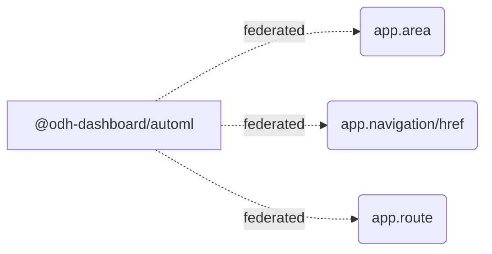

<!-- AUTO-GENERATED by @odh-dashboard/extension-map. Do not edit by hand. -->

> Generated file. Regenerate with `pnpm docs:extension-map`.

## Contents
- [Loading paths](#loading-paths)
- [Contributes](#contributes)
  - [app](#app)
    - [app.area](#apparea)
    - [app.navigation/href](#appnavigationhref)
    - [app.route](#approute)

## Loading paths

| Entry | Path | Source |
| --- | --- | --- |
| @odh-dashboard/automl#mf:./extensions | federated | `packages/automl/frontend/src/odh/extensions.ts` |

## Contributes

### app

| Node | Contract | Registration sources |
| --- | --- | --- |
| [@odh-dashboard/automl](#loading-paths) | — | — |
| app.area | [app.area](../../plugin-core/docs/extensions.md#apparea) | [../frontend/src/odh/extensions.ts:12](../frontend/src/odh/extensions.ts#L12-L20) |
| app.navigation/href | [app.navigation/href](../../plugin-core/docs/extensions.md#appnavigationhref) | [../frontend/src/odh/extensions.ts:21](../frontend/src/odh/extensions.ts#L21-L33) |
| app.route | [app.route](../../plugin-core/docs/extensions.md#approute) | [../frontend/src/odh/extensions.ts:34](../frontend/src/odh/extensions.ts#L34-L43) |

- `-->` declared or type-resolved contribution
- `==>` derived relationship
- `-. "rendered in" .->` rendered in one hop
- `-. "federated" .->` federated contribution
- `--x` suppression
- `-- "patch" -->` patch

#### app.area

| featureFlags | requiredComponents | id | Source |
| --- | --- | --- | --- |
| `"automl"`, `"disablePipelines"` | `DataScienceStackComponent.DS_PIPELINES` (`"aipipelines"`) | `PLUGIN_AUTOML` (`"plugin-automl"`) | [app.area](../frontend/src/odh/extensions.ts#L12-L20) |

#### app.navigation/href

| id | title | section | href | path | Requires | Source |
| --- | --- | --- | --- | --- | --- | --- |
| `"automl-view"` | `"AutoML"` | `"develop-and-train"` | `"/develop-train/automl"` | `"/develop-train/automl/*"` | `PLUGIN_AUTOML` (`"plugin-automl"`) | [app.navigation/href](../frontend/src/odh/extensions.ts#L21-L33) |

#### app.route

| component | path | Requires | CodeRef target | Source |
| --- | --- | --- | --- | --- |
| packages/automl/frontend/src/odh/AppWrapper.tsx#[AppWrapper](../frontend/src/odh/AppWrapper.tsx#L32-L53) | `"/develop-train/automl/*"` | `PLUGIN_AUTOML` (`"plugin-automl"`) | packages/automl/frontend/src/odh/AppWrapper.tsx#[AppWrapper](../frontend/src/odh/AppWrapper.tsx#L32-L53) | [app.route](../frontend/src/odh/extensions.ts#L34-L43) |
