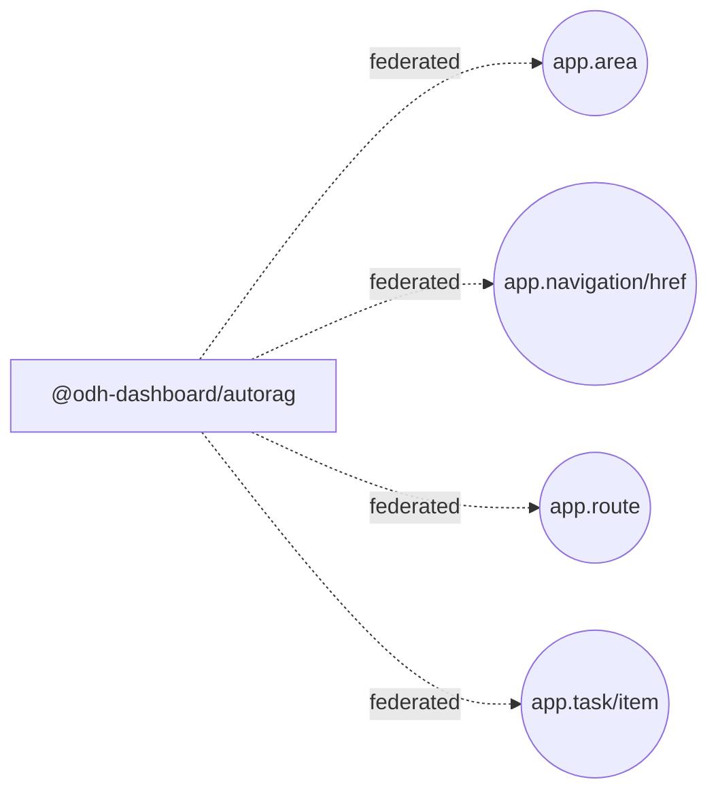

<!-- AUTO-GENERATED by @odh-dashboard/extension-map. Do not edit by hand. -->

> Generated file. Regenerate with `pnpm docs:extension-map`.

## Loading paths

| Entry | Path | Source |
| --- | --- | --- |
| @odh-dashboard/autorag#mf:./extensions | federated | `packages/autorag/frontend/src/odh/extensions.ts` |

## Contributes

### app

| Node | Link |
| --- | --- |
| @odh-dashboard/autorag | [@odh-dashboard/autorag](#contributes) |
| app.area | [app.area](../../plugin-core/docs/extensions.md#apparea) [app.area](../frontend/src/odh/extensions.ts#L12-L20) |
| app.navigation/href | [app.navigation/href](../../plugin-core/docs/extensions.md#appnavigationhref) [app.navigation/href](../frontend/src/odh/extensions.ts#L21-L33) |
| app.route | [app.route](../../plugin-core/docs/extensions.md#approute) [app.route](../frontend/src/odh/extensions.ts#L34-L43) |
| app.task/item | [app.task/item](../../plugin-core/docs/extensions.md#apptaskitem) [app.task/item](../frontend/src/odh/extensions.ts#L44-L56) |

- `-->` declared or type-resolved contribution
- `==>` derived relationship
- `-. "rendered in" .->` rendered in one hop
- `-. "federated" .->` federated contribution
- `--x` suppression
- `-- "patch" -->` patch

#### app.area

- **reliantAreas**: `PLUGIN_GEN_AI` (`"plugin-gen-ai"`)
- **featureFlags**: `"autorag"`, `"disablePipelines"`
- **requiredComponents**: `DataScienceStackComponent.DS_PIPELINES` (`"aipipelines"`)
- **id**: `PLUGIN_AUTORAG` (`"plugin-autorag"`)
- **Requires**: 
- **Disallows**: 
- **CodeRef target**: 
- **Included in**: 
- **Source**: [app.area](../frontend/src/odh/extensions.ts#L12-L20)

#### app.navigation/href

- **id**: `"autorag"`
- **title**: `"AutoRAG"`
- **section**: `"gen-ai-studio"`
- **href**: `"/gen-ai-studio/autorag"`
- **path**: `"/gen-ai-studio/autorag/*"`
- **Requires**: `PLUGIN_AUTORAG` (`"plugin-autorag"`)
- **Disallows**: 
- **CodeRef target**: 
- **Included in**: 
- **Source**: [app.navigation/href](../frontend/src/odh/extensions.ts#L21-L33)

#### app.route

| component | path | Requires | Disallows | CodeRef target | Included in | Source |
| --- | --- | --- | --- | --- | --- | --- |
| packages/autorag/frontend/src/odh/AppWrapper.tsx#[AppWrapper](../frontend/src/odh/AppWrapper.tsx#L37-L60) | `"/gen-ai-studio/autorag/*"` | `PLUGIN_AUTORAG` (`"plugin-autorag"`) |  | packages/autorag/frontend/src/odh/AppWrapper.tsx#[AppWrapper](../frontend/src/odh/AppWrapper.tsx#L37-L60) |  | [app.route](../frontend/src/odh/extensions.ts#L34-L43) |

#### app.task/item

- **id**: `"genai-autorag"`
- **group**: `"gen-ai-studio"`
- **title**: `"Create RAG pipelines"`
- **destination**: href: `"/gen-ai-studio/autorag"`
- **order**: `"3_autorag"`
- **Requires**: `PLUGIN_AUTORAG` (`"plugin-autorag"`)
- **Disallows**: 
- **CodeRef target**: 
- **Included in**: 
- **Source**: [app.task/item](../frontend/src/odh/extensions.ts#L44-L56)
