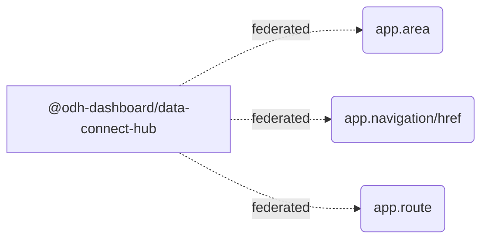

<!-- AUTO-GENERATED by @odh-dashboard/extension-map. Do not edit by hand. -->

> Generated file. Regenerate with `pnpm docs:extension-map`.

## Contents
- [Loading paths](#loading-paths)
- [Contributes](#contributes)
  - [app](#app)
    - [app.area](#apparea)
    - [app.navigation/href](#appnavigationhref)
    - [app.route](#approute)

## Loading paths

| Entry | Path | Source |
| --- | --- | --- |
| @odh-dashboard/data-connect-hub#mf:./extensions | federated | `packages/data-connect-hub/frontend/src/odh/extensions.ts` |

## Contributes

### app

| Node | Contract | Registration sources |
| --- | --- | --- |
| [@odh-dashboard/data-connect-hub](#loading-paths) | — | — |
| app.area | [app.area](../../plugin-core/docs/extensions.md#apparea) | [../frontend/src/odh/extensions.ts:9](../frontend/src/odh/extensions.ts#L9-L15) |
| app.navigation/href | [app.navigation/href](../../plugin-core/docs/extensions.md#appnavigationhref) | [../frontend/src/odh/extensions.ts:16](../frontend/src/odh/extensions.ts#L16-L30) |
| app.route | [app.route](../../plugin-core/docs/extensions.md#approute) | [../frontend/src/odh/extensions.ts:31](../frontend/src/odh/extensions.ts#L31-L40) |

- `-->` declared or type-resolved contribution
- `==>` derived relationship
- `-. "rendered in" .->` rendered in one hop
- `-. "federated" .->` federated contribution
- `--x` suppression
- `-- "patch" -->` patch

#### app.area

| featureFlags | id | Source |
| --- | --- | --- |
| `"dataConnectHub"` | `SupportedArea.PLUGIN_DATA_CONNECT_HUB` (`"plugin-data-connect-hub"`) | [app.area](../frontend/src/odh/extensions.ts#L9-L15) |

#### app.navigation/href

**Contribution:** `app.navigation/href` at `packages/data-connect-hub/frontend/src/odh/extensions.ts:16`

- **id**: `"data-connect-hub-view"`
- **title**: `"Connections"`
- **section**: `"ai-hub"`
- **group**: `"4_connections"`
- **label**: `"Dev Preview"`
- **href**: `"/ai-hub/connections"`
- **path**: `"/ai-hub/connections/*"`
- **Requires**: `SupportedArea.PLUGIN_DATA_CONNECT_HUB` (`"plugin-data-connect-hub"`)
- **Source**: [app.navigation/href](../frontend/src/odh/extensions.ts#L16-L30)

#### app.route

| component | path | Requires | CodeRef target | Source |
| --- | --- | --- | --- | --- |
| packages/data-connect-hub/frontend/src/odh/DataConnectHubWrapper.tsx#[ModArchWrapper](../frontend/src/odh/DataConnectHubWrapper.tsx#L19-L28) | `"/ai-hub/connections/*"` | `SupportedArea.PLUGIN_DATA_CONNECT_HUB` (`"plugin-data-connect-hub"`) | packages/data-connect-hub/frontend/src/odh/DataConnectHubWrapper.tsx#[ModArchWrapper](../frontend/src/odh/DataConnectHubWrapper.tsx#L19-L28) | [app.route](../frontend/src/odh/extensions.ts#L31-L40) |
