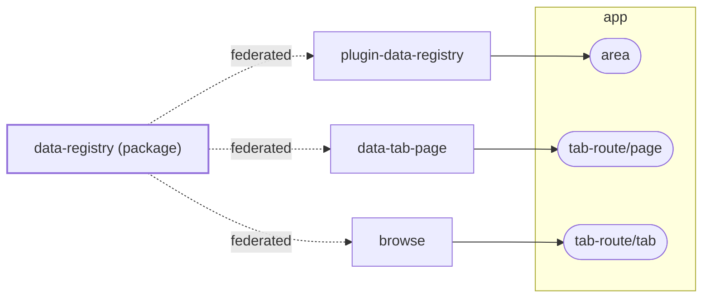

<!-- AUTO-GENERATED by @odh-dashboard/extension-map. Do not edit by hand. -->

> Generated file. Regenerate with `pnpm docs:extension-map`.

# Extensions in data-registry

Package `@odh-dashboard/data-registry` (package) at `packages/data-registry`. Everything below is read out of this repository's sources by static analysis.

## Loading paths

- [extensions.ts](../extensions.ts) (`./extensions`) — bundled into the host at build time (the `./extensions` export)
- [extensions.ts](../frontend/src/odh/extensions.ts) (`mf:./extensions`) — loaded at runtime by the host as a Module Federation remote

## Contributes

The extensions this package declares, grouped by the namespace of the extension point they target.

### Namespace `app`

| Node | What | Link |
| --- | --- | --- |
| data-registry (package) | this package | [packages/data-registry](..) |
| plugin-data-registry | extension of app.area — federated | [extensions.ts](../frontend/src/odh/extensions.ts#L7-L14) |
| data-tab-page | extension of app.tab-route/page — federated | [extensions.ts](../frontend/src/odh/extensions.ts#L15-L33) |
| browse | extension of app.tab-route/tab — federated | [extensions.ts](../frontend/src/odh/extensions.ts#L34-L47) |
| area | extension point | [app.area](../../plugin-core/docs/extensions.md#apparea) |
| tab-route/page | extension point | [app.tab-route/page](../../plugin-core/docs/extensions.md#apptab-routepage) |
| tab-route/tab | extension point | [app.tab-route/tab](../../plugin-core/docs/extensions.md#apptab-routetab) |

#### Contributes to app.area

Defined in [app.area](../../plugin-core/docs/extensions.md#apparea).

| reliantAreas | featureFlags | id | Source |
| --- | --- | --- | --- |
| `SupportedArea.DATA_REGISTRY` (`'data-registry'`) | `'dataRegistry'` | `PLUGIN_DATA_REGISTRY` (`'plugin-data-registry'`) | [extensions.ts](../frontend/src/odh/extensions.ts#L7-L14) |

#### Contributes to app.tab-route/page

Defined in [app.tab-route/page](../../plugin-core/docs/extensions.md#apptab-routepage).

##### data-tab-page

- **id:** `'data-tab-page'`
- **title:** `'Data'`
- **section:** `'ai-hub'`
- **group:** `'4_data'`
- **label:** `'Tech Preview'`
- **href:** `'/ai-hub/data'`
- **path:** `'/ai-hub/data/*'`
- **objectType:** `'data-registry'`
- **description:** `'View and manage this project’s data assets. Data assets are metadata records that help users discover and understand external data. They store information like location, format, and schema, but not the data itself.'`
- **hidePageTitleOnPaths:** `'browse/assets'`, `'browse/collections'`
- **Requires:** `PLUGIN_DATA_REGISTRY` (`'plugin-data-registry'`)
- **Source:** [extensions.ts](../frontend/src/odh/extensions.ts#L15-L33)

#### Contributes to app.tab-route/tab

Defined in [app.tab-route/tab](../../plugin-core/docs/extensions.md#apptab-routetab).

##### browse

- **pageId:** `'data-tab-page'`
- **id:** `'browse'`
- **title:** `'Browse'`
- **singleTabTitle:** `'Data assets'`
- **objectType:** `'data-registry'`
- **Requires:** `PLUGIN_DATA_REGISTRY` (`'plugin-data-registry'`)
- **CodeRef target:** [DataRegistryWrapper#default](../frontend/src/odh/DataRegistryWrapper.tsx#L18-L26)
- **Source:** [extensions.ts](../frontend/src/odh/extensions.ts#L34-L47)

## Legend

| Edge | What it means in these diagrams |
| --- | --- |
| `A --> B` | A is declared by this package and bundled into an app at build time. It may also be exposed through Module Federation — the node table beside each diagram names every loading path. |
| `A -. "federated" .-> B` | A reaches the host only through a Module Federation remote, loaded at runtime. |
| `A ==> B` | Derived: proven through a type or a JSDoc tag rather than a direct reference. |
| `A -. "rendered in" .-> B` | B renders A (one hop). |
| `A --x B` | A suppresses B. |
| `A -- "patch" --> B` | A patches B. |

A node with a dashed border stands for several extensions of the same point; its `×N` label is
the number of extensions, and the table beside the diagram always lists every one of them.
Anything the analysis could not resolve is never drawn — it is listed in a "Not resolved" table
instead.
