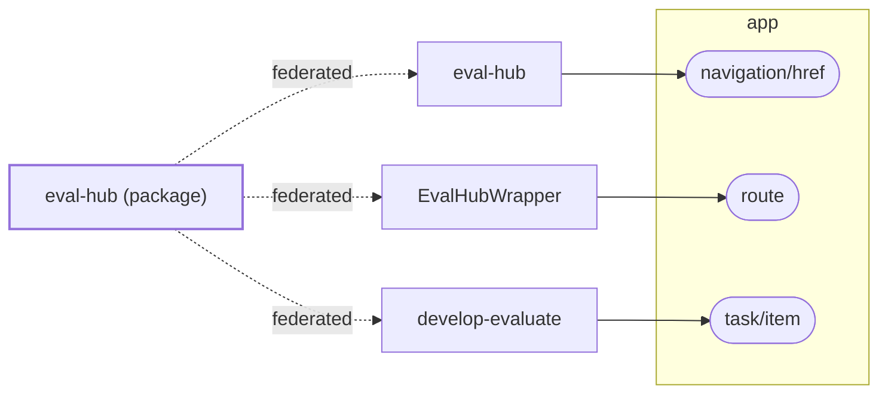

<!-- AUTO-GENERATED by @odh-dashboard/extension-map. Do not edit by hand. -->

> Generated file. Regenerate with `pnpm docs:extension-map`.

# Extensions in eval-hub

Package `@odh-dashboard/eval-hub` (package) at `packages/eval-hub`. Everything below is read out of this repository's sources by static analysis.

## Loading paths

- [extensions.ts](../frontend/src/odh/extensions.ts) (`mf:./extensions`) — loaded at runtime by the host as a Module Federation remote

## Contributes

The extensions this package declares, grouped by the namespace of the extension point they target.

### Namespace `app`

| Node | What | Link |
| --- | --- | --- |
| eval-hub (package) | this package | [packages/eval-hub](..) |
| eval-hub | extension of app.navigation/href — federated | [extensions.ts](../frontend/src/odh/extensions.ts#L9-L22) |
| EvalHubWrapper | extension of app.route — federated | [extensions.ts](../frontend/src/odh/extensions.ts#L23-L32) |
| develop-evaluate | extension of app.task/item — federated | [extensions.ts](../frontend/src/odh/extensions.ts#L33-L45) |
| navigation/href | extension point | [app.navigation/href](../../plugin-core/docs/extensions.md#appnavigationhref) |
| route | extension point | [app.route](../../plugin-core/docs/extensions.md#approute) |
| task/item | extension point | [app.task/item](../../plugin-core/docs/extensions.md#apptaskitem) |

#### Contributes to app.navigation/href

Defined in [app.navigation/href](../../plugin-core/docs/extensions.md#appnavigationhref).

##### eval-hub

- **id:** `'eval-hub'`
- **title:** `'Evaluations'`
- **section:** `'develop-and-train'`
- **label:** `'Tech Preview'`
- **href:** `'/evaluation'`
- **path:** `'/evaluation/*'`
- **Requires:** `SupportedArea.LM_EVAL` (`'lm-eval'`)
- **Source:** [extensions.ts](../frontend/src/odh/extensions.ts#L9-L22)

#### Contributes to app.route

Defined in [app.route](../../plugin-core/docs/extensions.md#approute).

| path | Requires | CodeRef target | Source |
| --- | --- | --- | --- |
| `'/evaluation/*'` | `SupportedArea.LM_EVAL` (`'lm-eval'`) | [EvalHubWrapper#default](../frontend/src/odh/EvalHubWrapper.tsx#L80-L84) | [extensions.ts](../frontend/src/odh/extensions.ts#L23-L32) |

#### Contributes to app.task/item

Defined in [app.task/item](../../plugin-core/docs/extensions.md#apptaskitem).

| id | group | title | destination | order | Requires | Source |
| --- | --- | --- | --- | --- | --- | --- |
| `'develop-evaluate'` | `'develop-and-train'` | `'Evaluate models'` | `{ href: '/evaluation' }` | `'2_evaluate'` | `SupportedArea.LM_EVAL` (`'lm-eval'`) | [extensions.ts](../frontend/src/odh/extensions.ts#L33-L45) |

## Legend

| Edge | What it means in these diagrams |
| --- | --- |
| `A --> B` | A is declared by this package and bundled into an app at build time. It may also be exposed through Module Federation — the node table beside each diagram names every loading path. |
| `A -. "federated" .-> B` | A reaches the host only through a Module Federation remote, loaded at runtime. |
| `A ==> B` | Derived: proven through a type or a JSDoc tag rather than a direct reference. |
| `A -. "rendered in" .-> B` | B renders A (one hop). |
| `A --x B` | A suppresses B. |
| `A -- "patch" --> B` | A patches B. |

A node with a dashed border stands for several extensions of the same point; its `×N` label is
the number of extensions, and the table beside the diagram always lists every one of them.
Anything the analysis could not resolve is never drawn — it is listed in a "Not resolved" table
instead.
