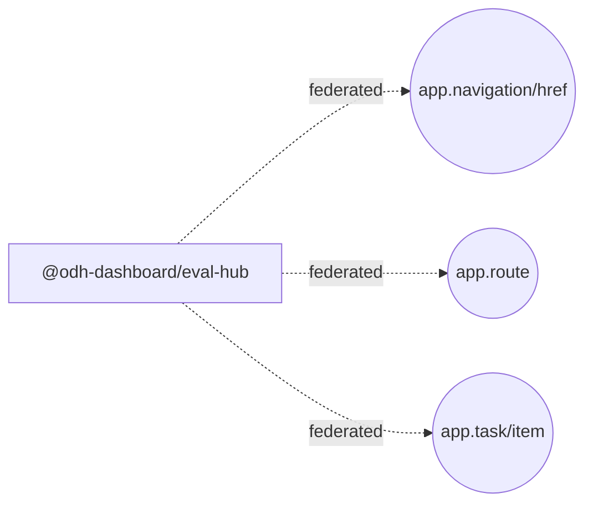

<!-- AUTO-GENERATED by @odh-dashboard/extension-map. Do not edit by hand. -->

> Generated file. Regenerate with `pnpm docs:extension-map`.

## Loading paths

| Entry | Path | Source |
| --- | --- | --- |
| @odh-dashboard/eval-hub#mf:./extensions | federated | `packages/eval-hub/frontend/src/odh/extensions.ts` |

## Contributes

### app

| Node | Link |
| --- | --- |
| @odh-dashboard/eval-hub | [@odh-dashboard/eval-hub](#contributes) |
| app.navigation/href | [app.navigation/href](../../plugin-core/docs/extensions.md#appnavigationhref) [app.navigation/href](../frontend/src/odh/extensions.ts#L9-L22) |
| app.route | [app.route](../../plugin-core/docs/extensions.md#approute) [app.route](../frontend/src/odh/extensions.ts#L23-L32) |
| app.task/item | [app.task/item](../../plugin-core/docs/extensions.md#apptaskitem) [app.task/item](../frontend/src/odh/extensions.ts#L33-L45) |

- `-->` declared or type-resolved contribution
- `==>` derived relationship
- `-. "rendered in" .->` rendered in one hop
- `-. "federated" .->` federated contribution
- `--x` suppression
- `-- "patch" -->` patch

#### app.navigation/href

- **id**: `"eval-hub"`
- **title**: `"Evaluations"`
- **section**: `"develop-and-train"`
- **label**: `"Tech Preview"`
- **href**: `"/evaluation"`
- **path**: `"/evaluation/*"`
- **Requires**: `SupportedArea.LM_EVAL` (`"lm-eval"`)
- **Disallows**: 
- **CodeRef target**: 
- **Included in**: 
- **Source**: [app.navigation/href](../frontend/src/odh/extensions.ts#L9-L22)

#### app.route

| component | path | Requires | Disallows | CodeRef target | Included in | Source |
| --- | --- | --- | --- | --- | --- | --- |
| packages/eval-hub/frontend/src/odh/EvalHubWrapper.tsx#[EvalHubWrapper](../frontend/src/odh/EvalHubWrapper.tsx#L80-L84) | `"/evaluation/*"` | `SupportedArea.LM_EVAL` (`"lm-eval"`) |  | packages/eval-hub/frontend/src/odh/EvalHubWrapper.tsx#[EvalHubWrapper](../frontend/src/odh/EvalHubWrapper.tsx#L80-L84) |  | [app.route](../frontend/src/odh/extensions.ts#L23-L32) |

#### app.task/item

- **id**: `"develop-evaluate"`
- **group**: `"develop-and-train"`
- **title**: `"Evaluate models"`
- **destination**: href: `"/evaluation"`
- **order**: `"2_evaluate"`
- **Requires**: `SupportedArea.LM_EVAL` (`"lm-eval"`)
- **Disallows**: 
- **CodeRef target**: 
- **Included in**: 
- **Source**: [app.task/item](../frontend/src/odh/extensions.ts#L33-L45)
