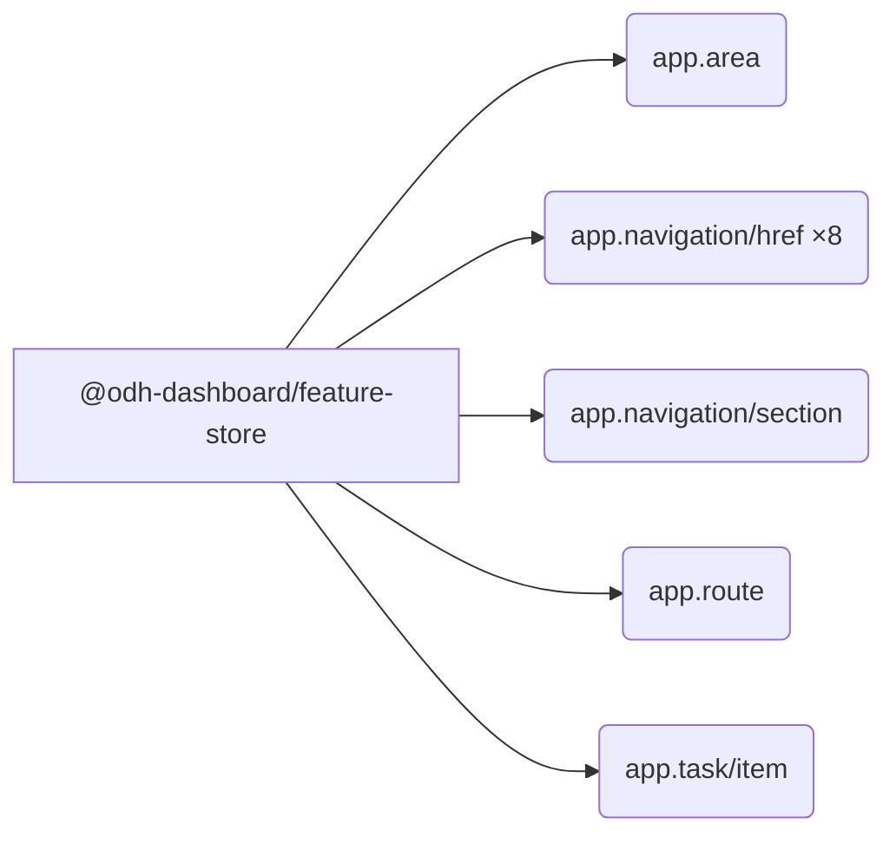

<!-- AUTO-GENERATED by @odh-dashboard/extension-map. Do not edit by hand. -->

> Generated file. Regenerate with `pnpm docs:extension-map`.

## Contents
- [Loading paths](#loading-paths)
- [Contributes](#contributes)
  - [app](#app)
    - [app.area](#apparea)
    - [app.navigation/href](#appnavigationhref)
    - [app.navigation/section](#appnavigationsection)
    - [app.route](#approute)
    - [app.task/item](#apptaskitem)

## Loading paths

| Entry | Path | Source |
| --- | --- | --- |
| @odh-dashboard/feature-store#./extensions | static | `packages/feature-store/extensions.ts` |

## Contributes

### app

| Node | Contract | Registration sources |
| --- | --- | --- |
| [@odh-dashboard/feature-store](#loading-paths) | — | — |
| app.area | [app.area](../../plugin-core/docs/extensions.md#apparea) | [../extensions.ts:21](../extensions.ts#L21-L28) [../extensions.ts:29](../extensions.ts#L29-L36) |
| app.navigation/href ×8 | [app.navigation/href](../../plugin-core/docs/extensions.md#appnavigationhref) | [../extensions.ts:49](../extensions.ts#L49-L61) [../extensions.ts:62](../extensions.ts#L62-L74) [../extensions.ts:75](../extensions.ts#L75-L87) [../extensions.ts:88](../extensions.ts#L88-L100) [../extensions.ts:101](../extensions.ts#L101-L113) [../extensions.ts:114](../extensions.ts#L114-L126) [../extensions.ts:127](../extensions.ts#L127-L139) [../extensions.ts:140](../extensions.ts#L140-L157) |
| app.navigation/section | [app.navigation/section](../../plugin-core/docs/extensions.md#appnavigationsection) | [../extensions.ts:37](../extensions.ts#L37-L48) |
| app.route | [app.route](../../plugin-core/docs/extensions.md#approute) | [../extensions.ts:158](../extensions.ts#L158-L167) [../extensions.ts:168](../extensions.ts#L168-L177) |
| app.task/item | [app.task/item](../../plugin-core/docs/extensions.md#apptaskitem) | [../extensions.ts:178](../extensions.ts#L178-L190) |

- `-->` declared or type-resolved contribution
- `==>` derived relationship
- `-. "rendered in" .->` rendered in one hop
- `-. "federated" .->` federated contribution
- `--x` suppression
- `-- "patch" -->` patch

#### app.area

| reliantAreas | featureFlags | id | Source |
| --- | --- | --- | --- |
| `SupportedArea.FEATURE_STORE` (`"feature-store"`) | `"disableFeatureStore"` | `PLUGIN_FEATURE_STORE` (`"plugin-feature-store"`) | [app.area](../extensions.ts#L21-L28) |
| `SupportedArea.FEATURE_STORE_ADMIN` (`"feature-store-admin"`) | `"featureStoreAdmin"` | `PLUGIN_FEATURE_STORE_ADMIN` (`"plugin-feature-store-admin"`) | [app.area](../extensions.ts#L29-L36) |

#### app.navigation/href

**Contribution:** `app.navigation/href` at `packages/feature-store/extensions.ts:49`

- **id**: `"featureStore-overview"`
- **title**: `"Overview"`
- **section**: `"feature-store"`
- **href**: `"/develop-train/feature-store/overview"`
- **accessReview**: —
- **path**: `"/develop-train/feature-store/overview/*"`
- **Requires**: `PLUGIN_FEATURE_STORE` (`"plugin-feature-store"`)
- **Source**: [app.navigation/href](../extensions.ts#L49-L61)

**Contribution:** `app.navigation/href` at `packages/feature-store/extensions.ts:62`

- **id**: `"featureStore-entities"`
- **title**: `"Entities"`
- **section**: `"feature-store"`
- **href**: `"/develop-train/feature-store/entities"`
- **accessReview**: —
- **path**: `"/develop-train/feature-store/entities/*"`
- **Requires**: `PLUGIN_FEATURE_STORE` (`"plugin-feature-store"`)
- **Source**: [app.navigation/href](../extensions.ts#L62-L74)

**Contribution:** `app.navigation/href` at `packages/feature-store/extensions.ts:75`

- **id**: `"featureStore-data-sources"`
- **title**: `"Data sources"`
- **section**: `"feature-store"`
- **href**: `"/develop-train/feature-store/data-sources"`
- **accessReview**: —
- **path**: `"/develop-train/feature-store/data-sources/*"`
- **Requires**: `PLUGIN_FEATURE_STORE` (`"plugin-feature-store"`)
- **Source**: [app.navigation/href](../extensions.ts#L75-L87)

**Contribution:** `app.navigation/href` at `packages/feature-store/extensions.ts:88`

- **id**: `"featureStore-datasets"`
- **title**: `"Datasets"`
- **section**: `"feature-store"`
- **href**: `"/develop-train/feature-store/datasets"`
- **accessReview**: —
- **path**: `"/develop-train/feature-store/datasets/*"`
- **Requires**: `PLUGIN_FEATURE_STORE` (`"plugin-feature-store"`)
- **Source**: [app.navigation/href](../extensions.ts#L88-L100)

**Contribution:** `app.navigation/href` at `packages/feature-store/extensions.ts:101`

- **id**: `"featureStore-features"`
- **title**: `"Features"`
- **section**: `"feature-store"`
- **href**: `"/develop-train/feature-store/features"`
- **accessReview**: —
- **path**: `"/develop-train/feature-store/features/*"`
- **Requires**: `PLUGIN_FEATURE_STORE` (`"plugin-feature-store"`)
- **Source**: [app.navigation/href](../extensions.ts#L101-L113)

**Contribution:** `app.navigation/href` at `packages/feature-store/extensions.ts:114`

- **id**: `"featureStore-feature-views"`
- **title**: `"Feature views"`
- **section**: `"feature-store"`
- **href**: `"/develop-train/feature-store/feature-views"`
- **accessReview**: —
- **path**: `"/develop-train/feature-store/feature-views/*"`
- **Requires**: `PLUGIN_FEATURE_STORE` (`"plugin-feature-store"`)
- **Source**: [app.navigation/href](../extensions.ts#L114-L126)

**Contribution:** `app.navigation/href` at `packages/feature-store/extensions.ts:127`

- **id**: `"featureStore-feature-services"`
- **title**: `"Feature services"`
- **section**: `"feature-store"`
- **href**: `"/develop-train/feature-store/feature-services"`
- **accessReview**: —
- **path**: `"/develop-train/feature-store/feature-services/*"`
- **Requires**: `PLUGIN_FEATURE_STORE` (`"plugin-feature-store"`)
- **Source**: [app.navigation/href](../extensions.ts#L127-L139)

**Contribution:** `app.navigation/href` at `packages/feature-store/extensions.ts:140`

- **id**: `"settings-feature-stores"`
- **title**: `"Feature stores"`
- **section**: `"settings-environment-setup"`
- **href**: `"/settings/environment-setup/feature-stores"`
- **accessReview**: group: `"feast.dev"`, resource: `"featurestores"`, verb: `"list"`
- **path**: `"/settings/environment-setup/feature-stores/*"`
- **Requires**: `PLUGIN_FEATURE_STORE_ADMIN` (`"plugin-feature-store-admin"`)
- **Source**: [app.navigation/href](../extensions.ts#L140-L157)

#### app.navigation/section

| id | title | section | group | Requires | Source |
| --- | --- | --- | --- | --- | --- |
| `"feature-store"` | `"Feature store"` | `"develop-and-train"` | `"1_feature_store"` | `PLUGIN_FEATURE_STORE` (`"plugin-feature-store"`) | [app.navigation/section](../extensions.ts#L37-L48) |

#### app.route

| component | path | Requires | CodeRef target | Source |
| --- | --- | --- | --- | --- |
| packages/feature-store/src/screens/manage/FeatureStoreManageRoutes.tsx#[FeatureStoreManageRoutes](../src/screens/manage/FeatureStoreManageRoutes.tsx#L12-L17) | `"/settings/environment-setup/feature-stores/*"` | `PLUGIN_FEATURE_STORE_ADMIN` (`"plugin-feature-store-admin"`) | packages/feature-store/src/screens/manage/FeatureStoreManageRoutes.tsx#[FeatureStoreManageRoutes](../src/screens/manage/FeatureStoreManageRoutes.tsx#L12-L17) | [app.route](../extensions.ts#L158-L167) |
| packages/feature-store/src/FeatureStoreRoutes.tsx#[FeatureStoreRoutes](../src/FeatureStoreRoutes.tsx#L53-L95) | `"/develop-train/feature-store/*"` | `PLUGIN_FEATURE_STORE` (`"plugin-feature-store"`) | packages/feature-store/src/FeatureStoreRoutes.tsx#[FeatureStoreRoutes](../src/FeatureStoreRoutes.tsx#L53-L95) | [app.route](../extensions.ts#L168-L177) |

#### app.task/item

| id | group | title | destination | order | Requires | Source |
| --- | --- | --- | --- | --- | --- | --- |
| `"develop-feature-store"` | `"develop-and-train"` | `"Build reusable ML features"` | href: `"/develop-train/feature-store/overview"` | `"1_feature_store"` | `PLUGIN_FEATURE_STORE` (`"plugin-feature-store"`) | [app.task/item](../extensions.ts#L178-L190) |
