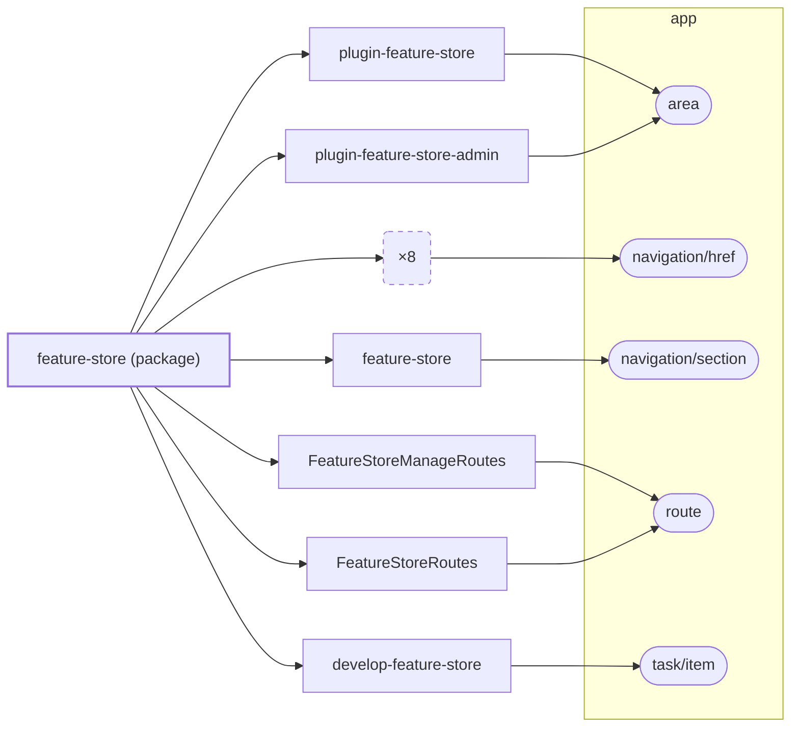

<!-- AUTO-GENERATED by @odh-dashboard/extension-map. Do not edit by hand. -->

> Generated file. Regenerate with `pnpm docs:extension-map`.

# Extensions in feature-store

Package `@odh-dashboard/feature-store` (package) at `packages/feature-store`. Everything below is read out of this repository's sources by static analysis.

## Loading paths

- [extensions.ts](../extensions.ts) (`./extensions`) — bundled into the host at build time (the `./extensions` export)

## Contributes

The extensions this package declares, grouped by the namespace of the extension point they target.

### Namespace `app`

| Node | What | Link |
| --- | --- | --- |
| feature-store (package) | this package | [packages/feature-store](..) |
| plugin-feature-store | extension of app.area — bundled | [extensions.ts](../extensions.ts#L21-L28) |
| plugin-feature-store-admin | extension of app.area — bundled | [extensions.ts](../extensions.ts#L29-L36) |
| ×8 | 8 extensions of app.navigation/href | [see the table below](#contributes-to-appnavigationhref) |
| feature-store | extension of app.navigation/section — bundled | [extensions.ts](../extensions.ts#L37-L48) |
| FeatureStoreManageRoutes | extension of app.route — bundled | [extensions.ts](../extensions.ts#L158-L167) |
| FeatureStoreRoutes | extension of app.route — bundled | [extensions.ts](../extensions.ts#L168-L177) |
| develop-feature-store | extension of app.task/item — bundled | [extensions.ts](../extensions.ts#L178-L190) |
| area | extension point | [app.area](../../plugin-core/docs/extensions.md#apparea) |
| navigation/href | extension point | [app.navigation/href](../../plugin-core/docs/extensions.md#appnavigationhref) |
| navigation/section | extension point | [app.navigation/section](../../plugin-core/docs/extensions.md#appnavigationsection) |
| route | extension point | [app.route](../../plugin-core/docs/extensions.md#approute) |
| task/item | extension point | [app.task/item](../../plugin-core/docs/extensions.md#apptaskitem) |

#### Contributes to app.area

Defined in [app.area](../../plugin-core/docs/extensions.md#apparea).

| reliantAreas | featureFlags | id | Included in | Source |
| --- | --- | --- | --- | --- |
| `SupportedArea.FEATURE_STORE` (`'feature-store'`) | `'disableFeatureStore'` | `PLUGIN_FEATURE_STORE` (`'plugin-feature-store'`) | host | [extensions.ts](../extensions.ts#L21-L28) |
| `SupportedArea.FEATURE_STORE_ADMIN` (`'feature-store-admin'`) | `'featureStoreAdmin'` | `PLUGIN_FEATURE_STORE_ADMIN` (`'plugin-feature-store-admin'`) | host | [extensions.ts](../extensions.ts#L29-L36) |

#### Contributes to app.navigation/href

Defined in [app.navigation/href](../../plugin-core/docs/extensions.md#appnavigationhref).

##### featureStore-overview

- **id:** `'featureStore-overview'`
- **title:** `'Overview'`
- **section:** `'feature-store'`
- **href:** `'/develop-train/feature-store/overview'`
- **accessReview:** —
- **path:** `'/develop-train/feature-store/overview/*'`
- **Requires:** `PLUGIN_FEATURE_STORE` (`'plugin-feature-store'`)
- **Included in:** host
- **Source:** [extensions.ts](../extensions.ts#L49-L61)

##### featureStore-entities

- **id:** `'featureStore-entities'`
- **title:** `'Entities'`
- **section:** `'feature-store'`
- **href:** `'/develop-train/feature-store/entities'`
- **accessReview:** —
- **path:** `'/develop-train/feature-store/entities/*'`
- **Requires:** `PLUGIN_FEATURE_STORE` (`'plugin-feature-store'`)
- **Included in:** host
- **Source:** [extensions.ts](../extensions.ts#L62-L74)

##### featureStore-data-sources

- **id:** `'featureStore-data-sources'`
- **title:** `'Data sources'`
- **section:** `'feature-store'`
- **href:** `'/develop-train/feature-store/data-sources'`
- **accessReview:** —
- **path:** `'/develop-train/feature-store/data-sources/*'`
- **Requires:** `PLUGIN_FEATURE_STORE` (`'plugin-feature-store'`)
- **Included in:** host
- **Source:** [extensions.ts](../extensions.ts#L75-L87)

##### featureStore-datasets

- **id:** `'featureStore-datasets'`
- **title:** `'Datasets'`
- **section:** `'feature-store'`
- **href:** `'/develop-train/feature-store/datasets'`
- **accessReview:** —
- **path:** `'/develop-train/feature-store/datasets/*'`
- **Requires:** `PLUGIN_FEATURE_STORE` (`'plugin-feature-store'`)
- **Included in:** host
- **Source:** [extensions.ts](../extensions.ts#L88-L100)

##### featureStore-features

- **id:** `'featureStore-features'`
- **title:** `'Features'`
- **section:** `'feature-store'`
- **href:** `'/develop-train/feature-store/features'`
- **accessReview:** —
- **path:** `'/develop-train/feature-store/features/*'`
- **Requires:** `PLUGIN_FEATURE_STORE` (`'plugin-feature-store'`)
- **Included in:** host
- **Source:** [extensions.ts](../extensions.ts#L101-L113)

##### featureStore-feature-views

- **id:** `'featureStore-feature-views'`
- **title:** `'Feature views'`
- **section:** `'feature-store'`
- **href:** `'/develop-train/feature-store/feature-views'`
- **accessReview:** —
- **path:** `'/develop-train/feature-store/feature-views/*'`
- **Requires:** `PLUGIN_FEATURE_STORE` (`'plugin-feature-store'`)
- **Included in:** host
- **Source:** [extensions.ts](../extensions.ts#L114-L126)

##### featureStore-feature-services

- **id:** `'featureStore-feature-services'`
- **title:** `'Feature services'`
- **section:** `'feature-store'`
- **href:** `'/develop-train/feature-store/feature-services'`
- **accessReview:** —
- **path:** `'/develop-train/feature-store/feature-services/*'`
- **Requires:** `PLUGIN_FEATURE_STORE` (`'plugin-feature-store'`)
- **Included in:** host
- **Source:** [extensions.ts](../extensions.ts#L127-L139)

##### settings-feature-stores

- **id:** `'settings-feature-stores'`
- **title:** `'Feature stores'`
- **section:** `'settings-environment-setup'`
- **href:** `'/settings/environment-setup/feature-stores'`
- **accessReview:** `{ group: 'feast.dev', resource: 'featurestores', verb: 'list' }`
- **path:** `'/settings/environment-setup/feature-stores/*'`
- **Requires:** `PLUGIN_FEATURE_STORE_ADMIN` (`'plugin-feature-store-admin'`)
- **Included in:** host
- **Source:** [extensions.ts](../extensions.ts#L140-L157)

#### Contributes to app.navigation/section

Defined in [app.navigation/section](../../plugin-core/docs/extensions.md#appnavigationsection).

| id | title | section | group | Requires | Included in | Source |
| --- | --- | --- | --- | --- | --- | --- |
| `'feature-store'` | `'Feature store'` | `'develop-and-train'` | `'1_feature_store'` | `PLUGIN_FEATURE_STORE` (`'plugin-feature-store'`) | host | [extensions.ts](../extensions.ts#L37-L48) |

#### Contributes to app.route

Defined in [app.route](../../plugin-core/docs/extensions.md#approute).

| path | Requires | CodeRef target | Included in | Source |
| --- | --- | --- | --- | --- |
| `'/settings/environment-setup/feature-stores/*'` | `PLUGIN_FEATURE_STORE_ADMIN` (`'plugin-feature-store-admin'`) | [FeatureStoreManageRoutes#default](../src/screens/manage/FeatureStoreManageRoutes.tsx#L12-L17) | host | [extensions.ts](../extensions.ts#L158-L167) |
| `'/develop-train/feature-store/*'` | `PLUGIN_FEATURE_STORE` (`'plugin-feature-store'`) | [FeatureStoreRoutes#default](../src/FeatureStoreRoutes.tsx#L53-L95) | host | [extensions.ts](../extensions.ts#L168-L177) |

#### Contributes to app.task/item

Defined in [app.task/item](../../plugin-core/docs/extensions.md#apptaskitem).

##### develop-feature-store

- **id:** `'develop-feature-store'`
- **group:** `'develop-and-train'`
- **title:** `'Build reusable ML features'`
- **destination:** `{ href: '/develop-train/feature-store/overview' }`
- **order:** `'1_feature_store'`
- **Requires:** `PLUGIN_FEATURE_STORE` (`'plugin-feature-store'`)
- **Included in:** host
- **Source:** [extensions.ts](../extensions.ts#L178-L190)

## Legend

| Edge | What it means in these diagrams |
| --- | --- |
| `A --> B` | Proven by a declaration or by the type checker. In a Contributes diagram: A is declared by this package and bundled into an app at build time; it may also be exposed through Module Federation, and the node table beside each diagram names every loading path. In a point's flow diagram: package A contributes extensions of point B, bundled into an app at build time. |
| `A -- "how" --> B` | In a point's flow diagram: consumer B queries or uses point A, proven by the type checker. The label names the query hook (or the wrapper it goes through) and the kinds of use: `lazy-render`, `jsx-render`, `hook-run`, `call`, `read`, `filter`, `type-check`. |
| `A -. "federated" .-> B` | A reaches the host only through a Module Federation remote, loaded at runtime. |
| `A ==> B` | Derived: proven through a type or a JSDoc tag rather than a direct reference. |
| `A -. "rendered in" .-> B` | B renders A as a JSX element (one hop up). |
| `A -. "called in" .-> B` | B calls A (one hop up). |
| `A --x B` | A suppresses B. |
| `A -- "patch" --> B` | A patches B. |

A node with a dashed border stands for several extensions of the same point; its `×N` label is
the number of extensions, and the table beside the diagram always lists every one of them.
Anything the analysis could not resolve is never drawn — it is listed in a "Not resolved" table
instead.
