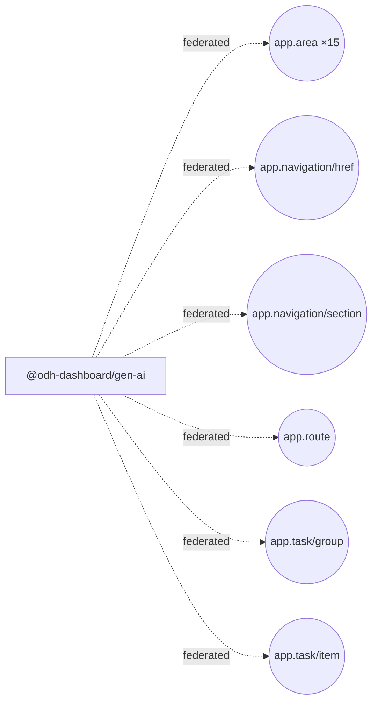
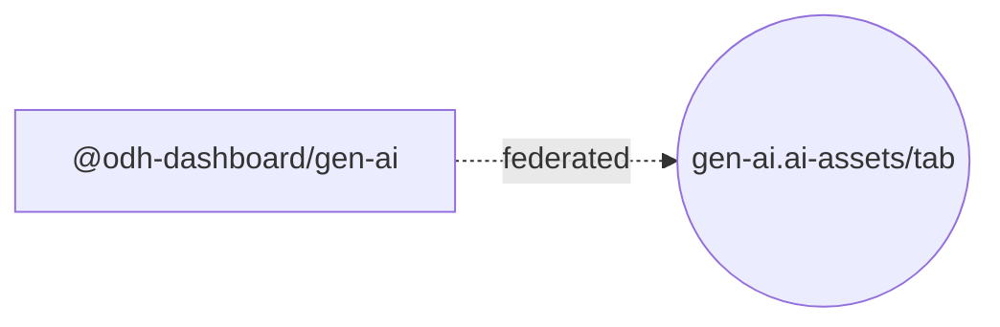

<!-- AUTO-GENERATED by @odh-dashboard/extension-map. Do not edit by hand. -->

> Generated file. Regenerate with `pnpm docs:extension-map`.

## Loading paths

| Entry | Path | Source |
| --- | --- | --- |
| @odh-dashboard/gen-ai#./extensions/static | distribution-static | `packages/gen-ai/frontend/src/odh/extensions.ts` |
| @odh-dashboard/gen-ai#mf:./extensions | federated | `packages/gen-ai/frontend/src/odh/extensions.ts` |

## Defines

### gen-ai.ai-assets/tab

| Property | Type | Required | Description |
| --- | --- | --- | --- |
| `id` | `string` | Yes |  |
| `title` | `string` | Yes |  |
| `component` | `CodeRef<ComponentType<{ children?: ReactNode; }>>` | Yes |  |
| `label` | `string` | No |  |

**Implemented by:** [@odh-dashboard/gen-ai](extensions.md#gen-aiai-assetstab)

## Contributes

### app

| Node | Link |
| --- | --- |
| @odh-dashboard/gen-ai | [@odh-dashboard/gen-ai](#contributes) |
| app.area ×15 | [app.area](../../plugin-core/docs/extensions.md#apparea) [app.area](../frontend/src/odh/extensions.ts#L45-L51) [app.area](../frontend/src/odh/extensions.ts#L52-L63) [app.area](../frontend/src/odh/extensions.ts#L64-L71) [app.area](../frontend/src/odh/extensions.ts#L72-L79) [app.area](../frontend/src/odh/extensions.ts#L80-L91) [app.area](../frontend/src/odh/extensions.ts#L92-L99) [app.area](../frontend/src/odh/extensions.ts#L100-L107) [app.area](../frontend/src/odh/extensions.ts#L108-L115) [app.area](../frontend/src/odh/extensions.ts#L116-L123) [app.area](../frontend/src/odh/extensions.ts#L124-L131) [app.area](../frontend/src/odh/extensions.ts#L132-L139) [app.area](../frontend/src/odh/extensions.ts#L140-L147) [app.area](../frontend/src/odh/extensions.ts#L148-L155) [app.area](../frontend/src/odh/extensions.ts#L156-L167) [app.area](../frontend/src/odh/extensions.ts#L168-L179) |
| app.navigation/href | [app.navigation/href](../../plugin-core/docs/extensions.md#appnavigationhref) [app.navigation/href](../frontend/src/odh/extensions.ts#L192-L204) [app.navigation/href](../frontend/src/odh/extensions.ts#L205-L217) |
| app.navigation/section | [app.navigation/section](../../plugin-core/docs/extensions.md#appnavigationsection) [app.navigation/section](../frontend/src/odh/extensions.ts#L180-L191) |
| app.route | [app.route](../../plugin-core/docs/extensions.md#approute) [app.route](../frontend/src/odh/extensions.ts#L218-L228) |
| app.task/group | [app.task/group](../../plugin-core/docs/extensions.md#apptaskgroup) [app.task/group](../frontend/src/odh/extensions.ts#L277-L288) |
| app.task/item | [app.task/item](../../plugin-core/docs/extensions.md#apptaskitem) [app.task/item](../frontend/src/odh/extensions.ts#L289-L301) [app.task/item](../frontend/src/odh/extensions.ts#L302-L314) |

- `-->` declared or type-resolved contribution
- `==>` derived relationship
- `-. "rendered in" .->` rendered in one hop
- `-. "federated" .->` federated contribution
- `--x` suppression
- `-- "patch" -->` patch

### gen-ai

| Node | Link |
| --- | --- |
| @odh-dashboard/gen-ai | [@odh-dashboard/gen-ai](#contributes) |
| gen-ai.ai-assets/tab | [gen-ai.ai-assets/tab](extensions.md#gen-aiai-assetstab) [gen-ai.ai-assets/tab](../frontend/src/odh/extensions.ts#L230-L240) [gen-ai.ai-assets/tab](../frontend/src/odh/extensions.ts#L241-L251) [gen-ai.ai-assets/tab](../frontend/src/odh/extensions.ts#L252-L262) [gen-ai.ai-assets/tab](../frontend/src/odh/extensions.ts#L263-L273) |

- `-->` declared or type-resolved contribution
- `==>` derived relationship
- `-. "rendered in" .->` rendered in one hop
- `-. "federated" .->` federated contribution
- `--x` suppression
- `-- "patch" -->` patch

#### app.area

- **reliantAreas**: 
- **devFlags**: 
- **featureFlags**: `GEN_AI_STUDIO` (`"genAiStudio"`)
- **requiredComponents**: 
- **customCondition**: 
- **id**: `PLUGIN_GEN_AI` (`"plugin-gen-ai"`)
- **Requires**: 
- **Disallows**: 
- **CodeRef target**: 
- **Included in**: 
- **Source**: [app.area](../frontend/src/odh/extensions.ts#L45-L51)

- **reliantAreas**: `PLUGIN_GEN_AI` (`"plugin-gen-ai"`)
- **devFlags**: 
- **featureFlags**: 
- **requiredComponents**: 
- **customCondition**: [not resolved](#diagnostics)
- **id**: `CHAT_PLAYGROUND` (`"chatPlayground"`)
- **Requires**: 
- **Disallows**: 
- **CodeRef target**: 
- **Included in**: 
- **Source**: [app.area](../frontend/src/odh/extensions.ts#L52-L63)

- **reliantAreas**: `PLUGIN_GEN_AI` (`"plugin-gen-ai"`)
- **devFlags**: 
- **featureFlags**: `GEN_AI_IMAGE_UPLOAD` (`"genAiImageUpload"`)
- **requiredComponents**: 
- **customCondition**: 
- **id**: `GEN_AI_IMAGE_UPLOAD` (`"genAiImageUpload"`)
- **Requires**: 
- **Disallows**: 
- **CodeRef target**: 
- **Included in**: 
- **Source**: [app.area](../frontend/src/odh/extensions.ts#L64-L71)

- **reliantAreas**: `PLUGIN_GEN_AI` (`"plugin-gen-ai"`)
- **devFlags**: 
- **featureFlags**: `GEN_AI_AUDIO_UPLOAD` (`"genAiAudioUpload"`)
- **requiredComponents**: 
- **customCondition**: 
- **id**: `GEN_AI_AUDIO_UPLOAD` (`"genAiAudioUpload"`)
- **Requires**: 
- **Disallows**: 
- **CodeRef target**: 
- **Included in**: 
- **Source**: [app.area](../frontend/src/odh/extensions.ts#L72-L79)

- **reliantAreas**: `PLUGIN_GEN_AI` (`"plugin-gen-ai"`)
- **devFlags**: 
- **featureFlags**: `GUARDRAILS` (`"guardrails"`)
- **requiredComponents**: `DataScienceStackComponent.TRUSTY_AI` (`"trustyai"`)
- **customCondition**: [not resolved](#diagnostics)
- **id**: `GUARDRAILS` (`"guardrails"`)
- **Requires**: 
- **Disallows**: 
- **CodeRef target**: 
- **Included in**: 
- **Source**: [app.area](../frontend/src/odh/extensions.ts#L80-L91)

- **reliantAreas**: `PLUGIN_GEN_AI` (`"plugin-gen-ai"`)
- **devFlags**: 
- **featureFlags**: `AI_ASSET_CUSTOM_ENDPOINTS` (`"aiAssetCustomEndpoints"`)
- **requiredComponents**: 
- **customCondition**: 
- **id**: `AI_ASSET_CUSTOM_ENDPOINTS` (`"aiAssetCustomEndpoints"`)
- **Requires**: 
- **Disallows**: 
- **CodeRef target**: 
- **Included in**: 
- **Source**: [app.area](../frontend/src/odh/extensions.ts#L92-L99)

- **reliantAreas**: `PLUGIN_GEN_AI` (`"plugin-gen-ai"`)
- **devFlags**: 
- **featureFlags**: `PROMPT_MANAGEMENT` (`"promptManagement"`)
- **requiredComponents**: 
- **customCondition**: 
- **id**: `PROMPT_MANAGEMENT` (`"promptManagement"`)
- **Requires**: 
- **Disallows**: 
- **CodeRef target**: 
- **Included in**: 
- **Source**: [app.area](../frontend/src/odh/extensions.ts#L100-L107)

- **reliantAreas**: `PROMPT_MANAGEMENT` (`"promptManagement"`)
- **devFlags**: `PROMPT_MODEL_ASSOCIATIONS` (`"promptModelAssociations"`)
- **featureFlags**: 
- **requiredComponents**: 
- **customCondition**: 
- **id**: `PROMPT_MODEL_ASSOCIATIONS` (`"promptModelAssociations"`)
- **Requires**: 
- **Disallows**: 
- **CodeRef target**: 
- **Included in**: 
- **Source**: [app.area](../frontend/src/odh/extensions.ts#L108-L115)

- **reliantAreas**: `PLUGIN_GEN_AI` (`"plugin-gen-ai"`)
- **devFlags**: 
- **featureFlags**: `EXTERNAL_VECTOR_STORES` (`"externalVectorStores"`)
- **requiredComponents**: 
- **customCondition**: 
- **id**: `EXTERNAL_VECTOR_STORES` (`"externalVectorStores"`)
- **Requires**: 
- **Disallows**: 
- **CodeRef target**: 
- **Included in**: 
- **Source**: [app.area](../frontend/src/odh/extensions.ts#L116-L123)

- **reliantAreas**: `PLUGIN_GEN_AI` (`"plugin-gen-ai"`)
- **devFlags**: 
- **featureFlags**: `AGENT_CONFIG_MANAGEMENT` (`"agentConfigManagement"`)
- **requiredComponents**: 
- **customCondition**: 
- **id**: `AGENT_CONFIG_MANAGEMENT` (`"agentConfigManagement"`)
- **Requires**: 
- **Disallows**: 
- **CodeRef target**: 
- **Included in**: 
- **Source**: [app.area](../frontend/src/odh/extensions.ts#L124-L131)

- **reliantAreas**: `PLUGIN_GEN_AI` (`"plugin-gen-ai"`)
- **devFlags**: 
- **featureFlags**: `GEN_AI_AGENT_DEPLOYMENT` (`"genAiAgentDeployment"`)
- **requiredComponents**: 
- **customCondition**: 
- **id**: `GEN_AI_AGENT_DEPLOYMENT` (`"genAiAgentDeployment"`)
- **Requires**: 
- **Disallows**: 
- **CodeRef target**: 
- **Included in**: 
- **Source**: [app.area](../frontend/src/odh/extensions.ts#L132-L139)

- **reliantAreas**: `PLUGIN_GEN_AI` (`"plugin-gen-ai"`)
- **devFlags**: 
- **featureFlags**: `MCP_REGISTRY` (`"mcpRegistry"`)
- **requiredComponents**: 
- **customCondition**: 
- **id**: `MCP_REGISTRY` (`"mcpRegistry"`)
- **Requires**: 
- **Disallows**: 
- **CodeRef target**: 
- **Included in**: 
- **Source**: [app.area](../frontend/src/odh/extensions.ts#L140-L147)

- **reliantAreas**: `PLUGIN_GEN_AI` (`"plugin-gen-ai"`)
- **devFlags**: 
- **featureFlags**: `GEN_AI_MCP_REGISTRY_SERVERS` (`"genAiMcpRegistryServers"`)
- **requiredComponents**: 
- **customCondition**: 
- **id**: `GEN_AI_MCP_REGISTRY_SERVERS` (`"genAiMcpRegistryServers"`)
- **Requires**: 
- **Disallows**: 
- **CodeRef target**: 
- **Included in**: 
- **Source**: [app.area](../frontend/src/odh/extensions.ts#L148-L155)

- **reliantAreas**: `PLUGIN_GEN_AI` (`"plugin-gen-ai"`)
- **devFlags**: 
- **featureFlags**: `GEN_AI_TRACING` (`"genAiTracing"`)
- **requiredComponents**: 
- **customCondition**: [not resolved](#diagnostics)
- **id**: `GEN_AI_TRACING` (`"genAiTracing"`)
- **Requires**: 
- **Disallows**: 
- **CodeRef target**: 
- **Included in**: 
- **Source**: [app.area](../frontend/src/odh/extensions.ts#L156-L167)

- **reliantAreas**: `PLUGIN_GEN_AI` (`"plugin-gen-ai"`)
- **devFlags**: 
- **featureFlags**: `MODEL_AS_SERVICE_CAMEL` (`"modelAsService"`)
- **requiredComponents**: 
- **customCondition**: [not resolved](#diagnostics)
- **id**: `MODEL_AS_SERVICE_CAMEL` (`"modelAsService"`)
- **Requires**: 
- **Disallows**: 
- **CodeRef target**: 
- **Included in**: 
- **Source**: [app.area](../frontend/src/odh/extensions.ts#L168-L179)

**Not resolved**

| Location | Reason | Link |
| --- | --- | --- |
| properties.customCondition | CodeRef body is not a supported dynamic import | [diagnostics](#diagnostics) |
| properties.customCondition | CodeRef body is not a supported dynamic import | [diagnostics](#diagnostics) |
| properties.customCondition | CodeRef body is not a supported dynamic import | [diagnostics](#diagnostics) |
| properties.customCondition | CodeRef body is not a supported dynamic import | [diagnostics](#diagnostics) |

#### app.navigation/href

- **id**: `"chat-playground"`
- **title**: `"Playground"`
- **section**: `"gen-ai-studio"`
- **href**: `chatPlaygroundRootPath` (`"/gen-ai-studio/playground"`)
- **path**: `globChatPlaygroundAll` (`"/gen-ai-studio/playground/*"`)
- **Requires**: `CHAT_PLAYGROUND` (`"chatPlayground"`)
- **Disallows**: 
- **CodeRef target**: 
- **Included in**: 
- **Source**: [app.navigation/href](../frontend/src/odh/extensions.ts#L192-L204)

- **id**: `"ai-assets"`
- **title**: `"AI asset endpoints"`
- **section**: `"gen-ai-studio"`
- **href**: `aiAssetsRootPath` (`"/gen-ai-studio/assets"`)
- **path**: `globAiAssetsAll` (`"/gen-ai-studio/assets/*"`)
- **Requires**: `PLUGIN_GEN_AI` (`"plugin-gen-ai"`)
- **Disallows**: 
- **CodeRef target**: 
- **Included in**: 
- **Source**: [app.navigation/href](../frontend/src/odh/extensions.ts#L205-L217)

#### app.navigation/section

- **id**: `"gen-ai-studio"`
- **title**: `"Gen AI studio"`
- **group**: `"4_gen_ai_studio"`
- **iconRef**: packages/gen-ai/frontend/src/odh/GenAiStudioNavIcon.ts#[GenAiStudioNavIcon](../frontend/src/odh/GenAiStudioNavIcon.ts#L3-L11)
- **Requires**: `PLUGIN_GEN_AI` (`"plugin-gen-ai"`)
- **Disallows**: 
- **CodeRef target**: packages/gen-ai/frontend/src/odh/GenAiStudioNavIcon.ts#[GenAiStudioNavIcon](../frontend/src/odh/GenAiStudioNavIcon.ts#L3-L11)
- **Included in**: 
- **Source**: [app.navigation/section](../frontend/src/odh/extensions.ts#L180-L191)

#### app.route

- **id**: `"gen-ai-routes"`
- **component**: packages/gen-ai/frontend/src/odh/GenAiWrapper.tsx#[GenAiWrapper](../frontend/src/odh/GenAiWrapper.tsx#L39-L53)
- **path**: `globGenAiAll` (`"/gen-ai-studio/*"`)
- **Requires**: `PLUGIN_GEN_AI` (`"plugin-gen-ai"`)
- **Disallows**: 
- **CodeRef target**: packages/gen-ai/frontend/src/odh/GenAiWrapper.tsx#[GenAiWrapper](../frontend/src/odh/GenAiWrapper.tsx#L39-L53)
- **Included in**: 
- **Source**: [app.route](../frontend/src/odh/extensions.ts#L218-L228)

#### app.task/group

- **id**: `"gen-ai-studio"`
- **title**: `"Gen AI studio"`
- **description**: `"Prototype, test, and manage models and applications."`
- **label**: `"Test gen AI models and apps"`
- **icon**: packages/gen-ai/frontend/src/odh/GenAiStudioNavIcon.ts#[GenAiStudioNavIcon](../frontend/src/odh/GenAiStudioNavIcon.ts#L3-L11)
- **type**: `"organize"`
- **order**: `"2_gen_ai_studio"`
- **Requires**: 
- **Disallows**: 
- **CodeRef target**: packages/gen-ai/frontend/src/odh/GenAiStudioNavIcon.ts#[GenAiStudioNavIcon](../frontend/src/odh/GenAiStudioNavIcon.ts#L3-L11)
- **Included in**: 
- **Source**: [app.task/group](../frontend/src/odh/extensions.ts#L277-L288)

#### app.task/item

- **id**: `"genai-playground"`
- **group**: `"gen-ai-studio"`
- **title**: `"Chat with models"`
- **destination**: href: `chatPlaygroundRootPath` (`"/gen-ai-studio/playground"`)
- **order**: `"1_playground"`
- **Requires**: `CHAT_PLAYGROUND` (`"chatPlayground"`)
- **Disallows**: 
- **CodeRef target**: 
- **Included in**: 
- **Source**: [app.task/item](../frontend/src/odh/extensions.ts#L289-L301)

- **id**: `"genai-ai-assets"`
- **group**: `"gen-ai-studio"`
- **title**: `"Browse available AI assets"`
- **destination**: href: `aiAssetsRootPath` (`"/gen-ai-studio/assets"`)
- **order**: `"2_ai_assets"`
- **Requires**: `PLUGIN_GEN_AI` (`"plugin-gen-ai"`)
- **Disallows**: 
- **CodeRef target**: 
- **Included in**: 
- **Source**: [app.task/item](../frontend/src/odh/extensions.ts#L302-L314)

#### gen-ai.ai-assets/tab

- **id**: `"models"`
- **title**: `"Models"`
- **component**: packages/gen-ai/frontend/src/app/AIAssets/AIAssetsModelsTab.tsx#[AIAssetsModelsTab](../frontend/src/app/AIAssets/AIAssetsModelsTab.tsx#L28-L261)
- **Requires**: `PLUGIN_GEN_AI` (`"plugin-gen-ai"`)
- **Disallows**: 
- **CodeRef target**: packages/gen-ai/frontend/src/app/AIAssets/AIAssetsModelsTab.tsx#[AIAssetsModelsTab](../frontend/src/app/AIAssets/AIAssetsModelsTab.tsx#L28-L261)
- **Included in**: 
- **Source**: [gen-ai.ai-assets/tab](../frontend/src/odh/extensions.ts#L230-L240)

- **id**: `"mcpservers"`
- **title**: `"MCP servers"`
- **component**: packages/gen-ai/frontend/src/app/AIAssets/AIAssetsMCPTab.tsx#[AIAssetsMCPTab](../frontend/src/app/AIAssets/AIAssetsMCPTab.tsx#L23-L102)
- **Requires**: `PLUGIN_GEN_AI` (`"plugin-gen-ai"`)
- **Disallows**: 
- **CodeRef target**: packages/gen-ai/frontend/src/app/AIAssets/AIAssetsMCPTab.tsx#[AIAssetsMCPTab](../frontend/src/app/AIAssets/AIAssetsMCPTab.tsx#L23-L102)
- **Included in**: 
- **Source**: [gen-ai.ai-assets/tab](../frontend/src/odh/extensions.ts#L241-L251)

- **id**: `"vectorstores"`
- **title**: `"Vector stores"`
- **component**: packages/gen-ai/frontend/src/app/AIAssets/AIAssetsVectorStoresTab.tsx#[AIAssetsVectorStoresTab](../frontend/src/app/AIAssets/AIAssetsVectorStoresTab.tsx#L11-L73)
- **Requires**: `PLUGIN_GEN_AI` (`"plugin-gen-ai"`), `EXTERNAL_VECTOR_STORES` (`"externalVectorStores"`)
- **Disallows**: 
- **CodeRef target**: packages/gen-ai/frontend/src/app/AIAssets/AIAssetsVectorStoresTab.tsx#[AIAssetsVectorStoresTab](../frontend/src/app/AIAssets/AIAssetsVectorStoresTab.tsx#L11-L73)
- **Included in**: 
- **Source**: [gen-ai.ai-assets/tab](../frontend/src/odh/extensions.ts#L252-L262)

- **id**: `"agentprofile"`
- **title**: `"Agents"`
- **component**: packages/gen-ai/frontend/src/app/AIAssets/AIAssetsAgentProfilesTab.tsx#[AIAssetsAgentProfilesTab](../frontend/src/app/AIAssets/AIAssetsAgentProfilesTab.tsx#L10-L66)
- **Requires**: `PLUGIN_GEN_AI` (`"plugin-gen-ai"`), `AGENT_CONFIG_MANAGEMENT` (`"agentConfigManagement"`)
- **Disallows**: 
- **CodeRef target**: packages/gen-ai/frontend/src/app/AIAssets/AIAssetsAgentProfilesTab.tsx#[AIAssetsAgentProfilesTab](../frontend/src/app/AIAssets/AIAssetsAgentProfilesTab.tsx#L10-L66)
- **Included in**: 
- **Source**: [gen-ai.ai-assets/tab](../frontend/src/odh/extensions.ts#L263-L273)

## Diagnostics

| Code | Message | Link |
| --- | --- | --- |
| `point-no-jsdoc` | extension point 'gen-ai.ai-assets/tab' (AIAssetsTabExtension) has no JSDoc summary | [AIAssetsTabExtension](../frontend/src/odh/extension-points/ai-assets.ts#L4-L12) |
| `unresolved-value` | extension property 'customCondition' contains a value that could not be resolved | [customCondition](../frontend/src/odh/extensions.ts#L58-L61) |
| `unresolved-value` | extension property 'customCondition' contains a value that could not be resolved | [customCondition](../frontend/src/odh/extensions.ts#L87-L89) |
| `unresolved-value` | extension property 'customCondition' contains a value that could not be resolved | [customCondition](../frontend/src/odh/extensions.ts#L162-L165) |
| `unresolved-value` | extension property 'customCondition' contains a value that could not be resolved | [customCondition](../frontend/src/odh/extensions.ts#L174-L177) |
