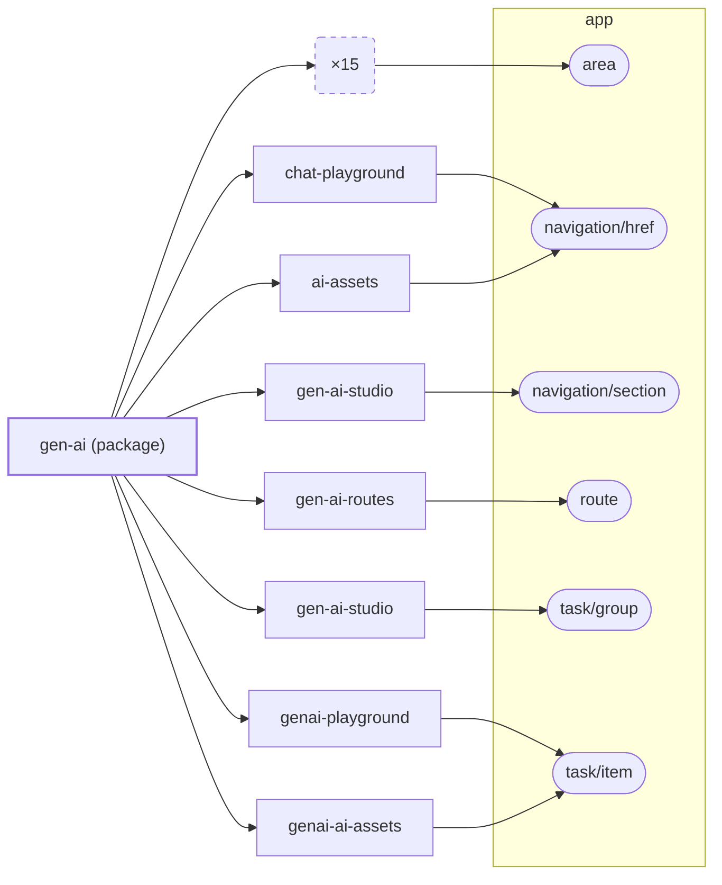

<!-- AUTO-GENERATED by @odh-dashboard/extension-map. Do not edit by hand. -->

> Generated file. Regenerate with `pnpm docs:extension-map`.

# Extensions in gen-ai

Package `@odh-dashboard/gen-ai` (package) at `packages/gen-ai`. Everything below is read out of this repository's sources by static analysis.

## Loading paths

- [extensions.ts](../frontend/src/odh/extensions.ts) (`./extensions/static`) — bundled by a distribution that imports this export
- [extensions.ts](../frontend/src/odh/extensions.ts) (`mf:./extensions`) — loaded at runtime by the host as a Module Federation remote

## Defines

The extension points this package declares. Each heading is the point ID other packages use as an extension's `type`.

### gen-ai.ai-assets/tab

Declared as [AIAssetsTabExtension](../frontend/src/odh/extension-points/ai-assets.ts#L4-L12).

**Properties:**

| Property | Required | Type | CodeRef of | Description |
| --- | --- | --- | --- | --- |
| `id` | yes | `string` | — |  |
| `title` | yes | `string` | — |  |
| `component` | yes | `CodeRef<ComponentType<{ children?: React.ReactNode }>>` | `ComponentType<{ children?: ReactNode; }>` |  |
| `label` | — | `string` | — |  |

**Implemented by:** [gen-ai](#contributes-to-gen-aiai-assetstab)

**Consumed in:** [gen-ai](#consumes-gen-aiai-assetstab)

```mermaid
flowchart LR
  classDef pkg stroke-width:2px
  classDef point stroke-width:1px
  n_pkg__odh_dashboard_gen_ai_f11571["gen-ai (package)"]:::pkg
  n_gen_ai_ai_assets_tab_775728(["gen-ai.ai-assets/tab"]):::point
  n_pkg__odh_dashboard_gen_ai_f11571 --> n_gen_ai_ai_assets_tab_775728
  n_symbol_packages_gen_ai_frontend_src_app_AIAssets_AIAssetsPage_tsx_AIAssetsPage_59d8f1["AIAssetsPage"]
  n_gen_ai_ai_assets_tab_775728 -- "useExtensions, lazy-render, read" --> n_symbol_packages_gen_ai_frontend_src_app_AIAssets_AIAssetsPage_tsx_AIAssetsPage_59d8f1
  n_symbol_packages_gen_ai_frontend_src_app_AppRoutes_tsx_AppRoutes_957e8f("AppRoutes")
  n_symbol_packages_gen_ai_frontend_src_app_AIAssets_AIAssetsPage_tsx_AIAssetsPage_59d8f1 -. "rendered in" .-> n_symbol_packages_gen_ai_frontend_src_app_AppRoutes_tsx_AppRoutes_957e8f
```

| Node | What | Link |
| --- | --- | --- |
| gen-ai (package) | contributes extensions of this point | [gen-ai](#contributes-to-gen-aiai-assetstab) |
| gen-ai.ai-assets/tab | this extension point | [gen-ai.ai-assets/tab](#gen-aiai-assetstab) |
| AIAssetsPage | consumer in @odh-dashboard/gen-ai — useExtensions, lazy-render, read | [AIAssetsPage](../frontend/src/app/AIAssets/AIAssetsPage.tsx#L24-L117) |
| AppRoutes | renders AIAssetsPage (one hop up) | renders AIAssetsPage at [AppRoutes.tsx:80](../frontend/src/app/AppRoutes.tsx#L80) renders AIAssetsPage at [AppRoutes.tsx:81](../frontend/src/app/AppRoutes.tsx#L81) renders AIAssetsPage at [AppRoutes.tsx:82](../frontend/src/app/AppRoutes.tsx#L82) |

## Contributes

The extensions this package declares, grouped by the namespace of the extension point they target.

### Namespace `app`

| Node | What | Link |
| --- | --- | --- |
| gen-ai (package) | this package | [packages/gen-ai](..) |
| ×15 | 15 extensions of app.area | [see the table below](#contributes-to-apparea) |
| chat-playground | extension of app.navigation/href — bundled by a distribution and federated | [extensions.ts](../frontend/src/odh/extensions.ts#L192-L204) |
| ai-assets | extension of app.navigation/href — bundled by a distribution and federated | [extensions.ts](../frontend/src/odh/extensions.ts#L205-L217) |
| gen-ai-studio | extension of app.navigation/section — bundled by a distribution and federated | [extensions.ts](../frontend/src/odh/extensions.ts#L180-L191) |
| gen-ai-routes | extension of app.route — bundled by a distribution and federated | [extensions.ts](../frontend/src/odh/extensions.ts#L218-L228) |
| gen-ai-studio | extension of app.task/group — bundled by a distribution and federated | [extensions.ts](../frontend/src/odh/extensions.ts#L277-L288) |
| genai-playground | extension of app.task/item — bundled by a distribution and federated | [extensions.ts](../frontend/src/odh/extensions.ts#L289-L301) |
| genai-ai-assets | extension of app.task/item — bundled by a distribution and federated | [extensions.ts](../frontend/src/odh/extensions.ts#L302-L314) |
| area | extension point | [app.area](../../plugin-core/docs/extensions.md#apparea) |
| navigation/href | extension point | [app.navigation/href](../../plugin-core/docs/extensions.md#appnavigationhref) |
| navigation/section | extension point | [app.navigation/section](../../plugin-core/docs/extensions.md#appnavigationsection) |
| route | extension point | [app.route](../../plugin-core/docs/extensions.md#approute) |
| task/group | extension point | [app.task/group](../../plugin-core/docs/extensions.md#apptaskgroup) |
| task/item | extension point | [app.task/item](../../plugin-core/docs/extensions.md#apptaskitem) |

#### Contributes to app.area

Defined in [app.area](../../plugin-core/docs/extensions.md#apparea).

##### plugin-gen-ai

- **reliantAreas:** —
- **devFlags:** —
- **featureFlags:** `GEN_AI_STUDIO` (`'genAiStudio'`)
- **requiredComponents:** —
- **customCondition:** —
- **id:** `PLUGIN_GEN_AI` (`'plugin-gen-ai'`)
- **Included in:** host, maas-portal
- **Source:** [extensions.ts](../frontend/src/odh/extensions.ts#L45-L51)

##### chatPlayground

- **reliantAreas:** `PLUGIN_GEN_AI` (`'plugin-gen-ai'`)
- **devFlags:** —
- **featureFlags:** (empty)
- **requiredComponents:** —
- **customCondition:** `function` ([customCondition](../frontend/src/odh/extensions.ts#L58-L61))
- **id:** `CHAT_PLAYGROUND` (`'chatPlayground'`)
- **Included in:** host, maas-portal
- **Source:** [extensions.ts](../frontend/src/odh/extensions.ts#L52-L63)

##### genAiImageUpload

- **reliantAreas:** `PLUGIN_GEN_AI` (`'plugin-gen-ai'`)
- **devFlags:** —
- **featureFlags:** `GEN_AI_IMAGE_UPLOAD` (`'genAiImageUpload'`)
- **requiredComponents:** —
- **customCondition:** —
- **id:** `GEN_AI_IMAGE_UPLOAD` (`'genAiImageUpload'`)
- **Included in:** host, maas-portal
- **Source:** [extensions.ts](../frontend/src/odh/extensions.ts#L64-L71)

##### genAiAudioUpload

- **reliantAreas:** `PLUGIN_GEN_AI` (`'plugin-gen-ai'`)
- **devFlags:** —
- **featureFlags:** `GEN_AI_AUDIO_UPLOAD` (`'genAiAudioUpload'`)
- **requiredComponents:** —
- **customCondition:** —
- **id:** `GEN_AI_AUDIO_UPLOAD` (`'genAiAudioUpload'`)
- **Included in:** host, maas-portal
- **Source:** [extensions.ts](../frontend/src/odh/extensions.ts#L72-L79)

##### guardrails

- **reliantAreas:** `PLUGIN_GEN_AI` (`'plugin-gen-ai'`)
- **devFlags:** —
- **featureFlags:** `GUARDRAILS` (`'guardrails'`)
- **requiredComponents:** `DataScienceStackComponent.TRUSTY_AI` (`'trustyai'`)
- **customCondition:** `function` ([customCondition](../frontend/src/odh/extensions.ts#L87-L89))
- **id:** `GUARDRAILS` (`'guardrails'`)
- **Included in:** host, maas-portal
- **Source:** [extensions.ts](../frontend/src/odh/extensions.ts#L80-L91)

##### aiAssetCustomEndpoints

- **reliantAreas:** `PLUGIN_GEN_AI` (`'plugin-gen-ai'`)
- **devFlags:** —
- **featureFlags:** `AI_ASSET_CUSTOM_ENDPOINTS` (`'aiAssetCustomEndpoints'`)
- **requiredComponents:** —
- **customCondition:** —
- **id:** `AI_ASSET_CUSTOM_ENDPOINTS` (`'aiAssetCustomEndpoints'`)
- **Included in:** host, maas-portal
- **Source:** [extensions.ts](../frontend/src/odh/extensions.ts#L92-L99)

##### promptManagement

- **reliantAreas:** `PLUGIN_GEN_AI` (`'plugin-gen-ai'`)
- **devFlags:** —
- **featureFlags:** `PROMPT_MANAGEMENT` (`'promptManagement'`)
- **requiredComponents:** —
- **customCondition:** —
- **id:** `PROMPT_MANAGEMENT` (`'promptManagement'`)
- **Included in:** host, maas-portal
- **Source:** [extensions.ts](../frontend/src/odh/extensions.ts#L100-L107)

##### promptModelAssociations

- **reliantAreas:** `PROMPT_MANAGEMENT` (`'promptManagement'`)
- **devFlags:** `PROMPT_MODEL_ASSOCIATIONS` (`'promptModelAssociations'`)
- **featureFlags:** —
- **requiredComponents:** —
- **customCondition:** —
- **id:** `PROMPT_MODEL_ASSOCIATIONS` (`'promptModelAssociations'`)
- **Included in:** host, maas-portal
- **Source:** [extensions.ts](../frontend/src/odh/extensions.ts#L108-L115)

##### externalVectorStores

- **reliantAreas:** `PLUGIN_GEN_AI` (`'plugin-gen-ai'`)
- **devFlags:** —
- **featureFlags:** `EXTERNAL_VECTOR_STORES` (`'externalVectorStores'`)
- **requiredComponents:** —
- **customCondition:** —
- **id:** `EXTERNAL_VECTOR_STORES` (`'externalVectorStores'`)
- **Included in:** host, maas-portal
- **Source:** [extensions.ts](../frontend/src/odh/extensions.ts#L116-L123)

##### agentConfigManagement

- **reliantAreas:** `PLUGIN_GEN_AI` (`'plugin-gen-ai'`)
- **devFlags:** —
- **featureFlags:** `AGENT_CONFIG_MANAGEMENT` (`'agentConfigManagement'`)
- **requiredComponents:** —
- **customCondition:** —
- **id:** `AGENT_CONFIG_MANAGEMENT` (`'agentConfigManagement'`)
- **Included in:** host, maas-portal
- **Source:** [extensions.ts](../frontend/src/odh/extensions.ts#L124-L131)

##### genAiAgentDeployment

- **reliantAreas:** `PLUGIN_GEN_AI` (`'plugin-gen-ai'`)
- **devFlags:** —
- **featureFlags:** `GEN_AI_AGENT_DEPLOYMENT` (`'genAiAgentDeployment'`)
- **requiredComponents:** —
- **customCondition:** —
- **id:** `GEN_AI_AGENT_DEPLOYMENT` (`'genAiAgentDeployment'`)
- **Included in:** host, maas-portal
- **Source:** [extensions.ts](../frontend/src/odh/extensions.ts#L132-L139)

##### mcpRegistry

- **reliantAreas:** `PLUGIN_GEN_AI` (`'plugin-gen-ai'`)
- **devFlags:** —
- **featureFlags:** `MCP_REGISTRY` (`'mcpRegistry'`)
- **requiredComponents:** —
- **customCondition:** —
- **id:** `MCP_REGISTRY` (`'mcpRegistry'`)
- **Included in:** host, maas-portal
- **Source:** [extensions.ts](../frontend/src/odh/extensions.ts#L140-L147)

##### genAiMcpRegistryServers

- **reliantAreas:** `PLUGIN_GEN_AI` (`'plugin-gen-ai'`)
- **devFlags:** —
- **featureFlags:** `GEN_AI_MCP_REGISTRY_SERVERS` (`'genAiMcpRegistryServers'`)
- **requiredComponents:** —
- **customCondition:** —
- **id:** `GEN_AI_MCP_REGISTRY_SERVERS` (`'genAiMcpRegistryServers'`)
- **Included in:** host, maas-portal
- **Source:** [extensions.ts](../frontend/src/odh/extensions.ts#L148-L155)

##### genAiTracing

- **reliantAreas:** `PLUGIN_GEN_AI` (`'plugin-gen-ai'`)
- **devFlags:** —
- **featureFlags:** `GEN_AI_TRACING` (`'genAiTracing'`)
- **requiredComponents:** —
- **customCondition:** `function` ([customCondition](../frontend/src/odh/extensions.ts#L162-L165))
- **id:** `GEN_AI_TRACING` (`'genAiTracing'`)
- **Included in:** host, maas-portal
- **Source:** [extensions.ts](../frontend/src/odh/extensions.ts#L156-L167)

##### modelAsService

- **reliantAreas:** `PLUGIN_GEN_AI` (`'plugin-gen-ai'`)
- **devFlags:** —
- **featureFlags:** `MODEL_AS_SERVICE_CAMEL` (`'modelAsService'`)
- **requiredComponents:** —
- **customCondition:** `function` ([customCondition](../frontend/src/odh/extensions.ts#L174-L177))
- **id:** `MODEL_AS_SERVICE_CAMEL` (`'modelAsService'`)
- **Included in:** host, maas-portal
- **Source:** [extensions.ts](../frontend/src/odh/extensions.ts#L168-L179)

#### Contributes to app.navigation/href

Defined in [app.navigation/href](../../plugin-core/docs/extensions.md#appnavigationhref).

##### chat-playground

- **id:** `'chat-playground'`
- **title:** `'Playground'`
- **section:** `'gen-ai-studio'`
- **href:** `chatPlaygroundRootPath` (`'/gen-ai-studio/playground'`)
- **path:** `globChatPlaygroundAll` (`'/gen-ai-studio/playground/*'`)
- **Requires:** `CHAT_PLAYGROUND` (`'chatPlayground'`)
- **Included in:** host, maas-portal
- **Source:** [extensions.ts](../frontend/src/odh/extensions.ts#L192-L204)

##### ai-assets

- **id:** `'ai-assets'`
- **title:** `'AI asset endpoints'`
- **section:** `'gen-ai-studio'`
- **href:** `aiAssetsRootPath` (`'/gen-ai-studio/assets'`)
- **path:** `globAiAssetsAll` (`'/gen-ai-studio/assets/*'`)
- **Requires:** `PLUGIN_GEN_AI` (`'plugin-gen-ai'`)
- **Included in:** host, maas-portal
- **Source:** [extensions.ts](../frontend/src/odh/extensions.ts#L205-L217)

**Suppressed / patched in** (overrides an app applies to these contributions):

| Contribution | App | Effect | By |
| --- | --- | --- | --- |
| chat-playground | maas-portal | suppressed | [extensions.ts:82](../../../distributions/maas-portal/src/extensions.ts#L82-L88) |
| ai-assets | maas-portal | suppressed | [extensions.ts:73](../../../distributions/maas-portal/src/extensions.ts#L73-L79) |
| ai-assets | maas-portal | patch has no effect: suppressed (would set `section` = `null`, `group` = `'1_ai_assets'`, `label` = `null`) | [extensions.ts:91](../../../distributions/maas-portal/src/extensions.ts#L91-L98) |

#### Contributes to app.navigation/section

Defined in [app.navigation/section](../../plugin-core/docs/extensions.md#appnavigationsection).

| id | title | group | Requires | CodeRef target | Included in | Source |
| --- | --- | --- | --- | --- | --- | --- |
| `'gen-ai-studio'` | `'Gen AI studio'` | `'4_gen_ai_studio'` | `PLUGIN_GEN_AI` (`'plugin-gen-ai'`) | [GenAiStudioNavIcon#default](../frontend/src/odh/GenAiStudioNavIcon.ts#L3-L11) | host, maas-portal | [extensions.ts](../frontend/src/odh/extensions.ts#L180-L191) |

**Suppressed / patched in** (overrides an app applies to these contributions):

| Contribution | App | Effect | By |
| --- | --- | --- | --- |
| gen-ai-studio | maas-portal | suppressed | [extensions.ts:36](../../../distributions/maas-portal/src/extensions.ts#L36-L42) |

#### Contributes to app.route

Defined in [app.route](../../plugin-core/docs/extensions.md#approute).

| id | path | Requires | CodeRef target | Included in | Source |
| --- | --- | --- | --- | --- | --- |
| `'gen-ai-routes'` | `globGenAiAll` (`'/gen-ai-studio/*'`) | `PLUGIN_GEN_AI` (`'plugin-gen-ai'`) | [GenAiWrapper#default](../frontend/src/odh/GenAiWrapper.tsx#L39-L53) | host, maas-portal | [extensions.ts](../frontend/src/odh/extensions.ts#L218-L228) |

**Suppressed / patched in** (overrides an app applies to these contributions):

| Contribution | App | Effect | By |
| --- | --- | --- | --- |
| gen-ai-routes | maas-portal | suppressed | [extensions.ts:45](../../../distributions/maas-portal/src/extensions.ts#L45-L51) |

#### Contributes to app.task/group

Defined in [app.task/group](../../plugin-core/docs/extensions.md#apptaskgroup).

##### gen-ai-studio

- **id:** `'gen-ai-studio'`
- **title:** `'Gen AI studio'`
- **description:** `'Prototype, test, and manage models and applications.'`
- **label:** `'Test gen AI models and apps'`
- **type:** `'organize'`
- **order:** `'2_gen_ai_studio'`
- **CodeRef target:** [GenAiStudioNavIcon#default](../frontend/src/odh/GenAiStudioNavIcon.ts#L3-L11)
- **Included in:** host, maas-portal
- **Source:** [extensions.ts](../frontend/src/odh/extensions.ts#L277-L288)

#### Contributes to app.task/item

Defined in [app.task/item](../../plugin-core/docs/extensions.md#apptaskitem).

##### genai-playground

- **id:** `'genai-playground'`
- **group:** `'gen-ai-studio'`
- **title:** `'Chat with models'`
- **destination:** `{ href: chatPlaygroundRootPath ('/gen-ai-studio/playground') }`
- **order:** `'1_playground'`
- **Requires:** `CHAT_PLAYGROUND` (`'chatPlayground'`)
- **Included in:** host, maas-portal
- **Source:** [extensions.ts](../frontend/src/odh/extensions.ts#L289-L301)

##### genai-ai-assets

- **id:** `'genai-ai-assets'`
- **group:** `'gen-ai-studio'`
- **title:** `'Browse available AI assets'`
- **destination:** `{ href: aiAssetsRootPath ('/gen-ai-studio/assets') }`
- **order:** `'2_ai_assets'`
- **Requires:** `PLUGIN_GEN_AI` (`'plugin-gen-ai'`)
- **Included in:** host, maas-portal
- **Source:** [extensions.ts](../frontend/src/odh/extensions.ts#L302-L314)

### Namespace `gen-ai`

| Node | What | Link |
| --- | --- | --- |
| gen-ai (package) | this package | [packages/gen-ai](..) |
| models | extension of gen-ai.ai-assets/tab — bundled by a distribution and federated | [extensions.ts](../frontend/src/odh/extensions.ts#L230-L240) |
| mcpservers | extension of gen-ai.ai-assets/tab — bundled by a distribution and federated | [extensions.ts](../frontend/src/odh/extensions.ts#L241-L251) |
| vectorstores | extension of gen-ai.ai-assets/tab — bundled by a distribution and federated | [extensions.ts](../frontend/src/odh/extensions.ts#L252-L262) |
| agentprofile | extension of gen-ai.ai-assets/tab — bundled by a distribution and federated | [extensions.ts](../frontend/src/odh/extensions.ts#L263-L273) |
| ai-assets/tab | extension point | [gen-ai.ai-assets/tab](#gen-aiai-assetstab) |

#### Contributes to gen-ai.ai-assets/tab

Defined in [gen-ai.ai-assets/tab](#gen-aiai-assetstab).

| id | title | Requires | CodeRef target | Included in | Source |
| --- | --- | --- | --- | --- | --- |
| `'models'` | `'Models'` | `PLUGIN_GEN_AI` (`'plugin-gen-ai'`) | [AIAssetsModelsTab#default](../frontend/src/app/AIAssets/AIAssetsModelsTab.tsx#L28-L261) | host, maas-portal | [extensions.ts](../frontend/src/odh/extensions.ts#L230-L240) |
| `'mcpservers'` | `'MCP servers'` | `PLUGIN_GEN_AI` (`'plugin-gen-ai'`) | [AIAssetsMCPTab#default](../frontend/src/app/AIAssets/AIAssetsMCPTab.tsx#L23-L102) | host, maas-portal | [extensions.ts](../frontend/src/odh/extensions.ts#L241-L251) |
| `'vectorstores'` | `'Vector stores'` | `PLUGIN_GEN_AI` (`'plugin-gen-ai'`), `EXTERNAL_VECTOR_STORES` (`'externalVectorStores'`) | [AIAssetsVectorStoresTab#default](../frontend/src/app/AIAssets/AIAssetsVectorStoresTab.tsx#L11-L73) | host, maas-portal | [extensions.ts](../frontend/src/odh/extensions.ts#L252-L262) |
| `'agentprofile'` | `'Agents'` | `PLUGIN_GEN_AI` (`'plugin-gen-ai'`), `AGENT_CONFIG_MANAGEMENT` (`'agentConfigManagement'`) | [AIAssetsAgentProfilesTab#default](../frontend/src/app/AIAssets/AIAssetsAgentProfilesTab.tsx#L10-L66) | host, maas-portal | [extensions.ts](../frontend/src/odh/extensions.ts#L263-L273) |

**Suppressed / patched in** (overrides an app applies to these contributions):

| Contribution | App | Effect | By |
| --- | --- | --- | --- |
| mcpservers | maas-portal | suppressed | [extensions.ts:64](../../../distributions/maas-portal/src/extensions.ts#L64-L70) |

## Consumes

The extension points this package's code queries or uses, one table per point. A use is a property read from an extension, followed wherever the extension is passed; "rendered in" is one hop up: where the consumer itself is rendered or called.

### Consumes app.tab-route/page

Defined in [app.tab-route/page](../../plugin-core/docs/extensions.md#apptab-routepage).

| Consumer | Query | Uses | Rendered in |
| --- | --- | --- | --- |
| [TranscriptionModelSection](../frontend/src/app/Chatbot/components/settingsPanelTabs/TranscriptionModelSection.tsx#L58-L370) | [useExtensions](../frontend/src/app/Chatbot/components/settingsPanelTabs/TranscriptionModelSection.tsx#L68) | `properties.href` — read, direct ([TranscriptionModelSection.tsx:265](../frontend/src/app/Chatbot/components/settingsPanelTabs/TranscriptionModelSection.tsx#L265)) | ModelTabContent ([ModelTabContent.tsx:85](../frontend/src/app/Chatbot/components/settingsPanelTabs/ModelTabContent.tsx#L85)) |

### Consumes app.tab-route/tab

Defined in [app.tab-route/tab](../../plugin-core/docs/extensions.md#apptab-routetab).

| Consumer | Query | Uses | Rendered in |
| --- | --- | --- | --- |
| [TranscriptionModelSection](../frontend/src/app/Chatbot/components/settingsPanelTabs/TranscriptionModelSection.tsx#L58-L370) | [useExtensions](../frontend/src/app/Chatbot/components/settingsPanelTabs/TranscriptionModelSection.tsx#L71) | `properties.id` — read, direct ([TranscriptionModelSection.tsx:265](../frontend/src/app/Chatbot/components/settingsPanelTabs/TranscriptionModelSection.tsx#L265)) | ModelTabContent ([ModelTabContent.tsx:85](../frontend/src/app/Chatbot/components/settingsPanelTabs/ModelTabContent.tsx#L85)) |

### Consumes gen-ai.ai-assets/tab

Defined in [gen-ai.ai-assets/tab](#gen-aiai-assetstab).

| Consumer | Query | Uses | Rendered in |
| --- | --- | --- | --- |
| [AIAssetsPage](../frontend/src/app/AIAssets/AIAssetsPage.tsx#L24-L117) | [useExtensions](../frontend/src/app/AIAssets/AIAssetsPage.tsx#L25) | `properties.id` — read, direct ([AIAssetsPage.tsx:31](../frontend/src/app/AIAssets/AIAssetsPage.tsx#L31) (+11 more)) `properties.label` — read, direct ([AIAssetsPage.tsx:69](../frontend/src/app/AIAssets/AIAssetsPage.tsx#L69) (+1 more)) `properties.title` — read, direct ([AIAssetsPage.tsx:71](../frontend/src/app/AIAssets/AIAssetsPage.tsx#L71) (+2 more)) `properties.component` — lazy-render, direct ([AIAssetsPage.tsx:103](../frontend/src/app/AIAssets/AIAssetsPage.tsx#L103)) | AppRoutes ([AppRoutes.tsx:80](../frontend/src/app/AppRoutes.tsx#L80)) AppRoutes ([AppRoutes.tsx:81](../frontend/src/app/AppRoutes.tsx#L81)) AppRoutes ([AppRoutes.tsx:82](../frontend/src/app/AppRoutes.tsx#L82)) |

## Diagnostics

What the analysis could not prove, or thought worth reporting, about this package. Warnings are gaps in the generated map; info entries are observations.

| Code | Severity | Message | Source |
| --- | --- | --- | --- |
| `point-no-jsdoc` | warning | Extension point 'gen-ai.ai-assets/tab' (AIAssetsTabExtension) has no JSDoc. | [ai-assets.ts:4](../frontend/src/odh/extension-points/ai-assets.ts#L4-L12) |

## Legend

| Edge | What it means in these diagrams |
| --- | --- |
| `A --> B` | Proven by a declaration or by the type checker. In a Contributes diagram: A is declared by this package and bundled into an app at build time; it may also be exposed through Module Federation, and the node table beside each diagram names every loading path. In a point's flow diagram: package A contributes extensions of point B, bundled into an app at build time. |
| `A -- "how" --> B` | In a point's flow diagram: consumer B queries or uses point A, proven by the type checker. The label names the query hook (or the wrapper it goes through) and the kinds of use: `lazy-render`, `jsx-render`, `hook-run`, `call`, `read`, `filter`, `type-check`. |
| `A -. "federated" .-> B` | A reaches the host only through a Module Federation remote, loaded at runtime. |
| `A ==> B` | Derived: proven through a type or a JSDoc tag rather than a direct reference. |
| `A -. "rendered in" .-> B` | B renders A as a JSX element (one hop up). |
| `A -. "called in" .-> B` | B calls A (one hop up). |
| `A --x B` | A suppresses B. |
| `A -- "patch" --> B` | A patches B. |

A node with a dashed border stands for several extensions of the same point; its `×N` label is
the number of extensions, and the table beside the diagram always lists every one of them.
Anything the analysis could not resolve is never drawn — it is listed in a "Not resolved" table
instead.
