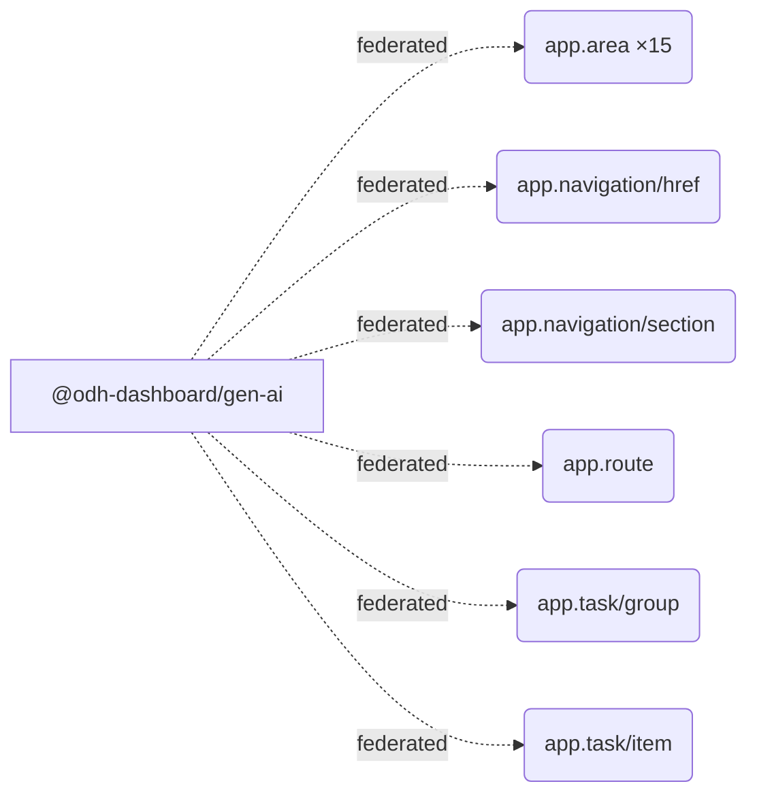
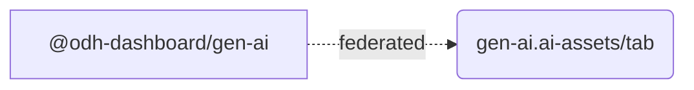

<!-- AUTO-GENERATED by @odh-dashboard/extension-map. Do not edit by hand. -->

> Generated file. Regenerate with `pnpm docs:extension-map`.

## Contents
- [Loading paths](#loading-paths)
- [Defines](#defines)
  - [gen-ai.ai-assets/tab](#gen-aiai-assetstab)
- [Contributes](#contributes)
  - [app](#app)
    - [app.area](#apparea)
    - [app.navigation/href](#appnavigationhref)
    - [app.navigation/section](#appnavigationsection)
    - [app.route](#approute)
    - [app.task/group](#apptaskgroup)
    - [app.task/item](#apptaskitem)
  - [gen-ai](#gen-ai)
    - [gen-ai.ai-assets/tab](#gen-aiai-assetstab-1)
- [Diagnostics](#diagnostics)

## Loading paths

| Entry | Path | Source |
| --- | --- | --- |
| @odh-dashboard/gen-ai#./extensions/static | distribution-static | `packages/gen-ai/frontend/src/odh/extensions.ts` |
| @odh-dashboard/gen-ai#mf:./extensions | federated | `packages/gen-ai/frontend/src/odh/extensions.ts` |

## Defines

### gen-ai.ai-assets/tab

| Property | Type | Required | Description |
| --- | --- | --- | --- |
| `id` | `string` | Yes |  |
| `title` | `string` | Yes |  |
| `component` | `CodeRef<ComponentType<{ children?: ReactNode; }>>` | Yes |  |
| `label` | `string` | No |  |

**Implemented by:** [@odh-dashboard/gen-ai](extensions.md#gen-aiai-assetstab)

## Contributes

### app

| Node | Contract | Registration sources |
| --- | --- | --- |
| [@odh-dashboard/gen-ai](#loading-paths) | — | — |
| app.area ×15 | [app.area](../../plugin-core/docs/extensions.md#apparea) | [../frontend/src/odh/extensions.ts:45](../frontend/src/odh/extensions.ts#L45-L51) [../frontend/src/odh/extensions.ts:52](../frontend/src/odh/extensions.ts#L52-L63) [../frontend/src/odh/extensions.ts:64](../frontend/src/odh/extensions.ts#L64-L71) [../frontend/src/odh/extensions.ts:72](../frontend/src/odh/extensions.ts#L72-L79) [../frontend/src/odh/extensions.ts:80](../frontend/src/odh/extensions.ts#L80-L91) [../frontend/src/odh/extensions.ts:92](../frontend/src/odh/extensions.ts#L92-L99) [../frontend/src/odh/extensions.ts:100](../frontend/src/odh/extensions.ts#L100-L107) [../frontend/src/odh/extensions.ts:108](../frontend/src/odh/extensions.ts#L108-L115) [../frontend/src/odh/extensions.ts:116](../frontend/src/odh/extensions.ts#L116-L123) [../frontend/src/odh/extensions.ts:124](../frontend/src/odh/extensions.ts#L124-L131) [../frontend/src/odh/extensions.ts:132](../frontend/src/odh/extensions.ts#L132-L139) [../frontend/src/odh/extensions.ts:140](../frontend/src/odh/extensions.ts#L140-L147) [../frontend/src/odh/extensions.ts:148](../frontend/src/odh/extensions.ts#L148-L155) [../frontend/src/odh/extensions.ts:156](../frontend/src/odh/extensions.ts#L156-L167) [../frontend/src/odh/extensions.ts:168](../frontend/src/odh/extensions.ts#L168-L179) |
| app.navigation/href | [app.navigation/href](../../plugin-core/docs/extensions.md#appnavigationhref) | [../frontend/src/odh/extensions.ts:192](../frontend/src/odh/extensions.ts#L192-L204) [../frontend/src/odh/extensions.ts:205](../frontend/src/odh/extensions.ts#L205-L217) |
| app.navigation/section | [app.navigation/section](../../plugin-core/docs/extensions.md#appnavigationsection) | [../frontend/src/odh/extensions.ts:180](../frontend/src/odh/extensions.ts#L180-L191) |
| app.route | [app.route](../../plugin-core/docs/extensions.md#approute) | [../frontend/src/odh/extensions.ts:218](../frontend/src/odh/extensions.ts#L218-L228) |
| app.task/group | [app.task/group](../../plugin-core/docs/extensions.md#apptaskgroup) | [../frontend/src/odh/extensions.ts:277](../frontend/src/odh/extensions.ts#L277-L288) |
| app.task/item | [app.task/item](../../plugin-core/docs/extensions.md#apptaskitem) | [../frontend/src/odh/extensions.ts:289](../frontend/src/odh/extensions.ts#L289-L301) [../frontend/src/odh/extensions.ts:302](../frontend/src/odh/extensions.ts#L302-L314) |

- `-->` declared or type-resolved contribution
- `==>` derived relationship
- `-. "rendered in" .->` rendered in one hop
- `-. "federated" .->` federated contribution
- `--x` suppression
- `-- "patch" -->` patch

#### app.area

| reliantAreas | devFlags | featureFlags | requiredComponents | customCondition | id | Source |
| --- | --- | --- | --- | --- | --- | --- |
| — | — | `GEN_AI_STUDIO` (`"genAiStudio"`) | — | — | `PLUGIN_GEN_AI` (`"plugin-gen-ai"`) | [app.area](../frontend/src/odh/extensions.ts#L45-L51) |
| `PLUGIN_GEN_AI` (`"plugin-gen-ai"`) | — | — | — | [not resolved](#diagnostics) | `CHAT_PLAYGROUND` (`"chatPlayground"`) | [app.area](../frontend/src/odh/extensions.ts#L52-L63) |
| `PLUGIN_GEN_AI` (`"plugin-gen-ai"`) | — | `GEN_AI_IMAGE_UPLOAD` (`"genAiImageUpload"`) | — | — | `GEN_AI_IMAGE_UPLOAD` (`"genAiImageUpload"`) | [app.area](../frontend/src/odh/extensions.ts#L64-L71) |
| `PLUGIN_GEN_AI` (`"plugin-gen-ai"`) | — | `GEN_AI_AUDIO_UPLOAD` (`"genAiAudioUpload"`) | — | — | `GEN_AI_AUDIO_UPLOAD` (`"genAiAudioUpload"`) | [app.area](../frontend/src/odh/extensions.ts#L72-L79) |
| `PLUGIN_GEN_AI` (`"plugin-gen-ai"`) | — | `GUARDRAILS` (`"guardrails"`) | `DataScienceStackComponent.TRUSTY_AI` (`"trustyai"`) | [not resolved](#diagnostics) | `GUARDRAILS` (`"guardrails"`) | [app.area](../frontend/src/odh/extensions.ts#L80-L91) |
| `PLUGIN_GEN_AI` (`"plugin-gen-ai"`) | — | `AI_ASSET_CUSTOM_ENDPOINTS` (`"aiAssetCustomEndpoints"`) | — | — | `AI_ASSET_CUSTOM_ENDPOINTS` (`"aiAssetCustomEndpoints"`) | [app.area](../frontend/src/odh/extensions.ts#L92-L99) |
| `PLUGIN_GEN_AI` (`"plugin-gen-ai"`) | — | `PROMPT_MANAGEMENT` (`"promptManagement"`) | — | — | `PROMPT_MANAGEMENT` (`"promptManagement"`) | [app.area](../frontend/src/odh/extensions.ts#L100-L107) |
| `PROMPT_MANAGEMENT` (`"promptManagement"`) | `PROMPT_MODEL_ASSOCIATIONS` (`"promptModelAssociations"`) | — | — | — | `PROMPT_MODEL_ASSOCIATIONS` (`"promptModelAssociations"`) | [app.area](../frontend/src/odh/extensions.ts#L108-L115) |
| `PLUGIN_GEN_AI` (`"plugin-gen-ai"`) | — | `EXTERNAL_VECTOR_STORES` (`"externalVectorStores"`) | — | — | `EXTERNAL_VECTOR_STORES` (`"externalVectorStores"`) | [app.area](../frontend/src/odh/extensions.ts#L116-L123) |
| `PLUGIN_GEN_AI` (`"plugin-gen-ai"`) | — | `AGENT_CONFIG_MANAGEMENT` (`"agentConfigManagement"`) | — | — | `AGENT_CONFIG_MANAGEMENT` (`"agentConfigManagement"`) | [app.area](../frontend/src/odh/extensions.ts#L124-L131) |
| `PLUGIN_GEN_AI` (`"plugin-gen-ai"`) | — | `GEN_AI_AGENT_DEPLOYMENT` (`"genAiAgentDeployment"`) | — | — | `GEN_AI_AGENT_DEPLOYMENT` (`"genAiAgentDeployment"`) | [app.area](../frontend/src/odh/extensions.ts#L132-L139) |
| `PLUGIN_GEN_AI` (`"plugin-gen-ai"`) | — | `MCP_REGISTRY` (`"mcpRegistry"`) | — | — | `MCP_REGISTRY` (`"mcpRegistry"`) | [app.area](../frontend/src/odh/extensions.ts#L140-L147) |
| `PLUGIN_GEN_AI` (`"plugin-gen-ai"`) | — | `GEN_AI_MCP_REGISTRY_SERVERS` (`"genAiMcpRegistryServers"`) | — | — | `GEN_AI_MCP_REGISTRY_SERVERS` (`"genAiMcpRegistryServers"`) | [app.area](../frontend/src/odh/extensions.ts#L148-L155) |
| `PLUGIN_GEN_AI` (`"plugin-gen-ai"`) | — | `GEN_AI_TRACING` (`"genAiTracing"`) | — | [not resolved](#diagnostics) | `GEN_AI_TRACING` (`"genAiTracing"`) | [app.area](../frontend/src/odh/extensions.ts#L156-L167) |
| `PLUGIN_GEN_AI` (`"plugin-gen-ai"`) | — | `MODEL_AS_SERVICE_CAMEL` (`"modelAsService"`) | — | [not resolved](#diagnostics) | `MODEL_AS_SERVICE_CAMEL` (`"modelAsService"`) | [app.area](../frontend/src/odh/extensions.ts#L168-L179) |

**Not resolved**

| Location | Reason | Link |
| --- | --- | --- |
| properties.customCondition | CodeRef body is not a supported dynamic import | [diagnostics](#diagnostics) |
| properties.customCondition | CodeRef body is not a supported dynamic import | [diagnostics](#diagnostics) |
| properties.customCondition | CodeRef body is not a supported dynamic import | [diagnostics](#diagnostics) |
| properties.customCondition | CodeRef body is not a supported dynamic import | [diagnostics](#diagnostics) |

#### app.navigation/href

| id | title | section | href | path | Requires | Source |
| --- | --- | --- | --- | --- | --- | --- |
| `"chat-playground"` | `"Playground"` | `"gen-ai-studio"` | `chatPlaygroundRootPath` (`"/gen-ai-studio/playground"`) | `globChatPlaygroundAll` (`"/gen-ai-studio/playground/*"`) | `CHAT_PLAYGROUND` (`"chatPlayground"`) | [app.navigation/href](../frontend/src/odh/extensions.ts#L192-L204) |
| `"ai-assets"` | `"AI asset endpoints"` | `"gen-ai-studio"` | `aiAssetsRootPath` (`"/gen-ai-studio/assets"`) | `globAiAssetsAll` (`"/gen-ai-studio/assets/*"`) | `PLUGIN_GEN_AI` (`"plugin-gen-ai"`) | [app.navigation/href](../frontend/src/odh/extensions.ts#L205-L217) |

#### app.navigation/section

| id | title | group | iconRef | Requires | CodeRef target | Source |
| --- | --- | --- | --- | --- | --- | --- |
| `"gen-ai-studio"` | `"Gen AI studio"` | `"4_gen_ai_studio"` | packages/gen-ai/frontend/src/odh/GenAiStudioNavIcon.ts#[GenAiStudioNavIcon](../frontend/src/odh/GenAiStudioNavIcon.ts#L3-L11) | `PLUGIN_GEN_AI` (`"plugin-gen-ai"`) | packages/gen-ai/frontend/src/odh/GenAiStudioNavIcon.ts#[GenAiStudioNavIcon](../frontend/src/odh/GenAiStudioNavIcon.ts#L3-L11) | [app.navigation/section](../frontend/src/odh/extensions.ts#L180-L191) |

#### app.route

| id | component | path | Requires | CodeRef target | Source |
| --- | --- | --- | --- | --- | --- |
| `"gen-ai-routes"` | packages/gen-ai/frontend/src/odh/GenAiWrapper.tsx#[GenAiWrapper](../frontend/src/odh/GenAiWrapper.tsx#L39-L53) | `globGenAiAll` (`"/gen-ai-studio/*"`) | `PLUGIN_GEN_AI` (`"plugin-gen-ai"`) | packages/gen-ai/frontend/src/odh/GenAiWrapper.tsx#[GenAiWrapper](../frontend/src/odh/GenAiWrapper.tsx#L39-L53) | [app.route](../frontend/src/odh/extensions.ts#L218-L228) |

#### app.task/group

**Contribution:** `app.task/group` at `packages/gen-ai/frontend/src/odh/extensions.ts:277`

- **id**: `"gen-ai-studio"`
- **title**: `"Gen AI studio"`
- **description**: `"Prototype, test, and manage models and applications."`
- **label**: `"Test gen AI models and apps"`
- **icon**: packages/gen-ai/frontend/src/odh/GenAiStudioNavIcon.ts#[GenAiStudioNavIcon](../frontend/src/odh/GenAiStudioNavIcon.ts#L3-L11)
- **type**: `"organize"`
- **order**: `"2_gen_ai_studio"`
- **CodeRef target**: packages/gen-ai/frontend/src/odh/GenAiStudioNavIcon.ts#[GenAiStudioNavIcon](../frontend/src/odh/GenAiStudioNavIcon.ts#L3-L11)
- **Source**: [app.task/group](../frontend/src/odh/extensions.ts#L277-L288)

#### app.task/item

| id | group | title | destination | order | Requires | Source |
| --- | --- | --- | --- | --- | --- | --- |
| `"genai-playground"` | `"gen-ai-studio"` | `"Chat with models"` | href: `chatPlaygroundRootPath` (`"/gen-ai-studio/playground"`) | `"1_playground"` | `CHAT_PLAYGROUND` (`"chatPlayground"`) | [app.task/item](../frontend/src/odh/extensions.ts#L289-L301) |
| `"genai-ai-assets"` | `"gen-ai-studio"` | `"Browse available AI assets"` | href: `aiAssetsRootPath` (`"/gen-ai-studio/assets"`) | `"2_ai_assets"` | `PLUGIN_GEN_AI` (`"plugin-gen-ai"`) | [app.task/item](../frontend/src/odh/extensions.ts#L302-L314) |

### gen-ai

| Node | Contract | Registration sources |
| --- | --- | --- |
| [@odh-dashboard/gen-ai](#loading-paths) | — | — |
| gen-ai.ai-assets/tab | [gen-ai.ai-assets/tab](extensions.md#gen-aiai-assetstab) | [../frontend/src/odh/extensions.ts:230](../frontend/src/odh/extensions.ts#L230-L240) [../frontend/src/odh/extensions.ts:241](../frontend/src/odh/extensions.ts#L241-L251) [../frontend/src/odh/extensions.ts:252](../frontend/src/odh/extensions.ts#L252-L262) [../frontend/src/odh/extensions.ts:263](../frontend/src/odh/extensions.ts#L263-L273) |

- `-->` declared or type-resolved contribution
- `==>` derived relationship
- `-. "rendered in" .->` rendered in one hop
- `-. "federated" .->` federated contribution
- `--x` suppression
- `-- "patch" -->` patch

#### gen-ai.ai-assets/tab

| id | title | component | Requires | CodeRef target | Source |
| --- | --- | --- | --- | --- | --- |
| `"models"` | `"Models"` | packages/gen-ai/frontend/src/app/AIAssets/AIAssetsModelsTab.tsx#[AIAssetsModelsTab](../frontend/src/app/AIAssets/AIAssetsModelsTab.tsx#L28-L261) | `PLUGIN_GEN_AI` (`"plugin-gen-ai"`) | packages/gen-ai/frontend/src/app/AIAssets/AIAssetsModelsTab.tsx#[AIAssetsModelsTab](../frontend/src/app/AIAssets/AIAssetsModelsTab.tsx#L28-L261) | [gen-ai.ai-assets/tab](../frontend/src/odh/extensions.ts#L230-L240) |
| `"mcpservers"` | `"MCP servers"` | packages/gen-ai/frontend/src/app/AIAssets/AIAssetsMCPTab.tsx#[AIAssetsMCPTab](../frontend/src/app/AIAssets/AIAssetsMCPTab.tsx#L23-L102) | `PLUGIN_GEN_AI` (`"plugin-gen-ai"`) | packages/gen-ai/frontend/src/app/AIAssets/AIAssetsMCPTab.tsx#[AIAssetsMCPTab](../frontend/src/app/AIAssets/AIAssetsMCPTab.tsx#L23-L102) | [gen-ai.ai-assets/tab](../frontend/src/odh/extensions.ts#L241-L251) |
| `"vectorstores"` | `"Vector stores"` | packages/gen-ai/frontend/src/app/AIAssets/AIAssetsVectorStoresTab.tsx#[AIAssetsVectorStoresTab](../frontend/src/app/AIAssets/AIAssetsVectorStoresTab.tsx#L11-L73) | `PLUGIN_GEN_AI` (`"plugin-gen-ai"`), `EXTERNAL_VECTOR_STORES` (`"externalVectorStores"`) | packages/gen-ai/frontend/src/app/AIAssets/AIAssetsVectorStoresTab.tsx#[AIAssetsVectorStoresTab](../frontend/src/app/AIAssets/AIAssetsVectorStoresTab.tsx#L11-L73) | [gen-ai.ai-assets/tab](../frontend/src/odh/extensions.ts#L252-L262) |
| `"agentprofile"` | `"Agents"` | packages/gen-ai/frontend/src/app/AIAssets/AIAssetsAgentProfilesTab.tsx#[AIAssetsAgentProfilesTab](../frontend/src/app/AIAssets/AIAssetsAgentProfilesTab.tsx#L10-L66) | `PLUGIN_GEN_AI` (`"plugin-gen-ai"`), `AGENT_CONFIG_MANAGEMENT` (`"agentConfigManagement"`) | packages/gen-ai/frontend/src/app/AIAssets/AIAssetsAgentProfilesTab.tsx#[AIAssetsAgentProfilesTab](../frontend/src/app/AIAssets/AIAssetsAgentProfilesTab.tsx#L10-L66) | [gen-ai.ai-assets/tab](../frontend/src/odh/extensions.ts#L263-L273) |

## Diagnostics

| Code | Message | Link |
| --- | --- | --- |
| `point-no-jsdoc` | extension point 'gen-ai.ai-assets/tab' (AIAssetsTabExtension) has no JSDoc summary | [AIAssetsTabExtension](../frontend/src/odh/extension-points/ai-assets.ts#L4-L12) |
| `unresolved-value` | extension property 'customCondition' contains a value that could not be resolved | [customCondition](../frontend/src/odh/extensions.ts#L58-L61) |
| `unresolved-value` | extension property 'customCondition' contains a value that could not be resolved | [customCondition](../frontend/src/odh/extensions.ts#L87-L89) |
| `unresolved-value` | extension property 'customCondition' contains a value that could not be resolved | [customCondition](../frontend/src/odh/extensions.ts#L162-L165) |
| `unresolved-value` | extension property 'customCondition' contains a value that could not be resolved | [customCondition](../frontend/src/odh/extensions.ts#L174-L177) |
