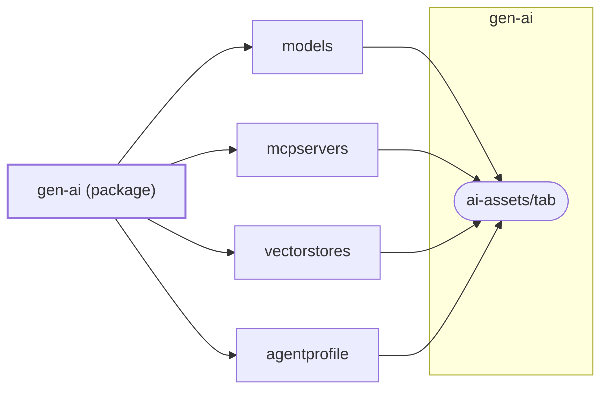

<!-- AUTO-GENERATED by @odh-dashboard/extension-map. Do not edit by hand. -->

> Generated file. Regenerate with `pnpm docs:extension-map`.

# Extensions in gen-ai

Package `@odh-dashboard/gen-ai` (package) at `packages/gen-ai`. Everything below is read out of this repository's sources by static analysis.

## Loading paths

- [extensions.ts](../frontend/src/odh/extensions.ts) (`./extensions/static`) — bundled by a distribution that imports this export
- [extensions.ts](../frontend/src/odh/extensions.ts) (`mf:./extensions`) — loaded at runtime by the host as a Module Federation remote

## Defines

The extension points this package declares. Each heading is the point ID other packages use as an extension's `type`.

### gen-ai.ai-assets/tab

Declared as [AIAssetsTabExtension](../frontend/src/odh/extension-points/ai-assets.ts#L4-L12).

**Properties:**

| Property | Required | Type | CodeRef of | Description |
| --- | --- | --- | --- | --- |
| `id` | yes | `string` | — |  |
| `title` | yes | `string` | — |  |
| `component` | yes | `CodeRef<ComponentType<{ children?: React.ReactNode }>>` | `ComponentType<{ children?: ReactNode; }>` |  |
| `label` | — | `string` | — |  |

**Implemented by:** [gen-ai](#contributes-to-gen-aiai-assetstab)

## Contributes

The extensions this package declares, grouped by the namespace of the extension point they target.

### Namespace `app`

| Node | What | Link |
| --- | --- | --- |
| gen-ai (package) | this package | [packages/gen-ai](..) |
| ×15 | 15 extensions of app.area | [see the table below](#contributes-to-apparea) |
| chat-playground | extension of app.navigation/href — bundled by a distribution and federated | [extensions.ts](../frontend/src/odh/extensions.ts#L192-L204) |
| ai-assets | extension of app.navigation/href — bundled by a distribution and federated | [extensions.ts](../frontend/src/odh/extensions.ts#L205-L217) |
| gen-ai-studio | extension of app.navigation/section — bundled by a distribution and federated | [extensions.ts](../frontend/src/odh/extensions.ts#L180-L191) |
| gen-ai-routes | extension of app.route — bundled by a distribution and federated | [extensions.ts](../frontend/src/odh/extensions.ts#L218-L228) |
| gen-ai-studio | extension of app.task/group — bundled by a distribution and federated | [extensions.ts](../frontend/src/odh/extensions.ts#L277-L288) |
| genai-playground | extension of app.task/item — bundled by a distribution and federated | [extensions.ts](../frontend/src/odh/extensions.ts#L289-L301) |
| genai-ai-assets | extension of app.task/item — bundled by a distribution and federated | [extensions.ts](../frontend/src/odh/extensions.ts#L302-L314) |
| area | extension point | [app.area](../../plugin-core/docs/extensions.md#apparea) |
| navigation/href | extension point | [app.navigation/href](../../plugin-core/docs/extensions.md#appnavigationhref) |
| navigation/section | extension point | [app.navigation/section](../../plugin-core/docs/extensions.md#appnavigationsection) |
| route | extension point | [app.route](../../plugin-core/docs/extensions.md#approute) |
| task/group | extension point | [app.task/group](../../plugin-core/docs/extensions.md#apptaskgroup) |
| task/item | extension point | [app.task/item](../../plugin-core/docs/extensions.md#apptaskitem) |

#### Contributes to app.area

Defined in [app.area](../../plugin-core/docs/extensions.md#apparea).

| reliantAreas | devFlags | featureFlags | requiredComponents | customCondition | id | Source |
| --- | --- | --- | --- | --- | --- | --- |
| — | — | `GEN_AI_STUDIO` (`'genAiStudio'`) | — | — | `PLUGIN_GEN_AI` (`'plugin-gen-ai'`) | [extensions.ts](../frontend/src/odh/extensions.ts#L45-L51) |
| `PLUGIN_GEN_AI` (`'plugin-gen-ai'`) | — | (empty) | — | `function` ([customCondition](../frontend/src/odh/extensions.ts#L58-L61)) | `CHAT_PLAYGROUND` (`'chatPlayground'`) | [extensions.ts](../frontend/src/odh/extensions.ts#L52-L63) |
| `PLUGIN_GEN_AI` (`'plugin-gen-ai'`) | — | `GEN_AI_IMAGE_UPLOAD` (`'genAiImageUpload'`) | — | — | `GEN_AI_IMAGE_UPLOAD` (`'genAiImageUpload'`) | [extensions.ts](../frontend/src/odh/extensions.ts#L64-L71) |
| `PLUGIN_GEN_AI` (`'plugin-gen-ai'`) | — | `GEN_AI_AUDIO_UPLOAD` (`'genAiAudioUpload'`) | — | — | `GEN_AI_AUDIO_UPLOAD` (`'genAiAudioUpload'`) | [extensions.ts](../frontend/src/odh/extensions.ts#L72-L79) |
| `PLUGIN_GEN_AI` (`'plugin-gen-ai'`) | — | `GUARDRAILS` (`'guardrails'`) | `DataScienceStackComponent.TRUSTY_AI` (`'trustyai'`) | `function` ([customCondition](../frontend/src/odh/extensions.ts#L87-L89)) | `GUARDRAILS` (`'guardrails'`) | [extensions.ts](../frontend/src/odh/extensions.ts#L80-L91) |
| `PLUGIN_GEN_AI` (`'plugin-gen-ai'`) | — | `AI_ASSET_CUSTOM_ENDPOINTS` (`'aiAssetCustomEndpoints'`) | — | — | `AI_ASSET_CUSTOM_ENDPOINTS` (`'aiAssetCustomEndpoints'`) | [extensions.ts](../frontend/src/odh/extensions.ts#L92-L99) |
| `PLUGIN_GEN_AI` (`'plugin-gen-ai'`) | — | `PROMPT_MANAGEMENT` (`'promptManagement'`) | — | — | `PROMPT_MANAGEMENT` (`'promptManagement'`) | [extensions.ts](../frontend/src/odh/extensions.ts#L100-L107) |
| `PROMPT_MANAGEMENT` (`'promptManagement'`) | `PROMPT_MODEL_ASSOCIATIONS` (`'promptModelAssociations'`) | — | — | — | `PROMPT_MODEL_ASSOCIATIONS` (`'promptModelAssociations'`) | [extensions.ts](../frontend/src/odh/extensions.ts#L108-L115) |
| `PLUGIN_GEN_AI` (`'plugin-gen-ai'`) | — | `EXTERNAL_VECTOR_STORES` (`'externalVectorStores'`) | — | — | `EXTERNAL_VECTOR_STORES` (`'externalVectorStores'`) | [extensions.ts](../frontend/src/odh/extensions.ts#L116-L123) |
| `PLUGIN_GEN_AI` (`'plugin-gen-ai'`) | — | `AGENT_CONFIG_MANAGEMENT` (`'agentConfigManagement'`) | — | — | `AGENT_CONFIG_MANAGEMENT` (`'agentConfigManagement'`) | [extensions.ts](../frontend/src/odh/extensions.ts#L124-L131) |
| `PLUGIN_GEN_AI` (`'plugin-gen-ai'`) | — | `GEN_AI_AGENT_DEPLOYMENT` (`'genAiAgentDeployment'`) | — | — | `GEN_AI_AGENT_DEPLOYMENT` (`'genAiAgentDeployment'`) | [extensions.ts](../frontend/src/odh/extensions.ts#L132-L139) |
| `PLUGIN_GEN_AI` (`'plugin-gen-ai'`) | — | `MCP_REGISTRY` (`'mcpRegistry'`) | — | — | `MCP_REGISTRY` (`'mcpRegistry'`) | [extensions.ts](../frontend/src/odh/extensions.ts#L140-L147) |
| `PLUGIN_GEN_AI` (`'plugin-gen-ai'`) | — | `GEN_AI_MCP_REGISTRY_SERVERS` (`'genAiMcpRegistryServers'`) | — | — | `GEN_AI_MCP_REGISTRY_SERVERS` (`'genAiMcpRegistryServers'`) | [extensions.ts](../frontend/src/odh/extensions.ts#L148-L155) |
| `PLUGIN_GEN_AI` (`'plugin-gen-ai'`) | — | `GEN_AI_TRACING` (`'genAiTracing'`) | — | `function` ([customCondition](../frontend/src/odh/extensions.ts#L162-L165)) | `GEN_AI_TRACING` (`'genAiTracing'`) | [extensions.ts](../frontend/src/odh/extensions.ts#L156-L167) |
| `PLUGIN_GEN_AI` (`'plugin-gen-ai'`) | — | `MODEL_AS_SERVICE_CAMEL` (`'modelAsService'`) | — | `function` ([customCondition](../frontend/src/odh/extensions.ts#L174-L177)) | `MODEL_AS_SERVICE_CAMEL` (`'modelAsService'`) | [extensions.ts](../frontend/src/odh/extensions.ts#L168-L179) |

#### Contributes to app.navigation/href

Defined in [app.navigation/href](../../plugin-core/docs/extensions.md#appnavigationhref).

| id | title | section | href | path | Requires | Source |
| --- | --- | --- | --- | --- | --- | --- |
| `'chat-playground'` | `'Playground'` | `'gen-ai-studio'` | `chatPlaygroundRootPath` (`'/gen-ai-studio/playground'`) | `globChatPlaygroundAll` (`'/gen-ai-studio/playground/*'`) | `CHAT_PLAYGROUND` (`'chatPlayground'`) | [extensions.ts](../frontend/src/odh/extensions.ts#L192-L204) |
| `'ai-assets'` | `'AI asset endpoints'` | `'gen-ai-studio'` | `aiAssetsRootPath` (`'/gen-ai-studio/assets'`) | `globAiAssetsAll` (`'/gen-ai-studio/assets/*'`) | `PLUGIN_GEN_AI` (`'plugin-gen-ai'`) | [extensions.ts](../frontend/src/odh/extensions.ts#L205-L217) |

#### Contributes to app.navigation/section

Defined in [app.navigation/section](../../plugin-core/docs/extensions.md#appnavigationsection).

| id | title | group | Requires | CodeRef target | Source |
| --- | --- | --- | --- | --- | --- |
| `'gen-ai-studio'` | `'Gen AI studio'` | `'4_gen_ai_studio'` | `PLUGIN_GEN_AI` (`'plugin-gen-ai'`) | [GenAiStudioNavIcon#default](../frontend/src/odh/GenAiStudioNavIcon.ts#L3-L11) | [extensions.ts](../frontend/src/odh/extensions.ts#L180-L191) |

#### Contributes to app.route

Defined in [app.route](../../plugin-core/docs/extensions.md#approute).

| id | path | Requires | CodeRef target | Source |
| --- | --- | --- | --- | --- |
| `'gen-ai-routes'` | `globGenAiAll` (`'/gen-ai-studio/*'`) | `PLUGIN_GEN_AI` (`'plugin-gen-ai'`) | [GenAiWrapper#default](../frontend/src/odh/GenAiWrapper.tsx#L39-L53) | [extensions.ts](../frontend/src/odh/extensions.ts#L218-L228) |

#### Contributes to app.task/group

Defined in [app.task/group](../../plugin-core/docs/extensions.md#apptaskgroup).

##### gen-ai-studio

- **id:** `'gen-ai-studio'`
- **title:** `'Gen AI studio'`
- **description:** `'Prototype, test, and manage models and applications.'`
- **label:** `'Test gen AI models and apps'`
- **type:** `'organize'`
- **order:** `'2_gen_ai_studio'`
- **CodeRef target:** [GenAiStudioNavIcon#default](../frontend/src/odh/GenAiStudioNavIcon.ts#L3-L11)
- **Source:** [extensions.ts](../frontend/src/odh/extensions.ts#L277-L288)

#### Contributes to app.task/item

Defined in [app.task/item](../../plugin-core/docs/extensions.md#apptaskitem).

| id | group | title | destination | order | Requires | Source |
| --- | --- | --- | --- | --- | --- | --- |
| `'genai-playground'` | `'gen-ai-studio'` | `'Chat with models'` | `{ href: chatPlaygroundRootPath ('/gen-ai-studio/playground') }` | `'1_playground'` | `CHAT_PLAYGROUND` (`'chatPlayground'`) | [extensions.ts](../frontend/src/odh/extensions.ts#L289-L301) |
| `'genai-ai-assets'` | `'gen-ai-studio'` | `'Browse available AI assets'` | `{ href: aiAssetsRootPath ('/gen-ai-studio/assets') }` | `'2_ai_assets'` | `PLUGIN_GEN_AI` (`'plugin-gen-ai'`) | [extensions.ts](../frontend/src/odh/extensions.ts#L302-L314) |

### Namespace `gen-ai`

| Node | What | Link |
| --- | --- | --- |
| gen-ai (package) | this package | [packages/gen-ai](..) |
| models | extension of gen-ai.ai-assets/tab — bundled by a distribution and federated | [extensions.ts](../frontend/src/odh/extensions.ts#L230-L240) |
| mcpservers | extension of gen-ai.ai-assets/tab — bundled by a distribution and federated | [extensions.ts](../frontend/src/odh/extensions.ts#L241-L251) |
| vectorstores | extension of gen-ai.ai-assets/tab — bundled by a distribution and federated | [extensions.ts](../frontend/src/odh/extensions.ts#L252-L262) |
| agentprofile | extension of gen-ai.ai-assets/tab — bundled by a distribution and federated | [extensions.ts](../frontend/src/odh/extensions.ts#L263-L273) |
| ai-assets/tab | extension point | [gen-ai.ai-assets/tab](#gen-aiai-assetstab) |

#### Contributes to gen-ai.ai-assets/tab

Defined in [gen-ai.ai-assets/tab](#gen-aiai-assetstab).

| id | title | Requires | CodeRef target | Source |
| --- | --- | --- | --- | --- |
| `'models'` | `'Models'` | `PLUGIN_GEN_AI` (`'plugin-gen-ai'`) | [AIAssetsModelsTab#default](../frontend/src/app/AIAssets/AIAssetsModelsTab.tsx#L28-L261) | [extensions.ts](../frontend/src/odh/extensions.ts#L230-L240) |
| `'mcpservers'` | `'MCP servers'` | `PLUGIN_GEN_AI` (`'plugin-gen-ai'`) | [AIAssetsMCPTab#default](../frontend/src/app/AIAssets/AIAssetsMCPTab.tsx#L23-L102) | [extensions.ts](../frontend/src/odh/extensions.ts#L241-L251) |
| `'vectorstores'` | `'Vector stores'` | `PLUGIN_GEN_AI` (`'plugin-gen-ai'`), `EXTERNAL_VECTOR_STORES` (`'externalVectorStores'`) | [AIAssetsVectorStoresTab#default](../frontend/src/app/AIAssets/AIAssetsVectorStoresTab.tsx#L11-L73) | [extensions.ts](../frontend/src/odh/extensions.ts#L252-L262) |
| `'agentprofile'` | `'Agents'` | `PLUGIN_GEN_AI` (`'plugin-gen-ai'`), `AGENT_CONFIG_MANAGEMENT` (`'agentConfigManagement'`) | [AIAssetsAgentProfilesTab#default](../frontend/src/app/AIAssets/AIAssetsAgentProfilesTab.tsx#L10-L66) | [extensions.ts](../frontend/src/odh/extensions.ts#L263-L273) |

## Diagnostics

What the analysis could not prove, or thought worth reporting, about this package. Warnings are gaps in the generated map; info entries are observations.

| Code | Severity | Message | Source |
| --- | --- | --- | --- |
| `point-no-jsdoc` | warning | Extension point 'gen-ai.ai-assets/tab' (AIAssetsTabExtension) has no JSDoc. | [ai-assets.ts:4](../frontend/src/odh/extension-points/ai-assets.ts#L4-L12) |

## Legend

| Edge | What it means in these diagrams |
| --- | --- |
| `A --> B` | A is declared by this package and bundled into an app at build time. It may also be exposed through Module Federation — the node table beside each diagram names every loading path. |
| `A -. "federated" .-> B` | A reaches the host only through a Module Federation remote, loaded at runtime. |
| `A ==> B` | Derived: proven through a type or a JSDoc tag rather than a direct reference. |
| `A -. "rendered in" .-> B` | B renders A (one hop). |
| `A --x B` | A suppresses B. |
| `A -- "patch" --> B` | A patches B. |

A node with a dashed border stands for several extensions of the same point; its `×N` label is
the number of extensions, and the table beside the diagram always lists every one of them.
Anything the analysis could not resolve is never drawn — it is listed in a "Not resolved" table
instead.
