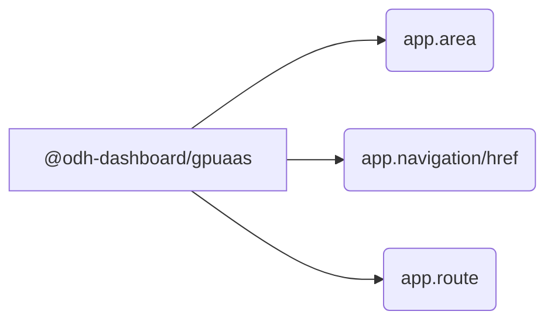

<!-- AUTO-GENERATED by @odh-dashboard/extension-map. Do not edit by hand. -->

> Generated file. Regenerate with `pnpm docs:extension-map`.

## Contents
- [Loading paths](#loading-paths)
- [Contributes](#contributes)
  - [app](#app)
    - [app.area](#apparea)
    - [app.navigation/href](#appnavigationhref)
    - [app.route](#approute)

## Loading paths

| Entry | Path | Source |
| --- | --- | --- |
| @odh-dashboard/gpuaas#./extensions | static | `packages/gpuaas/extensions.ts` |

## Contributes

### app

| Node | Contract | Registration sources |
| --- | --- | --- |
| [@odh-dashboard/gpuaas](#loading-paths) | — | — |
| app.area | [app.area](../../plugin-core/docs/extensions.md#apparea) | [../extensions.ts:12](../extensions.ts#L12-L19) |
| app.navigation/href | [app.navigation/href](../../plugin-core/docs/extensions.md#appnavigationhref) | [../extensions.ts:20](../extensions.ts#L20-L32) |
| app.route | [app.route](../../plugin-core/docs/extensions.md#approute) | [../extensions.ts:33](../extensions.ts#L33-L42) |

- `-->` declared or type-resolved contribution
- `==>` derived relationship
- `-. "rendered in" .->` rendered in one hop
- `-. "federated" .->` federated contribution
- `--x` suppression
- `-- "patch" -->` patch

#### app.area

| reliantAreas | featureFlags | id | Source |
| --- | --- | --- | --- |
| `SupportedArea.GPUAAS_INFRASTRUCTURE` (`"gpuaas-infrastructure"`) | `"gpuaas"` | `PLUGIN_GPUAAS` (`"plugin-gpuaas"`) | [app.area](../extensions.ts#L12-L19) |

#### app.navigation/href

| id | title | section | href | path | Requires | Source |
| --- | --- | --- | --- | --- | --- | --- |
| `"gpuaas-infrastructure"` | `"Infrastructure"` | `"observe-and-monitor"` | `"/observe-and-monitor/infrastructure"` | `"/observe-and-monitor/infrastructure/*"` | `PLUGIN_GPUAAS` (`"plugin-gpuaas"`) | [app.navigation/href](../extensions.ts#L20-L32) |

#### app.route

| component | path | Requires | CodeRef target | Source |
| --- | --- | --- | --- | --- |
| packages/gpuaas/src/InfrastructureRoutes.tsx#[InfrastructureRoutes](../src/InfrastructureRoutes.tsx#L7-L12) | `"/observe-and-monitor/infrastructure/*"` | `PLUGIN_GPUAAS` (`"plugin-gpuaas"`) | packages/gpuaas/src/InfrastructureRoutes.tsx#[InfrastructureRoutes](../src/InfrastructureRoutes.tsx#L7-L12) | [app.route](../extensions.ts#L33-L42) |
