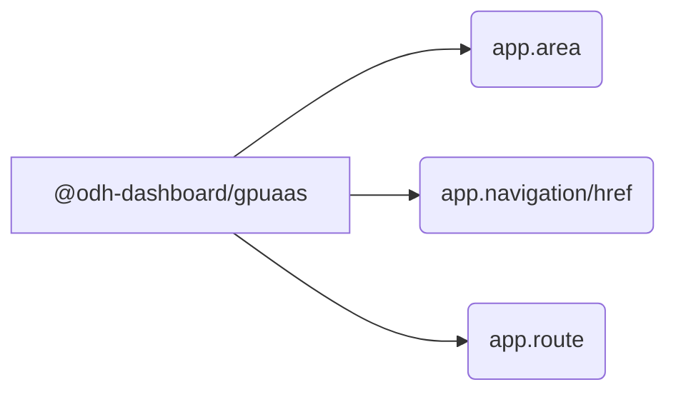

<!-- AUTO-GENERATED by @odh-dashboard/extension-map. Do not edit by hand. -->

> Generated file. Regenerate with `pnpm docs:extension-map`.

## Loading paths

| Entry | Path | Source |
| --- | --- | --- |
| @odh-dashboard/gpuaas#./extensions | static | `packages/gpuaas/extensions.ts` |

## Contributes

### app

| Node | Link |
| --- | --- |
| @odh-dashboard/gpuaas | [@odh-dashboard/gpuaas](#contributes) |
| app.area | [app.area](../../plugin-core/docs/extensions.md#apparea) [app.area](../extensions.ts#L12-L19) |
| app.navigation/href | [app.navigation/href](../../plugin-core/docs/extensions.md#appnavigationhref) [app.navigation/href](../extensions.ts#L20-L32) |
| app.route | [app.route](../../plugin-core/docs/extensions.md#approute) [app.route](../extensions.ts#L33-L42) |

- `-->` declared or type-resolved contribution
- `==>` derived relationship
- `-. "rendered in" .->` rendered in one hop
- `-. "federated" .->` federated contribution
- `--x` suppression
- `-- "patch" -->` patch

#### app.area

- **reliantAreas**: `SupportedArea.GPUAAS_INFRASTRUCTURE` (`"gpuaas-infrastructure"`)
- **featureFlags**: `"gpuaas"`
- **id**: `PLUGIN_GPUAAS` (`"plugin-gpuaas"`)
- **Requires**: 
- **Disallows**: 
- **CodeRef target**: 
- **Included in**: 
- **Source**: [app.area](../extensions.ts#L12-L19)

#### app.navigation/href

- **id**: `"gpuaas-infrastructure"`
- **title**: `"Infrastructure"`
- **section**: `"observe-and-monitor"`
- **href**: `"/observe-and-monitor/infrastructure"`
- **path**: `"/observe-and-monitor/infrastructure/*"`
- **Requires**: `PLUGIN_GPUAAS` (`"plugin-gpuaas"`)
- **Disallows**: 
- **CodeRef target**: 
- **Included in**: 
- **Source**: [app.navigation/href](../extensions.ts#L20-L32)

#### app.route

| component | path | Requires | Disallows | CodeRef target | Included in | Source |
| --- | --- | --- | --- | --- | --- | --- |
| packages/gpuaas/src/InfrastructureRoutes.tsx#[InfrastructureRoutes](../src/InfrastructureRoutes.tsx#L7-L12) | `"/observe-and-monitor/infrastructure/*"` | `PLUGIN_GPUAAS` (`"plugin-gpuaas"`) |  | packages/gpuaas/src/InfrastructureRoutes.tsx#[InfrastructureRoutes](../src/InfrastructureRoutes.tsx#L7-L12) |  | [app.route](../extensions.ts#L33-L42) |
