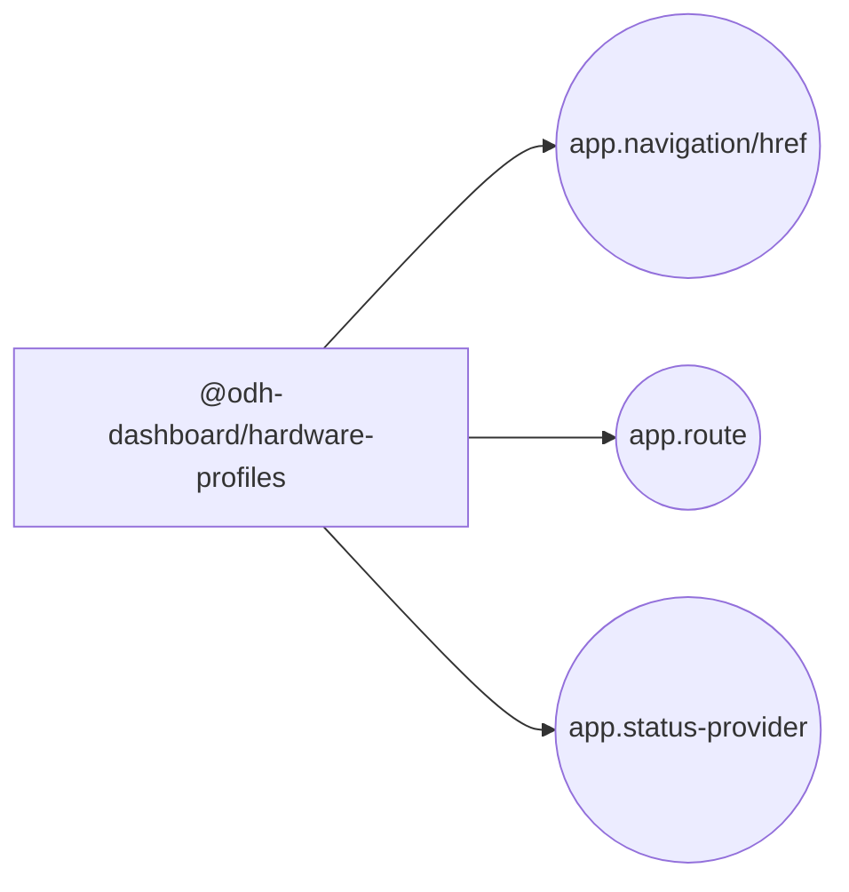

<!-- AUTO-GENERATED by @odh-dashboard/extension-map. Do not edit by hand. -->

> Generated file. Regenerate with `pnpm docs:extension-map`.

## Loading paths

| Entry | Path | Source |
| --- | --- | --- |
| @odh-dashboard/hardware-profiles#./extensions | static | `packages/hardware-profiles/extensions.ts` |

## Contributes

### app

| Node | Link |
| --- | --- |
| @odh-dashboard/hardware-profiles | [@odh-dashboard/hardware-profiles](#contributes) |
| app.navigation/href | [app.navigation/href](../../plugin-core/docs/extensions.md#appnavigationhref) [app.navigation/href](../extensions.ts#L13-L28) |
| app.route | [app.route](../../plugin-core/docs/extensions.md#approute) [app.route](../extensions.ts#L36-L45) [app.route](../extensions.ts#L29-L35) |
| app.status-provider | [app.status-provider](../../plugin-core/docs/extensions.md#appstatus-provider) [app.status-provider](../extensions.ts#L46-L55) |

- `-->` declared or type-resolved contribution
- `==>` derived relationship
- `-. "rendered in" .->` rendered in one hop
- `-. "federated" .->` federated contribution
- `--x` suppression
- `-- "patch" -->` patch

#### app.navigation/href

- **id**: `"settings-hardware-profiles"`
- **title**: `"Hardware profiles"`
- **section**: `"settings-environment-setup"`
- **href**: `"/settings/environment-setup/hardware-profiles"`
- **accessReview**: group: `"infrastructure.opendatahub.io"`, resource: `"hardwareprofiles"`, verb: `"create"`
- **statusProviderId**: `"hardware-profiles.status"`
- **path**: `"/settings/environment-setup/hardware-profiles/*"`
- **Requires**: 
- **Disallows**: 
- **CodeRef target**: 
- **Included in**: 
- **Source**: [app.navigation/href](../extensions.ts#L13-L28)

#### app.route

| component | path | Requires | Disallows | CodeRef target | Included in | Source |
| --- | --- | --- | --- | --- | --- | --- |
| [not resolved](#diagnostics) | `"/hardwareProfiles/*"` |  |  |  |  | [app.route](../extensions.ts#L36-L45) |
| packages/hardware-profiles/src/pages/HardwareProfilesRoutes.tsx#[accessAllowedRouteHoC](../src/pages/HardwareProfilesRoutes.tsx#L23-L25) | `"/settings/environment-setup/hardware-profiles/*"` |  |  | packages/hardware-profiles/src/pages/HardwareProfilesRoutes.tsx#[accessAllowedRouteHoC](../src/pages/HardwareProfilesRoutes.tsx#L23-L25) |  | [app.route](../extensions.ts#L29-L35) |

**Not resolved**

| Location | Reason | Link |
| --- | --- | --- |
| properties.component | expression is not a statically resolvable value | [diagnostics](#diagnostics) |

#### app.status-provider

| id | statusProviderHook | Requires | Disallows | CodeRef target | Included in | Source |
| --- | --- | --- | --- | --- | --- | --- |
| `"hardware-profiles.status"` | packages/hardware-profiles/src/useHardwareProfilesStatusProvider.ts#[useHardwareProfilesStatusProvider](../src/useHardwareProfilesStatusProvider.ts#L12-L29) |  |  | packages/hardware-profiles/src/useHardwareProfilesStatusProvider.ts#[useHardwareProfilesStatusProvider](../src/useHardwareProfilesStatusProvider.ts#L12-L29) |  | [app.status-provider](../extensions.ts#L46-L55) |

## Diagnostics

| Code | Message | Link |
| --- | --- | --- |
| `unresolved-value` | extension property 'component' contains a value that could not be resolved | [component](../extensions.ts#L40-L43) |
