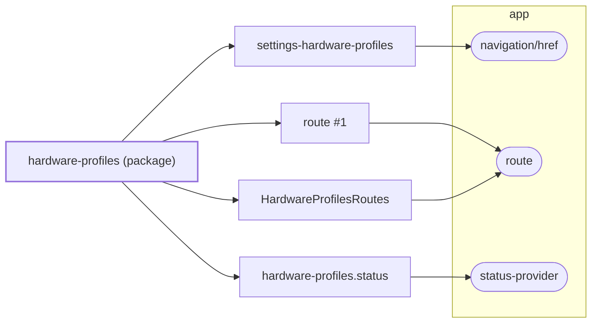

<!-- AUTO-GENERATED by @odh-dashboard/extension-map. Do not edit by hand. -->

> Generated file. Regenerate with `pnpm docs:extension-map`.

# Extensions in hardware-profiles

Package `@odh-dashboard/hardware-profiles` (package) at `packages/hardware-profiles`. Everything below is read out of this repository's sources by static analysis.

## Loading paths

- [extensions.ts](../extensions.ts) (`./extensions`) — bundled into the host at build time (the `./extensions` export)

## Contributes

The extensions this package declares, grouped by the namespace of the extension point they target.

### Namespace `app`

| Node | What | Link |
| --- | --- | --- |
| hardware-profiles (package) | this package | [packages/hardware-profiles](..) |
| settings-hardware-profiles | extension of app.navigation/href — bundled | [extensions.ts](../extensions.ts#L13-L28) |
| route #1 | extension of app.route — bundled | [extensions.ts](../extensions.ts#L36-L45) |
| HardwareProfilesRoutes | extension of app.route — bundled | [extensions.ts](../extensions.ts#L29-L35) |
| hardware-profiles.status | extension of app.status-provider — bundled | [extensions.ts](../extensions.ts#L46-L55) |
| navigation/href | extension point | [app.navigation/href](../../plugin-core/docs/extensions.md#appnavigationhref) |
| route | extension point | [app.route](../../plugin-core/docs/extensions.md#approute) |
| status-provider | extension point | [app.status-provider](../../plugin-core/docs/extensions.md#appstatus-provider) |

#### Contributes to app.navigation/href

Defined in [app.navigation/href](../../plugin-core/docs/extensions.md#appnavigationhref).

##### settings-hardware-profiles

- **id:** `'settings-hardware-profiles'`
- **title:** `'Hardware profiles'`
- **section:** `'settings-environment-setup'`
- **href:** `'/settings/environment-setup/hardware-profiles'`
- **accessReview:** `{ group: 'infrastructure.opendatahub.io', resource: 'hardwareprofiles', verb: 'create' }`
- **statusProviderId:** `'hardware-profiles.status'`
- **path:** `'/settings/environment-setup/hardware-profiles/*'`
- **Source:** [extensions.ts](../extensions.ts#L13-L28)

#### Contributes to app.route

Defined in [app.route](../../plugin-core/docs/extensions.md#approute).

| path | CodeRef target | Source |
| --- | --- | --- |
| `'/hardwareProfiles/*'` | `component`: [not resolved](../extensions.ts#L40-L43) | [extensions.ts](../extensions.ts#L36-L45) |
| `'/settings/environment-setup/hardware-profiles/*'` | [HardwareProfilesRoutes#default](../src/pages/HardwareProfilesRoutes.tsx#L23-L25) | [extensions.ts](../extensions.ts#L29-L35) |

**Not resolved** (never drawn in a diagram):

| Contribution | Property | Reason | Source |
| --- | --- | --- | --- |
| route #1 | component | CallExpression is not a resolvable value | [extensions.ts:40](../extensions.ts#L40-L43) |

#### Contributes to app.status-provider

Defined in [app.status-provider](../../plugin-core/docs/extensions.md#appstatus-provider).

| id | CodeRef target | Source |
| --- | --- | --- |
| `'hardware-profiles.status'` | [useHardwareProfilesStatusProvider#useHardwareProfilesStatusProvider](../src/useHardwareProfilesStatusProvider.ts#L12-L29) | [extensions.ts](../extensions.ts#L46-L55) |

## Diagnostics

What the analysis could not prove, or thought worth reporting, about this package. Warnings are gaps in the generated map; info entries are observations.

| Code | Severity | Message | Source |
| --- | --- | --- | --- |
| `unresolved-value` | warning | Cannot resolve 'component' of extension 'app.route': CallExpression is not a resolvable value. | [extensions.ts:40](../extensions.ts#L40-L43) |

## Legend

| Edge | What it means in these diagrams |
| --- | --- |
| `A --> B` | A is declared by this package and bundled into an app at build time. It may also be exposed through Module Federation — the node table beside each diagram names every loading path. |
| `A -. "federated" .-> B` | A reaches the host only through a Module Federation remote, loaded at runtime. |
| `A ==> B` | Derived: proven through a type or a JSDoc tag rather than a direct reference. |
| `A -. "rendered in" .-> B` | B renders A (one hop). |
| `A --x B` | A suppresses B. |
| `A -- "patch" --> B` | A patches B. |

A node with a dashed border stands for several extensions of the same point; its `×N` label is
the number of extensions, and the table beside the diagram always lists every one of them.
Anything the analysis could not resolve is never drawn — it is listed in a "Not resolved" table
instead.
