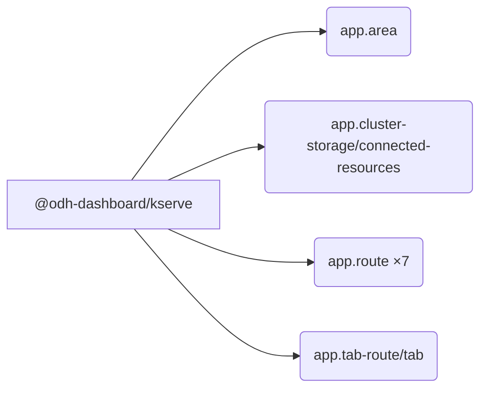

<!-- AUTO-GENERATED by @odh-dashboard/extension-map. Do not edit by hand. -->

> Generated file. Regenerate with `pnpm docs:extension-map`.

## Contents
- [Loading paths](#loading-paths)
- [Contributes](#contributes)
  - [app](#app)
    - [app.area](#apparea)
    - [app.cluster-storage/connected-resources](#appcluster-storageconnected-resources)
    - [app.route](#approute)
    - [app.tab-route/tab](#apptab-routetab)
  - [model-serving](#model-serving)
    - [model-serving.deployed-model/serving-runtime](#model-servingdeployed-modelserving-runtime)
    - [model-serving.deployment/deploy](#model-servingdeploymentdeploy)
    - [model-serving.deployment/form-data](#model-servingdeploymentform-data)
    - [model-serving.deployment/wizard-field](#model-servingdeploymentwizard-field)
    - [model-serving.deployment/wizard-field-apply](#model-servingdeploymentwizard-field-apply)
    - [model-serving.deployment/wizard-field-extractor](#model-servingdeploymentwizard-field-extractor)
    - [model-serving.deployment/wizard-field-override](#model-servingdeploymentwizard-field-override)
    - [model-serving.deployments-table/start-stop-action](#model-servingdeployments-tablestart-stop-action)
    - [model-serving.metrics](#model-servingmetrics)
    - [model-serving.platform](#model-servingplatform)
    - [model-serving.platform/delete-deployment](#model-servingplatformdelete-deployment)
    - [model-serving.platform/fetch-deployment-status](#model-servingplatformfetch-deployment-status)
    - [model-serving.platform/watch-deployments](#model-servingplatformwatch-deployments)
    - [model-serving.runtime-image/install-target](#model-servingruntime-imageinstall-target)
- [Diagnostics](#diagnostics)

## Loading paths

| Entry | Path | Source |
| --- | --- | --- |
| @odh-dashboard/kserve#./extensions | static | `packages/kserve/extensions.ts` |

## Contributes

### app

| Node | Contract | Registration sources |
| --- | --- | --- |
| [@odh-dashboard/kserve](#loading-paths) | — | — |
| app.area | [app.area](../../plugin-core/docs/extensions.md#apparea) | [../extensions.ts:188](../extensions.ts#L188-L196) |
| app.cluster-storage/connected-resources | [app.cluster-storage/connected-resources](../../plugin-core/docs/extensions.md#appcluster-storageconnected-resources) | [../extensions.ts:197](../extensions.ts#L197-L212) |
| app.route ×7 | [app.route](../../plugin-core/docs/extensions.md#approute) | [../extensions.ts:412](../extensions.ts#L412-L422) [../extensions.ts:432](../extensions.ts#L432-L444) [../extensions.ts:445](../extensions.ts#L445-L457) [../extensions.ts:458](../extensions.ts#L458-L470) [../extensions.ts:471](../extensions.ts#L471-L483) |
| app.tab-route/tab | [app.tab-route/tab](../../plugin-core/docs/extensions.md#apptab-routetab) | [../extensions.ts:389](../extensions.ts#L389-L402) |

- `-->` declared or type-resolved contribution
- `==>` derived relationship
- `-. "rendered in" .->` rendered in one hop
- `-. "federated" .->` federated contribution
- `--x` suppression
- `-- "patch" -->` patch

#### app.area

| reliantAreas | featureFlags | requiredComponents | id | Source |
| --- | --- | --- | --- | --- |
| `SupportedArea.MODEL_SERVING` (`"model-serving-shell"`) | `"disableKServe"` | `DataScienceStackComponent.K_SERVE` (`"kserve"`) | `SupportedArea.K_SERVE` (`"kserve"`) | [app.area](../extensions.ts#L188-L196) |

#### app.cluster-storage/connected-resources

| useConnectedResources | getConnectedResources | Requires | CodeRef target | Source |
| --- | --- | --- | --- | --- |
| packages/kserve/src/clusterStorage/connectedResources.tsx#[useConnectedKServeResources](../src/clusterStorage/connectedResources.tsx#L23-L44) | packages/kserve/src/clusterStorage/connectedResources.tsx#[getConnectedKServeResourceLabels](../src/clusterStorage/connectedResources.tsx#L136-L148) | `SupportedArea.K_SERVE` (`"kserve"`) | packages/kserve/src/clusterStorage/connectedResources.tsx#[useConnectedKServeResources](../src/clusterStorage/connectedResources.tsx#L23-L44), packages/kserve/src/clusterStorage/connectedResources.tsx#[getConnectedKServeResourceLabels](../src/clusterStorage/connectedResources.tsx#L136-L148) | [app.cluster-storage/connected-resources](../extensions.ts#L197-L212) |

#### app.route

| component | path | Requires | CodeRef target | Source |
| --- | --- | --- | --- | --- |
| packages/kserve/src/settings/servingRuntimeTemplates/ServingRuntimeTemplatesFormRoutes.tsx#[ServingRuntimeTemplatesFormRoutes](../src/settings/servingRuntimeTemplates/ServingRuntimeTemplatesFormRoutes.tsx#L22-L37) | [not resolved](#diagnostics) | `SupportedArea.CUSTOM_RUNTIMES` (`"custom-serving-runtimes"`), `ADMIN_USER` (`"ADMIN_USER"`) | packages/kserve/src/settings/servingRuntimeTemplates/ServingRuntimeTemplatesFormRoutes.tsx#[ServingRuntimeTemplatesFormRoutes](../src/settings/servingRuntimeTemplates/ServingRuntimeTemplatesFormRoutes.tsx#L22-L37) | [app.route](../extensions.ts#L412-L422) |
| [not resolved](#diagnostics) | `"/settings/model-resources-operations/serving-runtimes/*"` | `SupportedArea.CUSTOM_RUNTIMES` (`"custom-serving-runtimes"`), `ADMIN_USER` (`"ADMIN_USER"`) | — | [app.route](../extensions.ts#L432-L444) |
| [not resolved](#diagnostics) | `"/servingRuntimes/*"` | `SupportedArea.CUSTOM_RUNTIMES` (`"custom-serving-runtimes"`), `ADMIN_USER` (`"ADMIN_USER"`) | — | [app.route](../extensions.ts#L445-L457) |
| [not resolved](#diagnostics) | `"/servingRuntimes/addServingRuntime"` | `SupportedArea.CUSTOM_RUNTIMES` (`"custom-serving-runtimes"`), `ADMIN_USER` (`"ADMIN_USER"`) | — | [app.route](../extensions.ts#L458-L470) |
| [not resolved](#diagnostics) | `"/servingRuntimes/editServingRuntime/*"` | `SupportedArea.CUSTOM_RUNTIMES` (`"custom-serving-runtimes"`), `ADMIN_USER` (`"ADMIN_USER"`) | — | [app.route](../extensions.ts#L471-L483) |

**Not resolved**

| Location | Reason | Link |
| --- | --- | --- |
| properties.path | identifier does not resolve to a literal value | [diagnostics](#diagnostics) |
| properties.component | expression is not a statically resolvable value | [diagnostics](#diagnostics) |
| properties.component | expression is not a statically resolvable value | [diagnostics](#diagnostics) |
| properties.component | expression is not a statically resolvable value | [diagnostics](#diagnostics) |
| properties.component | expression is not a statically resolvable value | [diagnostics](#diagnostics) |

#### app.tab-route/tab

**Contribution:** `app.tab-route/tab` at `packages/kserve/extensions.ts:389`

- **pageId**: `"model-deployment-settings"`
- **id**: `"serving-runtime-templates"`
- **title**: `"Serving runtime templates"`
- **component**: packages/kserve/src/settings/servingRuntimeTemplates/ServingRuntimeTemplatesTabRoutes.tsx#[ServingRuntimeTemplatesTabRoutes](../src/settings/servingRuntimeTemplates/ServingRuntimeTemplatesTabRoutes.tsx#L15-L22)
- **group**: `"2_serving-runtimes"`
- **Requires**: `SupportedArea.CUSTOM_RUNTIMES` (`"custom-serving-runtimes"`), `ADMIN_USER` (`"ADMIN_USER"`)
- **CodeRef target**: packages/kserve/src/settings/servingRuntimeTemplates/ServingRuntimeTemplatesTabRoutes.tsx#[ServingRuntimeTemplatesTabRoutes](../src/settings/servingRuntimeTemplates/ServingRuntimeTemplatesTabRoutes.tsx#L15-L22)
- **Source**: [app.tab-route/tab](../extensions.ts#L389-L402)

### model-serving

```mermaid
flowchart LR
  pkg_n__odh_dashboard_kserve_e30286["@odh-dashboard/kserve"]
  point_n_model_serving_deployed_model_serving_runtime_a806c7("model-serving.deployed-model/serving-runtime")
  pkg_n__odh_dashboard_kserve_e30286 --> point_n_model_serving_deployed_model_serving_runtime_a806c7
  point_n_model_serving_deployment_deploy_35423a("model-serving.deployment/deploy")
  pkg_n__odh_dashboard_kserve_e30286 --> point_n_model_serving_deployment_deploy_35423a
  point_n_model_serving_deployment_form_data_a37ab2("model-serving.deployment/form-data")
  pkg_n__odh_dashboard_kserve_e30286 --> point_n_model_serving_deployment_form_data_a37ab2
  point_n_model_serving_deployment_wizard_field_19398b("model-serving.deployment/wizard-field")
  pkg_n__odh_dashboard_kserve_e30286 --> point_n_model_serving_deployment_wizard_field_19398b
  point_n_model_serving_deployment_wizard_field_apply_b7659a("model-serving.deployment/wizard-field-apply")
  pkg_n__odh_dashboard_kserve_e30286 --> point_n_model_serving_deployment_wizard_field_apply_b7659a
  point_n_model_serving_deployment_wizard_field_extractor_877f9e("model-serving.deployment/wizard-field-extractor")
  pkg_n__odh_dashboard_kserve_e30286 --> point_n_model_serving_deployment_wizard_field_extractor_877f9e
  point_n_model_serving_deployment_wizard_field_override_756caa("model-serving.deployment/wizard-field-override")
  pkg_n__odh_dashboard_kserve_e30286 --> point_n_model_serving_deployment_wizard_field_override_756caa
  point_n_model_serving_deployments_table_start_stop_action_ea2e4f("model-serving.deployments-table/start-stop-action")
  pkg_n__odh_dashboard_kserve_e30286 --> point_n_model_serving_deployments_table_start_stop_action_ea2e4f
  point_n_model_serving_metrics_8c16bc("model-serving.metrics")
  pkg_n__odh_dashboard_kserve_e30286 --> point_n_model_serving_metrics_8c16bc
  point_n_model_serving_platform_1d1e44("model-serving.platform")
  pkg_n__odh_dashboard_kserve_e30286 --> point_n_model_serving_platform_1d1e44
  point_n_model_serving_platform_delete_deployment_259f2a("model-serving.platform/delete-deployment")
  pkg_n__odh_dashboard_kserve_e30286 --> point_n_model_serving_platform_delete_deployment_259f2a
  point_n_model_serving_platform_fetch_deployment_status_63d9c2("model-serving.platform/fetch-deployment-status")
  pkg_n__odh_dashboard_kserve_e30286 --> point_n_model_serving_platform_fetch_deployment_status_63d9c2
  point_n_model_serving_platform_watch_deployments_cf294d("model-serving.platform/watch-deployments")
  pkg_n__odh_dashboard_kserve_e30286 --> point_n_model_serving_platform_watch_deployments_cf294d
  point_n_model_serving_runtime_image_install_target_e22ef9("model-serving.runtime-image/install-target")
  pkg_n__odh_dashboard_kserve_e30286 --> point_n_model_serving_runtime_image_install_target_e22ef9
```

| Node | Contract | Registration sources |
| --- | --- | --- |
| [@odh-dashboard/kserve](#loading-paths) | — | — |
| model-serving.deployed-model/serving-runtime | [model-serving.deployed-model/serving-runtime](../../model-serving/docs/extensions.md#model-servingdeployed-modelserving-runtime) | [../extensions.ts:276](../extensions.ts#L276-L290) |
| model-serving.deployment/deploy | [model-serving.deployment/deploy](../../model-serving/docs/extensions.md#model-servingdeploymentdeploy) | [../extensions.ts:313](../extensions.ts#L313-L326) |
| model-serving.deployment/form-data | [model-serving.deployment/form-data](../../model-serving/docs/extensions.md#model-servingdeploymentform-data) | [../extensions.ts:126](../extensions.ts#L126-L163) |
| model-serving.deployment/wizard-field | [model-serving.deployment/wizard-field](../../model-serving/docs/extensions.md#model-servingdeploymentwizard-field) | [../extensions.ts:64](../extensions.ts#L64-L76) [../extensions.ts:81](../extensions.ts#L81-L91) |
| model-serving.deployment/wizard-field-apply | [model-serving.deployment/wizard-field-apply](../../model-serving/docs/extensions.md#model-servingdeploymentwizard-field-apply) | [../extensions.ts:329](../extensions.ts#L329-L342) |
| model-serving.deployment/wizard-field-extractor | [model-serving.deployment/wizard-field-extractor](../../model-serving/docs/extensions.md#model-servingdeploymentwizard-field-extractor) | [../extensions.ts:96](../extensions.ts#L96-L109) [../extensions.ts:114](../extensions.ts#L114-L124) |
| model-serving.deployment/wizard-field-override | [model-serving.deployment/wizard-field-override](../../model-serving/docs/extensions.md#model-servingdeploymentwizard-field-override) | [../extensions.ts:345](../extensions.ts#L345-L357) [../extensions.ts:358](../extensions.ts#L358-L370) |
| model-serving.deployments-table/start-stop-action | [model-serving.deployments-table/start-stop-action](../../model-serving/docs/extensions.md#model-servingdeployments-tablestart-stop-action) | [../extensions.ts:291](../extensions.ts#L291-L301) |
| model-serving.metrics | [model-serving.metrics](../../model-serving/docs/extensions.md#model-servingmetrics) | [../extensions.ts:267](../extensions.ts#L267-L275) |
| model-serving.platform | [model-serving.platform](../../model-serving/docs/extensions.md#model-servingplatform) | [../extensions.ts:213](../extensions.ts#L213-L244) |
| model-serving.platform/delete-deployment | [model-serving.platform/delete-deployment](../../model-serving/docs/extensions.md#model-servingplatformdelete-deployment) | [../extensions.ts:255](../extensions.ts#L255-L266) |
| model-serving.platform/fetch-deployment-status | [model-serving.platform/fetch-deployment-status](../../model-serving/docs/extensions.md#model-servingplatformfetch-deployment-status) | [../extensions.ts:302](../extensions.ts#L302-L311) |
| model-serving.platform/watch-deployments | [model-serving.platform/watch-deployments](../../model-serving/docs/extensions.md#model-servingplatformwatch-deployments) | [../extensions.ts:245](../extensions.ts#L245-L254) |
| model-serving.runtime-image/install-target | [model-serving.runtime-image/install-target](../../model-serving/docs/extensions.md#model-servingruntime-imageinstall-target) | [../extensions.ts:371](../extensions.ts#L371-L388) |

- `-->` declared or type-resolved contribution
- `==>` derived relationship
- `-. "rendered in" .->` rendered in one hop
- `-. "federated" .->` federated contribution
- `--x` suppression
- `-- "patch" -->` patch

#### model-serving.deployed-model/serving-runtime

| platform | dataHook | ServingDetailsComponent | Requires | CodeRef target | Source |
| --- | --- | --- | --- | --- | --- |
| `KSERVE_ID` (`"kserve"`) | packages/kserve/src/components/deploymentServingDetails.tsx#[useServingDetailsData](../src/components/deploymentServingDetails.tsx#L31-L34) | packages/kserve/src/components/deploymentServingDetails.tsx#[DeploymentServingDetails](../src/components/deploymentServingDetails.tsx#L41-L117) | `SupportedArea.K_SERVE` (`"kserve"`) | packages/kserve/src/components/deploymentServingDetails.tsx#[useServingDetailsData](../src/components/deploymentServingDetails.tsx#L31-L34), packages/kserve/src/components/deploymentServingDetails.tsx#[DeploymentServingDetails](../src/components/deploymentServingDetails.tsx#L41-L117) | [model-serving.deployed-model/serving-runtime](../extensions.ts#L276-L290) |

#### model-serving.deployment/deploy

**Contribution:** `model-serving.deployment/deploy` at `packages/kserve/extensions.ts:313`

- **platform**: `KSERVE_ID` (`"kserve"`)
- **isActive**: `true`
- **priority**: `0`
- **supportsOverwrite**: `true`
- **supportsDRAHardwareProfiles**: `true`
- **deploy**: packages/kserve/src/deploy.ts#[deployKServeDeployment](../src/deploy.ts#L17-L131)
- **Requires**: `SupportedArea.K_SERVE` (`"kserve"`)
- **CodeRef target**: packages/kserve/src/deploy.ts#[deployKServeDeployment](../src/deploy.ts#L17-L131)
- **Source**: [model-serving.deployment/deploy](../extensions.ts#L313-L326)

#### model-serving.deployment/form-data

**Contribution:** `model-serving.deployment/form-data` at `packages/kserve/extensions.ts:126`

- **platform**: `KSERVE_ID` (`"kserve"`)
- **isActive**: `true`
- **priority**: `0`
- **hardwareProfilePaths**: packages/kserve/src/hardware.ts#[INFERENCE_SERVICE_HARDWARE_PROFILE_PATHS](../../hardware-profiles/shared/const.ts#L18-L23)
- **extractHardwareProfileConfig**: packages/kserve/src/hardware.ts#hardware
- **extractModelFormat**: packages/kserve/src/modelFormat.ts#[extractKServeModelFormat](../src/modelFormat.ts#L4-L15)
- **extractReplicas**: packages/kserve/src/hardware.ts#hardware
- **extractRuntimeArgs**: packages/kserve/src/hardware.ts#[extractRuntimeArgs](../src/hardware.ts#L46-L54)
- **extractEnvironmentVariables**: packages/kserve/src/hardware.ts#[extractEnvironmentVariables](../src/hardware.ts#L56-L67)
- **extractModelAvailabilityData**: packages/kserve/src/aiAssets.ts#[extractModelAvailabilityData](../src/aiAssets.ts#L4-L12)
- **extractModelLocationData**: packages/kserve/src/modelLocationData.ts#[extractKServeModelLocationData](../src/modelLocationData.ts#L38-L73)
- **extractDeploymentStrategy**: packages/kserve/src/deployUtils.ts#[extractDeploymentStrategy](../src/deployUtils.ts#L258-L271)
- **extractModelType**: packages/kserve/src/deployUtils.ts#[extractModelType](../src/deployUtils.ts#L222-L233)
- **extractModelServerTemplate**: packages/kserve/src/deployServer.ts#[extractModelServerTemplate](../src/deployServer.ts#L83-L112)
- **extractHuggingFaceApiKey**: packages/kserve/src/hfTokenSecret.ts#hfTokenSecret
- **Requires**: `SupportedArea.K_SERVE` (`"kserve"`)
- **CodeRef target**: packages/kserve/src/hardware.ts#hardware, packages/kserve/src/deployUtils.ts#[extractModelType](../src/deployUtils.ts#L222-L233), packages/kserve/src/modelFormat.ts#[extractKServeModelFormat](../src/modelFormat.ts#L4-L15), packages/kserve/src/hardware.ts#hardware, packages/kserve/src/hardware.ts#[extractRuntimeArgs](../src/hardware.ts#L46-L54), packages/kserve/src/hardware.ts#[extractEnvironmentVariables](../src/hardware.ts#L56-L67), packages/kserve/src/aiAssets.ts#[extractModelAvailabilityData](../src/aiAssets.ts#L4-L12), packages/kserve/src/modelLocationData.ts#[extractKServeModelLocationData](../src/modelLocationData.ts#L38-L73), packages/kserve/src/deployUtils.ts#[extractDeploymentStrategy](../src/deployUtils.ts#L258-L271), packages/kserve/src/deployServer.ts#[extractModelServerTemplate](../src/deployServer.ts#L83-L112), packages/kserve/src/hfTokenSecret.ts#hfTokenSecret, packages/kserve/src/hardware.ts#[INFERENCE_SERVICE_HARDWARE_PROFILE_PATHS](../../hardware-profiles/shared/const.ts#L18-L23)
- **Source**: [model-serving.deployment/form-data](../extensions.ts#L126-L163)

**Supplies**

| CodeRef | Supply | Value |
| --- | --- | --- |
| INFERENCE_SERVICE_HARDWARE_PROFILE_PATHS | containerResourcesPath | `"spec.predictor.model.resources"` |
| INFERENCE_SERVICE_HARDWARE_PROFILE_PATHS | tolerationsPath | `"spec.predictor.tolerations"` |
| INFERENCE_SERVICE_HARDWARE_PROFILE_PATHS | nodeSelectorPath | `"spec.predictor.nodeSelector"` |
| INFERENCE_SERVICE_HARDWARE_PROFILE_PATHS | podSpecPath | `"spec.predictor"` |

#### model-serving.deployment/wizard-field

| platform | field | Requires | CodeRef target | Source |
| --- | --- | --- | --- | --- |
| `KSERVE_ID` (`"kserve"`) | packages/kserve/src/wizardFields/servingRuntime/KServeServingRuntimeField.tsx#[KServeServingRuntimeFieldWizardField](../src/wizardFields/servingRuntime/KServeServingRuntimeField.tsx#L376-L408) | `SupportedArea.K_SERVE` (`"kserve"`) | packages/kserve/src/wizardFields/servingRuntime/KServeServingRuntimeField.tsx#[KServeServingRuntimeFieldWizardField](../src/wizardFields/servingRuntime/KServeServingRuntimeField.tsx#L376-L408) | [model-serving.deployment/wizard-field](../extensions.ts#L64-L76) |
| `KSERVE_ID` (`"kserve"`) | packages/kserve/src/wizardFields/timeout/TimeoutField.tsx#[TimeoutFieldWizardField](../src/wizardFields/timeout/TimeoutField.tsx#L143-L166) | `SupportedArea.K_SERVE` (`"kserve"`) | packages/kserve/src/wizardFields/timeout/TimeoutField.tsx#[TimeoutFieldWizardField](../src/wizardFields/timeout/TimeoutField.tsx#L143-L166) | [model-serving.deployment/wizard-field](../extensions.ts#L81-L91) |

**Not resolved**

| Location | Reason | Link |
| --- | --- | --- |
| properties.field supplies.reducerFunctions.resolveDependencies | CodeRef body is not a supported dynamic import | [diagnostics](#diagnostics) |
| properties.field supplies.reducerFunctions.setFieldData | CodeRef body is not a supported dynamic import | [diagnostics](#diagnostics) |
| properties.field supplies.reducerFunctions.getInitialFieldData | identifier does not resolve to a literal value | [diagnostics](#diagnostics) |
| properties.field supplies.reducerFunctions.validationSchema | expression is not a statically resolvable value | [diagnostics](#diagnostics) |
| properties.field supplies.reducerFunctions.setFieldData | identifier does not resolve to a literal value | [diagnostics](#diagnostics) |
| properties.field supplies.reducerFunctions.getInitialFieldData | identifier does not resolve to a literal value | [diagnostics](#diagnostics) |
| properties.field supplies.reducerFunctions.validationSchema | identifier does not resolve to a literal value | [diagnostics](#diagnostics) |

**Supplies**

| CodeRef | Supply | Value |
| --- | --- | --- |
| KServeServingRuntimeFieldWizardField | id | `"kserve/modelServer"` |
| KServeServingRuntimeFieldWizardField | step | `"modelDeployment"` |
| KServeServingRuntimeFieldWizardField | type | `"replacement"` |
| KServeServingRuntimeFieldWizardField | stateKey | `"modelServer"` |
| KServeServingRuntimeFieldWizardField | isActive | [isKServeServingRuntimeFieldActive](../src/wizardFields/servingRuntime/KServeServingRuntimeField.tsx#L85-L103) |
| KServeServingRuntimeFieldWizardField | reducerFunctions | resolveDependencies: [not resolved](#diagnostics), setFieldData: [not resolved](#diagnostics), getInitialFieldData: [not resolved](#diagnostics), validationSchema: [not resolved](#diagnostics) |
| KServeServingRuntimeFieldWizardField | shouldResetOnDependencyChange | [shouldResetOnDependencyChange](../src/wizardFields/servingRuntime/KServeServingRuntimeField.tsx#L399-L405) |
| KServeServingRuntimeFieldWizardField | component | [KServeServingRuntimeField](../src/wizardFields/servingRuntime/KServeServingRuntimeField.tsx#L321-L372) |
| KServeServingRuntimeFieldWizardField | externalDataHook | [useKServeServingRuntimeExternalData](../src/wizardFields/servingRuntime/KServeServingRuntimeField.tsx#L168-L283) |
| TimeoutFieldWizardField | id | `TIMEOUT_FIELD_ID` (`"kserve/timeout"`) |
| TimeoutFieldWizardField | step | `"advancedOptions"` |
| TimeoutFieldWizardField | type | `"addition"` |
| TimeoutFieldWizardField | isActive | [isKServeInferenceServiceActive](../src/wizardFields/timeout/TimeoutField.tsx#L47-L77) |
| TimeoutFieldWizardField | reducerFunctions | setFieldData: [not resolved](#diagnostics), getInitialFieldData: [not resolved](#diagnostics), validationSchema: [not resolved](#diagnostics) |
| TimeoutFieldWizardField | component | [TimeoutFieldComponent](../src/wizardFields/timeout/TimeoutField.tsx#L86-L137) |
| TimeoutFieldWizardField | getReviewSections | [getReviewSections](../src/wizardFields/timeout/TimeoutField.tsx#L154-L165) |

#### model-serving.deployment/wizard-field-apply

| fieldId | platform | apply | Requires | CodeRef target | Source |
| --- | --- | --- | --- | --- | --- |
| `"kserve/timeout"` | `KSERVE_ID` (`"kserve"`) | packages/kserve/src/wizardFields/timeout/timeoutApplyExtract.ts#[applyTimeoutFieldData](../src/wizardFields/timeout/timeoutApplyExtract.ts#L61-L73) | `SupportedArea.K_SERVE` (`"kserve"`) | packages/kserve/src/wizardFields/timeout/timeoutApplyExtract.ts#[applyTimeoutFieldData](../src/wizardFields/timeout/timeoutApplyExtract.ts#L61-L73) | [model-serving.deployment/wizard-field-apply](../extensions.ts#L329-L342) |

#### model-serving.deployment/wizard-field-extractor

| fieldId | platform | extract | Requires | CodeRef target | Source |
| --- | --- | --- | --- | --- | --- |
| `"kserve/timeout"` | `KSERVE_ID` (`"kserve"`) | packages/kserve/src/wizardFields/timeout/timeoutApplyExtract.ts#[extractTimeoutFieldData](../src/wizardFields/timeout/timeoutApplyExtract.ts#L78-L84) | `SupportedArea.K_SERVE` (`"kserve"`) | packages/kserve/src/wizardFields/timeout/timeoutApplyExtract.ts#[extractTimeoutFieldData](../src/wizardFields/timeout/timeoutApplyExtract.ts#L78-L84) | [model-serving.deployment/wizard-field-extractor](../extensions.ts#L96-L109) |
| `"deploymentMethod"` | `KSERVE_ID` (`"kserve"`) | packages/kserve/src/deployUtils.ts#[extractDeploymentMethod](../src/deployUtils.ts#L286-L288) | `SupportedArea.K_SERVE` (`"kserve"`) | packages/kserve/src/deployUtils.ts#[extractDeploymentMethod](../src/deployUtils.ts#L286-L288) | [model-serving.deployment/wizard-field-extractor](../extensions.ts#L114-L124) |

#### model-serving.deployment/wizard-field-override

| platform | field | Requires | CodeRef target | Source |
| --- | --- | --- | --- | --- |
| `KSERVE_ID` (`"kserve"`) | packages/kserve/src/wizardFields/deploymentStrategy.ts#[kserveDeploymentStrategyOverride](../src/wizardFields/deploymentStrategy.ts#L4-L9) | `KSERVE_ID` (`"kserve"`) | packages/kserve/src/wizardFields/deploymentStrategy.ts#[kserveDeploymentStrategyOverride](../src/wizardFields/deploymentStrategy.ts#L4-L9) | [model-serving.deployment/wizard-field-override](../extensions.ts#L345-L357) |
| `KSERVE_ID` (`"kserve"`) | packages/kserve/src/wizardFields/deploymentMethodField.ts#[legacyDeploymentMethodOverride](../src/wizardFields/deploymentMethodField.ts#L13-L19) | `SupportedArea.K_SERVE` (`"kserve"`) | packages/kserve/src/wizardFields/deploymentMethodField.ts#[legacyDeploymentMethodOverride](../src/wizardFields/deploymentMethodField.ts#L13-L19) | [model-serving.deployment/wizard-field-override](../extensions.ts#L358-L370) |

**Not resolved**

| Location | Reason | Link |
| --- | --- | --- |
| properties.field supplies.options[0] | identifier does not resolve to a literal value | [diagnostics](#diagnostics) |

**Supplies**

| CodeRef | Supply | Value |
| --- | --- | --- |
| kserveDeploymentStrategyOverride | id | `"deploymentStrategy"` |
| kserveDeploymentStrategyOverride | type | `"modifier"` |
| kserveDeploymentStrategyOverride | isVisible | `true` |
| kserveDeploymentStrategyOverride | isActive | [isKServeInferenceServiceActive](../src/wizardFields/timeout/TimeoutField.tsx#L47-L77) |
| legacyDeploymentMethodOverride | id | `"deploymentMethod"` |
| legacyDeploymentMethodOverride | type | `"modifier"` |
| legacyDeploymentMethodOverride | isActive | [isActive](../src/wizardFields/deploymentMethodField.ts#L16-L16) |
| legacyDeploymentMethodOverride | options | [not resolved](#diagnostics) |
| legacyDeploymentMethodOverride | suggestion | [suggestion](../src/wizardFields/deploymentMethodField.ts#L18-L18) |

#### model-serving.deployments-table/start-stop-action

| platform | patchDeploymentStoppedStatus | Requires | CodeRef target | Source |
| --- | --- | --- | --- | --- |
| `KSERVE_ID` (`"kserve"`) | packages/kserve/src/deploymentStatus.ts#[patchDeploymentStoppedStatus](../src/deploymentStatus.ts#L22-L39) | `SupportedArea.K_SERVE` (`"kserve"`) | packages/kserve/src/deploymentStatus.ts#[patchDeploymentStoppedStatus](../src/deploymentStatus.ts#L22-L39) | [model-serving.deployments-table/start-stop-action](../extensions.ts#L291-L301) |

#### model-serving.metrics

| platform | Requires | Source |
| --- | --- | --- |
| `KSERVE_ID` (`"kserve"`) | `SupportedArea.K_SERVE` (`"kserve"`), `SupportedArea.K_SERVE_METRICS` (`"kserve-metrics"`) | [model-serving.metrics](../extensions.ts#L267-L275) |

#### model-serving.platform

| id | manage | enableCardText | deployedModelsView | Requires | Source |
| --- | --- | --- | --- | --- | --- |
| `KSERVE_ID` (`"kserve"`) | namespaceApplicationCase: `NamespaceApplicationCase.KSERVE_PROMOTION` (`1`), priority: `0`, default: `true`, projectRequirements: labels: modelmesh-enabled: `"false"` | title: `"Enable model serving"`, description: `"Enable users to serve models using the single-model serving platform which deploys each model on its own dedicated model server. "`, selectText: `"Select single-model"`, enabledText: `"Single-model serving enabled"`, objectType: `ProjectObjectType.singleModel` (`"single-model"`) | startHintTitle: `"Start by deploying a model"`, startHintDescription: `"Each model is deployed on its own model server"`, deployButtonText: `"Deploy model"` | `SupportedArea.K_SERVE` (`"kserve"`) | [model-serving.platform](../extensions.ts#L213-L244) |

#### model-serving.platform/delete-deployment

| platform | onDelete | title | submitButtonLabel | Requires | CodeRef target | Source |
| --- | --- | --- | --- | --- | --- | --- |
| `KSERVE_ID` (`"kserve"`) | packages/kserve/src/deployments.ts#[deleteDeployment](../src/deployments.ts#L161-L200) | `"Delete model deployment?"` | `"Delete model deployment"` | `SupportedArea.K_SERVE` (`"kserve"`) | packages/kserve/src/deployments.ts#[deleteDeployment](../src/deployments.ts#L161-L200) | [model-serving.platform/delete-deployment](../extensions.ts#L255-L266) |

#### model-serving.platform/fetch-deployment-status

| platform | fetch | Requires | CodeRef target | Source |
| --- | --- | --- | --- | --- |
| `KSERVE_ID` (`"kserve"`) | packages/kserve/src/deployments.ts#[fetchDeploymentStatus](../src/deployments.ts#L132-L159) | `SupportedArea.K_SERVE` (`"kserve"`) | packages/kserve/src/deployments.ts#[fetchDeploymentStatus](../src/deployments.ts#L132-L159) | [model-serving.platform/fetch-deployment-status](../extensions.ts#L302-L311) |

#### model-serving.platform/watch-deployments

| platform | watch | Requires | CodeRef target | Source |
| --- | --- | --- | --- | --- |
| `KSERVE_ID` (`"kserve"`) | packages/kserve/src/deployments.ts#[useWatchDeployments](../src/deployments.ts#L36-L130) | `SupportedArea.K_SERVE` (`"kserve"`) | packages/kserve/src/deployments.ts#[useWatchDeployments](../src/deployments.ts#L36-L130) | [model-serving.platform/watch-deployments](../extensions.ts#L245-L254) |

#### model-serving.runtime-image/install-target

**Contribution:** `model-serving.runtime-image/install-target` at `packages/kserve/extensions.ts:371`

- **id**: `"servingRuntimeTemplate"`
- **label**: `"Serving runtime template"`
- **installTargetName**: `"serving runtime template"`
- **description**: `"Install as a ServingRuntime template for inference service deployments. Not compatible with Models as a Service."`
- **selectedState**: listName: `"Serving runtime templates"`, description: `"and the inference service deployment wizard."`
- **component**: packages/kserve/src/runtimeImageInstall/ServingRuntimeInstallTarget.tsx#[ServingRuntimeInstallTarget](../src/runtimeImageInstall/ServingRuntimeInstallTarget.tsx#L25-L102)
- **Requires**: `SupportedArea.CUSTOM_RUNTIMES` (`"custom-serving-runtimes"`), `SupportedArea.K_SERVE` (`"kserve"`), `ADMIN_USER` (`"ADMIN_USER"`)
- **CodeRef target**: packages/kserve/src/runtimeImageInstall/ServingRuntimeInstallTarget.tsx#[ServingRuntimeInstallTarget](../src/runtimeImageInstall/ServingRuntimeInstallTarget.tsx#L25-L102)
- **Source**: [model-serving.runtime-image/install-target](../extensions.ts#L371-L388)

## Diagnostics

| Code | Message | Link |
| --- | --- | --- |
| `unresolved-value` | extension property 'field' contains a value that could not be resolved | [field](../extensions.ts#L68-L71) |
| `unresolved-value` | extension property 'field' contains a value that could not be resolved | [field](../extensions.ts#L85-L86) |
| `unresolved-value` | extension property 'extractHardwareProfileConfig' contains a CodeRef with an unsupported then callback | [extractHardwareProfileConfig](../extensions.ts#L132-L135) |
| `unresolved-value` | extension property 'extractReplicas' contains a CodeRef with an unsupported then callback | [extractReplicas](../extensions.ts#L138-L141) |
| `unresolved-value` | extension property 'extractHuggingFaceApiKey' contains a CodeRef with an unsupported then callback | [extractHuggingFaceApiKey](../extensions.ts#L153-L156) |
| `unresolved-value` | extension property 'field' contains a value that could not be resolved | [field](../extensions.ts#L362-L365) |
| `unresolved-value` | extension property 'path' contains a value that could not be resolved | [path](../extensions.ts#L418-L418) |
| `unresolved-value` | extension property 'component' contains a value that could not be resolved | [component](../extensions.ts#L439-L442) |
| `unresolved-value` | extension property 'component' contains a value that could not be resolved | [component](../extensions.ts#L452-L455) |
| `unresolved-value` | extension property 'component' contains a value that could not be resolved | [component](../extensions.ts#L465-L468) |
| `unresolved-value` | extension property 'component' contains a value that could not be resolved | [component](../extensions.ts#L478-L481) |
