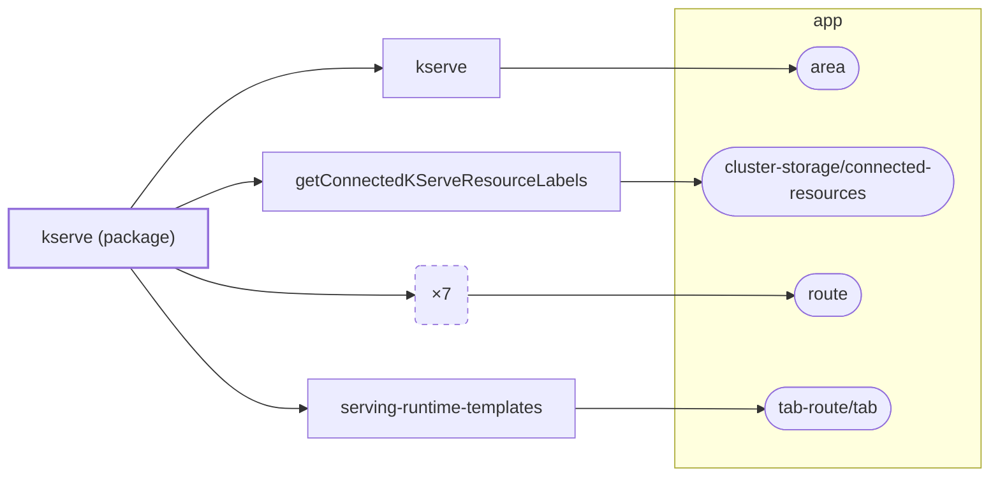

<!-- AUTO-GENERATED by @odh-dashboard/extension-map. Do not edit by hand. -->

> Generated file. Regenerate with `pnpm docs:extension-map`.

# Extensions in kserve

Package `@odh-dashboard/kserve` (package) at `packages/kserve`. Everything below is read out of this repository's sources by static analysis.

## Loading paths

- [extensions.ts](../extensions.ts) (`./extensions`) — bundled into the host at build time (the `./extensions` export)

## Contributes

The extensions this package declares, grouped by the namespace of the extension point they target.

### Namespace `app`

| Node | What | Link |
| --- | --- | --- |
| kserve (package) | this package | [packages/kserve](..) |
| kserve | extension of app.area — bundled | [extensions.ts](../extensions.ts#L188-L196) |
| getConnectedKServeResourceLabels | extension of app.cluster-storage/connected-resources — bundled | [extensions.ts](../extensions.ts#L197-L212) |
| ×7 | 7 extensions of app.route | [see the table below](#contributes-to-approute) |
| serving-runtime-templates | extension of app.tab-route/tab — bundled | [extensions.ts](../extensions.ts#L389-L402) |
| area | extension point | [app.area](../../plugin-core/docs/extensions.md#apparea) |
| cluster-storage/connected-resources | extension point | [app.cluster-storage/connected-resources](../../plugin-core/docs/extensions.md#appcluster-storageconnected-resources) |
| route | extension point | [app.route](../../plugin-core/docs/extensions.md#approute) |
| tab-route/tab | extension point | [app.tab-route/tab](../../plugin-core/docs/extensions.md#apptab-routetab) |

#### Contributes to app.area

Defined in [app.area](../../plugin-core/docs/extensions.md#apparea).

| reliantAreas | featureFlags | requiredComponents | id | Included in | Source |
| --- | --- | --- | --- | --- | --- |
| `SupportedArea.MODEL_SERVING` (`'model-serving-shell'`) | `'disableKServe'` | `DataScienceStackComponent.K_SERVE` (`'kserve'`) | `SupportedArea.K_SERVE` (`'kserve'`) | host, rhaii | [extensions.ts](../extensions.ts#L188-L196) |

#### Contributes to app.cluster-storage/connected-resources

Defined in [app.cluster-storage/connected-resources](../../plugin-core/docs/extensions.md#appcluster-storageconnected-resources).

| Requires | CodeRef target | Included in | Source |
| --- | --- | --- | --- |
| `SupportedArea.K_SERVE` (`'kserve'`) | `getConnectedResources`: [connectedResources#getConnectedKServeResourceLabels](../src/clusterStorage/connectedResources.tsx#L136-L148) `useConnectedResources`: [connectedResources#useConnectedKServeResources](../src/clusterStorage/connectedResources.tsx#L23-L44) | host, rhaii | [extensions.ts](../extensions.ts#L197-L212) |

#### Contributes to app.route

Defined in [app.route](../../plugin-core/docs/extensions.md#approute).

| path | Requires | CodeRef target | Included in | Source |
| --- | --- | --- | --- | --- |
| `×3` `'/settings/model-resources-operations/model-deployment-settings/serving-runtime-templates/add'` · `'/settings/model-resources-operations/model-deployment-settings/serving-runtime-templates/edit/:servingRuntimeName'` · `'/settings/model-resources-operations/model-deployment-settings/serving-runtime-templates/duplicate/:servingRuntimeName'` | `SupportedArea.CUSTOM_RUNTIMES` (`'custom-serving-runtimes'`), `ADMIN_USER` | [ServingRuntimeTemplatesFormRoutes#default](../src/settings/servingRuntimeTemplates/ServingRuntimeTemplatesFormRoutes.tsx#L22-L37) | host, rhaii | [extensions.ts](../extensions.ts#L412-L422) |
| `'/settings/model-resources-operations/serving-runtimes/*'` | `SupportedArea.CUSTOM_RUNTIMES` (`'custom-serving-runtimes'`), `ADMIN_USER` | `component`: [not resolved](../extensions.ts#L439-L442) | host, rhaii | [extensions.ts](../extensions.ts#L432-L444) |
| `'/servingRuntimes/*'` | `SupportedArea.CUSTOM_RUNTIMES` (`'custom-serving-runtimes'`), `ADMIN_USER` | `component`: [not resolved](../extensions.ts#L452-L455) | host, rhaii | [extensions.ts](../extensions.ts#L445-L457) |
| `'/servingRuntimes/addServingRuntime'` | `SupportedArea.CUSTOM_RUNTIMES` (`'custom-serving-runtimes'`), `ADMIN_USER` | `component`: [not resolved](../extensions.ts#L465-L468) | host, rhaii | [extensions.ts](../extensions.ts#L458-L470) |
| `'/servingRuntimes/editServingRuntime/*'` | `SupportedArea.CUSTOM_RUNTIMES` (`'custom-serving-runtimes'`), `ADMIN_USER` | `component`: [not resolved](../extensions.ts#L478-L481) | host, rhaii | [extensions.ts](../extensions.ts#L471-L483) |

**Not resolved** (never drawn in a diagram):

| Contribution | Property | Reason | Source |
| --- | --- | --- | --- |
| route #2 | component | CallExpression is not a resolvable value | [extensions.ts:439](../extensions.ts#L439-L442) |
| route #3 | component | CallExpression is not a resolvable value | [extensions.ts:452](../extensions.ts#L452-L455) |
| route #4 | component | CallExpression is not a resolvable value | [extensions.ts:465](../extensions.ts#L465-L468) |
| route #5 | component | CallExpression is not a resolvable value | [extensions.ts:478](../extensions.ts#L478-L481) |

#### Contributes to app.tab-route/tab

Defined in [app.tab-route/tab](../../plugin-core/docs/extensions.md#apptab-routetab).

##### serving-runtime-templates

- **pageId:** `'model-deployment-settings'`
- **id:** `'serving-runtime-templates'`
- **title:** `'Serving runtime templates'`
- **group:** `'2_serving-runtimes'`
- **Requires:** `SupportedArea.CUSTOM_RUNTIMES` (`'custom-serving-runtimes'`), `ADMIN_USER`
- **CodeRef target:** [ServingRuntimeTemplatesTabRoutes#default](../src/settings/servingRuntimeTemplates/ServingRuntimeTemplatesTabRoutes.tsx#L15-L22)
- **Included in:** host, rhaii
- **Source:** [extensions.ts](../extensions.ts#L389-L402)

### Namespace `model-serving`

```mermaid
flowchart LR
  classDef pkg stroke-width:2px
  classDef point stroke-width:1px
  n__odh_dashboard_kserve_e30286["kserve (package)"]:::pkg
  n_packages_kserve_extensions_ts_10111_81c5d7["deploymentServingDetails"]
  n__odh_dashboard_kserve_e30286 --> n_packages_kserve_extensions_ts_10111_81c5d7
  n_packages_kserve_extensions_ts_11173_d945da["deployKServeDeployment"]
  n__odh_dashboard_kserve_e30286 --> n_packages_kserve_extensions_ts_11173_d945da
  n_packages_kserve_extensions_ts_4729_b732d3["kserveFormDataExtension"]
  n__odh_dashboard_kserve_e30286 --> n_packages_kserve_extensions_ts_4729_b732d3
  n_packages_kserve_extensions_ts_3063_dade9f["kserveServingRuntimeFieldExtension"]
  n__odh_dashboard_kserve_e30286 --> n_packages_kserve_extensions_ts_3063_dade9f
  n_packages_kserve_extensions_ts_3507_2bf562["kserveTimeoutFieldExtension"]
  n__odh_dashboard_kserve_e30286 --> n_packages_kserve_extensions_ts_3507_2bf562
  n_packages_kserve_extensions_ts_11604_166769["applyTimeoutFieldData"]
  n__odh_dashboard_kserve_e30286 --> n_packages_kserve_extensions_ts_11604_166769
  n_packages_kserve_extensions_ts_3884_f7c6d8["timeoutExtractorExtension"]
  n__odh_dashboard_kserve_e30286 --> n_packages_kserve_extensions_ts_3884_f7c6d8
  n_packages_kserve_extensions_ts_4345_675b61["deploymentMethodExtractorExtension"]
  n__odh_dashboard_kserve_e30286 --> n_packages_kserve_extensions_ts_4345_675b61
  n_packages_kserve_extensions_ts_12026_583120["kserveDeploymentStrategyOverride"]
  n__odh_dashboard_kserve_e30286 --> n_packages_kserve_extensions_ts_12026_583120
  n_packages_kserve_extensions_ts_12341_6094d2["legacyDeploymentMethodOverride"]
  n__odh_dashboard_kserve_e30286 --> n_packages_kserve_extensions_ts_12341_6094d2
  n_packages_kserve_extensions_ts_10566_0a6571["patchDeploymentStoppedStatus"]
  n__odh_dashboard_kserve_e30286 --> n_packages_kserve_extensions_ts_10566_0a6571
  n_packages_kserve_extensions_ts_9923_010de6["metrics #1"]
  n__odh_dashboard_kserve_e30286 --> n_packages_kserve_extensions_ts_9923_010de6
  n_packages_kserve_extensions_ts_8301_e8eedd["kserve"]
  n__odh_dashboard_kserve_e30286 --> n_packages_kserve_extensions_ts_8301_e8eedd
  n_packages_kserve_extensions_ts_9571_26771d["Delete model deployment?"]
  n__odh_dashboard_kserve_e30286 --> n_packages_kserve_extensions_ts_9571_26771d
  n_packages_kserve_extensions_ts_10879_dad25a["fetchDeploymentStatus"]
  n__odh_dashboard_kserve_e30286 --> n_packages_kserve_extensions_ts_10879_dad25a
  n_packages_kserve_extensions_ts_9312_b1b1f4["useWatchDeployments"]
  n__odh_dashboard_kserve_e30286 --> n_packages_kserve_extensions_ts_9312_b1b1f4
  n_packages_kserve_extensions_ts_12669_0f7e0f["servingRuntimeTemplate"]
  n__odh_dashboard_kserve_e30286 --> n_packages_kserve_extensions_ts_12669_0f7e0f
  subgraph n_ns_model_serving_eced18 ["model-serving"]
    n_model_serving_deployed_model_serving_runtime_a806c7(["deployed-model/serving-runtime"]):::point
    n_model_serving_deployment_deploy_35423a(["deployment/deploy"]):::point
    n_model_serving_deployment_form_data_a37ab2(["deployment/form-data"]):::point
    n_model_serving_deployment_wizard_field_19398b(["deployment/wizard-field"]):::point
    n_model_serving_deployment_wizard_field_apply_b7659a(["deployment/wizard-field-apply"]):::point
    n_model_serving_deployment_wizard_field_extractor_877f9e(["deployment/wizard-field-extractor"]):::point
    n_model_serving_deployment_wizard_field_override_756caa(["deployment/wizard-field-override"]):::point
    n_model_serving_deployments_table_start_stop_action_ea2e4f(["deployments-table/start-stop-action"]):::point
    n_model_serving_metrics_8c16bc(["metrics"]):::point
    n_model_serving_platform_1d1e44(["platform"]):::point
    n_model_serving_platform_delete_deployment_259f2a(["platform/delete-deployment"]):::point
    n_model_serving_platform_fetch_deployment_status_63d9c2(["platform/fetch-deployment-status"]):::point
    n_model_serving_platform_watch_deployments_cf294d(["platform/watch-deployments"]):::point
    n_model_serving_runtime_image_install_target_e22ef9(["runtime-image/install-target"]):::point
  end
  n_packages_kserve_extensions_ts_10111_81c5d7 --> n_model_serving_deployed_model_serving_runtime_a806c7
  n_packages_kserve_extensions_ts_11173_d945da --> n_model_serving_deployment_deploy_35423a
  n_packages_kserve_extensions_ts_4729_b732d3 --> n_model_serving_deployment_form_data_a37ab2
  n_packages_kserve_extensions_ts_3063_dade9f --> n_model_serving_deployment_wizard_field_19398b
  n_packages_kserve_extensions_ts_3507_2bf562 --> n_model_serving_deployment_wizard_field_19398b
  n_packages_kserve_extensions_ts_11604_166769 --> n_model_serving_deployment_wizard_field_apply_b7659a
  n_packages_kserve_extensions_ts_3884_f7c6d8 --> n_model_serving_deployment_wizard_field_extractor_877f9e
  n_packages_kserve_extensions_ts_4345_675b61 --> n_model_serving_deployment_wizard_field_extractor_877f9e
  n_packages_kserve_extensions_ts_12026_583120 --> n_model_serving_deployment_wizard_field_override_756caa
  n_packages_kserve_extensions_ts_12341_6094d2 --> n_model_serving_deployment_wizard_field_override_756caa
  n_packages_kserve_extensions_ts_10566_0a6571 --> n_model_serving_deployments_table_start_stop_action_ea2e4f
  n_packages_kserve_extensions_ts_9923_010de6 --> n_model_serving_metrics_8c16bc
  n_packages_kserve_extensions_ts_8301_e8eedd --> n_model_serving_platform_1d1e44
  n_packages_kserve_extensions_ts_9571_26771d --> n_model_serving_platform_delete_deployment_259f2a
  n_packages_kserve_extensions_ts_10879_dad25a --> n_model_serving_platform_fetch_deployment_status_63d9c2
  n_packages_kserve_extensions_ts_9312_b1b1f4 --> n_model_serving_platform_watch_deployments_cf294d
  n_packages_kserve_extensions_ts_12669_0f7e0f --> n_model_serving_runtime_image_install_target_e22ef9
```

| Node | What | Link |
| --- | --- | --- |
| kserve (package) | this package | [packages/kserve](..) |
| deploymentServingDetails | extension of model-serving.deployed-model/serving-runtime — bundled | [extensions.ts](../extensions.ts#L276-L290) |
| deployKServeDeployment | extension of model-serving.deployment/deploy — bundled | [extensions.ts](../extensions.ts#L313-L326) |
| kserveFormDataExtension | extension of model-serving.deployment/form-data — bundled | [extensions.ts](../extensions.ts#L126-L163) |
| kserveServingRuntimeFieldExtension | extension of model-serving.deployment/wizard-field — bundled | [extensions.ts](../extensions.ts#L64-L76) |
| kserveTimeoutFieldExtension | extension of model-serving.deployment/wizard-field — bundled | [extensions.ts](../extensions.ts#L81-L91) |
| applyTimeoutFieldData | extension of model-serving.deployment/wizard-field-apply — bundled | [extensions.ts](../extensions.ts#L329-L342) |
| timeoutExtractorExtension | extension of model-serving.deployment/wizard-field-extractor — bundled | [extensions.ts](../extensions.ts#L96-L109) |
| deploymentMethodExtractorExtension | extension of model-serving.deployment/wizard-field-extractor — bundled | [extensions.ts](../extensions.ts#L114-L124) |
| kserveDeploymentStrategyOverride | extension of model-serving.deployment/wizard-field-override — bundled | [extensions.ts](../extensions.ts#L345-L357) |
| legacyDeploymentMethodOverride | extension of model-serving.deployment/wizard-field-override — bundled | [extensions.ts](../extensions.ts#L358-L370) |
| patchDeploymentStoppedStatus | extension of model-serving.deployments-table/start-stop-action — bundled | [extensions.ts](../extensions.ts#L291-L301) |
| metrics #1 | extension of model-serving.metrics — bundled | [extensions.ts](../extensions.ts#L267-L275) |
| kserve | extension of model-serving.platform — bundled | [extensions.ts](../extensions.ts#L213-L244) |
| Delete model deployment? | extension of model-serving.platform/delete-deployment — bundled | [extensions.ts](../extensions.ts#L255-L266) |
| fetchDeploymentStatus | extension of model-serving.platform/fetch-deployment-status — bundled | [extensions.ts](../extensions.ts#L302-L311) |
| useWatchDeployments | extension of model-serving.platform/watch-deployments — bundled | [extensions.ts](../extensions.ts#L245-L254) |
| servingRuntimeTemplate | extension of model-serving.runtime-image/install-target — bundled | [extensions.ts](../extensions.ts#L371-L388) |
| deployed-model/serving-runtime | extension point | [model-serving.deployed-model/serving-runtime](../../model-serving/docs/extensions.md#model-servingdeployed-modelserving-runtime) |
| deployment/deploy | extension point | [model-serving.deployment/deploy](../../model-serving/docs/extensions.md#model-servingdeploymentdeploy) |
| deployment/form-data | extension point | [model-serving.deployment/form-data](../../model-serving/docs/extensions.md#model-servingdeploymentform-data) |
| deployment/wizard-field | extension point | [model-serving.deployment/wizard-field](../../model-serving/docs/extensions.md#model-servingdeploymentwizard-field) |
| deployment/wizard-field-apply | extension point | [model-serving.deployment/wizard-field-apply](../../model-serving/docs/extensions.md#model-servingdeploymentwizard-field-apply) |
| deployment/wizard-field-extractor | extension point | [model-serving.deployment/wizard-field-extractor](../../model-serving/docs/extensions.md#model-servingdeploymentwizard-field-extractor) |
| deployment/wizard-field-override | extension point | [model-serving.deployment/wizard-field-override](../../model-serving/docs/extensions.md#model-servingdeploymentwizard-field-override) |
| deployments-table/start-stop-action | extension point | [model-serving.deployments-table/start-stop-action](../../model-serving/docs/extensions.md#model-servingdeployments-tablestart-stop-action) |
| metrics | extension point | [model-serving.metrics](../../model-serving/docs/extensions.md#model-servingmetrics) |
| platform | extension point | [model-serving.platform](../../model-serving/docs/extensions.md#model-servingplatform) |
| platform/delete-deployment | extension point | [model-serving.platform/delete-deployment](../../model-serving/docs/extensions.md#model-servingplatformdelete-deployment) |
| platform/fetch-deployment-status | extension point | [model-serving.platform/fetch-deployment-status](../../model-serving/docs/extensions.md#model-servingplatformfetch-deployment-status) |
| platform/watch-deployments | extension point | [model-serving.platform/watch-deployments](../../model-serving/docs/extensions.md#model-servingplatformwatch-deployments) |
| runtime-image/install-target | extension point | [model-serving.runtime-image/install-target](../../model-serving/docs/extensions.md#model-servingruntime-imageinstall-target) |

#### Contributes to model-serving.deployed-model/serving-runtime

Defined in [model-serving.deployed-model/serving-runtime](../../model-serving/docs/extensions.md#model-servingdeployed-modelserving-runtime).

| platform | Requires | CodeRef target | Included in | Source |
| --- | --- | --- | --- | --- |
| `KSERVE_ID` (`'kserve'`) | `SupportedArea.K_SERVE` (`'kserve'`) | `ServingDetailsComponent`: [deploymentServingDetails#default](../src/components/deploymentServingDetails.tsx#L41-L117) `dataHook`: [deploymentServingDetails#useServingDetailsData](../src/components/deploymentServingDetails.tsx#L31-L34) | host, rhaii | [extensions.ts](../extensions.ts#L276-L290) |

#### Contributes to model-serving.deployment/deploy

Defined in [model-serving.deployment/deploy](../../model-serving/docs/extensions.md#model-servingdeploymentdeploy).

##### deployKServeDeployment

- **platform:** `KSERVE_ID` (`'kserve'`)
- **isActive:** `true`
- **priority:** `0`
- **supportsOverwrite:** `true`
- **supportsDRAHardwareProfiles:** `true`
- **Requires:** `SupportedArea.K_SERVE` (`'kserve'`)
- **CodeRef target:** [deploy#deployKServeDeployment](../src/deploy.ts#L17-L131)
- **Included in:** host, rhaii
- **Source:** [extensions.ts](../extensions.ts#L313-L326)

#### Contributes to model-serving.deployment/form-data

Defined in [model-serving.deployment/form-data](../../model-serving/docs/extensions.md#model-servingdeploymentform-data).

| platform | isActive | priority | Requires | CodeRef target | Included in | Source |
| --- | --- | --- | --- | --- | --- | --- |
| `KSERVE_ID` (`'kserve'`) | `true` | `0` | `SupportedArea.K_SERVE` (`'kserve'`) | `extractDeploymentStrategy`: [deployUtils#extractDeploymentStrategy](../src/deployUtils.ts#L258-L271) `extractEnvironmentVariables`: [hardware#extractEnvironmentVariables](../src/hardware.ts#L56-L67) `extractHardwareProfileConfig`: `hardware#?` `extractHuggingFaceApiKey`: `hfTokenSecret#?` `extractModelAvailabilityData`: [aiAssets#extractModelAvailabilityData](../src/aiAssets.ts#L4-L12) `extractModelFormat`: [modelFormat#extractKServeModelFormat](../src/modelFormat.ts#L4-L15) `extractModelLocationData`: [modelLocationData#extractKServeModelLocationData](../src/modelLocationData.ts#L38-L73) `extractModelServerTemplate`: [deployServer#extractModelServerTemplate](../src/deployServer.ts#L83-L112) `extractModelType`: [deployUtils#extractModelType](../src/deployUtils.ts#L222-L233) `extractReplicas`: `hardware#?` `extractRuntimeArgs`: [hardware#extractRuntimeArgs](../src/hardware.ts#L46-L54) `hardwareProfilePaths`: [const#INFERENCE_SERVICE_HARDWARE_PROFILE_PATHS](../../hardware-profiles/shared/const.ts#L18-L23) (via `hardware`) | host, rhaii | [extensions.ts](../extensions.ts#L126-L163) |

**Supplies** (what each CodeRef target provides):

| Contribution | Supplies | Value |
| --- | --- | --- |
| kserveFormDataExtension | hardwareProfilePaths → containerResourcesPath | `'spec.predictor.model.resources'` |
| kserveFormDataExtension | hardwareProfilePaths → nodeSelectorPath | `'spec.predictor.nodeSelector'` |
| kserveFormDataExtension | hardwareProfilePaths → podSpecPath | `'spec.predictor'` |
| kserveFormDataExtension | hardwareProfilePaths → tolerationsPath | `'spec.predictor.tolerations'` |

**Not resolved** (never drawn in a diagram):

| Contribution | Property | Reason | Source |
| --- | --- | --- | --- |
| kserveFormDataExtension | extractHardwareProfileConfig | the code reference resolves to no export | [extensions.ts:126](../extensions.ts#L126-L163) |
| kserveFormDataExtension | extractReplicas | the code reference resolves to no export | [extensions.ts:126](../extensions.ts#L126-L163) |
| kserveFormDataExtension | extractHuggingFaceApiKey | the code reference resolves to no export | [extensions.ts:126](../extensions.ts#L126-L163) |

#### Contributes to model-serving.deployment/wizard-field

Defined in [model-serving.deployment/wizard-field](../../model-serving/docs/extensions.md#model-servingdeploymentwizard-field).

| platform | Requires | CodeRef target | Included in | Source |
| --- | --- | --- | --- | --- |
| `KSERVE_ID` (`'kserve'`) | `SupportedArea.K_SERVE` (`'kserve'`) | [KServeServingRuntimeField#KServeServingRuntimeFieldWizardField](../src/wizardFields/servingRuntime/KServeServingRuntimeField.tsx#L376-L408) | host, rhaii | [extensions.ts](../extensions.ts#L64-L76) |
| `KSERVE_ID` (`'kserve'`) | `SupportedArea.K_SERVE` (`'kserve'`) | [TimeoutField#TimeoutFieldWizardField](../src/wizardFields/timeout/TimeoutField.tsx#L143-L166) | host, rhaii | [extensions.ts](../extensions.ts#L81-L91) |

**Supplies** (what each CodeRef target provides):

| Contribution | Supplies | Value |
| --- | --- | --- |
| kserveServingRuntimeFieldExtension | component | [KServeServingRuntimeField](../src/wizardFields/servingRuntime/KServeServingRuntimeField.tsx#L321-L372) |
| kserveServingRuntimeFieldExtension | externalDataHook | [useKServeServingRuntimeExternalData](../src/wizardFields/servingRuntime/KServeServingRuntimeField.tsx#L168-L283) |
| kserveServingRuntimeFieldExtension | id | `'kserve/modelServer'` |
| kserveServingRuntimeFieldExtension | isActive | [isKServeServingRuntimeFieldActive](../src/wizardFields/servingRuntime/KServeServingRuntimeField.tsx#L85-L103) |
| kserveServingRuntimeFieldExtension | reducerFunctions | `{ resolveDependencies: function, setFieldData: function, getInitialFieldData: resolveInitialModelServerFieldData, validationSchema: not resolved }` |
| kserveServingRuntimeFieldExtension | shouldResetOnDependencyChange | [shouldResetOnDependencyChange](../src/wizardFields/servingRuntime/KServeServingRuntimeField.tsx#L399-L405) |
| kserveServingRuntimeFieldExtension | stateKey | `'modelServer'` |
| kserveServingRuntimeFieldExtension | step | `'modelDeployment'` |
| kserveServingRuntimeFieldExtension | type | `'replacement'` |
| kserveTimeoutFieldExtension | component | [TimeoutFieldComponent](../src/wizardFields/timeout/TimeoutField.tsx#L86-L137) |
| kserveTimeoutFieldExtension | getReviewSections | [getReviewSections](../src/wizardFields/timeout/TimeoutField.tsx#L154-L165) |
| kserveTimeoutFieldExtension | id | `TIMEOUT_FIELD_ID` (`'kserve/timeout'`) |
| kserveTimeoutFieldExtension | isActive | [isKServeInferenceServiceActive](../src/wizardFields/timeout/TimeoutField.tsx#L47-L77) |
| kserveTimeoutFieldExtension | reducerFunctions | `{ setFieldData: setTimeoutFieldData, getInitialFieldData: getInitialTimeoutFieldData, validationSchema: timeoutFieldSchema (code) }` |
| kserveTimeoutFieldExtension | step | `'advancedOptions'` |
| kserveTimeoutFieldExtension | type | `'addition'` |

**Not resolved** (never drawn in a diagram):

| Contribution | Property | Reason | Source |
| --- | --- | --- | --- |
| kserveServingRuntimeFieldExtension | field → reducerFunctions.validationSchema | CallExpression is not a resolvable value | [KServeServingRuntimeField.tsx:395](../src/wizardFields/servingRuntime/KServeServingRuntimeField.tsx#L395-L397) |

#### Contributes to model-serving.deployment/wizard-field-apply

Defined in [model-serving.deployment/wizard-field-apply](../../model-serving/docs/extensions.md#model-servingdeploymentwizard-field-apply).

| fieldId | platform | Requires | CodeRef target | Included in | Source |
| --- | --- | --- | --- | --- | --- |
| `'kserve/timeout'` | `KSERVE_ID` (`'kserve'`) | `SupportedArea.K_SERVE` (`'kserve'`) | [timeoutApplyExtract#applyTimeoutFieldData](../src/wizardFields/timeout/timeoutApplyExtract.ts#L61-L73) | host, rhaii | [extensions.ts](../extensions.ts#L329-L342) |

#### Contributes to model-serving.deployment/wizard-field-extractor

Defined in [model-serving.deployment/wizard-field-extractor](../../model-serving/docs/extensions.md#model-servingdeploymentwizard-field-extractor).

| fieldId | platform | Requires | CodeRef target | Included in | Source |
| --- | --- | --- | --- | --- | --- |
| `'kserve/timeout'` | `KSERVE_ID` (`'kserve'`) | `SupportedArea.K_SERVE` (`'kserve'`) | [timeoutApplyExtract#extractTimeoutFieldData](../src/wizardFields/timeout/timeoutApplyExtract.ts#L78-L84) | host, rhaii | [extensions.ts](../extensions.ts#L96-L109) |
| `'deploymentMethod'` | `KSERVE_ID` (`'kserve'`) | `SupportedArea.K_SERVE` (`'kserve'`) | [deployUtils#extractDeploymentMethod](../src/deployUtils.ts#L286-L288) | host, rhaii | [extensions.ts](../extensions.ts#L114-L124) |

#### Contributes to model-serving.deployment/wizard-field-override

Defined in [model-serving.deployment/wizard-field-override](../../model-serving/docs/extensions.md#model-servingdeploymentwizard-field-override).

| platform | Requires | CodeRef target | Included in | Source |
| --- | --- | --- | --- | --- |
| `KSERVE_ID` (`'kserve'`) | `KSERVE_ID` (`'kserve'`) | [deploymentStrategy#kserveDeploymentStrategyOverride](../src/wizardFields/deploymentStrategy.ts#L4-L9) | host, rhaii | [extensions.ts](../extensions.ts#L345-L357) |
| `KSERVE_ID` (`'kserve'`) | `SupportedArea.K_SERVE` (`'kserve'`) | [deploymentMethodField#legacyDeploymentMethodOverride](../src/wizardFields/deploymentMethodField.ts#L13-L19) | host, rhaii | [extensions.ts](../extensions.ts#L358-L370) |

**Supplies** (what each CodeRef target provides):

| Contribution | Supplies | Value |
| --- | --- | --- |
| kserveDeploymentStrategyOverride | id | `'deploymentStrategy'` |
| kserveDeploymentStrategyOverride | isActive | [isKServeInferenceServiceActive](../src/wizardFields/timeout/TimeoutField.tsx#L47-L77) |
| kserveDeploymentStrategyOverride | isVisible | `true` |
| kserveDeploymentStrategyOverride | type | `'modifier'` |
| legacyDeploymentMethodOverride | id | `'deploymentMethod'` |
| legacyDeploymentMethodOverride | isActive | [isActive](../src/wizardFields/deploymentMethodField.ts#L16) |
| legacyDeploymentMethodOverride | options | `{ key: LEGACY_GENERATIVE_DEPLOYMENT_METHOD_KEY ('legacy'), label: 'Inference service', description: 'Deploy a model using a serving runtime template. Not compatible with Models as a Service.', order: 3 }` |
| legacyDeploymentMethodOverride | suggestion | [suggestion](../src/wizardFields/deploymentMethodField.ts#L18) |
| legacyDeploymentMethodOverride | type | `'modifier'` |

#### Contributes to model-serving.deployments-table/start-stop-action

Defined in [model-serving.deployments-table/start-stop-action](../../model-serving/docs/extensions.md#model-servingdeployments-tablestart-stop-action).

| platform | Requires | CodeRef target | Included in | Source |
| --- | --- | --- | --- | --- |
| `KSERVE_ID` (`'kserve'`) | `SupportedArea.K_SERVE` (`'kserve'`) | [deploymentStatus#patchDeploymentStoppedStatus](../src/deploymentStatus.ts#L22-L39) | host, rhaii | [extensions.ts](../extensions.ts#L291-L301) |

#### Contributes to model-serving.metrics

Defined in [model-serving.metrics](../../model-serving/docs/extensions.md#model-servingmetrics).

| platform | Requires | Included in | Source |
| --- | --- | --- | --- |
| `KSERVE_ID` (`'kserve'`) | `SupportedArea.K_SERVE` (`'kserve'`), `SupportedArea.K_SERVE_METRICS` (`'kserve-metrics'`) | host, rhaii | [extensions.ts](../extensions.ts#L267-L275) |

#### Contributes to model-serving.platform

Defined in [model-serving.platform](../../model-serving/docs/extensions.md#model-servingplatform).

| id | manage | enableCardText | deployedModelsView | Requires | Included in | Source |
| --- | --- | --- | --- | --- | --- | --- |
| `KSERVE_ID` (`'kserve'`) | `{ namespaceApplicationCase: NamespaceApplicationCase.KSERVE_PROMOTION (1), priority: 0, default: true, projectRequirements: { labels: { modelmesh-enabled: 'false' } } }` | `{ title: 'Enable model serving', description: 'Enable users to serve models using the single-model serving platform which deploys each model on its own dedicated model server. ', selectText: 'Select single-model', enabledText: 'Single-model serving enabled', objectType: ProjectObjectType.singleModel ('single-model') }` | `{ startHintTitle: 'Start by deploying a model', startHintDescription: 'Each model is deployed on its own model server', deployButtonText: 'Deploy model' }` | `SupportedArea.K_SERVE` (`'kserve'`) | host, rhaii | [extensions.ts](../extensions.ts#L213-L244) |

#### Contributes to model-serving.platform/delete-deployment

Defined in [model-serving.platform/delete-deployment](../../model-serving/docs/extensions.md#model-servingplatformdelete-deployment).

| platform | title | submitButtonLabel | Requires | CodeRef target | Included in | Source |
| --- | --- | --- | --- | --- | --- | --- |
| `KSERVE_ID` (`'kserve'`) | `'Delete model deployment?'` | `'Delete model deployment'` | `SupportedArea.K_SERVE` (`'kserve'`) | [deployments#deleteDeployment](../src/deployments.ts#L161-L200) | host, rhaii | [extensions.ts](../extensions.ts#L255-L266) |

#### Contributes to model-serving.platform/fetch-deployment-status

Defined in [model-serving.platform/fetch-deployment-status](../../model-serving/docs/extensions.md#model-servingplatformfetch-deployment-status).

| platform | Requires | CodeRef target | Included in | Source |
| --- | --- | --- | --- | --- |
| `KSERVE_ID` (`'kserve'`) | `SupportedArea.K_SERVE` (`'kserve'`) | [deployments#fetchDeploymentStatus](../src/deployments.ts#L132-L159) | host, rhaii | [extensions.ts](../extensions.ts#L302-L311) |

#### Contributes to model-serving.platform/watch-deployments

Defined in [model-serving.platform/watch-deployments](../../model-serving/docs/extensions.md#model-servingplatformwatch-deployments).

| platform | Requires | CodeRef target | Included in | Source |
| --- | --- | --- | --- | --- |
| `KSERVE_ID` (`'kserve'`) | `SupportedArea.K_SERVE` (`'kserve'`) | [deployments#useWatchDeployments](../src/deployments.ts#L36-L130) | host, rhaii | [extensions.ts](../extensions.ts#L245-L254) |

#### Contributes to model-serving.runtime-image/install-target

Defined in [model-serving.runtime-image/install-target](../../model-serving/docs/extensions.md#model-servingruntime-imageinstall-target).

##### servingRuntimeTemplate

- **id:** `'servingRuntimeTemplate'`
- **label:** `'Serving runtime template'`
- **installTargetName:** `'serving runtime template'`
- **description:** `'Install as a ServingRuntime template for inference service deployments. Not compatible with Models as a Service.'`
- **selectedState:** `{ listName: 'Serving runtime templates', description: 'and the inference service deployment wizard.' }`
- **Requires:** `SupportedArea.CUSTOM_RUNTIMES` (`'custom-serving-runtimes'`), `SupportedArea.K_SERVE` (`'kserve'`), `ADMIN_USER`
- **CodeRef target:** [ServingRuntimeInstallTarget#default](../src/runtimeImageInstall/ServingRuntimeInstallTarget.tsx#L25-L102)
- **Included in:** host, rhaii
- **Source:** [extensions.ts](../extensions.ts#L371-L388)

## Consumes

The extension points this package's code queries or uses, one table per point. A use is a property read from an extension, followed wherever the extension is passed; "rendered in" is one hop up: where the consumer itself is rendered or called.

### Consumes model-serving.platform/exclude-deployment

Defined in [model-serving.platform/exclude-deployment](../../model-serving/docs/extensions.md#model-servingplatformexclude-deployment).

| Consumer | Query | Uses | Rendered in |
| --- | --- | --- | --- |
| [useWatchDeployments](../src/deployments.ts#L36-L130) | [useResolvedExtensions](../src/deployments.ts#L45-L47) | `properties.excludeFromPlatform` — read, direct ([deployments.ts:50](../src/deployments.ts#L50)) `properties.filter` — call, direct ([deployments.ts:59](../src/deployments.ts#L59)) | — |

## Diagnostics

What the analysis could not prove, or thought worth reporting, about this package. Warnings are gaps in the generated map; info entries are observations.

| Code | Severity | Message | Source |
| --- | --- | --- | --- |
| `unresolved-value` | warning | Cannot resolve 'extractHardwareProfileConfig' of extension 'model-serving.deployment/form-data': the imported module is not re-exported as it is. | [extensions.ts:126](../extensions.ts#L126-L163) |
| `unresolved-value` | warning | Cannot resolve 'extractHuggingFaceApiKey' of extension 'model-serving.deployment/form-data': the imported module is not re-exported as it is. | [extensions.ts:126](../extensions.ts#L126-L163) |
| `unresolved-value` | warning | Cannot resolve 'extractReplicas' of extension 'model-serving.deployment/form-data': the imported module is not re-exported as it is. | [extensions.ts:126](../extensions.ts#L126-L163) |
| `unresolved-value` | warning | Cannot resolve 'component' of extension 'app.route': CallExpression is not a resolvable value. | [extensions.ts:439](../extensions.ts#L439-L442) |
| `unresolved-value` | warning | Cannot resolve 'component' of extension 'app.route': CallExpression is not a resolvable value. | [extensions.ts:452](../extensions.ts#L452-L455) |
| `unresolved-value` | warning | Cannot resolve 'component' of extension 'app.route': CallExpression is not a resolvable value. | [extensions.ts:465](../extensions.ts#L465-L468) |
| `unresolved-value` | warning | Cannot resolve 'component' of extension 'app.route': CallExpression is not a resolvable value. | [extensions.ts:478](../extensions.ts#L478-L481) |

## Legend

| Edge | What it means in these diagrams |
| --- | --- |
| `A --> B` | Proven by a declaration or by the type checker. In a Contributes diagram: A is declared by this package and bundled into an app at build time; it may also be exposed through Module Federation, and the node table beside each diagram names every loading path. In a point's flow diagram: package A contributes extensions of point B, bundled into an app at build time. |
| `A -- "how" --> B` | In a point's flow diagram: consumer B queries or uses point A, proven by the type checker. The label names the query hook (or the wrapper it goes through) and the kinds of use: `lazy-render`, `jsx-render`, `hook-run`, `call`, `read`, `filter`, `type-check`. |
| `A -. "federated" .-> B` | A reaches the host only through a Module Federation remote, loaded at runtime. |
| `A ==> B` | Derived: proven through a type or a JSDoc tag rather than a direct reference. |
| `A -. "rendered in" .-> B` | B renders A as a JSX element (one hop up). |
| `A -. "called in" .-> B` | B calls A (one hop up). |
| `A --x B` | A suppresses B. |
| `A -- "patch" --> B` | A patches B. |

A node with a dashed border stands for several extensions of the same point; its `×N` label is
the number of extensions, and the table beside the diagram always lists every one of them.
Anything the analysis could not resolve is never drawn — it is listed in a "Not resolved" table
instead.
