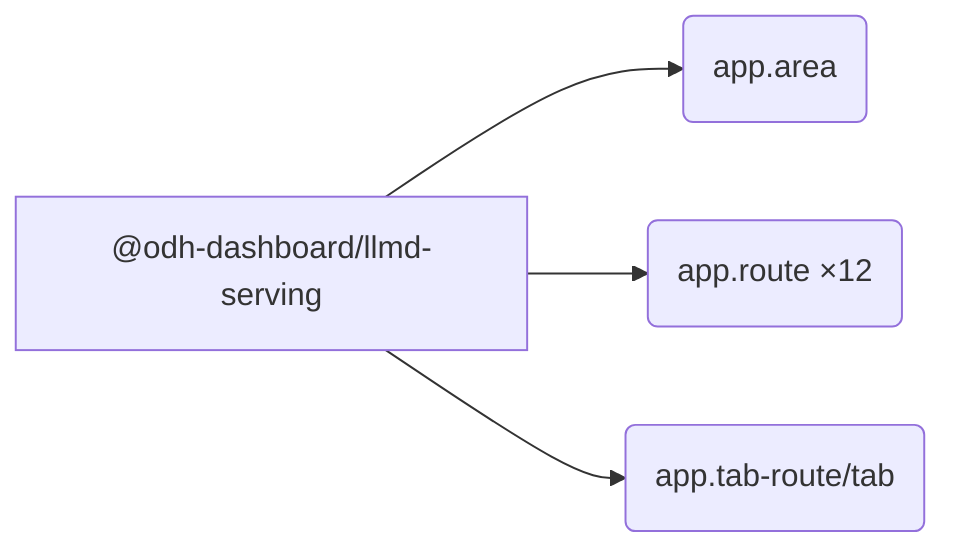

<!-- AUTO-GENERATED by @odh-dashboard/extension-map. Do not edit by hand. -->

> Generated file. Regenerate with `pnpm docs:extension-map`.

## Loading paths

| Entry | Path | Source |
| --- | --- | --- |
| @odh-dashboard/llmd-serving#./extensions | static | `packages/llmd-serving/extensions/extensions.ts` |

## Contributes

### app

| Node | Link |
| --- | --- |
| @odh-dashboard/llmd-serving | [@odh-dashboard/llmd-serving](#contributes) |
| app.area | [app.area](../../plugin-core/docs/extensions.md#apparea) [app.area](../extensions/extensions.ts#L417-L424) |
| app.route ×12 | [app.route](../../plugin-core/docs/extensions.md#approute) [app.route](../extensions/extensions.ts#L626-L638) [app.route](../extensions/extensions.ts#L639-L651) [app.route](../extensions/extensions.ts#L652-L664) [app.route](../extensions/extensions.ts#L707-L717) [app.route](../extensions/extensions.ts#L742-L751) [app.route](../extensions/extensions.ts#L776-L785) |
| app.tab-route/tab | [app.tab-route/tab](../../plugin-core/docs/extensions.md#apptab-routetab) [app.tab-route/tab](../extensions/extensions.ts#L683-L696) [app.tab-route/tab](../extensions/extensions.ts#L719-L731) [app.tab-route/tab](../extensions/extensions.ts#L753-L765) |

- `-->` declared or type-resolved contribution
- `==>` derived relationship
- `-. "rendered in" .->` rendered in one hop
- `-. "federated" .->` federated contribution
- `--x` suppression
- `-- "patch" -->` patch

### model-serving

```mermaid
flowchart LR
  pkg_n__odh_dashboard_llmd_serving_2d801a["@odh-dashboard/llmd-serving"]
  point_n_model_serving_deployed_model_serving_runtime_a806c7("model-serving.deployed-model/serving-runtime")
  pkg_n__odh_dashboard_llmd_serving_2d801a --> point_n_model_serving_deployed_model_serving_runtime_a806c7
  point_n_model_serving_deployment_assemble_model_resource_5b5fd4("model-serving.deployment/assemble-model-resource")
  pkg_n__odh_dashboard_llmd_serving_2d801a --> point_n_model_serving_deployment_assemble_model_resource_5b5fd4
  point_n_model_serving_deployment_deploy_35423a("model-serving.deployment/deploy")
  pkg_n__odh_dashboard_llmd_serving_2d801a --> point_n_model_serving_deployment_deploy_35423a
  point_n_model_serving_deployment_form_data_a37ab2("model-serving.deployment/form-data")
  pkg_n__odh_dashboard_llmd_serving_2d801a --> point_n_model_serving_deployment_form_data_a37ab2
  point_n_model_serving_deployment_tracking_properties_2845ae("model-serving.deployment/tracking-properties")
  pkg_n__odh_dashboard_llmd_serving_2d801a --> point_n_model_serving_deployment_tracking_properties_2845ae
  point_n_model_serving_deployment_wizard_field_19398b("model-serving.deployment/wizard-field ×6")
  pkg_n__odh_dashboard_llmd_serving_2d801a --> point_n_model_serving_deployment_wizard_field_19398b
  point_n_model_serving_deployment_wizard_field_apply_b7659a("model-serving.deployment/wizard-field-apply ×5")
  pkg_n__odh_dashboard_llmd_serving_2d801a --> point_n_model_serving_deployment_wizard_field_apply_b7659a
  point_n_model_serving_deployment_wizard_field_deployment_functions_dd7c85("model-serving.deployment/wizard-field-deployment-functions")
  pkg_n__odh_dashboard_llmd_serving_2d801a --> point_n_model_serving_deployment_wizard_field_deployment_functions_dd7c85
  point_n_model_serving_deployment_wizard_field_extractor_877f9e("model-serving.deployment/wizard-field-extractor ×7")
  pkg_n__odh_dashboard_llmd_serving_2d801a --> point_n_model_serving_deployment_wizard_field_extractor_877f9e
  point_n_model_serving_deployment_wizard_field_override_756caa("model-serving.deployment/wizard-field-override ×7")
  pkg_n__odh_dashboard_llmd_serving_2d801a --> point_n_model_serving_deployment_wizard_field_override_756caa
  point_n_model_serving_deployments_table_start_stop_action_ea2e4f("model-serving.deployments-table/start-stop-action")
  pkg_n__odh_dashboard_llmd_serving_2d801a --> point_n_model_serving_deployments_table_start_stop_action_ea2e4f
  point_n_model_serving_platform_delete_deployment_259f2a("model-serving.platform/delete-deployment")
  pkg_n__odh_dashboard_llmd_serving_2d801a --> point_n_model_serving_platform_delete_deployment_259f2a
  point_n_model_serving_platform_watch_deployments_cf294d("model-serving.platform/watch-deployments")
  pkg_n__odh_dashboard_llmd_serving_2d801a --> point_n_model_serving_platform_watch_deployments_cf294d
  point_n_model_serving_runtime_image_install_target_e22ef9("model-serving.runtime-image/install-target")
  pkg_n__odh_dashboard_llmd_serving_2d801a --> point_n_model_serving_runtime_image_install_target_e22ef9
```

| Node | Link |
| --- | --- |
| @odh-dashboard/llmd-serving | [@odh-dashboard/llmd-serving](#contributes) |
| model-serving.deployed-model/serving-runtime | [model-serving.deployed-model/serving-runtime](../../model-serving/docs/extensions.md#model-servingdeployed-modelserving-runtime) [model-serving.deployed-model/serving-runtime](../extensions/extensions.ts#L436-L450) |
| model-serving.deployment/assemble-model-resource | [model-serving.deployment/assemble-model-resource](../../model-serving/docs/extensions.md#model-servingdeploymentassemble-model-resource) [model-serving.deployment/assemble-model-resource](../extensions/extensions.ts#L514-L525) |
| model-serving.deployment/deploy | [model-serving.deployment/deploy](../../model-serving/docs/extensions.md#model-servingdeploymentdeploy) [model-serving.deployment/deploy](../extensions/extensions.ts#L500-L513) |
| model-serving.deployment/form-data | [model-serving.deployment/form-data](../../model-serving/docs/extensions.md#model-servingdeploymentform-data) [model-serving.deployment/form-data](../extensions/extensions.ts#L451-L487) |
| model-serving.deployment/tracking-properties | [model-serving.deployment/tracking-properties](../../model-serving/docs/extensions.md#model-servingdeploymenttracking-properties) [model-serving.deployment/tracking-properties](../extensions/extensions.ts#L151-L163) |
| model-serving.deployment/wizard-field ×6 | [model-serving.deployment/wizard-field](../../model-serving/docs/extensions.md#model-servingdeploymentwizard-field) [model-serving.deployment/wizard-field](../extensions/extensions.ts#L274-L286) [model-serving.deployment/wizard-field](../extensions/extensions.ts#L310-L320) [model-serving.deployment/wizard-field](../extensions/extensions.ts#L89-L101) [model-serving.deployment/wizard-field](../extensions/extensions.ts#L103-L113) [model-serving.deployment/wizard-field](../extensions/extensions.ts#L189-L199) [model-serving.deployment/wizard-field](../extensions/extensions.ts#L223-L235) |
| model-serving.deployment/wizard-field-apply ×5 | [model-serving.deployment/wizard-field-apply](../../model-serving/docs/extensions.md#model-servingdeploymentwizard-field-apply) [model-serving.deployment/wizard-field-apply](../extensions/extensions.ts#L287-L297) [model-serving.deployment/wizard-field-apply](../extensions/extensions.ts#L321-L329) [model-serving.deployment/wizard-field-apply](../extensions/extensions.ts#L118-L131) [model-serving.deployment/wizard-field-apply](../extensions/extensions.ts#L200-L210) [model-serving.deployment/wizard-field-apply](../extensions/extensions.ts#L236-L246) |
| model-serving.deployment/wizard-field-deployment-functions | [model-serving.deployment/wizard-field-deployment-functions](../../model-serving/docs/extensions.md#model-servingdeploymentwizard-field-deployment-functions) [model-serving.deployment/wizard-field-deployment-functions](../extensions/extensions.ts#L258-L269) [model-serving.deployment/wizard-field-deployment-functions](../extensions/extensions.ts#L340-L350) |
| model-serving.deployment/wizard-field-extractor ×7 | [model-serving.deployment/wizard-field-extractor](../../model-serving/docs/extensions.md#model-servingdeploymentwizard-field-extractor) [model-serving.deployment/wizard-field-extractor](../extensions/extensions.ts#L298-L308) [model-serving.deployment/wizard-field-extractor](../extensions/extensions.ts#L330-L339) [model-serving.deployment/wizard-field-extractor](../extensions/extensions.ts#L356-L368) [model-serving.deployment/wizard-field-extractor](../extensions/extensions.ts#L372-L383) [model-serving.deployment/wizard-field-extractor](../extensions/extensions.ts#L136-L149) [model-serving.deployment/wizard-field-extractor](../extensions/extensions.ts#L211-L221) [model-serving.deployment/wizard-field-extractor](../extensions/extensions.ts#L247-L257) |
| model-serving.deployment/wizard-field-override ×7 | [model-serving.deployment/wizard-field-override](../../model-serving/docs/extensions.md#model-servingdeploymentwizard-field-override) [model-serving.deployment/wizard-field-override](../extensions/extensions.ts#L526-L536) [model-serving.deployment/wizard-field-override](../extensions/extensions.ts#L537-L547) [model-serving.deployment/wizard-field-override](../extensions/extensions.ts#L548-L558) [model-serving.deployment/wizard-field-override](../extensions/extensions.ts#L559-L569) [model-serving.deployment/wizard-field-override](../extensions/extensions.ts#L570-L580) [model-serving.deployment/wizard-field-override](../extensions/extensions.ts#L581-L593) [model-serving.deployment/wizard-field-override](../extensions/extensions.ts#L594-L606) |
| model-serving.deployments-table/start-stop-action | [model-serving.deployments-table/start-stop-action](../../model-serving/docs/extensions.md#model-servingdeployments-tablestart-stop-action) [model-serving.deployments-table/start-stop-action](../extensions/extensions.ts#L615-L622) |
| model-serving.platform/delete-deployment | [model-serving.platform/delete-deployment](../../model-serving/docs/extensions.md#model-servingplatformdelete-deployment) [model-serving.platform/delete-deployment](../extensions/extensions.ts#L488-L499) |
| model-serving.platform/watch-deployments | [model-serving.platform/watch-deployments](../../model-serving/docs/extensions.md#model-servingplatformwatch-deployments) [model-serving.platform/watch-deployments](../extensions/extensions.ts#L425-L435) |
| model-serving.runtime-image/install-target | [model-serving.runtime-image/install-target](../../model-serving/docs/extensions.md#model-servingruntime-imageinstall-target) [model-serving.runtime-image/install-target](../extensions/extensions.ts#L665-L682) |

- `-->` declared or type-resolved contribution
- `==>` derived relationship
- `-. "rendered in" .->` rendered in one hop
- `-. "federated" .->` federated contribution
- `--x` suppression
- `-- "patch" -->` patch

#### app.area

- **reliantAreas**: `SupportedArea.K_SERVE` (`"kserve"`)
- **featureFlags**: `"disableLLMd"`
- **id**: `LLMD_SERVING_ID` (`"llmd-serving"`)
- **Requires**: 
- **Disallows**: 
- **CodeRef target**: 
- **Included in**: 
- **Source**: [app.area](../extensions/extensions.ts#L417-L424)

#### app.route

| component | path | Requires | Disallows | CodeRef target | Included in | Source |
| --- | --- | --- | --- | --- | --- | --- |
| [not resolved](#diagnostics) | `"/settings/model-resources-operations/llm-accelerator-configs/*"` | `LLMD_SERVING_ID` (`"llmd-serving"`), `ADMIN_USER` (`"ADMIN_USER"`), `SupportedArea.VLLM_ON_MAAS` (`"vllm-on-maas"`) |  |  |  | [app.route](../extensions/extensions.ts#L626-L638) |
| [not resolved](#diagnostics) | `"/settings/model-resources-operations/llmd-topology-configurations/*"` | `SupportedArea.LLMD_TOPOLOGY_CONFIGS` (`"llmd-topology-configs"`), `ADMIN_USER` (`"ADMIN_USER"`) |  |  |  | [app.route](../extensions/extensions.ts#L639-L651) |
| [not resolved](#diagnostics) | `"/settings/model-resources-operations/llmd-routing-configurations/*"` | `SupportedArea.LLMD_TOPOLOGY_CONFIGS` (`"llmd-topology-configs"`), `ADMIN_USER` (`"ADMIN_USER"`) |  |  |  | [app.route](../extensions/extensions.ts#L652-L664) |
| packages/llmd-serving/src/settings/llmInferenceServiceConfigs/LlmInferenceServiceConfigFormRoutes.tsx#[LlmInferenceServiceConfigFormRoutes](../src/settings/llmInferenceServiceConfigs/LlmInferenceServiceConfigFormRoutes.tsx#L24-L40) | [not resolved](#diagnostics) | `LLMD_SERVING_ID` (`"llmd-serving"`), `ADMIN_USER` (`"ADMIN_USER"`), `SupportedArea.VLLM_ON_MAAS` (`"vllm-on-maas"`) |  | packages/llmd-serving/src/settings/llmInferenceServiceConfigs/LlmInferenceServiceConfigFormRoutes.tsx#[LlmInferenceServiceConfigFormRoutes](../src/settings/llmInferenceServiceConfigs/LlmInferenceServiceConfigFormRoutes.tsx#L24-L40) |  | [app.route](../extensions/extensions.ts#L707-L717) |
| packages/llmd-serving/src/settings/topologyConfigs/TopologyConfigFormRoutes.tsx#[TopologyConfigFormRoutes](../src/settings/topologyConfigs/TopologyConfigFormRoutes.tsx#L22-L32) | [not resolved](#diagnostics) | `SupportedArea.LLMD_TOPOLOGY_CONFIGS` (`"llmd-topology-configs"`), `ADMIN_USER` (`"ADMIN_USER"`) |  | packages/llmd-serving/src/settings/topologyConfigs/TopologyConfigFormRoutes.tsx#[TopologyConfigFormRoutes](../src/settings/topologyConfigs/TopologyConfigFormRoutes.tsx#L22-L32) |  | [app.route](../extensions/extensions.ts#L742-L751) |
| packages/llmd-serving/src/settings/routingConfigs/RoutingConfigFormRoutes.tsx#[RoutingConfigFormRoutes](../src/settings/routingConfigs/RoutingConfigFormRoutes.tsx#L22-L32) | [not resolved](#diagnostics) | `SupportedArea.LLMD_TOPOLOGY_CONFIGS` (`"llmd-topology-configs"`), `ADMIN_USER` (`"ADMIN_USER"`) |  | packages/llmd-serving/src/settings/routingConfigs/RoutingConfigFormRoutes.tsx#[RoutingConfigFormRoutes](../src/settings/routingConfigs/RoutingConfigFormRoutes.tsx#L22-L32) |  | [app.route](../extensions/extensions.ts#L776-L785) |

**Not resolved**

| Location | Reason | Link |
| --- | --- | --- |
| properties.component | expression is not a statically resolvable value | [diagnostics](#diagnostics) |
| properties.component | expression is not a statically resolvable value | [diagnostics](#diagnostics) |
| properties.component | expression is not a statically resolvable value | [diagnostics](#diagnostics) |
| properties.path | identifier does not resolve to a literal value | [diagnostics](#diagnostics) |
| properties.path | identifier does not resolve to a literal value | [diagnostics](#diagnostics) |
| properties.path | identifier does not resolve to a literal value | [diagnostics](#diagnostics) |

#### app.tab-route/tab

- **pageId**: `"model-deployment-settings"`
- **id**: `"llm-inference-service-configurations"`
- **title**: `"LLM inference service configurations"`
- **component**: packages/llmd-serving/src/settings/llmInferenceServiceConfigs/LlmInferenceServiceConfigTabRoutes.tsx#[LlmInferenceServiceConfigTabRoutes](../src/settings/llmInferenceServiceConfigs/LlmInferenceServiceConfigTabRoutes.tsx#L16-L25)
- **group**: `"3_accelerator"`
- **Requires**: `LLMD_SERVING_ID` (`"llmd-serving"`), `ADMIN_USER` (`"ADMIN_USER"`), `SupportedArea.VLLM_ON_MAAS` (`"vllm-on-maas"`)
- **Disallows**: 
- **CodeRef target**: packages/llmd-serving/src/settings/llmInferenceServiceConfigs/LlmInferenceServiceConfigTabRoutes.tsx#[LlmInferenceServiceConfigTabRoutes](../src/settings/llmInferenceServiceConfigs/LlmInferenceServiceConfigTabRoutes.tsx#L16-L25)
- **Included in**: 
- **Source**: [app.tab-route/tab](../extensions/extensions.ts#L683-L696)

- **pageId**: `"model-deployment-settings"`
- **id**: `"topology-configurations"`
- **title**: `"llm-d topology configurations"`
- **component**: packages/llmd-serving/src/settings/topologyConfigs/TopologyConfigTabRoutes.tsx#[TopologyConfigTabRoutes](../src/settings/topologyConfigs/TopologyConfigTabRoutes.tsx#L16-L25)
- **group**: `"4_topology"`
- **Requires**: `SupportedArea.LLMD_TOPOLOGY_CONFIGS` (`"llmd-topology-configs"`), `ADMIN_USER` (`"ADMIN_USER"`)
- **Disallows**: 
- **CodeRef target**: packages/llmd-serving/src/settings/topologyConfigs/TopologyConfigTabRoutes.tsx#[TopologyConfigTabRoutes](../src/settings/topologyConfigs/TopologyConfigTabRoutes.tsx#L16-L25)
- **Included in**: 
- **Source**: [app.tab-route/tab](../extensions/extensions.ts#L719-L731)

- **pageId**: `"model-deployment-settings"`
- **id**: `"routing-configurations"`
- **title**: `"llm-d routing configurations"`
- **component**: packages/llmd-serving/src/settings/routingConfigs/RoutingConfigTabRoutes.tsx#[RoutingConfigTabRoutes](../src/settings/routingConfigs/RoutingConfigTabRoutes.tsx#L16-L25)
- **group**: `"5_routing"`
- **Requires**: `SupportedArea.LLMD_TOPOLOGY_CONFIGS` (`"llmd-topology-configs"`), `ADMIN_USER` (`"ADMIN_USER"`)
- **Disallows**: 
- **CodeRef target**: packages/llmd-serving/src/settings/routingConfigs/RoutingConfigTabRoutes.tsx#[RoutingConfigTabRoutes](../src/settings/routingConfigs/RoutingConfigTabRoutes.tsx#L16-L25)
- **Included in**: 
- **Source**: [app.tab-route/tab](../extensions/extensions.ts#L753-L765)

#### model-serving.deployed-model/serving-runtime

- **platform**: `LLMD_SERVING_ID` (`"llmd-serving"`)
- **dataHook**: packages/llmd-serving/src/components/ServingDetails.tsx#[useServingDetailsData](../src/components/ServingDetails.tsx#L16-L19)
- **ServingDetailsComponent**: packages/llmd-serving/src/components/ServingDetails.tsx#[LLMInferenceServiceServingDetails](../src/components/ServingDetails.tsx#L26-L71)
- **Requires**: `LLMD_SERVING_ID` (`"llmd-serving"`)
- **Disallows**: 
- **CodeRef target**: packages/llmd-serving/src/components/ServingDetails.tsx#[useServingDetailsData](../src/components/ServingDetails.tsx#L16-L19), packages/llmd-serving/src/components/ServingDetails.tsx#[LLMInferenceServiceServingDetails](../src/components/ServingDetails.tsx#L26-L71)
- **Included in**: 
- **Source**: [model-serving.deployed-model/serving-runtime](../extensions/extensions.ts#L436-L450)

#### model-serving.deployment/assemble-model-resource

- **platform**: `LLMD_SERVING_ID` (`"llmd-serving"`)
- **isActive**: packages/llmd-serving/src/formUtils.ts#[isLLMInferenceServiceActive](../src/formUtils.ts#L14-L28)
- **priority**: `100`
- **assemble**: packages/llmd-serving/src/deployments/deploy.ts#[assembleLLMdDeployment](../src/deployments/deploy.ts#L214-L265)
- **Requires**: `LLMD_SERVING_ID` (`"llmd-serving"`)
- **Disallows**: 
- **CodeRef target**: packages/llmd-serving/src/formUtils.ts#[isLLMInferenceServiceActive](../src/formUtils.ts#L14-L28), packages/llmd-serving/src/deployments/deploy.ts#[assembleLLMdDeployment](../src/deployments/deploy.ts#L214-L265)
- **Included in**: 
- **Source**: [model-serving.deployment/assemble-model-resource](../extensions/extensions.ts#L514-L525)

#### model-serving.deployment/deploy

- **platform**: `LLMD_SERVING_ID` (`"llmd-serving"`)
- **isActive**: packages/llmd-serving/src/formUtils.ts#[isLLMInferenceServiceActive](../src/formUtils.ts#L14-L28)
- **priority**: `100`
- **supportsOverwrite**: `true`
- **supportsDRAHardwareProfiles**: `true`
- **deploy**: packages/llmd-serving/src/deployments/deploy.ts#[deployLLMdDeployment](../src/deployments/deploy.ts#L313-L388)
- **Requires**: `LLMD_SERVING_ID` (`"llmd-serving"`)
- **Disallows**: 
- **CodeRef target**: packages/llmd-serving/src/formUtils.ts#[isLLMInferenceServiceActive](../src/formUtils.ts#L14-L28), packages/llmd-serving/src/deployments/deploy.ts#[deployLLMdDeployment](../src/deployments/deploy.ts#L313-L388)
- **Included in**: 
- **Source**: [model-serving.deployment/deploy](../extensions/extensions.ts#L500-L513)

#### model-serving.deployment/form-data

- **platform**: `LLMD_SERVING_ID` (`"llmd-serving"`)
- **isActive**: `true`
- **priority**: `0`
- **hardwareProfilePaths**: packages/llmd-serving/src/deployments/hardware.ts#[LLMD_INFERENCE_SERVICE_HARDWARE_PROFILE_PATHS](../src/deployments/hardware.ts#L15-L20)
- **extractHardwareProfileConfig**: packages/llmd-serving/src/deployments/hardware.ts#[extractHardwareProfileConfig](../src/deployments/hardware.ts#L22-L42)
- **extractModelFormat**: packages/llmd-serving/src/deployments/model.ts#[extractModelFormat](../src/deployments/model.ts#L88-L90)
- **extractReplicas**: packages/llmd-serving/src/deployments/hardware.ts#[extractReplicas](../src/deployments/hardware.ts#L53-L57)
- **extractRuntimeArgs**: packages/llmd-serving/src/deployments/model.ts#[extractRuntimeArgs](../src/deployments/model.ts#L147-L159)
- **extractEnvironmentVariables**: packages/llmd-serving/src/deployments/model.ts#[extractEnvironmentVariables](../src/deployments/model.ts#L161-L174)
- **extractModelAvailabilityData**: packages/llmd-serving/src/wizardFields/modelAvailability.ts#[extractModelAvailabilityData](../src/wizardFields/modelAvailability.ts#L16-L23)
- **extractModelLocationData**: packages/llmd-serving/src/deployments/model.ts#[extractModelLocationData](../src/deployments/model.ts#L197-L237)
- **extractModelType**: packages/llmd-serving/src/deployments/model.ts#[extractModelType](../src/deployments/model.ts#L92-L94)
- **extractModelServerTemplate**: packages/llmd-serving/src/deployments/server.ts#[extractModelServerTemplate](../src/deployments/server.ts#L9-L30)
- **extractHuggingFaceApiKey**: packages/llmd-serving/src/hfTokenSecret.ts#hfTokenSecret
- **validateExtraction**: packages/llmd-serving/src/deployments/validateExtraction.ts#[validateExtraction](../src/deployments/validateExtraction.ts#L11-L34)
- **Requires**: `LLMD_SERVING_ID` (`"llmd-serving"`)
- **Disallows**: 
- **CodeRef target**: packages/llmd-serving/src/deployments/hardware.ts#[extractHardwareProfileConfig](../src/deployments/hardware.ts#L22-L42), packages/llmd-serving/src/deployments/model.ts#[extractModelType](../src/deployments/model.ts#L92-L94), packages/llmd-serving/src/deployments/model.ts#[extractModelFormat](../src/deployments/model.ts#L88-L90), packages/llmd-serving/src/deployments/hardware.ts#[extractReplicas](../src/deployments/hardware.ts#L53-L57), packages/llmd-serving/src/deployments/model.ts#[extractRuntimeArgs](../src/deployments/model.ts#L147-L159), packages/llmd-serving/src/deployments/model.ts#[extractEnvironmentVariables](../src/deployments/model.ts#L161-L174), packages/llmd-serving/src/hfTokenSecret.ts#hfTokenSecret, packages/llmd-serving/src/wizardFields/modelAvailability.ts#[extractModelAvailabilityData](../src/wizardFields/modelAvailability.ts#L16-L23), packages/llmd-serving/src/deployments/model.ts#[extractModelLocationData](../src/deployments/model.ts#L197-L237), packages/llmd-serving/src/deployments/server.ts#[extractModelServerTemplate](../src/deployments/server.ts#L9-L30), packages/llmd-serving/src/deployments/hardware.ts#[LLMD_INFERENCE_SERVICE_HARDWARE_PROFILE_PATHS](../src/deployments/hardware.ts#L15-L20), packages/llmd-serving/src/deployments/validateExtraction.ts#[validateExtraction](../src/deployments/validateExtraction.ts#L11-L34)
- **Included in**: 
- **Source**: [model-serving.deployment/form-data](../extensions/extensions.ts#L451-L487)

**Supplies**

| CodeRef | Supply | Value |
| --- | --- | --- |
| LLMD_INFERENCE_SERVICE_HARDWARE_PROFILE_PATHS | containerResourcesPath | `"spec.template.containers.0.resources"` |
| LLMD_INFERENCE_SERVICE_HARDWARE_PROFILE_PATHS | tolerationsPath | `"spec.template.tolerations"` |
| LLMD_INFERENCE_SERVICE_HARDWARE_PROFILE_PATHS | nodeSelectorPath | `"spec.template.nodeSelector"` |
| LLMD_INFERENCE_SERVICE_HARDWARE_PROFILE_PATHS | podSpecPath | `"spec.template"` |

#### model-serving.deployment/tracking-properties

| platform | getProperties | Requires | Disallows | CodeRef target | Included in | Source |
| --- | --- | --- | --- | --- | --- | --- |
| `LLMD_SERVING_ID` (`"llmd-serving"`) | packages/llmd-serving/src/tracking/llmdWizardTracking.ts#[extractLlmdDeploymentTrackingProperties](../src/tracking/llmdWizardTracking.ts#L198-L203) | `LLMD_SERVING_ID` (`"llmd-serving"`) |  | packages/llmd-serving/src/tracking/llmdWizardTracking.ts#[extractLlmdDeploymentTrackingProperties](../src/tracking/llmdWizardTracking.ts#L198-L203) |  | [model-serving.deployment/tracking-properties](../extensions/extensions.ts#L151-L163) |

#### model-serving.deployment/wizard-field

| platform | field | Requires | Disallows | CodeRef target | Included in | Source |
| --- | --- | --- | --- | --- | --- | --- |
| `LLMD_SERVING_ID` (`"llmd-serving"`) | packages/llmd-serving/src/wizardFields/AdvancedRoutingField.tsx#[AdvancedRoutingFieldWizardField](../src/wizardFields/AdvancedRoutingField.tsx#L287-L318) | `SupportedArea.LLMD_SERVING` (`"llmd-serving"`), `SupportedArea.LLMD_TOPOLOGY_CONFIGS` (`"llmd-topology-configs"`) |  | packages/llmd-serving/src/wizardFields/AdvancedRoutingField.tsx#[AdvancedRoutingFieldWizardField](../src/wizardFields/AdvancedRoutingField.tsx#L287-L318) |  | [model-serving.deployment/wizard-field](../extensions/extensions.ts#L274-L286) |
| `LLMD_SERVING_ID` (`"llmd-serving"`) | packages/llmd-serving/src/wizardFields/AcceleratorConfigField.tsx#[AcceleratorConfigFieldWizardField](../src/wizardFields/AcceleratorConfigField.tsx#L336-L373) | `SupportedArea.LLMD_SERVING` (`"llmd-serving"`), `SupportedArea.VLLM_ON_MAAS` (`"vllm-on-maas"`) |  | packages/llmd-serving/src/wizardFields/AcceleratorConfigField.tsx#[AcceleratorConfigFieldWizardField](../src/wizardFields/AcceleratorConfigField.tsx#L336-L373) |  | [model-serving.deployment/wizard-field](../extensions/extensions.ts#L310-L320) |
| `LLMD_SERVING_ID` (`"llmd-serving"`) | packages/llmd-serving/src/wizardFields/LlmConfigOptionsField.tsx#[LLMConfigOptionsFieldWizardField](../src/wizardFields/LlmConfigOptionsField.tsx#L159-L201) | `LLMD_SERVING_ID` (`"llmd-serving"`), `SupportedArea.VLLM_ON_MAAS` (`"vllm-on-maas"`) |  | packages/llmd-serving/src/wizardFields/LlmConfigOptionsField.tsx#[LLMConfigOptionsFieldWizardField](../src/wizardFields/LlmConfigOptionsField.tsx#L159-L201) |  | [model-serving.deployment/wizard-field](../extensions/extensions.ts#L89-L101) |
| `LLMD_SERVING_ID` (`"llmd-serving"`) | packages/llmd-serving/src/wizardFields/gateway/GatewaySelectField.tsx#[GatewaySelectField](../src/wizardFields/gateway/GatewaySelectField.tsx#L302-L320) | `LLMD_SERVING_ID` (`"llmd-serving"`), `SupportedArea.LLMD_GATEWAY_FIELD` (`"llmd-gateway-field"`) |  | packages/llmd-serving/src/wizardFields/gateway/GatewaySelectField.tsx#[GatewaySelectField](../src/wizardFields/gateway/GatewaySelectField.tsx#L302-L320) |  | [model-serving.deployment/wizard-field](../extensions/extensions.ts#L103-L113) |
| `LLMD_SERVING_ID` (`"llmd-serving"`) | packages/llmd-serving/src/wizardFields/TopologyTypeField.tsx#[TopologyTypeFieldWizardField](../src/wizardFields/TopologyTypeField.tsx#L247-L264) | `SupportedArea.LLMD_SERVING` (`"llmd-serving"`), `SupportedArea.LLMD_TOPOLOGY_CONFIGS` (`"llmd-topology-configs"`) |  | packages/llmd-serving/src/wizardFields/TopologyTypeField.tsx#[TopologyTypeFieldWizardField](../src/wizardFields/TopologyTypeField.tsx#L247-L264) |  | [model-serving.deployment/wizard-field](../extensions/extensions.ts#L189-L199) |
| `LLMD_SERVING_ID` (`"llmd-serving"`) | packages/llmd-serving/src/wizardFields/CustomTopologyConfigField.tsx#[CustomTopologyConfigFieldWizardField](../src/wizardFields/CustomTopologyConfigField.tsx#L248-L298) | `SupportedArea.LLMD_SERVING` (`"llmd-serving"`), `SupportedArea.LLMD_TOPOLOGY_CONFIGS` (`"llmd-topology-configs"`) |  | packages/llmd-serving/src/wizardFields/CustomTopologyConfigField.tsx#[CustomTopologyConfigFieldWizardField](../src/wizardFields/CustomTopologyConfigField.tsx#L248-L298) |  | [model-serving.deployment/wizard-field](../extensions/extensions.ts#L223-L235) |

**Not resolved**

| Location | Reason | Link |
| --- | --- | --- |
| properties.field supplies.reducerFunctions.resolveDependencies | CodeRef body is not a supported dynamic import | [diagnostics](#diagnostics) |
| properties.field supplies.reducerFunctions.setFieldData | CodeRef body is not a supported dynamic import | [diagnostics](#diagnostics) |
| properties.field supplies.reducerFunctions.getInitialFieldData | CodeRef body is not a supported dynamic import | [diagnostics](#diagnostics) |
| properties.field supplies.reducerFunctions.validationSchema | expression is not a statically resolvable value | [diagnostics](#diagnostics) |
| properties.field supplies.reducerFunctions.resolveDependencies | identifier does not resolve to a literal value | [diagnostics](#diagnostics) |
| properties.field supplies.reducerFunctions.setFieldData | CodeRef body is not a supported dynamic import | [diagnostics](#diagnostics) |
| properties.field supplies.reducerFunctions.getInitialFieldData | CodeRef body is not a supported dynamic import | [diagnostics](#diagnostics) |
| properties.field supplies.reducerFunctions.validationSchema | expression is not a statically resolvable value | [diagnostics](#diagnostics) |
| properties.field supplies.reducerFunctions.resolveDependencies | CodeRef body is not a supported dynamic import | [diagnostics](#diagnostics) |
| properties.field supplies.reducerFunctions.setFieldData | CodeRef body is not a supported dynamic import | [diagnostics](#diagnostics) |
| properties.field supplies.reducerFunctions.getInitialFieldData | CodeRef body is not a supported dynamic import | [diagnostics](#diagnostics) |
| properties.field supplies.reducerFunctions.validationSchema | expression is not a statically resolvable value | [diagnostics](#diagnostics) |
| properties.field supplies.reducerFunctions.resolveDependencies | CodeRef body is not a supported dynamic import | [diagnostics](#diagnostics) |
| properties.field supplies.reducerFunctions.setFieldData | CodeRef body is not a supported dynamic import | [diagnostics](#diagnostics) |
| properties.field supplies.reducerFunctions.getInitialFieldData | CodeRef body is not a supported dynamic import | [diagnostics](#diagnostics) |
| properties.field supplies.reducerFunctions.resolveDependencies | identifier does not resolve to a literal value | [diagnostics](#diagnostics) |
| properties.field supplies.reducerFunctions.setFieldData | CodeRef body is not a supported dynamic import | [diagnostics](#diagnostics) |
| properties.field supplies.reducerFunctions.getInitialFieldData | CodeRef body is not a supported dynamic import | [diagnostics](#diagnostics) |
| properties.field supplies.reducerFunctions.validationSchema | expression is not a statically resolvable value | [diagnostics](#diagnostics) |
| properties.field supplies.reducerFunctions.resolveDependencies | CodeRef body is not a supported dynamic import | [diagnostics](#diagnostics) |
| properties.field supplies.reducerFunctions.setFieldData | CodeRef body is not a supported dynamic import | [diagnostics](#diagnostics) |
| properties.field supplies.reducerFunctions.getInitialFieldData | CodeRef body is not a supported dynamic import | [diagnostics](#diagnostics) |
| properties.field supplies.reducerFunctions.validationSchema | expression is not a statically resolvable value | [diagnostics](#diagnostics) |

**Supplies**

| CodeRef | Supply | Value |
| --- | --- | --- |
| AdvancedRoutingFieldWizardField | id | `LLMD_ROUTING_FIELD_ID` (`"llmd-serving/advanced-routing"`) |
| AdvancedRoutingFieldWizardField | step | `"modelDeployment"` |
| AdvancedRoutingFieldWizardField | type | `"addition"` |
| AdvancedRoutingFieldWizardField | isActive | [isActive](../src/wizardFields/AdvancedRoutingField.tsx#L291-L291) |
| AdvancedRoutingFieldWizardField | reducerFunctions | resolveDependencies: [not resolved](#diagnostics), setFieldData: [not resolved](#diagnostics), getInitialFieldData: [not resolved](#diagnostics), validationSchema: [not resolved](#diagnostics) |
| AdvancedRoutingFieldWizardField | shouldResetOnDependencyChange | [shouldResetOnDependencyChange](../src/wizardFields/AdvancedRoutingField.tsx#L313-L314) |
| AdvancedRoutingFieldWizardField | externalDataHook | [useAdvancedRoutingData](../src/wizardFields/AdvancedRoutingField.tsx#L43-L61) |
| AdvancedRoutingFieldWizardField | component | [AdvancedRoutingFieldComponent](../src/wizardFields/AdvancedRoutingField.tsx#L97-L256) |
| AdvancedRoutingFieldWizardField | getReviewSections | [getReviewSections](../src/wizardFields/AdvancedRoutingField.tsx#L317-L317) |
| AcceleratorConfigFieldWizardField | id | `ACCELERATOR_CONFIG_FIELD_ID` (`"llmd-serving/accelerator-config"`) |
| AcceleratorConfigFieldWizardField | step | `"modelDeployment"` |
| AcceleratorConfigFieldWizardField | type | `"addition"` |
| AcceleratorConfigFieldWizardField | isActive | [isActive](../src/wizardFields/AcceleratorConfigField.tsx#L340-L340) |
| AcceleratorConfigFieldWizardField | reducerFunctions | resolveDependencies: [not resolved](#diagnostics), setFieldData: [not resolved](#diagnostics), getInitialFieldData: [not resolved](#diagnostics), validationSchema: [not resolved](#diagnostics) |
| AcceleratorConfigFieldWizardField | externalDataHook | [useAcceleratorConfigData](../src/wizardFields/AcceleratorConfigField.tsx#L86-L125) |
| AcceleratorConfigFieldWizardField | component | [AcceleratorConfigFieldComponent](../src/wizardFields/AcceleratorConfigField.tsx#L207-L295) |
| AcceleratorConfigFieldWizardField | getReviewSections | [getReviewSections](../src/wizardFields/AcceleratorConfigField.tsx#L372-L372) |
| LLMConfigOptionsFieldWizardField | id | `"llmd-serving/modelServer"` |
| LLMConfigOptionsFieldWizardField | step | `"modelDeployment"` |
| LLMConfigOptionsFieldWizardField | type | `"replacement"` |
| LLMConfigOptionsFieldWizardField | stateKey | `"modelServer"` |
| LLMConfigOptionsFieldWizardField | isActive | [isSimpleLLMInferenceService](../src/formUtils.ts#L34-L49) |
| LLMConfigOptionsFieldWizardField | reducerFunctions | resolveDependencies: [not resolved](#diagnostics), setFieldData: [not resolved](#diagnostics), getInitialFieldData: [not resolved](#diagnostics), validationSchema: [not resolved](#diagnostics) |
| LLMConfigOptionsFieldWizardField | component | [LLMConfigOptionsField](../src/wizardFields/LlmConfigOptionsField.tsx#L132-L156) |
| LLMConfigOptionsFieldWizardField | externalDataHook | [useLLMConfigOptions](../src/wizardFields/LlmConfigOptionsField.tsx#L30-L62) |
| LLMConfigOptionsFieldWizardField | getReviewSections | [getReviewSections](../src/wizardFields/LlmConfigOptionsField.tsx#L200-L200) |
| GatewaySelectField | id | `LLMD_GATEWAY_FIELD_ID` (`"llmd-serving/gateway"`) |
| GatewaySelectField | parentId | `"networking"` |
| GatewaySelectField | step | `"advancedOptions"` |
| GatewaySelectField | type | `"addition"` |
| GatewaySelectField | isActive | [isLLMInferenceServiceActive](../src/formUtils.ts#L14-L28) |
| GatewaySelectField | reducerFunctions | resolveDependencies: [not resolved](#diagnostics), setFieldData: [not resolved](#diagnostics), getInitialFieldData: [not resolved](#diagnostics) |
| GatewaySelectField | shouldResetOnDependencyChange | [shouldResetOnDependencyChange](../src/wizardFields/gateway/GatewaySelectField.tsx#L316-L316) |
| GatewaySelectField | externalDataHook | [useGatewayOptions](../src/wizardFields/gateway/GatewaySelectField.tsx#L29-L35) |
| GatewaySelectField | component | [GatewaySelectFieldComponent](../src/wizardFields/gateway/GatewaySelectField.tsx#L80-L283) |
| GatewaySelectField | getReviewSections | [getGatewayReviewSection](../src/wizardFields/gateway/GatewaySelectField.tsx#L285-L301) |
| TopologyTypeFieldWizardField | id | `TOPOLOGY_TYPE_FIELD_ID` (`"llmd-serving/topology-type"`) |
| TopologyTypeFieldWizardField | step | `"modelDeployment"` |
| TopologyTypeFieldWizardField | type | `"addition"` |
| TopologyTypeFieldWizardField | isActive | [isActive](../src/wizardFields/TopologyTypeField.tsx#L251-L251) |
| TopologyTypeFieldWizardField | reducerFunctions | resolveDependencies: [not resolved](#diagnostics), setFieldData: [not resolved](#diagnostics), getInitialFieldData: [not resolved](#diagnostics), validationSchema: [not resolved](#diagnostics) |
| TopologyTypeFieldWizardField | externalDataHook | [useTopologyTypeData](../src/wizardFields/TopologyTypeField.tsx#L82-L141) |
| TopologyTypeFieldWizardField | component | [TopologyTypeFieldComponent](../src/wizardFields/TopologyTypeField.tsx#L153-L219) |
| TopologyTypeFieldWizardField | getReviewSections | [getReviewSections](../src/wizardFields/TopologyTypeField.tsx#L263-L263) |
| CustomTopologyConfigFieldWizardField | id | `CUSTOM_TOPOLOGY_CONFIG_FIELD_ID` (`"llmd-serving/custom-topology-config"`) |
| CustomTopologyConfigFieldWizardField | step | `"modelDeployment"` |
| CustomTopologyConfigFieldWizardField | type | `"addition"` |
| CustomTopologyConfigFieldWizardField | isActive | [isActive](../src/wizardFields/CustomTopologyConfigField.tsx#L252-L252) |
| CustomTopologyConfigFieldWizardField | reducerFunctions | resolveDependencies: [not resolved](#diagnostics), setFieldData: [not resolved](#diagnostics), getInitialFieldData: [not resolved](#diagnostics), validationSchema: [not resolved](#diagnostics) |
| CustomTopologyConfigFieldWizardField | shouldResetOnDependencyChange | [shouldResetOnDependencyChange](../src/wizardFields/CustomTopologyConfigField.tsx#L293-L294) |
| CustomTopologyConfigFieldWizardField | externalDataHook | [useTopologyTypeData](../src/wizardFields/TopologyTypeField.tsx#L82-L141) |
| CustomTopologyConfigFieldWizardField | component | [CustomTopologyConfigFieldComponent](../src/wizardFields/CustomTopologyConfigField.tsx#L72-L217) |
| CustomTopologyConfigFieldWizardField | getReviewSections | [getReviewSections](../src/wizardFields/CustomTopologyConfigField.tsx#L297-L297) |

#### model-serving.deployment/wizard-field-apply

- **fieldId**: `"llmd-serving/advanced-routing"`
- **platform**: `LLMD_SERVING_ID` (`"llmd-serving"`)
- **apply**: packages/llmd-serving/src/deployments/topology.ts#[applyRoutingConfig](../src/deployments/topology.ts#L69-L102)
- **Requires**: `SupportedArea.LLMD_SERVING` (`"llmd-serving"`), `SupportedArea.LLMD_TOPOLOGY_CONFIGS` (`"llmd-topology-configs"`)
- **Disallows**: 
- **CodeRef target**: packages/llmd-serving/src/deployments/topology.ts#[applyRoutingConfig](../src/deployments/topology.ts#L69-L102)
- **Included in**: 
- **Source**: [model-serving.deployment/wizard-field-apply](../extensions/extensions.ts#L287-L297)

- **fieldId**: `"llmd-serving/accelerator-config"`
- **platform**: `LLMD_SERVING_ID` (`"llmd-serving"`)
- **apply**: packages/llmd-serving/src/deployments/accelerator.ts#[applyAcceleratorConfig](../src/deployments/accelerator.ts#L15-L23)
- **Requires**: `SupportedArea.LLMD_SERVING` (`"llmd-serving"`), `SupportedArea.VLLM_ON_MAAS` (`"vllm-on-maas"`)
- **Disallows**: 
- **CodeRef target**: packages/llmd-serving/src/deployments/accelerator.ts#[applyAcceleratorConfig](../src/deployments/accelerator.ts#L15-L23)
- **Included in**: 
- **Source**: [model-serving.deployment/wizard-field-apply](../extensions/extensions.ts#L321-L329)

- **fieldId**: `"llmd-serving/gateway"`
- **platform**: `LLMD_SERVING_ID` (`"llmd-serving"`)
- **apply**: packages/llmd-serving/src/wizardFields/gateway/gatewaySelectApplyExtract.ts#[applyGatewaySelectData](../src/wizardFields/gateway/gatewaySelectApplyExtract.ts#L14-L36)
- **Requires**: `LLMD_SERVING_ID` (`"llmd-serving"`), `SupportedArea.LLMD_GATEWAY_FIELD` (`"llmd-gateway-field"`)
- **Disallows**: 
- **CodeRef target**: packages/llmd-serving/src/wizardFields/gateway/gatewaySelectApplyExtract.ts#[applyGatewaySelectData](../src/wizardFields/gateway/gatewaySelectApplyExtract.ts#L14-L36)
- **Included in**: 
- **Source**: [model-serving.deployment/wizard-field-apply](../extensions/extensions.ts#L118-L131)

- **fieldId**: `"llmd-serving/topology-type"`
- **platform**: `LLMD_SERVING_ID` (`"llmd-serving"`)
- **apply**: packages/llmd-serving/src/deployments/topology.ts#[applyTopologyType](../src/deployments/topology.ts#L20-L33)
- **Requires**: `SupportedArea.LLMD_SERVING` (`"llmd-serving"`), `SupportedArea.LLMD_TOPOLOGY_CONFIGS` (`"llmd-topology-configs"`)
- **Disallows**: 
- **CodeRef target**: packages/llmd-serving/src/deployments/topology.ts#[applyTopologyType](../src/deployments/topology.ts#L20-L33)
- **Included in**: 
- **Source**: [model-serving.deployment/wizard-field-apply](../extensions/extensions.ts#L200-L210)

- **fieldId**: `"llmd-serving/custom-topology-config"`
- **platform**: `LLMD_SERVING_ID` (`"llmd-serving"`)
- **apply**: packages/llmd-serving/src/deployments/topology.ts#[applyTopologyConfig](../src/deployments/topology.ts#L37-L45)
- **Requires**: `SupportedArea.LLMD_SERVING` (`"llmd-serving"`), `SupportedArea.LLMD_TOPOLOGY_CONFIGS` (`"llmd-topology-configs"`)
- **Disallows**: 
- **CodeRef target**: packages/llmd-serving/src/deployments/topology.ts#[applyTopologyConfig](../src/deployments/topology.ts#L37-L45)
- **Included in**: 
- **Source**: [model-serving.deployment/wizard-field-apply](../extensions/extensions.ts#L236-L246)

#### model-serving.deployment/wizard-field-deployment-functions

- **fieldId**: `"llmd-serving/custom-topology-config"`
- **platform**: `LLMD_SERVING_ID` (`"llmd-serving"`)
- **preDeploy**: packages/llmd-serving/src/deployments/topology.ts#[preDeployTopologyConfig](../src/deployments/topology.ts#L49-L65)
- **postDeploy**: `null`
- **Requires**: `SupportedArea.LLMD_SERVING` (`"llmd-serving"`), `SupportedArea.LLMD_TOPOLOGY_CONFIGS` (`"llmd-topology-configs"`)
- **Disallows**: 
- **CodeRef target**: packages/llmd-serving/src/deployments/topology.ts#[preDeployTopologyConfig](../src/deployments/topology.ts#L49-L65)
- **Included in**: 
- **Source**: [model-serving.deployment/wizard-field-deployment-functions](../extensions/extensions.ts#L258-L269)

- **fieldId**: `"llmd-serving/accelerator-config"`
- **platform**: `LLMD_SERVING_ID` (`"llmd-serving"`)
- **preDeploy**: packages/llmd-serving/src/deployments/accelerator.ts#[preDeployAcceleratorConfig](../src/deployments/accelerator.ts#L25-L38)
- **postDeploy**: `null`
- **Requires**: `SupportedArea.LLMD_SERVING` (`"llmd-serving"`), `SupportedArea.VLLM_ON_MAAS` (`"vllm-on-maas"`)
- **Disallows**: 
- **CodeRef target**: packages/llmd-serving/src/deployments/accelerator.ts#[preDeployAcceleratorConfig](../src/deployments/accelerator.ts#L25-L38)
- **Included in**: 
- **Source**: [model-serving.deployment/wizard-field-deployment-functions](../extensions/extensions.ts#L340-L350)

#### model-serving.deployment/wizard-field-extractor

- **fieldId**: `"llmd-serving/advanced-routing"`
- **platform**: `LLMD_SERVING_ID` (`"llmd-serving"`)
- **extract**: packages/llmd-serving/src/deployments/topology.ts#[extractRoutingConfig](../src/deployments/topology.ts#L130-L138)
- **Requires**: `SupportedArea.LLMD_SERVING` (`"llmd-serving"`), `SupportedArea.LLMD_TOPOLOGY_CONFIGS` (`"llmd-topology-configs"`)
- **Disallows**: 
- **CodeRef target**: packages/llmd-serving/src/deployments/topology.ts#[extractRoutingConfig](../src/deployments/topology.ts#L130-L138)
- **Included in**: 
- **Source**: [model-serving.deployment/wizard-field-extractor](../extensions/extensions.ts#L298-L308)

- **fieldId**: `"llmd-serving/accelerator-config"`
- **platform**: `LLMD_SERVING_ID` (`"llmd-serving"`)
- **extract**: packages/llmd-serving/src/deployments/accelerator.ts#[extractAcceleratorConfig](../src/deployments/accelerator.ts#L40-L48)
- **Requires**: `SupportedArea.LLMD_SERVING` (`"llmd-serving"`), `SupportedArea.VLLM_ON_MAAS` (`"vllm-on-maas"`)
- **Disallows**: 
- **CodeRef target**: packages/llmd-serving/src/deployments/accelerator.ts#[extractAcceleratorConfig](../src/deployments/accelerator.ts#L40-L48)
- **Included in**: 
- **Source**: [model-serving.deployment/wizard-field-extractor](../extensions/extensions.ts#L330-L339)

- **fieldId**: `"deploymentMethod"`
- **platform**: `LLMD_SERVING_ID` (`"llmd-serving"`)
- **extract**: packages/llmd-serving/src/deployments/model.ts#[extractDeploymentMethodAlwaysLlmd](../src/deployments/model.ts#L323-L325)
- **Requires**: `LLMD_SERVING_ID` (`"llmd-serving"`)
- **Disallows**: `SupportedArea.VLLM_ON_MAAS` (`"vllm-on-maas"`)
- **CodeRef target**: packages/llmd-serving/src/deployments/model.ts#[extractDeploymentMethodAlwaysLlmd](../src/deployments/model.ts#L323-L325)
- **Included in**: 
- **Source**: [model-serving.deployment/wizard-field-extractor](../extensions/extensions.ts#L356-L368)

- **fieldId**: `"deploymentMethod"`
- **platform**: `LLMD_SERVING_ID` (`"llmd-serving"`)
- **extract**: packages/llmd-serving/src/deployments/model.ts#[extractDeploymentMethodvLLMOnMaaS](../src/deployments/model.ts#L327-L331)
- **Requires**: `LLMD_SERVING_ID` (`"llmd-serving"`), `SupportedArea.VLLM_ON_MAAS` (`"vllm-on-maas"`)
- **Disallows**: 
- **CodeRef target**: packages/llmd-serving/src/deployments/model.ts#[extractDeploymentMethodvLLMOnMaaS](../src/deployments/model.ts#L327-L331)
- **Included in**: 
- **Source**: [model-serving.deployment/wizard-field-extractor](../extensions/extensions.ts#L372-L383)

- **fieldId**: `"llmd-serving/gateway"`
- **platform**: `LLMD_SERVING_ID` (`"llmd-serving"`)
- **extract**: packages/llmd-serving/src/wizardFields/gateway/gatewaySelectApplyExtract.ts#[extractGatewaySelectData](../src/wizardFields/gateway/gatewaySelectApplyExtract.ts#L38-L56)
- **Requires**: `LLMD_SERVING_ID` (`"llmd-serving"`), `SupportedArea.LLMD_GATEWAY_FIELD` (`"llmd-gateway-field"`)
- **Disallows**: 
- **CodeRef target**: packages/llmd-serving/src/wizardFields/gateway/gatewaySelectApplyExtract.ts#[extractGatewaySelectData](../src/wizardFields/gateway/gatewaySelectApplyExtract.ts#L38-L56)
- **Included in**: 
- **Source**: [model-serving.deployment/wizard-field-extractor](../extensions/extensions.ts#L136-L149)

- **fieldId**: `"llmd-serving/topology-type"`
- **platform**: `LLMD_SERVING_ID` (`"llmd-serving"`)
- **extract**: packages/llmd-serving/src/deployments/topology.ts#[extractTopologyType](../src/deployments/topology.ts#L106-L114)
- **Requires**: `SupportedArea.LLMD_SERVING` (`"llmd-serving"`), `SupportedArea.LLMD_TOPOLOGY_CONFIGS` (`"llmd-topology-configs"`)
- **Disallows**: 
- **CodeRef target**: packages/llmd-serving/src/deployments/topology.ts#[extractTopologyType](../src/deployments/topology.ts#L106-L114)
- **Included in**: 
- **Source**: [model-serving.deployment/wizard-field-extractor](../extensions/extensions.ts#L211-L221)

- **fieldId**: `"llmd-serving/custom-topology-config"`
- **platform**: `LLMD_SERVING_ID` (`"llmd-serving"`)
- **extract**: packages/llmd-serving/src/deployments/topology.ts#[extractTopologyConfig](../src/deployments/topology.ts#L118-L126)
- **Requires**: `SupportedArea.LLMD_SERVING` (`"llmd-serving"`), `SupportedArea.LLMD_TOPOLOGY_CONFIGS` (`"llmd-topology-configs"`)
- **Disallows**: 
- **CodeRef target**: packages/llmd-serving/src/deployments/topology.ts#[extractTopologyConfig](../src/deployments/topology.ts#L118-L126)
- **Included in**: 
- **Source**: [model-serving.deployment/wizard-field-extractor](../extensions/extensions.ts#L247-L257)

#### model-serving.deployment/wizard-field-override

| platform | field | Requires | Disallows | CodeRef target | Included in | Source |
| --- | --- | --- | --- | --- | --- | --- |
| `LLMD_SERVING_ID` (`"llmd-serving"`) | packages/llmd-serving/src/wizardFields/modelServerField.ts#[modelServerField](../src/wizardFields/modelServerField.ts#L18-L26) | `LLMD_SERVING_ID` (`"llmd-serving"`) | `SupportedArea.VLLM_ON_MAAS` (`"vllm-on-maas"`) | packages/llmd-serving/src/wizardFields/modelServerField.ts#[modelServerField](../src/wizardFields/modelServerField.ts#L18-L26) |  | [model-serving.deployment/wizard-field-override](../extensions/extensions.ts#L526-L536) |
| `LLMD_SERVING_ID` (`"llmd-serving"`) | packages/llmd-serving/src/wizardFields/modelAvailability.ts#[modelAvailabilityField](../src/wizardFields/modelAvailability.ts#L8-L14) | `"model-as-service"`, `LLMD_SERVING_ID` (`"llmd-serving"`) |  | packages/llmd-serving/src/wizardFields/modelAvailability.ts#[modelAvailabilityField](../src/wizardFields/modelAvailability.ts#L8-L14) |  | [model-serving.deployment/wizard-field-override](../extensions/extensions.ts#L537-L547) |
| `LLMD_SERVING_ID` (`"llmd-serving"`) | packages/llmd-serving/src/wizardFields/advancedOptionsFields.ts#[externalRouteField](../src/wizardFields/advancedOptionsFields.ts#L8-L13) | `LLMD_SERVING_ID` (`"llmd-serving"`) |  | packages/llmd-serving/src/wizardFields/advancedOptionsFields.ts#[externalRouteField](../src/wizardFields/advancedOptionsFields.ts#L8-L13) |  | [model-serving.deployment/wizard-field-override](../extensions/extensions.ts#L548-L558) |
| `LLMD_SERVING_ID` (`"llmd-serving"`) | packages/llmd-serving/src/wizardFields/advancedOptionsFields.ts#[tokenAuthField](../src/wizardFields/advancedOptionsFields.ts#L15-L20) | `LLMD_SERVING_ID` (`"llmd-serving"`) |  | packages/llmd-serving/src/wizardFields/advancedOptionsFields.ts#[tokenAuthField](../src/wizardFields/advancedOptionsFields.ts#L15-L20) |  | [model-serving.deployment/wizard-field-override](../extensions/extensions.ts#L559-L569) |
| `LLMD_SERVING_ID` (`"llmd-serving"`) | packages/llmd-serving/src/wizardFields/advancedOptionsFields.ts#[deploymentStrategyField](../src/wizardFields/advancedOptionsFields.ts#L22-L27) | `LLMD_SERVING_ID` (`"llmd-serving"`) |  | packages/llmd-serving/src/wizardFields/advancedOptionsFields.ts#[deploymentStrategyField](../src/wizardFields/advancedOptionsFields.ts#L22-L27) |  | [model-serving.deployment/wizard-field-override](../extensions/extensions.ts#L570-L580) |
| `LLMD_SERVING_ID` (`"llmd-serving"`) | packages/llmd-serving/src/wizardFields/deploymentMethodField.ts#[vllmDeploymentMethodOverride](../src/wizardFields/deploymentMethodField.ts#L17-L24) | `LLMD_SERVING_ID` (`"llmd-serving"`), `SupportedArea.VLLM_ON_MAAS` (`"vllm-on-maas"`) |  | packages/llmd-serving/src/wizardFields/deploymentMethodField.ts#[vllmDeploymentMethodOverride](../src/wizardFields/deploymentMethodField.ts#L17-L24) |  | [model-serving.deployment/wizard-field-override](../extensions/extensions.ts#L581-L593) |
| `LLMD_SERVING_ID` (`"llmd-serving"`) | packages/llmd-serving/src/wizardFields/deploymentMethodField.ts#[llmdDeploymentMethodOverride](../src/wizardFields/deploymentMethodField.ts#L36-L42) | `LLMD_SERVING_ID` (`"llmd-serving"`) |  | packages/llmd-serving/src/wizardFields/deploymentMethodField.ts#[llmdDeploymentMethodOverride](../src/wizardFields/deploymentMethodField.ts#L36-L42) |  | [model-serving.deployment/wizard-field-override](../extensions/extensions.ts#L594-L606) |

**Not resolved**

| Location | Reason | Link |
| --- | --- | --- |
| properties.field supplies.extraOptions[0] | identifier does not resolve to a literal value | [diagnostics](#diagnostics) |
| properties.field supplies.options[0] | identifier does not resolve to a literal value | [diagnostics](#diagnostics) |
| properties.field supplies.options[0] | identifier does not resolve to a literal value | [diagnostics](#diagnostics) |

**Supplies**

| CodeRef | Supply | Value |
| --- | --- | --- |
| modelServerField | id | `"modelServerTemplate"` |
| modelServerField | type | `"modifier"` |
| modelServerField | isActive | [shouldAddLLMDOptionToRuntimeTemplates](../src/wizardFields/modelServerField.ts#L6-L16) |
| modelServerField | extraOptions | [not resolved](#diagnostics) |
| modelServerField | suggestion | [suggestion](../src/wizardFields/modelServerField.ts#L23-L25) |
| modelAvailabilityField | id | `"modelAvailability"` |
| modelAvailabilityField | type | `"modifier"` |
| modelAvailabilityField | isActive | [isLLMInferenceServiceActive](../src/formUtils.ts#L14-L28) |
| modelAvailabilityField | showSaveAsMaaS | `false` |
| externalRouteField | id | `"externalRoute"` |
| externalRouteField | type | `"modifier"` |
| externalRouteField | isVisible | `false` |
| externalRouteField | isActive | [isLLMInferenceServiceActive](../src/formUtils.ts#L14-L28) |
| tokenAuthField | id | `"tokenAuth"` |
| tokenAuthField | type | `"modifier"` |
| tokenAuthField | initialValue | `true` |
| tokenAuthField | isActive | [isLLMInferenceServiceActive](../src/formUtils.ts#L14-L28) |
| deploymentStrategyField | id | `"deploymentStrategy"` |
| deploymentStrategyField | type | `"modifier"` |
| deploymentStrategyField | isVisible | `false` |
| deploymentStrategyField | isActive | [isLLMInferenceServiceActive](../src/formUtils.ts#L14-L28) |
| vllmDeploymentMethodOverride | id | `"deploymentMethod"` |
| vllmDeploymentMethodOverride | type | `"modifier"` |
| vllmDeploymentMethodOverride | isActive | [isActive](../src/wizardFields/deploymentMethodField.ts#L20-L20) |
| vllmDeploymentMethodOverride | options | [not resolved](#diagnostics) |
| vllmDeploymentMethodOverride | suggestion | [suggestion](../src/wizardFields/deploymentMethodField.ts#L22-L23) |
| llmdDeploymentMethodOverride | id | `"deploymentMethod"` |
| llmdDeploymentMethodOverride | type | `"modifier"` |
| llmdDeploymentMethodOverride | isActive | [isActive](../src/wizardFields/deploymentMethodField.ts#L39-L39) |
| llmdDeploymentMethodOverride | options | [not resolved](#diagnostics) |
| llmdDeploymentMethodOverride | suggestion | [suggestion](../src/wizardFields/deploymentMethodField.ts#L41-L41) |

#### model-serving.deployments-table/start-stop-action

| platform | patchDeploymentStoppedStatus | Requires | Disallows | CodeRef target | Included in | Source |
| --- | --- | --- | --- | --- | --- | --- |
| `LLMD_SERVING_ID` (`"llmd-serving"`) | packages/llmd-serving/src/deployments/status.ts#[patchDeploymentStoppedStatus](../src/deployments/status.ts#L222-L239) |  |  | packages/llmd-serving/src/deployments/status.ts#[patchDeploymentStoppedStatus](../src/deployments/status.ts#L222-L239) |  | [model-serving.deployments-table/start-stop-action](../extensions/extensions.ts#L615-L622) |

#### model-serving.platform/delete-deployment

- **platform**: `LLMD_SERVING_ID` (`"llmd-serving"`)
- **onDelete**: packages/llmd-serving/src/api/LLMdDeployment.ts#[deleteDeployment](../src/api/LLMdDeployment.ts#L11-L49)
- **title**: `"Delete model deployment?"`
- **submitButtonLabel**: `"Delete model deployment"`
- **Requires**: `LLMD_SERVING_ID` (`"llmd-serving"`)
- **Disallows**: 
- **CodeRef target**: packages/llmd-serving/src/api/LLMdDeployment.ts#[deleteDeployment](../src/api/LLMdDeployment.ts#L11-L49)
- **Included in**: 
- **Source**: [model-serving.platform/delete-deployment](../extensions/extensions.ts#L488-L499)

#### model-serving.platform/watch-deployments

| platform | watch | Requires | Disallows | CodeRef target | Included in | Source |
| --- | --- | --- | --- | --- | --- | --- |
| `LLMD_SERVING_ID` (`"llmd-serving"`) | packages/llmd-serving/src/deployments/useWatchDeployments.ts#[useWatchDeployments](../src/deployments/useWatchDeployments.ts#L13-L107) | `LLMD_SERVING_ID` (`"llmd-serving"`) |  | packages/llmd-serving/src/deployments/useWatchDeployments.ts#[useWatchDeployments](../src/deployments/useWatchDeployments.ts#L13-L107) |  | [model-serving.platform/watch-deployments](../extensions/extensions.ts#L425-L435) |

#### model-serving.runtime-image/install-target

- **id**: `"llmInferenceServiceConfig"`
- **label**: `"LLM inference service configuration"`
- **installTargetName**: `"LLM inference service configuration"`
- **description**: `"Install as an LLMInferenceServiceConfig for LLM inference service deployments. Compatible with Models as a Service."`
- **selectedState**: listName: `"LLM inference service configurations"`, description: `"and the LLM inference service deployment wizard."`
- **component**: packages/llmd-serving/src/runtimeImageInstall/LlmInferenceServiceConfigInstallTarget.tsx#[LlmInferenceServiceConfigInstallTarget](../src/runtimeImageInstall/LlmInferenceServiceConfigInstallTarget.tsx#L109-L115)
- **Requires**: `LLMD_SERVING_ID` (`"llmd-serving"`), `ADMIN_USER` (`"ADMIN_USER"`), `SupportedArea.VLLM_ON_MAAS` (`"vllm-on-maas"`)
- **Disallows**: 
- **CodeRef target**: packages/llmd-serving/src/runtimeImageInstall/LlmInferenceServiceConfigInstallTarget.tsx#[LlmInferenceServiceConfigInstallTarget](../src/runtimeImageInstall/LlmInferenceServiceConfigInstallTarget.tsx#L109-L115)
- **Included in**: 
- **Source**: [model-serving.runtime-image/install-target](../extensions/extensions.ts#L665-L682)

## Diagnostics

| Code | Message | Link |
| --- | --- | --- |
| `unresolved-value` | extension property 'field' contains a value that could not be resolved | [field](../extensions/extensions.ts#L93-L96) |
| `unresolved-value` | extension property 'field' contains a value that could not be resolved | [field](../extensions/extensions.ts#L107-L108) |
| `unresolved-value` | extension property 'field' contains a value that could not be resolved | [field](../extensions/extensions.ts#L193-L194) |
| `unresolved-value` | extension property 'field' contains a value that could not be resolved | [field](../extensions/extensions.ts#L227-L230) |
| `unresolved-value` | extension property 'field' contains a value that could not be resolved | [field](../extensions/extensions.ts#L278-L281) |
| `unresolved-value` | extension property 'field' contains a value that could not be resolved | [field](../extensions/extensions.ts#L314-L317) |
| `unresolved-value` | extension property 'extractHuggingFaceApiKey' contains a CodeRef with an unsupported then callback | [extractHuggingFaceApiKey](../extensions/extensions.ts#L467-L470) |
| `unresolved-value` | extension property 'field' contains a value that could not be resolved | [field](../extensions/extensions.ts#L530-L530) |
| `unresolved-value` | extension property 'field' contains a value that could not be resolved | [field](../extensions/extensions.ts#L585-L588) |
| `unresolved-value` | extension property 'field' contains a value that could not be resolved | [field](../extensions/extensions.ts#L598-L601) |
| `unresolved-value` | extension property 'component' contains a value that could not be resolved | [component](../extensions/extensions.ts#L633-L636) |
| `unresolved-value` | extension property 'component' contains a value that could not be resolved | [component](../extensions/extensions.ts#L646-L649) |
| `unresolved-value` | extension property 'component' contains a value that could not be resolved | [component](../extensions/extensions.ts#L659-L662) |
| `unresolved-value` | extension property 'path' contains a value that could not be resolved | [path](../extensions/extensions.ts#L713-L713) |
| `unresolved-value` | extension property 'path' contains a value that could not be resolved | [path](../extensions/extensions.ts#L748-L748) |
| `unresolved-value` | extension property 'path' contains a value that could not be resolved | [path](../extensions/extensions.ts#L782-L782) |
