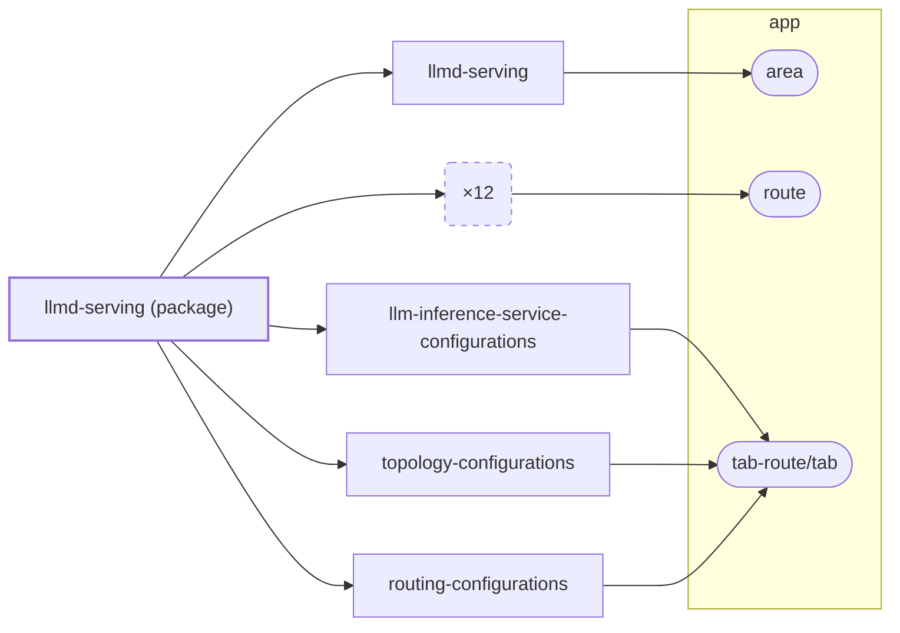

<!-- AUTO-GENERATED by @odh-dashboard/extension-map. Do not edit by hand. -->

> Generated file. Regenerate with `pnpm docs:extension-map`.

# Extensions in llmd-serving

Package `@odh-dashboard/llmd-serving` (package) at `packages/llmd-serving`. Everything below is read out of this repository's sources by static analysis.

## Loading paths

- [extensions.ts](../extensions/extensions.ts) (`./extensions`) — bundled into the host at build time (the `./extensions` export)

## Contributes

The extensions this package declares, grouped by the namespace of the extension point they target.

### Namespace `app`

| Node | What | Link |
| --- | --- | --- |
| llmd-serving (package) | this package | [packages/llmd-serving](..) |
| llmd-serving | extension of app.area — bundled | [extensions.ts](../extensions/extensions.ts#L417-L424) |
| ×12 | 12 extensions of app.route | [see the table below](#contributes-to-approute) |
| llm-inference-service-configurations | extension of app.tab-route/tab — bundled | [extensions.ts](../extensions/extensions.ts#L683-L696) |
| topology-configurations | extension of app.tab-route/tab — bundled | [extensions.ts](../extensions/extensions.ts#L719-L731) |
| routing-configurations | extension of app.tab-route/tab — bundled | [extensions.ts](../extensions/extensions.ts#L753-L765) |
| area | extension point | [app.area](../../plugin-core/docs/extensions.md#apparea) |
| route | extension point | [app.route](../../plugin-core/docs/extensions.md#approute) |
| tab-route/tab | extension point | [app.tab-route/tab](../../plugin-core/docs/extensions.md#apptab-routetab) |

#### Contributes to app.area

Defined in [app.area](../../plugin-core/docs/extensions.md#apparea).

| reliantAreas | featureFlags | id | Source |
| --- | --- | --- | --- |
| `SupportedArea.K_SERVE` (`'kserve'`) | `'disableLLMd'` | `LLMD_SERVING_ID` (`'llmd-serving'`) | [extensions.ts](../extensions/extensions.ts#L417-L424) |

#### Contributes to app.route

Defined in [app.route](../../plugin-core/docs/extensions.md#approute).

| path | Requires | CodeRef target | Source |
| --- | --- | --- | --- |
| `'/settings/model-resources-operations/llm-accelerator-configs/*'` | `LLMD_SERVING_ID` (`'llmd-serving'`), `ADMIN_USER`, `SupportedArea.VLLM_ON_MAAS` (`'vllm-on-maas'`) | `component`: [not resolved](../extensions/extensions.ts#L633-L636) | [extensions.ts](../extensions/extensions.ts#L626-L638) |
| `'/settings/model-resources-operations/llmd-topology-configurations/*'` | `SupportedArea.LLMD_TOPOLOGY_CONFIGS` (`'llmd-topology-configs'`), `ADMIN_USER` | `component`: [not resolved](../extensions/extensions.ts#L646-L649) | [extensions.ts](../extensions/extensions.ts#L639-L651) |
| `'/settings/model-resources-operations/llmd-routing-configurations/*'` | `SupportedArea.LLMD_TOPOLOGY_CONFIGS` (`'llmd-topology-configs'`), `ADMIN_USER` | `component`: [not resolved](../extensions/extensions.ts#L659-L662) | [extensions.ts](../extensions/extensions.ts#L652-L664) |
| `×3` `'/settings/model-resources-operations/model-deployment-settings/llm-inference-service-configurations/add'` · `'/settings/model-resources-operations/model-deployment-settings/llm-inference-service-configurations/edit/:configName'` · `'/settings/model-resources-operations/model-deployment-settings/llm-inference-service-configurations/duplicate/:configName'` | `LLMD_SERVING_ID` (`'llmd-serving'`), `ADMIN_USER`, `SupportedArea.VLLM_ON_MAAS` (`'vllm-on-maas'`) | [LlmInferenceServiceConfigFormRoutes#default](../src/settings/llmInferenceServiceConfigs/LlmInferenceServiceConfigFormRoutes.tsx#L24-L40) | [extensions.ts](../extensions/extensions.ts#L707-L717) |
| `×3` `'/settings/model-resources-operations/model-deployment-settings/topology-configurations/add/:topologyType'` · `'/settings/model-resources-operations/model-deployment-settings/topology-configurations/edit/:configName'` · `'/settings/model-resources-operations/model-deployment-settings/topology-configurations/duplicate/:configName'` | `SupportedArea.LLMD_TOPOLOGY_CONFIGS` (`'llmd-topology-configs'`), `ADMIN_USER` | [TopologyConfigFormRoutes#default](../src/settings/topologyConfigs/TopologyConfigFormRoutes.tsx#L22-L32) | [extensions.ts](../extensions/extensions.ts#L742-L751) |
| `×3` `'/settings/model-resources-operations/model-deployment-settings/routing-configurations/add'` · `'/settings/model-resources-operations/model-deployment-settings/routing-configurations/edit/:configName'` · `'/settings/model-resources-operations/model-deployment-settings/routing-configurations/duplicate/:configName'` | `SupportedArea.LLMD_TOPOLOGY_CONFIGS` (`'llmd-topology-configs'`), `ADMIN_USER` | [RoutingConfigFormRoutes#default](../src/settings/routingConfigs/RoutingConfigFormRoutes.tsx#L22-L32) | [extensions.ts](../extensions/extensions.ts#L776-L785) |

**Not resolved** (never drawn in a diagram):

| Contribution | Property | Reason | Source |
| --- | --- | --- | --- |
| route #1 | component | CallExpression is not a resolvable value | [extensions.ts:633](../extensions/extensions.ts#L633-L636) |
| route #2 | component | CallExpression is not a resolvable value | [extensions.ts:646](../extensions/extensions.ts#L646-L649) |
| route #3 | component | CallExpression is not a resolvable value | [extensions.ts:659](../extensions/extensions.ts#L659-L662) |

#### Contributes to app.tab-route/tab

Defined in [app.tab-route/tab](../../plugin-core/docs/extensions.md#apptab-routetab).

| pageId | id | title | group | Requires | CodeRef target | Source |
| --- | --- | --- | --- | --- | --- | --- |
| `'model-deployment-settings'` | `'llm-inference-service-configurations'` | `'LLM inference service configurations'` | `'3_accelerator'` | `LLMD_SERVING_ID` (`'llmd-serving'`), `ADMIN_USER`, `SupportedArea.VLLM_ON_MAAS` (`'vllm-on-maas'`) | [LlmInferenceServiceConfigTabRoutes#default](../src/settings/llmInferenceServiceConfigs/LlmInferenceServiceConfigTabRoutes.tsx#L16-L25) | [extensions.ts](../extensions/extensions.ts#L683-L696) |
| `'model-deployment-settings'` | `'topology-configurations'` | `'llm-d topology configurations'` | `'4_topology'` | `SupportedArea.LLMD_TOPOLOGY_CONFIGS` (`'llmd-topology-configs'`), `ADMIN_USER` | [TopologyConfigTabRoutes#default](../src/settings/topologyConfigs/TopologyConfigTabRoutes.tsx#L16-L25) | [extensions.ts](../extensions/extensions.ts#L719-L731) |
| `'model-deployment-settings'` | `'routing-configurations'` | `'llm-d routing configurations'` | `'5_routing'` | `SupportedArea.LLMD_TOPOLOGY_CONFIGS` (`'llmd-topology-configs'`), `ADMIN_USER` | [RoutingConfigTabRoutes#default](../src/settings/routingConfigs/RoutingConfigTabRoutes.tsx#L16-L25) | [extensions.ts](../extensions/extensions.ts#L753-L765) |

### Namespace `model-serving`

```mermaid
flowchart LR
  classDef collapsed stroke-dasharray: 5 5
  classDef pkg stroke-width:2px
  classDef point stroke-width:1px
  n__odh_dashboard_llmd_serving_2d801a["llmd-serving (package)"]:::pkg
  n_packages_llmd_serving_extensions_extensions_ts_17040_78b020["ServingDetails"]
  n__odh_dashboard_llmd_serving_2d801a --> n_packages_llmd_serving_extensions_extensions_ts_17040_78b020
  n_packages_llmd_serving_extensions_extensions_ts_20023_70d03d["assembleLLMdDeployment"]
  n__odh_dashboard_llmd_serving_2d801a --> n_packages_llmd_serving_extensions_extensions_ts_20023_70d03d
  n_packages_llmd_serving_extensions_extensions_ts_19577_1bffcf["deployLLMdDeployment"]
  n__odh_dashboard_llmd_serving_2d801a --> n_packages_llmd_serving_extensions_extensions_ts_19577_1bffcf
  n_packages_llmd_serving_extensions_extensions_ts_17477_0b395e["extractEnvironmentVariables"]
  n__odh_dashboard_llmd_serving_2d801a --> n_packages_llmd_serving_extensions_extensions_ts_17477_0b395e
  n_packages_llmd_serving_extensions_extensions_ts_5562_e3ff2e["extractLlmdDeploymentTrackingProperties"]
  n__odh_dashboard_llmd_serving_2d801a --> n_packages_llmd_serving_extensions_extensions_ts_5562_e3ff2e
  n_model_serving_deployment_wizard_field_collapsed_de0b31("×6"):::collapsed
  n__odh_dashboard_llmd_serving_2d801a --> n_model_serving_deployment_wizard_field_collapsed_de0b31
  n_model_serving_deployment_wizard_field_apply_collapsed_4ee72c("×5"):::collapsed
  n__odh_dashboard_llmd_serving_2d801a --> n_model_serving_deployment_wizard_field_apply_collapsed_4ee72c
  n_packages_llmd_serving_extensions_extensions_ts_10039_376273["preDeployTopologyConfig"]
  n__odh_dashboard_llmd_serving_2d801a --> n_packages_llmd_serving_extensions_extensions_ts_10039_376273
  n_packages_llmd_serving_extensions_extensions_ts_13369_44d5cc["preDeployAcceleratorConfig"]
  n__odh_dashboard_llmd_serving_2d801a --> n_packages_llmd_serving_extensions_extensions_ts_13369_44d5cc
  n_model_serving_deployment_wizard_field_extractor_collapsed_ac62f8("×7"):::collapsed
  n__odh_dashboard_llmd_serving_2d801a --> n_model_serving_deployment_wizard_field_extractor_collapsed_ac62f8
  n_model_serving_deployment_wizard_field_override_collapsed_19173c("×7"):::collapsed
  n__odh_dashboard_llmd_serving_2d801a --> n_model_serving_deployment_wizard_field_override_collapsed_19173c
  n_packages_llmd_serving_extensions_extensions_ts_22927_f32450["patchDeploymentStoppedStatus"]
  n__odh_dashboard_llmd_serving_2d801a --> n_packages_llmd_serving_extensions_extensions_ts_22927_f32450
  n_packages_llmd_serving_extensions_extensions_ts_19217_a99ef8["Delete model deployment?"]
  n__odh_dashboard_llmd_serving_2d801a --> n_packages_llmd_serving_extensions_extensions_ts_19217_a99ef8
  n_packages_llmd_serving_extensions_extensions_ts_16752_961baf["useWatchDeployments"]
  n__odh_dashboard_llmd_serving_2d801a --> n_packages_llmd_serving_extensions_extensions_ts_16752_961baf
  n_packages_llmd_serving_extensions_extensions_ts_24527_ebdde2["llmInferenceServiceConfig"]
  n__odh_dashboard_llmd_serving_2d801a --> n_packages_llmd_serving_extensions_extensions_ts_24527_ebdde2
  subgraph n_ns_model_serving_eced18 ["model-serving"]
    n_model_serving_deployed_model_serving_runtime_a806c7(["deployed-model/serving-runtime"]):::point
    n_model_serving_deployment_assemble_model_resource_5b5fd4(["deployment/assemble-model-resource"]):::point
    n_model_serving_deployment_deploy_35423a(["deployment/deploy"]):::point
    n_model_serving_deployment_form_data_a37ab2(["deployment/form-data"]):::point
    n_model_serving_deployment_tracking_properties_2845ae(["deployment/tracking-properties"]):::point
    n_model_serving_deployment_wizard_field_19398b(["deployment/wizard-field"]):::point
    n_model_serving_deployment_wizard_field_apply_b7659a(["deployment/wizard-field-apply"]):::point
    n_model_serving_deployment_wizard_field_deployment_functions_dd7c85(["deployment/wizard-field-deployment-functions"]):::point
    n_model_serving_deployment_wizard_field_extractor_877f9e(["deployment/wizard-field-extractor"]):::point
    n_model_serving_deployment_wizard_field_override_756caa(["deployment/wizard-field-override"]):::point
    n_model_serving_deployments_table_start_stop_action_ea2e4f(["deployments-table/start-stop-action"]):::point
    n_model_serving_platform_delete_deployment_259f2a(["platform/delete-deployment"]):::point
    n_model_serving_platform_watch_deployments_cf294d(["platform/watch-deployments"]):::point
    n_model_serving_runtime_image_install_target_e22ef9(["runtime-image/install-target"]):::point
  end
  n_packages_llmd_serving_extensions_extensions_ts_17040_78b020 --> n_model_serving_deployed_model_serving_runtime_a806c7
  n_packages_llmd_serving_extensions_extensions_ts_20023_70d03d --> n_model_serving_deployment_assemble_model_resource_5b5fd4
  n_packages_llmd_serving_extensions_extensions_ts_19577_1bffcf --> n_model_serving_deployment_deploy_35423a
  n_packages_llmd_serving_extensions_extensions_ts_17477_0b395e --> n_model_serving_deployment_form_data_a37ab2
  n_packages_llmd_serving_extensions_extensions_ts_5562_e3ff2e --> n_model_serving_deployment_tracking_properties_2845ae
  n_model_serving_deployment_wizard_field_collapsed_de0b31 --> n_model_serving_deployment_wizard_field_19398b
  n_model_serving_deployment_wizard_field_apply_collapsed_4ee72c --> n_model_serving_deployment_wizard_field_apply_b7659a
  n_packages_llmd_serving_extensions_extensions_ts_10039_376273 --> n_model_serving_deployment_wizard_field_deployment_functions_dd7c85
  n_packages_llmd_serving_extensions_extensions_ts_13369_44d5cc --> n_model_serving_deployment_wizard_field_deployment_functions_dd7c85
  n_model_serving_deployment_wizard_field_extractor_collapsed_ac62f8 --> n_model_serving_deployment_wizard_field_extractor_877f9e
  n_model_serving_deployment_wizard_field_override_collapsed_19173c --> n_model_serving_deployment_wizard_field_override_756caa
  n_packages_llmd_serving_extensions_extensions_ts_22927_f32450 --> n_model_serving_deployments_table_start_stop_action_ea2e4f
  n_packages_llmd_serving_extensions_extensions_ts_19217_a99ef8 --> n_model_serving_platform_delete_deployment_259f2a
  n_packages_llmd_serving_extensions_extensions_ts_16752_961baf --> n_model_serving_platform_watch_deployments_cf294d
  n_packages_llmd_serving_extensions_extensions_ts_24527_ebdde2 --> n_model_serving_runtime_image_install_target_e22ef9
```

| Node | What | Link |
| --- | --- | --- |
| llmd-serving (package) | this package | [packages/llmd-serving](..) |
| ServingDetails | extension of model-serving.deployed-model/serving-runtime — bundled | [extensions.ts](../extensions/extensions.ts#L436-L450) |
| assembleLLMdDeployment | extension of model-serving.deployment/assemble-model-resource — bundled | [extensions.ts](../extensions/extensions.ts#L514-L525) |
| deployLLMdDeployment | extension of model-serving.deployment/deploy — bundled | [extensions.ts](../extensions/extensions.ts#L500-L513) |
| extractEnvironmentVariables | extension of model-serving.deployment/form-data — bundled | [extensions.ts](../extensions/extensions.ts#L451-L487) |
| extractLlmdDeploymentTrackingProperties | extension of model-serving.deployment/tracking-properties — bundled | [extensions.ts](../extensions/extensions.ts#L151-L163) |
| ×6 | 6 extensions of model-serving.deployment/wizard-field | [see the table below](#contributes-to-model-servingdeploymentwizard-field) |
| ×5 | 5 extensions of model-serving.deployment/wizard-field-apply | [see the table below](#contributes-to-model-servingdeploymentwizard-field-apply) |
| preDeployTopologyConfig | extension of model-serving.deployment/wizard-field-deployment-functions — bundled | [extensions.ts](../extensions/extensions.ts#L258-L269) |
| preDeployAcceleratorConfig | extension of model-serving.deployment/wizard-field-deployment-functions — bundled | [extensions.ts](../extensions/extensions.ts#L340-L350) |
| ×7 | 7 extensions of model-serving.deployment/wizard-field-extractor | [see the table below](#contributes-to-model-servingdeploymentwizard-field-extractor) |
| ×7 | 7 extensions of model-serving.deployment/wizard-field-override | [see the table below](#contributes-to-model-servingdeploymentwizard-field-override) |
| patchDeploymentStoppedStatus | extension of model-serving.deployments-table/start-stop-action — bundled | [extensions.ts](../extensions/extensions.ts#L615-L622) |
| Delete model deployment? | extension of model-serving.platform/delete-deployment — bundled | [extensions.ts](../extensions/extensions.ts#L488-L499) |
| useWatchDeployments | extension of model-serving.platform/watch-deployments — bundled | [extensions.ts](../extensions/extensions.ts#L425-L435) |
| llmInferenceServiceConfig | extension of model-serving.runtime-image/install-target — bundled | [extensions.ts](../extensions/extensions.ts#L665-L682) |
| deployed-model/serving-runtime | extension point | [model-serving.deployed-model/serving-runtime](../../model-serving/docs/extensions.md#model-servingdeployed-modelserving-runtime) |
| deployment/assemble-model-resource | extension point | [model-serving.deployment/assemble-model-resource](../../model-serving/docs/extensions.md#model-servingdeploymentassemble-model-resource) |
| deployment/deploy | extension point | [model-serving.deployment/deploy](../../model-serving/docs/extensions.md#model-servingdeploymentdeploy) |
| deployment/form-data | extension point | [model-serving.deployment/form-data](../../model-serving/docs/extensions.md#model-servingdeploymentform-data) |
| deployment/tracking-properties | extension point | [model-serving.deployment/tracking-properties](../../model-serving/docs/extensions.md#model-servingdeploymenttracking-properties) |
| deployment/wizard-field | extension point | [model-serving.deployment/wizard-field](../../model-serving/docs/extensions.md#model-servingdeploymentwizard-field) |
| deployment/wizard-field-apply | extension point | [model-serving.deployment/wizard-field-apply](../../model-serving/docs/extensions.md#model-servingdeploymentwizard-field-apply) |
| deployment/wizard-field-deployment-functions | extension point | [model-serving.deployment/wizard-field-deployment-functions](../../model-serving/docs/extensions.md#model-servingdeploymentwizard-field-deployment-functions) |
| deployment/wizard-field-extractor | extension point | [model-serving.deployment/wizard-field-extractor](../../model-serving/docs/extensions.md#model-servingdeploymentwizard-field-extractor) |
| deployment/wizard-field-override | extension point | [model-serving.deployment/wizard-field-override](../../model-serving/docs/extensions.md#model-servingdeploymentwizard-field-override) |
| deployments-table/start-stop-action | extension point | [model-serving.deployments-table/start-stop-action](../../model-serving/docs/extensions.md#model-servingdeployments-tablestart-stop-action) |
| platform/delete-deployment | extension point | [model-serving.platform/delete-deployment](../../model-serving/docs/extensions.md#model-servingplatformdelete-deployment) |
| platform/watch-deployments | extension point | [model-serving.platform/watch-deployments](../../model-serving/docs/extensions.md#model-servingplatformwatch-deployments) |
| runtime-image/install-target | extension point | [model-serving.runtime-image/install-target](../../model-serving/docs/extensions.md#model-servingruntime-imageinstall-target) |

#### Contributes to model-serving.deployed-model/serving-runtime

Defined in [model-serving.deployed-model/serving-runtime](../../model-serving/docs/extensions.md#model-servingdeployed-modelserving-runtime).

| platform | Requires | CodeRef target | Source |
| --- | --- | --- | --- |
| `LLMD_SERVING_ID` (`'llmd-serving'`) | `LLMD_SERVING_ID` (`'llmd-serving'`) | `ServingDetailsComponent`: [ServingDetails#default](../src/components/ServingDetails.tsx#L26-L71) `dataHook`: [ServingDetails#useServingDetailsData](../src/components/ServingDetails.tsx#L16-L19) | [extensions.ts](../extensions/extensions.ts#L436-L450) |

#### Contributes to model-serving.deployment/assemble-model-resource

Defined in [model-serving.deployment/assemble-model-resource](../../model-serving/docs/extensions.md#model-servingdeploymentassemble-model-resource).

| platform | priority | Requires | CodeRef target | Source |
| --- | --- | --- | --- | --- |
| `LLMD_SERVING_ID` (`'llmd-serving'`) | `100` | `LLMD_SERVING_ID` (`'llmd-serving'`) | `assemble`: [deploy#assembleLLMdDeployment](../src/deployments/deploy.ts#L214-L265) `isActive`: [formUtils#isLLMInferenceServiceActive](../src/formUtils.ts#L14-L28) | [extensions.ts](../extensions/extensions.ts#L514-L525) |

#### Contributes to model-serving.deployment/deploy

Defined in [model-serving.deployment/deploy](../../model-serving/docs/extensions.md#model-servingdeploymentdeploy).

| platform | priority | supportsOverwrite | supportsDRAHardwareProfiles | Requires | CodeRef target | Source |
| --- | --- | --- | --- | --- | --- | --- |
| `LLMD_SERVING_ID` (`'llmd-serving'`) | `100` | `true` | `true` | `LLMD_SERVING_ID` (`'llmd-serving'`) | `deploy`: [deploy#deployLLMdDeployment](../src/deployments/deploy.ts#L313-L388) `isActive`: [formUtils#isLLMInferenceServiceActive](../src/formUtils.ts#L14-L28) | [extensions.ts](../extensions/extensions.ts#L500-L513) |

#### Contributes to model-serving.deployment/form-data

Defined in [model-serving.deployment/form-data](../../model-serving/docs/extensions.md#model-servingdeploymentform-data).

| platform | isActive | priority | Requires | CodeRef target | Source |
| --- | --- | --- | --- | --- | --- |
| `LLMD_SERVING_ID` (`'llmd-serving'`) | `true` | `0` | `LLMD_SERVING_ID` (`'llmd-serving'`) | `extractEnvironmentVariables`: [model#extractEnvironmentVariables](../src/deployments/model.ts#L161-L174) `extractHardwareProfileConfig`: [hardware#extractHardwareProfileConfig](../src/deployments/hardware.ts#L22-L42) `extractHuggingFaceApiKey`: `hfTokenSecret#?` `extractModelAvailabilityData`: [modelAvailability#extractModelAvailabilityData](../src/wizardFields/modelAvailability.ts#L16-L23) `extractModelFormat`: [model#extractModelFormat](../src/deployments/model.ts#L88-L90) `extractModelLocationData`: [model#extractModelLocationData](../src/deployments/model.ts#L197-L237) `extractModelServerTemplate`: [server#extractModelServerTemplate](../src/deployments/server.ts#L9-L30) `extractModelType`: [model#extractModelType](../src/deployments/model.ts#L92-L94) `extractReplicas`: [hardware#extractReplicas](../src/deployments/hardware.ts#L53-L57) `extractRuntimeArgs`: [model#extractRuntimeArgs](../src/deployments/model.ts#L147-L159) `hardwareProfilePaths`: [hardware#LLMD_INFERENCE_SERVICE_HARDWARE_PROFILE_PATHS](../src/deployments/hardware.ts#L15-L20) `validateExtraction`: [validateExtraction#validateExtraction](../src/deployments/validateExtraction.ts#L11-L34) | [extensions.ts](../extensions/extensions.ts#L451-L487) |

**Supplies** (what each CodeRef target provides):

| Contribution | Supplies | Value |
| --- | --- | --- |
| extractEnvironmentVariables | hardwareProfilePaths → containerResourcesPath | `'spec.template.containers.0.resources'` |
| extractEnvironmentVariables | hardwareProfilePaths → nodeSelectorPath | `'spec.template.nodeSelector'` |
| extractEnvironmentVariables | hardwareProfilePaths → podSpecPath | `'spec.template'` |
| extractEnvironmentVariables | hardwareProfilePaths → tolerationsPath | `'spec.template.tolerations'` |

**Not resolved** (never drawn in a diagram):

| Contribution | Property | Reason | Source |
| --- | --- | --- | --- |
| extractEnvironmentVariables | extractHuggingFaceApiKey | the code reference resolves to no export | [extensions.ts:451](../extensions/extensions.ts#L451-L487) |

#### Contributes to model-serving.deployment/tracking-properties

Defined in [model-serving.deployment/tracking-properties](../../model-serving/docs/extensions.md#model-servingdeploymenttracking-properties).

| platform | Requires | CodeRef target | Source |
| --- | --- | --- | --- |
| `LLMD_SERVING_ID` (`'llmd-serving'`) | `LLMD_SERVING_ID` (`'llmd-serving'`) | [llmdWizardTracking#extractLlmdDeploymentTrackingProperties](../src/tracking/llmdWizardTracking.ts#L198-L203) | [extensions.ts](../extensions/extensions.ts#L151-L163) |

#### Contributes to model-serving.deployment/wizard-field

Defined in [model-serving.deployment/wizard-field](../../model-serving/docs/extensions.md#model-servingdeploymentwizard-field).

| platform | Requires | CodeRef target | Source |
| --- | --- | --- | --- |
| `LLMD_SERVING_ID` (`'llmd-serving'`) | `SupportedArea.LLMD_SERVING` (`'llmd-serving'`), `SupportedArea.LLMD_TOPOLOGY_CONFIGS` (`'llmd-topology-configs'`) | [AdvancedRoutingField#AdvancedRoutingFieldWizardField](../src/wizardFields/AdvancedRoutingField.tsx#L287-L318) | [extensions.ts](../extensions/extensions.ts#L274-L286) |
| `LLMD_SERVING_ID` (`'llmd-serving'`) | `SupportedArea.LLMD_SERVING` (`'llmd-serving'`), `SupportedArea.VLLM_ON_MAAS` (`'vllm-on-maas'`) | [AcceleratorConfigField#AcceleratorConfigFieldWizardField](../src/wizardFields/AcceleratorConfigField.tsx#L336-L373) | [extensions.ts](../extensions/extensions.ts#L310-L320) |
| `LLMD_SERVING_ID` (`'llmd-serving'`) | `LLMD_SERVING_ID` (`'llmd-serving'`), `SupportedArea.VLLM_ON_MAAS` (`'vllm-on-maas'`) | [LlmConfigOptionsField#LLMConfigOptionsFieldWizardField](../src/wizardFields/LlmConfigOptionsField.tsx#L159-L201) | [extensions.ts](../extensions/extensions.ts#L89-L101) |
| `LLMD_SERVING_ID` (`'llmd-serving'`) | `LLMD_SERVING_ID` (`'llmd-serving'`), `SupportedArea.LLMD_GATEWAY_FIELD` (`'llmd-gateway-field'`) | [GatewaySelectField#GatewaySelectField](../src/wizardFields/gateway/GatewaySelectField.tsx#L302-L320) | [extensions.ts](../extensions/extensions.ts#L103-L113) |
| `LLMD_SERVING_ID` (`'llmd-serving'`) | `SupportedArea.LLMD_SERVING` (`'llmd-serving'`), `SupportedArea.LLMD_TOPOLOGY_CONFIGS` (`'llmd-topology-configs'`) | [TopologyTypeField#TopologyTypeFieldWizardField](../src/wizardFields/TopologyTypeField.tsx#L247-L264) | [extensions.ts](../extensions/extensions.ts#L189-L199) |
| `LLMD_SERVING_ID` (`'llmd-serving'`) | `SupportedArea.LLMD_SERVING` (`'llmd-serving'`), `SupportedArea.LLMD_TOPOLOGY_CONFIGS` (`'llmd-topology-configs'`) | [CustomTopologyConfigField#CustomTopologyConfigFieldWizardField](../src/wizardFields/CustomTopologyConfigField.tsx#L248-L298) | [extensions.ts](../extensions/extensions.ts#L223-L235) |

**Supplies** (what each CodeRef target provides):

| Contribution | Supplies | Value |
| --- | --- | --- |
| AdvancedRoutingFieldWizardField | component | [AdvancedRoutingFieldComponent](../src/wizardFields/AdvancedRoutingField.tsx#L97-L256) |
| AdvancedRoutingFieldWizardField | externalDataHook | [useAdvancedRoutingData](../src/wizardFields/AdvancedRoutingField.tsx#L43-L61) |
| AdvancedRoutingFieldWizardField | getReviewSections | [getReviewSections](../src/wizardFields/AdvancedRoutingField.tsx#L317) |
| AdvancedRoutingFieldWizardField | id | `LLMD_ROUTING_FIELD_ID` (`'llmd-serving/advanced-routing'`) |
| AdvancedRoutingFieldWizardField | isActive | [isActive](../src/wizardFields/AdvancedRoutingField.tsx#L291) |
| AdvancedRoutingFieldWizardField | reducerFunctions | `{ resolveDependencies: function, setFieldData: function, getInitialFieldData: function, validationSchema: not resolved }` |
| AdvancedRoutingFieldWizardField | shouldResetOnDependencyChange | [shouldResetOnDependencyChange](../src/wizardFields/AdvancedRoutingField.tsx#L313-L314) |
| AdvancedRoutingFieldWizardField | step | `'modelDeployment'` |
| AdvancedRoutingFieldWizardField | type | `'addition'` |
| AcceleratorConfigFieldWizardField | component | [AcceleratorConfigFieldComponent](../src/wizardFields/AcceleratorConfigField.tsx#L207-L295) |
| AcceleratorConfigFieldWizardField | externalDataHook | [useAcceleratorConfigData](../src/wizardFields/AcceleratorConfigField.tsx#L86-L125) |
| AcceleratorConfigFieldWizardField | getReviewSections | [getReviewSections](../src/wizardFields/AcceleratorConfigField.tsx#L372) |
| AcceleratorConfigFieldWizardField | id | `ACCELERATOR_CONFIG_FIELD_ID` (`'llmd-serving/accelerator-config'`) |
| AcceleratorConfigFieldWizardField | isActive | [isActive](../src/wizardFields/AcceleratorConfigField.tsx#L340) |
| AcceleratorConfigFieldWizardField | reducerFunctions | `{ resolveDependencies: resolveAcceleratorConfigDependencies, setFieldData: function, getInitialFieldData: function, validationSchema: not resolved }` |
| AcceleratorConfigFieldWizardField | step | `'modelDeployment'` |
| AcceleratorConfigFieldWizardField | type | `'addition'` |
| LLMConfigOptionsFieldWizardField | component | [LLMConfigOptionsField](../src/wizardFields/LlmConfigOptionsField.tsx#L132-L156) |
| LLMConfigOptionsFieldWizardField | externalDataHook | [useLLMConfigOptions](../src/wizardFields/LlmConfigOptionsField.tsx#L30-L62) |
| LLMConfigOptionsFieldWizardField | getReviewSections | [getReviewSections](../src/wizardFields/LlmConfigOptionsField.tsx#L200) |
| LLMConfigOptionsFieldWizardField | id | `'llmd-serving/modelServer'` |
| LLMConfigOptionsFieldWizardField | isActive | [isSimpleLLMInferenceService](../src/formUtils.ts#L34-L49) |
| LLMConfigOptionsFieldWizardField | reducerFunctions | `{ resolveDependencies: function, setFieldData: function, getInitialFieldData: function, validationSchema: not resolved }` |
| LLMConfigOptionsFieldWizardField | stateKey | `'modelServer'` |
| LLMConfigOptionsFieldWizardField | step | `'modelDeployment'` |
| LLMConfigOptionsFieldWizardField | type | `'replacement'` |
| GatewaySelectField | component | [GatewaySelectFieldComponent](../src/wizardFields/gateway/GatewaySelectField.tsx#L80-L283) |
| GatewaySelectField | externalDataHook | [useGatewayOptions](../src/wizardFields/gateway/GatewaySelectField.tsx#L29-L35) |
| GatewaySelectField | getReviewSections | [getGatewayReviewSection](../src/wizardFields/gateway/GatewaySelectField.tsx#L285-L301) |
| GatewaySelectField | id | `LLMD_GATEWAY_FIELD_ID` (`'llmd-serving/gateway'`) |
| GatewaySelectField | isActive | [isLLMInferenceServiceActive](../src/formUtils.ts#L14-L28) |
| GatewaySelectField | parentId | `'networking'` |
| GatewaySelectField | reducerFunctions | `{ resolveDependencies: function, setFieldData: function, getInitialFieldData: function }` |
| GatewaySelectField | shouldResetOnDependencyChange | [shouldResetOnDependencyChange](../src/wizardFields/gateway/GatewaySelectField.tsx#L316) |
| GatewaySelectField | step | `'advancedOptions'` |
| GatewaySelectField | type | `'addition'` |
| TopologyTypeFieldWizardField | component | [TopologyTypeFieldComponent](../src/wizardFields/TopologyTypeField.tsx#L153-L219) |
| TopologyTypeFieldWizardField | externalDataHook | [useTopologyTypeData](../src/wizardFields/TopologyTypeField.tsx#L82-L141) |
| TopologyTypeFieldWizardField | getReviewSections | [getReviewSections](../src/wizardFields/TopologyTypeField.tsx#L263) |
| TopologyTypeFieldWizardField | id | `TOPOLOGY_TYPE_FIELD_ID` (`'llmd-serving/topology-type'`) |
| TopologyTypeFieldWizardField | isActive | [isActive](../src/wizardFields/TopologyTypeField.tsx#L251) |
| TopologyTypeFieldWizardField | reducerFunctions | `{ resolveDependencies: resolveTopologyConfigsDependencies, setFieldData: function, getInitialFieldData: function, validationSchema: not resolved }` |
| TopologyTypeFieldWizardField | step | `'modelDeployment'` |
| TopologyTypeFieldWizardField | type | `'addition'` |
| CustomTopologyConfigFieldWizardField | component | [CustomTopologyConfigFieldComponent](../src/wizardFields/CustomTopologyConfigField.tsx#L72-L217) |
| CustomTopologyConfigFieldWizardField | externalDataHook | [useTopologyTypeData](../src/wizardFields/TopologyTypeField.tsx#L82-L141) |
| CustomTopologyConfigFieldWizardField | getReviewSections | [getReviewSections](../src/wizardFields/CustomTopologyConfigField.tsx#L297) |
| CustomTopologyConfigFieldWizardField | id | `CUSTOM_TOPOLOGY_CONFIG_FIELD_ID` (`'llmd-serving/custom-topology-config'`) |
| CustomTopologyConfigFieldWizardField | isActive | [isActive](../src/wizardFields/CustomTopologyConfigField.tsx#L252) |
| CustomTopologyConfigFieldWizardField | reducerFunctions | `{ resolveDependencies: function, setFieldData: function, getInitialFieldData: function, validationSchema: not resolved }` |
| CustomTopologyConfigFieldWizardField | shouldResetOnDependencyChange | [shouldResetOnDependencyChange](../src/wizardFields/CustomTopologyConfigField.tsx#L293-L294) |
| CustomTopologyConfigFieldWizardField | step | `'modelDeployment'` |
| CustomTopologyConfigFieldWizardField | type | `'addition'` |

**Not resolved** (never drawn in a diagram):

| Contribution | Property | Reason | Source |
| --- | --- | --- | --- |
| AdvancedRoutingFieldWizardField | field → reducerFunctions.validationSchema | CallExpression is not a resolvable value | [AdvancedRoutingField.tsx:304](../src/wizardFields/AdvancedRoutingField.tsx#L304-L311) |
| AcceleratorConfigFieldWizardField | field → reducerFunctions.validationSchema | CallExpression is not a resolvable value | [AcceleratorConfigField.tsx:359](../src/wizardFields/AcceleratorConfigField.tsx#L359-L368) |
| LLMConfigOptionsFieldWizardField | field → reducerFunctions.validationSchema | CallExpression is not a resolvable value | [LlmConfigOptionsField.tsx:194](../src/wizardFields/LlmConfigOptionsField.tsx#L194-L196) |
| TopologyTypeFieldWizardField | field → reducerFunctions.validationSchema | CallExpression is not a resolvable value | [TopologyTypeField.tsx:257](../src/wizardFields/TopologyTypeField.tsx#L257-L259) |
| CustomTopologyConfigFieldWizardField | field → reducerFunctions.validationSchema | CallExpression is not a resolvable value | [CustomTopologyConfigField.tsx:283](../src/wizardFields/CustomTopologyConfigField.tsx#L283-L291) |

#### Contributes to model-serving.deployment/wizard-field-apply

Defined in [model-serving.deployment/wizard-field-apply](../../model-serving/docs/extensions.md#model-servingdeploymentwizard-field-apply).

| fieldId | platform | Requires | CodeRef target | Source |
| --- | --- | --- | --- | --- |
| `'llmd-serving/advanced-routing'` | `LLMD_SERVING_ID` (`'llmd-serving'`) | `SupportedArea.LLMD_SERVING` (`'llmd-serving'`), `SupportedArea.LLMD_TOPOLOGY_CONFIGS` (`'llmd-topology-configs'`) | [topology#applyRoutingConfig](../src/deployments/topology.ts#L69-L102) | [extensions.ts](../extensions/extensions.ts#L287-L297) |
| `'llmd-serving/accelerator-config'` | `LLMD_SERVING_ID` (`'llmd-serving'`) | `SupportedArea.LLMD_SERVING` (`'llmd-serving'`), `SupportedArea.VLLM_ON_MAAS` (`'vllm-on-maas'`) | [accelerator#applyAcceleratorConfig](../src/deployments/accelerator.ts#L15-L23) | [extensions.ts](../extensions/extensions.ts#L321-L329) |
| `'llmd-serving/gateway'` | `LLMD_SERVING_ID` (`'llmd-serving'`) | `LLMD_SERVING_ID` (`'llmd-serving'`), `SupportedArea.LLMD_GATEWAY_FIELD` (`'llmd-gateway-field'`) | [gatewaySelectApplyExtract#applyGatewaySelectData](../src/wizardFields/gateway/gatewaySelectApplyExtract.ts#L14-L36) | [extensions.ts](../extensions/extensions.ts#L118-L131) |
| `'llmd-serving/topology-type'` | `LLMD_SERVING_ID` (`'llmd-serving'`) | `SupportedArea.LLMD_SERVING` (`'llmd-serving'`), `SupportedArea.LLMD_TOPOLOGY_CONFIGS` (`'llmd-topology-configs'`) | [topology#applyTopologyType](../src/deployments/topology.ts#L20-L33) | [extensions.ts](../extensions/extensions.ts#L200-L210) |
| `'llmd-serving/custom-topology-config'` | `LLMD_SERVING_ID` (`'llmd-serving'`) | `SupportedArea.LLMD_SERVING` (`'llmd-serving'`), `SupportedArea.LLMD_TOPOLOGY_CONFIGS` (`'llmd-topology-configs'`) | [topology#applyTopologyConfig](../src/deployments/topology.ts#L37-L45) | [extensions.ts](../extensions/extensions.ts#L236-L246) |

#### Contributes to model-serving.deployment/wizard-field-deployment-functions

Defined in [model-serving.deployment/wizard-field-deployment-functions](../../model-serving/docs/extensions.md#model-servingdeploymentwizard-field-deployment-functions).

| fieldId | platform | postDeploy | Requires | CodeRef target | Source |
| --- | --- | --- | --- | --- | --- |
| `'llmd-serving/custom-topology-config'` | `LLMD_SERVING_ID` (`'llmd-serving'`) | `null` | `SupportedArea.LLMD_SERVING` (`'llmd-serving'`), `SupportedArea.LLMD_TOPOLOGY_CONFIGS` (`'llmd-topology-configs'`) | [topology#preDeployTopologyConfig](../src/deployments/topology.ts#L49-L65) | [extensions.ts](../extensions/extensions.ts#L258-L269) |
| `'llmd-serving/accelerator-config'` | `LLMD_SERVING_ID` (`'llmd-serving'`) | `null` | `SupportedArea.LLMD_SERVING` (`'llmd-serving'`), `SupportedArea.VLLM_ON_MAAS` (`'vllm-on-maas'`) | [accelerator#preDeployAcceleratorConfig](../src/deployments/accelerator.ts#L25-L38) | [extensions.ts](../extensions/extensions.ts#L340-L350) |

#### Contributes to model-serving.deployment/wizard-field-extractor

Defined in [model-serving.deployment/wizard-field-extractor](../../model-serving/docs/extensions.md#model-servingdeploymentwizard-field-extractor).

| fieldId | platform | Requires | Disallows | CodeRef target | Source |
| --- | --- | --- | --- | --- | --- |
| `'llmd-serving/advanced-routing'` | `LLMD_SERVING_ID` (`'llmd-serving'`) | `SupportedArea.LLMD_SERVING` (`'llmd-serving'`), `SupportedArea.LLMD_TOPOLOGY_CONFIGS` (`'llmd-topology-configs'`) | — | [topology#extractRoutingConfig](../src/deployments/topology.ts#L130-L138) | [extensions.ts](../extensions/extensions.ts#L298-L308) |
| `'llmd-serving/accelerator-config'` | `LLMD_SERVING_ID` (`'llmd-serving'`) | `SupportedArea.LLMD_SERVING` (`'llmd-serving'`), `SupportedArea.VLLM_ON_MAAS` (`'vllm-on-maas'`) | — | [accelerator#extractAcceleratorConfig](../src/deployments/accelerator.ts#L40-L48) | [extensions.ts](../extensions/extensions.ts#L330-L339) |
| `'deploymentMethod'` | `LLMD_SERVING_ID` (`'llmd-serving'`) | `LLMD_SERVING_ID` (`'llmd-serving'`) | `SupportedArea.VLLM_ON_MAAS` (`'vllm-on-maas'`) | [model#extractDeploymentMethodAlwaysLlmd](../src/deployments/model.ts#L323-L325) | [extensions.ts](../extensions/extensions.ts#L356-L368) |
| `'deploymentMethod'` | `LLMD_SERVING_ID` (`'llmd-serving'`) | `LLMD_SERVING_ID` (`'llmd-serving'`), `SupportedArea.VLLM_ON_MAAS` (`'vllm-on-maas'`) | — | [model#extractDeploymentMethodvLLMOnMaaS](../src/deployments/model.ts#L327-L331) | [extensions.ts](../extensions/extensions.ts#L372-L383) |
| `'llmd-serving/gateway'` | `LLMD_SERVING_ID` (`'llmd-serving'`) | `LLMD_SERVING_ID` (`'llmd-serving'`), `SupportedArea.LLMD_GATEWAY_FIELD` (`'llmd-gateway-field'`) | — | [gatewaySelectApplyExtract#extractGatewaySelectData](../src/wizardFields/gateway/gatewaySelectApplyExtract.ts#L38-L56) | [extensions.ts](../extensions/extensions.ts#L136-L149) |
| `'llmd-serving/topology-type'` | `LLMD_SERVING_ID` (`'llmd-serving'`) | `SupportedArea.LLMD_SERVING` (`'llmd-serving'`), `SupportedArea.LLMD_TOPOLOGY_CONFIGS` (`'llmd-topology-configs'`) | — | [topology#extractTopologyType](../src/deployments/topology.ts#L106-L114) | [extensions.ts](../extensions/extensions.ts#L211-L221) |
| `'llmd-serving/custom-topology-config'` | `LLMD_SERVING_ID` (`'llmd-serving'`) | `SupportedArea.LLMD_SERVING` (`'llmd-serving'`), `SupportedArea.LLMD_TOPOLOGY_CONFIGS` (`'llmd-topology-configs'`) | — | [topology#extractTopologyConfig](../src/deployments/topology.ts#L118-L126) | [extensions.ts](../extensions/extensions.ts#L247-L257) |

#### Contributes to model-serving.deployment/wizard-field-override

Defined in [model-serving.deployment/wizard-field-override](../../model-serving/docs/extensions.md#model-servingdeploymentwizard-field-override).

| platform | Requires | Disallows | CodeRef target | Source |
| --- | --- | --- | --- | --- |
| `LLMD_SERVING_ID` (`'llmd-serving'`) | `LLMD_SERVING_ID` (`'llmd-serving'`) | `SupportedArea.VLLM_ON_MAAS` (`'vllm-on-maas'`) | [modelServerField#modelServerField](../src/wizardFields/modelServerField.ts#L18-L26) | [extensions.ts](../extensions/extensions.ts#L526-L536) |
| `LLMD_SERVING_ID` (`'llmd-serving'`) | `model-as-service`, `LLMD_SERVING_ID` (`'llmd-serving'`) | — | [modelAvailability#modelAvailabilityField](../src/wizardFields/modelAvailability.ts#L8-L14) | [extensions.ts](../extensions/extensions.ts#L537-L547) |
| `LLMD_SERVING_ID` (`'llmd-serving'`) | `LLMD_SERVING_ID` (`'llmd-serving'`) | — | [advancedOptionsFields#externalRouteField](../src/wizardFields/advancedOptionsFields.ts#L8-L13) | [extensions.ts](../extensions/extensions.ts#L548-L558) |
| `LLMD_SERVING_ID` (`'llmd-serving'`) | `LLMD_SERVING_ID` (`'llmd-serving'`) | — | [advancedOptionsFields#tokenAuthField](../src/wizardFields/advancedOptionsFields.ts#L15-L20) | [extensions.ts](../extensions/extensions.ts#L559-L569) |
| `LLMD_SERVING_ID` (`'llmd-serving'`) | `LLMD_SERVING_ID` (`'llmd-serving'`) | — | [advancedOptionsFields#deploymentStrategyField](../src/wizardFields/advancedOptionsFields.ts#L22-L27) | [extensions.ts](../extensions/extensions.ts#L570-L580) |
| `LLMD_SERVING_ID` (`'llmd-serving'`) | `LLMD_SERVING_ID` (`'llmd-serving'`), `SupportedArea.VLLM_ON_MAAS` (`'vllm-on-maas'`) | — | [deploymentMethodField#vllmDeploymentMethodOverride](../src/wizardFields/deploymentMethodField.ts#L17-L24) | [extensions.ts](../extensions/extensions.ts#L581-L593) |
| `LLMD_SERVING_ID` (`'llmd-serving'`) | `LLMD_SERVING_ID` (`'llmd-serving'`) | — | [deploymentMethodField#llmdDeploymentMethodOverride](../src/wizardFields/deploymentMethodField.ts#L36-L42) | [extensions.ts](../extensions/extensions.ts#L594-L606) |

**Supplies** (what each CodeRef target provides):

| Contribution | Supplies | Value |
| --- | --- | --- |
| modelServerField | extraOptions | `{ name: 'llmd-serving', label: 'Distributed inference with llm-d' }` |
| modelServerField | id | `'modelServerTemplate'` |
| modelServerField | isActive | [shouldAddLLMDOptionToRuntimeTemplates](../src/wizardFields/modelServerField.ts#L6-L16) |
| modelServerField | suggestion | [suggestion](../src/wizardFields/modelServerField.ts#L23-L25) |
| modelServerField | type | `'modifier'` |
| modelAvailabilityField | id | `'modelAvailability'` |
| modelAvailabilityField | isActive | [isLLMInferenceServiceActive](../src/formUtils.ts#L14-L28) |
| modelAvailabilityField | showSaveAsMaaS | `false` |
| modelAvailabilityField | type | `'modifier'` |
| externalRouteField | id | `'externalRoute'` |
| externalRouteField | isActive | [isLLMInferenceServiceActive](../src/formUtils.ts#L14-L28) |
| externalRouteField | isVisible | `false` |
| externalRouteField | type | `'modifier'` |
| tokenAuthField | id | `'tokenAuth'` |
| tokenAuthField | initialValue | `true` |
| tokenAuthField | isActive | [isLLMInferenceServiceActive](../src/formUtils.ts#L14-L28) |
| tokenAuthField | type | `'modifier'` |
| deploymentStrategyField | id | `'deploymentStrategy'` |
| deploymentStrategyField | isActive | [isLLMInferenceServiceActive](../src/formUtils.ts#L14-L28) |
| deploymentStrategyField | isVisible | `false` |
| deploymentStrategyField | type | `'modifier'` |
| vllmDeploymentMethodOverride | id | `'deploymentMethod'` |
| vllmDeploymentMethodOverride | isActive | [isActive](../src/wizardFields/deploymentMethodField.ts#L20) |
| vllmDeploymentMethodOverride | options | `{ key: SIMPLE_VLLM_DEPLOYMENT_METHOD_KEY ('llm-inference-service-simple-vllm'), label: 'LLM inference service', description: 'Deploy a large language model. Compatible with Models as a Service.', order: 1 }` |
| vllmDeploymentMethodOverride | suggestion | [suggestion](../src/wizardFields/deploymentMethodField.ts#L22-L23) |
| vllmDeploymentMethodOverride | type | `'modifier'` |
| llmdDeploymentMethodOverride | id | `'deploymentMethod'` |
| llmdDeploymentMethodOverride | isActive | [isActive](../src/wizardFields/deploymentMethodField.ts#L39) |
| llmdDeploymentMethodOverride | options | `{ key: LLMD_DEPLOYMENT_METHOD_KEY ('llm-inference-service-llmd'), label: 'LLM inference service with llm-d', description: 'Same as LLM inference service, but with distributed serving and advanced routing techniques such as cache-aware routing and disaggregated prefill and decode.', order: 2 }` |
| llmdDeploymentMethodOverride | suggestion | [suggestion](../src/wizardFields/deploymentMethodField.ts#L41) |
| llmdDeploymentMethodOverride | type | `'modifier'` |

#### Contributes to model-serving.deployments-table/start-stop-action

Defined in [model-serving.deployments-table/start-stop-action](../../model-serving/docs/extensions.md#model-servingdeployments-tablestart-stop-action).

| platform | CodeRef target | Source |
| --- | --- | --- |
| `LLMD_SERVING_ID` (`'llmd-serving'`) | [status#patchDeploymentStoppedStatus](../src/deployments/status.ts#L222-L239) | [extensions.ts](../extensions/extensions.ts#L615-L622) |

#### Contributes to model-serving.platform/delete-deployment

Defined in [model-serving.platform/delete-deployment](../../model-serving/docs/extensions.md#model-servingplatformdelete-deployment).

| platform | title | submitButtonLabel | Requires | CodeRef target | Source |
| --- | --- | --- | --- | --- | --- |
| `LLMD_SERVING_ID` (`'llmd-serving'`) | `'Delete model deployment?'` | `'Delete model deployment'` | `LLMD_SERVING_ID` (`'llmd-serving'`) | [LLMdDeployment#deleteDeployment](../src/api/LLMdDeployment.ts#L11-L49) | [extensions.ts](../extensions/extensions.ts#L488-L499) |

#### Contributes to model-serving.platform/watch-deployments

Defined in [model-serving.platform/watch-deployments](../../model-serving/docs/extensions.md#model-servingplatformwatch-deployments).

| platform | Requires | CodeRef target | Source |
| --- | --- | --- | --- |
| `LLMD_SERVING_ID` (`'llmd-serving'`) | `LLMD_SERVING_ID` (`'llmd-serving'`) | [useWatchDeployments#useWatchDeployments](../src/deployments/useWatchDeployments.ts#L13-L107) | [extensions.ts](../extensions/extensions.ts#L425-L435) |

#### Contributes to model-serving.runtime-image/install-target

Defined in [model-serving.runtime-image/install-target](../../model-serving/docs/extensions.md#model-servingruntime-imageinstall-target).

##### llmInferenceServiceConfig

- **id:** `'llmInferenceServiceConfig'`
- **label:** `'LLM inference service configuration'`
- **installTargetName:** `'LLM inference service configuration'`
- **description:** `'Install as an LLMInferenceServiceConfig for LLM inference service deployments. Compatible with Models as a Service.'`
- **selectedState:** `{ listName: 'LLM inference service configurations', description: 'and the LLM inference service deployment wizard.' }`
- **Requires:** `LLMD_SERVING_ID` (`'llmd-serving'`), `ADMIN_USER`, `SupportedArea.VLLM_ON_MAAS` (`'vllm-on-maas'`)
- **CodeRef target:** [LlmInferenceServiceConfigInstallTarget#default](../src/runtimeImageInstall/LlmInferenceServiceConfigInstallTarget.tsx#L109-L115)
- **Source:** [extensions.ts](../extensions/extensions.ts#L665-L682)

## Diagnostics

What the analysis could not prove, or thought worth reporting, about this package. Warnings are gaps in the generated map; info entries are observations.

| Code | Severity | Message | Source |
| --- | --- | --- | --- |
| `unresolved-value` | warning | Cannot resolve 'extractHuggingFaceApiKey' of extension 'model-serving.deployment/form-data': the imported module is not re-exported as it is. | [extensions.ts:451](../extensions/extensions.ts#L451-L487) |
| `unresolved-value` | warning | Cannot resolve 'component' of extension 'app.route': CallExpression is not a resolvable value. | [extensions.ts:633](../extensions/extensions.ts#L633-L636) |
| `unresolved-value` | warning | Cannot resolve 'component' of extension 'app.route': CallExpression is not a resolvable value. | [extensions.ts:646](../extensions/extensions.ts#L646-L649) |
| `unresolved-value` | warning | Cannot resolve 'component' of extension 'app.route': CallExpression is not a resolvable value. | [extensions.ts:659](../extensions/extensions.ts#L659-L662) |

## Legend

| Edge | What it means in these diagrams |
| --- | --- |
| `A --> B` | A is declared by this package and bundled into an app at build time. It may also be exposed through Module Federation — the node table beside each diagram names every loading path. |
| `A -. "federated" .-> B` | A reaches the host only through a Module Federation remote, loaded at runtime. |
| `A ==> B` | Derived: proven through a type or a JSDoc tag rather than a direct reference. |
| `A -. "rendered in" .-> B` | B renders A (one hop). |
| `A --x B` | A suppresses B. |
| `A -- "patch" --> B` | A patches B. |

A node with a dashed border stands for several extensions of the same point; its `×N` label is
the number of extensions, and the table beside the diagram always lists every one of them.
Anything the analysis could not resolve is never drawn — it is listed in a "Not resolved" table
instead.
