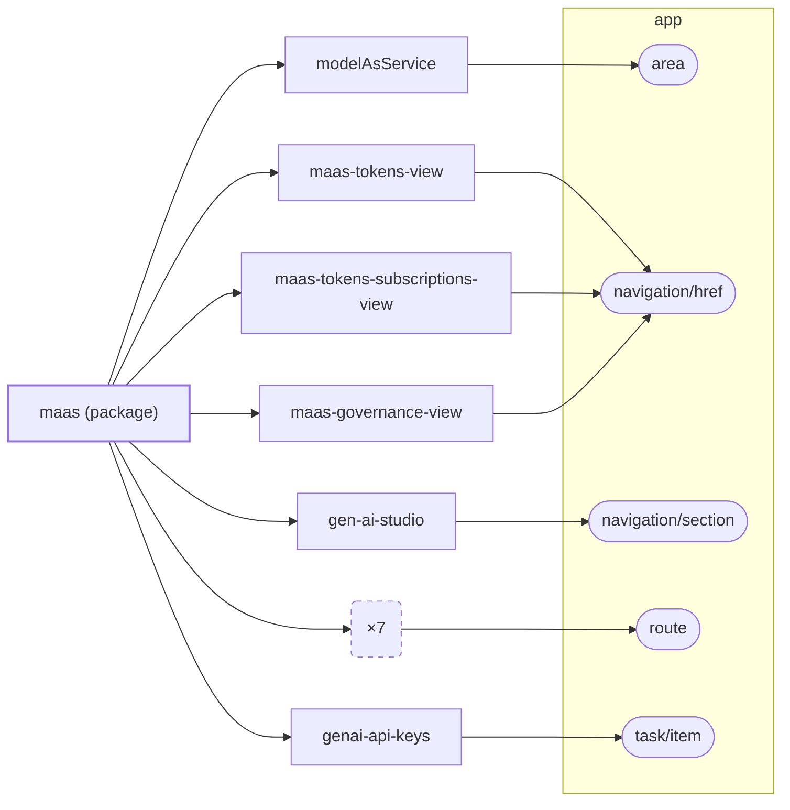
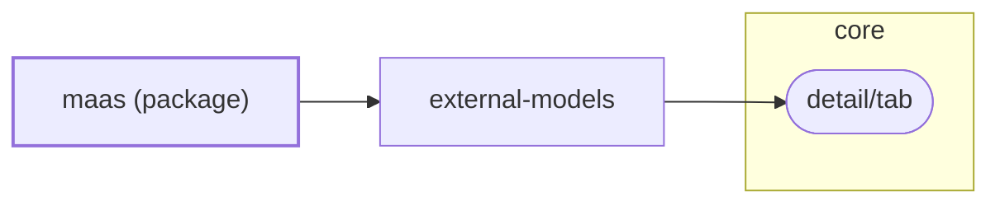
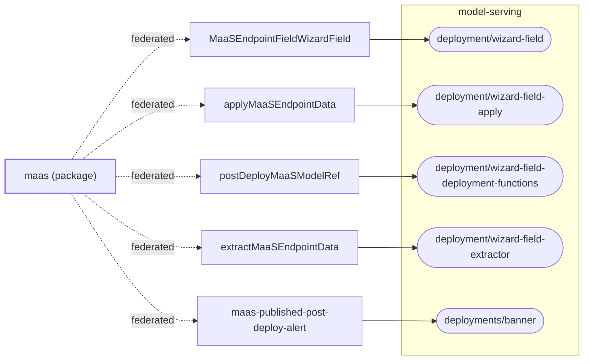

<!-- AUTO-GENERATED by @odh-dashboard/extension-map. Do not edit by hand. -->

> Generated file. Regenerate with `pnpm docs:extension-map`.

# Extensions in maas

Package `@odh-dashboard/maas` (package) at `packages/maas`. Everything below is read out of this repository's sources by static analysis.

## Loading paths

- [odhExtensions.ts](../frontend/src/odh/odhExtensions/odhExtensions.ts) (`./extensions/static`) — bundled by a distribution that imports this export
- [extensions.ts](../frontend/src/odh/extensions.ts) (`mf:./extensions`) — loaded at runtime by the host as a Module Federation remote

## Contributes

The extensions this package declares, grouped by the namespace of the extension point they target.

### Namespace `app`

| Node | What | Link |
| --- | --- | --- |
| maas (package) | this package | [packages/maas](..) |
| modelAsService | extension of app.area — bundled by a distribution and federated | [odhExtensions.ts](../frontend/src/odh/odhExtensions/odhExtensions.ts#L21-L31) |
| maas-tokens-view | extension of app.navigation/href — bundled by a distribution and federated | [odhExtensions.ts](../frontend/src/odh/odhExtensions/odhExtensions.ts#L57-L70) |
| maas-tokens-subscriptions-view | extension of app.navigation/href — bundled by a distribution and federated | [odhExtensions.ts](../frontend/src/odh/odhExtensions/odhExtensions.ts#L71-L83) |
| maas-governance-view | extension of app.navigation/href — bundled by a distribution and federated | [odhExtensions.ts](../frontend/src/odh/odhExtensions/odhExtensions.ts#L32-L44) |
| gen-ai-studio | extension of app.navigation/section — bundled by a distribution and federated | [odhExtensions.ts](../frontend/src/odh/odhExtensions/odhExtensions.ts#L45-L56) |
| ×7 | 7 extensions of app.route | [see the table below](#contributes-to-approute) |
| genai-api-keys | extension of app.task/item — bundled by a distribution and federated | [odhExtensions.ts](../frontend/src/odh/odhExtensions/odhExtensions.ts#L167-L179) |
| area | extension point | [app.area](../../plugin-core/docs/extensions.md#apparea) |
| navigation/href | extension point | [app.navigation/href](../../plugin-core/docs/extensions.md#appnavigationhref) |
| navigation/section | extension point | [app.navigation/section](../../plugin-core/docs/extensions.md#appnavigationsection) |
| route | extension point | [app.route](../../plugin-core/docs/extensions.md#approute) |
| task/item | extension point | [app.task/item](../../plugin-core/docs/extensions.md#apptaskitem) |

#### Contributes to app.area

Defined in [app.area](../../plugin-core/docs/extensions.md#apparea).

| featureFlags | customCondition | id | Included in | Source |
| --- | --- | --- | --- | --- |
| `'modelAsService'` | `function` ([customCondition](../frontend/src/odh/odhExtensions/odhExtensions.ts#L26-L29)) | `MODEL_AS_SERVICE_ID` (`'modelAsService'`) | host, maas-portal | [odhExtensions.ts](../frontend/src/odh/odhExtensions/odhExtensions.ts#L21-L31) |

#### Contributes to app.navigation/href

Defined in [app.navigation/href](../../plugin-core/docs/extensions.md#appnavigationhref).

##### maas-tokens-view

- **id:** `'maas-tokens-view'`
- **title:** `'API keys'`
- **section:** `'gen-ai-studio'`
- **href:** `'/maas/tokens'`
- **path:** `'/maas/tokens/*'`
- **Requires:** `MODEL_AS_SERVICE_ID` (`'modelAsService'`)
- **Disallows:** `MAAS_MY_SUBSCRIPTIONS` (`'mySubscriptions'`)
- **Included in:** host, maas-portal
- **Source:** [odhExtensions.ts](../frontend/src/odh/odhExtensions/odhExtensions.ts#L57-L70)

##### maas-tokens-subscriptions-view

- **id:** `'maas-tokens-subscriptions-view'`
- **title:** `'API keys'`
- **section:** `'gen-ai-studio'`
- **href:** `'/maas/keys-and-subs'`
- **path:** `'/maas/keys-and-subs/*'`
- **Requires:** `MODEL_AS_SERVICE_ID` (`'modelAsService'`)
- **Disallows:** —
- **Included in:** host, maas-portal
- **Source:** [odhExtensions.ts](../frontend/src/odh/odhExtensions/odhExtensions.ts#L71-L83)

##### maas-governance-view

- **id:** `'maas-governance-view'`
- **title:** `'MaaS governance'`
- **section:** `'settings'`
- **href:** `'/maas/maas-governance'`
- **path:** `'/maas/maas-governance/*'`
- **Requires:** `MODEL_AS_SERVICE_ID` (`'modelAsService'`), `ADMIN_USER`
- **Disallows:** —
- **Included in:** host, maas-portal
- **Source:** [odhExtensions.ts](../frontend/src/odh/odhExtensions/odhExtensions.ts#L32-L44)

**Suppressed / patched in** (overrides an app applies to these contributions):

| Contribution | App | Effect | By |
| --- | --- | --- | --- |
| maas-tokens-subscriptions-view | maas-portal | patched if in use: `section` = `null`, `group` = `'2_api_keys'` | [extensions.ts:99](../../../distributions/maas-portal/src/extensions.ts#L99-L106) |
| maas-governance-view | maas-portal | suppressed | [extensions.ts:55](../../../distributions/maas-portal/src/extensions.ts#L55-L61) |
| maas-governance-view | maas-portal | patch has no effect: suppressed (would set `section` = `null`, `group` = `'5_maas_governance'`) | [extensions.ts:128](../../../distributions/maas-portal/src/extensions.ts#L128-L135) |

#### Contributes to app.navigation/section

Defined in [app.navigation/section](../../plugin-core/docs/extensions.md#appnavigationsection).

| id | title | group | Requires | CodeRef target | Included in | Source |
| --- | --- | --- | --- | --- | --- | --- |
| `'gen-ai-studio'` | `'Gen AI studio'` | `'4_gen_ai_studio'` | `MODEL_AS_SERVICE_ID` (`'modelAsService'`) | [GenAiStudioNavIcon#default](../frontend/src/odh/odhExtensions/GenAiStudioNavIcon.ts#L3-L11) | host, maas-portal | [odhExtensions.ts](../frontend/src/odh/odhExtensions/odhExtensions.ts#L45-L56) |

**Suppressed / patched in** (overrides an app applies to these contributions):

| Contribution | App | Effect | By |
| --- | --- | --- | --- |
| gen-ai-studio | maas-portal | suppressed | [extensions.ts:36](../../../distributions/maas-portal/src/extensions.ts#L36-L42) |

#### Contributes to app.route

Defined in [app.route](../../plugin-core/docs/extensions.md#approute).

| path | Requires | CodeRef target | Included in | Source |
| --- | --- | --- | --- | --- |
| `'/maas/maas-governance/*'` | `MODEL_AS_SERVICE_ID` (`'modelAsService'`), `ADMIN_USER` | [MaaSWrapper#default](../frontend/src/odh/odhExtensions/MaaSWrapper.tsx#L5-L9) | host, maas-portal | [odhExtensions.ts](../frontend/src/odh/odhExtensions/odhExtensions.ts#L84-L93) |
| `'/ai-hub/models/deployments/external-providers/*'` | `MODEL_AS_SERVICE_ID` (`'modelAsService'`) | [ExternalProvidersWrapper#default](../frontend/src/odh/odhExtensions/ExternalProvidersWrapper.tsx#L13-L20) | host, maas-portal | [odhExtensions.ts](../frontend/src/odh/odhExtensions/odhExtensions.ts#L107-L116) |
| `'/ai-hub/models/deployments/external/:namespace/register'` | `MODEL_AS_SERVICE_ID` (`'modelAsService'`) | [ExternalModelsCreateWrapper#default](../frontend/src/odh/odhExtensions/ExternalModelsCreateWrapper.tsx#L5-L9) | host, maas-portal | [odhExtensions.ts](../frontend/src/odh/odhExtensions/odhExtensions.ts#L117-L126) |
| `'/ai-hub/models/deployments/external/:namespace/:modelName/edit'` | `MODEL_AS_SERVICE_ID` (`'modelAsService'`) | [ExternalModelsEditWrapper#default](../frontend/src/odh/odhExtensions/ExternalModelsEditWrapper.tsx#L5-L9) | host, maas-portal | [odhExtensions.ts](../frontend/src/odh/odhExtensions/odhExtensions.ts#L127-L136) |
| `'/maas/tokens/*'` | `MODEL_AS_SERVICE_ID` (`'modelAsService'`) | [MaaSWrapper#default](../frontend/src/odh/odhExtensions/MaaSWrapper.tsx#L5-L9) | host, maas-portal | [odhExtensions.ts](../frontend/src/odh/odhExtensions/odhExtensions.ts#L137-L146) |
| `'/maas/keys-and-subs/*'` | `MODEL_AS_SERVICE_ID` (`'modelAsService'`) | [MaaSWrapper#default](../frontend/src/odh/odhExtensions/MaaSWrapper.tsx#L5-L9) | host, maas-portal | [odhExtensions.ts](../frontend/src/odh/odhExtensions/odhExtensions.ts#L147-L156) |
| `'/maas'` | `MODEL_AS_SERVICE_ID` (`'modelAsService'`) | [MaaSRedirect#default](../frontend/src/odh/odhExtensions/MaaSRedirect.tsx#L5-L12) | host, maas-portal | [odhExtensions.ts](../frontend/src/odh/odhExtensions/odhExtensions.ts#L157-L166) |

#### Contributes to app.task/item

Defined in [app.task/item](../../plugin-core/docs/extensions.md#apptaskitem).

##### genai-api-keys

- **id:** `'genai-api-keys'`
- **group:** `'gen-ai-studio'`
- **title:** `'Manage API keys'`
- **destination:** `{ href: '/maas/tokens' }`
- **order:** `'5_api_keys'`
- **Requires:** `MODEL_AS_SERVICE_ID` (`'modelAsService'`)
- **Included in:** host, maas-portal
- **Source:** [odhExtensions.ts](../frontend/src/odh/odhExtensions/odhExtensions.ts#L167-L179)

### Namespace `core`

| Node | What | Link |
| --- | --- | --- |
| maas (package) | this package | [packages/maas](..) |
| external-models | extension of core.detail/tab — bundled by a distribution and federated | [odhExtensions.ts](../frontend/src/odh/odhExtensions/odhExtensions.ts#L94-L106) |
| detail/tab | extension point | [core.detail/tab](../../plugin-core/docs/extensions.md#coredetailtab) |

#### Contributes to core.detail/tab

Defined in [core.detail/tab](../../plugin-core/docs/extensions.md#coredetailtab).

| id | title | group | Requires | CodeRef target | Included in | Source |
| --- | --- | --- | --- | --- | --- | --- |
| `'external-models'` | `'External models'` | `GLOBAL_DEPLOYMENTS_DETAIL_TAB_GROUP` (`'model-serving.global-deployments'`) | `MODEL_AS_SERVICE_ID` (`'modelAsService'`) | [ExternalModelsWrapper#default](../frontend/src/odh/odhExtensions/ExternalModelsWrapper.tsx#L5-L9) | host, maas-portal | [odhExtensions.ts](../frontend/src/odh/odhExtensions/odhExtensions.ts#L94-L106) |

### Namespace `model-serving`

| Node | What | Link |
| --- | --- | --- |
| maas (package) | this package | [packages/maas](..) |
| MaaSEndpointFieldWizardField | extension of model-serving.deployment/wizard-field — federated | [modelServingExtensions.ts](../frontend/src/odh/modelServingExtensions/modelServingExtensions.ts#L23-L35) |
| applyMaaSEndpointData | extension of model-serving.deployment/wizard-field-apply — federated | [modelServingExtensions.ts](../frontend/src/odh/modelServingExtensions/modelServingExtensions.ts#L36-L49) |
| postDeployMaaSModelRef | extension of model-serving.deployment/wizard-field-deployment-functions — federated | [modelServingExtensions.ts](../frontend/src/odh/modelServingExtensions/modelServingExtensions.ts#L64-L77) |
| extractMaaSEndpointData | extension of model-serving.deployment/wizard-field-extractor — federated | [modelServingExtensions.ts](../frontend/src/odh/modelServingExtensions/modelServingExtensions.ts#L50-L63) |
| maas-published-post-deploy-alert | extension of model-serving.deployments/banner — federated | [modelServingExtensions.ts](../frontend/src/odh/modelServingExtensions/modelServingExtensions.ts#L78-L90) |
| deployment/wizard-field | extension point | [model-serving.deployment/wizard-field](../../model-serving/docs/extensions.md#model-servingdeploymentwizard-field) |
| deployment/wizard-field-apply | extension point | [model-serving.deployment/wizard-field-apply](../../model-serving/docs/extensions.md#model-servingdeploymentwizard-field-apply) |
| deployment/wizard-field-deployment-functions | extension point | [model-serving.deployment/wizard-field-deployment-functions](../../model-serving/docs/extensions.md#model-servingdeploymentwizard-field-deployment-functions) |
| deployment/wizard-field-extractor | extension point | [model-serving.deployment/wizard-field-extractor](../../model-serving/docs/extensions.md#model-servingdeploymentwizard-field-extractor) |
| deployments/banner | extension point | [model-serving.deployments/banner](../../model-serving/docs/extensions.md#model-servingdeploymentsbanner) |

#### Contributes to model-serving.deployment/wizard-field

Defined in [model-serving.deployment/wizard-field](../../model-serving/docs/extensions.md#model-servingdeploymentwizard-field).

| platform | Requires | CodeRef target | Included in | Source |
| --- | --- | --- | --- | --- |
| `MODEL_AS_SERVICE_ID` (`'modelAsService'`) | `MODEL_AS_SERVICE_ID` (`'modelAsService'`) | [MaaSEndpointCheckbox#MaaSEndpointFieldWizardField](../frontend/src/odh/modelServingExtensions/modelDeploymentWizard/MaaSEndpointCheckbox.tsx#L118-L193) | host | [modelServingExtensions.ts](../frontend/src/odh/modelServingExtensions/modelServingExtensions.ts#L23-L35) |

**Supplies** (what each CodeRef target provides):

| Contribution | Supplies | Value |
| --- | --- | --- |
| MaaSEndpointFieldWizardField | component | [MaaSField](../frontend/src/odh/modelServingExtensions/modelDeploymentWizard/MaaSEndpointCheckbox.tsx#L89-L114) |
| MaaSEndpointFieldWizardField | externalDataHook | [useMaaSPublishTrackingSession](../frontend/src/odh/modelServingExtensions/modelDeploymentWizard/MaaSEndpointCheckbox.tsx#L54-L80) |
| MaaSEndpointFieldWizardField | getReviewSections | [getReviewSections](../frontend/src/odh/modelServingExtensions/modelDeploymentWizard/MaaSEndpointCheckbox.tsx#L181-L192) |
| MaaSEndpointFieldWizardField | id | `'maas/save-as-maas-checkbox'` |
| MaaSEndpointFieldWizardField | isActive | [isLLMInferenceServiceActive](../../llmd-serving/src/formUtils.ts#L14-L28) |
| MaaSEndpointFieldWizardField | parentId | `'model-users'` |
| MaaSEndpointFieldWizardField | reducerFunctions | `{ setFieldData: setMaaSFieldData, getInitialFieldData: getInitialMaaSFieldData, validationSchema: maasFieldSchema (code), resolveDependencies: resolveMaaSTrackingDependencies, getFieldOverrides: function }` |
| MaaSEndpointFieldWizardField | step | `'advancedOptions'` |
| MaaSEndpointFieldWizardField | type | `'addition'` |

#### Contributes to model-serving.deployment/wizard-field-apply

Defined in [model-serving.deployment/wizard-field-apply](../../model-serving/docs/extensions.md#model-servingdeploymentwizard-field-apply).

| fieldId | platform | Requires | CodeRef target | Included in | Source |
| --- | --- | --- | --- | --- | --- |
| `MAAS_ENDPOINT_FIELD_ID` (`'maas/save-as-maas-checkbox'`) | `LLMD_SERVING_ID` (`'llmd-serving'`) | `MODEL_AS_SERVICE_ID` (`'modelAsService'`), `LLMD_SERVING_ID` (`'llmd-serving'`) | [maasDeploymentTransformer#applyMaaSEndpointData](../frontend/src/odh/modelServingExtensions/modelDeploymentWizard/maasDeploymentTransformer.ts#L17-L56) | host | [modelServingExtensions.ts](../frontend/src/odh/modelServingExtensions/modelServingExtensions.ts#L36-L49) |

#### Contributes to model-serving.deployment/wizard-field-deployment-functions

Defined in [model-serving.deployment/wizard-field-deployment-functions](../../model-serving/docs/extensions.md#model-servingdeploymentwizard-field-deployment-functions).

| fieldId | platform | Requires | CodeRef target | Included in | Source |
| --- | --- | --- | --- | --- | --- |
| `MAAS_ENDPOINT_FIELD_ID` (`'maas/save-as-maas-checkbox'`) | `LLMD_SERVING_ID` (`'llmd-serving'`) | `MODEL_AS_SERVICE_ID` (`'modelAsService'`), `LLMD_SERVING_ID` (`'llmd-serving'`) | `postDeploy`: [maas-model-ref#postDeployMaaSModelRef](../frontend/src/odh/modelServingExtensions/modelDeploymentWizard/maas-model-ref.ts#L149-L236) `preDeploy`: [maas-model-ref#preDeployMaaSModelRef](../frontend/src/odh/modelServingExtensions/modelDeploymentWizard/maas-model-ref.ts#L54-L134) | host | [modelServingExtensions.ts](../frontend/src/odh/modelServingExtensions/modelServingExtensions.ts#L64-L77) |

#### Contributes to model-serving.deployment/wizard-field-extractor

Defined in [model-serving.deployment/wizard-field-extractor](../../model-serving/docs/extensions.md#model-servingdeploymentwizard-field-extractor).

| fieldId | platform | Requires | CodeRef target | Included in | Source |
| --- | --- | --- | --- | --- | --- |
| `MAAS_ENDPOINT_FIELD_ID` (`'maas/save-as-maas-checkbox'`) | `LLMD_SERVING_ID` (`'llmd-serving'`) | `MODEL_AS_SERVICE_ID` (`'modelAsService'`), `LLMD_SERVING_ID` (`'llmd-serving'`) | [maasDeploymentTransformer#extractMaaSEndpointData](../frontend/src/odh/modelServingExtensions/modelDeploymentWizard/maasDeploymentTransformer.ts#L62-L71) | host | [modelServingExtensions.ts](../frontend/src/odh/modelServingExtensions/modelServingExtensions.ts#L50-L63) |

#### Contributes to model-serving.deployments/banner

Defined in [model-serving.deployments/banner](../../model-serving/docs/extensions.md#model-servingdeploymentsbanner).

| id | Requires | CodeRef target | Included in | Source |
| --- | --- | --- | --- | --- |
| `'maas-published-post-deploy-alert'` | `MODEL_AS_SERVICE_ID` (`'modelAsService'`) | [MaaSPublishedPostDeployAlert#MaaSPublishedInternalPostDeployAlert](../frontend/src/odh/modelServingExtensions/MaaSPublishedPostDeployAlert.tsx#L83-L94) | host | [modelServingExtensions.ts](../frontend/src/odh/modelServingExtensions/modelServingExtensions.ts#L78-L90) |

## Legend

| Edge | What it means in these diagrams |
| --- | --- |
| `A --> B` | Proven by a declaration or by the type checker. In a Contributes diagram: A is declared by this package and bundled into an app at build time; it may also be exposed through Module Federation, and the node table beside each diagram names every loading path. In a point's flow diagram: package A contributes extensions of point B, bundled into an app at build time. |
| `A -- "how" --> B` | In a point's flow diagram: consumer B queries or uses point A, proven by the type checker. The label names the query hook (or the wrapper it goes through) and the kinds of use: `lazy-render`, `jsx-render`, `hook-run`, `call`, `read`, `filter`, `type-check`. |
| `A -. "federated" .-> B` | A reaches the host only through a Module Federation remote, loaded at runtime. |
| `A ==> B` | Derived: proven through a type or a JSDoc tag rather than a direct reference. |
| `A -. "rendered in" .-> B` | B renders A as a JSX element (one hop up). |
| `A -. "called in" .-> B` | B calls A (one hop up). |
| `A --x B` | A suppresses B. |
| `A -- "patch" --> B` | A patches B. |

A node with a dashed border stands for several extensions of the same point; its `×N` label is
the number of extensions, and the table beside the diagram always lists every one of them.
Anything the analysis could not resolve is never drawn — it is listed in a "Not resolved" table
instead.
