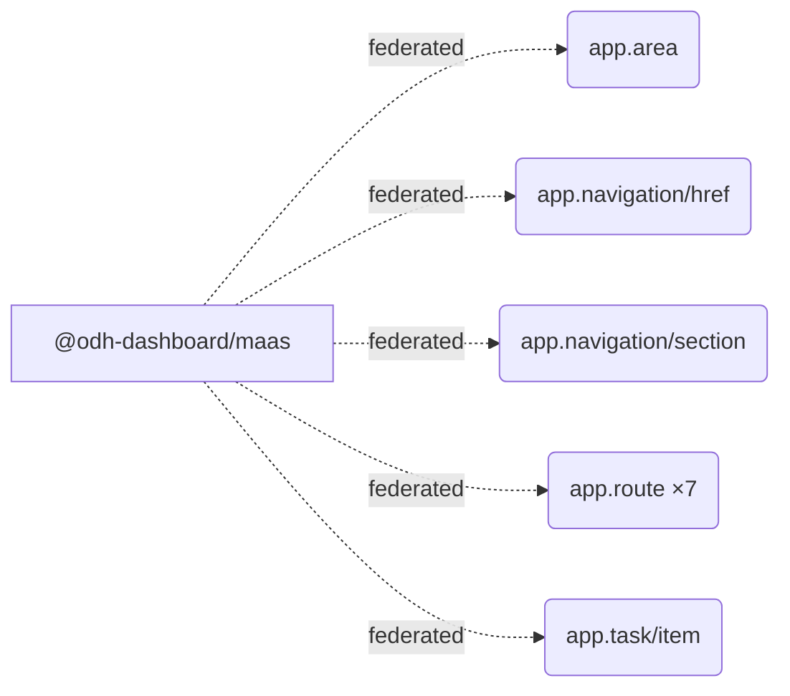
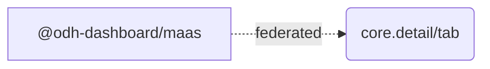
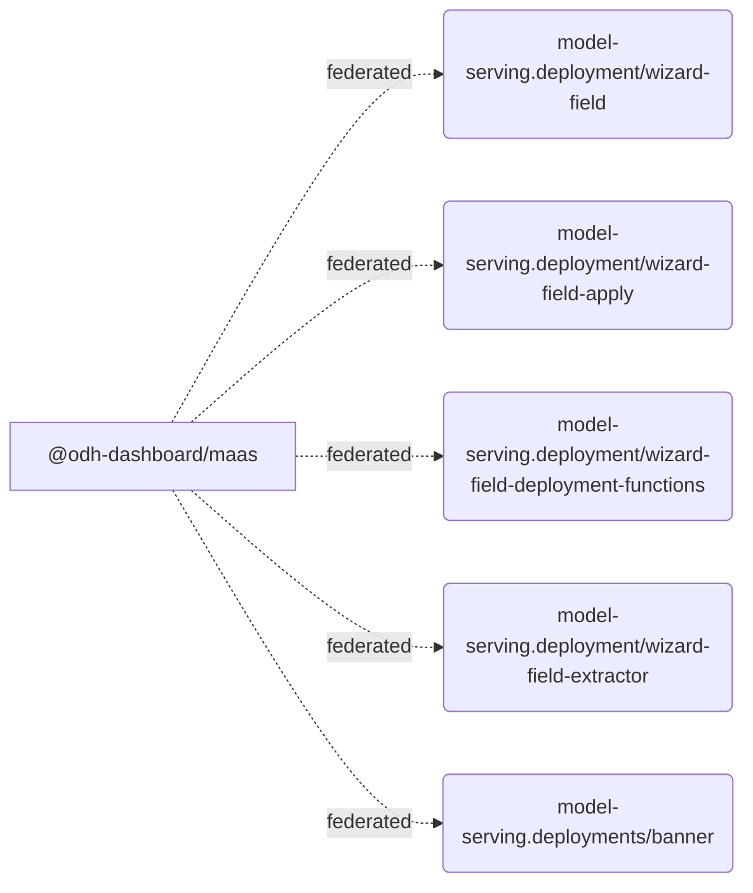

<!-- AUTO-GENERATED by @odh-dashboard/extension-map. Do not edit by hand. -->

> Generated file. Regenerate with `pnpm docs:extension-map`.

## Contents
- [Loading paths](#loading-paths)
- [Contributes](#contributes)
  - [app](#app)
    - [app.area](#apparea)
    - [app.navigation/href](#appnavigationhref)
    - [app.navigation/section](#appnavigationsection)
    - [app.route](#approute)
    - [app.task/item](#apptaskitem)
  - [core](#core)
    - [core.detail/tab](#coredetailtab)
  - [model-serving](#model-serving)
    - [model-serving.deployment/wizard-field](#model-servingdeploymentwizard-field)
    - [model-serving.deployment/wizard-field-apply](#model-servingdeploymentwizard-field-apply)
    - [model-serving.deployment/wizard-field-deployment-functions](#model-servingdeploymentwizard-field-deployment-functions)
    - [model-serving.deployment/wizard-field-extractor](#model-servingdeploymentwizard-field-extractor)
    - [model-serving.deployments/banner](#model-servingdeploymentsbanner)
- [Diagnostics](#diagnostics)

## Loading paths

| Entry | Path | Source |
| --- | --- | --- |
| @odh-dashboard/maas#./extensions/static | distribution-static | `packages/maas/frontend/src/odh/odhExtensions/odhExtensions.ts` |
| @odh-dashboard/maas#mf:./extensions | federated | `packages/maas/frontend/src/odh/extensions.ts` |

## Contributes

### app

| Node | Contract | Registration sources |
| --- | --- | --- |
| [@odh-dashboard/maas](#loading-paths) | — | — |
| app.area | [app.area](../../plugin-core/docs/extensions.md#apparea) | [../frontend/src/odh/odhExtensions/odhExtensions.ts:21](../frontend/src/odh/odhExtensions/odhExtensions.ts#L21-L31) |
| app.navigation/href | [app.navigation/href](../../plugin-core/docs/extensions.md#appnavigationhref) | [../frontend/src/odh/odhExtensions/odhExtensions.ts:57](../frontend/src/odh/odhExtensions/odhExtensions.ts#L57-L70) [../frontend/src/odh/odhExtensions/odhExtensions.ts:71](../frontend/src/odh/odhExtensions/odhExtensions.ts#L71-L83) [../frontend/src/odh/odhExtensions/odhExtensions.ts:32](../frontend/src/odh/odhExtensions/odhExtensions.ts#L32-L44) |
| app.navigation/section | [app.navigation/section](../../plugin-core/docs/extensions.md#appnavigationsection) | [../frontend/src/odh/odhExtensions/odhExtensions.ts:45](../frontend/src/odh/odhExtensions/odhExtensions.ts#L45-L56) |
| app.route ×7 | [app.route](../../plugin-core/docs/extensions.md#approute) | [../frontend/src/odh/odhExtensions/odhExtensions.ts:84](../frontend/src/odh/odhExtensions/odhExtensions.ts#L84-L93) [../frontend/src/odh/odhExtensions/odhExtensions.ts:107](../frontend/src/odh/odhExtensions/odhExtensions.ts#L107-L116) [../frontend/src/odh/odhExtensions/odhExtensions.ts:117](../frontend/src/odh/odhExtensions/odhExtensions.ts#L117-L126) [../frontend/src/odh/odhExtensions/odhExtensions.ts:127](../frontend/src/odh/odhExtensions/odhExtensions.ts#L127-L136) [../frontend/src/odh/odhExtensions/odhExtensions.ts:137](../frontend/src/odh/odhExtensions/odhExtensions.ts#L137-L146) [../frontend/src/odh/odhExtensions/odhExtensions.ts:147](../frontend/src/odh/odhExtensions/odhExtensions.ts#L147-L156) [../frontend/src/odh/odhExtensions/odhExtensions.ts:157](../frontend/src/odh/odhExtensions/odhExtensions.ts#L157-L166) |
| app.task/item | [app.task/item](../../plugin-core/docs/extensions.md#apptaskitem) | [../frontend/src/odh/odhExtensions/odhExtensions.ts:167](../frontend/src/odh/odhExtensions/odhExtensions.ts#L167-L179) |

- `-->` declared or type-resolved contribution
- `==>` derived relationship
- `-. "rendered in" .->` rendered in one hop
- `-. "federated" .->` federated contribution
- `--x` suppression
- `-- "patch" -->` patch

#### app.area

| featureFlags | customCondition | id | Source |
| --- | --- | --- | --- |
| `"modelAsService"` | [not resolved](#diagnostics) | `MODEL_AS_SERVICE_ID` (`"modelAsService"`) | [app.area](../frontend/src/odh/odhExtensions/odhExtensions.ts#L21-L31) |

**Not resolved**

| Location | Reason | Link |
| --- | --- | --- |
| properties.customCondition | CodeRef body is not a supported dynamic import | [diagnostics](#diagnostics) |

#### app.navigation/href

**Contribution:** `app.navigation/href` at `packages/maas/frontend/src/odh/odhExtensions/odhExtensions.ts:57`

- **id**: `"maas-tokens-view"`
- **title**: `"API keys"`
- **section**: `"gen-ai-studio"`
- **href**: `"/maas/tokens"`
- **path**: `"/maas/tokens/*"`
- **Requires**: `MODEL_AS_SERVICE_ID` (`"modelAsService"`)
- **Disallows**: `MAAS_MY_SUBSCRIPTIONS` (`"mySubscriptions"`)
- **Source**: [app.navigation/href](../frontend/src/odh/odhExtensions/odhExtensions.ts#L57-L70)

**Contribution:** `app.navigation/href` at `packages/maas/frontend/src/odh/odhExtensions/odhExtensions.ts:71`

- **id**: `"maas-tokens-subscriptions-view"`
- **title**: `"API keys"`
- **section**: `"gen-ai-studio"`
- **href**: `"/maas/keys-and-subs"`
- **path**: `"/maas/keys-and-subs/*"`
- **Requires**: `MODEL_AS_SERVICE_ID` (`"modelAsService"`)
- **Disallows**: —
- **Source**: [app.navigation/href](../frontend/src/odh/odhExtensions/odhExtensions.ts#L71-L83)

**Contribution:** `app.navigation/href` at `packages/maas/frontend/src/odh/odhExtensions/odhExtensions.ts:32`

- **id**: `"maas-governance-view"`
- **title**: `"MaaS governance"`
- **section**: `"settings"`
- **href**: `"/maas/maas-governance"`
- **path**: `"/maas/maas-governance/*"`
- **Requires**: `MODEL_AS_SERVICE_ID` (`"modelAsService"`), `ADMIN_USER` (`"ADMIN_USER"`)
- **Disallows**: —
- **Source**: [app.navigation/href](../frontend/src/odh/odhExtensions/odhExtensions.ts#L32-L44)

#### app.navigation/section

| id | title | group | iconRef | Requires | CodeRef target | Source |
| --- | --- | --- | --- | --- | --- | --- |
| `"gen-ai-studio"` | `"Gen AI studio"` | `"4_gen_ai_studio"` | packages/maas/frontend/src/odh/odhExtensions/GenAiStudioNavIcon.ts#[GenAiStudioNavIcon](../frontend/src/odh/odhExtensions/GenAiStudioNavIcon.ts#L3-L11) | `MODEL_AS_SERVICE_ID` (`"modelAsService"`) | packages/maas/frontend/src/odh/odhExtensions/GenAiStudioNavIcon.ts#[GenAiStudioNavIcon](../frontend/src/odh/odhExtensions/GenAiStudioNavIcon.ts#L3-L11) | [app.navigation/section](../frontend/src/odh/odhExtensions/odhExtensions.ts#L45-L56) |

#### app.route

| component | path | Requires | CodeRef target | Source |
| --- | --- | --- | --- | --- |
| packages/maas/frontend/src/odh/odhExtensions/MaaSWrapper.tsx#[MaaSWrapper](../frontend/src/odh/odhExtensions/MaaSWrapper.tsx#L5-L9) | `"/maas/maas-governance/*"` | `MODEL_AS_SERVICE_ID` (`"modelAsService"`), `ADMIN_USER` (`"ADMIN_USER"`) | packages/maas/frontend/src/odh/odhExtensions/MaaSWrapper.tsx#[MaaSWrapper](../frontend/src/odh/odhExtensions/MaaSWrapper.tsx#L5-L9) | [app.route](../frontend/src/odh/odhExtensions/odhExtensions.ts#L84-L93) |
| packages/maas/frontend/src/odh/odhExtensions/ExternalProvidersWrapper.tsx#[ExternalProvidersWrapper](../frontend/src/odh/odhExtensions/ExternalProvidersWrapper.tsx#L13-L20) | `"/ai-hub/models/deployments/external-providers/*"` | `MODEL_AS_SERVICE_ID` (`"modelAsService"`) | packages/maas/frontend/src/odh/odhExtensions/ExternalProvidersWrapper.tsx#[ExternalProvidersWrapper](../frontend/src/odh/odhExtensions/ExternalProvidersWrapper.tsx#L13-L20) | [app.route](../frontend/src/odh/odhExtensions/odhExtensions.ts#L107-L116) |
| packages/maas/frontend/src/odh/odhExtensions/ExternalModelsCreateWrapper.tsx#[ExternalModelsCreateWrapper](../frontend/src/odh/odhExtensions/ExternalModelsCreateWrapper.tsx#L5-L9) | `"/ai-hub/models/deployments/external/:namespace/register"` | `MODEL_AS_SERVICE_ID` (`"modelAsService"`) | packages/maas/frontend/src/odh/odhExtensions/ExternalModelsCreateWrapper.tsx#[ExternalModelsCreateWrapper](../frontend/src/odh/odhExtensions/ExternalModelsCreateWrapper.tsx#L5-L9) | [app.route](../frontend/src/odh/odhExtensions/odhExtensions.ts#L117-L126) |
| packages/maas/frontend/src/odh/odhExtensions/ExternalModelsEditWrapper.tsx#[ExternalModelsEditWrapper](../frontend/src/odh/odhExtensions/ExternalModelsEditWrapper.tsx#L5-L9) | `"/ai-hub/models/deployments/external/:namespace/:modelName/edit"` | `MODEL_AS_SERVICE_ID` (`"modelAsService"`) | packages/maas/frontend/src/odh/odhExtensions/ExternalModelsEditWrapper.tsx#[ExternalModelsEditWrapper](../frontend/src/odh/odhExtensions/ExternalModelsEditWrapper.tsx#L5-L9) | [app.route](../frontend/src/odh/odhExtensions/odhExtensions.ts#L127-L136) |
| packages/maas/frontend/src/odh/odhExtensions/MaaSWrapper.tsx#[MaaSWrapper](../frontend/src/odh/odhExtensions/MaaSWrapper.tsx#L5-L9) | `"/maas/tokens/*"` | `MODEL_AS_SERVICE_ID` (`"modelAsService"`) | packages/maas/frontend/src/odh/odhExtensions/MaaSWrapper.tsx#[MaaSWrapper](../frontend/src/odh/odhExtensions/MaaSWrapper.tsx#L5-L9) | [app.route](../frontend/src/odh/odhExtensions/odhExtensions.ts#L137-L146) |
| packages/maas/frontend/src/odh/odhExtensions/MaaSWrapper.tsx#[MaaSWrapper](../frontend/src/odh/odhExtensions/MaaSWrapper.tsx#L5-L9) | `"/maas/keys-and-subs/*"` | `MODEL_AS_SERVICE_ID` (`"modelAsService"`) | packages/maas/frontend/src/odh/odhExtensions/MaaSWrapper.tsx#[MaaSWrapper](../frontend/src/odh/odhExtensions/MaaSWrapper.tsx#L5-L9) | [app.route](../frontend/src/odh/odhExtensions/odhExtensions.ts#L147-L156) |
| packages/maas/frontend/src/odh/odhExtensions/MaaSRedirect.tsx#[MaaSRedirect](../frontend/src/odh/odhExtensions/MaaSRedirect.tsx#L5-L12) | `"/maas"` | `MODEL_AS_SERVICE_ID` (`"modelAsService"`) | packages/maas/frontend/src/odh/odhExtensions/MaaSRedirect.tsx#[MaaSRedirect](../frontend/src/odh/odhExtensions/MaaSRedirect.tsx#L5-L12) | [app.route](../frontend/src/odh/odhExtensions/odhExtensions.ts#L157-L166) |

#### app.task/item

| id | group | title | destination | order | Requires | Source |
| --- | --- | --- | --- | --- | --- | --- |
| `"genai-api-keys"` | `"gen-ai-studio"` | `"Manage API keys"` | href: `"/maas/tokens"` | `"5_api_keys"` | `MODEL_AS_SERVICE_ID` (`"modelAsService"`) | [app.task/item](../frontend/src/odh/odhExtensions/odhExtensions.ts#L167-L179) |

### core

| Node | Contract | Registration sources |
| --- | --- | --- |
| [@odh-dashboard/maas](#loading-paths) | — | — |
| core.detail/tab | [core.detail/tab](../../plugin-core/docs/extensions.md#coredetailtab) | [../frontend/src/odh/odhExtensions/odhExtensions.ts:94](../frontend/src/odh/odhExtensions/odhExtensions.ts#L94-L106) |

- `-->` declared or type-resolved contribution
- `==>` derived relationship
- `-. "rendered in" .->` rendered in one hop
- `-. "federated" .->` federated contribution
- `--x` suppression
- `-- "patch" -->` patch

#### core.detail/tab

| id | title | component | group | Requires | CodeRef target | Source |
| --- | --- | --- | --- | --- | --- | --- |
| `"external-models"` | `"External models"` | packages/maas/frontend/src/odh/odhExtensions/ExternalModelsWrapper.tsx#[ExternalModelsWrapper](../frontend/src/odh/odhExtensions/ExternalModelsWrapper.tsx#L5-L9) | `GLOBAL_DEPLOYMENTS_DETAIL_TAB_GROUP` (`"model-serving.global-deployments"`) | `MODEL_AS_SERVICE_ID` (`"modelAsService"`) | packages/maas/frontend/src/odh/odhExtensions/ExternalModelsWrapper.tsx#[ExternalModelsWrapper](../frontend/src/odh/odhExtensions/ExternalModelsWrapper.tsx#L5-L9) | [core.detail/tab](../frontend/src/odh/odhExtensions/odhExtensions.ts#L94-L106) |

### model-serving

| Node | Contract | Registration sources |
| --- | --- | --- |
| [@odh-dashboard/maas](#loading-paths) | — | — |
| model-serving.deployment/wizard-field | [model-serving.deployment/wizard-field](../../model-serving/docs/extensions.md#model-servingdeploymentwizard-field) | [../frontend/src/odh/modelServingExtensions/modelServingExtensions.ts:23](../frontend/src/odh/modelServingExtensions/modelServingExtensions.ts#L23-L35) |
| model-serving.deployment/wizard-field-apply | [model-serving.deployment/wizard-field-apply](../../model-serving/docs/extensions.md#model-servingdeploymentwizard-field-apply) | [../frontend/src/odh/modelServingExtensions/modelServingExtensions.ts:36](../frontend/src/odh/modelServingExtensions/modelServingExtensions.ts#L36-L49) |
| model-serving.deployment/wizard-field-deployment-functions | [model-serving.deployment/wizard-field-deployment-functions](../../model-serving/docs/extensions.md#model-servingdeploymentwizard-field-deployment-functions) | [../frontend/src/odh/modelServingExtensions/modelServingExtensions.ts:64](../frontend/src/odh/modelServingExtensions/modelServingExtensions.ts#L64-L77) |
| model-serving.deployment/wizard-field-extractor | [model-serving.deployment/wizard-field-extractor](../../model-serving/docs/extensions.md#model-servingdeploymentwizard-field-extractor) | [../frontend/src/odh/modelServingExtensions/modelServingExtensions.ts:50](../frontend/src/odh/modelServingExtensions/modelServingExtensions.ts#L50-L63) |
| model-serving.deployments/banner | [model-serving.deployments/banner](../../model-serving/docs/extensions.md#model-servingdeploymentsbanner) | [../frontend/src/odh/modelServingExtensions/modelServingExtensions.ts:78](../frontend/src/odh/modelServingExtensions/modelServingExtensions.ts#L78-L90) |

- `-->` declared or type-resolved contribution
- `==>` derived relationship
- `-. "rendered in" .->` rendered in one hop
- `-. "federated" .->` federated contribution
- `--x` suppression
- `-- "patch" -->` patch

#### model-serving.deployment/wizard-field

| platform | field | Requires | CodeRef target | Source |
| --- | --- | --- | --- | --- |
| `MODEL_AS_SERVICE_ID` (`"modelAsService"`) | packages/maas/frontend/src/odh/modelServingExtensions/modelDeploymentWizard/MaaSEndpointCheckbox.tsx#[MaaSEndpointFieldWizardField](../frontend/src/odh/modelServingExtensions/modelDeploymentWizard/MaaSEndpointCheckbox.tsx#L118-L193) | `MODEL_AS_SERVICE_ID` (`"modelAsService"`) | packages/maas/frontend/src/odh/modelServingExtensions/modelDeploymentWizard/MaaSEndpointCheckbox.tsx#[MaaSEndpointFieldWizardField](../frontend/src/odh/modelServingExtensions/modelDeploymentWizard/MaaSEndpointCheckbox.tsx#L118-L193) | [model-serving.deployment/wizard-field](../frontend/src/odh/modelServingExtensions/modelServingExtensions.ts#L23-L35) |

**Not resolved**

| Location | Reason | Link |
| --- | --- | --- |
| properties.field supplies.reducerFunctions.setFieldData | identifier does not resolve to a literal value | [diagnostics](#diagnostics) |
| properties.field supplies.reducerFunctions.getInitialFieldData | identifier does not resolve to a literal value | [diagnostics](#diagnostics) |
| properties.field supplies.reducerFunctions.validationSchema | identifier does not resolve to a literal value | [diagnostics](#diagnostics) |
| properties.field supplies.reducerFunctions.resolveDependencies | identifier does not resolve to a literal value | [diagnostics](#diagnostics) |
| properties.field supplies.reducerFunctions.getFieldOverrides | CodeRef body is not a supported dynamic import | [diagnostics](#diagnostics) |

**Supplies**

| CodeRef | Supply | Value |
| --- | --- | --- |
| MaaSEndpointFieldWizardField | id | `"maas/save-as-maas-checkbox"` |
| MaaSEndpointFieldWizardField | parentId | `"model-users"` |
| MaaSEndpointFieldWizardField | step | `"advancedOptions"` |
| MaaSEndpointFieldWizardField | type | `"addition"` |
| MaaSEndpointFieldWizardField | isActive | [isLLMInferenceServiceActive](../../llmd-serving/src/formUtils.ts#L14-L28) |
| MaaSEndpointFieldWizardField | reducerFunctions | setFieldData: [not resolved](#diagnostics), getInitialFieldData: [not resolved](#diagnostics), validationSchema: [not resolved](#diagnostics), resolveDependencies: [not resolved](#diagnostics), getFieldOverrides: [not resolved](#diagnostics) |
| MaaSEndpointFieldWizardField | component | [MaaSField](../frontend/src/odh/modelServingExtensions/modelDeploymentWizard/MaaSEndpointCheckbox.tsx#L89-L114) |
| MaaSEndpointFieldWizardField | externalDataHook | [useMaaSPublishTrackingSession](../frontend/src/odh/modelServingExtensions/modelDeploymentWizard/MaaSEndpointCheckbox.tsx#L54-L80) |
| MaaSEndpointFieldWizardField | getReviewSections | [getReviewSections](../frontend/src/odh/modelServingExtensions/modelDeploymentWizard/MaaSEndpointCheckbox.tsx#L181-L192) |

#### model-serving.deployment/wizard-field-apply

| fieldId | platform | apply | Requires | CodeRef target | Source |
| --- | --- | --- | --- | --- | --- |
| `MAAS_ENDPOINT_FIELD_ID` (`"maas/save-as-maas-checkbox"`) | `LLMD_SERVING_ID` (`"llmd-serving"`) | packages/maas/frontend/src/odh/modelServingExtensions/modelDeploymentWizard/maasDeploymentTransformer.ts#[applyMaaSEndpointData](../frontend/src/odh/modelServingExtensions/modelDeploymentWizard/maasDeploymentTransformer.ts#L17-L56) | `MODEL_AS_SERVICE_ID` (`"modelAsService"`), `LLMD_SERVING_ID` (`"llmd-serving"`) | packages/maas/frontend/src/odh/modelServingExtensions/modelDeploymentWizard/maasDeploymentTransformer.ts#[applyMaaSEndpointData](../frontend/src/odh/modelServingExtensions/modelDeploymentWizard/maasDeploymentTransformer.ts#L17-L56) | [model-serving.deployment/wizard-field-apply](../frontend/src/odh/modelServingExtensions/modelServingExtensions.ts#L36-L49) |

#### model-serving.deployment/wizard-field-deployment-functions

| fieldId | platform | preDeploy | postDeploy | Requires | CodeRef target | Source |
| --- | --- | --- | --- | --- | --- | --- |
| `MAAS_ENDPOINT_FIELD_ID` (`"maas/save-as-maas-checkbox"`) | `LLMD_SERVING_ID` (`"llmd-serving"`) | packages/maas/frontend/src/odh/modelServingExtensions/modelDeploymentWizard/maas-model-ref.ts#[preDeployMaaSModelRef](../frontend/src/odh/modelServingExtensions/modelDeploymentWizard/maas-model-ref.ts#L54-L134) | packages/maas/frontend/src/odh/modelServingExtensions/modelDeploymentWizard/maas-model-ref.ts#[postDeployMaaSModelRef](../frontend/src/odh/modelServingExtensions/modelDeploymentWizard/maas-model-ref.ts#L149-L236) | `MODEL_AS_SERVICE_ID` (`"modelAsService"`), `LLMD_SERVING_ID` (`"llmd-serving"`) | packages/maas/frontend/src/odh/modelServingExtensions/modelDeploymentWizard/maas-model-ref.ts#[preDeployMaaSModelRef](../frontend/src/odh/modelServingExtensions/modelDeploymentWizard/maas-model-ref.ts#L54-L134), packages/maas/frontend/src/odh/modelServingExtensions/modelDeploymentWizard/maas-model-ref.ts#[postDeployMaaSModelRef](../frontend/src/odh/modelServingExtensions/modelDeploymentWizard/maas-model-ref.ts#L149-L236) | [model-serving.deployment/wizard-field-deployment-functions](../frontend/src/odh/modelServingExtensions/modelServingExtensions.ts#L64-L77) |

#### model-serving.deployment/wizard-field-extractor

| fieldId | platform | extract | Requires | CodeRef target | Source |
| --- | --- | --- | --- | --- | --- |
| `MAAS_ENDPOINT_FIELD_ID` (`"maas/save-as-maas-checkbox"`) | `LLMD_SERVING_ID` (`"llmd-serving"`) | packages/maas/frontend/src/odh/modelServingExtensions/modelDeploymentWizard/maasDeploymentTransformer.ts#[extractMaaSEndpointData](../frontend/src/odh/modelServingExtensions/modelDeploymentWizard/maasDeploymentTransformer.ts#L62-L71) | `MODEL_AS_SERVICE_ID` (`"modelAsService"`), `LLMD_SERVING_ID` (`"llmd-serving"`) | packages/maas/frontend/src/odh/modelServingExtensions/modelDeploymentWizard/maasDeploymentTransformer.ts#[extractMaaSEndpointData](../frontend/src/odh/modelServingExtensions/modelDeploymentWizard/maasDeploymentTransformer.ts#L62-L71) | [model-serving.deployment/wizard-field-extractor](../frontend/src/odh/modelServingExtensions/modelServingExtensions.ts#L50-L63) |

#### model-serving.deployments/banner

| id | component | Requires | CodeRef target | Source |
| --- | --- | --- | --- | --- |
| `"maas-published-post-deploy-alert"` | packages/maas/frontend/src/odh/modelServingExtensions/MaaSPublishedPostDeployAlert.tsx#[MaaSPublishedInternalPostDeployAlert](../frontend/src/odh/modelServingExtensions/MaaSPublishedPostDeployAlert.tsx#L83-L94) | `MODEL_AS_SERVICE_ID` (`"modelAsService"`) | packages/maas/frontend/src/odh/modelServingExtensions/MaaSPublishedPostDeployAlert.tsx#[MaaSPublishedInternalPostDeployAlert](../frontend/src/odh/modelServingExtensions/MaaSPublishedPostDeployAlert.tsx#L83-L94) | [model-serving.deployments/banner](../frontend/src/odh/modelServingExtensions/modelServingExtensions.ts#L78-L90) |

## Diagnostics

| Code | Message | Link |
| --- | --- | --- |
| `unresolved-value` | extension property 'field' contains a value that could not be resolved | [field](../frontend/src/odh/modelServingExtensions/modelServingExtensions.ts#L30-L33) |
| `unresolved-value` | extension property 'customCondition' contains a value that could not be resolved | [customCondition](../frontend/src/odh/odhExtensions/odhExtensions.ts#L26-L29) |
