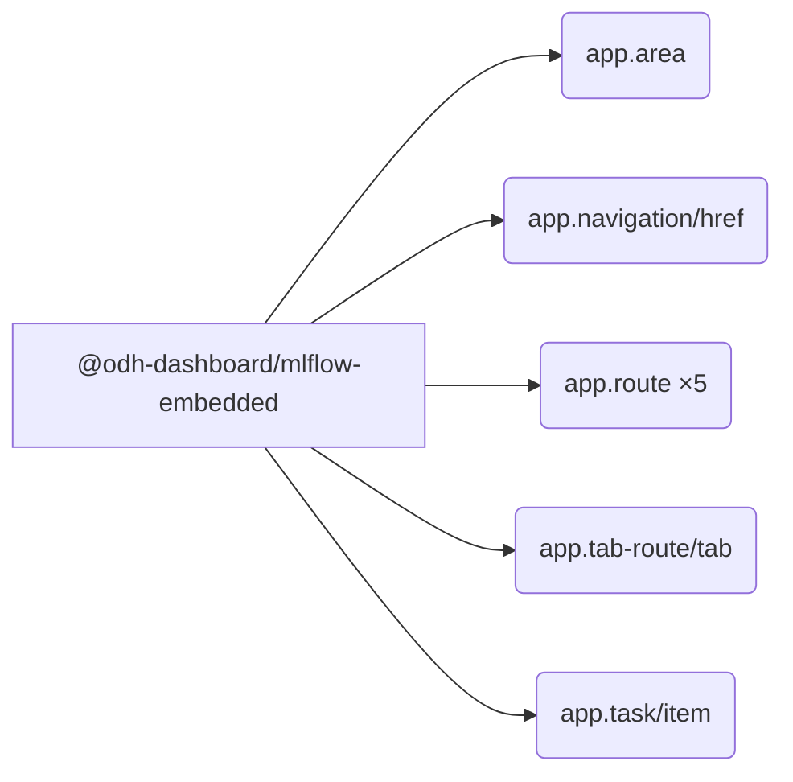

<!-- AUTO-GENERATED by @odh-dashboard/extension-map. Do not edit by hand. -->

> Generated file. Regenerate with `pnpm docs:extension-map`.

## Contents
- [Loading paths](#loading-paths)
- [Contributes](#contributes)
  - [app](#app)
    - [app.area](#apparea)
    - [app.navigation/href](#appnavigationhref)
    - [app.route](#approute)
    - [app.tab-route/tab](#apptab-routetab)
    - [app.task/item](#apptaskitem)
- [Diagnostics](#diagnostics)

## Loading paths

| Entry | Path | Source |
| --- | --- | --- |
| @odh-dashboard/mlflow-embedded#./extensions | static | `packages/mlflow-embedded/extensions.ts` |

_Federation declared but not loaded by the host._

## Contributes

### app

| Node | Contract | Registration sources |
| --- | --- | --- |
| [@odh-dashboard/mlflow-embedded](#loading-paths) | — | — |
| app.area | [app.area](../../plugin-core/docs/extensions.md#apparea) | [../extensions.ts:45](../extensions.ts#L45-L50) |
| app.navigation/href | [app.navigation/href](../../plugin-core/docs/extensions.md#appnavigationhref) | [../extensions.ts:51](../extensions.ts#L51-L64) [../extensions.ts:72](../extensions.ts#L72-L85) [../extensions.ts:95](../extensions.ts#L95-L109) [../extensions.ts:147](../extensions.ts#L147-L165) |
| app.route ×5 | [app.route](../../plugin-core/docs/extensions.md#approute) | [../extensions.ts:65](../extensions.ts#L65-L71) [../extensions.ts:88](../extensions.ts#L88-L94) [../extensions.ts:110](../extensions.ts#L110-L116) [../extensions.ts:137](../extensions.ts#L137-L146) [../extensions.ts:168](../extensions.ts#L168-L177) |
| app.tab-route/tab | [app.tab-route/tab](../../plugin-core/docs/extensions.md#apptab-routetab) | [../extensions.ts:117](../extensions.ts#L117-L131) |
| app.task/item | [app.task/item](../../plugin-core/docs/extensions.md#apptaskitem) | [../extensions.ts:178](../extensions.ts#L178-L190) [../extensions.ts:191](../extensions.ts#L191-L203) [../extensions.ts:204](../extensions.ts#L204-L216) |

- `-->` declared or type-resolved contribution
- `==>` derived relationship
- `-. "rendered in" .->` rendered in one hop
- `-. "federated" .->` federated contribution
- `--x` suppression
- `-- "patch" -->` patch

#### app.area

| id | Source |
| --- | --- |
| `"mlflow-embedded"` | [app.area](../extensions.ts#L45-L50) |

#### app.navigation/href

**Contribution:** `app.navigation/href` at `packages/mlflow-embedded/extensions.ts:51`

- **id**: `EXPERIMENTS_NAV_ID` (`"experiments-mlflow"`)
- **title**: `"Experiments"`
- **section**: `"develop-and-train"`
- **group**: —
- **label**: —
- **href**: `"/develop-train/mlflow/experiments"`
- **path**: `"/develop-train/mlflow/experiments/*"`
- **trackingEvent**: name: `MlflowTrackingEvents.EMBEDDED_VIEW_OPENED` (`"MLflow Embedded View Opened"`), section: `"sidebar-nav"`
- **Requires**: —
- **Source**: [app.navigation/href](../extensions.ts#L51-L64)

**Contribution:** `app.navigation/href` at `packages/mlflow-embedded/extensions.ts:72`

- **id**: `"prompt-management"`
- **title**: `PROMPT_MANAGEMENT_PAGE_TITLE` (`"Prompts"`)
- **section**: `"gen-ai-studio"`
- **group**: `"6_prompt_management"`
- **label**: —
- **href**: `promptManagementPath` (`"/gen-ai-studio/prompts"`)
- **path**: `globPromptManagementAll` (`"/gen-ai-studio/prompts/*"`)
- **trackingEvent**: —
- **Requires**: `"plugin-gen-ai"`, `SupportedArea.MLFLOW` (`"mlflow"`)
- **Source**: [app.navigation/href](../extensions.ts#L72-L85)

**Contribution:** `app.navigation/href` at `packages/mlflow-embedded/extensions.ts:95`

- **id**: `"agent-observability"`
- **title**: `AGENT_OBSERVABILITY_PAGE_TITLE` (`"Agent traces"`)
- **section**: `"observe-and-monitor"`
- **group**: `"6_agent_observability"`
- **label**: —
- **href**: `agentObservabilityPath` (`"/observe-and-monitor/agent-traces"`)
- **path**: `globAgentObservabilityAll` (`"/observe-and-monitor/agent-traces/*"`)
- **trackingEvent**: name: `MlflowTrackingEvents.EMBEDDED_VIEW_OPENED` (`"MLflow Embedded View Opened"`), section: `"agent-observability-sidebar-nav"`
- **Requires**: —
- **Source**: [app.navigation/href](../extensions.ts#L95-L109)

**Contribution:** `app.navigation/href` at `packages/mlflow-embedded/extensions.ts:147`

- **id**: `"skill-registry"`
- **title**: `SKILL_REGISTRY_PAGE_TITLE` (`"Skills"`)
- **section**: `"ai-hub"`
- **group**: `"3b_skill_registry"`
- **label**: `"Tech Preview"`
- **href**: `skillRegistryPath` (`"/ai-hub/skills"`)
- **path**: `globSkillRegistryAll` (`"/ai-hub/skills/*"`)
- **trackingEvent**: name: `MlflowTrackingEvents.EMBEDDED_VIEW_OPENED` (`"MLflow Embedded View Opened"`), section: `"skill-registry-sidebar-nav"`
- **Requires**: `SupportedArea.MLFLOW` (`"mlflow"`), `SupportedArea.SKILL_REGISTRY` (`"skill-registry"`)
- **Source**: [app.navigation/href](../extensions.ts#L147-L165)

#### app.route

| component | path | Requires | CodeRef target | Source |
| --- | --- | --- | --- | --- |
| packages/mlflow-embedded/experiments/GlobalMLflowExperimentsRoutes.tsx#[GlobalMLflowExperimentsRoutes](../experiments/GlobalMLflowExperimentsRoutes.tsx#L20-L42) | `"/develop-train/mlflow/*"` | — | packages/mlflow-embedded/experiments/GlobalMLflowExperimentsRoutes.tsx#[GlobalMLflowExperimentsRoutes](../experiments/GlobalMLflowExperimentsRoutes.tsx#L20-L42) | [app.route](../extensions.ts#L65-L71) |
| packages/mlflow-embedded/prompts/GlobalMLflowPromptManagementRoutes.tsx#[GlobalMLflowPromptManagementRoutes](../prompts/GlobalMLflowPromptManagementRoutes.tsx#L14-L34) | `globPromptManagementAll` (`"/gen-ai-studio/prompts/*"`) | — | packages/mlflow-embedded/prompts/GlobalMLflowPromptManagementRoutes.tsx#[GlobalMLflowPromptManagementRoutes](../prompts/GlobalMLflowPromptManagementRoutes.tsx#L14-L34) | [app.route](../extensions.ts#L88-L94) |
| packages/mlflow-embedded/agent-observability/GlobalMLflowAgentObservabilityRoutes.tsx#[GlobalMLflowAgentObservabilityRoutes](../agent-observability/GlobalMLflowAgentObservabilityRoutes.tsx#L14-L34) | `globAgentObservabilityAll` (`"/observe-and-monitor/agent-traces/*"`) | — | packages/mlflow-embedded/agent-observability/GlobalMLflowAgentObservabilityRoutes.tsx#[GlobalMLflowAgentObservabilityRoutes](../agent-observability/GlobalMLflowAgentObservabilityRoutes.tsx#L14-L34) | [app.route](../extensions.ts#L110-L116) |
| packages/mlflow-embedded/mcp-registry/MlflowMcpRegistryDetailPage.tsx#[MlflowMcpRegistryDetailPage](../mcp-registry/MlflowMcpRegistryDetailPage.tsx#L39-L195) | `"/ai-hub/mcp-servers/registry/:serverName"` | `SupportedArea.MLFLOW` (`"mlflow"`), `SupportedArea.MCP_CATALOG` (`"mcp-catalog"`), `SupportedArea.MCP_REGISTRY` (`"mcp-registry"`) | packages/mlflow-embedded/mcp-registry/MlflowMcpRegistryDetailPage.tsx#[MlflowMcpRegistryDetailPage](../mcp-registry/MlflowMcpRegistryDetailPage.tsx#L39-L195) | [app.route](../extensions.ts#L137-L146) |
| packages/mlflow-embedded/skill-registry/GlobalMLflowSkillRegistryRoutes.tsx#[GlobalMLflowSkillRegistryRoutes](../skill-registry/GlobalMLflowSkillRegistryRoutes.tsx#L11-L40) | `globSkillRegistryAll` (`"/ai-hub/skills/*"`) | `SupportedArea.MLFLOW` (`"mlflow"`), `SupportedArea.SKILL_REGISTRY` (`"skill-registry"`) | packages/mlflow-embedded/skill-registry/GlobalMLflowSkillRegistryRoutes.tsx#[GlobalMLflowSkillRegistryRoutes](../skill-registry/GlobalMLflowSkillRegistryRoutes.tsx#L11-L40) | [app.route](../extensions.ts#L168-L177) |

#### app.tab-route/tab

**Contribution:** `app.tab-route/tab` at `packages/mlflow-embedded/extensions.ts:117`

- **pageId**: `"mcp-servers-tab-page"`
- **id**: `"registry"`
- **title**: `"Registry"`
- **singleTabTitle**: `"Registry"`
- **objectType**: `"mcp-catalog"`
- **component**: packages/mlflow-embedded/mcp-registry/MlflowMcpRegistryTabContent.tsx#[MlflowMcpRegistryTabContent](../mcp-registry/MlflowMcpRegistryTabContent.tsx#L34-L116)
- **group**: `"1b_registry"`
- **Requires**: `SupportedArea.MLFLOW` (`"mlflow"`), `SupportedArea.MCP_CATALOG` (`"mcp-catalog"`), `SupportedArea.MCP_REGISTRY` (`"mcp-registry"`)
- **CodeRef target**: packages/mlflow-embedded/mcp-registry/MlflowMcpRegistryTabContent.tsx#[MlflowMcpRegistryTabContent](../mcp-registry/MlflowMcpRegistryTabContent.tsx#L34-L116)
- **Source**: [app.tab-route/tab](../extensions.ts#L117-L131)

#### app.task/item

| id | group | title | destination | order | Requires | Source |
| --- | --- | --- | --- | --- | --- | --- |
| `"develop-experiments"` | `"develop-and-train"` | `"Track and compare training runs"` | href: `"/develop-train/mlflow/experiments"` | `"3_experiments"` | `SupportedArea.MLFLOW` (`"mlflow"`) | [app.task/item](../extensions.ts#L178-L190) |
| `"genai-prompts"` | `"gen-ai-studio"` | `"Create and manage AI prompts"` | href: `promptManagementPath` (`"/gen-ai-studio/prompts"`) | `"4_prompts"` | `"plugin-gen-ai"`, `SupportedArea.MLFLOW` (`"mlflow"`) | [app.task/item](../extensions.ts#L191-L203) |
| `"ai-hub-skills"` | `"ai-hub"` | `"Discover and register agent skills"` | href: `skillRegistryPath` (`"/ai-hub/skills"`) | `"3_skills"` | `SupportedArea.MLFLOW` (`"mlflow"`), `SupportedArea.SKILL_REGISTRY` (`"skill-registry"`) | [app.task/item](../extensions.ts#L204-L216) |

## Diagnostics

| Code | Message | Link |
| --- | --- | --- |
| `federation-not-loaded` | the host would not load '@odh-dashboard/mlflow-embedded' as a federated remote (no-extensions-expose) | [details](#diagnostics) |
