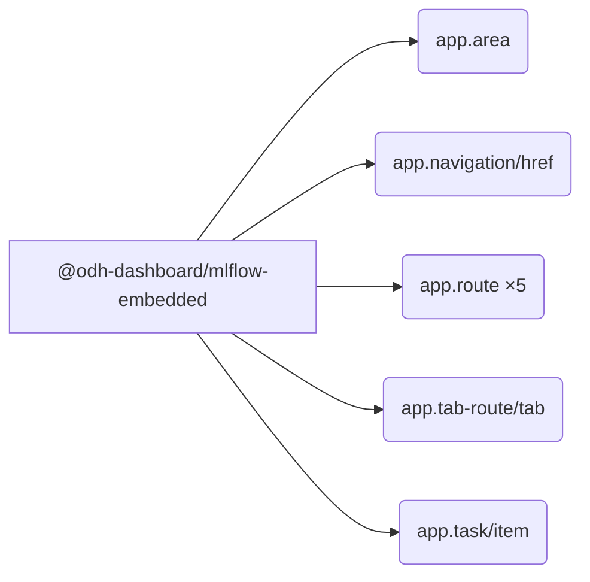

<!-- AUTO-GENERATED by @odh-dashboard/extension-map. Do not edit by hand. -->

> Generated file. Regenerate with `pnpm docs:extension-map`.

## Loading paths

| Entry | Path | Source |
| --- | --- | --- |
| @odh-dashboard/mlflow-embedded#./extensions | static | `packages/mlflow-embedded/extensions.ts` |

_Federation declared but not loaded by the host._

## Contributes

### app

| Node | Link |
| --- | --- |
| @odh-dashboard/mlflow-embedded | [@odh-dashboard/mlflow-embedded](#contributes) |
| app.area | [app.area](../../plugin-core/docs/extensions.md#apparea) [app.area](../extensions.ts#L45-L50) |
| app.navigation/href | [app.navigation/href](../../plugin-core/docs/extensions.md#appnavigationhref) [app.navigation/href](../extensions.ts#L51-L64) [app.navigation/href](../extensions.ts#L72-L85) [app.navigation/href](../extensions.ts#L95-L109) [app.navigation/href](../extensions.ts#L147-L165) |
| app.route ×5 | [app.route](../../plugin-core/docs/extensions.md#approute) [app.route](../extensions.ts#L65-L71) [app.route](../extensions.ts#L88-L94) [app.route](../extensions.ts#L110-L116) [app.route](../extensions.ts#L137-L146) [app.route](../extensions.ts#L168-L177) |
| app.tab-route/tab | [app.tab-route/tab](../../plugin-core/docs/extensions.md#apptab-routetab) [app.tab-route/tab](../extensions.ts#L117-L131) |
| app.task/item | [app.task/item](../../plugin-core/docs/extensions.md#apptaskitem) [app.task/item](../extensions.ts#L178-L190) [app.task/item](../extensions.ts#L191-L203) [app.task/item](../extensions.ts#L204-L216) |

- `-->` declared or type-resolved contribution
- `==>` derived relationship
- `-. "rendered in" .->` rendered in one hop
- `-. "federated" .->` federated contribution
- `--x` suppression
- `-- "patch" -->` patch

#### app.area

| id | Requires | Disallows | CodeRef target | Included in | Source |
| --- | --- | --- | --- | --- | --- |
| `"mlflow-embedded"` |  |  |  |  | [app.area](../extensions.ts#L45-L50) |

#### app.navigation/href

- **id**: `EXPERIMENTS_NAV_ID` (`"experiments-mlflow"`)
- **title**: `"Experiments"`
- **section**: `"develop-and-train"`
- **group**: 
- **label**: 
- **href**: `"/develop-train/mlflow/experiments"`
- **path**: `"/develop-train/mlflow/experiments/*"`
- **trackingEvent**: name: `MlflowTrackingEvents.EMBEDDED_VIEW_OPENED` (`"MLflow Embedded View Opened"`), section: `"sidebar-nav"`
- **Requires**: 
- **Disallows**: 
- **CodeRef target**: 
- **Included in**: 
- **Source**: [app.navigation/href](../extensions.ts#L51-L64)

- **id**: `"prompt-management"`
- **title**: `PROMPT_MANAGEMENT_PAGE_TITLE` (`"Prompts"`)
- **section**: `"gen-ai-studio"`
- **group**: `"6_prompt_management"`
- **label**: 
- **href**: `promptManagementPath` (`"/gen-ai-studio/prompts"`)
- **path**: `globPromptManagementAll` (`"/gen-ai-studio/prompts/*"`)
- **trackingEvent**: 
- **Requires**: `"plugin-gen-ai"`, `SupportedArea.MLFLOW` (`"mlflow"`)
- **Disallows**: 
- **CodeRef target**: 
- **Included in**: 
- **Source**: [app.navigation/href](../extensions.ts#L72-L85)

- **id**: `"agent-observability"`
- **title**: `AGENT_OBSERVABILITY_PAGE_TITLE` (`"Agent traces"`)
- **section**: `"observe-and-monitor"`
- **group**: `"6_agent_observability"`
- **label**: 
- **href**: `agentObservabilityPath` (`"/observe-and-monitor/agent-traces"`)
- **path**: `globAgentObservabilityAll` (`"/observe-and-monitor/agent-traces/*"`)
- **trackingEvent**: name: `MlflowTrackingEvents.EMBEDDED_VIEW_OPENED` (`"MLflow Embedded View Opened"`), section: `"agent-observability-sidebar-nav"`
- **Requires**: 
- **Disallows**: 
- **CodeRef target**: 
- **Included in**: 
- **Source**: [app.navigation/href](../extensions.ts#L95-L109)

- **id**: `"skill-registry"`
- **title**: `SKILL_REGISTRY_PAGE_TITLE` (`"Skills"`)
- **section**: `"ai-hub"`
- **group**: `"3b_skill_registry"`
- **label**: `"Tech Preview"`
- **href**: `skillRegistryPath` (`"/ai-hub/skills"`)
- **path**: `globSkillRegistryAll` (`"/ai-hub/skills/*"`)
- **trackingEvent**: name: `MlflowTrackingEvents.EMBEDDED_VIEW_OPENED` (`"MLflow Embedded View Opened"`), section: `"skill-registry-sidebar-nav"`
- **Requires**: `SupportedArea.MLFLOW` (`"mlflow"`), `SupportedArea.SKILL_REGISTRY` (`"skill-registry"`)
- **Disallows**: 
- **CodeRef target**: 
- **Included in**: 
- **Source**: [app.navigation/href](../extensions.ts#L147-L165)

#### app.route

| component | path | Requires | Disallows | CodeRef target | Included in | Source |
| --- | --- | --- | --- | --- | --- | --- |
| packages/mlflow-embedded/experiments/GlobalMLflowExperimentsRoutes.tsx#[GlobalMLflowExperimentsRoutes](../experiments/GlobalMLflowExperimentsRoutes.tsx#L20-L42) | `"/develop-train/mlflow/*"` |  |  | packages/mlflow-embedded/experiments/GlobalMLflowExperimentsRoutes.tsx#[GlobalMLflowExperimentsRoutes](../experiments/GlobalMLflowExperimentsRoutes.tsx#L20-L42) |  | [app.route](../extensions.ts#L65-L71) |
| packages/mlflow-embedded/prompts/GlobalMLflowPromptManagementRoutes.tsx#[GlobalMLflowPromptManagementRoutes](../prompts/GlobalMLflowPromptManagementRoutes.tsx#L14-L34) | `globPromptManagementAll` (`"/gen-ai-studio/prompts/*"`) |  |  | packages/mlflow-embedded/prompts/GlobalMLflowPromptManagementRoutes.tsx#[GlobalMLflowPromptManagementRoutes](../prompts/GlobalMLflowPromptManagementRoutes.tsx#L14-L34) |  | [app.route](../extensions.ts#L88-L94) |
| packages/mlflow-embedded/agent-observability/GlobalMLflowAgentObservabilityRoutes.tsx#[GlobalMLflowAgentObservabilityRoutes](../agent-observability/GlobalMLflowAgentObservabilityRoutes.tsx#L14-L34) | `globAgentObservabilityAll` (`"/observe-and-monitor/agent-traces/*"`) |  |  | packages/mlflow-embedded/agent-observability/GlobalMLflowAgentObservabilityRoutes.tsx#[GlobalMLflowAgentObservabilityRoutes](../agent-observability/GlobalMLflowAgentObservabilityRoutes.tsx#L14-L34) |  | [app.route](../extensions.ts#L110-L116) |
| packages/mlflow-embedded/mcp-registry/MlflowMcpRegistryDetailPage.tsx#[MlflowMcpRegistryDetailPage](../mcp-registry/MlflowMcpRegistryDetailPage.tsx#L39-L195) | `"/ai-hub/mcp-servers/registry/:serverName"` | `SupportedArea.MLFLOW` (`"mlflow"`), `SupportedArea.MCP_CATALOG` (`"mcp-catalog"`), `SupportedArea.MCP_REGISTRY` (`"mcp-registry"`) |  | packages/mlflow-embedded/mcp-registry/MlflowMcpRegistryDetailPage.tsx#[MlflowMcpRegistryDetailPage](../mcp-registry/MlflowMcpRegistryDetailPage.tsx#L39-L195) |  | [app.route](../extensions.ts#L137-L146) |
| packages/mlflow-embedded/skill-registry/GlobalMLflowSkillRegistryRoutes.tsx#[GlobalMLflowSkillRegistryRoutes](../skill-registry/GlobalMLflowSkillRegistryRoutes.tsx#L11-L40) | `globSkillRegistryAll` (`"/ai-hub/skills/*"`) | `SupportedArea.MLFLOW` (`"mlflow"`), `SupportedArea.SKILL_REGISTRY` (`"skill-registry"`) |  | packages/mlflow-embedded/skill-registry/GlobalMLflowSkillRegistryRoutes.tsx#[GlobalMLflowSkillRegistryRoutes](../skill-registry/GlobalMLflowSkillRegistryRoutes.tsx#L11-L40) |  | [app.route](../extensions.ts#L168-L177) |

#### app.tab-route/tab

- **pageId**: `"mcp-servers-tab-page"`
- **id**: `"registry"`
- **title**: `"Registry"`
- **singleTabTitle**: `"Registry"`
- **objectType**: `"mcp-catalog"`
- **component**: packages/mlflow-embedded/mcp-registry/MlflowMcpRegistryTabContent.tsx#[MlflowMcpRegistryTabContent](../mcp-registry/MlflowMcpRegistryTabContent.tsx#L34-L116)
- **group**: `"1b_registry"`
- **Requires**: `SupportedArea.MLFLOW` (`"mlflow"`), `SupportedArea.MCP_CATALOG` (`"mcp-catalog"`), `SupportedArea.MCP_REGISTRY` (`"mcp-registry"`)
- **Disallows**: 
- **CodeRef target**: packages/mlflow-embedded/mcp-registry/MlflowMcpRegistryTabContent.tsx#[MlflowMcpRegistryTabContent](../mcp-registry/MlflowMcpRegistryTabContent.tsx#L34-L116)
- **Included in**: 
- **Source**: [app.tab-route/tab](../extensions.ts#L117-L131)

#### app.task/item

- **id**: `"develop-experiments"`
- **group**: `"develop-and-train"`
- **title**: `"Track and compare training runs"`
- **destination**: href: `"/develop-train/mlflow/experiments"`
- **order**: `"3_experiments"`
- **Requires**: `SupportedArea.MLFLOW` (`"mlflow"`)
- **Disallows**: 
- **CodeRef target**: 
- **Included in**: 
- **Source**: [app.task/item](../extensions.ts#L178-L190)

- **id**: `"genai-prompts"`
- **group**: `"gen-ai-studio"`
- **title**: `"Create and manage AI prompts"`
- **destination**: href: `promptManagementPath` (`"/gen-ai-studio/prompts"`)
- **order**: `"4_prompts"`
- **Requires**: `"plugin-gen-ai"`, `SupportedArea.MLFLOW` (`"mlflow"`)
- **Disallows**: 
- **CodeRef target**: 
- **Included in**: 
- **Source**: [app.task/item](../extensions.ts#L191-L203)

- **id**: `"ai-hub-skills"`
- **group**: `"ai-hub"`
- **title**: `"Discover and register agent skills"`
- **destination**: href: `skillRegistryPath` (`"/ai-hub/skills"`)
- **order**: `"3_skills"`
- **Requires**: `SupportedArea.MLFLOW` (`"mlflow"`), `SupportedArea.SKILL_REGISTRY` (`"skill-registry"`)
- **Disallows**: 
- **CodeRef target**: 
- **Included in**: 
- **Source**: [app.task/item](../extensions.ts#L204-L216)

## Diagnostics

| Code | Message | Link |
| --- | --- | --- |
| `federation-not-loaded` | the host would not load '@odh-dashboard/mlflow-embedded' as a federated remote (no-extensions-expose) | [details](#diagnostics) |
