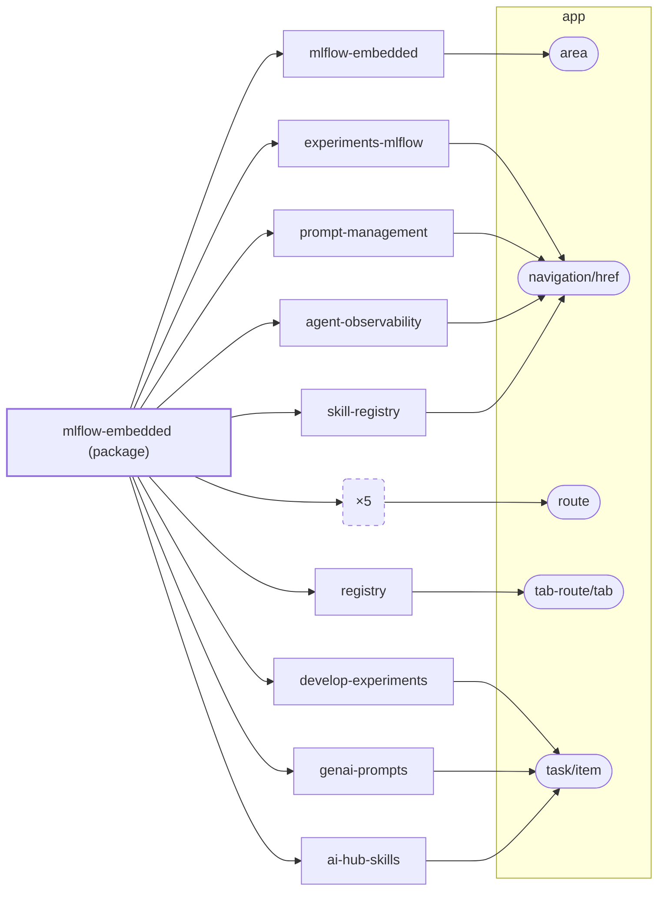

<!-- AUTO-GENERATED by @odh-dashboard/extension-map. Do not edit by hand. -->

> Generated file. Regenerate with `pnpm docs:extension-map`.

# Extensions in mlflow-embedded

Package `@odh-dashboard/mlflow-embedded` (package) at `packages/mlflow-embedded`. Everything below is read out of this repository's sources by static analysis.

## Loading paths

- [extensions.ts](../extensions.ts) (`./extensions`) — bundled into the host at build time (the `./extensions` export)

> **Federation declared but not loaded.** @odh-dashboard/mlflow-embedded declares module federation but the host does not load it as a remote: its moduleFederation.js has no ./extensions expose.

## Contributes

The extensions this package declares, grouped by the namespace of the extension point they target.

### Namespace `app`

| Node | What | Link |
| --- | --- | --- |
| mlflow-embedded (package) | this package | [packages/mlflow-embedded](..) |
| mlflow-embedded | extension of app.area — bundled | [extensions.ts](../extensions.ts#L45-L50) |
| experiments-mlflow | extension of app.navigation/href — bundled | [extensions.ts](../extensions.ts#L51-L64) |
| prompt-management | extension of app.navigation/href — bundled | [extensions.ts](../extensions.ts#L72-L85) |
| agent-observability | extension of app.navigation/href — bundled | [extensions.ts](../extensions.ts#L95-L109) |
| skill-registry | extension of app.navigation/href — bundled | [extensions.ts](../extensions.ts#L147-L165) |
| ×5 | 5 extensions of app.route | [see the table below](#contributes-to-approute) |
| registry | extension of app.tab-route/tab — bundled | [extensions.ts](../extensions.ts#L117-L131) |
| develop-experiments | extension of app.task/item — bundled | [extensions.ts](../extensions.ts#L178-L190) |
| genai-prompts | extension of app.task/item — bundled | [extensions.ts](../extensions.ts#L191-L203) |
| ai-hub-skills | extension of app.task/item — bundled | [extensions.ts](../extensions.ts#L204-L216) |
| area | extension point | [app.area](../../plugin-core/docs/extensions.md#apparea) |
| navigation/href | extension point | [app.navigation/href](../../plugin-core/docs/extensions.md#appnavigationhref) |
| route | extension point | [app.route](../../plugin-core/docs/extensions.md#approute) |
| tab-route/tab | extension point | [app.tab-route/tab](../../plugin-core/docs/extensions.md#apptab-routetab) |
| task/item | extension point | [app.task/item](../../plugin-core/docs/extensions.md#apptaskitem) |

#### Contributes to app.area

Defined in [app.area](../../plugin-core/docs/extensions.md#apparea).

| id | Included in | Source |
| --- | --- | --- |
| `'mlflow-embedded'` | host | [extensions.ts](../extensions.ts#L45-L50) |

#### Contributes to app.navigation/href

Defined in [app.navigation/href](../../plugin-core/docs/extensions.md#appnavigationhref).

##### experiments-mlflow

- **id:** `EXPERIMENTS_NAV_ID` (`'experiments-mlflow'`)
- **title:** `'Experiments'`
- **section:** `'develop-and-train'`
- **group:** —
- **label:** —
- **href:** `'/develop-train/mlflow/experiments'`
- **path:** `'/develop-train/mlflow/experiments/*'`
- **trackingEvent:** `{ name: MlflowTrackingEvents.EMBEDDED_VIEW_OPENED ('MLflow Embedded View Opened'), section: 'sidebar-nav' }`
- **Requires:** —
- **Included in:** host
- **Source:** [extensions.ts](../extensions.ts#L51-L64)

##### prompt-management

- **id:** `'prompt-management'`
- **title:** `PROMPT_MANAGEMENT_PAGE_TITLE` (`'Prompts'`)
- **section:** `'gen-ai-studio'`
- **group:** `'6_prompt_management'`
- **label:** —
- **href:** `promptManagementPath` (`'/gen-ai-studio/prompts'`)
- **path:** `globPromptManagementAll` (`'/gen-ai-studio/prompts/*'`)
- **trackingEvent:** —
- **Requires:** `plugin-gen-ai`, `SupportedArea.MLFLOW` (`'mlflow'`)
- **Included in:** host
- **Source:** [extensions.ts](../extensions.ts#L72-L85)

##### agent-observability

- **id:** `'agent-observability'`
- **title:** `AGENT_OBSERVABILITY_PAGE_TITLE` (`'Agent traces'`)
- **section:** `'observe-and-monitor'`
- **group:** `'6_agent_observability'`
- **label:** —
- **href:** `agentObservabilityPath` (`'/observe-and-monitor/agent-traces'`)
- **path:** `globAgentObservabilityAll` (`'/observe-and-monitor/agent-traces/*'`)
- **trackingEvent:** `{ name: MlflowTrackingEvents.EMBEDDED_VIEW_OPENED ('MLflow Embedded View Opened'), section: 'agent-observability-sidebar-nav' }`
- **Requires:** —
- **Included in:** host
- **Source:** [extensions.ts](../extensions.ts#L95-L109)

##### skill-registry

- **id:** `'skill-registry'`
- **title:** `SKILL_REGISTRY_PAGE_TITLE` (`'Skills'`)
- **section:** `'ai-hub'`
- **group:** `'3b_skill_registry'`
- **label:** `'Tech Preview'`
- **href:** `skillRegistryPath` (`'/ai-hub/skills'`)
- **path:** `globSkillRegistryAll` (`'/ai-hub/skills/*'`)
- **trackingEvent:** `{ name: MlflowTrackingEvents.EMBEDDED_VIEW_OPENED ('MLflow Embedded View Opened'), section: 'skill-registry-sidebar-nav' }`
- **Requires:** `SupportedArea.MLFLOW` (`'mlflow'`), `SupportedArea.SKILL_REGISTRY` (`'skill-registry'`)
- **Included in:** host
- **Source:** [extensions.ts](../extensions.ts#L147-L165)

#### Contributes to app.route

Defined in [app.route](../../plugin-core/docs/extensions.md#approute).

| path | Requires | CodeRef target | Included in | Source |
| --- | --- | --- | --- | --- |
| `'/develop-train/mlflow/*'` | — | [GlobalMLflowExperimentsRoutes#default](../experiments/GlobalMLflowExperimentsRoutes.tsx#L20-L42) | host | [extensions.ts](../extensions.ts#L65-L71) |
| `globPromptManagementAll` (`'/gen-ai-studio/prompts/*'`) | — | [GlobalMLflowPromptManagementRoutes#default](../prompts/GlobalMLflowPromptManagementRoutes.tsx#L14-L34) | host | [extensions.ts](../extensions.ts#L88-L94) |
| `globAgentObservabilityAll` (`'/observe-and-monitor/agent-traces/*'`) | — | [GlobalMLflowAgentObservabilityRoutes#default](../agent-observability/GlobalMLflowAgentObservabilityRoutes.tsx#L14-L34) | host | [extensions.ts](../extensions.ts#L110-L116) |
| `'/ai-hub/mcp-servers/registry/:serverName'` | `SupportedArea.MLFLOW` (`'mlflow'`), `SupportedArea.MCP_CATALOG` (`'mcp-catalog'`), `SupportedArea.MCP_REGISTRY` (`'mcp-registry'`) | [MlflowMcpRegistryDetailPage#default](../mcp-registry/MlflowMcpRegistryDetailPage.tsx#L39-L195) | host | [extensions.ts](../extensions.ts#L137-L146) |
| `globSkillRegistryAll` (`'/ai-hub/skills/*'`) | `SupportedArea.MLFLOW` (`'mlflow'`), `SupportedArea.SKILL_REGISTRY` (`'skill-registry'`) | [GlobalMLflowSkillRegistryRoutes#default](../skill-registry/GlobalMLflowSkillRegistryRoutes.tsx#L11-L40) | host | [extensions.ts](../extensions.ts#L168-L177) |

#### Contributes to app.tab-route/tab

Defined in [app.tab-route/tab](../../plugin-core/docs/extensions.md#apptab-routetab).

##### registry

- **pageId:** `'mcp-servers-tab-page'`
- **id:** `'registry'`
- **title:** `'Registry'`
- **singleTabTitle:** `'Registry'`
- **objectType:** `'mcp-catalog'`
- **group:** `'1b_registry'`
- **Requires:** `SupportedArea.MLFLOW` (`'mlflow'`), `SupportedArea.MCP_CATALOG` (`'mcp-catalog'`), `SupportedArea.MCP_REGISTRY` (`'mcp-registry'`)
- **CodeRef target:** [MlflowMcpRegistryTabContent#default](../mcp-registry/MlflowMcpRegistryTabContent.tsx#L34-L116)
- **Included in:** host
- **Source:** [extensions.ts](../extensions.ts#L117-L131)

#### Contributes to app.task/item

Defined in [app.task/item](../../plugin-core/docs/extensions.md#apptaskitem).

##### develop-experiments

- **id:** `'develop-experiments'`
- **group:** `'develop-and-train'`
- **title:** `'Track and compare training runs'`
- **destination:** `{ href: '/develop-train/mlflow/experiments' }`
- **order:** `'3_experiments'`
- **Requires:** `SupportedArea.MLFLOW` (`'mlflow'`)
- **Included in:** host
- **Source:** [extensions.ts](../extensions.ts#L178-L190)

##### genai-prompts

- **id:** `'genai-prompts'`
- **group:** `'gen-ai-studio'`
- **title:** `'Create and manage AI prompts'`
- **destination:** `{ href: promptManagementPath ('/gen-ai-studio/prompts') }`
- **order:** `'4_prompts'`
- **Requires:** `plugin-gen-ai`, `SupportedArea.MLFLOW` (`'mlflow'`)
- **Included in:** host
- **Source:** [extensions.ts](../extensions.ts#L191-L203)

##### ai-hub-skills

- **id:** `'ai-hub-skills'`
- **group:** `'ai-hub'`
- **title:** `'Discover and register agent skills'`
- **destination:** `{ href: skillRegistryPath ('/ai-hub/skills') }`
- **order:** `'3_skills'`
- **Requires:** `SupportedArea.MLFLOW` (`'mlflow'`), `SupportedArea.SKILL_REGISTRY` (`'skill-registry'`)
- **Included in:** host
- **Source:** [extensions.ts](../extensions.ts#L204-L216)

## Consumes

The extension points this package's code queries or uses, one table per point. A use is a property read from an extension, followed wherever the extension is passed; "rendered in" is one hop up: where the consumer itself is rendered or called.

### Consumes core.action

Defined in [core.action](../../plugin-core/docs/extensions.md#coreaction).

| Consumer | Query | Uses | Rendered in |
| --- | --- | --- | --- |
| [MlflowMcpRegistryDetailPage](../mcp-registry/MlflowMcpRegistryDetailPage.tsx#L39-L195) | [useExtensions](../mcp-registry/MlflowMcpRegistryDetailPage.tsx#L47) | — | — |

## Diagnostics

What the analysis could not prove, or thought worth reporting, about this package. Warnings are gaps in the generated map; info entries are observations.

| Code | Severity | Message | Source |
| --- | --- | --- | --- |
| `federation-not-loaded` | info | @odh-dashboard/mlflow-embedded declares module federation but the host does not load it as a remote: its moduleFederation.js has no ./extensions expose. | — |

## Legend

| Edge | What it means in these diagrams |
| --- | --- |
| `A --> B` | Proven by a declaration or by the type checker. In a Contributes diagram: A is declared by this package and bundled into an app at build time; it may also be exposed through Module Federation, and the node table beside each diagram names every loading path. In a point's flow diagram: package A contributes extensions of point B, bundled into an app at build time. |
| `A -- "how" --> B` | In a point's flow diagram: consumer B queries or uses point A, proven by the type checker. The label names the query hook (or the wrapper it goes through) and the kinds of use: `lazy-render`, `jsx-render`, `hook-run`, `call`, `read`, `filter`, `type-check`. |
| `A -. "federated" .-> B` | A reaches the host only through a Module Federation remote, loaded at runtime. |
| `A ==> B` | Derived: proven through a type or a JSDoc tag rather than a direct reference. |
| `A -. "rendered in" .-> B` | B renders A as a JSX element (one hop up). |
| `A -. "called in" .-> B` | B calls A (one hop up). |
| `A --x B` | A suppresses B. |
| `A -- "patch" --> B` | A patches B. |

A node with a dashed border stands for several extensions of the same point; its `×N` label is
the number of extensions, and the table beside the diagram always lists every one of them.
Anything the analysis could not resolve is never drawn — it is listed in a "Not resolved" table
instead.
