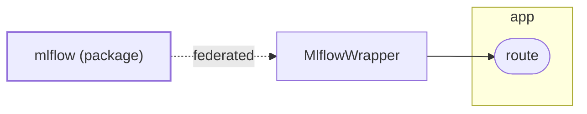
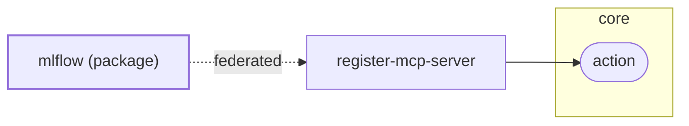
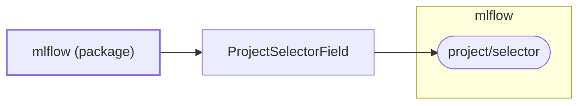

<!-- AUTO-GENERATED by @odh-dashboard/extension-map. Do not edit by hand. -->

> Generated file. Regenerate with `pnpm docs:extension-map`.

# Extensions in mlflow

Package `@odh-dashboard/mlflow` (package) at `packages/mlflow`. Everything below is read out of this repository's sources by static analysis.

## Loading paths

- [extensions.ts](../extensions.ts) (`./extensions`) — bundled into the host at build time (the `./extensions` export)
- [extensions.ts](../frontend/src/odh/extensions.ts) (`mf:./extensions`) — loaded at runtime by the host as a Module Federation remote

## Defines

The extension points this package declares. Each heading is the point ID other packages use as an extension's `type`.

### mlflow.project/selector

Extension point for a project selector that uses the host ProjectsContext.
Replaces direct ui-core ProjectSelector usage in the mlflow remote, which
otherwise reads a second (empty) ProjectsContext instance.

Declared as [ProjectSelectorExtension](../frontend/src/odh/extension-points/namespace-selector.ts#L23-L28).

**Properties:**

| Property | Required | Type | CodeRef of | Description |
| --- | --- | --- | --- | --- |
| `component` | yes | `ComponentCodeRef<ProjectSelectorFieldProps>` | `{ default: ComponentType<ProjectSelectorFieldProps>; }` |  |

**Implemented by:** [mlflow](#contributes-to-mlflowprojectselector)

## Contributes

The extensions this package declares, grouped by the namespace of the extension point they target.

### Namespace `app`

| Node | What | Link |
| --- | --- | --- |
| mlflow (package) | this package | [packages/mlflow](..) |
| MlflowWrapper | extension of app.route — federated | [extensions.ts](../frontend/src/odh/extensions.ts#L36-L45) |
| route | extension point | [app.route](../../plugin-core/docs/extensions.md#approute) |

#### Contributes to app.route

Defined in [app.route](../../plugin-core/docs/extensions.md#approute).

| path | CodeRef target | Source |
| --- | --- | --- |
| `'/mlflow-bff/main-view/*'` | [MlflowWrapper#default](../frontend/src/odh/MlflowWrapper.tsx#L18-L26) | [extensions.ts](../frontend/src/odh/extensions.ts#L36-L45) |

### Namespace `core`

| Node | What | Link |
| --- | --- | --- |
| mlflow (package) | this package | [packages/mlflow](..) |
| register-mcp-server | extension of core.action — federated | [extensions.ts](../frontend/src/odh/extensions.ts#L46-L57) |
| action | extension point | [core.action](../../plugin-core/docs/extensions.md#coreaction) |

#### Contributes to core.action

Defined in [core.action](../../plugin-core/docs/extensions.md#coreaction).

| id | label | group | Requires | CodeRef target | Source |
| --- | --- | --- | --- | --- | --- |
| `'register-mcp-server'` | `'Register MCP server'` | `'mcp-catalog.server-actions'` | `SupportedArea.MCP_CATALOG` (`'mcp-catalog'`), `SupportedArea.MCP_REGISTRY` (`'mcp-registry'`) | [McpServerRegisterAction#default](../frontend/src/odh/components/McpServerRegisterAction.tsx#L91-L96) | [extensions.ts](../frontend/src/odh/extensions.ts#L46-L57) |

### Namespace `mlflow`

| Node | What | Link |
| --- | --- | --- |
| mlflow (package) | this package | [packages/mlflow](..) |
| ProjectSelectorField | extension of mlflow.project/selector — bundled | [extensions.ts](../extensions.ts#L4-L9) |
| project/selector | extension point | [mlflow.project/selector](#mlflowprojectselector) |

#### Contributes to mlflow.project/selector

Defined in [mlflow.project/selector](#mlflowprojectselector).

| CodeRef target | Source |
| --- | --- |
| [ProjectSelectorField#default](../src/projectSelector/ProjectSelectorField.tsx#L9-L11) | [extensions.ts](../extensions.ts#L4-L9) |

## Legend

| Edge | What it means in these diagrams |
| --- | --- |
| `A --> B` | A is declared by this package and bundled into an app at build time. It may also be exposed through Module Federation — the node table beside each diagram names every loading path. |
| `A -. "federated" .-> B` | A reaches the host only through a Module Federation remote, loaded at runtime. |
| `A ==> B` | Derived: proven through a type or a JSDoc tag rather than a direct reference. |
| `A -. "rendered in" .-> B` | B renders A (one hop). |
| `A --x B` | A suppresses B. |
| `A -- "patch" --> B` | A patches B. |

A node with a dashed border stands for several extensions of the same point; its `×N` label is
the number of extensions, and the table beside the diagram always lists every one of them.
Anything the analysis could not resolve is never drawn — it is listed in a "Not resolved" table
instead.
