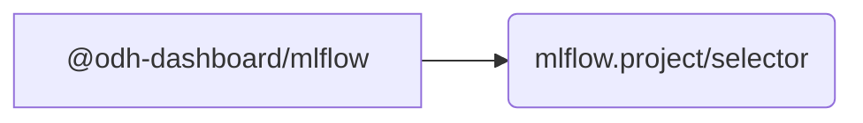

<!-- AUTO-GENERATED by @odh-dashboard/extension-map. Do not edit by hand. -->

> Generated file. Regenerate with `pnpm docs:extension-map`.

## Loading paths

| Entry | Path | Source |
| --- | --- | --- |
| @odh-dashboard/mlflow#./extensions | static | `packages/mlflow/extensions.ts` |
| @odh-dashboard/mlflow#mf:./extensions | federated | `packages/mlflow/frontend/src/odh/extensions.ts` |

## Defines

### mlflow.project/selector

Extension point for a project selector that uses the host ProjectsContext.
Replaces direct ui-core ProjectSelector usage in the mlflow remote, which
otherwise reads a second (empty) ProjectsContext instance.

| Property | Type | Required | Description |
| --- | --- | --- | --- |
| `component` | `ComponentCodeRef<ProjectSelectorFieldProps>` | Yes |  |

**Implemented by:** [@odh-dashboard/mlflow](extensions.md#mlflowprojectselector)

## Contributes

### app

| Node | Link |
| --- | --- |
| @odh-dashboard/mlflow | [@odh-dashboard/mlflow](#contributes) |
| app.route | [app.route](../../plugin-core/docs/extensions.md#approute) [app.route](../frontend/src/odh/extensions.ts#L36-L45) |

- `-->` declared or type-resolved contribution
- `==>` derived relationship
- `-. "rendered in" .->` rendered in one hop
- `-. "federated" .->` federated contribution
- `--x` suppression
- `-- "patch" -->` patch

### core

| Node | Link |
| --- | --- |
| @odh-dashboard/mlflow | [@odh-dashboard/mlflow](#contributes) |
| core.action | [core.action](../../plugin-core/docs/extensions.md#coreaction) [core.action](../frontend/src/odh/extensions.ts#L46-L57) |

- `-->` declared or type-resolved contribution
- `==>` derived relationship
- `-. "rendered in" .->` rendered in one hop
- `-. "federated" .->` federated contribution
- `--x` suppression
- `-- "patch" -->` patch

### mlflow

| Node | Link |
| --- | --- |
| @odh-dashboard/mlflow | [@odh-dashboard/mlflow](#contributes) |
| mlflow.project/selector | [mlflow.project/selector](extensions.md#mlflowprojectselector) [mlflow.project/selector](../extensions.ts#L4-L9) |

- `-->` declared or type-resolved contribution
- `==>` derived relationship
- `-. "rendered in" .->` rendered in one hop
- `-. "federated" .->` federated contribution
- `--x` suppression
- `-- "patch" -->` patch

#### app.route

| component | path | Requires | Disallows | CodeRef target | Included in | Source |
| --- | --- | --- | --- | --- | --- | --- |
| packages/mlflow/frontend/src/odh/MlflowWrapper.tsx#[MlflowWrapper](../frontend/src/odh/MlflowWrapper.tsx#L18-L26) | `"/mlflow-bff/main-view/*"` |  |  | packages/mlflow/frontend/src/odh/MlflowWrapper.tsx#[MlflowWrapper](../frontend/src/odh/MlflowWrapper.tsx#L18-L26) |  | [app.route](../frontend/src/odh/extensions.ts#L36-L45) |

#### core.action

- **id**: `"register-mcp-server"`
- **label**: `"Register MCP server"`
- **component**: packages/mlflow/frontend/src/odh/components/McpServerRegisterAction.tsx#[McpServerRegisterActionExtension](../frontend/src/odh/components/McpServerRegisterAction.tsx#L91-L96)
- **group**: `"mcp-catalog.server-actions"`
- **Requires**: `SupportedArea.MCP_CATALOG` (`"mcp-catalog"`), `SupportedArea.MCP_REGISTRY` (`"mcp-registry"`)
- **Disallows**: 
- **CodeRef target**: packages/mlflow/frontend/src/odh/components/McpServerRegisterAction.tsx#[McpServerRegisterActionExtension](../frontend/src/odh/components/McpServerRegisterAction.tsx#L91-L96)
- **Included in**: 
- **Source**: [core.action](../frontend/src/odh/extensions.ts#L46-L57)

#### mlflow.project/selector

| component | Requires | Disallows | CodeRef target | Included in | Source |
| --- | --- | --- | --- | --- | --- |
| packages/mlflow/src/projectSelector/ProjectSelectorField.tsx#[ProjectSelectorField](../src/projectSelector/ProjectSelectorField.tsx#L9-L11) |  |  | packages/mlflow/src/projectSelector/ProjectSelectorField.tsx#[ProjectSelectorField](../src/projectSelector/ProjectSelectorField.tsx#L9-L11) |  | [mlflow.project/selector](../extensions.ts#L4-L9) |
