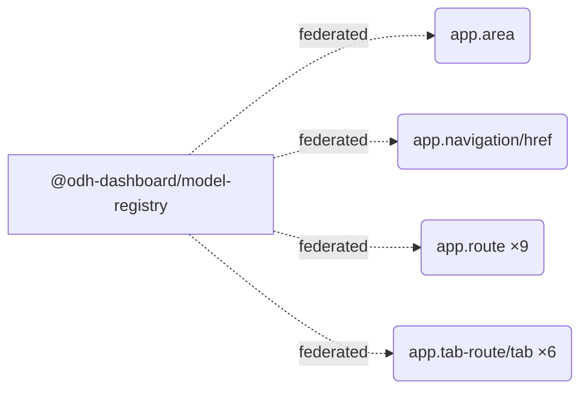
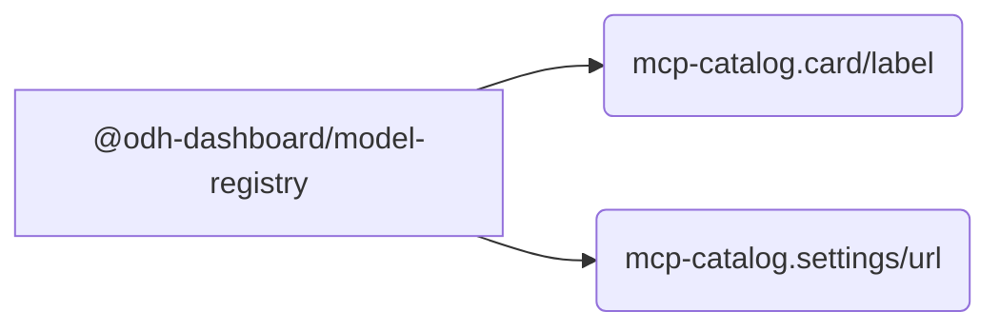
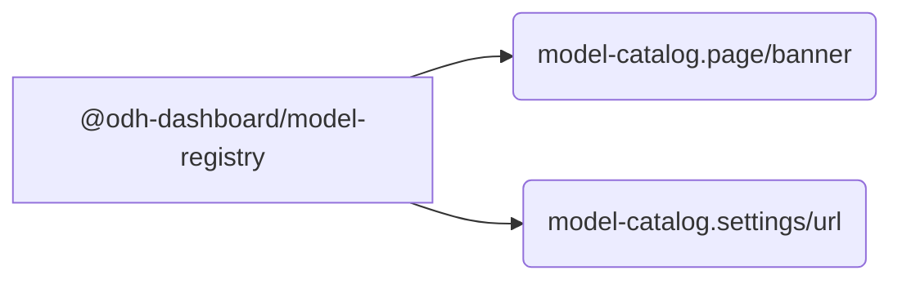
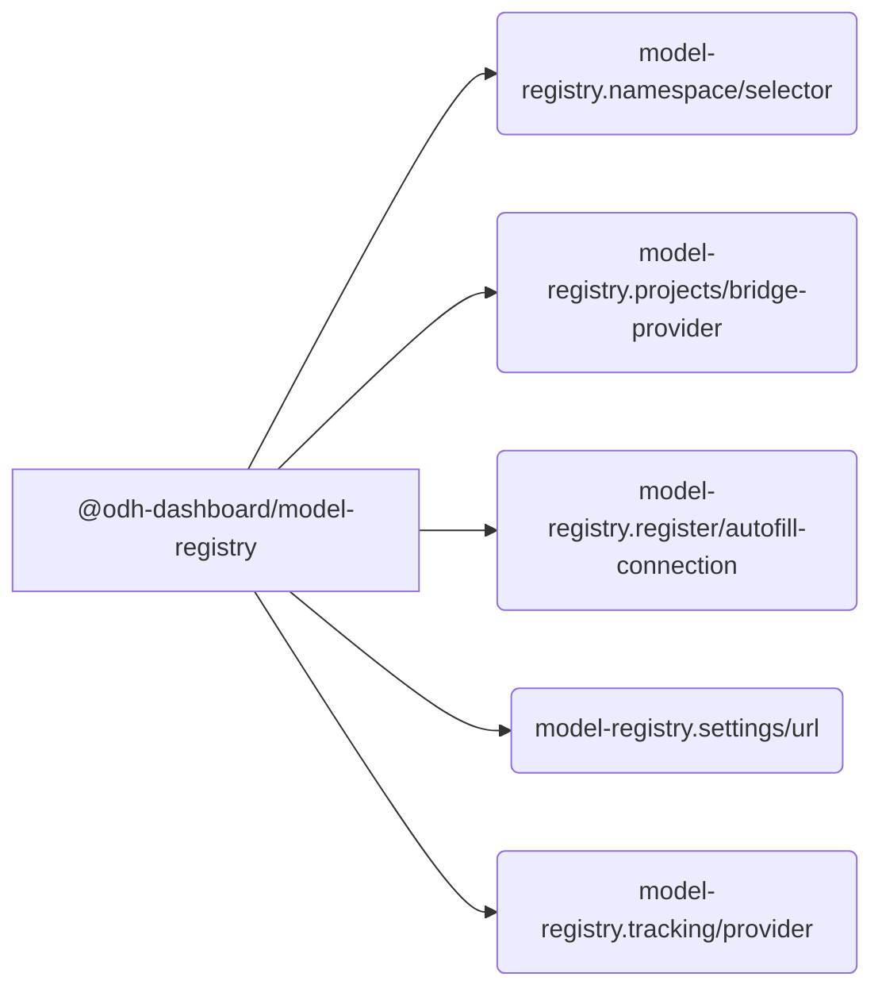

<!-- AUTO-GENERATED by @odh-dashboard/extension-map. Do not edit by hand. -->

> Generated file. Regenerate with `pnpm docs:extension-map`.

## Contents
- [Loading paths](#loading-paths)
- [Defines](#defines)
  - [mcp-catalog.card/label](#mcp-catalogcardlabel)
  - [mcp-catalog.settings/url](#mcp-catalogsettingsurl)
  - [model-catalog.page/banner](#model-catalogpagebanner)
  - [model-catalog.settings/url](#model-catalogsettingsurl)
  - [model-registry.admin/check](#model-registryadmincheck)
  - [model-registry.feature-flag-overrides/provider](#model-registryfeature-flag-overridesprovider)
  - [model-registry.model-version/deploy-modal](#model-registrymodel-versiondeploy-modal)
  - [model-registry.model-version/deployments-context](#model-registrymodel-versiondeployments-context)
  - [model-registry.namespace/selector](#model-registrynamespaceselector)
  - [model-registry.projects/bridge-provider](#model-registryprojectsbridge-provider)
  - [model-registry.register/autofill-connection](#model-registryregisterautofill-connection)
  - [model-registry.settings/url](#model-registrysettingsurl)
  - [model-registry.tracking/provider](#model-registrytrackingprovider)
- [Contributes](#contributes)
  - [app](#app)
    - [app.area](#apparea)
    - [app.navigation/href](#appnavigationhref)
    - [app.route](#approute)
    - [app.tab-route/tab](#apptab-routetab)
  - [core](#core)
    - [core.detail/tab](#coredetailtab)
  - [mcp-catalog](#mcp-catalog)
    - [mcp-catalog.card/label](#mcp-catalogcardlabel-1)
    - [mcp-catalog.settings/url](#mcp-catalogsettingsurl-1)
  - [model-catalog](#model-catalog)
    - [model-catalog.page/banner](#model-catalogpagebanner-1)
    - [model-catalog.settings/url](#model-catalogsettingsurl-1)
  - [model-registry](#model-registry)
    - [model-registry.namespace/selector](#model-registrynamespaceselector-1)
    - [model-registry.projects/bridge-provider](#model-registryprojectsbridge-provider-1)
    - [model-registry.register/autofill-connection](#model-registryregisterautofill-connection-1)
    - [model-registry.settings/url](#model-registrysettingsurl-1)
    - [model-registry.tracking/provider](#model-registrytrackingprovider-1)
- [Diagnostics](#diagnostics)

## Loading paths

| Entry | Path | Source |
| --- | --- | --- |
| @odh-dashboard/model-registry#./extensions | static | `packages/model-registry/extensions.ts` |
| @odh-dashboard/model-registry#mf:./extensions | federated | `packages/model-registry/upstream/frontend/src/odh/extensions.ts` |

## Defines

### mcp-catalog.card/label

| Property | Type | Required | Description |
| --- | --- | --- | --- |
| `id` | `string` | Yes |  |
| `component` | `CodeRef<ComponentType<McpCatalogCardLabelProps>>` | Yes |  |

**Implemented by:** [@odh-dashboard/model-registry](extensions.md#mcp-catalogcardlabel)

### mcp-catalog.settings/url

Extension point for providing the MCP catalog settings URL.
This allows ODH to inject its own settings URL for the MCP catalog settings page
without hardcoding the path in the model registry package.

| Property | Type | Required | Description |
| --- | --- | --- | --- |
| `url` | `string` | Yes | The MCP catalog settings URL path. |
| `title` | `string` | Yes | The display title for the settings page link. |

**Implemented by:** [@odh-dashboard/model-registry](extensions.md#mcp-catalogsettingsurl)

### model-catalog.page/banner

| Property | Type | Required | Description |
| --- | --- | --- | --- |
| `id` | `string` | Yes |  |
| `component` | `CodeRef<ComponentType<{}>>` | Yes |  |

**Implemented by:** [@odh-dashboard/model-registry](extensions.md#model-catalogpagebanner)

### model-catalog.settings/url

Extension point for providing the Model catalog settings URL.
This allows ODH to inject its own settings URL for the catalog settings page
without hardcoding the path in the model registry package.

| Property | Type | Required | Description |
| --- | --- | --- | --- |
| `url` | `string` | Yes | The catalog settings URL path. |
| `title` | `string` | Yes | The display title for the settings page link. |

**Implemented by:** [@odh-dashboard/model-registry](extensions.md#model-catalogsettingsurl)

### model-registry.admin/check

Extension point for providing a custom admin check component.
This allows ODH to inject its own admin check logic (e.g., using useUser hook)
without creating import issues in the model registry package.

| Property | Type | Required | Description |
| --- | --- | --- | --- |
| `component` | `ComponentCodeRef<{ children: (isAdmin: boolean, loaded: boolean) => ReactElement<any, string \| JSXElementConstructor<any>>; }>` | Yes | Component that returns admin status. Should render children with isAdmin prop. |

**Implemented by:** _Unused: no package contributes to this point._

### model-registry.feature-flag-overrides/provider

Extension point for providing an ODH dev feature flag overrides provider.
This allows ODH to inject a provider component that reads from its dev feature flags
and provides override values to the OdhDevFeatureFlagOverridesContext.

| Property | Type | Required | Description |
| --- | --- | --- | --- |
| `component` | `CodeRef<ComponentType<{ children: ReactNode; }>>` | Yes | Provider component that wraps children and provides OdhDevFeatureFlagOverridesContext. The component should read from ODH's dev feature flags and provide the override values. |

**Implemented by:** _Unused: no package contributes to this point._

### model-registry.model-version/deploy-modal

| Property | Type | Required | Description |
| --- | --- | --- | --- |
| `useAvailablePlatformIds` | `CodeRef<() => string[]>` | Yes |  |
| `modalComponent` | `CodeRef<ComponentType<{ modelDeployPrefill: { data: ModelDeployPrefillInfo; loaded: boolean; error: Error \| undefined; }; onClose: () => void; }>>` | Yes |  |

**Implemented by:** [@odh-dashboard/model-serving](../../model-serving/docs/extensions.md#model-registrymodel-versiondeploy-modal)

### model-registry.model-version/deployments-context

| Property | Type | Required | Description |
| --- | --- | --- | --- |
| `DeploymentsProvider` | `CodeRef<ComponentType<{ children: ({ deployments, loaded, }: { deployments?: ModelRegistryDeploymentListItem[] \| undefined; loaded: boolean; }) => ReactNode; labelSelectors?: { [key: string]: string; } \| undefined; mrName?: string \| undefined; }>>` | Yes |  |

**Implemented by:** [@odh-dashboard/model-serving](../../model-serving/docs/extensions.md#model-registrymodel-versiondeployments-context)

### model-registry.namespace/selector

Extension point for providing a custom namespace/project selector component.
This allows ODH to replace the upstream namespace selector with its own
project selector that uses the OpenShift Projects API (which supports
non-admin listing) and filters out system projects.

| Property | Type | Required | Description |
| --- | --- | --- | --- |
| `component` | `ComponentCodeRef<NamespaceSelectorFieldProps>` | Yes |  |

**Implemented by:** [@odh-dashboard/model-registry](extensions.md#model-registrynamespaceselector)

### model-registry.projects/bridge-provider

Extension point for providing project data from the host app's ProjectsContext
to the upstream ProjectsBridgeContext. Uses a render-prop pattern so that the
downstream component never needs to import the upstream context object — it
passes data back via the render prop, and the upstream wrapper provides it
to ProjectsBridgeContext.Provider.

| Property | Type | Required | Description |
| --- | --- | --- | --- |
| `component` | `ComponentCodeRef<ProjectsBridgeProviderProps>` | Yes |  |

**Implemented by:** [@odh-dashboard/model-registry](extensions.md#model-registryprojectsbridge-provider)

### model-registry.register/autofill-connection

| Property | Type | Required | Description |
| --- | --- | --- | --- |
| `component` | `CodeRef<{ default: ComponentType<{ modelLocationType: ModelLocationType; setData: (propKey: "modelLocationEndpoint" \| "modelLocationBucket" \| "modelLocationRegion" \| "modelLocationURI", propValue: string) => void; }>; }>` | Yes |  |

**Implemented by:** [@odh-dashboard/model-registry](extensions.md#model-registryregisterautofill-connection)

### model-registry.settings/url

Extension point for providing the model registry settings URL.
This allows ODH to inject its own settings URL for the registry settings page
without hardcoding the path in the model registry package.

| Property | Type | Required | Description |
| --- | --- | --- | --- |
| `url` | `string` | Yes | The registry settings URL path. |
| `title` | `string` | Yes | The display title for the settings page link. |

**Implemented by:** [@odh-dashboard/model-registry](extensions.md#model-registrysettingsurl)

### model-registry.tracking/provider

| Property | Type | Required | Description |
| --- | --- | --- | --- |
| `component` | `ComponentCodeRef<UserInteractionProviderProps>` | Yes |  |

**Implemented by:** [@odh-dashboard/model-registry](extensions.md#model-registrytrackingprovider)

## Contributes

### app

| Node | Contract | Registration sources |
| --- | --- | --- |
| [@odh-dashboard/model-registry](#loading-paths) | — | — |
| app.area | [app.area](../../plugin-core/docs/extensions.md#apparea) | [../upstream/frontend/src/odh/extensions.ts:37](../upstream/frontend/src/odh/extensions.ts#L37-L47) |
| app.navigation/href | [app.navigation/href](../../plugin-core/docs/extensions.md#appnavigationhref) | [../upstream/frontend/src/odh/extensions.ts:141](../upstream/frontend/src/odh/extensions.ts#L141-L153) [../upstream/frontend/src/odh/extensions.ts:154](../upstream/frontend/src/odh/extensions.ts#L154-L168) [../upstream/frontend/src/odh/extensions.ts:249](../upstream/frontend/src/odh/extensions.ts#L249-L262) [../upstream/frontend/src/odh/extensions.ts:274](../upstream/frontend/src/odh/extensions.ts#L274-L287) |
| app.route ×9 | [app.route](../../plugin-core/docs/extensions.md#approute) | [../upstream/frontend/src/odh/extensions.ts:127](../upstream/frontend/src/odh/extensions.ts#L127-L139) [../upstream/frontend/src/odh/extensions.ts:169](../upstream/frontend/src/odh/extensions.ts#L169-L178) [../upstream/frontend/src/odh/extensions.ts:180](../upstream/frontend/src/odh/extensions.ts#L180-L192) [../upstream/frontend/src/odh/extensions.ts:193](../upstream/frontend/src/odh/extensions.ts#L193-L205) [../upstream/frontend/src/odh/extensions.ts:206](../upstream/frontend/src/odh/extensions.ts#L206-L218) [../upstream/frontend/src/odh/extensions.ts:235](../upstream/frontend/src/odh/extensions.ts#L235-L247) [../upstream/frontend/src/odh/extensions.ts:263](../upstream/frontend/src/odh/extensions.ts#L263-L272) [../upstream/frontend/src/odh/extensions.ts:288](../upstream/frontend/src/odh/extensions.ts#L288-L297) [../upstream/frontend/src/odh/extensions.ts:299](../upstream/frontend/src/odh/extensions.ts#L299-L311) |
| app.tab-route/tab ×6 | [app.tab-route/tab](../../plugin-core/docs/extensions.md#apptab-routetab) | [../upstream/frontend/src/odh/extensions.ts:49](../upstream/frontend/src/odh/extensions.ts#L49-L63) [../upstream/frontend/src/odh/extensions.ts:64](../upstream/frontend/src/odh/extensions.ts#L64-L78) [../upstream/frontend/src/odh/extensions.ts:80](../upstream/frontend/src/odh/extensions.ts#L80-L94) [../upstream/frontend/src/odh/extensions.ts:96](../upstream/frontend/src/odh/extensions.ts#L96-L110) [../upstream/frontend/src/odh/extensions.ts:112](../upstream/frontend/src/odh/extensions.ts#L112-L124) [../upstream/frontend/src/odh/extensions.ts:219](../upstream/frontend/src/odh/extensions.ts#L219-L233) |

- `-->` declared or type-resolved contribution
- `==>` derived relationship
- `-. "rendered in" .->` rendered in one hop
- `-. "federated" .->` federated contribution
- `--x` suppression
- `-- "patch" -->` patch

#### app.area

| reliantAreas | devFlags | id | Source |
| --- | --- | --- | --- |
| [not resolved](#diagnostics) | `"Model Registry Plugin (unreleased pages)"`, `"KF MR Upstream: Catalog HuggingFace API Key"` | `PLUGIN_MODEL_REGISTRY` (`"model-registry-plugin"`) | [app.area](../upstream/frontend/src/odh/extensions.ts#L37-L47) |

**Not resolved**

| Location | Reason | Link |
| --- | --- | --- |
| properties.reliantAreas | identifier does not resolve to a literal value | [diagnostics](#diagnostics) |

#### app.navigation/href

**Contribution:** `app.navigation/href` at `packages/model-registry/upstream/frontend/src/odh/extensions.ts:141`

- **id**: `"modelRegistry-kf"`
- **title**: `"Model registry (KF)"`
- **section**: `"ai-hub"`
- **group**: —
- **href**: `"/ai-hub/models/registry"`
- **path**: `"/ai-hub/models/registry/*"`
- **Requires**: `PLUGIN_MODEL_REGISTRY` (`"model-registry-plugin"`)
- **Source**: [app.navigation/href](../upstream/frontend/src/odh/extensions.ts#L141-L153)

**Contribution:** `app.navigation/href` at `packages/model-registry/upstream/frontend/src/odh/extensions.ts:154`

- **id**: `"settings-model-registry"`
- **title**: `"Model registry settings (KF)"`
- **section**: `"settings-model-resources-and-operations"`
- **group**: —
- **href**: `"/model-registry-settings"`
- **path**: `"/model-registry-settings/*"`
- **Requires**: `PLUGIN_MODEL_REGISTRY` (`"model-registry-plugin"`)
- **Source**: [app.navigation/href](../upstream/frontend/src/odh/extensions.ts#L154-L168)

**Contribution:** `app.navigation/href` at `packages/model-registry/upstream/frontend/src/odh/extensions.ts:249`

- **id**: `"settings-model-catalog"`
- **title**: `CATALOG_SETTINGS_PAGE_TITLE` (`"Model catalog settings"`)
- **section**: `"settings-model-resources-and-operations"`
- **group**: `"2_model-resources"`
- **href**: [not resolved](#diagnostics)
- **path**: [not resolved](#diagnostics)
- **Requires**: `ADMIN_USER` (`"ADMIN_USER"`), `SupportedArea.MODEL_CATALOG` (`"model-catalog"`)
- **Source**: [app.navigation/href](../upstream/frontend/src/odh/extensions.ts#L249-L262)

**Contribution:** `app.navigation/href` at `packages/model-registry/upstream/frontend/src/odh/extensions.ts:274`

- **id**: `"settings-mcp-catalog"`
- **title**: `"MCP catalog sources"`
- **section**: `"settings-mcp-resources"`
- **group**: `"1_mcp-resources"`
- **href**: [not resolved](#diagnostics)
- **path**: [not resolved](#diagnostics)
- **Requires**: `ADMIN_USER` (`"ADMIN_USER"`), `SupportedArea.MCP_CATALOG` (`"mcp-catalog"`)
- **Source**: [app.navigation/href](../upstream/frontend/src/odh/extensions.ts#L274-L287)

**Not resolved**

| Location | Reason | Link |
| --- | --- | --- |
| properties.href | expression is not a statically resolvable value | [diagnostics](#diagnostics) |
| properties.path | template expression contains a non-literal value | [diagnostics](#diagnostics) |
| properties.href | expression is not a statically resolvable value | [diagnostics](#diagnostics) |
| properties.path | template expression contains a non-literal value | [diagnostics](#diagnostics) |

#### app.route

| component | path | Requires | CodeRef target | Source |
| --- | --- | --- | --- | --- |
| packages/model-registry/upstream/frontend/src/odh/RuntimeCatalogWrapper.tsx#[RuntimeCatalogDetailsWrapper](../upstream/frontend/src/odh/RuntimeCatalogWrapper.tsx#L61-L65) | `"/settings/model-resources-operations/model-deployment-settings/serving-runtime-catalog/:runtimeId"` | `SupportedArea.MODEL_SERVING` (`"model-serving-shell"`), `ADMIN_USER` (`"ADMIN_USER"`) | packages/model-registry/upstream/frontend/src/odh/RuntimeCatalogWrapper.tsx#[RuntimeCatalogDetailsWrapper](../upstream/frontend/src/odh/RuntimeCatalogWrapper.tsx#L61-L65) | [app.route](../upstream/frontend/src/odh/extensions.ts#L127-L139) |
| packages/model-registry/upstream/frontend/src/odh/ModelRegistrySettingsRoutesWrapper.tsx#[ModelRegistryWrapper](../upstream/frontend/src/odh/ModelRegistrySettingsRoutesWrapper.tsx#L9-L23) | `"/model-registry-settings/*"` | `PLUGIN_MODEL_REGISTRY` (`"model-registry-plugin"`) | packages/model-registry/upstream/frontend/src/odh/ModelRegistrySettingsRoutesWrapper.tsx#[ModelRegistryWrapper](../upstream/frontend/src/odh/ModelRegistrySettingsRoutesWrapper.tsx#L9-L23) | [app.route](../upstream/frontend/src/odh/extensions.ts#L169-L178) |
| [not resolved](#diagnostics) | `"/ai-hub/catalog/*"` | `SupportedArea.MODEL_CATALOG` (`"model-catalog"`) | — | [app.route](../upstream/frontend/src/odh/extensions.ts#L180-L192) |
| [not resolved](#diagnostics) | `"/ai-hub/registry/*"` | `SupportedArea.MODEL_REGISTRY` (`"model-registry"`) | — | [app.route](../upstream/frontend/src/odh/extensions.ts#L193-L205) |
| [not resolved](#diagnostics) | `"/ai-hub/mcp-catalog/*"` | `SupportedArea.MCP_CATALOG` (`"mcp-catalog"`) | — | [app.route](../upstream/frontend/src/odh/extensions.ts#L206-L218) |
| [not resolved](#diagnostics) | `"/ai-hub/mcp-deployments/*"` | `SupportedArea.MCP_CATALOG` (`"mcp-catalog"`) | — | [app.route](../upstream/frontend/src/odh/extensions.ts#L235-L247) |
| packages/model-registry/upstream/frontend/src/odh/ModelCatalogSettingsRoutesWrapper.tsx#[ModelCatalogSettingsRoutesWrapper](../upstream/frontend/src/odh/ModelCatalogSettingsRoutesWrapper.tsx#L41-L45) | [not resolved](#diagnostics) | `ADMIN_USER` (`"ADMIN_USER"`), `SupportedArea.MODEL_CATALOG` (`"model-catalog"`) | packages/model-registry/upstream/frontend/src/odh/ModelCatalogSettingsRoutesWrapper.tsx#[ModelCatalogSettingsRoutesWrapper](../upstream/frontend/src/odh/ModelCatalogSettingsRoutesWrapper.tsx#L41-L45) | [app.route](../upstream/frontend/src/odh/extensions.ts#L263-L272) |
| packages/model-registry/upstream/frontend/src/odh/McpCatalogSettingsRoutesWrapper.tsx#[McpCatalogSettingsRoutesWrapper](../upstream/frontend/src/odh/McpCatalogSettingsRoutesWrapper.tsx#L41-L45) | [not resolved](#diagnostics) | `ADMIN_USER` (`"ADMIN_USER"`), `SupportedArea.MCP_CATALOG` (`"mcp-catalog"`) | packages/model-registry/upstream/frontend/src/odh/McpCatalogSettingsRoutesWrapper.tsx#[McpCatalogSettingsRoutesWrapper](../upstream/frontend/src/odh/McpCatalogSettingsRoutesWrapper.tsx#L41-L45) | [app.route](../upstream/frontend/src/odh/extensions.ts#L288-L297) |
| [not resolved](#diagnostics) | `"/mcp-catalog-settings/*"` | `ADMIN_USER` (`"ADMIN_USER"`), `SupportedArea.MCP_CATALOG` (`"mcp-catalog"`) | — | [app.route](../upstream/frontend/src/odh/extensions.ts#L299-L311) |

**Not resolved**

| Location | Reason | Link |
| --- | --- | --- |
| properties.component | expression is not a statically resolvable value | [diagnostics](#diagnostics) |
| properties.component | expression is not a statically resolvable value | [diagnostics](#diagnostics) |
| properties.component | expression is not a statically resolvable value | [diagnostics](#diagnostics) |
| properties.component | expression is not a statically resolvable value | [diagnostics](#diagnostics) |
| properties.path | template expression contains a non-literal value | [diagnostics](#diagnostics) |
| properties.path | template expression contains a non-literal value | [diagnostics](#diagnostics) |
| properties.component | expression is not a statically resolvable value | [diagnostics](#diagnostics) |

#### app.tab-route/tab

**Contribution:** `app.tab-route/tab` at `packages/model-registry/upstream/frontend/src/odh/extensions.ts:49`

- **pageId**: `"models-tab-page"`
- **id**: `"catalog"`
- **title**: `"Catalog"`
- **singleTabTitle**: `"Model catalog"`
- **objectType**: `"model-catalog"`
- **component**: packages/model-registry/upstream/frontend/src/odh/ModelCatalogWrapper.tsx#[ModelCatalogWrapper](../upstream/frontend/src/odh/ModelCatalogWrapper.tsx#L51-L55)
- **group**: `"1_catalog"`
- **Requires**: `SupportedArea.MODEL_CATALOG` (`"model-catalog"`)
- **CodeRef target**: packages/model-registry/upstream/frontend/src/odh/ModelCatalogWrapper.tsx#[ModelCatalogWrapper](../upstream/frontend/src/odh/ModelCatalogWrapper.tsx#L51-L55)
- **Source**: [app.tab-route/tab](../upstream/frontend/src/odh/extensions.ts#L49-L63)

**Contribution:** `app.tab-route/tab` at `packages/model-registry/upstream/frontend/src/odh/extensions.ts:64`

- **pageId**: `"models-tab-page"`
- **id**: `"registry"`
- **title**: `"Registry"`
- **singleTabTitle**: `"Model registry"`
- **objectType**: `"model-registry"`
- **component**: packages/model-registry/upstream/frontend/src/odh/ModelRegistryWrapper.tsx#[ModelRegistryWrapper](../upstream/frontend/src/odh/ModelRegistryWrapper.tsx#L52-L56)
- **group**: `"2_registry"`
- **Requires**: `SupportedArea.MODEL_REGISTRY` (`"model-registry"`)
- **CodeRef target**: packages/model-registry/upstream/frontend/src/odh/ModelRegistryWrapper.tsx#[ModelRegistryWrapper](../upstream/frontend/src/odh/ModelRegistryWrapper.tsx#L52-L56)
- **Source**: [app.tab-route/tab](../upstream/frontend/src/odh/extensions.ts#L64-L78)

**Contribution:** `app.tab-route/tab` at `packages/model-registry/upstream/frontend/src/odh/extensions.ts:80`

- **pageId**: `"mcp-servers-tab-page"`
- **id**: `"catalog"`
- **title**: `"Catalog"`
- **singleTabTitle**: `"Catalog"`
- **objectType**: `"mcp-catalog"`
- **component**: packages/model-registry/upstream/frontend/src/odh/McpCatalogWrapper.tsx#[McpCatalogWrapper](../upstream/frontend/src/odh/McpCatalogWrapper.tsx#L47-L51)
- **group**: `"1_catalog"`
- **Requires**: `SupportedArea.MCP_CATALOG` (`"mcp-catalog"`)
- **CodeRef target**: packages/model-registry/upstream/frontend/src/odh/McpCatalogWrapper.tsx#[McpCatalogWrapper](../upstream/frontend/src/odh/McpCatalogWrapper.tsx#L47-L51)
- **Source**: [app.tab-route/tab](../upstream/frontend/src/odh/extensions.ts#L80-L94)

**Contribution:** `app.tab-route/tab` at `packages/model-registry/upstream/frontend/src/odh/extensions.ts:96`

- **pageId**: `"agents-tab-page"`
- **id**: `"catalog"`
- **title**: `"Catalog"`
- **singleTabTitle**: `"Agents catalog"`
- **objectType**: `"agents-catalog"`
- **component**: packages/model-registry/upstream/frontend/src/odh/AgentsCatalogWrapper.tsx#[AgentsCatalogWrapper](../upstream/frontend/src/odh/AgentsCatalogWrapper.tsx#L47-L51)
- **group**: `"1_catalog"`
- **Requires**: `SupportedArea.AGENTS_CATALOG` (`"agents-catalog"`)
- **CodeRef target**: packages/model-registry/upstream/frontend/src/odh/AgentsCatalogWrapper.tsx#[AgentsCatalogWrapper](../upstream/frontend/src/odh/AgentsCatalogWrapper.tsx#L47-L51)
- **Source**: [app.tab-route/tab](../upstream/frontend/src/odh/extensions.ts#L96-L110)

**Contribution:** `app.tab-route/tab` at `packages/model-registry/upstream/frontend/src/odh/extensions.ts:112`

- **pageId**: `"model-deployment-settings"`
- **id**: `RUNTIME_CATALOG_TAB_ID` (`"serving-runtime-catalog"`)
- **title**: `RUNTIME_CATALOG_TAB_TITLE` (`"Runtime library"`)
- **singleTabTitle**: —
- **objectType**: —
- **component**: packages/model-registry/upstream/frontend/src/odh/RuntimeCatalogWrapper.tsx#[RuntimeCatalogWrapper](../upstream/frontend/src/odh/RuntimeCatalogWrapper.tsx#L55-L59)
- **group**: `"1b_runtime-catalog"`
- **Requires**: `SupportedArea.MODEL_SERVING` (`"model-serving-shell"`), `ADMIN_USER` (`"ADMIN_USER"`)
- **CodeRef target**: packages/model-registry/upstream/frontend/src/odh/RuntimeCatalogWrapper.tsx#[RuntimeCatalogWrapper](../upstream/frontend/src/odh/RuntimeCatalogWrapper.tsx#L55-L59)
- **Source**: [app.tab-route/tab](../upstream/frontend/src/odh/extensions.ts#L112-L124)

**Contribution:** `app.tab-route/tab` at `packages/model-registry/upstream/frontend/src/odh/extensions.ts:219`

- **pageId**: `"mcp-servers-tab-page"`
- **id**: `"deployments"`
- **title**: `"Deployments"`
- **singleTabTitle**: `"Deployments"`
- **objectType**: `"mcp-catalog"`
- **component**: packages/model-registry/upstream/frontend/src/odh/McpDeploymentsWrapper.tsx#[McpDeploymentsWrapper](../upstream/frontend/src/odh/McpDeploymentsWrapper.tsx#L53-L64)
- **group**: `"2_deployments"`
- **Requires**: `SupportedArea.MCP_CATALOG` (`"mcp-catalog"`)
- **CodeRef target**: packages/model-registry/upstream/frontend/src/odh/McpDeploymentsWrapper.tsx#[McpDeploymentsWrapper](../upstream/frontend/src/odh/McpDeploymentsWrapper.tsx#L53-L64)
- **Source**: [app.tab-route/tab](../upstream/frontend/src/odh/extensions.ts#L219-L233)

### core

| Node | Contract | Registration sources |
| --- | --- | --- |
| [@odh-dashboard/model-registry](#loading-paths) | — | — |
| core.detail/tab | [core.detail/tab](../../plugin-core/docs/extensions.md#coredetailtab) | [../extensions.ts:116](../extensions.ts#L116-L127) [../extensions.ts:128](../extensions.ts#L128-L139) |

- `-->` declared or type-resolved contribution
- `==>` derived relationship
- `-. "rendered in" .->` rendered in one hop
- `-. "federated" .->` federated contribution
- `--x` suppression
- `-- "patch" -->` patch

#### core.detail/tab

**Contribution:** `core.detail/tab` at `packages/model-registry/extensions.ts:116`

- **id**: `"security-insights"`
- **title**: `"Safety and security insights"`
- **component**: packages/model-registry/src/modelCatalog/SecurityInsightsTab.tsx#[SecurityInsightsTab](../src/modelCatalog/SecurityInsightsTab.tsx#L4-L10)
- **group**: `"model-catalog.details"`
- **visibilityErrorMessage**: `"An error occurred while trying to determine if security metrics exist"`
- **shouldShow**: [not resolved](#diagnostics)
- **CodeRef target**: packages/model-registry/src/modelCatalog/SecurityInsightsTab.tsx#[SecurityInsightsTab](../src/modelCatalog/SecurityInsightsTab.tsx#L4-L10)
- **Source**: [core.detail/tab](../extensions.ts#L116-L127)

**Contribution:** `core.detail/tab` at `packages/model-registry/extensions.ts:128`

- **id**: `"quality-insights"`
- **title**: `"Quality insights"`
- **component**: packages/model-registry/src/modelCatalog/QualityInsightsTab.tsx#[QualityInsightsTab](../src/modelCatalog/QualityInsightsTab.tsx#L4-L10)
- **group**: `"model-catalog.details"`
- **visibilityErrorMessage**: `"An error occurred while trying to determine if quality metrics exist"`
- **shouldShow**: [not resolved](#diagnostics)
- **CodeRef target**: packages/model-registry/src/modelCatalog/QualityInsightsTab.tsx#[QualityInsightsTab](../src/modelCatalog/QualityInsightsTab.tsx#L4-L10)
- **Source**: [core.detail/tab](../extensions.ts#L128-L139)

**Not resolved**

| Location | Reason | Link |
| --- | --- | --- |
| properties.shouldShow | identifier does not resolve to a literal value | [diagnostics](#diagnostics) |
| properties.shouldShow | identifier does not resolve to a literal value | [diagnostics](#diagnostics) |

### mcp-catalog

| Node | Contract | Registration sources |
| --- | --- | --- |
| [@odh-dashboard/model-registry](#loading-paths) | — | — |
| mcp-catalog.card/label | [mcp-catalog.card/label](extensions.md#mcp-catalogcardlabel) | [../extensions.ts:140](../extensions.ts#L140-L146) |
| mcp-catalog.settings/url | [mcp-catalog.settings/url](extensions.md#mcp-catalogsettingsurl) | [../extensions.ts:167](../extensions.ts#L167-L173) |

- `-->` declared or type-resolved contribution
- `==>` derived relationship
- `-. "rendered in" .->` rendered in one hop
- `-. "federated" .->` federated contribution
- `--x` suppression
- `-- "patch" -->` patch

#### mcp-catalog.card/label

| id | component | CodeRef target | Source |
| --- | --- | --- | --- |
| `"mcp-support-tier-label"` | packages/model-registry/src/mcpCatalog/McpSupportTierLabel.tsx#[McpSupportTierLabel](../src/mcpCatalog/McpSupportTierLabel.tsx#L23-L42) | packages/model-registry/src/mcpCatalog/McpSupportTierLabel.tsx#[McpSupportTierLabel](../src/mcpCatalog/McpSupportTierLabel.tsx#L23-L42) | [mcp-catalog.card/label](../extensions.ts#L140-L146) |

#### mcp-catalog.settings/url

| url | title | Source |
| --- | --- | --- |
| `MCP_CATALOG_SETTINGS_URL` (`"/settings/mcp-resources/mcp-catalog"`) | `MCP_CATALOG_SETTINGS_NAV_TITLE` (`"MCP catalog sources"`) | [mcp-catalog.settings/url](../extensions.ts#L167-L173) |

### model-catalog

| Node | Contract | Registration sources |
| --- | --- | --- |
| [@odh-dashboard/model-registry](#loading-paths) | — | — |
| model-catalog.page/banner | [model-catalog.page/banner](extensions.md#model-catalogpagebanner) | [../extensions.ts:109](../extensions.ts#L109-L115) |
| model-catalog.settings/url | [model-catalog.settings/url](extensions.md#model-catalogsettingsurl) | [../extensions.ts:153](../extensions.ts#L153-L159) |

- `-->` declared or type-resolved contribution
- `==>` derived relationship
- `-. "rendered in" .->` rendered in one hop
- `-. "federated" .->` federated contribution
- `--x` suppression
- `-- "patch" -->` patch

#### model-catalog.page/banner

| id | component | CodeRef target | Source |
| --- | --- | --- | --- |
| `"validated-models-banner"` | packages/model-registry/src/modelCatalog/ValidatedModelsBanner.tsx#[ValidatedModelsBanner](../src/modelCatalog/ValidatedModelsBanner.tsx#L18-L101) | packages/model-registry/src/modelCatalog/ValidatedModelsBanner.tsx#[ValidatedModelsBanner](../src/modelCatalog/ValidatedModelsBanner.tsx#L18-L101) | [model-catalog.page/banner](../extensions.ts#L109-L115) |

#### model-catalog.settings/url

| url | title | Source |
| --- | --- | --- |
| `CATALOG_SETTINGS_URL` (`"/settings/model-resources-operations/model-catalog"`) | `CATALOG_SETTINGS_PAGE_TITLE` (`"Model catalog settings"`) | [model-catalog.settings/url](../extensions.ts#L153-L159) |

### model-registry

| Node | Contract | Registration sources |
| --- | --- | --- |
| [@odh-dashboard/model-registry](#loading-paths) | — | — |
| model-registry.namespace/selector | [model-registry.namespace/selector](extensions.md#model-registrynamespaceselector) | [../extensions.ts:174](../extensions.ts#L174-L179) |
| model-registry.projects/bridge-provider | [model-registry.projects/bridge-provider](extensions.md#model-registryprojectsbridge-provider) | [../extensions.ts:180](../extensions.ts#L180-L185) |
| model-registry.register/autofill-connection | [model-registry.register/autofill-connection](extensions.md#model-registryregisterautofill-connection) | [../extensions.ts:103](../extensions.ts#L103-L108) |
| model-registry.settings/url | [model-registry.settings/url](extensions.md#model-registrysettingsurl) | [../extensions.ts:160](../extensions.ts#L160-L166) |
| model-registry.tracking/provider | [model-registry.tracking/provider](extensions.md#model-registrytrackingprovider) | [../extensions.ts:186](../extensions.ts#L186-L191) |

- `-->` declared or type-resolved contribution
- `==>` derived relationship
- `-. "rendered in" .->` rendered in one hop
- `-. "federated" .->` federated contribution
- `--x` suppression
- `-- "patch" -->` patch

#### model-registry.namespace/selector

| component | CodeRef target | Source |
| --- | --- | --- |
| packages/model-registry/src/projectSelector/ProjectSelectorField.tsx#[ProjectSelectorField](../src/projectSelector/ProjectSelectorField.tsx#L45-L171) | packages/model-registry/src/projectSelector/ProjectSelectorField.tsx#[ProjectSelectorField](../src/projectSelector/ProjectSelectorField.tsx#L45-L171) | [model-registry.namespace/selector](../extensions.ts#L174-L179) |

#### model-registry.projects/bridge-provider

| component | CodeRef target | Source |
| --- | --- | --- |
| packages/model-registry/src/projectSelector/ProjectsBridgeProvider.tsx#[ProjectsBridgeProvider](../src/projectSelector/ProjectsBridgeProvider.tsx#L9-L47) | packages/model-registry/src/projectSelector/ProjectsBridgeProvider.tsx#[ProjectsBridgeProvider](../src/projectSelector/ProjectsBridgeProvider.tsx#L9-L47) | [model-registry.projects/bridge-provider](../extensions.ts#L180-L185) |

#### model-registry.register/autofill-connection

| component | CodeRef target | Source |
| --- | --- | --- |
| packages/model-registry/src/connection/AutofillConnectionButton.tsx#[AutofillConnectionButton](../src/connection/AutofillConnectionButton.tsx#L12-L82) | packages/model-registry/src/connection/AutofillConnectionButton.tsx#[AutofillConnectionButton](../src/connection/AutofillConnectionButton.tsx#L12-L82) | [model-registry.register/autofill-connection](../extensions.ts#L103-L108) |

#### model-registry.settings/url

| url | title | Source |
| --- | --- | --- |
| `REGISTRY_SETTINGS_URL` (`"/settings/model-resources-operations/model-registry"`) | `REGISTRY_SETTINGS_PAGE_TITLE` (`"Model registry settings"`) | [model-registry.settings/url](../extensions.ts#L160-L166) |

#### model-registry.tracking/provider

| component | CodeRef target | Source |
| --- | --- | --- |
| packages/model-registry/src/tracking/SegmentUserInteractionProvider.tsx#[SegmentUserInteractionProvider](../src/tracking/SegmentUserInteractionProvider.tsx#L8-L26) | packages/model-registry/src/tracking/SegmentUserInteractionProvider.tsx#[SegmentUserInteractionProvider](../src/tracking/SegmentUserInteractionProvider.tsx#L8-L26) | [model-registry.tracking/provider](../extensions.ts#L186-L191) |

## Diagnostics

| Code | Message | Link |
| --- | --- | --- |
| `unresolved-value` | extension property 'shouldShow' contains a value that could not be resolved | [shouldShow](../extensions.ts#L125-L125) |
| `unresolved-value` | extension property 'shouldShow' contains a value that could not be resolved | [shouldShow](../extensions.ts#L137-L137) |
| `unresolved-element` | object element is not checker-proven to be an extension value | [unresolved-element](../extensions.ts#L147-L152) |
| `point-no-jsdoc` | extension point 'model-registry.register/autofill-connection' (AutofillConnectionButtonExtension) has no JSDoc summary | [AutofillConnectionButtonExtension](../upstream/frontend/src/odh/extension-points/connection.ts#L8-L27) |
| `point-no-jsdoc` | extension point 'model-registry.model-version/deploy-modal' (ModelRegistryDeployModalExtension) has no JSDoc summary | [ModelRegistryDeployModalExtension](../upstream/frontend/src/odh/extension-points/deploy.ts#L6-L21) |
| `point-no-jsdoc` | extension point 'model-registry.model-version/deployments-context' (ModelRegistryVersionDeploymentsContextExtension) has no JSDoc summary | [ModelRegistryVersionDeploymentsContextExtension](../upstream/frontend/src/odh/extension-points/deploy.ts#L28-L45) |
| `point-no-jsdoc` | extension point 'mcp-catalog.card/label' (McpCatalogCardLabelExtension) has no JSDoc summary | [McpCatalogCardLabelExtension](../upstream/frontend/src/odh/extension-points/mcp-catalog-card-label.ts#L9-L15) |
| `point-no-jsdoc` | extension point 'model-catalog.page/banner' (ModelCatalogBannerExtension) has no JSDoc summary | [ModelCatalogBannerExtension](../upstream/frontend/src/odh/extension-points/model-catalog-banner.ts#L4-L10) |
| `point-no-jsdoc` | extension point 'model-registry.tracking/provider' (UserInteractionProviderExtension) has no JSDoc summary | [UserInteractionProviderExtension](../upstream/frontend/src/odh/extension-points/user-interaction.ts#L12-L17) |
| `unresolved-value` | extension property 'reliantAreas' contains a value that could not be resolved | [reliantAreas](../upstream/frontend/src/odh/extensions.ts#L41-L41) |
| `unresolved-value` | extension property 'component' contains a value that could not be resolved | [component](../upstream/frontend/src/odh/extensions.ts#L187-L190) |
| `unresolved-value` | extension property 'component' contains a value that could not be resolved | [component](../upstream/frontend/src/odh/extensions.ts#L200-L203) |
| `unresolved-value` | extension property 'component' contains a value that could not be resolved | [component](../upstream/frontend/src/odh/extensions.ts#L213-L216) |
| `unresolved-value` | extension property 'component' contains a value that could not be resolved | [component](../upstream/frontend/src/odh/extensions.ts#L242-L245) |
| `unresolved-value` | extension property 'href' contains a value that could not be resolved | [href](../upstream/frontend/src/odh/extensions.ts#L257-L257) |
| `unresolved-value` | extension property 'path' contains a value that could not be resolved | [path](../upstream/frontend/src/odh/extensions.ts#L259-L259) |
| `unresolved-value` | extension property 'path' contains a value that could not be resolved | [path](../upstream/frontend/src/odh/extensions.ts#L269-L269) |
| `unresolved-value` | extension property 'href' contains a value that could not be resolved | [href](../upstream/frontend/src/odh/extensions.ts#L282-L282) |
| `unresolved-value` | extension property 'path' contains a value that could not be resolved | [path](../upstream/frontend/src/odh/extensions.ts#L284-L284) |
| `unresolved-value` | extension property 'path' contains a value that could not be resolved | [path](../upstream/frontend/src/odh/extensions.ts#L294-L294) |
| `unresolved-value` | extension property 'component' contains a value that could not be resolved | [component](../upstream/frontend/src/odh/extensions.ts#L306-L309) |
| `unresolved-element` | object element is not checker-proven to be an extension value | [unresolved-element](../upstream/frontend/src/odh/extensions.ts#L312-L323) |
| `unresolved-element` | object element is not checker-proven to be an extension value | [unresolved-element](../upstream/frontend/src/odh/extensions.ts#L324-L335) |
| `unresolved-element` | object element is not checker-proven to be an extension value | [unresolved-element](../upstream/frontend/src/odh/extensions.ts#L336-L347) |
