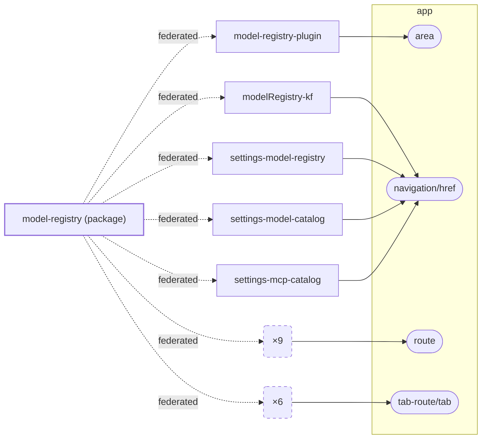
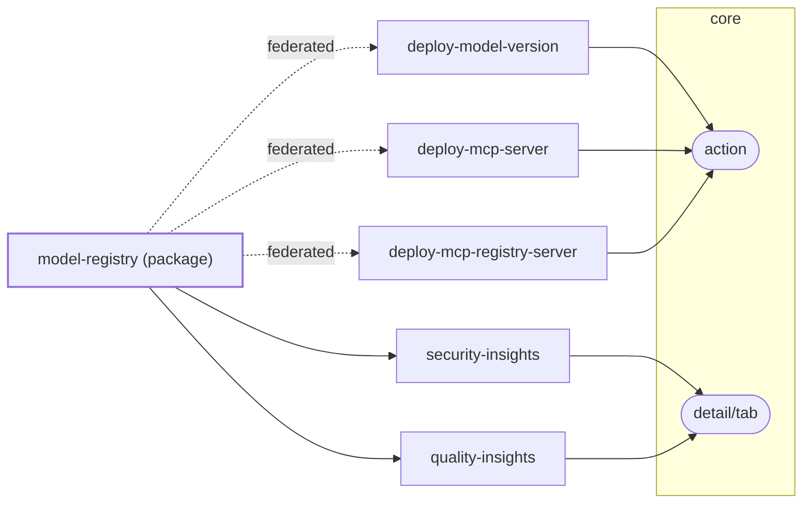
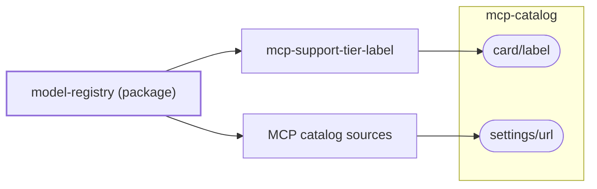
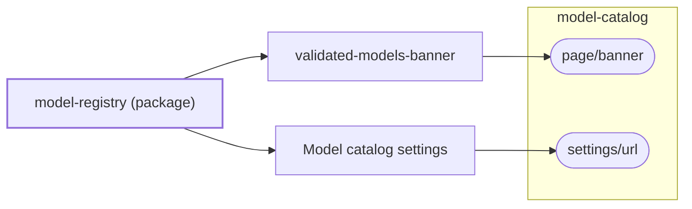
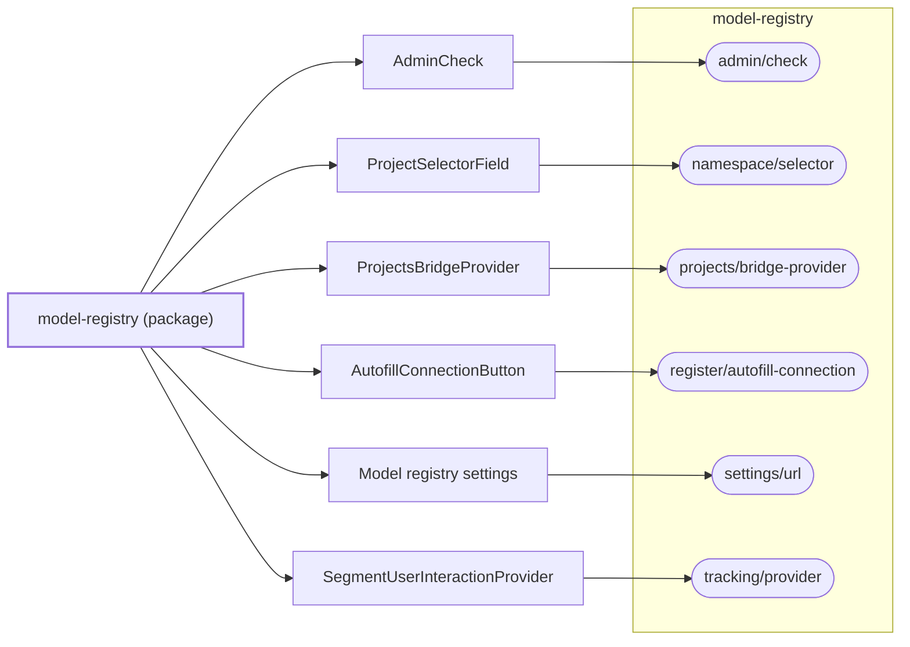

<!-- AUTO-GENERATED by @odh-dashboard/extension-map. Do not edit by hand. -->

> Generated file. Regenerate with `pnpm docs:extension-map`.

# Extensions in model-registry

Package `@odh-dashboard/model-registry` (package) at `packages/model-registry`. Everything below is read out of this repository's sources by static analysis.

## Loading paths

- [extensions.ts](../extensions.ts) (`./extensions`) — bundled into the host at build time (the `./extensions` export)
- [extensions.ts](../upstream/frontend/src/odh/extensions.ts) (`mf:./extensions`) — loaded at runtime by the host as a Module Federation remote

## Defines

The extension points this package declares. Each heading is the point ID other packages use as an extension's `type`.

### mcp-catalog.card/label

Declared as [McpCatalogCardLabelExtension](../upstream/frontend/src/odh/extension-points/mcp-catalog-card-label.ts#L9-L15).

**Properties:**

| Property | Required | Type | CodeRef of | Description |
| --- | --- | --- | --- | --- |
| `id` | yes | `string` | — |  |
| `component` | yes | `CodeRef<React.ComponentType<McpCatalogCardLabelProps>>` | `ComponentType<McpCatalogCardLabelProps>` |  |

**Implemented by:** [model-registry](#contributes-to-mcp-catalogcardlabel)

### mcp-catalog.settings/url

Extension point for providing the MCP catalog settings URL.
This allows ODH to inject its own settings URL for the MCP catalog settings page
without hardcoding the path in the model registry package.

Declared as [McpCatalogSettingsUrlExtension](../upstream/frontend/src/odh/extension-points/mcp-catalog-settings-url.ts#L9-L21).

**Properties:**

| Property | Required | Type | CodeRef of | Description |
| --- | --- | --- | --- | --- |
| `url` | yes | `string` | — | The MCP catalog settings URL path. |
| `title` | yes | `string` | — | The display title for the settings page link. |

**Implemented by:** [model-registry](#contributes-to-mcp-catalogsettingsurl)

### model-catalog.page/banner

Declared as [ModelCatalogBannerExtension](../upstream/frontend/src/odh/extension-points/model-catalog-banner.ts#L4-L10).

**Properties:**

| Property | Required | Type | CodeRef of | Description |
| --- | --- | --- | --- | --- |
| `id` | yes | `string` | — |  |
| `component` | yes | `CodeRef<React.ComponentType>` | `ComponentType<{}>` |  |

**Implemented by:** [model-registry](#contributes-to-model-catalogpagebanner)

### model-catalog.settings/url

Extension point for providing the Model catalog settings URL.
This allows ODH to inject its own settings URL for the catalog settings page
without hardcoding the path in the model registry package.

Declared as [CatalogSettingsUrlExtension](../upstream/frontend/src/odh/extension-points/catalog-settings-url.ts#L9-L21).

**Properties:**

| Property | Required | Type | CodeRef of | Description |
| --- | --- | --- | --- | --- |
| `url` | yes | `string` | — | The catalog settings URL path. |
| `title` | yes | `string` | — | The display title for the settings page link. |

**Implemented by:** [model-registry](#contributes-to-model-catalogsettingsurl)

### model-registry.admin/check

Extension point for providing a custom admin check component.
This allows ODH to inject its own admin check logic (e.g., using useUser hook)
without creating import issues in the model registry package.

Declared as [AdminCheckExtension](../upstream/frontend/src/odh/extension-points/admin.ts#L10-L21).

**Properties:**

| Property | Required | Type | CodeRef of | Description |
| --- | --- | --- | --- | --- |
| `component` | yes | `ComponentCodeRef<{ children: (isAdmin: boolean, loaded: boolean) => React.ReactElement; }>` | `{ default: ComponentType<{ children: (isAdmin: boolean, loaded: boolean) => ReactElement<any, string \| JSXElementConstru…` | Component that returns admin status. Should render children with isAdmin prop. |

**Implemented by:** [model-registry](#contributes-to-model-registryadmincheck)

### model-registry.feature-flag-overrides/provider

Extension point for providing an ODH dev feature flag overrides provider.
This allows ODH to inject a provider component that reads from its dev feature flags
and provides override values to the OdhDevFeatureFlagOverridesContext.

Declared as [OdhDevFeatureFlagOverridesProviderExtension](../upstream/frontend/src/odh/extension-points/feature-flag-overrides.ts#L33-L42).

**Properties:**

| Property | Required | Type | CodeRef of | Description |
| --- | --- | --- | --- | --- |
| `component` | yes | `CodeRef<React.ComponentType<{ children: React.ReactNode }>>` | `ComponentType<{ children: ReactNode; }>` | Provider component that wraps children and provides OdhDevFeatureFlagOverridesContext. The component should read from ODH's dev feature flags and provide the override values. |

> **Unused.** No package in this repository contributes an extension of this point.

### model-registry.model-version/deploy-modal

Declared as [ModelRegistryDeployModalExtension](../upstream/frontend/src/odh/extension-points/deploy.ts#L6-L21).

**Properties:**

| Property | Required | Type | CodeRef of | Description |
| --- | --- | --- | --- | --- |
| `useAvailablePlatformIds` | yes | `CodeRef<() => string[]>` | `() => string[]` |  |
| `modalComponent` | yes | `CodeRef< React.ComponentType<{ modelDeployPrefill: { data: ModelDeployPrefillInfo; loaded: boolean; error: Error \| undefined; }; onClose: () => void; }> >` | `ComponentType<{ modelDeployPrefill: { data: ModelDeployPrefillInfo; loaded: boolean; error: Error \| undefined; }; onClos…` |  |

**Implemented by:** [model-serving](../../model-serving/docs/extensions.md#contributes-to-model-registrymodel-versiondeploy-modal)

### model-registry.model-version/deployments-context

Declared as [ModelRegistryVersionDeploymentsContextExtension](../upstream/frontend/src/odh/extension-points/deploy.ts#L28-L45).

**Properties:**

| Property | Required | Type | CodeRef of | Description |
| --- | --- | --- | --- | --- |
| `DeploymentsProvider` | yes | `CodeRef< React.ComponentType<{ children: ({ deployments, loaded, }: { deployments?: ModelRegistryDeploymentListItem[]; loaded: boolean; }) => React.ReactNode; labelSelectors?: { [key: string]: string }; mrName?: string; }> >` | `ComponentType<{ children: ({ deployments, loaded, }: { deployments?: ModelRegistryDeploymentListItem[] \| undefined; load…` |  |

**Implemented by:** [model-serving](../../model-serving/docs/extensions.md#contributes-to-model-registrymodel-versiondeployments-context)

### model-registry.namespace/selector

Extension point for providing a custom namespace/project selector component.
This allows ODH to replace the upstream namespace selector with its own
project selector that uses the OpenShift Projects API (which supports
non-admin listing) and filters out system projects.

Declared as [NamespaceSelectorExtension](../upstream/frontend/src/odh/extension-points/namespace-selector.ts#L14-L19).

**Properties:**

| Property | Required | Type | CodeRef of | Description |
| --- | --- | --- | --- | --- |
| `component` | yes | `ComponentCodeRef<NamespaceSelectorFieldProps>` | `{ default: ComponentType<NamespaceSelectorFieldProps>; }` |  |

**Implemented by:** [model-registry](#contributes-to-model-registrynamespaceselector)

### model-registry.projects/bridge-provider

Extension point for providing project data from the host app's ProjectsContext
to the upstream ProjectsBridgeContext. Uses a render-prop pattern so that the
downstream component never needs to import the upstream context object — it
passes data back via the render prop, and the upstream wrapper provides it
to ProjectsBridgeContext.Provider.

Declared as [ProjectsBridgeProviderExtension](../upstream/frontend/src/odh/extension-points/projects-bridge.ts#L28-L33).

**Properties:**

| Property | Required | Type | CodeRef of | Description |
| --- | --- | --- | --- | --- |
| `component` | yes | `ComponentCodeRef<ProjectsBridgeProviderProps>` | `{ default: ComponentType<ProjectsBridgeProviderProps>; }` |  |

**Implemented by:** [model-registry](#contributes-to-model-registryprojectsbridge-provider)

### model-registry.register/autofill-connection

Declared as [AutofillConnectionButtonExtension](../upstream/frontend/src/odh/extension-points/connection.ts#L8-L27).

**Properties:**

| Property | Required | Type | CodeRef of | Description |
| --- | --- | --- | --- | --- |
| `component` | yes | `CodeRef<{ default: React.ComponentType<{ modelLocationType: ModelLocationType; setData: ( propKey: keyof Pick< RegistrationCommonFormData, \| 'modelLocationEndpoint' \| 'modelLocationBucket' \| 'modelLocationRegion' \| 'modelLocationURI' >, propValue: string, ) => void; }>; }>` | `{ default: ComponentType<{ modelLocationType: ModelLocationType; setData: (propKey: "modelLocationEndpoint" \| "modelLoca…` |  |

**Implemented by:** [model-registry](#contributes-to-model-registryregisterautofill-connection)

### model-registry.settings/url

Extension point for providing the model registry settings URL.
This allows ODH to inject its own settings URL for the registry settings page
without hardcoding the path in the model registry package.

Declared as [RegistrySettingsUrlExtension](../upstream/frontend/src/odh/extension-points/registry-settings-url.ts#L9-L21).

**Properties:**

| Property | Required | Type | CodeRef of | Description |
| --- | --- | --- | --- | --- |
| `url` | yes | `string` | — | The registry settings URL path. |
| `title` | yes | `string` | — | The display title for the settings page link. |

**Implemented by:** [model-registry](#contributes-to-model-registrysettingsurl)

### model-registry.tracking/provider

Declared as [UserInteractionProviderExtension](../upstream/frontend/src/odh/extension-points/user-interaction.ts#L12-L17).

**Properties:**

| Property | Required | Type | CodeRef of | Description |
| --- | --- | --- | --- | --- |
| `component` | yes | `ComponentCodeRef<UserInteractionProviderProps>` | `{ default: ComponentType<UserInteractionProviderProps>; }` |  |

**Implemented by:** [model-registry](#contributes-to-model-registrytrackingprovider)

## Contributes

The extensions this package declares, grouped by the namespace of the extension point they target.

### Namespace `app`

| Node | What | Link |
| --- | --- | --- |
| model-registry (package) | this package | [packages/model-registry](..) |
| model-registry-plugin | extension of app.area — federated | [extensions.ts](../upstream/frontend/src/odh/extensions.ts#L37-L47) |
| modelRegistry-kf | extension of app.navigation/href — federated | [extensions.ts](../upstream/frontend/src/odh/extensions.ts#L141-L153) |
| settings-model-registry | extension of app.navigation/href — federated | [extensions.ts](../upstream/frontend/src/odh/extensions.ts#L154-L168) |
| settings-model-catalog | extension of app.navigation/href — federated | [extensions.ts](../upstream/frontend/src/odh/extensions.ts#L249-L262) |
| settings-mcp-catalog | extension of app.navigation/href — federated | [extensions.ts](../upstream/frontend/src/odh/extensions.ts#L274-L287) |
| ×9 | 9 extensions of app.route | [see the table below](#contributes-to-approute) |
| ×6 | 6 extensions of app.tab-route/tab | [see the table below](#contributes-to-apptab-routetab) |
| area | extension point | [app.area](../../plugin-core/docs/extensions.md#apparea) |
| navigation/href | extension point | [app.navigation/href](../../plugin-core/docs/extensions.md#appnavigationhref) |
| route | extension point | [app.route](../../plugin-core/docs/extensions.md#approute) |
| tab-route/tab | extension point | [app.tab-route/tab](../../plugin-core/docs/extensions.md#apptab-routetab) |

#### Contributes to app.area

Defined in [app.area](../../plugin-core/docs/extensions.md#apparea).

| reliantAreas | devFlags | id | Source |
| --- | --- | --- | --- |
| `'model-registry'` | `'Model Registry Plugin (unreleased pages)'`, `'KF MR Upstream: Catalog HuggingFace API Key'` | `PLUGIN_MODEL_REGISTRY` (`'model-registry-plugin'`) | [extensions.ts](../upstream/frontend/src/odh/extensions.ts#L37-L47) |

#### Contributes to app.navigation/href

Defined in [app.navigation/href](../../plugin-core/docs/extensions.md#appnavigationhref).

##### modelRegistry-kf

- **id:** `'modelRegistry-kf'`
- **title:** `'Model registry (KF)'`
- **section:** `'ai-hub'`
- **group:** —
- **href:** `'/ai-hub/models/registry'`
- **path:** `'/ai-hub/models/registry/*'`
- **Requires:** `PLUGIN_MODEL_REGISTRY` (`'model-registry-plugin'`)
- **Source:** [extensions.ts](../upstream/frontend/src/odh/extensions.ts#L141-L153)

##### settings-model-registry

- **id:** `'settings-model-registry'`
- **title:** `'Model registry settings (KF)'`
- **section:** `'settings-model-resources-and-operations'`
- **group:** —
- **href:** `'/model-registry-settings'`
- **path:** `'/model-registry-settings/*'`
- **Requires:** `PLUGIN_MODEL_REGISTRY` (`'model-registry-plugin'`)
- **Source:** [extensions.ts](../upstream/frontend/src/odh/extensions.ts#L154-L168)

##### settings-model-catalog

- **id:** `'settings-model-catalog'`
- **title:** `CATALOG_SETTINGS_PAGE_TITLE` (`'Model catalog settings'`)
- **section:** `'settings-model-resources-and-operations'`
- **group:** `'2_model-resources'`
- **href:** [not resolved](../upstream/frontend/src/odh/extensions.ts#L257)
- **path:** [not resolved](../upstream/frontend/src/odh/extensions.ts#L259)
- **Requires:** `ADMIN_USER`, `SupportedArea.MODEL_CATALOG` (`'model-catalog'`)
- **Source:** [extensions.ts](../upstream/frontend/src/odh/extensions.ts#L249-L262)

##### settings-mcp-catalog

- **id:** `'settings-mcp-catalog'`
- **title:** `'MCP catalog sources'`
- **section:** `'settings-mcp-resources'`
- **group:** `'1_mcp-resources'`
- **href:** [not resolved](../upstream/frontend/src/odh/extensions.ts#L282)
- **path:** [not resolved](../upstream/frontend/src/odh/extensions.ts#L284)
- **Requires:** `ADMIN_USER`, `SupportedArea.MCP_CATALOG` (`'mcp-catalog'`)
- **Source:** [extensions.ts](../upstream/frontend/src/odh/extensions.ts#L274-L287)

**Not resolved** (never drawn in a diagram):

| Contribution | Property | Reason | Source |
| --- | --- | --- | --- |
| settings-model-catalog | href | CallExpression is not a resolvable value | [extensions.ts:257](../upstream/frontend/src/odh/extensions.ts#L257) |
| settings-model-catalog | path | template literal with a part that is not a literal | [extensions.ts:259](../upstream/frontend/src/odh/extensions.ts#L259) |
| settings-mcp-catalog | href | CallExpression is not a resolvable value | [extensions.ts:282](../upstream/frontend/src/odh/extensions.ts#L282) |
| settings-mcp-catalog | path | template literal with a part that is not a literal | [extensions.ts:284](../upstream/frontend/src/odh/extensions.ts#L284) |

#### Contributes to app.route

Defined in [app.route](../../plugin-core/docs/extensions.md#approute).

| path | Requires | CodeRef target | Source |
| --- | --- | --- | --- |
| `'/settings/model-resources-operations/model-deployment-settings/serving-runtime-catalog/:runtimeId'` | `SupportedArea.MODEL_SERVING` (`'model-serving-shell'`), `ADMIN_USER` | [RuntimeCatalogWrapper#RuntimeCatalogDetailsWrapper](../upstream/frontend/src/odh/RuntimeCatalogWrapper.tsx#L61-L65) | [extensions.ts](../upstream/frontend/src/odh/extensions.ts#L127-L139) |
| `'/model-registry-settings/*'` | `PLUGIN_MODEL_REGISTRY` (`'model-registry-plugin'`) | [ModelRegistrySettingsRoutesWrapper#default](../upstream/frontend/src/odh/ModelRegistrySettingsRoutesWrapper.tsx#L9-L23) | [extensions.ts](../upstream/frontend/src/odh/extensions.ts#L169-L178) |
| `'/ai-hub/catalog/*'` | `SupportedArea.MODEL_CATALOG` (`'model-catalog'`) | `component`: [not resolved](../upstream/frontend/src/odh/extensions.ts#L187-L190) | [extensions.ts](../upstream/frontend/src/odh/extensions.ts#L180-L192) |
| `'/ai-hub/registry/*'` | `SupportedArea.MODEL_REGISTRY` (`'model-registry'`) | `component`: [not resolved](../upstream/frontend/src/odh/extensions.ts#L200-L203) | [extensions.ts](../upstream/frontend/src/odh/extensions.ts#L193-L205) |
| `'/ai-hub/mcp-catalog/*'` | `SupportedArea.MCP_CATALOG` (`'mcp-catalog'`) | `component`: [not resolved](../upstream/frontend/src/odh/extensions.ts#L213-L216) | [extensions.ts](../upstream/frontend/src/odh/extensions.ts#L206-L218) |
| `'/ai-hub/mcp-deployments/*'` | `SupportedArea.MCP_CATALOG` (`'mcp-catalog'`) | `component`: [not resolved](../upstream/frontend/src/odh/extensions.ts#L242-L245) | [extensions.ts](../upstream/frontend/src/odh/extensions.ts#L235-L247) |
| [not resolved](../upstream/frontend/src/odh/extensions.ts#L269) | `ADMIN_USER`, `SupportedArea.MODEL_CATALOG` (`'model-catalog'`) | [ModelCatalogSettingsRoutesWrapper#default](../upstream/frontend/src/odh/ModelCatalogSettingsRoutesWrapper.tsx#L41-L45) | [extensions.ts](../upstream/frontend/src/odh/extensions.ts#L263-L272) |
| [not resolved](../upstream/frontend/src/odh/extensions.ts#L294) | `ADMIN_USER`, `SupportedArea.MCP_CATALOG` (`'mcp-catalog'`) | [McpCatalogSettingsRoutesWrapper#default](../upstream/frontend/src/odh/McpCatalogSettingsRoutesWrapper.tsx#L41-L45) | [extensions.ts](../upstream/frontend/src/odh/extensions.ts#L288-L297) |
| `'/mcp-catalog-settings/*'` | `ADMIN_USER`, `SupportedArea.MCP_CATALOG` (`'mcp-catalog'`) | `component`: [not resolved](../upstream/frontend/src/odh/extensions.ts#L306-L309) | [extensions.ts](../upstream/frontend/src/odh/extensions.ts#L299-L311) |

**Not resolved** (never drawn in a diagram):

| Contribution | Property | Reason | Source |
| --- | --- | --- | --- |
| route #3 | component | CallExpression is not a resolvable value | [extensions.ts:187](../upstream/frontend/src/odh/extensions.ts#L187-L190) |
| route #4 | component | CallExpression is not a resolvable value | [extensions.ts:200](../upstream/frontend/src/odh/extensions.ts#L200-L203) |
| route #5 | component | CallExpression is not a resolvable value | [extensions.ts:213](../upstream/frontend/src/odh/extensions.ts#L213-L216) |
| route #6 | component | CallExpression is not a resolvable value | [extensions.ts:242](../upstream/frontend/src/odh/extensions.ts#L242-L245) |
| ModelCatalogSettingsRoutesWrapper | path | template literal with a part that is not a literal | [extensions.ts:269](../upstream/frontend/src/odh/extensions.ts#L269) |
| McpCatalogSettingsRoutesWrapper | path | template literal with a part that is not a literal | [extensions.ts:294](../upstream/frontend/src/odh/extensions.ts#L294) |
| route #9 | component | CallExpression is not a resolvable value | [extensions.ts:306](../upstream/frontend/src/odh/extensions.ts#L306-L309) |

#### Contributes to app.tab-route/tab

Defined in [app.tab-route/tab](../../plugin-core/docs/extensions.md#apptab-routetab).

##### catalog #1

- **pageId:** `'models-tab-page'`
- **id:** `'catalog'`
- **title:** `'Catalog'`
- **singleTabTitle:** `'Model catalog'`
- **objectType:** `'model-catalog'`
- **group:** `'1_catalog'`
- **Requires:** `SupportedArea.MODEL_CATALOG` (`'model-catalog'`)
- **CodeRef target:** [ModelCatalogWrapper#default](../upstream/frontend/src/odh/ModelCatalogWrapper.tsx#L51-L55)
- **Source:** [extensions.ts](../upstream/frontend/src/odh/extensions.ts#L49-L63)

##### registry

- **pageId:** `'models-tab-page'`
- **id:** `'registry'`
- **title:** `'Registry'`
- **singleTabTitle:** `'Model registry'`
- **objectType:** `'model-registry'`
- **group:** `'2_registry'`
- **Requires:** `SupportedArea.MODEL_REGISTRY` (`'model-registry'`)
- **CodeRef target:** [ModelRegistryWrapper#default](../upstream/frontend/src/odh/ModelRegistryWrapper.tsx#L52-L56)
- **Source:** [extensions.ts](../upstream/frontend/src/odh/extensions.ts#L64-L78)

##### catalog #2

- **pageId:** `'mcp-servers-tab-page'`
- **id:** `'catalog'`
- **title:** `'Catalog'`
- **singleTabTitle:** `'Catalog'`
- **objectType:** `'mcp-catalog'`
- **group:** `'1_catalog'`
- **Requires:** `SupportedArea.MCP_CATALOG` (`'mcp-catalog'`)
- **CodeRef target:** [McpCatalogWrapper#default](../upstream/frontend/src/odh/McpCatalogWrapper.tsx#L47-L51)
- **Source:** [extensions.ts](../upstream/frontend/src/odh/extensions.ts#L80-L94)

##### catalog #3

- **pageId:** `'agents-tab-page'`
- **id:** `'catalog'`
- **title:** `'Catalog'`
- **singleTabTitle:** `'Agents catalog'`
- **objectType:** `'agents-catalog'`
- **group:** `'1_catalog'`
- **Requires:** `SupportedArea.AGENTS_CATALOG` (`'agents-catalog'`)
- **CodeRef target:** [AgentsCatalogWrapper#default](../upstream/frontend/src/odh/AgentsCatalogWrapper.tsx#L47-L51)
- **Source:** [extensions.ts](../upstream/frontend/src/odh/extensions.ts#L96-L110)

##### serving-runtime-catalog

- **pageId:** `'model-deployment-settings'`
- **id:** `RUNTIME_CATALOG_TAB_ID` (`'serving-runtime-catalog'`)
- **title:** `RUNTIME_CATALOG_TAB_TITLE` (`'Runtime library'`)
- **singleTabTitle:** —
- **objectType:** —
- **group:** `'1b_runtime-catalog'`
- **Requires:** `SupportedArea.MODEL_SERVING` (`'model-serving-shell'`), `ADMIN_USER`
- **CodeRef target:** [RuntimeCatalogWrapper#default](../upstream/frontend/src/odh/RuntimeCatalogWrapper.tsx#L55-L59)
- **Source:** [extensions.ts](../upstream/frontend/src/odh/extensions.ts#L112-L124)

##### deployments

- **pageId:** `'mcp-servers-tab-page'`
- **id:** `'deployments'`
- **title:** `'Deployments'`
- **singleTabTitle:** `'Deployments'`
- **objectType:** `'mcp-catalog'`
- **group:** `'2_deployments'`
- **Requires:** `SupportedArea.MCP_CATALOG` (`'mcp-catalog'`)
- **CodeRef target:** [McpDeploymentsWrapper#default](../upstream/frontend/src/odh/McpDeploymentsWrapper.tsx#L53-L64)
- **Source:** [extensions.ts](../upstream/frontend/src/odh/extensions.ts#L219-L233)

### Namespace `core`

| Node | What | Link |
| --- | --- | --- |
| model-registry (package) | this package | [packages/model-registry](..) |
| deploy-model-version | extension of core.action — federated | [extensions.ts](../upstream/frontend/src/odh/extensions.ts#L312-L323) |
| deploy-mcp-server | extension of core.action — federated | [extensions.ts](../upstream/frontend/src/odh/extensions.ts#L324-L335) |
| deploy-mcp-registry-server | extension of core.action — federated | [extensions.ts](../upstream/frontend/src/odh/extensions.ts#L336-L347) |
| security-insights | extension of core.detail/tab — bundled | [extensions.ts](../extensions.ts#L116-L127) |
| quality-insights | extension of core.detail/tab — bundled | [extensions.ts](../extensions.ts#L128-L139) |
| action | extension point | [core.action](../../plugin-core/docs/extensions.md#coreaction) |
| detail/tab | extension point | [core.detail/tab](../../plugin-core/docs/extensions.md#coredetailtab) |

#### Contributes to core.action

Defined in [core.action](../../plugin-core/docs/extensions.md#coreaction).

| id | label | group | Requires | CodeRef target | Source |
| --- | --- | --- | --- | --- | --- |
| `'deploy-model-version'` | `'Deploy'` | `'model-registry.version-deploy'` | `SupportedArea.MODEL_REGISTRY` (`'model-registry'`) | [ModelVersionDeployAction#default](../upstream/frontend/src/odh/components/ModelVersionDeployAction.tsx#L26-L117) | [extensions.ts](../upstream/frontend/src/odh/extensions.ts#L312-L323) |
| `'deploy-mcp-server'` | `'Deploy MCP server'` | `'mcp-catalog.server-actions'` | `SupportedArea.MCP_CATALOG` (`'mcp-catalog'`) | [McpServerDeployAction#default](../upstream/frontend/src/odh/components/McpServerDeployAction.tsx#L19-L89) | [extensions.ts](../upstream/frontend/src/odh/extensions.ts#L324-L335) |
| `'deploy-mcp-registry-server'` | `'Deploy'` | `'mcp-registry.server-deploy'` | `SupportedArea.MCP_CATALOG` (`'mcp-catalog'`) | [McpRegistryServerDeployAction#default](../upstream/frontend/src/odh/components/McpRegistryServerDeployAction.tsx#L97-L104) | [extensions.ts](../upstream/frontend/src/odh/extensions.ts#L336-L347) |

#### Contributes to core.detail/tab

Defined in [core.detail/tab](../../plugin-core/docs/extensions.md#coredetailtab).

| id | title | group | visibilityErrorMessage | shouldShow | CodeRef target | Source |
| --- | --- | --- | --- | --- | --- | --- |
| `'security-insights'` | `'Safety and security insights'` | `'model-catalog.details'` | `'An error occurred while trying to determine if security metrics exist'` | `function` ([hasSecurityArtifacts](../extensions.ts#L73-L74)) | [SecurityInsightsTab#default](../src/modelCatalog/SecurityInsightsTab.tsx#L4-L10) | [extensions.ts](../extensions.ts#L116-L127) |
| `'quality-insights'` | `'Quality insights'` | `'model-catalog.details'` | `'An error occurred while trying to determine if quality metrics exist'` | `function` ([hasQualityArtifacts](../extensions.ts#L76-L80)) | [QualityInsightsTab#default](../src/modelCatalog/QualityInsightsTab.tsx#L4-L10) | [extensions.ts](../extensions.ts#L128-L139) |

### Namespace `mcp-catalog`

| Node | What | Link |
| --- | --- | --- |
| model-registry (package) | this package | [packages/model-registry](..) |
| mcp-support-tier-label | extension of mcp-catalog.card/label — bundled | [extensions.ts](../extensions.ts#L140-L146) |
| MCP catalog sources | extension of mcp-catalog.settings/url — bundled | [extensions.ts](../extensions.ts#L167-L173) |
| card/label | extension point | [mcp-catalog.card/label](#mcp-catalogcardlabel) |
| settings/url | extension point | [mcp-catalog.settings/url](#mcp-catalogsettingsurl) |

#### Contributes to mcp-catalog.card/label

Defined in [mcp-catalog.card/label](#mcp-catalogcardlabel).

| id | CodeRef target | Source |
| --- | --- | --- |
| `'mcp-support-tier-label'` | [McpSupportTierLabel#default](../src/mcpCatalog/McpSupportTierLabel.tsx#L23-L42) | [extensions.ts](../extensions.ts#L140-L146) |

#### Contributes to mcp-catalog.settings/url

Defined in [mcp-catalog.settings/url](#mcp-catalogsettingsurl).

| url | title | Source |
| --- | --- | --- |
| `MCP_CATALOG_SETTINGS_URL` (`'/settings/mcp-resources/mcp-catalog'`) | `MCP_CATALOG_SETTINGS_NAV_TITLE` (`'MCP catalog sources'`) | [extensions.ts](../extensions.ts#L167-L173) |

### Namespace `model-catalog`

| Node | What | Link |
| --- | --- | --- |
| model-registry (package) | this package | [packages/model-registry](..) |
| validated-models-banner | extension of model-catalog.page/banner — bundled | [extensions.ts](../extensions.ts#L109-L115) |
| Model catalog settings | extension of model-catalog.settings/url — bundled | [extensions.ts](../extensions.ts#L153-L159) |
| page/banner | extension point | [model-catalog.page/banner](#model-catalogpagebanner) |
| settings/url | extension point | [model-catalog.settings/url](#model-catalogsettingsurl) |

#### Contributes to model-catalog.page/banner

Defined in [model-catalog.page/banner](#model-catalogpagebanner).

| id | CodeRef target | Source |
| --- | --- | --- |
| `'validated-models-banner'` | [ValidatedModelsBanner#default](../src/modelCatalog/ValidatedModelsBanner.tsx#L18-L101) | [extensions.ts](../extensions.ts#L109-L115) |

#### Contributes to model-catalog.settings/url

Defined in [model-catalog.settings/url](#model-catalogsettingsurl).

| url | title | Source |
| --- | --- | --- |
| `CATALOG_SETTINGS_URL` (`'/settings/model-resources-operations/model-catalog'`) | `CATALOG_SETTINGS_PAGE_TITLE` (`'Model catalog settings'`) | [extensions.ts](../extensions.ts#L153-L159) |

### Namespace `model-registry`

| Node | What | Link |
| --- | --- | --- |
| model-registry (package) | this package | [packages/model-registry](..) |
| AdminCheck | extension of model-registry.admin/check — bundled | [extensions.ts](../extensions.ts#L147-L152) |
| ProjectSelectorField | extension of model-registry.namespace/selector — bundled | [extensions.ts](../extensions.ts#L174-L179) |
| ProjectsBridgeProvider | extension of model-registry.projects/bridge-provider — bundled | [extensions.ts](../extensions.ts#L180-L185) |
| AutofillConnectionButton | extension of model-registry.register/autofill-connection — bundled | [extensions.ts](../extensions.ts#L103-L108) |
| Model registry settings | extension of model-registry.settings/url — bundled | [extensions.ts](../extensions.ts#L160-L166) |
| SegmentUserInteractionProvider | extension of model-registry.tracking/provider — bundled | [extensions.ts](../extensions.ts#L186-L191) |
| admin/check | extension point | [model-registry.admin/check](#model-registryadmincheck) |
| namespace/selector | extension point | [model-registry.namespace/selector](#model-registrynamespaceselector) |
| projects/bridge-provider | extension point | [model-registry.projects/bridge-provider](#model-registryprojectsbridge-provider) |
| register/autofill-connection | extension point | [model-registry.register/autofill-connection](#model-registryregisterautofill-connection) |
| settings/url | extension point | [model-registry.settings/url](#model-registrysettingsurl) |
| tracking/provider | extension point | [model-registry.tracking/provider](#model-registrytrackingprovider) |

#### Contributes to model-registry.admin/check

Defined in [model-registry.admin/check](#model-registryadmincheck).

| CodeRef target | Source |
| --- | --- |
| [AdminCheck#default](../upstream/frontend/src/odh/components/AdminCheck.tsx#L14-L18) | [extensions.ts](../extensions.ts#L147-L152) |

#### Contributes to model-registry.namespace/selector

Defined in [model-registry.namespace/selector](#model-registrynamespaceselector).

| CodeRef target | Source |
| --- | --- |
| [ProjectSelectorField#default](../src/projectSelector/ProjectSelectorField.tsx#L45-L171) | [extensions.ts](../extensions.ts#L174-L179) |

#### Contributes to model-registry.projects/bridge-provider

Defined in [model-registry.projects/bridge-provider](#model-registryprojectsbridge-provider).

| CodeRef target | Source |
| --- | --- |
| [ProjectsBridgeProvider#default](../src/projectSelector/ProjectsBridgeProvider.tsx#L9-L47) | [extensions.ts](../extensions.ts#L180-L185) |

#### Contributes to model-registry.register/autofill-connection

Defined in [model-registry.register/autofill-connection](#model-registryregisterautofill-connection).

| CodeRef target | Source |
| --- | --- |
| [AutofillConnectionButton#default](../src/connection/AutofillConnectionButton.tsx#L12-L82) | [extensions.ts](../extensions.ts#L103-L108) |

#### Contributes to model-registry.settings/url

Defined in [model-registry.settings/url](#model-registrysettingsurl).

| url | title | Source |
| --- | --- | --- |
| `REGISTRY_SETTINGS_URL` (`'/settings/model-resources-operations/model-registry'`) | `REGISTRY_SETTINGS_PAGE_TITLE` (`'Model registry settings'`) | [extensions.ts](../extensions.ts#L160-L166) |

#### Contributes to model-registry.tracking/provider

Defined in [model-registry.tracking/provider](#model-registrytrackingprovider).

| CodeRef target | Source |
| --- | --- |
| [SegmentUserInteractionProvider#default](../src/tracking/SegmentUserInteractionProvider.tsx#L8-L26) | [extensions.ts](../extensions.ts#L186-L191) |

## Diagnostics

What the analysis could not prove, or thought worth reporting, about this package. Warnings are gaps in the generated map; info entries are observations.

| Code | Severity | Message | Source |
| --- | --- | --- | --- |
| `point-no-jsdoc` | warning | Extension point 'model-registry.register/autofill-connection' (AutofillConnectionButtonExtension) has no JSDoc. | [connection.ts:8](../upstream/frontend/src/odh/extension-points/connection.ts#L8-L27) |
| `point-no-jsdoc` | warning | Extension point 'model-registry.model-version/deploy-modal' (ModelRegistryDeployModalExtension) has no JSDoc. | [deploy.ts:6](../upstream/frontend/src/odh/extension-points/deploy.ts#L6-L21) |
| `point-no-jsdoc` | warning | Extension point 'model-registry.model-version/deployments-context' (ModelRegistryVersionDeploymentsContextExtension) has no JSDoc. | [deploy.ts:28](../upstream/frontend/src/odh/extension-points/deploy.ts#L28-L45) |
| `point-no-jsdoc` | warning | Extension point 'mcp-catalog.card/label' (McpCatalogCardLabelExtension) has no JSDoc. | [mcp-catalog-card-label.ts:9](../upstream/frontend/src/odh/extension-points/mcp-catalog-card-label.ts#L9-L15) |
| `point-no-jsdoc` | warning | Extension point 'model-catalog.page/banner' (ModelCatalogBannerExtension) has no JSDoc. | [model-catalog-banner.ts:4](../upstream/frontend/src/odh/extension-points/model-catalog-banner.ts#L4-L10) |
| `point-no-jsdoc` | warning | Extension point 'model-registry.tracking/provider' (UserInteractionProviderExtension) has no JSDoc. | [user-interaction.ts:12](../upstream/frontend/src/odh/extension-points/user-interaction.ts#L12-L17) |
| `unresolved-value` | warning | Cannot resolve 'component' of extension 'app.route': CallExpression is not a resolvable value. | [extensions.ts:187](../upstream/frontend/src/odh/extensions.ts#L187-L190) |
| `unresolved-value` | warning | Cannot resolve 'component' of extension 'app.route': CallExpression is not a resolvable value. | [extensions.ts:200](../upstream/frontend/src/odh/extensions.ts#L200-L203) |
| `unresolved-value` | warning | Cannot resolve 'component' of extension 'app.route': CallExpression is not a resolvable value. | [extensions.ts:213](../upstream/frontend/src/odh/extensions.ts#L213-L216) |
| `unresolved-value` | warning | Cannot resolve 'component' of extension 'app.route': CallExpression is not a resolvable value. | [extensions.ts:242](../upstream/frontend/src/odh/extensions.ts#L242-L245) |
| `unresolved-value` | warning | Cannot resolve 'href' of extension 'app.navigation/href': CallExpression is not a resolvable value. | [extensions.ts:257](../upstream/frontend/src/odh/extensions.ts#L257) |
| `unresolved-value` | warning | Cannot resolve 'path' of extension 'app.navigation/href': template literal with a part that is not a literal. | [extensions.ts:259](../upstream/frontend/src/odh/extensions.ts#L259) |
| `unresolved-value` | warning | Cannot resolve 'path' of extension 'app.route': template literal with a part that is not a literal. | [extensions.ts:269](../upstream/frontend/src/odh/extensions.ts#L269) |
| `unresolved-value` | warning | Cannot resolve 'href' of extension 'app.navigation/href': CallExpression is not a resolvable value. | [extensions.ts:282](../upstream/frontend/src/odh/extensions.ts#L282) |
| `unresolved-value` | warning | Cannot resolve 'path' of extension 'app.navigation/href': template literal with a part that is not a literal. | [extensions.ts:284](../upstream/frontend/src/odh/extensions.ts#L284) |
| `unresolved-value` | warning | Cannot resolve 'path' of extension 'app.route': template literal with a part that is not a literal. | [extensions.ts:294](../upstream/frontend/src/odh/extensions.ts#L294) |
| `unresolved-value` | warning | Cannot resolve 'component' of extension 'app.route': CallExpression is not a resolvable value. | [extensions.ts:306](../upstream/frontend/src/odh/extensions.ts#L306-L309) |

## Legend

| Edge | What it means in these diagrams |
| --- | --- |
| `A --> B` | A is declared by this package and bundled into an app at build time. It may also be exposed through Module Federation — the node table beside each diagram names every loading path. |
| `A -. "federated" .-> B` | A reaches the host only through a Module Federation remote, loaded at runtime. |
| `A ==> B` | Derived: proven through a type or a JSDoc tag rather than a direct reference. |
| `A -. "rendered in" .-> B` | B renders A (one hop). |
| `A --x B` | A suppresses B. |
| `A -- "patch" --> B` | A patches B. |

A node with a dashed border stands for several extensions of the same point; its `×N` label is
the number of extensions, and the table beside the diagram always lists every one of them.
Anything the analysis could not resolve is never drawn — it is listed in a "Not resolved" table
instead.
