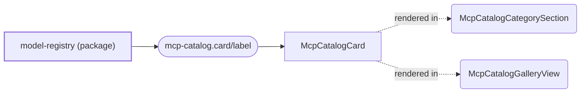
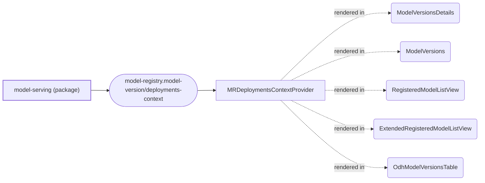
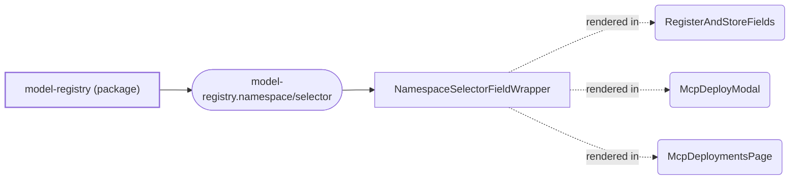
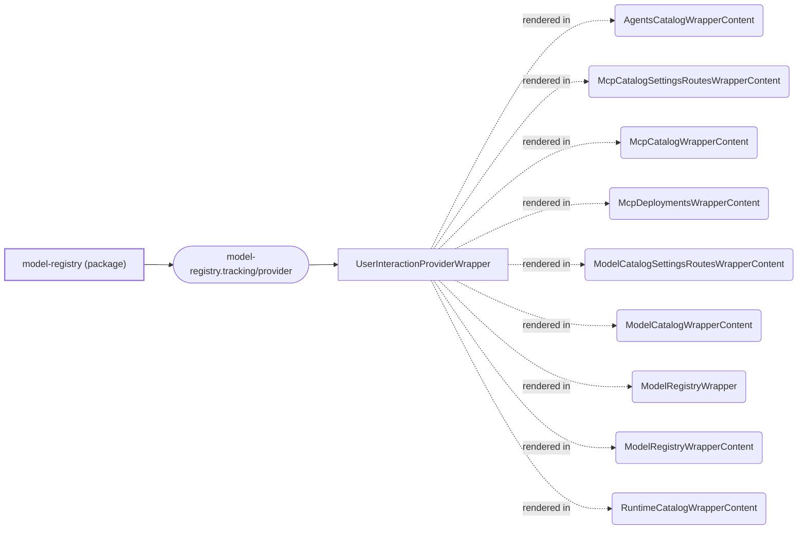

<!-- AUTO-GENERATED by @odh-dashboard/extension-map. Do not edit by hand. -->

> Generated file. Regenerate with `pnpm docs:extension-map`.

# Extensions in model-registry

Package `@odh-dashboard/model-registry` (package) at `packages/model-registry`. Everything below is read out of this repository's sources by static analysis.

[Loading paths](#loading-paths) · [Defines](#defines) · [Contributes](#contributes) · [Consumes](#consumes) · [Diagnostics](#diagnostics) · [Legend](#legend)

## On this page

Every extension point, extension and consumer on this page, each linking to its own section. Links to the code are in those sections.

**Defines**

| Extension point | Implemented by | Consumed in |
| --- | --- | --- |
| [mcp-catalog.card/label](#mcp-catalogcardlabel) | [model-registry](#contributes-to-mcp-catalogcardlabel) | [model-registry](#consumes-mcp-catalogcardlabel) |
| [mcp-catalog.settings/url](#mcp-catalogsettingsurl) | [model-registry](#contributes-to-mcp-catalogsettingsurl) | [model-registry](#consumes-mcp-catalogsettingsurl) |
| [model-catalog.page/banner](#model-catalogpagebanner) | [model-registry](#contributes-to-model-catalogpagebanner) | [model-registry](#consumes-model-catalogpagebanner) |
| [model-catalog.settings/url](#model-catalogsettingsurl) | [model-registry](#contributes-to-model-catalogsettingsurl) | [model-registry](#consumes-model-catalogsettingsurl) |
| [model-registry.admin/check](#model-registryadmincheck) | [model-registry](#contributes-to-model-registryadmincheck) | [model-registry](#consumes-model-registryadmincheck) |
| [model-registry.feature-flag-overrides/provider](#model-registryfeature-flag-overridesprovider) | unused | unused |
| [model-registry.model-version/deploy-modal](#model-registrymodel-versiondeploy-modal) | [model-serving](../../model-serving/docs/extensions.md#contributes-to-model-registrymodel-versiondeploy-modal) | [model-registry](#consumes-model-registrymodel-versiondeploy-modal) |
| [model-registry.model-version/deployments-context](#model-registrymodel-versiondeployments-context) | [model-serving](../../model-serving/docs/extensions.md#contributes-to-model-registrymodel-versiondeployments-context) | [model-registry](#consumes-model-registrymodel-versiondeployments-context) |
| [model-registry.namespace/selector](#model-registrynamespaceselector) | [model-registry](#contributes-to-model-registrynamespaceselector) | [model-registry](#consumes-model-registrynamespaceselector) |
| [model-registry.projects/bridge-provider](#model-registryprojectsbridge-provider) | [model-registry](#contributes-to-model-registryprojectsbridge-provider) | [model-registry](#consumes-model-registryprojectsbridge-provider) |
| [model-registry.register/autofill-connection](#model-registryregisterautofill-connection) | [model-registry](#contributes-to-model-registryregisterautofill-connection) | [model-registry](#consumes-model-registryregisterautofill-connection) |
| [model-registry.settings/url](#model-registrysettingsurl) | [model-registry](#contributes-to-model-registrysettingsurl) | [model-registry](#consumes-model-registrysettingsurl) |
| [model-registry.tracking/provider](#model-registrytrackingprovider) | [model-registry](#contributes-to-model-registrytrackingprovider) | [model-registry](#consumes-model-registrytrackingprovider) |

**Contributes**

| Extension | Extension point | Included in |
| --- | --- | --- |
| [model-registry-plugin](#contributes-to-apparea) | [app.area](../../plugin-core/docs/extensions.md#apparea) | host |
| [modelRegistry-kf](#contributes-to-appnavigationhref) | [app.navigation/href](../../plugin-core/docs/extensions.md#appnavigationhref) | host |
| [settings-model-registry](#contributes-to-appnavigationhref) | [app.navigation/href](../../plugin-core/docs/extensions.md#appnavigationhref) | host |
| [settings-model-catalog](#contributes-to-appnavigationhref) | [app.navigation/href](../../plugin-core/docs/extensions.md#appnavigationhref) | host |
| [settings-mcp-catalog](#contributes-to-appnavigationhref) | [app.navigation/href](../../plugin-core/docs/extensions.md#appnavigationhref) | host |
| [RuntimeCatalogDetailsWrapper](#contributes-to-approute) | [app.route](../../plugin-core/docs/extensions.md#approute) | host |
| [ModelRegistrySettingsRoutesWrapper](#contributes-to-approute) | [app.route](../../plugin-core/docs/extensions.md#approute) | host |
| [route #3](#contributes-to-approute) | [app.route](../../plugin-core/docs/extensions.md#approute) | host |
| [route #4](#contributes-to-approute) | [app.route](../../plugin-core/docs/extensions.md#approute) | host |
| [route #5](#contributes-to-approute) | [app.route](../../plugin-core/docs/extensions.md#approute) | host |
| [route #6](#contributes-to-approute) | [app.route](../../plugin-core/docs/extensions.md#approute) | host |
| [ModelCatalogSettingsRoutesWrapper](#contributes-to-approute) | [app.route](../../plugin-core/docs/extensions.md#approute) | host |
| [McpCatalogSettingsRoutesWrapper](#contributes-to-approute) | [app.route](../../plugin-core/docs/extensions.md#approute) | host |
| [route #9](#contributes-to-approute) | [app.route](../../plugin-core/docs/extensions.md#approute) | host |
| [catalog #1](#contributes-to-apptab-routetab) | [app.tab-route/tab](../../plugin-core/docs/extensions.md#apptab-routetab) | host |
| [registry](#contributes-to-apptab-routetab) | [app.tab-route/tab](../../plugin-core/docs/extensions.md#apptab-routetab) | host |
| [catalog #2](#contributes-to-apptab-routetab) | [app.tab-route/tab](../../plugin-core/docs/extensions.md#apptab-routetab) | host |
| [catalog #3](#contributes-to-apptab-routetab) | [app.tab-route/tab](../../plugin-core/docs/extensions.md#apptab-routetab) | host |
| [serving-runtime-catalog](#contributes-to-apptab-routetab) | [app.tab-route/tab](../../plugin-core/docs/extensions.md#apptab-routetab) | host |
| [deployments](#contributes-to-apptab-routetab) | [app.tab-route/tab](../../plugin-core/docs/extensions.md#apptab-routetab) | host |
| [deploy-model-version](#contributes-to-coreaction) | [core.action](../../plugin-core/docs/extensions.md#coreaction) | host |
| [deploy-mcp-server](#contributes-to-coreaction) | [core.action](../../plugin-core/docs/extensions.md#coreaction) | host |
| [deploy-mcp-registry-server](#contributes-to-coreaction) | [core.action](../../plugin-core/docs/extensions.md#coreaction) | host |
| [security-insights](#contributes-to-coredetailtab) | [core.detail/tab](../../plugin-core/docs/extensions.md#coredetailtab) | host |
| [quality-insights](#contributes-to-coredetailtab) | [core.detail/tab](../../plugin-core/docs/extensions.md#coredetailtab) | host |
| [mcp-support-tier-label](#contributes-to-mcp-catalogcardlabel) | [mcp-catalog.card/label](#mcp-catalogcardlabel) | host |
| [MCP catalog sources](#contributes-to-mcp-catalogsettingsurl) | [mcp-catalog.settings/url](#mcp-catalogsettingsurl) | host |
| [validated-models-banner](#contributes-to-model-catalogpagebanner) | [model-catalog.page/banner](#model-catalogpagebanner) | host |
| [Model catalog settings](#contributes-to-model-catalogsettingsurl) | [model-catalog.settings/url](#model-catalogsettingsurl) | host |
| [AdminCheck](#contributes-to-model-registryadmincheck) | [model-registry.admin/check](#model-registryadmincheck) | host |
| [ProjectSelectorField](#contributes-to-model-registrynamespaceselector) | [model-registry.namespace/selector](#model-registrynamespaceselector) | host |
| [ProjectsBridgeProvider](#contributes-to-model-registryprojectsbridge-provider) | [model-registry.projects/bridge-provider](#model-registryprojectsbridge-provider) | host |
| [AutofillConnectionButton](#contributes-to-model-registryregisterautofill-connection) | [model-registry.register/autofill-connection](#model-registryregisterautofill-connection) | host |
| [Model registry settings](#contributes-to-model-registrysettingsurl) | [model-registry.settings/url](#model-registrysettingsurl) | host |
| [SegmentUserInteractionProvider](#contributes-to-model-registrytrackingprovider) | [model-registry.tracking/provider](#model-registrytrackingprovider) | host |

**Consumes**

| Consumer | Extension point |
| --- | --- |
| [RuntimeCatalogDetailsRoutes](#consumes-apptab-routepage) | [app.tab-route/page](../../plugin-core/docs/extensions.md#apptab-routepage) |
| [McpDeploymentsTable](#consumes-apptab-routetab) | [app.tab-route/tab](../../plugin-core/docs/extensions.md#apptab-routetab) |
| [RuntimeCatalogDetailsRoutes](#consumes-apptab-routetab) | [app.tab-route/tab](../../plugin-core/docs/extensions.md#apptab-routetab) |
| [McpServerDetailsPage](#consumes-coreaction) | [core.action](../../plugin-core/docs/extensions.md#coreaction) |
| [ModelDetailsPage](#consumes-coreaction) | [core.action](../../plugin-core/docs/extensions.md#coreaction) |
| [ModelVersionsDetailsContent](#consumes-coreaction) | [core.action](../../plugin-core/docs/extensions.md#coreaction) |
| [ModelVersionsHeaderActions](#consumes-coreaction) | [core.action](../../plugin-core/docs/extensions.md#coreaction) |
| [ModelVersionsTableRow](#consumes-coreaction) | [core.action](../../plugin-core/docs/extensions.md#coreaction) |
| [RegisteredModelTableRow](#consumes-coreaction) | [core.action](../../plugin-core/docs/extensions.md#coreaction) |
| [ExtendedRegisteredModelTableRow](#consumes-coreaction) | [core.action](../../plugin-core/docs/extensions.md#coreaction) |
| [RuntimeCatalogDetailsView](#consumes-coreaction) | [core.action](../../plugin-core/docs/extensions.md#coreaction) |
| [ModelDetailsView](#consumes-coredetail-card) | [core.detail-card](../../plugin-core/docs/extensions.md#coredetail-card) |
| [ModelCatalogRoutes](#consumes-coredetailtab) | [core.detail/tab](../../plugin-core/docs/extensions.md#coredetailtab) |
| [ModelDetailsTabs](#consumes-coredetailtab) | [core.detail/tab](../../plugin-core/docs/extensions.md#coredetailtab) |
| [ModelRegistryRoutes](#consumes-coredetailtab) | [core.detail/tab](../../plugin-core/docs/extensions.md#coredetailtab) |
| [ModelVersionDetailsTabs](#consumes-coredetailtab) | [core.detail/tab](../../plugin-core/docs/extensions.md#coredetailtab) |
| [ModelVersionsTabs](#consumes-coredetailtab) | [core.detail/tab](../../plugin-core/docs/extensions.md#coredetailtab) |
| [ExtendedRegisteredModelTable](#consumes-coretable-column) | [core.table-column](../../plugin-core/docs/extensions.md#coretable-column) |
| [ExtendedRegisteredModelTableRow](#consumes-coretable-column) | [core.table-column](../../plugin-core/docs/extensions.md#coretable-column) |
| [renderExtensionColumns](#consumes-coretable-column) | [core.table-column](../../plugin-core/docs/extensions.md#coretable-column) |
| [McpCatalogCard](#consumes-mcp-catalogcardlabel) | [mcp-catalog.card/label](#mcp-catalogcardlabel) |
| [OdhMcpCatalogCoreLoader](#consumes-mcp-catalogsettingsurl) | [mcp-catalog.settings/url](#mcp-catalogsettingsurl) |
| [getMcpCatalogSettingsUrl](#consumes-mcp-catalogsettingsurl) | [mcp-catalog.settings/url](#mcp-catalogsettingsurl) |
| [ModelCatalog](#consumes-model-catalogpagebanner) | [model-catalog.page/banner](#model-catalogpagebanner) |
| [OdhModelCatalogCoreLoader](#consumes-model-catalogsettingsurl) | [model-catalog.settings/url](#model-catalogsettingsurl) |
| [getCatalogSettingsUrl](#consumes-model-catalogsettingsurl) | [model-catalog.settings/url](#model-catalogsettingsurl) |
| [OdhMcpCatalogCoreLoader](#consumes-model-registryadmincheck) | [model-registry.admin/check](#model-registryadmincheck) |
| [OdhModelCatalogCoreLoader](#consumes-model-registryadmincheck) | [model-registry.admin/check](#model-registryadmincheck) |
| [OdhModelRegistryCoreLoader](#consumes-model-registryadmincheck) | [model-registry.admin/check](#model-registryadmincheck) |
| [ModelVersionDeployAction](#consumes-model-registrymodel-versiondeploy-modal) | [model-registry.model-version/deploy-modal](#model-registrymodel-versiondeploy-modal) |
| [createModal](#consumes-model-registrymodel-versiondeploy-modal) | [model-registry.model-version/deploy-modal](#model-registrymodel-versiondeploy-modal) |
| [MRDeploymentsContextProvider](#consumes-model-registrymodel-versiondeployments-context) | [model-registry.model-version/deployments-context](#model-registrymodel-versiondeployments-context) |
| [NamespaceSelectorFieldWrapper](#consumes-model-registrynamespaceselector) | [model-registry.namespace/selector](#model-registrynamespaceselector) |
| [ProjectsBridgeProviderWrapper](#consumes-model-registryprojectsbridge-provider) | [model-registry.projects/bridge-provider](#model-registryprojectsbridge-provider) |
| [RegistrationModelLocationFields](#consumes-model-registryregisterautofill-connection) | [model-registry.register/autofill-connection](#model-registryregisterautofill-connection) |
| [OdhModelCatalogCoreLoader](#consumes-model-registrysettingsurl) | [model-registry.settings/url](#model-registrysettingsurl) |
| [OdhModelRegistryCoreLoader](#consumes-model-registrysettingsurl) | [model-registry.settings/url](#model-registrysettingsurl) |
| [UserInteractionProviderWrapper](#consumes-model-registrytrackingprovider) | [model-registry.tracking/provider](#model-registrytrackingprovider) |

## Loading paths

- [extensions.ts](../extensions.ts) (`./extensions`) — bundled into the host at build time (the `./extensions` export)
- [extensions.ts](../upstream/frontend/src/odh/extensions.ts) (`mf:./extensions`) — loaded at runtime by the host as a Module Federation remote

## Defines

The extension points this package declares. Each heading is the point ID other packages use as an extension's `type`.

### mcp-catalog.card/label

Declared as [McpCatalogCardLabelExtension](../upstream/frontend/src/odh/extension-points/mcp-catalog-card-label.ts#L9-L15).

**Properties:**

| Property | Required | Type | CodeRef of | Description |
| --- | --- | --- | --- | --- |
| `id` | yes | `string` | — |  |
| `component` | yes | `CodeRef<React.ComponentType<McpCatalogCardLabelProps>>` | `ComponentType<McpCatalogCardLabelProps>` |  |

**Implemented by:** [model-registry](#contributes-to-mcp-catalogcardlabel)

**Consumed in:** [model-registry](#consumes-mcp-catalogcardlabel)

**Consumers:**

| Consumer | Package | Query | Uses | Rendered or called in |
| --- | --- | --- | --- | --- |
| [McpCatalogCard](../upstream/frontend/src/app/pages/mcpCatalog/components/McpCatalogCard.tsx#L43-L136) | model-registry | [useExtensions](../upstream/frontend/src/app/pages/mcpCatalog/components/McpCatalogCard.tsx#L46) | `properties.id` — read, direct ([McpCatalogCard.tsx:78](../upstream/frontend/src/app/pages/mcpCatalog/components/McpCatalogCard.tsx#L78)) `properties.component` — lazy-render, direct ([McpCatalogCard.tsx:80](../upstream/frontend/src/app/pages/mcpCatalog/components/McpCatalogCard.tsx#L80)) | McpCatalogCategorySection ([McpCatalogCategorySection.tsx:71](../upstream/frontend/src/app/pages/mcpCatalog/screens/McpCatalogCategorySection.tsx#L71)) McpCatalogGalleryView ([McpCatalogGalleryView.tsx:72](../upstream/frontend/src/app/pages/mcpCatalog/screens/McpCatalogGalleryView.tsx#L72)) |

### mcp-catalog.settings/url

Extension point for providing the MCP catalog settings URL.
This allows ODH to inject its own settings URL for the MCP catalog settings page
without hardcoding the path in the model registry package.

Declared as [McpCatalogSettingsUrlExtension](../upstream/frontend/src/odh/extension-points/mcp-catalog-settings-url.ts#L9-L21).

**Properties:**

| Property | Required | Type | CodeRef of | Description |
| --- | --- | --- | --- | --- |
| `url` | yes | `string` | — | The MCP catalog settings URL path. |
| `title` | yes | `string` | — | The display title for the settings page link. |

**Implemented by:** [model-registry](#contributes-to-mcp-catalogsettingsurl)

**Consumed in:** [model-registry](#consumes-mcp-catalogsettingsurl)

**Consumers:**

| Consumer | Package | Query | Uses | Rendered or called in |
| --- | --- | --- | --- | --- |
| [OdhMcpCatalogCoreLoader](../upstream/frontend/src/odh/components/OdhMcpCatalogCoreLoader.tsx#L17-L76) | model-registry | [useExtensions](../upstream/frontend/src/odh/components/OdhMcpCatalogCoreLoader.tsx#L20) | `properties.title` — read, direct ([OdhMcpCatalogCoreLoader.tsx:31](../upstream/frontend/src/odh/components/OdhMcpCatalogCoreLoader.tsx#L31)) | McpCatalogRoutes ([McpCatalogRoutes.tsx:11](../upstream/frontend/src/app/pages/mcpCatalog/McpCatalogRoutes.tsx#L11)) |
| [getMcpCatalogSettingsUrl](../upstream/frontend/src/odh/components/OdhMcpCatalogCoreLoader.tsx#L22-L27) | model-registry | — | `properties.url` — read, direct ([OdhMcpCatalogCoreLoader.tsx:24](../upstream/frontend/src/odh/components/OdhMcpCatalogCoreLoader.tsx#L24)) | OdhMcpCatalogCoreLoader (called at [OdhMcpCatalogCoreLoader.tsx:43](../upstream/frontend/src/odh/components/OdhMcpCatalogCoreLoader.tsx#L43)) |

```mermaid
flowchart LR
  classDef pkg stroke-width:2px
  classDef point stroke-width:1px
  n_pkg__odh_dashboard_model_registry_1fc815["model-registry (package)"]:::pkg
  n_mcp_catalog_settings_url_2e25fe(["mcp-catalog.settings/url"]):::point
  n_pkg__odh_dashboard_model_registry_1fc815 --> n_mcp_catalog_settings_url_2e25fe
  n_symbol_packages_model_registry_upstream_frontend_src_odh_components_OdhMcpCatalogCoreLoader_tsx_OdhMcpCatalogCoreLoader_2d2018["OdhMcpCatalogCoreLoader"]
  n_mcp_catalog_settings_url_2e25fe --> n_symbol_packages_model_registry_upstream_frontend_src_odh_components_OdhMcpCatalogCoreLoader_tsx_OdhMcpCatalogCoreLoader_2d2018
  n_symbol_packages_model_registry_upstream_frontend_src_odh_components_OdhMcpCatalogCoreLoader_tsx_getMcpCatalogSettingsUrl_a739bd["getMcpCatalogSettingsUrl"]
  n_mcp_catalog_settings_url_2e25fe --> n_symbol_packages_model_registry_upstream_frontend_src_odh_components_OdhMcpCatalogCoreLoader_tsx_getMcpCatalogSettingsUrl_a739bd
  n_symbol_packages_model_registry_upstream_frontend_src_app_pages_mcpCatalog_McpCatalogRoutes_tsx_McpCatalogRoutes_71c3a2("McpCatalogRoutes")
  n_symbol_packages_model_registry_upstream_frontend_src_odh_components_OdhMcpCatalogCoreLoader_tsx_OdhMcpCatalogCoreLoader_2d2018 -. "rendered in" .-> n_symbol_packages_model_registry_upstream_frontend_src_app_pages_mcpCatalog_McpCatalogRoutes_tsx_McpCatalogRoutes_71c3a2
  n_symbol_packages_model_registry_upstream_frontend_src_odh_components_OdhMcpCatalogCoreLoader_tsx_getMcpCatalogSettingsUrl_a739bd -. "called in" .-> n_symbol_packages_model_registry_upstream_frontend_src_odh_components_OdhMcpCatalogCoreLoader_tsx_OdhMcpCatalogCoreLoader_2d2018
```

### model-catalog.page/banner

Declared as [ModelCatalogBannerExtension](../upstream/frontend/src/odh/extension-points/model-catalog-banner.ts#L4-L10).

**Properties:**

| Property | Required | Type | CodeRef of | Description |
| --- | --- | --- | --- | --- |
| `id` | yes | `string` | — |  |
| `component` | yes | `CodeRef<React.ComponentType>` | `ComponentType<{}>` |  |

**Implemented by:** [model-registry](#contributes-to-model-catalogpagebanner)

**Consumed in:** [model-registry](#consumes-model-catalogpagebanner)

**Consumers:**

| Consumer | Package | Query | Uses | Rendered or called in |
| --- | --- | --- | --- | --- |
| [ModelCatalog](../upstream/frontend/src/app/pages/modelCatalog/screens/ModelCatalog.tsx#L17-L114) | model-registry | [useExtensions](../upstream/frontend/src/app/pages/modelCatalog/screens/ModelCatalog.tsx#L34) | `properties.id` — read, direct ([ModelCatalog.tsx:72](../upstream/frontend/src/app/pages/modelCatalog/screens/ModelCatalog.tsx#L72)) `properties.component` — lazy-render, direct ([ModelCatalog.tsx:73](../upstream/frontend/src/app/pages/modelCatalog/screens/ModelCatalog.tsx#L73)) | ModelCatalogRoutes ([ModelCatalogRoutes.tsx:20](../upstream/frontend/src/app/pages/modelCatalog/ModelCatalogRoutes.tsx#L20)) |

**Flow:** model-registry → model-catalog.page/banner → model-registry · ModelCatalog → rendered in ModelCatalogRoutes

### model-catalog.settings/url

Extension point for providing the Model catalog settings URL.
This allows ODH to inject its own settings URL for the catalog settings page
without hardcoding the path in the model registry package.

Declared as [CatalogSettingsUrlExtension](../upstream/frontend/src/odh/extension-points/catalog-settings-url.ts#L9-L21).

**Properties:**

| Property | Required | Type | CodeRef of | Description |
| --- | --- | --- | --- | --- |
| `url` | yes | `string` | — | The catalog settings URL path. |
| `title` | yes | `string` | — | The display title for the settings page link. |

**Implemented by:** [model-registry](#contributes-to-model-catalogsettingsurl)

**Consumed in:** [model-registry](#consumes-model-catalogsettingsurl)

**Consumers:**

| Consumer | Package | Query | Uses | Rendered or called in |
| --- | --- | --- | --- | --- |
| [OdhModelCatalogCoreLoader](../upstream/frontend/src/odh/components/OdhModelCatalogCoreLoader.tsx#L23-L96) | model-registry | [useExtensions](../upstream/frontend/src/odh/components/OdhModelCatalogCoreLoader.tsx#L26) | `properties.title` — read, direct ([OdhModelCatalogCoreLoader.tsx:37](../upstream/frontend/src/odh/components/OdhModelCatalogCoreLoader.tsx#L37)) | ModelCatalogRoutes ([ModelCatalogRoutes.tsx:19](../upstream/frontend/src/app/pages/modelCatalog/ModelCatalogRoutes.tsx#L19)) |
| [getCatalogSettingsUrl](../upstream/frontend/src/odh/components/OdhModelCatalogCoreLoader.tsx#L29-L34) | model-registry | — | `properties.url` — read, direct ([OdhModelCatalogCoreLoader.tsx:31](../upstream/frontend/src/odh/components/OdhModelCatalogCoreLoader.tsx#L31)) | OdhModelCatalogCoreLoader (called at [OdhModelCatalogCoreLoader.tsx:57](../upstream/frontend/src/odh/components/OdhModelCatalogCoreLoader.tsx#L57)) |

```mermaid
flowchart LR
  classDef pkg stroke-width:2px
  classDef point stroke-width:1px
  n_pkg__odh_dashboard_model_registry_1fc815["model-registry (package)"]:::pkg
  n_model_catalog_settings_url_c9f659(["model-catalog.settings/url"]):::point
  n_pkg__odh_dashboard_model_registry_1fc815 --> n_model_catalog_settings_url_c9f659
  n_symbol_packages_model_registry_upstream_frontend_src_odh_components_OdhModelCatalogCoreLoader_tsx_OdhModelCatalogCoreLoader_caa324["OdhModelCatalogCoreLoader"]
  n_model_catalog_settings_url_c9f659 --> n_symbol_packages_model_registry_upstream_frontend_src_odh_components_OdhModelCatalogCoreLoader_tsx_OdhModelCatalogCoreLoader_caa324
  n_symbol_packages_model_registry_upstream_frontend_src_odh_components_OdhModelCatalogCoreLoader_tsx_getCatalogSettingsUrl_d73fd6["getCatalogSettingsUrl"]
  n_model_catalog_settings_url_c9f659 --> n_symbol_packages_model_registry_upstream_frontend_src_odh_components_OdhModelCatalogCoreLoader_tsx_getCatalogSettingsUrl_d73fd6
  n_symbol_packages_model_registry_upstream_frontend_src_app_pages_modelCatalog_ModelCatalogRoutes_tsx_ModelCatalogRoutes_b582db("ModelCatalogRoutes")
  n_symbol_packages_model_registry_upstream_frontend_src_odh_components_OdhModelCatalogCoreLoader_tsx_OdhModelCatalogCoreLoader_caa324 -. "rendered in" .-> n_symbol_packages_model_registry_upstream_frontend_src_app_pages_modelCatalog_ModelCatalogRoutes_tsx_ModelCatalogRoutes_b582db
  n_symbol_packages_model_registry_upstream_frontend_src_odh_components_OdhModelCatalogCoreLoader_tsx_getCatalogSettingsUrl_d73fd6 -. "called in" .-> n_symbol_packages_model_registry_upstream_frontend_src_odh_components_OdhModelCatalogCoreLoader_tsx_OdhModelCatalogCoreLoader_caa324
```

### model-registry.admin/check

Extension point for providing a custom admin check component.
This allows ODH to inject its own admin check logic (e.g., using useUser hook)
without creating import issues in the model registry package.

Declared as [AdminCheckExtension](../upstream/frontend/src/odh/extension-points/admin.ts#L10-L21).

**Properties:**

| Property | Required | Type | CodeRef of | Description |
| --- | --- | --- | --- | --- |
| `component` | yes | `ComponentCodeRef<{ children: (isAdmin: boolean, loaded: boolean) => React.ReactElement; }>` | `{ default: ComponentType<{ children: (isAdmin: boolean, loaded: boolean) => ReactElement<any, string \| JSXElementConstru…` | Component that returns admin status. Should render children with isAdmin prop. |

**Implemented by:** [model-registry](#contributes-to-model-registryadmincheck)

**Consumed in:** [model-registry](#consumes-model-registryadmincheck)

**Consumers:**

| Consumer | Package | Query | Uses | Rendered or called in |
| --- | --- | --- | --- | --- |
| [OdhMcpCatalogCoreLoader](../upstream/frontend/src/odh/components/OdhMcpCatalogCoreLoader.tsx#L17-L76) | model-registry | [useResolvedExtensions](../upstream/frontend/src/odh/components/OdhMcpCatalogCoreLoader.tsx#L19) | `properties.component.default` — jsx-render, direct ([OdhMcpCatalogCoreLoader.tsx:53](../upstream/frontend/src/odh/components/OdhMcpCatalogCoreLoader.tsx#L53)) | McpCatalogRoutes ([McpCatalogRoutes.tsx:11](../upstream/frontend/src/app/pages/mcpCatalog/McpCatalogRoutes.tsx#L11)) |
| [OdhModelCatalogCoreLoader](../upstream/frontend/src/odh/components/OdhModelCatalogCoreLoader.tsx#L23-L96) | model-registry | [useResolvedExtensions](../upstream/frontend/src/odh/components/OdhModelCatalogCoreLoader.tsx#L25) | `properties.component.default` — jsx-render, direct ([OdhModelCatalogCoreLoader.tsx:67](../upstream/frontend/src/odh/components/OdhModelCatalogCoreLoader.tsx#L67)) | ModelCatalogRoutes ([ModelCatalogRoutes.tsx:19](../upstream/frontend/src/app/pages/modelCatalog/ModelCatalogRoutes.tsx#L19)) |
| [OdhModelRegistryCoreLoader](../upstream/frontend/src/odh/components/OdhModelRegistryCoreLoader.tsx#L22-L123) | model-registry | [useResolvedExtensions](../upstream/frontend/src/odh/components/OdhModelRegistryCoreLoader.tsx#L26) | `properties.component.default` — jsx-render, direct ([OdhModelRegistryCoreLoader.tsx:89](../upstream/frontend/src/odh/components/OdhModelRegistryCoreLoader.tsx#L89)) | ModelRegistryRoutes ([ModelRegistryRoutes.tsx:30](../upstream/frontend/src/app/pages/modelRegistry/ModelRegistryRoutes.tsx#L30-L32)) |

```mermaid
flowchart LR
  classDef pkg stroke-width:2px
  classDef point stroke-width:1px
  n_pkg__odh_dashboard_model_registry_1fc815["model-registry (package)"]:::pkg
  n_model_registry_admin_check_d55a30(["model-registry.admin/check"]):::point
  n_pkg__odh_dashboard_model_registry_1fc815 --> n_model_registry_admin_check_d55a30
  n_symbol_packages_model_registry_upstream_frontend_src_odh_components_OdhMcpCatalogCoreLoader_tsx_OdhMcpCatalogCoreLoader_2d2018["OdhMcpCatalogCoreLoader"]
  n_model_registry_admin_check_d55a30 --> n_symbol_packages_model_registry_upstream_frontend_src_odh_components_OdhMcpCatalogCoreLoader_tsx_OdhMcpCatalogCoreLoader_2d2018
  n_symbol_packages_model_registry_upstream_frontend_src_odh_components_OdhModelCatalogCoreLoader_tsx_OdhModelCatalogCoreLoader_caa324["OdhModelCatalogCoreLoader"]
  n_model_registry_admin_check_d55a30 --> n_symbol_packages_model_registry_upstream_frontend_src_odh_components_OdhModelCatalogCoreLoader_tsx_OdhModelCatalogCoreLoader_caa324
  n_symbol_packages_model_registry_upstream_frontend_src_odh_components_OdhModelRegistryCoreLoader_tsx_OdhModelRegistryCoreLoader_048726["OdhModelRegistryCoreLoader"]
  n_model_registry_admin_check_d55a30 --> n_symbol_packages_model_registry_upstream_frontend_src_odh_components_OdhModelRegistryCoreLoader_tsx_OdhModelRegistryCoreLoader_048726
  n_symbol_packages_model_registry_upstream_frontend_src_app_pages_mcpCatalog_McpCatalogRoutes_tsx_McpCatalogRoutes_71c3a2("McpCatalogRoutes")
  n_symbol_packages_model_registry_upstream_frontend_src_app_pages_modelCatalog_ModelCatalogRoutes_tsx_ModelCatalogRoutes_b582db("ModelCatalogRoutes")
  n_symbol_packages_model_registry_upstream_frontend_src_app_pages_modelRegistry_ModelRegistryRoutes_tsx_ModelRegistryRoutes_7a9291("ModelRegistryRoutes")
  n_symbol_packages_model_registry_upstream_frontend_src_odh_components_OdhMcpCatalogCoreLoader_tsx_OdhMcpCatalogCoreLoader_2d2018 -. "rendered in" .-> n_symbol_packages_model_registry_upstream_frontend_src_app_pages_mcpCatalog_McpCatalogRoutes_tsx_McpCatalogRoutes_71c3a2
  n_symbol_packages_model_registry_upstream_frontend_src_odh_components_OdhModelCatalogCoreLoader_tsx_OdhModelCatalogCoreLoader_caa324 -. "rendered in" .-> n_symbol_packages_model_registry_upstream_frontend_src_app_pages_modelCatalog_ModelCatalogRoutes_tsx_ModelCatalogRoutes_b582db
  n_symbol_packages_model_registry_upstream_frontend_src_odh_components_OdhModelRegistryCoreLoader_tsx_OdhModelRegistryCoreLoader_048726 -. "rendered in" .-> n_symbol_packages_model_registry_upstream_frontend_src_app_pages_modelRegistry_ModelRegistryRoutes_tsx_ModelRegistryRoutes_7a9291
```

### model-registry.feature-flag-overrides/provider

Extension point for providing an ODH dev feature flag overrides provider.
This allows ODH to inject a provider component that reads from its dev feature flags
and provides override values to the OdhDevFeatureFlagOverridesContext.

Declared as [OdhDevFeatureFlagOverridesProviderExtension](../upstream/frontend/src/odh/extension-points/feature-flag-overrides.ts#L33-L42).

**Properties:**

| Property | Required | Type | CodeRef of | Description |
| --- | --- | --- | --- | --- |
| `component` | yes | `CodeRef<React.ComponentType<{ children: React.ReactNode }>>` | `ComponentType<{ children: ReactNode; }>` | Provider component that wraps children and provides OdhDevFeatureFlagOverridesContext. The component should read from ODH's dev feature flags and provide the override values. |

> **Unused.** No package in this repository contributes an extension of this point, and no code queries or uses it.

### model-registry.model-version/deploy-modal

Declared as [ModelRegistryDeployModalExtension](../upstream/frontend/src/odh/extension-points/deploy.ts#L6-L21).

**Properties:**

| Property | Required | Type | CodeRef of | Description |
| --- | --- | --- | --- | --- |
| `useAvailablePlatformIds` | yes | `CodeRef<() => string[]>` | `() => string[]` |  |
| `modalComponent` | yes | `CodeRef< React.ComponentType<{ modelDeployPrefill: { data: ModelDeployPrefillInfo; loaded: boolean; error: Error \| undefined; }; onClose: () => void; }> >` | `ComponentType<{ modelDeployPrefill: { data: ModelDeployPrefillInfo; loaded: boolean; error: Error \| undefined; }; onClos…` |  |

**Implemented by:** [model-serving](../../model-serving/docs/extensions.md#contributes-to-model-registrymodel-versiondeploy-modal)

**Consumed in:** [model-registry](#consumes-model-registrymodel-versiondeploy-modal)

**Consumers:**

| Consumer | Package | Query | Uses | Rendered or called in |
| --- | --- | --- | --- | --- |
| [ModelVersionDeployAction](../upstream/frontend/src/odh/components/ModelVersionDeployAction.tsx#L26-L117) | model-registry | [useResolvedExtensions](../upstream/frontend/src/odh/components/ModelVersionDeployAction.tsx#L31) | `properties.useAvailablePlatformIds` — hook-run, direct ([ModelVersionDeployAction.tsx:45](../upstream/frontend/src/odh/components/ModelVersionDeployAction.tsx#L45)) | — |

```mermaid
flowchart LR
  classDef pkg stroke-width:2px
  classDef point stroke-width:1px
  n_pkg__odh_dashboard_model_serving_d0bfea["model-serving (package)"]:::pkg
  n_model_registry_model_version_deploy_modal_74d1d6(["model-registry.model-version/deploy-modal"]):::point
  n_pkg__odh_dashboard_model_serving_d0bfea --> n_model_registry_model_version_deploy_modal_74d1d6
  n_symbol_packages_model_registry_upstream_frontend_src_odh_components_ModelVersionDeployAction_tsx_ModelVersionDeployAction_2ff9c8["ModelVersionDeployAction"]
  n_model_registry_model_version_deploy_modal_74d1d6 --> n_symbol_packages_model_registry_upstream_frontend_src_odh_components_ModelVersionDeployAction_tsx_ModelVersionDeployAction_2ff9c8
  n_symbol_packages_model_registry_upstream_frontend_src_odh_components_ModelVersionDeployAction_tsx_createModal_035947["createModal"]
  n_model_registry_model_version_deploy_modal_74d1d6 --> n_symbol_packages_model_registry_upstream_frontend_src_odh_components_ModelVersionDeployAction_tsx_createModal_035947
  n_symbol_packages_model_registry_upstream_frontend_src_odh_components_ModelVersionDeployAction_tsx_handleDropdownClick_6c0253("handleDropdownClick")
  n_symbol_packages_model_registry_upstream_frontend_src_odh_components_ModelVersionDeployAction_tsx_createModal_035947 -. "called in" .-> n_symbol_packages_model_registry_upstream_frontend_src_odh_components_ModelVersionDeployAction_tsx_ModelVersionDeployAction_2ff9c8
  n_symbol_packages_model_registry_upstream_frontend_src_odh_components_ModelVersionDeployAction_tsx_createModal_035947 -. "called in" .-> n_symbol_packages_model_registry_upstream_frontend_src_odh_components_ModelVersionDeployAction_tsx_handleDropdownClick_6c0253
```

| [createModal](../upstream/frontend/src/odh/components/ModelVersionDeployAction.tsx#L50-L62) | model-registry | — | `properties.modalComponent` — jsx-render, direct ([ModelVersionDeployAction.tsx:56](../upstream/frontend/src/odh/components/ModelVersionDeployAction.tsx#L56)) | ModelVersionDeployAction (called at [ModelVersionDeployAction.tsx:64](../upstream/frontend/src/odh/components/ModelVersionDeployAction.tsx#L64)) handleDropdownClick (called at [ModelVersionDeployAction.tsx:69](../upstream/frontend/src/odh/components/ModelVersionDeployAction.tsx#L69)) |

### model-registry.model-version/deployments-context

Declared as [ModelRegistryVersionDeploymentsContextExtension](../upstream/frontend/src/odh/extension-points/deploy.ts#L28-L45).

**Properties:**

| Property | Required | Type | CodeRef of | Description |
| --- | --- | --- | --- | --- |
| `DeploymentsProvider` | yes | `CodeRef< React.ComponentType<{ children: ({ deployments, loaded, }: { deployments?: ModelRegistryDeploymentListItem[]; loaded: boolean; }) => React.ReactNode; labelSelectors?: { [key: string]: string }; mrName?: string; }> >` | `ComponentType<{ children: ({ deployments, loaded, }: { deployments?: ModelRegistryDeploymentListItem[] \| undefined; load…` |  |

**Implemented by:** [model-serving](../../model-serving/docs/extensions.md#contributes-to-model-registrymodel-versiondeployments-context)

**Consumed in:** [model-registry](#consumes-model-registrymodel-versiondeployments-context)

**Consumers:**

| Consumer | Package | Query | Uses | Rendered or called in |
| --- | --- | --- | --- | --- |
| [MRDeploymentsContextProvider](../upstream/frontend/src/odh/components/MRDeploymentsContextProvider.tsx#L16-L51) | model-registry | [useResolvedExtensions](../upstream/frontend/src/odh/components/MRDeploymentsContextProvider.tsx#L21-L23) | `properties.DeploymentsProvider` — read, direct ([MRDeploymentsContextProvider.tsx:27](../upstream/frontend/src/odh/components/MRDeploymentsContextProvider.tsx#L27)) | ModelVersionsDetails ([ModelVersionDetails.tsx:176](../upstream/frontend/src/app/pages/modelRegistry/screens/ModelVersionDetails/ModelVersionDetails.tsx#L176-L179)) ModelVersions ([ModelVersions.tsx:98](../upstream/frontend/src/app/pages/modelRegistry/screens/ModelVersions/ModelVersions.tsx#L98-L101)) RegisteredModelListView ([RegisteredModelListView.tsx:132](../upstream/frontend/src/app/pages/modelRegistry/screens/RegisteredModels/RegisteredModelListView.tsx#L132)) ExtendedRegisteredModelListView ([ExtendedRegisteredModelListView.tsx:109](../upstream/frontend/src/odh/components/ExtendedRegisteredModelListView.tsx#L109)) OdhModelVersionsTable ([OdhModelVersionsTable.tsx:82](../upstream/frontend/src/odh/components/OdhModelVersionsTable.tsx#L82-L85)) |

### model-registry.namespace/selector

Extension point for providing a custom namespace/project selector component.
This allows ODH to replace the upstream namespace selector with its own
project selector that uses the OpenShift Projects API (which supports
non-admin listing) and filters out system projects.

Declared as [NamespaceSelectorExtension](../upstream/frontend/src/odh/extension-points/namespace-selector.ts#L14-L19).

**Properties:**

| Property | Required | Type | CodeRef of | Description |
| --- | --- | --- | --- | --- |
| `component` | yes | `ComponentCodeRef<NamespaceSelectorFieldProps>` | `{ default: ComponentType<NamespaceSelectorFieldProps>; }` |  |

**Implemented by:** [model-registry](#contributes-to-model-registrynamespaceselector)

**Consumed in:** [model-registry](#consumes-model-registrynamespaceselector)

**Consumers:**

| Consumer | Package | Query | Uses | Rendered or called in |
| --- | --- | --- | --- | --- |
| [NamespaceSelectorFieldWrapper](../upstream/frontend/src/odh/components/NamespaceSelectorFieldWrapper.tsx#L9-L18) | model-registry | [useResolvedExtensions](../upstream/frontend/src/odh/components/NamespaceSelectorFieldWrapper.tsx#L10) | `properties.component.default` — jsx-render, direct ([NamespaceSelectorFieldWrapper.tsx:13](../upstream/frontend/src/odh/components/NamespaceSelectorFieldWrapper.tsx#L13)) | RegisterAndStoreFields ([RegisterAndStoreFields.tsx:90](../upstream/frontend/src/app/pages/modelRegistry/screens/RegisterModel/RegisterAndStoreFields.tsx#L90-L98)) McpDeployModal ([McpDeployModal.tsx:288](../upstream/frontend/src/odh/components/McpDeployModal.tsx#L288-L294)) McpDeploymentsPage ([McpDeploymentsPage.tsx:88](../upstream/frontend/src/odh/pages/mcpDeployments/McpDeploymentsPage.tsx#L88-L92)) |

### model-registry.projects/bridge-provider

Extension point for providing project data from the host app's ProjectsContext
to the upstream ProjectsBridgeContext. Uses a render-prop pattern so that the
downstream component never needs to import the upstream context object — it
passes data back via the render prop, and the upstream wrapper provides it
to ProjectsBridgeContext.Provider.

Declared as [ProjectsBridgeProviderExtension](../upstream/frontend/src/odh/extension-points/projects-bridge.ts#L28-L33).

**Properties:**

| Property | Required | Type | CodeRef of | Description |
| --- | --- | --- | --- | --- |
| `component` | yes | `ComponentCodeRef<ProjectsBridgeProviderProps>` | `{ default: ComponentType<ProjectsBridgeProviderProps>; }` |  |

**Implemented by:** [model-registry](#contributes-to-model-registryprojectsbridge-provider)

**Consumed in:** [model-registry](#consumes-model-registryprojectsbridge-provider)

**Consumers:**

| Consumer | Package | Query | Uses | Rendered or called in |
| --- | --- | --- | --- | --- |
| [ProjectsBridgeProviderWrapper](../upstream/frontend/src/odh/components/ProjectsBridgeProviderWrapper.tsx#L10-L27) | model-registry | [useResolvedExtensions](../upstream/frontend/src/odh/components/ProjectsBridgeProviderWrapper.tsx#L13) | `properties.component.default` — jsx-render, direct ([ProjectsBridgeProviderWrapper.tsx:16](../upstream/frontend/src/odh/components/ProjectsBridgeProviderWrapper.tsx#L16)) | McpDeploymentsWrapperContent ([McpDeploymentsWrapper.tsx:40](../upstream/frontend/src/odh/McpDeploymentsWrapper.tsx#L40)) |

**Flow:** model-registry → model-registry.projects/bridge-provider → model-registry · ProjectsBridgeProviderWrapper → rendered in McpDeploymentsWrapperContent

### model-registry.register/autofill-connection

Declared as [AutofillConnectionButtonExtension](../upstream/frontend/src/odh/extension-points/connection.ts#L8-L27).

**Properties:**

| Property | Required | Type | CodeRef of | Description |
| --- | --- | --- | --- | --- |
| `component` | yes | `CodeRef<{ default: React.ComponentType<{ modelLocationType: ModelLocationType; setData: ( propKey: keyof Pick< RegistrationCommonFormData, \| 'modelLocationEndpoint' \| 'modelLocationBucket' \| 'modelLocationRegion' \| 'modelLocationURI' >, propValue: string, ) => void; }>; }>` | `{ default: ComponentType<{ modelLocationType: ModelLocationType; setData: (propKey: "modelLocationEndpoint" \| "modelLoca…` |  |

**Implemented by:** [model-registry](#contributes-to-model-registryregisterautofill-connection)

**Consumed in:** [model-registry](#consumes-model-registryregisterautofill-connection)

**Consumers:**

| Consumer | Package | Query | Uses | Rendered or called in |
| --- | --- | --- | --- | --- |
| [RegistrationModelLocationFields](../upstream/frontend/src/app/pages/modelRegistry/screens/RegisterModel/RegistrationModelLocationFields.tsx#L27-L249) | model-registry | [useExtensions](../upstream/frontend/src/app/pages/modelRegistry/screens/RegisterModel/RegistrationModelLocationFields.tsx#L122) | `properties.component` — lazy-render, direct ([RegistrationModelLocationFields.tsx:126](../upstream/frontend/src/app/pages/modelRegistry/screens/RegisterModel/RegistrationModelLocationFields.tsx#L126)) | RegisterAndStoreFields ([RegisterAndStoreFields.tsx:106](../upstream/frontend/src/app/pages/modelRegistry/screens/RegisterModel/RegisterAndStoreFields.tsx#L106-L111)) RegistrationCommonFormSections ([RegistrationCommonFormSections.tsx:214](../upstream/frontend/src/app/pages/modelRegistry/screens/RegisterModel/RegistrationCommonFormSections.tsx#L214-L218)) |

```mermaid
flowchart LR
  classDef pkg stroke-width:2px
  classDef point stroke-width:1px
  n_pkg__odh_dashboard_model_registry_1fc815["model-registry (package)"]:::pkg
  n_model_registry_register_autofill_connection_d7b1cf(["model-registry.register/autofill-connection"]):::point
  n_pkg__odh_dashboard_model_registry_1fc815 --> n_model_registry_register_autofill_connection_d7b1cf
  n_symbol_packages_model_registry_upstream_frontend_src_app_pages_modelRegistry_screens_RegisterModel_RegistrationModelLocationFields_tsx_RegistrationModelLocationFields_1fd466["RegistrationModelLocationFields"]
  n_model_registry_register_autofill_connection_d7b1cf --> n_symbol_packages_model_registry_upstream_frontend_src_app_pages_modelRegistry_screens_RegisterModel_RegistrationModelLocationFields_tsx_RegistrationModelLocationFields_1fd466
  n_symbol_packages_model_registry_upstream_frontend_src_app_pages_modelRegistry_screens_RegisterModel_RegisterAndStoreFields_tsx_RegisterAndStoreFields_c0182a("RegisterAndStoreFields")
  n_symbol_packages_model_registry_upstream_frontend_src_app_pages_modelRegistry_screens_RegisterModel_RegistrationCommonFormSections_tsx_RegistrationCommonFormSections_d8067a("RegistrationCommonFormSections")
  n_symbol_packages_model_registry_upstream_frontend_src_app_pages_modelRegistry_screens_RegisterModel_RegistrationModelLocationFields_tsx_RegistrationModelLocationFields_1fd466 -. "rendered in" .-> n_symbol_packages_model_registry_upstream_frontend_src_app_pages_modelRegistry_screens_RegisterModel_RegisterAndStoreFields_tsx_RegisterAndStoreFields_c0182a
  n_symbol_packages_model_registry_upstream_frontend_src_app_pages_modelRegistry_screens_RegisterModel_RegistrationModelLocationFields_tsx_RegistrationModelLocationFields_1fd466 -. "rendered in" .-> n_symbol_packages_model_registry_upstream_frontend_src_app_pages_modelRegistry_screens_RegisterModel_RegistrationCommonFormSections_tsx_RegistrationCommonFormSections_d8067a
```

### model-registry.settings/url

Extension point for providing the model registry settings URL.
This allows ODH to inject its own settings URL for the registry settings page
without hardcoding the path in the model registry package.

Declared as [RegistrySettingsUrlExtension](../upstream/frontend/src/odh/extension-points/registry-settings-url.ts#L9-L21).

**Properties:**

| Property | Required | Type | CodeRef of | Description |
| --- | --- | --- | --- | --- |
| `url` | yes | `string` | — | The registry settings URL path. |
| `title` | yes | `string` | — | The display title for the settings page link. |

**Implemented by:** [model-registry](#contributes-to-model-registrysettingsurl)

**Consumed in:** [model-registry](#consumes-model-registrysettingsurl)

**Consumers:**

| Consumer | Package | Query | Uses | Rendered or called in |
| --- | --- | --- | --- | --- |
| [OdhModelCatalogCoreLoader](../upstream/frontend/src/odh/components/OdhModelCatalogCoreLoader.tsx#L23-L96) | model-registry | [useExtensions](../upstream/frontend/src/odh/components/OdhModelCatalogCoreLoader.tsx#L27) | `properties.url` — read, direct ([OdhModelCatalogCoreLoader.tsx:41](../upstream/frontend/src/odh/components/OdhModelCatalogCoreLoader.tsx#L41)) `properties.title` — read, direct ([OdhModelCatalogCoreLoader.tsx:45](../upstream/frontend/src/odh/components/OdhModelCatalogCoreLoader.tsx#L45)) | ModelCatalogRoutes ([ModelCatalogRoutes.tsx:19](../upstream/frontend/src/app/pages/modelCatalog/ModelCatalogRoutes.tsx#L19)) |
| [OdhModelRegistryCoreLoader](../upstream/frontend/src/odh/components/OdhModelRegistryCoreLoader.tsx#L22-L123) | model-registry | [useExtensions](../upstream/frontend/src/odh/components/OdhModelRegistryCoreLoader.tsx#L27) | `properties.url` — read, direct ([OdhModelRegistryCoreLoader.tsx:30](../upstream/frontend/src/odh/components/OdhModelRegistryCoreLoader.tsx#L30)) `properties.title` — read, direct ([OdhModelRegistryCoreLoader.tsx:34](../upstream/frontend/src/odh/components/OdhModelRegistryCoreLoader.tsx#L34)) | ModelRegistryRoutes ([ModelRegistryRoutes.tsx:30](../upstream/frontend/src/app/pages/modelRegistry/ModelRegistryRoutes.tsx#L30-L32)) |

```mermaid
flowchart LR
  classDef pkg stroke-width:2px
  classDef point stroke-width:1px
  n_pkg__odh_dashboard_model_registry_1fc815["model-registry (package)"]:::pkg
  n_model_registry_settings_url_26ee47(["model-registry.settings/url"]):::point
  n_pkg__odh_dashboard_model_registry_1fc815 --> n_model_registry_settings_url_26ee47
  n_symbol_packages_model_registry_upstream_frontend_src_odh_components_OdhModelCatalogCoreLoader_tsx_OdhModelCatalogCoreLoader_caa324["OdhModelCatalogCoreLoader"]
  n_model_registry_settings_url_26ee47 --> n_symbol_packages_model_registry_upstream_frontend_src_odh_components_OdhModelCatalogCoreLoader_tsx_OdhModelCatalogCoreLoader_caa324
  n_symbol_packages_model_registry_upstream_frontend_src_odh_components_OdhModelRegistryCoreLoader_tsx_OdhModelRegistryCoreLoader_048726["OdhModelRegistryCoreLoader"]
  n_model_registry_settings_url_26ee47 --> n_symbol_packages_model_registry_upstream_frontend_src_odh_components_OdhModelRegistryCoreLoader_tsx_OdhModelRegistryCoreLoader_048726
  n_symbol_packages_model_registry_upstream_frontend_src_app_pages_modelCatalog_ModelCatalogRoutes_tsx_ModelCatalogRoutes_b582db("ModelCatalogRoutes")
  n_symbol_packages_model_registry_upstream_frontend_src_app_pages_modelRegistry_ModelRegistryRoutes_tsx_ModelRegistryRoutes_7a9291("ModelRegistryRoutes")
  n_symbol_packages_model_registry_upstream_frontend_src_odh_components_OdhModelCatalogCoreLoader_tsx_OdhModelCatalogCoreLoader_caa324 -. "rendered in" .-> n_symbol_packages_model_registry_upstream_frontend_src_app_pages_modelCatalog_ModelCatalogRoutes_tsx_ModelCatalogRoutes_b582db
  n_symbol_packages_model_registry_upstream_frontend_src_odh_components_OdhModelRegistryCoreLoader_tsx_OdhModelRegistryCoreLoader_048726 -. "rendered in" .-> n_symbol_packages_model_registry_upstream_frontend_src_app_pages_modelRegistry_ModelRegistryRoutes_tsx_ModelRegistryRoutes_7a9291
```

### model-registry.tracking/provider

Declared as [UserInteractionProviderExtension](../upstream/frontend/src/odh/extension-points/user-interaction.ts#L12-L17).

**Properties:**

| Property | Required | Type | CodeRef of | Description |
| --- | --- | --- | --- | --- |
| `component` | yes | `ComponentCodeRef<UserInteractionProviderProps>` | `{ default: ComponentType<UserInteractionProviderProps>; }` |  |

**Implemented by:** [model-registry](#contributes-to-model-registrytrackingprovider)

**Consumed in:** [model-registry](#consumes-model-registrytrackingprovider)

**Consumers:**

| Consumer | Package | Query | Uses | Rendered or called in |
| --- | --- | --- | --- | --- |
| [UserInteractionProviderWrapper](../upstream/frontend/src/odh/components/UserInteractionProviderWrapper.tsx#L10-L27) | model-registry | [useResolvedExtensions](../upstream/frontend/src/odh/components/UserInteractionProviderWrapper.tsx#L13) | `properties.component.default` — jsx-render, direct ([UserInteractionProviderWrapper.tsx:16](../upstream/frontend/src/odh/components/UserInteractionProviderWrapper.tsx#L16)) | AgentsCatalogWrapperContent ([AgentsCatalogWrapper.tsx:35](../upstream/frontend/src/odh/AgentsCatalogWrapper.tsx#L35)) McpCatalogSettingsRoutesWrapperContent ([McpCatalogSettingsRoutesWrapper.tsx:31](../upstream/frontend/src/odh/McpCatalogSettingsRoutesWrapper.tsx#L31)) McpCatalogWrapperContent ([McpCatalogWrapper.tsx:35](../upstream/frontend/src/odh/McpCatalogWrapper.tsx#L35)) McpDeploymentsWrapperContent ([McpDeploymentsWrapper.tsx:39](../upstream/frontend/src/odh/McpDeploymentsWrapper.tsx#L39)) ModelCatalogSettingsRoutesWrapperContent ([ModelCatalogSettingsRoutesWrapper.tsx:31](../upstream/frontend/src/odh/ModelCatalogSettingsRoutesWrapper.tsx#L31)) ModelCatalogWrapperContent ([ModelCatalogWrapper.tsx:37](../upstream/frontend/src/odh/ModelCatalogWrapper.tsx#L37)) ModelRegistryWrapper ([ModelRegistrySettingsRoutesWrapper.tsx:14](../upstream/frontend/src/odh/ModelRegistrySettingsRoutesWrapper.tsx#L14)) ModelRegistryWrapperContent ([ModelRegistryWrapper.tsx:38](../upstream/frontend/src/odh/ModelRegistryWrapper.tsx#L38)) RuntimeCatalogWrapperContent ([RuntimeCatalogWrapper.tsx:37](../upstream/frontend/src/odh/RuntimeCatalogWrapper.tsx#L37)) |

## Contributes

The extensions this package declares, grouped by the namespace of the extension point they target.

### Namespace `app`

#### Contributes to app.area

Defined in [app.area](../../plugin-core/docs/extensions.md#apparea).

| reliantAreas | devFlags | id | Included in | Source |
| --- | --- | --- | --- | --- |
| `'model-registry'` | `'Model Registry Plugin (unreleased pages)'`, `'KF MR Upstream: Catalog HuggingFace API Key'` | `PLUGIN_MODEL_REGISTRY` (`'model-registry-plugin'`) | host | [extensions.ts](../upstream/frontend/src/odh/extensions.ts#L37-L47) |

#### Contributes to app.navigation/href

Defined in [app.navigation/href](../../plugin-core/docs/extensions.md#appnavigationhref).

##### modelRegistry-kf

- **id:** `'modelRegistry-kf'`
- **title:** `'Model registry (KF)'`
- **section:** `'ai-hub'`
- **group:** —
- **href:** `'/ai-hub/models/registry'`
- **path:** `'/ai-hub/models/registry/*'`
- **Requires:** `PLUGIN_MODEL_REGISTRY` (`'model-registry-plugin'`)
- **Included in:** host
- **Source:** [extensions.ts](../upstream/frontend/src/odh/extensions.ts#L141-L153)

##### settings-model-registry

- **id:** `'settings-model-registry'`
- **title:** `'Model registry settings (KF)'`
- **section:** `'settings-model-resources-and-operations'`
- **group:** —
- **href:** `'/model-registry-settings'`
- **path:** `'/model-registry-settings/*'`
- **Requires:** `PLUGIN_MODEL_REGISTRY` (`'model-registry-plugin'`)
- **Included in:** host
- **Source:** [extensions.ts](../upstream/frontend/src/odh/extensions.ts#L154-L168)

##### settings-model-catalog

- **id:** `'settings-model-catalog'`
- **title:** `CATALOG_SETTINGS_PAGE_TITLE` (`'Model catalog settings'`)
- **section:** `'settings-model-resources-and-operations'`
- **group:** `'2_model-resources'`
- **href:** [not resolved](../upstream/frontend/src/odh/extensions.ts#L257)
- **path:** [not resolved](../upstream/frontend/src/odh/extensions.ts#L259)
- **Requires:** `ADMIN_USER`, `SupportedArea.MODEL_CATALOG` (`'model-catalog'`)
- **Included in:** host
- **Source:** [extensions.ts](../upstream/frontend/src/odh/extensions.ts#L249-L262)

##### settings-mcp-catalog

- **id:** `'settings-mcp-catalog'`
- **title:** `'MCP catalog sources'`
- **section:** `'settings-mcp-resources'`
- **group:** `'1_mcp-resources'`
- **href:** [not resolved](../upstream/frontend/src/odh/extensions.ts#L282)
- **path:** [not resolved](../upstream/frontend/src/odh/extensions.ts#L284)
- **Requires:** `ADMIN_USER`, `SupportedArea.MCP_CATALOG` (`'mcp-catalog'`)
- **Included in:** host
- **Source:** [extensions.ts](../upstream/frontend/src/odh/extensions.ts#L274-L287)

**Not resolved** (never drawn in a diagram):

| Contribution | Property | Reason | Source |
| --- | --- | --- | --- |
| settings-model-catalog | href | CallExpression is not a resolvable value | [extensions.ts:257](../upstream/frontend/src/odh/extensions.ts#L257) |
| settings-model-catalog | path | template literal with a part that is not a literal | [extensions.ts:259](../upstream/frontend/src/odh/extensions.ts#L259) |
| settings-mcp-catalog | href | CallExpression is not a resolvable value | [extensions.ts:282](../upstream/frontend/src/odh/extensions.ts#L282) |
| settings-mcp-catalog | path | template literal with a part that is not a literal | [extensions.ts:284](../upstream/frontend/src/odh/extensions.ts#L284) |

#### Contributes to app.route

Defined in [app.route](../../plugin-core/docs/extensions.md#approute).

| path | Requires | CodeRef target | Included in | Source |
| --- | --- | --- | --- | --- |
| `'/settings/model-resources-operations/model-deployment-settings/serving-runtime-catalog/:runtimeId'` | `SupportedArea.MODEL_SERVING` (`'model-serving-shell'`), `ADMIN_USER` | [RuntimeCatalogWrapper#RuntimeCatalogDetailsWrapper](../upstream/frontend/src/odh/RuntimeCatalogWrapper.tsx#L61-L65) | host | [extensions.ts](../upstream/frontend/src/odh/extensions.ts#L127-L139) |
| `'/model-registry-settings/*'` | `PLUGIN_MODEL_REGISTRY` (`'model-registry-plugin'`) | [ModelRegistrySettingsRoutesWrapper#default](../upstream/frontend/src/odh/ModelRegistrySettingsRoutesWrapper.tsx#L9-L23) | host | [extensions.ts](../upstream/frontend/src/odh/extensions.ts#L169-L178) |
| `'/ai-hub/catalog/*'` | `SupportedArea.MODEL_CATALOG` (`'model-catalog'`) | `component`: [not resolved](../upstream/frontend/src/odh/extensions.ts#L187-L190) | host | [extensions.ts](../upstream/frontend/src/odh/extensions.ts#L180-L192) |
| `'/ai-hub/registry/*'` | `SupportedArea.MODEL_REGISTRY` (`'model-registry'`) | `component`: [not resolved](../upstream/frontend/src/odh/extensions.ts#L200-L203) | host | [extensions.ts](../upstream/frontend/src/odh/extensions.ts#L193-L205) |
| `'/ai-hub/mcp-catalog/*'` | `SupportedArea.MCP_CATALOG` (`'mcp-catalog'`) | `component`: [not resolved](../upstream/frontend/src/odh/extensions.ts#L213-L216) | host | [extensions.ts](../upstream/frontend/src/odh/extensions.ts#L206-L218) |
| `'/ai-hub/mcp-deployments/*'` | `SupportedArea.MCP_CATALOG` (`'mcp-catalog'`) | `component`: [not resolved](../upstream/frontend/src/odh/extensions.ts#L242-L245) | host | [extensions.ts](../upstream/frontend/src/odh/extensions.ts#L235-L247) |
| [not resolved](../upstream/frontend/src/odh/extensions.ts#L269) | `ADMIN_USER`, `SupportedArea.MODEL_CATALOG` (`'model-catalog'`) | [ModelCatalogSettingsRoutesWrapper#default](../upstream/frontend/src/odh/ModelCatalogSettingsRoutesWrapper.tsx#L41-L45) | host | [extensions.ts](../upstream/frontend/src/odh/extensions.ts#L263-L272) |
| [not resolved](../upstream/frontend/src/odh/extensions.ts#L294) | `ADMIN_USER`, `SupportedArea.MCP_CATALOG` (`'mcp-catalog'`) | [McpCatalogSettingsRoutesWrapper#default](../upstream/frontend/src/odh/McpCatalogSettingsRoutesWrapper.tsx#L41-L45) | host | [extensions.ts](../upstream/frontend/src/odh/extensions.ts#L288-L297) |
| `'/mcp-catalog-settings/*'` | `ADMIN_USER`, `SupportedArea.MCP_CATALOG` (`'mcp-catalog'`) | `component`: [not resolved](../upstream/frontend/src/odh/extensions.ts#L306-L309) | host | [extensions.ts](../upstream/frontend/src/odh/extensions.ts#L299-L311) |

**Not resolved** (never drawn in a diagram):

| Contribution | Property | Reason | Source |
| --- | --- | --- | --- |
| route #3 | component | CallExpression is not a resolvable value | [extensions.ts:187](../upstream/frontend/src/odh/extensions.ts#L187-L190) |
| route #4 | component | CallExpression is not a resolvable value | [extensions.ts:200](../upstream/frontend/src/odh/extensions.ts#L200-L203) |
| route #5 | component | CallExpression is not a resolvable value | [extensions.ts:213](../upstream/frontend/src/odh/extensions.ts#L213-L216) |
| route #6 | component | CallExpression is not a resolvable value | [extensions.ts:242](../upstream/frontend/src/odh/extensions.ts#L242-L245) |
| ModelCatalogSettingsRoutesWrapper | path | template literal with a part that is not a literal | [extensions.ts:269](../upstream/frontend/src/odh/extensions.ts#L269) |
| McpCatalogSettingsRoutesWrapper | path | template literal with a part that is not a literal | [extensions.ts:294](../upstream/frontend/src/odh/extensions.ts#L294) |
| route #9 | component | CallExpression is not a resolvable value | [extensions.ts:306](../upstream/frontend/src/odh/extensions.ts#L306-L309) |

#### Contributes to app.tab-route/tab

Defined in [app.tab-route/tab](../../plugin-core/docs/extensions.md#apptab-routetab).

##### catalog #1

- **pageId:** `'models-tab-page'`
- **id:** `'catalog'`
- **title:** `'Catalog'`
- **singleTabTitle:** `'Model catalog'`
- **objectType:** `'model-catalog'`
- **group:** `'1_catalog'`
- **Requires:** `SupportedArea.MODEL_CATALOG` (`'model-catalog'`)
- **CodeRef target:** [ModelCatalogWrapper#default](../upstream/frontend/src/odh/ModelCatalogWrapper.tsx#L51-L55)
- **Included in:** host
- **Source:** [extensions.ts](../upstream/frontend/src/odh/extensions.ts#L49-L63)

##### registry

- **pageId:** `'models-tab-page'`
- **id:** `'registry'`
- **title:** `'Registry'`
- **singleTabTitle:** `'Model registry'`
- **objectType:** `'model-registry'`
- **group:** `'2_registry'`
- **Requires:** `SupportedArea.MODEL_REGISTRY` (`'model-registry'`)
- **CodeRef target:** [ModelRegistryWrapper#default](../upstream/frontend/src/odh/ModelRegistryWrapper.tsx#L52-L56)
- **Included in:** host
- **Source:** [extensions.ts](../upstream/frontend/src/odh/extensions.ts#L64-L78)

##### catalog #2

- **pageId:** `'mcp-servers-tab-page'`
- **id:** `'catalog'`
- **title:** `'Catalog'`
- **singleTabTitle:** `'Catalog'`
- **objectType:** `'mcp-catalog'`
- **group:** `'1_catalog'`
- **Requires:** `SupportedArea.MCP_CATALOG` (`'mcp-catalog'`)
- **CodeRef target:** [McpCatalogWrapper#default](../upstream/frontend/src/odh/McpCatalogWrapper.tsx#L47-L51)
- **Included in:** host
- **Source:** [extensions.ts](../upstream/frontend/src/odh/extensions.ts#L80-L94)

##### catalog #3

- **pageId:** `'agents-tab-page'`
- **id:** `'catalog'`
- **title:** `'Catalog'`
- **singleTabTitle:** `'Agents catalog'`
- **objectType:** `'agents-catalog'`
- **group:** `'1_catalog'`
- **Requires:** `SupportedArea.AGENTS_CATALOG` (`'agents-catalog'`)
- **CodeRef target:** [AgentsCatalogWrapper#default](../upstream/frontend/src/odh/AgentsCatalogWrapper.tsx#L47-L51)
- **Included in:** host
- **Source:** [extensions.ts](../upstream/frontend/src/odh/extensions.ts#L96-L110)

##### serving-runtime-catalog

- **pageId:** `'model-deployment-settings'`
- **id:** `RUNTIME_CATALOG_TAB_ID` (`'serving-runtime-catalog'`)
- **title:** `RUNTIME_CATALOG_TAB_TITLE` (`'Runtime library'`)
- **singleTabTitle:** —
- **objectType:** —
- **group:** `'1b_runtime-catalog'`
- **Requires:** `SupportedArea.MODEL_SERVING` (`'model-serving-shell'`), `ADMIN_USER`
- **CodeRef target:** [RuntimeCatalogWrapper#default](../upstream/frontend/src/odh/RuntimeCatalogWrapper.tsx#L55-L59)
- **Included in:** host
- **Source:** [extensions.ts](../upstream/frontend/src/odh/extensions.ts#L112-L124)

##### deployments

- **pageId:** `'mcp-servers-tab-page'`
- **id:** `'deployments'`
- **title:** `'Deployments'`
- **singleTabTitle:** `'Deployments'`
- **objectType:** `'mcp-catalog'`
- **group:** `'2_deployments'`
- **Requires:** `SupportedArea.MCP_CATALOG` (`'mcp-catalog'`)
- **CodeRef target:** [McpDeploymentsWrapper#default](../upstream/frontend/src/odh/McpDeploymentsWrapper.tsx#L53-L64)
- **Included in:** host
- **Source:** [extensions.ts](../upstream/frontend/src/odh/extensions.ts#L219-L233)

### Namespace `core`

#### Contributes to core.action

Defined in [core.action](../../plugin-core/docs/extensions.md#coreaction).

| id | label | group | Requires | CodeRef target | Included in | Source |
| --- | --- | --- | --- | --- | --- | --- |
| `'deploy-model-version'` | `'Deploy'` | `'model-registry.version-deploy'` | `SupportedArea.MODEL_REGISTRY` (`'model-registry'`) | [ModelVersionDeployAction#default](../upstream/frontend/src/odh/components/ModelVersionDeployAction.tsx#L26-L117) | host | [extensions.ts](../upstream/frontend/src/odh/extensions.ts#L312-L323) |
| `'deploy-mcp-server'` | `'Deploy MCP server'` | `'mcp-catalog.server-actions'` | `SupportedArea.MCP_CATALOG` (`'mcp-catalog'`) | [McpServerDeployAction#default](../upstream/frontend/src/odh/components/McpServerDeployAction.tsx#L19-L89) | host | [extensions.ts](../upstream/frontend/src/odh/extensions.ts#L324-L335) |
| `'deploy-mcp-registry-server'` | `'Deploy'` | `'mcp-registry.server-deploy'` | `SupportedArea.MCP_CATALOG` (`'mcp-catalog'`) | [McpRegistryServerDeployAction#default](../upstream/frontend/src/odh/components/McpRegistryServerDeployAction.tsx#L97-L104) | host | [extensions.ts](../upstream/frontend/src/odh/extensions.ts#L336-L347) |

#### Contributes to core.detail/tab

Defined in [core.detail/tab](../../plugin-core/docs/extensions.md#coredetailtab).

##### security-insights

- **id:** `'security-insights'`
- **title:** `'Safety and security insights'`
- **group:** `'model-catalog.details'`
- **visibilityErrorMessage:** `'An error occurred while trying to determine if security metrics exist'`
- **shouldShow:** `function` ([hasSecurityArtifacts](../extensions.ts#L73-L74))
- **CodeRef target:** [SecurityInsightsTab#default](../src/modelCatalog/SecurityInsightsTab.tsx#L4-L10)
- **Included in:** host
- **Source:** [extensions.ts](../extensions.ts#L116-L127)

##### quality-insights

- **id:** `'quality-insights'`
- **title:** `'Quality insights'`
- **group:** `'model-catalog.details'`
- **visibilityErrorMessage:** `'An error occurred while trying to determine if quality metrics exist'`
- **shouldShow:** `function` ([hasQualityArtifacts](../extensions.ts#L76-L80))
- **CodeRef target:** [QualityInsightsTab#default](../src/modelCatalog/QualityInsightsTab.tsx#L4-L10)
- **Included in:** host
- **Source:** [extensions.ts](../extensions.ts#L128-L139)

### Namespace `mcp-catalog`

#### Contributes to mcp-catalog.card/label

Defined in [mcp-catalog.card/label](#mcp-catalogcardlabel).

| id | CodeRef target | Included in | Source |
| --- | --- | --- | --- |
| `'mcp-support-tier-label'` | [McpSupportTierLabel#default](../src/mcpCatalog/McpSupportTierLabel.tsx#L23-L42) | host | [extensions.ts](../extensions.ts#L140-L146) |

#### Contributes to mcp-catalog.settings/url

Defined in [mcp-catalog.settings/url](#mcp-catalogsettingsurl).

| url | title | Included in | Source |
| --- | --- | --- | --- |
| `MCP_CATALOG_SETTINGS_URL` (`'/settings/mcp-resources/mcp-catalog'`) | `MCP_CATALOG_SETTINGS_NAV_TITLE` (`'MCP catalog sources'`) | host | [extensions.ts](../extensions.ts#L167-L173) |

### Namespace `model-catalog`

#### Contributes to model-catalog.page/banner

Defined in [model-catalog.page/banner](#model-catalogpagebanner).

| id | CodeRef target | Included in | Source |
| --- | --- | --- | --- |
| `'validated-models-banner'` | [ValidatedModelsBanner#default](../src/modelCatalog/ValidatedModelsBanner.tsx#L18-L101) | host | [extensions.ts](../extensions.ts#L109-L115) |

#### Contributes to model-catalog.settings/url

Defined in [model-catalog.settings/url](#model-catalogsettingsurl).

| url | title | Included in | Source |
| --- | --- | --- | --- |
| `CATALOG_SETTINGS_URL` (`'/settings/model-resources-operations/model-catalog'`) | `CATALOG_SETTINGS_PAGE_TITLE` (`'Model catalog settings'`) | host | [extensions.ts](../extensions.ts#L153-L159) |

### Namespace `model-registry`

#### Contributes to model-registry.admin/check

Defined in [model-registry.admin/check](#model-registryadmincheck).

| CodeRef target | Included in | Source |
| --- | --- | --- |
| [AdminCheck#default](../upstream/frontend/src/odh/components/AdminCheck.tsx#L14-L18) | host | [extensions.ts](../extensions.ts#L147-L152) |

#### Contributes to model-registry.namespace/selector

Defined in [model-registry.namespace/selector](#model-registrynamespaceselector).

| CodeRef target | Included in | Source |
| --- | --- | --- |
| [ProjectSelectorField#default](../src/projectSelector/ProjectSelectorField.tsx#L45-L171) | host | [extensions.ts](../extensions.ts#L174-L179) |

#### Contributes to model-registry.projects/bridge-provider

Defined in [model-registry.projects/bridge-provider](#model-registryprojectsbridge-provider).

| CodeRef target | Included in | Source |
| --- | --- | --- |
| [ProjectsBridgeProvider#default](../src/projectSelector/ProjectsBridgeProvider.tsx#L9-L47) | host | [extensions.ts](../extensions.ts#L180-L185) |

#### Contributes to model-registry.register/autofill-connection

Defined in [model-registry.register/autofill-connection](#model-registryregisterautofill-connection).

| CodeRef target | Included in | Source |
| --- | --- | --- |
| [AutofillConnectionButton#default](../src/connection/AutofillConnectionButton.tsx#L12-L82) | host | [extensions.ts](../extensions.ts#L103-L108) |

#### Contributes to model-registry.settings/url

Defined in [model-registry.settings/url](#model-registrysettingsurl).

| url | title | Included in | Source |
| --- | --- | --- | --- |
| `REGISTRY_SETTINGS_URL` (`'/settings/model-resources-operations/model-registry'`) | `REGISTRY_SETTINGS_PAGE_TITLE` (`'Model registry settings'`) | host | [extensions.ts](../extensions.ts#L160-L166) |

#### Contributes to model-registry.tracking/provider

Defined in [model-registry.tracking/provider](#model-registrytrackingprovider).

| CodeRef target | Included in | Source |
| --- | --- | --- |
| [SegmentUserInteractionProvider#default](../src/tracking/SegmentUserInteractionProvider.tsx#L8-L26) | host | [extensions.ts](../extensions.ts#L186-L191) |

## Consumes

The extension points this package's code queries or uses, one table per point. A use is a property read from an extension, followed wherever the extension is passed; "rendered in" is one hop up: where the consumer itself is rendered or called.

### Consumes app.tab-route/page

Defined in [app.tab-route/page](../../plugin-core/docs/extensions.md#apptab-routepage).

| Consumer | Query | Uses | Rendered in |
| --- | --- | --- | --- |
| [RuntimeCatalogDetailsRoutes](../upstream/frontend/src/odh/pages/runtimeCatalog/RuntimeCatalogDetailsRoutes.tsx#L13-L53) | [useExtensions](../upstream/frontend/src/odh/pages/runtimeCatalog/RuntimeCatalogDetailsRoutes.tsx#L23) | `properties.id` — read, direct ([RuntimeCatalogDetailsRoutes.tsx:25](../upstream/frontend/src/odh/pages/runtimeCatalog/RuntimeCatalogDetailsRoutes.tsx#L25) (+1 more)) `properties.breadcrumbTabId` — read, direct ([RuntimeCatalogDetailsRoutes.tsx:29](../upstream/frontend/src/odh/pages/runtimeCatalog/RuntimeCatalogDetailsRoutes.tsx#L29)) `properties.title` — read, direct ([RuntimeCatalogDetailsRoutes.tsx:41](../upstream/frontend/src/odh/pages/runtimeCatalog/RuntimeCatalogDetailsRoutes.tsx#L41)) `properties.href` — read, direct ([RuntimeCatalogDetailsRoutes.tsx:43](../upstream/frontend/src/odh/pages/runtimeCatalog/RuntimeCatalogDetailsRoutes.tsx#L43) (+2 more)) | RuntimeCatalogDetailsWrapper ([RuntimeCatalogWrapper.tsx:63](../upstream/frontend/src/odh/RuntimeCatalogWrapper.tsx#L63)) |

### Consumes app.tab-route/tab

Defined in [app.tab-route/tab](../../plugin-core/docs/extensions.md#apptab-routetab).

| Consumer | Query | Uses | Rendered in |
| --- | --- | --- | --- |
| [McpDeploymentsTable](../upstream/frontend/src/odh/pages/mcpDeployments/McpDeploymentsTable.tsx#L19-L60) | [useExtensions](../upstream/frontend/src/odh/pages/mcpDeployments/McpDeploymentsTable.tsx#L26) | `properties.id` — read, direct ([McpDeploymentsTable.tsx:29](../upstream/frontend/src/odh/pages/mcpDeployments/McpDeploymentsTable.tsx#L29)) `properties.pageId` — read, direct ([McpDeploymentsTable.tsx:29](../upstream/frontend/src/odh/pages/mcpDeployments/McpDeploymentsTable.tsx#L29)) | McpDeploymentsPage ([McpDeploymentsPage.tsx:122](../upstream/frontend/src/odh/pages/mcpDeployments/McpDeploymentsPage.tsx#L122-L134)) |
| [RuntimeCatalogDetailsRoutes](../upstream/frontend/src/odh/pages/runtimeCatalog/RuntimeCatalogDetailsRoutes.tsx#L13-L53) | [useExtensions](../upstream/frontend/src/odh/pages/runtimeCatalog/RuntimeCatalogDetailsRoutes.tsx#L22) | `properties.id` — read, direct ([RuntimeCatalogDetailsRoutes.tsx:24](../upstream/frontend/src/odh/pages/runtimeCatalog/RuntimeCatalogDetailsRoutes.tsx#L24) (+3 more)) `properties.pageId` — read, direct ([RuntimeCatalogDetailsRoutes.tsx:25](../upstream/frontend/src/odh/pages/runtimeCatalog/RuntimeCatalogDetailsRoutes.tsx#L25) (+1 more)) `properties.title` — read, direct ([RuntimeCatalogDetailsRoutes.tsx:47](../upstream/frontend/src/odh/pages/runtimeCatalog/RuntimeCatalogDetailsRoutes.tsx#L47)) | RuntimeCatalogDetailsWrapper ([RuntimeCatalogWrapper.tsx:63](../upstream/frontend/src/odh/RuntimeCatalogWrapper.tsx#L63)) |

### Consumes core.action

Defined in [core.action](../../plugin-core/docs/extensions.md#coreaction).

| Consumer | Query | Uses | Rendered in |
| --- | --- | --- | --- |
| [McpServerDetailsPage](../upstream/frontend/src/app/pages/mcpCatalog/screens/McpServerDetailsPage.tsx#L38-L142) | [useExtensions](../upstream/frontend/src/app/pages/mcpCatalog/screens/McpServerDetailsPage.tsx#L42) | — | McpCatalogRoutes ([McpCatalogRoutes.tsx:13](../upstream/frontend/src/app/pages/mcpCatalog/McpCatalogRoutes.tsx#L13)) |
| [ModelDetailsPage](../upstream/frontend/src/app/pages/modelCatalog/screens/ModelDetailsPage.tsx#L61-L299) | [useExtensions](../upstream/frontend/src/app/pages/modelCatalog/screens/ModelDetailsPage.tsx#L74) | `properties.group` — read, direct ([ModelDetailsPage.tsx:76](../upstream/frontend/src/app/pages/modelCatalog/screens/ModelDetailsPage.tsx#L76)) | OdhModelDetailsPage ([OdhModelDetailsPage.tsx:14](../upstream/frontend/src/odh/components/OdhModelDetailsPage.tsx#L14)) OdhModelDetailsPage ([OdhModelDetailsPage.tsx:18](../upstream/frontend/src/odh/components/OdhModelDetailsPage.tsx#L18-L35)) |
| [ModelVersionsDetailsContent](../upstream/frontend/src/app/pages/modelRegistry/screens/ModelVersionDetails/ModelVersionDetails.tsx#L45-L159) | [useExtensions](../upstream/frontend/src/app/pages/modelRegistry/screens/ModelVersionDetails/ModelVersionDetails.tsx#L49) | — | ModelVersionsDetails ([ModelVersionDetails.tsx:180](../upstream/frontend/src/app/pages/modelRegistry/screens/ModelVersionDetails/ModelVersionDetails.tsx#L180)) |
| [ModelVersionsHeaderActions](../upstream/frontend/src/app/pages/modelRegistry/screens/ModelVersions/ModelVersionsHeaderActions.tsx#L28-L101) | [useExtensions](../upstream/frontend/src/app/pages/modelRegistry/screens/ModelVersions/ModelVersionsHeaderActions.tsx#L38) | — | ModelVersionsContent ([ModelVersions.tsx:69](../upstream/frontend/src/app/pages/modelRegistry/screens/ModelVersions/ModelVersions.tsx#L69)) |
| [ModelVersionsTableRow](../upstream/frontend/src/app/pages/modelRegistry/screens/ModelVersions/ModelVersionsTableRow.tsx#L43-L200) | [useExtensions](../upstream/frontend/src/app/pages/modelRegistry/screens/ModelVersions/ModelVersionsTableRow.tsx#L54) | — | ModelVersionsArchiveTable ([ModelVersionsArchiveTable.tsx:29](../upstream/frontend/src/app/pages/modelRegistry/screens/ModelVersionsArchive/ModelVersionsArchiveTable.tsx#L29)) OdhModelVersionsTableContent ([OdhModelVersionsTable.tsx:51](../upstream/frontend/src/odh/components/OdhModelVersionsTable.tsx#L51-L57)) |
| [RegisteredModelTableRow](../upstream/frontend/src/app/pages/modelRegistry/screens/RegisteredModels/RegisteredModelTableRow.tsx#L49-L240) | [useExtensions](../upstream/frontend/src/app/pages/modelRegistry/screens/RegisteredModels/RegisteredModelTableRow.tsx#L64) | — | RegisteredModelsArchiveTable ([RegisteredModelsArchiveTable.tsx:32](../upstream/frontend/src/app/pages/modelRegistry/screens/RegisteredModelsArchive/RegisteredModelsArchiveTable.tsx#L32-L38)) enhancedRowRenderer ([OdhRegisteredModelTable.tsx:55](../upstream/frontend/src/odh/components/OdhRegisteredModelTable.tsx#L55-L62)) |
| [ExtendedRegisteredModelTableRow](../upstream/frontend/src/odh/components/ExtendedRegisteredModelTableRow.tsx#L53-L273) | [useExtensions](../upstream/frontend/src/odh/components/ExtendedRegisteredModelTableRow.tsx#L78) | — | ExtendedRegisteredModelTable ([ExtendedRegisteredModelTable.tsx:114](../upstream/frontend/src/odh/components/ExtendedRegisteredModelTable.tsx#L114-L121)) |
| [RuntimeCatalogDetailsView](../upstream/frontend/src/odh/pages/runtimeCatalog/RuntimeCatalogDetailsView.tsx#L57-L293) | [useExtensions](../upstream/frontend/src/odh/pages/runtimeCatalog/RuntimeCatalogDetailsView.tsx#L66) | — | RuntimeCatalogDetailsRoutes ([RuntimeCatalogDetailsRoutes.tsx:33](../upstream/frontend/src/odh/pages/runtimeCatalog/RuntimeCatalogDetailsRoutes.tsx#L33-L51)) |

### Consumes core.detail-card

Defined in [core.detail-card](../../plugin-core/docs/extensions.md#coredetail-card).

| Consumer | Query | Uses | Rendered in |
| --- | --- | --- | --- |
| [ModelDetailsView](../upstream/frontend/src/app/pages/modelRegistry/screens/ModelVersions/ModelDetailsView.tsx#L18-L48) | [useExtensions](../upstream/frontend/src/app/pages/modelRegistry/screens/ModelVersions/ModelDetailsView.tsx#L24) | `properties.group` — read, direct ([ModelDetailsView.tsx:26](../upstream/frontend/src/app/pages/modelRegistry/screens/ModelVersions/ModelDetailsView.tsx#L26)) `properties.component` — lazy-render, direct ([ModelDetailsView.tsx:30](../upstream/frontend/src/app/pages/modelRegistry/screens/ModelVersions/ModelDetailsView.tsx#L30)) | ModelVersionsTabs ([ModelVersionsTabs.tsx:60](../upstream/frontend/src/app/pages/modelRegistry/screens/ModelVersions/ModelVersionsTabs.tsx#L60-L64)) |

### Consumes core.detail/tab

Defined in [core.detail/tab](../../plugin-core/docs/extensions.md#coredetailtab).

| Consumer | Query | Uses | Rendered in |
| --- | --- | --- | --- |
| [ModelCatalogRoutes](../upstream/frontend/src/app/pages/modelCatalog/ModelCatalogRoutes.tsx#L13-L44) | [useExtensions](../upstream/frontend/src/app/pages/modelCatalog/ModelCatalogRoutes.tsx#L14) | — | AppRoutes ([AppRoutes.tsx:96](../upstream/frontend/src/app/AppRoutes.tsx#L96)) ModelCatalogWrapperContent ([ModelCatalogWrapper.tsx:39](../upstream/frontend/src/odh/ModelCatalogWrapper.tsx#L39)) |
| [ModelDetailsTabs](../upstream/frontend/src/app/pages/modelCatalog/screens/ModelDetailsTabs.tsx#L36-L120) | [useExtensions](../upstream/frontend/src/app/pages/modelCatalog/screens/ModelDetailsTabs.tsx#L47) | — | ModelDetailsPage ([ModelDetailsPage.tsx:285](../upstream/frontend/src/app/pages/modelCatalog/screens/ModelDetailsPage.tsx#L285-L294)) |
| [ModelRegistryRoutes](../upstream/frontend/src/app/pages/modelRegistry/ModelRegistryRoutes.tsx#L23-L129) | [useExtensions](../upstream/frontend/src/app/pages/modelRegistry/ModelRegistryRoutes.tsx#L24) | — | AppRoutes ([AppRoutes.tsx:93](../upstream/frontend/src/app/AppRoutes.tsx#L93)) ModelRegistryWrapperContent ([ModelRegistryWrapper.tsx:40](../upstream/frontend/src/odh/ModelRegistryWrapper.tsx#L40)) |
| [ModelVersionDetailsTabs](../upstream/frontend/src/app/pages/modelRegistry/screens/ModelVersionDetails/ModelVersionDetailsTabs.tsx#L25-L80) | [useExtensions](../upstream/frontend/src/app/pages/modelRegistry/screens/ModelVersionDetails/ModelVersionDetailsTabs.tsx#L36) | `properties.id` — read, direct ([ModelVersionDetailsTabs.tsx:44](../upstream/frontend/src/app/pages/modelRegistry/screens/ModelVersionDetails/ModelVersionDetailsTabs.tsx#L44)) | ModelVersionsDetailsContent ([ModelVersionDetails.tsx:147](../upstream/frontend/src/app/pages/modelRegistry/screens/ModelVersionDetails/ModelVersionDetails.tsx#L147-L155)) ArchiveModelVersionDetails ([ArchiveModelVersionDetails.tsx:83](../upstream/frontend/src/app/pages/modelRegistry/screens/ModelVersionsArchive/ArchiveModelVersionDetails.tsx#L83-L92)) ModelVersionsArchiveDetails ([ModelVersionArchiveDetails.tsx:91](../upstream/frontend/src/app/pages/modelRegistry/screens/ModelVersionsArchive/ModelVersionArchiveDetails.tsx#L91-L100)) |
| [ModelVersionsTabs](../upstream/frontend/src/app/pages/modelRegistry/screens/ModelVersions/ModelVersionsTabs.tsx#L27-L88) | [useExtensions](../upstream/frontend/src/app/pages/modelRegistry/screens/ModelVersions/ModelVersionsTabs.tsx#L36) | `properties.id` — read, direct ([ModelVersionsTabs.tsx:44](../upstream/frontend/src/app/pages/modelRegistry/screens/ModelVersions/ModelVersionsTabs.tsx#L44)) | ModelVersionsContent ([ModelVersions.tsx:76](../upstream/frontend/src/app/pages/modelRegistry/screens/ModelVersions/ModelVersions.tsx#L76-L82)) RegisteredModelsArchiveDetails ([RegisteredModelArchiveDetails.tsx:72](../upstream/frontend/src/app/pages/modelRegistry/screens/RegisteredModelsArchive/RegisteredModelArchiveDetails.tsx#L72-L79)) |

### Consumes core.table-column

Defined in [core.table-column](../../plugin-core/docs/extensions.md#coretable-column).

| Consumer | Query | Uses | Rendered in |
| --- | --- | --- | --- |
| [ExtendedRegisteredModelTable](../upstream/frontend/src/odh/components/ExtendedRegisteredModelTable.tsx#L24-L125) | [useResolvedExtensions](../upstream/frontend/src/odh/components/ExtendedRegisteredModelTable.tsx#L32) | `properties.group` — read, direct ([ExtendedRegisteredModelTable.tsx:54](../upstream/frontend/src/odh/components/ExtendedRegisteredModelTable.tsx#L54)) | ExtendedRegisteredModelListView ([ExtendedRegisteredModelListView.tsx:110](../upstream/frontend/src/odh/components/ExtendedRegisteredModelListView.tsx#L110-L126)) |
| [ExtendedRegisteredModelTableRow](../upstream/frontend/src/odh/components/ExtendedRegisteredModelTableRow.tsx#L53-L273) | [useExtensions](../upstream/frontend/src/odh/components/ExtendedRegisteredModelTableRow.tsx#L70) | `properties.group` — read, direct ([ExtendedRegisteredModelTableRow.tsx:72](../upstream/frontend/src/odh/components/ExtendedRegisteredModelTableRow.tsx#L72)) | ExtendedRegisteredModelTable ([ExtendedRegisteredModelTable.tsx:114](../upstream/frontend/src/odh/components/ExtendedRegisteredModelTable.tsx#L114-L121)) |
| [renderExtensionColumns](../upstream/frontend/src/odh/components/ExtendedRegisteredModelTableRow.tsx#L92-L109) | — | `properties.component` — lazy-render, direct ([ExtendedRegisteredModelTableRow.tsx:100](../upstream/frontend/src/odh/components/ExtendedRegisteredModelTableRow.tsx#L100)) | ExtendedRegisteredModelTableRow (called at [ExtendedRegisteredModelTableRow.tsx:144](../upstream/frontend/src/odh/components/ExtendedRegisteredModelTableRow.tsx#L144)) |

### Consumes mcp-catalog.card/label

Defined in [mcp-catalog.card/label](#mcp-catalogcardlabel).

| Consumer | Query | Uses | Rendered in |
| --- | --- | --- | --- |
| [McpCatalogCard](../upstream/frontend/src/app/pages/mcpCatalog/components/McpCatalogCard.tsx#L43-L136) | [useExtensions](../upstream/frontend/src/app/pages/mcpCatalog/components/McpCatalogCard.tsx#L46) | `properties.id` — read, direct ([McpCatalogCard.tsx:78](../upstream/frontend/src/app/pages/mcpCatalog/components/McpCatalogCard.tsx#L78)) `properties.component` — lazy-render, direct ([McpCatalogCard.tsx:80](../upstream/frontend/src/app/pages/mcpCatalog/components/McpCatalogCard.tsx#L80)) | McpCatalogCategorySection ([McpCatalogCategorySection.tsx:71](../upstream/frontend/src/app/pages/mcpCatalog/screens/McpCatalogCategorySection.tsx#L71)) McpCatalogGalleryView ([McpCatalogGalleryView.tsx:72](../upstream/frontend/src/app/pages/mcpCatalog/screens/McpCatalogGalleryView.tsx#L72)) |

### Consumes mcp-catalog.settings/url

Defined in [mcp-catalog.settings/url](#mcp-catalogsettingsurl).

| Consumer | Query | Uses | Rendered in |
| --- | --- | --- | --- |
| [OdhMcpCatalogCoreLoader](../upstream/frontend/src/odh/components/OdhMcpCatalogCoreLoader.tsx#L17-L76) | [useExtensions](../upstream/frontend/src/odh/components/OdhMcpCatalogCoreLoader.tsx#L20) | `properties.title` — read, direct ([OdhMcpCatalogCoreLoader.tsx:31](../upstream/frontend/src/odh/components/OdhMcpCatalogCoreLoader.tsx#L31)) | McpCatalogRoutes ([McpCatalogRoutes.tsx:11](../upstream/frontend/src/app/pages/mcpCatalog/McpCatalogRoutes.tsx#L11)) |
| [getMcpCatalogSettingsUrl](../upstream/frontend/src/odh/components/OdhMcpCatalogCoreLoader.tsx#L22-L27) | — | `properties.url` — read, direct ([OdhMcpCatalogCoreLoader.tsx:24](../upstream/frontend/src/odh/components/OdhMcpCatalogCoreLoader.tsx#L24)) | OdhMcpCatalogCoreLoader (called at [OdhMcpCatalogCoreLoader.tsx:43](../upstream/frontend/src/odh/components/OdhMcpCatalogCoreLoader.tsx#L43)) |

### Consumes model-catalog.page/banner

Defined in [model-catalog.page/banner](#model-catalogpagebanner).

| Consumer | Query | Uses | Rendered in |
| --- | --- | --- | --- |
| [ModelCatalog](../upstream/frontend/src/app/pages/modelCatalog/screens/ModelCatalog.tsx#L17-L114) | [useExtensions](../upstream/frontend/src/app/pages/modelCatalog/screens/ModelCatalog.tsx#L34) | `properties.id` — read, direct ([ModelCatalog.tsx:72](../upstream/frontend/src/app/pages/modelCatalog/screens/ModelCatalog.tsx#L72)) `properties.component` — lazy-render, direct ([ModelCatalog.tsx:73](../upstream/frontend/src/app/pages/modelCatalog/screens/ModelCatalog.tsx#L73)) | ModelCatalogRoutes ([ModelCatalogRoutes.tsx:20](../upstream/frontend/src/app/pages/modelCatalog/ModelCatalogRoutes.tsx#L20)) |

### Consumes model-catalog.settings/url

Defined in [model-catalog.settings/url](#model-catalogsettingsurl).

| Consumer | Query | Uses | Rendered in |
| --- | --- | --- | --- |
| [OdhModelCatalogCoreLoader](../upstream/frontend/src/odh/components/OdhModelCatalogCoreLoader.tsx#L23-L96) | [useExtensions](../upstream/frontend/src/odh/components/OdhModelCatalogCoreLoader.tsx#L26) | `properties.title` — read, direct ([OdhModelCatalogCoreLoader.tsx:37](../upstream/frontend/src/odh/components/OdhModelCatalogCoreLoader.tsx#L37)) | ModelCatalogRoutes ([ModelCatalogRoutes.tsx:19](../upstream/frontend/src/app/pages/modelCatalog/ModelCatalogRoutes.tsx#L19)) |
| [getCatalogSettingsUrl](../upstream/frontend/src/odh/components/OdhModelCatalogCoreLoader.tsx#L29-L34) | — | `properties.url` — read, direct ([OdhModelCatalogCoreLoader.tsx:31](../upstream/frontend/src/odh/components/OdhModelCatalogCoreLoader.tsx#L31)) | OdhModelCatalogCoreLoader (called at [OdhModelCatalogCoreLoader.tsx:57](../upstream/frontend/src/odh/components/OdhModelCatalogCoreLoader.tsx#L57)) |

### Consumes model-registry.admin/check

Defined in [model-registry.admin/check](#model-registryadmincheck).

| Consumer | Query | Uses | Rendered in |
| --- | --- | --- | --- |
| [OdhMcpCatalogCoreLoader](../upstream/frontend/src/odh/components/OdhMcpCatalogCoreLoader.tsx#L17-L76) | [useResolvedExtensions](../upstream/frontend/src/odh/components/OdhMcpCatalogCoreLoader.tsx#L19) | `properties.component.default` — jsx-render, direct ([OdhMcpCatalogCoreLoader.tsx:53](../upstream/frontend/src/odh/components/OdhMcpCatalogCoreLoader.tsx#L53)) | McpCatalogRoutes ([McpCatalogRoutes.tsx:11](../upstream/frontend/src/app/pages/mcpCatalog/McpCatalogRoutes.tsx#L11)) |
| [OdhModelCatalogCoreLoader](../upstream/frontend/src/odh/components/OdhModelCatalogCoreLoader.tsx#L23-L96) | [useResolvedExtensions](../upstream/frontend/src/odh/components/OdhModelCatalogCoreLoader.tsx#L25) | `properties.component.default` — jsx-render, direct ([OdhModelCatalogCoreLoader.tsx:67](../upstream/frontend/src/odh/components/OdhModelCatalogCoreLoader.tsx#L67)) | ModelCatalogRoutes ([ModelCatalogRoutes.tsx:19](../upstream/frontend/src/app/pages/modelCatalog/ModelCatalogRoutes.tsx#L19)) |
| [OdhModelRegistryCoreLoader](../upstream/frontend/src/odh/components/OdhModelRegistryCoreLoader.tsx#L22-L123) | [useResolvedExtensions](../upstream/frontend/src/odh/components/OdhModelRegistryCoreLoader.tsx#L26) | `properties.component.default` — jsx-render, direct ([OdhModelRegistryCoreLoader.tsx:89](../upstream/frontend/src/odh/components/OdhModelRegistryCoreLoader.tsx#L89)) | ModelRegistryRoutes ([ModelRegistryRoutes.tsx:30](../upstream/frontend/src/app/pages/modelRegistry/ModelRegistryRoutes.tsx#L30-L32)) |

### Consumes model-registry.model-version/deploy-modal

Defined in [model-registry.model-version/deploy-modal](#model-registrymodel-versiondeploy-modal).

| Consumer | Query | Uses | Rendered in |
| --- | --- | --- | --- |
| [ModelVersionDeployAction](../upstream/frontend/src/odh/components/ModelVersionDeployAction.tsx#L26-L117) | [useResolvedExtensions](../upstream/frontend/src/odh/components/ModelVersionDeployAction.tsx#L31) | `properties.useAvailablePlatformIds` — hook-run, direct ([ModelVersionDeployAction.tsx:45](../upstream/frontend/src/odh/components/ModelVersionDeployAction.tsx#L45)) | — |
| [createModal](../upstream/frontend/src/odh/components/ModelVersionDeployAction.tsx#L50-L62) | — | `properties.modalComponent` — jsx-render, direct ([ModelVersionDeployAction.tsx:56](../upstream/frontend/src/odh/components/ModelVersionDeployAction.tsx#L56)) | ModelVersionDeployAction (called at [ModelVersionDeployAction.tsx:64](../upstream/frontend/src/odh/components/ModelVersionDeployAction.tsx#L64)) handleDropdownClick (called at [ModelVersionDeployAction.tsx:69](../upstream/frontend/src/odh/components/ModelVersionDeployAction.tsx#L69)) |

### Consumes model-registry.model-version/deployments-context

Defined in [model-registry.model-version/deployments-context](#model-registrymodel-versiondeployments-context).

| Consumer | Query | Uses | Rendered in |
| --- | --- | --- | --- |
| [MRDeploymentsContextProvider](../upstream/frontend/src/odh/components/MRDeploymentsContextProvider.tsx#L16-L51) | [useResolvedExtensions](../upstream/frontend/src/odh/components/MRDeploymentsContextProvider.tsx#L21-L23) | `properties.DeploymentsProvider` — read, direct ([MRDeploymentsContextProvider.tsx:27](../upstream/frontend/src/odh/components/MRDeploymentsContextProvider.tsx#L27)) | ModelVersionsDetails ([ModelVersionDetails.tsx:176](../upstream/frontend/src/app/pages/modelRegistry/screens/ModelVersionDetails/ModelVersionDetails.tsx#L176-L179)) ModelVersions ([ModelVersions.tsx:98](../upstream/frontend/src/app/pages/modelRegistry/screens/ModelVersions/ModelVersions.tsx#L98-L101)) RegisteredModelListView ([RegisteredModelListView.tsx:132](../upstream/frontend/src/app/pages/modelRegistry/screens/RegisteredModels/RegisteredModelListView.tsx#L132)) ExtendedRegisteredModelListView ([ExtendedRegisteredModelListView.tsx:109](../upstream/frontend/src/odh/components/ExtendedRegisteredModelListView.tsx#L109)) OdhModelVersionsTable ([OdhModelVersionsTable.tsx:82](../upstream/frontend/src/odh/components/OdhModelVersionsTable.tsx#L82-L85)) |

### Consumes model-registry.namespace/selector

Defined in [model-registry.namespace/selector](#model-registrynamespaceselector).

| Consumer | Query | Uses | Rendered in |
| --- | --- | --- | --- |
| [NamespaceSelectorFieldWrapper](../upstream/frontend/src/odh/components/NamespaceSelectorFieldWrapper.tsx#L9-L18) | [useResolvedExtensions](../upstream/frontend/src/odh/components/NamespaceSelectorFieldWrapper.tsx#L10) | `properties.component.default` — jsx-render, direct ([NamespaceSelectorFieldWrapper.tsx:13](../upstream/frontend/src/odh/components/NamespaceSelectorFieldWrapper.tsx#L13)) | RegisterAndStoreFields ([RegisterAndStoreFields.tsx:90](../upstream/frontend/src/app/pages/modelRegistry/screens/RegisterModel/RegisterAndStoreFields.tsx#L90-L98)) McpDeployModal ([McpDeployModal.tsx:288](../upstream/frontend/src/odh/components/McpDeployModal.tsx#L288-L294)) McpDeploymentsPage ([McpDeploymentsPage.tsx:88](../upstream/frontend/src/odh/pages/mcpDeployments/McpDeploymentsPage.tsx#L88-L92)) |

### Consumes model-registry.projects/bridge-provider

Defined in [model-registry.projects/bridge-provider](#model-registryprojectsbridge-provider).

| Consumer | Query | Uses | Rendered in |
| --- | --- | --- | --- |
| [ProjectsBridgeProviderWrapper](../upstream/frontend/src/odh/components/ProjectsBridgeProviderWrapper.tsx#L10-L27) | [useResolvedExtensions](../upstream/frontend/src/odh/components/ProjectsBridgeProviderWrapper.tsx#L13) | `properties.component.default` — jsx-render, direct ([ProjectsBridgeProviderWrapper.tsx:16](../upstream/frontend/src/odh/components/ProjectsBridgeProviderWrapper.tsx#L16)) | McpDeploymentsWrapperContent ([McpDeploymentsWrapper.tsx:40](../upstream/frontend/src/odh/McpDeploymentsWrapper.tsx#L40)) |

### Consumes model-registry.register/autofill-connection

Defined in [model-registry.register/autofill-connection](#model-registryregisterautofill-connection).

| Consumer | Query | Uses | Rendered in |
| --- | --- | --- | --- |
| [RegistrationModelLocationFields](../upstream/frontend/src/app/pages/modelRegistry/screens/RegisterModel/RegistrationModelLocationFields.tsx#L27-L249) | [useExtensions](../upstream/frontend/src/app/pages/modelRegistry/screens/RegisterModel/RegistrationModelLocationFields.tsx#L122) | `properties.component` — lazy-render, direct ([RegistrationModelLocationFields.tsx:126](../upstream/frontend/src/app/pages/modelRegistry/screens/RegisterModel/RegistrationModelLocationFields.tsx#L126)) | RegisterAndStoreFields ([RegisterAndStoreFields.tsx:106](../upstream/frontend/src/app/pages/modelRegistry/screens/RegisterModel/RegisterAndStoreFields.tsx#L106-L111)) RegistrationCommonFormSections ([RegistrationCommonFormSections.tsx:214](../upstream/frontend/src/app/pages/modelRegistry/screens/RegisterModel/RegistrationCommonFormSections.tsx#L214-L218)) |

### Consumes model-registry.settings/url

Defined in [model-registry.settings/url](#model-registrysettingsurl).

| Consumer | Query | Uses | Rendered in |
| --- | --- | --- | --- |
| [OdhModelCatalogCoreLoader](../upstream/frontend/src/odh/components/OdhModelCatalogCoreLoader.tsx#L23-L96) | [useExtensions](../upstream/frontend/src/odh/components/OdhModelCatalogCoreLoader.tsx#L27) | `properties.url` — read, direct ([OdhModelCatalogCoreLoader.tsx:41](../upstream/frontend/src/odh/components/OdhModelCatalogCoreLoader.tsx#L41)) `properties.title` — read, direct ([OdhModelCatalogCoreLoader.tsx:45](../upstream/frontend/src/odh/components/OdhModelCatalogCoreLoader.tsx#L45)) | ModelCatalogRoutes ([ModelCatalogRoutes.tsx:19](../upstream/frontend/src/app/pages/modelCatalog/ModelCatalogRoutes.tsx#L19)) |
| [OdhModelRegistryCoreLoader](../upstream/frontend/src/odh/components/OdhModelRegistryCoreLoader.tsx#L22-L123) | [useExtensions](../upstream/frontend/src/odh/components/OdhModelRegistryCoreLoader.tsx#L27) | `properties.url` — read, direct ([OdhModelRegistryCoreLoader.tsx:30](../upstream/frontend/src/odh/components/OdhModelRegistryCoreLoader.tsx#L30)) `properties.title` — read, direct ([OdhModelRegistryCoreLoader.tsx:34](../upstream/frontend/src/odh/components/OdhModelRegistryCoreLoader.tsx#L34)) | ModelRegistryRoutes ([ModelRegistryRoutes.tsx:30](../upstream/frontend/src/app/pages/modelRegistry/ModelRegistryRoutes.tsx#L30-L32)) |

### Consumes model-registry.tracking/provider

Defined in [model-registry.tracking/provider](#model-registrytrackingprovider).

| Consumer | Query | Uses | Rendered in |
| --- | --- | --- | --- |
| [UserInteractionProviderWrapper](../upstream/frontend/src/odh/components/UserInteractionProviderWrapper.tsx#L10-L27) | [useResolvedExtensions](../upstream/frontend/src/odh/components/UserInteractionProviderWrapper.tsx#L13) | `properties.component.default` — jsx-render, direct ([UserInteractionProviderWrapper.tsx:16](../upstream/frontend/src/odh/components/UserInteractionProviderWrapper.tsx#L16)) | AgentsCatalogWrapperContent ([AgentsCatalogWrapper.tsx:35](../upstream/frontend/src/odh/AgentsCatalogWrapper.tsx#L35)) McpCatalogSettingsRoutesWrapperContent ([McpCatalogSettingsRoutesWrapper.tsx:31](../upstream/frontend/src/odh/McpCatalogSettingsRoutesWrapper.tsx#L31)) McpCatalogWrapperContent ([McpCatalogWrapper.tsx:35](../upstream/frontend/src/odh/McpCatalogWrapper.tsx#L35)) McpDeploymentsWrapperContent ([McpDeploymentsWrapper.tsx:39](../upstream/frontend/src/odh/McpDeploymentsWrapper.tsx#L39)) ModelCatalogSettingsRoutesWrapperContent ([ModelCatalogSettingsRoutesWrapper.tsx:31](../upstream/frontend/src/odh/ModelCatalogSettingsRoutesWrapper.tsx#L31)) ModelCatalogWrapperContent ([ModelCatalogWrapper.tsx:37](../upstream/frontend/src/odh/ModelCatalogWrapper.tsx#L37)) ModelRegistryWrapper ([ModelRegistrySettingsRoutesWrapper.tsx:14](../upstream/frontend/src/odh/ModelRegistrySettingsRoutesWrapper.tsx#L14)) ModelRegistryWrapperContent ([ModelRegistryWrapper.tsx:38](../upstream/frontend/src/odh/ModelRegistryWrapper.tsx#L38)) RuntimeCatalogWrapperContent ([RuntimeCatalogWrapper.tsx:37](../upstream/frontend/src/odh/RuntimeCatalogWrapper.tsx#L37)) |

## Diagnostics

What the analysis could not prove, or thought worth reporting, about this package: warnings are things the analysis could not prove, which are gaps in the map; info entries are findings about the code, which the map reports in full.

| Code | Severity | Message | Source |
| --- | --- | --- | --- |
| `point-no-jsdoc` | warning | Extension point 'model-registry.register/autofill-connection' (AutofillConnectionButtonExtension) has no JSDoc. | [connection.ts:8](../upstream/frontend/src/odh/extension-points/connection.ts#L8-L27) |
| `point-no-jsdoc` | warning | Extension point 'model-registry.model-version/deploy-modal' (ModelRegistryDeployModalExtension) has no JSDoc. | [deploy.ts:6](../upstream/frontend/src/odh/extension-points/deploy.ts#L6-L21) |
| `point-no-jsdoc` | warning | Extension point 'model-registry.model-version/deployments-context' (ModelRegistryVersionDeploymentsContextExtension) has no JSDoc. | [deploy.ts:28](../upstream/frontend/src/odh/extension-points/deploy.ts#L28-L45) |
| `point-unused` | info | Nothing in this repository contributes an extension of 'model-registry.feature-flag-overrides/provider' or queries or uses it. | [feature-flag-overrides.ts:33](../upstream/frontend/src/odh/extension-points/feature-flag-overrides.ts#L33-L42) |
| `point-no-jsdoc` | warning | Extension point 'mcp-catalog.card/label' (McpCatalogCardLabelExtension) has no JSDoc. | [mcp-catalog-card-label.ts:9](../upstream/frontend/src/odh/extension-points/mcp-catalog-card-label.ts#L9-L15) |
| `point-no-jsdoc` | warning | Extension point 'model-catalog.page/banner' (ModelCatalogBannerExtension) has no JSDoc. | [model-catalog-banner.ts:4](../upstream/frontend/src/odh/extension-points/model-catalog-banner.ts#L4-L10) |
| `point-no-jsdoc` | warning | Extension point 'model-registry.tracking/provider' (UserInteractionProviderExtension) has no JSDoc. | [user-interaction.ts:12](../upstream/frontend/src/odh/extension-points/user-interaction.ts#L12-L17) |
| `unresolved-value` | warning | Cannot resolve 'component' of extension 'app.route': CallExpression is not a resolvable value. | [extensions.ts:187](../upstream/frontend/src/odh/extensions.ts#L187-L190) |
| `unresolved-value` | warning | Cannot resolve 'component' of extension 'app.route': CallExpression is not a resolvable value. | [extensions.ts:200](../upstream/frontend/src/odh/extensions.ts#L200-L203) |
| `unresolved-value` | warning | Cannot resolve 'component' of extension 'app.route': CallExpression is not a resolvable value. | [extensions.ts:213](../upstream/frontend/src/odh/extensions.ts#L213-L216) |
| `unresolved-value` | warning | Cannot resolve 'component' of extension 'app.route': CallExpression is not a resolvable value. | [extensions.ts:242](../upstream/frontend/src/odh/extensions.ts#L242-L245) |
| `unresolved-value` | warning | Cannot resolve 'href' of extension 'app.navigation/href': CallExpression is not a resolvable value. | [extensions.ts:257](../upstream/frontend/src/odh/extensions.ts#L257) |
| `unresolved-value` | warning | Cannot resolve 'path' of extension 'app.navigation/href': template literal with a part that is not a literal. | [extensions.ts:259](../upstream/frontend/src/odh/extensions.ts#L259) |
| `unresolved-value` | warning | Cannot resolve 'path' of extension 'app.route': template literal with a part that is not a literal. | [extensions.ts:269](../upstream/frontend/src/odh/extensions.ts#L269) |
| `unresolved-value` | warning | Cannot resolve 'href' of extension 'app.navigation/href': CallExpression is not a resolvable value. | [extensions.ts:282](../upstream/frontend/src/odh/extensions.ts#L282) |
| `unresolved-value` | warning | Cannot resolve 'path' of extension 'app.navigation/href': template literal with a part that is not a literal. | [extensions.ts:284](../upstream/frontend/src/odh/extensions.ts#L284) |
| `unresolved-value` | warning | Cannot resolve 'path' of extension 'app.route': template literal with a part that is not a literal. | [extensions.ts:294](../upstream/frontend/src/odh/extensions.ts#L294) |
| `unresolved-value` | warning | Cannot resolve 'component' of extension 'app.route': CallExpression is not a resolvable value. | [extensions.ts:306](../upstream/frontend/src/odh/extensions.ts#L306-L309) |

## Legend

Every diagram on this page is one extension point's flow: the packages that contribute
extensions of it, the point, the code that queries or uses it, and where that code is itself
rendered or called. The Consumers table above each diagram carries a link for every node.

| Edge | What it means in these diagrams |
| --- | --- |
| `A --> B` | Proven use: package A contributes extensions of point B, or consumer B queries or uses point A. |
| `A -. "rendered in" .-> B` | B renders A as a JSX element (one hop up). |
| `A -. "called in" .-> B` | B calls A (one hop up). |

Anything the analysis could not resolve is never drawn — it is listed in a "Not resolved" table
instead.
