<!-- AUTO-GENERATED by @odh-dashboard/extension-map. Do not edit by hand. -->

> Generated file. Regenerate with `pnpm docs:extension-map`.

# Extensions in model-serving

Package `@odh-dashboard/model-serving` (package) at `packages/model-serving`. Everything below is read out of this repository's sources by static analysis.

## Loading paths

- [index.ts](../extensions/index.ts) (`./extensions`) — bundled into the host at build time (the `./extensions` export)
- [extensions.ts](../frontend/src/odh/extensions.ts) (`mf:./extensions`) — loaded at runtime by the host as a Module Federation remote

> **Federation declared but not loaded.** @odh-dashboard/model-serving declares module federation but the host does not load it as a remote: its module-federation config has no remoteEntry.

## Defines

The extension points this package declares. Each heading is the point ID other packages use as an extension's `type`.

### model-serving.auth

Declared as [ModelServingAuthExtension](../extension-points/index.ts#L189-L195), with type parameters `D`.

**Properties:**

| Property | Required | Type | CodeRef of | Description |
| --- | --- | --- | --- | --- |
| `platform` | yes | `D['modelServingPlatformId']` | — |  |
| `usePlatformAuthEnabled` | yes | `CodeRef<(deployment?: D) => boolean>` | `(deployment?: D \| undefined) => boolean` |  |

**Implemented by:** [nim-serving](../../nim-serving/docs/extensions.md#contributes-to-model-servingauth)

**Consumed in:** [model-serving](#consumes-model-servingauth)

```mermaid
flowchart LR
  classDef pkg stroke-width:2px
  classDef point stroke-width:1px
  n_pkg__odh_dashboard_nim_serving_241793["nim-serving (package)"]:::pkg
  n_model_serving_auth_5d7b65(["model-serving.auth"]):::point
  n_pkg__odh_dashboard_nim_serving_241793 --> n_model_serving_auth_5d7b65
  n_symbol_packages_model_serving_src_components_deploymentWizard_useExtractFormDataFromDeployment_ts_useExtractFormDataFromDeployment_701711["useExtractFormDataFromDeployment"]
  n_model_serving_auth_5d7b65 -- "useResolvedDeploymentExtension, read" --> n_symbol_packages_model_serving_src_components_deploymentWizard_useExtractFormDataFromDeployment_ts_useExtractFormDataFromDeployment_701711
  n_symbol_packages_model_serving_src_components_deployments_row_DeploymentsTableRowExpandedSection_tsx_TokenAuthenticationItem_895cd8["TokenAuthenticationItem"]
  n_model_serving_auth_5d7b65 -- "useResolvedDeploymentExtension, read" --> n_symbol_packages_model_serving_src_components_deployments_row_DeploymentsTableRowExpandedSection_tsx_TokenAuthenticationItem_895cd8
  n_symbol_packages_model_serving_src_components_deploymentWizard_useNavigateToDeploymentWizard_ts_useNavigateToDeploymentWizard_f85877("useNavigateToDeploymentWizard")
  n_symbol_packages_model_serving_src_components_deploymentWizard_useRefreshWizardPage_ts_useRefreshWizardPage_ad7255("useRefreshWizardPage")
  n_symbol_packages_model_serving_src_components_deploymentWizard_yaml_useYamlResourcesResult_tsx_useFormYamlResources_29148c("useFormYamlResources")
  n_symbol_packages_model_serving_src_components_deployments_row_DeploymentsTableRowExpandedSection_tsx_DeploymentRowExpandedSection_4c2ced("DeploymentRowExpandedSection")
  n_symbol_packages_model_serving_src_components_deploymentWizard_useExtractFormDataFromDeployment_ts_useExtractFormDataFromDeployment_701711 -. "called in" .-> n_symbol_packages_model_serving_src_components_deploymentWizard_useNavigateToDeploymentWizard_ts_useNavigateToDeploymentWizard_f85877
  n_symbol_packages_model_serving_src_components_deploymentWizard_useExtractFormDataFromDeployment_ts_useExtractFormDataFromDeployment_701711 -. "called in" .-> n_symbol_packages_model_serving_src_components_deploymentWizard_useRefreshWizardPage_ts_useRefreshWizardPage_ad7255
  n_symbol_packages_model_serving_src_components_deploymentWizard_useExtractFormDataFromDeployment_ts_useExtractFormDataFromDeployment_701711 -. "called in" .-> n_symbol_packages_model_serving_src_components_deploymentWizard_yaml_useYamlResourcesResult_tsx_useFormYamlResources_29148c
  n_symbol_packages_model_serving_src_components_deployments_row_DeploymentsTableRowExpandedSection_tsx_TokenAuthenticationItem_895cd8 -. "rendered in" .-> n_symbol_packages_model_serving_src_components_deployments_row_DeploymentsTableRowExpandedSection_tsx_DeploymentRowExpandedSection_4c2ced
```

| Node | What | Link |
| --- | --- | --- |
| nim-serving (package) | contributes extensions of this point | [nim-serving](../../nim-serving/docs/extensions.md#contributes-to-model-servingauth) |
| model-serving.auth | this extension point | [model-serving.auth](#model-servingauth) |
| useExtractFormDataFromDeployment | consumer in @odh-dashboard/model-serving — useResolvedDeploymentExtension, read | [useExtractFormDataFromDeployment](../src/components/deploymentWizard/useExtractFormDataFromDeployment.ts#L64-L306) |
| TokenAuthenticationItem | consumer in @odh-dashboard/model-serving — useResolvedDeploymentExtension, read | [TokenAuthenticationItem](../src/components/deployments/row/DeploymentsTableRowExpandedSection.tsx#L105-L141) |
| useNavigateToDeploymentWizard | calls useExtractFormDataFromDeployment (one hop up) | calls useExtractFormDataFromDeployment at [useNavigateToDeploymentWizard.ts:75](../src/components/deploymentWizard/useNavigateToDeploymentWizard.ts#L75) |
| useRefreshWizardPage | calls useExtractFormDataFromDeployment (one hop up) | calls useExtractFormDataFromDeployment at [useRefreshWizardPage.ts:42](../src/components/deploymentWizard/useRefreshWizardPage.ts#L42) |
| useFormYamlResources | calls useExtractFormDataFromDeployment (one hop up) | calls useExtractFormDataFromDeployment at [useYamlResourcesResult.tsx:72](../src/components/deploymentWizard/yaml/useYamlResourcesResult.tsx#L72) |
| DeploymentRowExpandedSection | renders TokenAuthenticationItem (one hop up) | renders TokenAuthenticationItem at [DeploymentsTableRowExpandedSection.tsx:289](../src/components/deployments/row/DeploymentsTableRowExpandedSection.tsx#L289) |

### model-serving.deployed-model/serving-runtime

Declared as [DeployedModelServingDetails](../extension-points/index.ts#L263-L273), with type parameters `D`, `Data`.

**Properties:**

| Property | Required | Type | CodeRef of | Description |
| --- | --- | --- | --- | --- |
| `platform` | yes | `D['modelServingPlatformId']` | — |  |
| `dataHook` | — | `CodeRef<() => Data>` | `CodeRef<() => Data>` |  |
| `ServingDetailsComponent` | yes | `ComponentCodeRef<{ deployment: D; data?: Data }>` | `{ default: ComponentType<{ deployment: D; data?: Data \| undefined; }>; }` |  |

**Implemented by:** [kserve](../../kserve/docs/extensions.md#contributes-to-model-servingdeployed-modelserving-runtime), [llmd-serving](../../llmd-serving/docs/extensions.md#contributes-to-model-servingdeployed-modelserving-runtime), [nim-serving](../../nim-serving/docs/extensions.md#contributes-to-model-servingdeployed-modelserving-runtime)

**Consumed in:** [model-serving](#consumes-model-servingdeployed-modelserving-runtime)

```mermaid
flowchart LR
  classDef pkg stroke-width:2px
  classDef point stroke-width:1px
  n_pkg__odh_dashboard_kserve_5ec96a["kserve (package)"]:::pkg
  n_pkg__odh_dashboard_llmd_serving_3e146e["llmd-serving (package)"]:::pkg
  n_pkg__odh_dashboard_nim_serving_241793["nim-serving (package)"]:::pkg
  n_model_serving_deployed_model_serving_runtime_a806c7(["model-serving.deployed-model/serving-runtime"]):::point
  n_pkg__odh_dashboard_kserve_5ec96a --> n_model_serving_deployed_model_serving_runtime_a806c7
  n_pkg__odh_dashboard_llmd_serving_3e146e --> n_model_serving_deployed_model_serving_runtime_a806c7
  n_pkg__odh_dashboard_nim_serving_241793 --> n_model_serving_deployed_model_serving_runtime_a806c7
  n_symbol_packages_model_serving_src_components_deployments_DeployedModelsVersion_tsx_DeployedModelsVersion_7c3b75["DeployedModelsVersion"]
  n_model_serving_deployed_model_serving_runtime_a806c7 -- "lazy-render" --> n_symbol_packages_model_serving_src_components_deployments_DeployedModelsVersion_tsx_DeployedModelsVersion_7c3b75
  n_symbol_packages_model_serving_src_components_deployments_DeploymentsTable_tsx_DeploymentsTable_e63685["DeploymentsTable"]
  n_model_serving_deployed_model_serving_runtime_a806c7 -- "usePlatformExtensionDataMap, PlatformExtensionDataLoader" --> n_symbol_packages_model_serving_src_components_deployments_DeploymentsTable_tsx_DeploymentsTable_e63685
  n_symbol_packages_model_serving_src_components_overview_DeployedModelsSection_tsx_DeployedModelsGallery_a05bbb["DeployedModelsGallery"]
  n_model_serving_deployed_model_serving_runtime_a806c7 -- "usePlatformExtensionDataMap, PlatformExtensionDataLoader" --> n_symbol_packages_model_serving_src_components_overview_DeployedModelsSection_tsx_DeployedModelsGallery_a05bbb
  n_symbol_packages_model_serving_src_components_deployments_row_DeploymentsTableRow_tsx_DeploymentRow_4a6253("DeploymentRow")
  n_symbol_packages_model_serving_src_components_overview_DeployedModelsSection_tsx_DeployedModelCard_c106cc("DeployedModelCard")
  n_symbol_packages_model_serving_src_components_global_GlobalDeploymentsTable_tsx_GlobalDeploymentsTable_f5e0a4("GlobalDeploymentsTable")
  n_symbol_packages_model_serving_src_components_projectDetails_ProjectDeploymentsTable_tsx_ProjectDeploymentsTable_97a434("ProjectDeploymentsTable")
  n_symbol_packages_model_serving_src_components_overview_DeployedModelsSection_tsx_DeployedModelsSection_490432("DeployedModelsSection")
  n_symbol_packages_model_serving_src_components_deployments_DeployedModelsVersion_tsx_DeployedModelsVersion_7c3b75 -. "rendered in" .-> n_symbol_packages_model_serving_src_components_deployments_row_DeploymentsTableRow_tsx_DeploymentRow_4a6253
  n_symbol_packages_model_serving_src_components_deployments_DeployedModelsVersion_tsx_DeployedModelsVersion_7c3b75 -. "rendered in" .-> n_symbol_packages_model_serving_src_components_overview_DeployedModelsSection_tsx_DeployedModelCard_c106cc
  n_symbol_packages_model_serving_src_components_deployments_DeploymentsTable_tsx_DeploymentsTable_e63685 -. "rendered in" .-> n_symbol_packages_model_serving_src_components_global_GlobalDeploymentsTable_tsx_GlobalDeploymentsTable_f5e0a4
  n_symbol_packages_model_serving_src_components_deployments_DeploymentsTable_tsx_DeploymentsTable_e63685 -. "rendered in" .-> n_symbol_packages_model_serving_src_components_projectDetails_ProjectDeploymentsTable_tsx_ProjectDeploymentsTable_97a434
  n_symbol_packages_model_serving_src_components_overview_DeployedModelsSection_tsx_DeployedModelsGallery_a05bbb -. "rendered in" .-> n_symbol_packages_model_serving_src_components_overview_DeployedModelsSection_tsx_DeployedModelsSection_490432
```

| Node | What | Link |
| --- | --- | --- |
| kserve (package) | contributes extensions of this point | [kserve](../../kserve/docs/extensions.md#contributes-to-model-servingdeployed-modelserving-runtime) |
| llmd-serving (package) | contributes extensions of this point | [llmd-serving](../../llmd-serving/docs/extensions.md#contributes-to-model-servingdeployed-modelserving-runtime) |
| nim-serving (package) | contributes extensions of this point | [nim-serving](../../nim-serving/docs/extensions.md#contributes-to-model-servingdeployed-modelserving-runtime) |
| model-serving.deployed-model/serving-runtime | this extension point | [model-serving.deployed-model/serving-runtime](#model-servingdeployed-modelserving-runtime) |
| DeployedModelsVersion | consumer in @odh-dashboard/model-serving — lazy-render | [DeployedModelsVersion](../src/components/deployments/DeployedModelsVersion.tsx#L11-L25) |
| DeploymentsTable | consumer in @odh-dashboard/model-serving — usePlatformExtensionDataMap, PlatformExtensionDataLoader | [DeploymentsTable](../src/components/deployments/DeploymentsTable.tsx#L85-L163) |
| DeployedModelsGallery | consumer in @odh-dashboard/model-serving — usePlatformExtensionDataMap, PlatformExtensionDataLoader | [DeployedModelsGallery](../src/components/overview/DeployedModelsSection.tsx#L147-L234) |
| DeploymentRow | renders DeployedModelsVersion (one hop up) | renders DeployedModelsVersion at [DeploymentsTableRow.tsx:209](../src/components/deployments/row/DeploymentsTableRow.tsx#L209-L212) |
| DeployedModelCard | renders DeployedModelsVersion (one hop up) | renders DeployedModelsVersion at [DeployedModelsSection.tsx:119](../src/components/overview/DeployedModelsSection.tsx#L119-L122) |
| GlobalDeploymentsTable | renders DeploymentsTable (one hop up) | renders DeploymentsTable at [GlobalDeploymentsTable.tsx:93](../src/components/global/GlobalDeploymentsTable.tsx#L93-L113) |
| ProjectDeploymentsTable | renders DeploymentsTable (one hop up) | renders DeploymentsTable at [ProjectDeploymentsTable.tsx:21](../src/components/projectDetails/ProjectDeploymentsTable.tsx#L21-L26) |
| DeployedModelsSection | renders DeployedModelsGallery (one hop up) | renders DeployedModelsGallery at [DeployedModelsSection.tsx:287](../src/components/overview/DeployedModelsSection.tsx#L287-L291) |

### model-serving.deployment/assemble-model-resource

Declared as [AssembleModelResourceExtension](../extension-points/deployment-wizard.ts#L129-L137), with type parameters `D`.

**Properties:**

| Property | Required | Type | CodeRef of | Description |
| --- | --- | --- | --- | --- |
| `platform` | yes | `D['modelServingPlatformId']` | — |  |
| `isActive` | yes | `CodeRef<(wizardData: WizardFormData['state']) => boolean> \| true` | — |  |
| `priority` | yes | `number \| 0` | — |  |
| `assemble` | yes | `CodeRef<AssembleModelResourceFn<D>>` | `AssembleModelResourceFn<D>` |  |

**Implemented by:** [llmd-serving](../../llmd-serving/docs/extensions.md#contributes-to-model-servingdeploymentassemble-model-resource), [nim-serving](../../nim-serving/docs/extensions.md#contributes-to-model-servingdeploymentassemble-model-resource)

**Consumed in:** [model-serving](#consumes-model-servingdeploymentassemble-model-resource)

```mermaid
flowchart LR
  classDef pkg stroke-width:2px
  classDef point stroke-width:1px
  n_pkg__odh_dashboard_llmd_serving_3e146e["llmd-serving (package)"]:::pkg
  n_pkg__odh_dashboard_nim_serving_241793["nim-serving (package)"]:::pkg
  n_model_serving_deployment_assemble_model_resource_5b5fd4(["model-serving.deployment/assemble-model-resource"]):::point
  n_pkg__odh_dashboard_llmd_serving_3e146e --> n_model_serving_deployment_assemble_model_resource_5b5fd4
  n_pkg__odh_dashboard_nim_serving_241793 --> n_model_serving_deployment_assemble_model_resource_5b5fd4
  n_symbol_packages_model_serving_src_components_deploymentWizard_yaml_useFormToResourcesTransformer_tsx_useAssembleDeploymentFn_fd04c7["useAssembleDeploymentFn"]
  n_model_serving_deployment_assemble_model_resource_5b5fd4 -- "useResolvedExtensions, call, read" --> n_symbol_packages_model_serving_src_components_deploymentWizard_yaml_useFormToResourcesTransformer_tsx_useAssembleDeploymentFn_fd04c7
  n_symbol_packages_model_serving_src_components_deploymentWizard_yaml_useFormToResourcesTransformer_tsx_useFormToResourcesTransformer_b07a4f("useFormToResourcesTransformer")
  n_symbol_packages_model_serving_src_components_deploymentWizard_yaml_useFormToResourcesTransformer_tsx_useAssembleDeploymentFn_fd04c7 -. "called in" .-> n_symbol_packages_model_serving_src_components_deploymentWizard_yaml_useFormToResourcesTransformer_tsx_useFormToResourcesTransformer_b07a4f
```

| Node | What | Link |
| --- | --- | --- |
| llmd-serving (package) | contributes extensions of this point | [llmd-serving](../../llmd-serving/docs/extensions.md#contributes-to-model-servingdeploymentassemble-model-resource) |
| nim-serving (package) | contributes extensions of this point | [nim-serving](../../nim-serving/docs/extensions.md#contributes-to-model-servingdeploymentassemble-model-resource) |
| model-serving.deployment/assemble-model-resource | this extension point | [model-serving.deployment/assemble-model-resource](#model-servingdeploymentassemble-model-resource) |
| useAssembleDeploymentFn | consumer in @odh-dashboard/model-serving — useResolvedExtensions, call, read | [useAssembleDeploymentFn](../src/components/deploymentWizard/yaml/useFormToResourcesTransformer.tsx#L18-L36) |
| useFormToResourcesTransformer | calls useAssembleDeploymentFn (one hop up) | calls useAssembleDeploymentFn at [useFormToResourcesTransformer.tsx:60](../src/components/deploymentWizard/yaml/useFormToResourcesTransformer.tsx#L60) |

### model-serving.deployment/deploy

Declared as [ModelServingDeploy](../extension-points/deployment-wizard.ts#L85-L117), with type parameters `D`.

**Properties:**

| Property | Required | Type | CodeRef of | Description |
| --- | --- | --- | --- | --- |
| `platform` | yes | `D['modelServingPlatformId']` | — |  |
| `isActive` | yes | `\| CodeRef< ( wizardData: DeployMethodActivationInput, resources?: DeploymentAssemblyResources<D>, ) => boolean > \| true` | — |  |
| `priority` | yes | `number \| 0` | — |  |
| `supportsOverwrite` | — | `boolean` | — |  |
| `supportsDRAHardwareProfiles` | — | `boolean` | — |  |
| `deploy` | yes | `CodeRef< ( wizardData: WizardFormData['state'], externalData: ExternalDataMap, projectName: string, existingDeployment?: D, modelResource?: D['model'], serverResource?: D['server'], serverResourceTemplateName?: string, dryRun?: boolean, secretName?: string, overwrite?: boolean, initialWizardData?: InitialWizardFormData, applyFieldData?: DeploymentAssemblyFn<D>, ) => Promise<D> >` | `(wizardData: { project: ProjectSectionType; modelType: ModelTypeField; k8sNameDesc: UseK8sNameDescriptionFieldData; depl…` |  |

**Implemented by:** [kserve](../../kserve/docs/extensions.md#contributes-to-model-servingdeploymentdeploy), [llmd-serving](../../llmd-serving/docs/extensions.md#contributes-to-model-servingdeploymentdeploy), [nim-serving](../../nim-serving/docs/extensions.md#contributes-to-model-servingdeploymentdeploy)

**Consumed in:** [model-serving](#consumes-model-servingdeploymentdeploy)

```mermaid
flowchart LR
  classDef pkg stroke-width:2px
  classDef point stroke-width:1px
  n_pkg__odh_dashboard_kserve_5ec96a["kserve (package)"]:::pkg
  n_pkg__odh_dashboard_llmd_serving_3e146e["llmd-serving (package)"]:::pkg
  n_pkg__odh_dashboard_nim_serving_241793["nim-serving (package)"]:::pkg
  n_model_serving_deployment_deploy_35423a(["model-serving.deployment/deploy"]):::point
  n_pkg__odh_dashboard_kserve_5ec96a --> n_model_serving_deployment_deploy_35423a
  n_pkg__odh_dashboard_llmd_serving_3e146e --> n_model_serving_deployment_deploy_35423a
  n_pkg__odh_dashboard_nim_serving_241793 --> n_model_serving_deployment_deploy_35423a
  n_symbol_packages_model_serving_src_components_deploymentWizard_deploying_useDeployMethod_ts_useDeployMethod_fd14ad["useDeployMethod"]
  n_model_serving_deployment_deploy_35423a -- "useResolvedExtensions, call, read" --> n_symbol_packages_model_serving_src_components_deploymentWizard_deploying_useDeployMethod_ts_useDeployMethod_fd14ad
  n_symbol_packages_model_serving_src_components_deploymentWizard_deploying_useIsDRAHardwareProfileSupported_ts_useIsDRAHardwareProfileSupported_911f4b["useIsDRAHardwareProfileSupported"]
  n_model_serving_deployment_deploy_35423a -- "read" --> n_symbol_packages_model_serving_src_components_deploymentWizard_deploying_useIsDRAHardwareProfileSupported_ts_useIsDRAHardwareProfileSupported_911f4b
  n_symbol_packages_model_serving_src_components_deploymentWizard_deploying_useModelDeploymentSubmit_ts_onSave_1aa1cc["onSave"]
  n_model_serving_deployment_deploy_35423a -- "read" --> n_symbol_packages_model_serving_src_components_deploymentWizard_deploying_useModelDeploymentSubmit_ts_onSave_1aa1cc
  n_symbol_packages_model_serving_src_components_deploymentWizard_deploying_useModelDeploymentSubmit_ts_useModelDeploymentSubmit_61e0df["useModelDeploymentSubmit"]
  n_model_serving_deployment_deploy_35423a -- "read" --> n_symbol_packages_model_serving_src_components_deploymentWizard_deploying_useModelDeploymentSubmit_ts_useModelDeploymentSubmit_61e0df
  n_symbol_packages_model_serving_src_concepts_useCanMakeNewDeployment_ts_useCanMakeNewDeployment_6e6f4f["useCanMakeNewDeployment"]
  n_model_serving_deployment_deploy_35423a -- "useExtensions" --> n_symbol_packages_model_serving_src_concepts_useCanMakeNewDeployment_ts_useCanMakeNewDeployment_6e6f4f
  n_symbol_packages_model_serving_src_components_deploymentWizard_useDeploymentWizard_ts_useModelDeploymentWizard_3601d0("useModelDeploymentWizard")
  n_symbol_packages_model_serving_src_components_deploymentWizard_ModelDeploymentWizard_tsx_ModelDeploymentWizard_5de951("ModelDeploymentWizard")
  n_symbol_packages_model_serving_src_components_deploy_DeployButton_tsx_DeployButton_c4a8f4("DeployButton")
  n_symbol_packages_model_serving_src_components_deploymentWizard_deploying_useDeployMethod_ts_useDeployMethod_fd14ad -. "called in" .-> n_symbol_packages_model_serving_src_components_deploymentWizard_deploying_useIsDRAHardwareProfileSupported_ts_useIsDRAHardwareProfileSupported_911f4b
  n_symbol_packages_model_serving_src_components_deploymentWizard_deploying_useDeployMethod_ts_useDeployMethod_fd14ad -. "called in" .-> n_symbol_packages_model_serving_src_components_deploymentWizard_deploying_useModelDeploymentSubmit_ts_useModelDeploymentSubmit_61e0df
  n_symbol_packages_model_serving_src_components_deploymentWizard_deploying_useIsDRAHardwareProfileSupported_ts_useIsDRAHardwareProfileSupported_911f4b -. "called in" .-> n_symbol_packages_model_serving_src_components_deploymentWizard_useDeploymentWizard_ts_useModelDeploymentWizard_3601d0
  n_symbol_packages_model_serving_src_components_deploymentWizard_deploying_useModelDeploymentSubmit_ts_onSave_1aa1cc -. "called in" .-> n_symbol_packages_model_serving_src_components_deploymentWizard_deploying_useModelDeploymentSubmit_ts_useModelDeploymentSubmit_61e0df
  n_symbol_packages_model_serving_src_components_deploymentWizard_deploying_useModelDeploymentSubmit_ts_useModelDeploymentSubmit_61e0df -. "called in" .-> n_symbol_packages_model_serving_src_components_deploymentWizard_ModelDeploymentWizard_tsx_ModelDeploymentWizard_5de951
  n_symbol_packages_model_serving_src_concepts_useCanMakeNewDeployment_ts_useCanMakeNewDeployment_6e6f4f -. "called in" .-> n_symbol_packages_model_serving_src_components_deploy_DeployButton_tsx_DeployButton_c4a8f4
```

| Node | What | Link |
| --- | --- | --- |
| kserve (package) | contributes extensions of this point | [kserve](../../kserve/docs/extensions.md#contributes-to-model-servingdeploymentdeploy) |
| llmd-serving (package) | contributes extensions of this point | [llmd-serving](../../llmd-serving/docs/extensions.md#contributes-to-model-servingdeploymentdeploy) |
| nim-serving (package) | contributes extensions of this point | [nim-serving](../../nim-serving/docs/extensions.md#contributes-to-model-servingdeploymentdeploy) |
| model-serving.deployment/deploy | this extension point | [model-serving.deployment/deploy](#model-servingdeploymentdeploy) |
| useDeployMethod | consumer in @odh-dashboard/model-serving — useResolvedExtensions, call, read | [useDeployMethod](../src/components/deploymentWizard/deploying/useDeployMethod.ts#L14-L42) |
| useIsDRAHardwareProfileSupported | consumer in @odh-dashboard/model-serving — read; calls useDeployMethod (one hop up) | [useIsDRAHardwareProfileSupported](../src/components/deploymentWizard/deploying/useIsDRAHardwareProfileSupported.ts#L4-L12)<br>calls useDeployMethod at [useIsDRAHardwareProfileSupported.ts:7](../src/components/deploymentWizard/deploying/useIsDRAHardwareProfileSupported.ts#L7) |
| onSave | consumer in @odh-dashboard/model-serving — read | [onSave](../src/components/deploymentWizard/deploying/useModelDeploymentSubmit.ts#L76-L177) |
| useModelDeploymentSubmit | consumer in @odh-dashboard/model-serving — read; calls useDeployMethod, onSave (one hop up) | [useModelDeploymentSubmit](../src/components/deploymentWizard/deploying/useModelDeploymentSubmit.ts#L26-L198)<br>calls useDeployMethod at [useModelDeploymentSubmit.ts:47](../src/components/deploymentWizard/deploying/useModelDeploymentSubmit.ts#L47-L50)<br>calls onSave at [useModelDeploymentSubmit.ts:182](../src/components/deploymentWizard/deploying/useModelDeploymentSubmit.ts#L182) |
| useCanMakeNewDeployment | consumer in @odh-dashboard/model-serving — useExtensions | [useCanMakeNewDeployment](../src/concepts/useCanMakeNewDeployment.ts#L7-L31) |
| useModelDeploymentWizard | calls useIsDRAHardwareProfileSupported (one hop up) | calls useIsDRAHardwareProfileSupported at [useDeploymentWizard.ts:237](../src/components/deploymentWizard/useDeploymentWizard.ts#L237-L239) |
| ModelDeploymentWizard | calls useModelDeploymentSubmit (one hop up) | calls useModelDeploymentSubmit at [ModelDeploymentWizard.tsx:121](../src/components/deploymentWizard/ModelDeploymentWizard.tsx#L121-L132) |
| DeployButton | calls useCanMakeNewDeployment (one hop up) | calls useCanMakeNewDeployment at [DeployButton.tsx:23](../src/components/deploy/DeployButton.tsx#L23) |

### model-serving.deployment/form-data

Declared as [ModelServingDeploymentFormDataExtension](../extension-points/deployment-wizard.ts#L23-L65), with type parameters `D`.

**Properties:**

| Property | Required | Type | CodeRef of | Description |
| --- | --- | --- | --- | --- |
| `platform` | yes | `D['modelServingPlatformId']` | — |  |
| `isActive` | yes | `CodeRef<(deployment: D) => boolean> \| true` | — | Whether this extension is active for the given deployment. When multiple form-data extensions share a `platform`, the active one with the highest `priority` wins. Evaluated at extraction time from an existing deployment, so it must not rely on wizard state. |
| `priority` | yes | `number \| 0` | — | Priority among active extensions WITH the same `platform`. Higher number wins. |
| `hardwareProfilePaths` | yes | `CodeRef<CrPathConfig>` | `CrPathConfig` |  |
| `extractHardwareProfileConfig` | yes | `CodeRef< (deployment: D) => ExtractionResult<Parameters<typeof useHardwareProfileConfig> \| null> >` | `(deployment: D) => ExtractionResult<[existingHardwareProfileName?: string \| undefined, resources?: ContainerResources \| …` |  |
| `extractModelFormat` | — | `CodeRef<(deployment: D) => SupportedModelFormats \| null>` | `CodeRef<(deployment: D) => SupportedModelFormats \| null>` |  |
| `extractReplicas` | yes | `CodeRef<(deployment: D) => ExtractionResult<number \| null>>` | `(deployment: D) => ExtractionResult<number \| null>` |  |
| `extractRuntimeArgs` | yes | `CodeRef<(deployment: D) => { enabled: boolean; args: string[] } \| null>` | `(deployment: D) => { enabled: boolean; args: string[]; } \| null` |  |
| `extractEnvironmentVariables` | yes | `CodeRef< (deployment: D) => { enabled: boolean; variables: EnvironmentVariable[] } \| null >` | `(deployment: D) => { enabled: boolean; variables: EnvironmentVariable[]; } \| null` |  |
| `extractModelAvailabilityData` | yes | `CodeRef< (deployment: D) => { saveAsAiAsset: boolean; useCase?: string } \| null >` | `(deployment: D) => { saveAsAiAsset: boolean; useCase?: string \| undefined; } \| null` |  |
| `extractModelLocationData` | yes | `CodeRef<(deployment: D) => ModelLocationData \| null>` | `(deployment: D) => ModelLocationData \| null` |  |
| `extractDeploymentStrategy` | — | `CodeRef< (deployment: D) => WizardFormData['state']['deploymentStrategy']['data'] \| null >` | `CodeRef< (deployment: D) => WizardFormData['state']['deploymentStrategy']['data'] \| null >` |  |
| `extractModelType` | — | `CodeRef<(deployment: D) => ModelTypeFieldData \| null>` | `CodeRef<(deployment: D) => ModelTypeFieldData \| null>` |  |
| `extractModelServerTemplate` | yes | `CodeRef< (deployment: D, dashboardNamespace?: string) => { data: ModelServerSelectFieldData } \| null >` | `(deployment: D, dashboardNamespace?: string \| undefined) => { data: ModelServerSelectFieldData; } \| null` |  |
| `extractHuggingFaceApiKey` | — | `CodeRef< ( deployment: D, ) => HuggingFaceApiKeyFieldData \| null \| Promise<HuggingFaceApiKeyFieldData \| null> >` | `CodeRef< ( deployment: D, ) => HuggingFaceApiKeyFieldData \| null \| Promise<HuggingFaceApiKeyFieldData \| null> >` |  |
| `validateExtraction` | — | `CodeRef<(deployment: D) => string[]>` | `CodeRef<(deployment: D) => string[]>` |  |

**Implemented by:** [kserve](../../kserve/docs/extensions.md#contributes-to-model-servingdeploymentform-data), [llmd-serving](../../llmd-serving/docs/extensions.md#contributes-to-model-servingdeploymentform-data), [nim-serving](../../nim-serving/docs/extensions.md#contributes-to-model-servingdeploymentform-data)

**Consumed in:** [model-serving](#consumes-model-servingdeploymentform-data)

```mermaid
flowchart LR
  classDef pkg stroke-width:2px
  classDef point stroke-width:1px
  n_pkg__odh_dashboard_kserve_5ec96a["kserve (package)"]:::pkg
  n_pkg__odh_dashboard_llmd_serving_3e146e["llmd-serving (package)"]:::pkg
  n_pkg__odh_dashboard_nim_serving_241793["nim-serving (package)"]:::pkg
  n_model_serving_deployment_form_data_a37ab2(["model-serving.deployment/form-data"]):::point
  n_pkg__odh_dashboard_kserve_5ec96a --> n_model_serving_deployment_form_data_a37ab2
  n_pkg__odh_dashboard_llmd_serving_3e146e --> n_model_serving_deployment_form_data_a37ab2
  n_pkg__odh_dashboard_nim_serving_241793 --> n_model_serving_deployment_form_data_a37ab2
  n_symbol_packages_model_serving_src_components_deploymentWizard_useExtractFormDataFromDeployment_ts_useExtractFormDataFromDeployment_701711["useExtractFormDataFromDeployment"]
  n_model_serving_deployment_form_data_a37ab2 -- "useResolvedDeploymentExtension, call, read" --> n_symbol_packages_model_serving_src_components_deploymentWizard_useExtractFormDataFromDeployment_ts_useExtractFormDataFromDeployment_701711
  n_symbol_packages_model_serving_src_components_deployments_row_DeploymentsTableRow_tsx_DeploymentRow_4a6253["DeploymentRow"]
  n_model_serving_deployment_form_data_a37ab2 -- "useResolvedDeploymentExtension, read" --> n_symbol_packages_model_serving_src_components_deployments_row_DeploymentsTableRow_tsx_DeploymentRow_4a6253
  n_symbol_packages_model_serving_src_components_deployments_row_DeploymentsTableRowExpandedSection_tsx_DeploymentRowExpandedSection_4c2ced["DeploymentRowExpandedSection"]
  n_model_serving_deployment_form_data_a37ab2 -- "useResolvedDeploymentExtension, call, read" --> n_symbol_packages_model_serving_src_components_deployments_row_DeploymentsTableRowExpandedSection_tsx_DeploymentRowExpandedSection_4c2ced
  n_symbol_packages_model_serving_src_components_deploymentWizard_useNavigateToDeploymentWizard_ts_useNavigateToDeploymentWizard_f85877("useNavigateToDeploymentWizard")
  n_symbol_packages_model_serving_src_components_deploymentWizard_useRefreshWizardPage_ts_useRefreshWizardPage_ad7255("useRefreshWizardPage")
  n_symbol_packages_model_serving_src_components_deploymentWizard_yaml_useYamlResourcesResult_tsx_useFormYamlResources_29148c("useFormYamlResources")
  n_symbol_packages_model_serving_src_components_deployments_DeploymentsTable_tsx_DeploymentsTable_e63685("DeploymentsTable")
  n_symbol_packages_model_serving_src_components_deploymentWizard_useExtractFormDataFromDeployment_ts_useExtractFormDataFromDeployment_701711 -. "called in" .-> n_symbol_packages_model_serving_src_components_deploymentWizard_useNavigateToDeploymentWizard_ts_useNavigateToDeploymentWizard_f85877
  n_symbol_packages_model_serving_src_components_deploymentWizard_useExtractFormDataFromDeployment_ts_useExtractFormDataFromDeployment_701711 -. "called in" .-> n_symbol_packages_model_serving_src_components_deploymentWizard_useRefreshWizardPage_ts_useRefreshWizardPage_ad7255
  n_symbol_packages_model_serving_src_components_deploymentWizard_useExtractFormDataFromDeployment_ts_useExtractFormDataFromDeployment_701711 -. "called in" .-> n_symbol_packages_model_serving_src_components_deploymentWizard_yaml_useYamlResourcesResult_tsx_useFormYamlResources_29148c
  n_symbol_packages_model_serving_src_components_deployments_row_DeploymentsTableRow_tsx_DeploymentRow_4a6253 -. "rendered in" .-> n_symbol_packages_model_serving_src_components_deployments_DeploymentsTable_tsx_DeploymentsTable_e63685
  n_symbol_packages_model_serving_src_components_deployments_row_DeploymentsTableRowExpandedSection_tsx_DeploymentRowExpandedSection_4c2ced -. "rendered in" .-> n_symbol_packages_model_serving_src_components_deployments_row_DeploymentsTableRow_tsx_DeploymentRow_4a6253
```

| Node | What | Link |
| --- | --- | --- |
| kserve (package) | contributes extensions of this point | [kserve](../../kserve/docs/extensions.md#contributes-to-model-servingdeploymentform-data) |
| llmd-serving (package) | contributes extensions of this point | [llmd-serving](../../llmd-serving/docs/extensions.md#contributes-to-model-servingdeploymentform-data) |
| nim-serving (package) | contributes extensions of this point | [nim-serving](../../nim-serving/docs/extensions.md#contributes-to-model-servingdeploymentform-data) |
| model-serving.deployment/form-data | this extension point | [model-serving.deployment/form-data](#model-servingdeploymentform-data) |
| useExtractFormDataFromDeployment | consumer in @odh-dashboard/model-serving — useResolvedDeploymentExtension, call, read | [useExtractFormDataFromDeployment](../src/components/deploymentWizard/useExtractFormDataFromDeployment.ts#L64-L306) |
| DeploymentRow | consumer in @odh-dashboard/model-serving — useResolvedDeploymentExtension, read; renders DeploymentRowExpandedSection (one hop up) | [DeploymentRow](../src/components/deployments/row/DeploymentsTableRow.tsx#L58-L345)<br>renders DeploymentRowExpandedSection at [DeploymentsTableRow.tsx:298](../src/components/deployments/row/DeploymentsTableRow.tsx#L298-L303) |
| DeploymentRowExpandedSection | consumer in @odh-dashboard/model-serving — useResolvedDeploymentExtension, call, read | [DeploymentRowExpandedSection](../src/components/deployments/row/DeploymentsTableRowExpandedSection.tsx#L204-L296) |
| useNavigateToDeploymentWizard | calls useExtractFormDataFromDeployment (one hop up) | calls useExtractFormDataFromDeployment at [useNavigateToDeploymentWizard.ts:75](../src/components/deploymentWizard/useNavigateToDeploymentWizard.ts#L75) |
| useRefreshWizardPage | calls useExtractFormDataFromDeployment (one hop up) | calls useExtractFormDataFromDeployment at [useRefreshWizardPage.ts:42](../src/components/deploymentWizard/useRefreshWizardPage.ts#L42) |
| useFormYamlResources | calls useExtractFormDataFromDeployment (one hop up) | calls useExtractFormDataFromDeployment at [useYamlResourcesResult.tsx:72](../src/components/deploymentWizard/yaml/useYamlResourcesResult.tsx#L72) |
| DeploymentsTable | renders DeploymentRow (one hop up) | renders DeploymentRow at [DeploymentsTable.tsx:134](../src/components/deployments/DeploymentsTable.tsx#L134-L143) |

**Not resolved** (never drawn in a diagram):

| Code | Message | Source |
| --- | --- | --- |
| `unresolved-value` | Cannot resolve 'extractHardwareProfileConfig' of extension 'model-serving.deployment/form-data': the imported module is not re-exported as it is. | [extensions.ts:126](../../kserve/extensions.ts#L126-L163) |
| `unresolved-value` | Cannot resolve 'extractHuggingFaceApiKey' of extension 'model-serving.deployment/form-data': the imported module is not re-exported as it is. | [extensions.ts:126](../../kserve/extensions.ts#L126-L163) |
| `unresolved-value` | Cannot resolve 'extractReplicas' of extension 'model-serving.deployment/form-data': the imported module is not re-exported as it is. | [extensions.ts:126](../../kserve/extensions.ts#L126-L163) |
| `unresolved-value` | Cannot resolve 'extractHuggingFaceApiKey' of extension 'model-serving.deployment/form-data': the imported module is not re-exported as it is. | [extensions.ts:451](../../llmd-serving/extensions/extensions.ts#L451-L487) |
| `unresolved-value` | Cannot resolve 'extractHardwareProfileConfig' of extension 'model-serving.deployment/form-data': the imported module is not re-exported as it is. | [nim-kserve.ts:113](../../nim-serving/extensions/nim-kserve.ts#L113-L125) |
| `unresolved-value` | Cannot resolve 'extractHuggingFaceApiKey' of extension 'model-serving.deployment/form-data': the imported module is not re-exported as it is. | [nim-kserve.ts:113](../../nim-serving/extensions/nim-kserve.ts#L113-L125) |
| `unresolved-value` | Cannot resolve 'extractReplicas' of extension 'model-serving.deployment/form-data': the imported module is not re-exported as it is. | [nim-kserve.ts:113](../../nim-serving/extensions/nim-kserve.ts#L113-L125) |

### model-serving.deployment/tracking-properties

Extension for contributing per-platform tracking properties to the Model Deployed event.
Spokes register this extension so the hub can collect platform-specific analytics data
without importing from spoke packages.

Declared as [WizardTrackingPropertiesExtension](../extension-points/deployment-wizard.ts#L326-L341), with type parameters `D`.

**Properties:**

| Property | Required | Type | CodeRef of | Description |
| --- | --- | --- | --- | --- |
| `platform` | yes | `D['modelServingPlatformId']` | — |  |
| `getProperties` | yes | `CodeRef< ( wizardState: WizardFormData['state'], externalData?: ExternalDataMap, ) => Record<string, string \| number \| boolean \| undefined> >` | `(wizardState: { project: ProjectSectionType; modelType: ModelTypeField; k8sNameDesc: UseK8sNameDescriptionFieldData; dep…` | Extract platform-specific tracking properties from the wizard form state. These are merged into the base Model Deployed / Model Updated event properties. |

**Implemented by:** [llmd-serving](../../llmd-serving/docs/extensions.md#contributes-to-model-servingdeploymenttracking-properties), [nim-serving](../../nim-serving/docs/extensions.md#contributes-to-model-servingdeploymenttracking-properties)

**Consumed in:** [model-serving](#consumes-model-servingdeploymenttracking-properties)

```mermaid
flowchart LR
  classDef pkg stroke-width:2px
  classDef point stroke-width:1px
  n_pkg__odh_dashboard_llmd_serving_3e146e["llmd-serving (package)"]:::pkg
  n_pkg__odh_dashboard_nim_serving_241793["nim-serving (package)"]:::pkg
  n_model_serving_deployment_tracking_properties_2845ae(["model-serving.deployment/tracking-properties"]):::point
  n_pkg__odh_dashboard_llmd_serving_3e146e --> n_model_serving_deployment_tracking_properties_2845ae
  n_pkg__odh_dashboard_nim_serving_241793 --> n_model_serving_deployment_tracking_properties_2845ae
  n_symbol_packages_model_serving_src_shared_tracking_useWizardTrackingProperties_ts_getTrackingProperties_2d918b["getTrackingProperties"]
  n_model_serving_deployment_tracking_properties_2845ae -- "call, read" --> n_symbol_packages_model_serving_src_shared_tracking_useWizardTrackingProperties_ts_getTrackingProperties_2d918b
  n_symbol_packages_model_serving_src_shared_tracking_useWizardTrackingProperties_ts_useWizardTrackingProperties_a8fd8f["useWizardTrackingProperties"]
  n_model_serving_deployment_tracking_properties_2845ae -- "useExtensions" --> n_symbol_packages_model_serving_src_shared_tracking_useWizardTrackingProperties_ts_useWizardTrackingProperties_a8fd8f
  n_symbol_packages_model_serving_src_shared_tracking_useModelDeployedTracking_ts_useModelDeployedTracking_1abebb("useModelDeployedTracking")
  n_symbol_packages_model_serving_src_shared_tracking_useWizardTrackingProperties_ts_useWizardTrackingProperties_a8fd8f -. "called in" .-> n_symbol_packages_model_serving_src_shared_tracking_useModelDeployedTracking_ts_useModelDeployedTracking_1abebb
```

| Node | What | Link |
| --- | --- | --- |
| llmd-serving (package) | contributes extensions of this point | [llmd-serving](../../llmd-serving/docs/extensions.md#contributes-to-model-servingdeploymenttracking-properties) |
| nim-serving (package) | contributes extensions of this point | [nim-serving](../../nim-serving/docs/extensions.md#contributes-to-model-servingdeploymenttracking-properties) |
| model-serving.deployment/tracking-properties | this extension point | [model-serving.deployment/tracking-properties](#model-servingdeploymenttracking-properties) |
| getTrackingProperties | consumer in @odh-dashboard/model-serving — call, read | [getTrackingProperties](../src/shared/tracking/useWizardTrackingProperties.ts#L22-L44) |
| useWizardTrackingProperties | consumer in @odh-dashboard/model-serving — useExtensions | [useWizardTrackingProperties](../src/shared/tracking/useWizardTrackingProperties.ts#L12-L47) |
| useModelDeployedTracking | calls useWizardTrackingProperties (one hop up) | calls useWizardTrackingProperties at [useModelDeployedTracking.ts:89](../src/shared/tracking/useModelDeployedTracking.ts#L89) |

### model-serving.deployment/transform

Declared as [ModelServingDeploymentTransformExtension](../extension-points/deployment-wizard.ts#L177-L183), with type parameters `D`.

**Properties:**

| Property | Required | Type | CodeRef of | Description |
| --- | --- | --- | --- | --- |
| `platform` | yes | `D['modelServingPlatformId']` | — |  |
| `transform` | yes | `CodeRef<(deployment: D, initialWizardData: InitialWizardFormData) => D>` | `(deployment: D, initialWizardData: InitialWizardFormData) => D` |  |

> **Unused.** No package in this repository contributes an extension of this point, and no code queries or uses it.

### model-serving.deployment/wizard-field

Declared as [WizardFieldExtension](../extension-points/deployment-wizard.ts#L159-L168), with type parameters `WizardFieldType`, `D`.

**Properties:**

| Property | Required | Type | CodeRef of | Description |
| --- | --- | --- | --- | --- |
| `platform` | — | `D['modelServingPlatformId']` | — |  |
| `field` | yes | `CodeRef<WizardFieldType>` | `WizardFieldType` |  |

**Implemented by:** [kserve](../../kserve/docs/extensions.md#contributes-to-model-servingdeploymentwizard-field), [llmd-serving](../../llmd-serving/docs/extensions.md#contributes-to-model-servingdeploymentwizard-field), [maas](../../maas/docs/extensions.md#contributes-to-model-servingdeploymentwizard-field), [model-serving](#contributes-to-model-servingdeploymentwizard-field), [nim-serving](../../nim-serving/docs/extensions.md#contributes-to-model-servingdeploymentwizard-field)

**Consumed in:** [model-serving](#consumes-model-servingdeploymentwizard-field)

```mermaid
flowchart LR
  classDef pkg stroke-width:2px
  classDef point stroke-width:1px
  n_pkg__odh_dashboard_kserve_5ec96a["kserve (package)"]:::pkg
  n_pkg__odh_dashboard_llmd_serving_3e146e["llmd-serving (package)"]:::pkg
  n_pkg__odh_dashboard_maas_87d494["maas (package)"]:::pkg
  n_pkg__odh_dashboard_model_serving_d0bfea["model-serving (package)"]:::pkg
  n_pkg__odh_dashboard_nim_serving_241793["nim-serving (package)"]:::pkg
  n_model_serving_deployment_wizard_field_19398b(["model-serving.deployment/wizard-field"]):::point
  n_pkg__odh_dashboard_kserve_5ec96a --> n_model_serving_deployment_wizard_field_19398b
  n_pkg__odh_dashboard_llmd_serving_3e146e --> n_model_serving_deployment_wizard_field_19398b
  n_pkg__odh_dashboard_maas_87d494 -. "federated" .-> n_model_serving_deployment_wizard_field_19398b
  n_pkg__odh_dashboard_model_serving_d0bfea --> n_model_serving_deployment_wizard_field_19398b
  n_pkg__odh_dashboard_nim_serving_241793 --> n_model_serving_deployment_wizard_field_19398b
  n_symbol_packages_model_serving_src_components_deploymentWizard_dynamicFormUtils_ts_useActiveFields_ec0f77["useActiveFields"]
  n_model_serving_deployment_wizard_field_19398b -- "useResolvedExtensions, call, read" --> n_symbol_packages_model_serving_src_components_deploymentWizard_dynamicFormUtils_ts_useActiveFields_ec0f77
  n_symbol_packages_model_serving_src_components_deploymentWizard_useWizardFieldApply_ts_useWizardFieldApply_ded659["useWizardFieldApply"]
  n_model_serving_deployment_wizard_field_19398b -- "useResolvedExtensions, read" --> n_symbol_packages_model_serving_src_components_deploymentWizard_useWizardFieldApply_ts_useWizardFieldApply_ded659
  n_symbol_packages_model_serving_src_components_deploymentWizard_deploying_useWizardFieldPostDeploy_ts_useWizardFieldPostDeploy_4e3f3f("useWizardFieldPostDeploy")
  n_symbol_packages_model_serving_src_components_deploymentWizard_deploying_useWizardFieldPreDeploy_ts_useWizardFieldPreDeploy_9dbe1f("useWizardFieldPreDeploy")
  n_symbol_packages_model_serving_src_components_deploymentWizard_useDeploymentWizardReducer_tsx_useDeploymentWizardReducer_2c9a23("useDeploymentWizardReducer")
  n_symbol_packages_model_serving_src_components_deploymentWizard_deploying_useModelDeploymentSubmit_ts_useModelDeploymentSubmit_61e0df("useModelDeploymentSubmit")
  n_symbol_packages_model_serving_src_components_deploymentWizard_yaml_useFormToResourcesTransformer_tsx_useFormToResourcesTransformer_b07a4f("useFormToResourcesTransformer")
  n_symbol_packages_model_serving_src_components_deploymentWizard_dynamicFormUtils_ts_useActiveFields_ec0f77 -. "called in" .-> n_symbol_packages_model_serving_src_components_deploymentWizard_deploying_useWizardFieldPostDeploy_ts_useWizardFieldPostDeploy_4e3f3f
  n_symbol_packages_model_serving_src_components_deploymentWizard_dynamicFormUtils_ts_useActiveFields_ec0f77 -. "called in" .-> n_symbol_packages_model_serving_src_components_deploymentWizard_deploying_useWizardFieldPreDeploy_ts_useWizardFieldPreDeploy_9dbe1f
  n_symbol_packages_model_serving_src_components_deploymentWizard_dynamicFormUtils_ts_useActiveFields_ec0f77 -. "called in" .-> n_symbol_packages_model_serving_src_components_deploymentWizard_useDeploymentWizardReducer_tsx_useDeploymentWizardReducer_2c9a23
  n_symbol_packages_model_serving_src_components_deploymentWizard_useWizardFieldApply_ts_useWizardFieldApply_ded659 -. "called in" .-> n_symbol_packages_model_serving_src_components_deploymentWizard_deploying_useModelDeploymentSubmit_ts_useModelDeploymentSubmit_61e0df
  n_symbol_packages_model_serving_src_components_deploymentWizard_useWizardFieldApply_ts_useWizardFieldApply_ded659 -. "called in" .-> n_symbol_packages_model_serving_src_components_deploymentWizard_yaml_useFormToResourcesTransformer_tsx_useFormToResourcesTransformer_b07a4f
```

| Node | What | Link |
| --- | --- | --- |
| kserve (package) | contributes extensions of this point | [kserve](../../kserve/docs/extensions.md#contributes-to-model-servingdeploymentwizard-field) |
| llmd-serving (package) | contributes extensions of this point | [llmd-serving](../../llmd-serving/docs/extensions.md#contributes-to-model-servingdeploymentwizard-field) |
| maas (package) | contributes extensions of this point | [maas](../../maas/docs/extensions.md#contributes-to-model-servingdeploymentwizard-field) |
| model-serving (package) | contributes extensions of this point | [model-serving](#contributes-to-model-servingdeploymentwizard-field) |
| nim-serving (package) | contributes extensions of this point | [nim-serving](../../nim-serving/docs/extensions.md#contributes-to-model-servingdeploymentwizard-field) |
| model-serving.deployment/wizard-field | this extension point | [model-serving.deployment/wizard-field](#model-servingdeploymentwizard-field) |
| useActiveFields | consumer in @odh-dashboard/model-serving — useResolvedExtensions, call, read | [useActiveFields](../src/components/deploymentWizard/dynamicFormUtils.ts#L42-L52) |
| useWizardFieldApply | consumer in @odh-dashboard/model-serving — useResolvedExtensions, read | [useWizardFieldApply](../src/components/deploymentWizard/useWizardFieldApply.ts#L22-L98) |
| useWizardFieldPostDeploy | calls useActiveFields (one hop up) | calls useActiveFields at [useWizardFieldPostDeploy.ts:36](../src/components/deploymentWizard/deploying/useWizardFieldPostDeploy.ts#L36) |
| useWizardFieldPreDeploy | calls useActiveFields (one hop up) | calls useActiveFields at [useWizardFieldPreDeploy.ts:35](../src/components/deploymentWizard/deploying/useWizardFieldPreDeploy.ts#L35) |
| useDeploymentWizardReducer | calls useActiveFields (one hop up) | calls useActiveFields at [useDeploymentWizardReducer.tsx:141](../src/components/deploymentWizard/useDeploymentWizardReducer.tsx#L141) |
| useModelDeploymentSubmit | calls useWizardFieldApply (one hop up) | calls useWizardFieldApply at [useModelDeploymentSubmit.ts:59](../src/components/deploymentWizard/deploying/useModelDeploymentSubmit.ts#L59-L62) |
| useFormToResourcesTransformer | calls useWizardFieldApply (one hop up) | calls useWizardFieldApply at [useFormToResourcesTransformer.tsx:65](../src/components/deploymentWizard/yaml/useFormToResourcesTransformer.tsx#L65) |

### model-serving.deployment/wizard-field-apply

Extension for applying a wizard field's data to a deployment resource during assembly.
This is executed as part of the deployment assembly process, allowing each field to
contribute its data to the final deployment resource.

The `fieldId` links this apply extension to a specific WizardFieldExtension, ensuring
it is only executed when its associated field is active.

Declared as [WizardFieldApplyExtension](../extension-points/deployment-wizard.ts#L197-L213), with type parameters `T`, `D`.

**Properties:**

| Property | Required | Type | CodeRef of | Description |
| --- | --- | --- | --- | --- |
| `fieldId` | yes | `string` | — | The ID of the WizardField this apply extension is associated with |
| `platform` | yes | `D['modelServingPlatformId'] \| 'all'` | — | The platform this apply extension applies to, or 'all' for platform-agnostic fields |
| `apply` | yes | `CodeRef<(deployment: D, fieldData: T, wizardState: WizardFormData['state']) => D>` | `(deployment: D, fieldData: T, wizardState: { project: ProjectSectionType; modelType: ModelTypeField; k8sNameDesc: UseK8s…` | Apply function that modifies the deployment based on the field's data. |

**Implemented by:** [kserve](../../kserve/docs/extensions.md#contributes-to-model-servingdeploymentwizard-field-apply), [llmd-serving](../../llmd-serving/docs/extensions.md#contributes-to-model-servingdeploymentwizard-field-apply), [maas](../../maas/docs/extensions.md#contributes-to-model-servingdeploymentwizard-field-apply), [model-serving](#contributes-to-model-servingdeploymentwizard-field-apply), [nim-serving](../../nim-serving/docs/extensions.md#contributes-to-model-servingdeploymentwizard-field-apply)

**Consumed in:** [model-serving](#consumes-model-servingdeploymentwizard-field-apply)

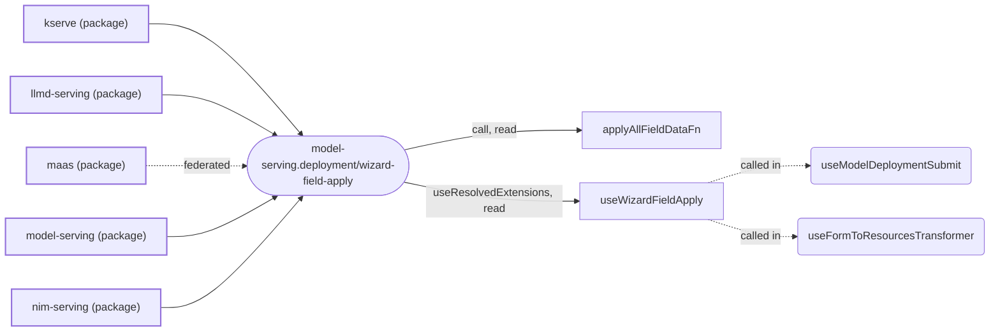

| Node | What | Link |
| --- | --- | --- |
| kserve (package) | contributes extensions of this point | [kserve](../../kserve/docs/extensions.md#contributes-to-model-servingdeploymentwizard-field-apply) |
| llmd-serving (package) | contributes extensions of this point | [llmd-serving](../../llmd-serving/docs/extensions.md#contributes-to-model-servingdeploymentwizard-field-apply) |
| maas (package) | contributes extensions of this point | [maas](../../maas/docs/extensions.md#contributes-to-model-servingdeploymentwizard-field-apply) |
| model-serving (package) | contributes extensions of this point | [model-serving](#contributes-to-model-servingdeploymentwizard-field-apply) |
| nim-serving (package) | contributes extensions of this point | [nim-serving](../../nim-serving/docs/extensions.md#contributes-to-model-servingdeploymentwizard-field-apply) |
| model-serving.deployment/wizard-field-apply | this extension point | [model-serving.deployment/wizard-field-apply](#model-servingdeploymentwizard-field-apply) |
| applyAllFieldDataFn | consumer in @odh-dashboard/model-serving — call, read | [applyAllFieldDataFn](../src/components/deploymentWizard/useWizardFieldApply.ts#L52-L86) |
| useWizardFieldApply | consumer in @odh-dashboard/model-serving — useResolvedExtensions, read | [useWizardFieldApply](../src/components/deploymentWizard/useWizardFieldApply.ts#L22-L98) |
| useModelDeploymentSubmit | calls useWizardFieldApply (one hop up) | calls useWizardFieldApply at [useModelDeploymentSubmit.ts:59](../src/components/deploymentWizard/deploying/useModelDeploymentSubmit.ts#L59-L62) |
| useFormToResourcesTransformer | calls useWizardFieldApply (one hop up) | calls useWizardFieldApply at [useFormToResourcesTransformer.tsx:65](../src/components/deploymentWizard/yaml/useFormToResourcesTransformer.tsx#L65) |

### model-serving.deployment/wizard-field-deployment-functions

Extension for making side-effect resources before a deployment is saved.
This runs before the inference service is created, in the same phase as other dry runs,
allowing extensions to validate that their associated resources can be created without conflicts.

The `fieldId` links this to a specific WizardFieldExtension so it is only
executed when that field is active.

Declared as [WizardFieldDeploymentFunctionsExtension](../extension-points/deployment-wizard.ts#L258-L312), with type parameters `T`, `D`.

**Properties:**

| Property | Required | Type | CodeRef of | Description |
| --- | --- | --- | --- | --- |
| `fieldId` | yes | `string` | — | The ID of the WizardField this deployment functions extension is associated with |
| `platform` | yes | `D['modelServingPlatformId'] \| 'all'` | — | The platform this deployment functions extension applies to, or 'all' for platform-agnostic fields |
| `preDeploy` | yes | `null \| CodeRef< ( fieldData: T, wizardState: WizardFormData['state'], deployment: DeploymentHookPayloadFor<D>, existingDeployment?: D, dryRun?: boolean, ) => Promise<DeploymentHookPayloadFor<D>> >` | — | Async function that runs before the deployment is saved. Throw to block the deployment. Called twice: first with `dryRun === true` alongside the other dry runs to validate, then again with `dryRun !== true` to perform the actual side effects before the deployment is created. |
| `postDeploy` | yes | `null \| CodeRef< ( fieldData: T, deployedModel: DeploymentHookPayloadFor<D>, existingDeployment?: D, dryRun?: boolean, ) => Promise<void> >` | — | Async function that runs after the deployment is saved. Called twice: first with `dryRun === true` alongside the other dry runs to validate, then again with `dryRun !== true` once the deployment has been created. |

**Implemented by:** [llmd-serving](../../llmd-serving/docs/extensions.md#contributes-to-model-servingdeploymentwizard-field-deployment-functions), [maas](../../maas/docs/extensions.md#contributes-to-model-servingdeploymentwizard-field-deployment-functions), [nim-serving](../../nim-serving/docs/extensions.md#contributes-to-model-servingdeploymentwizard-field-deployment-functions)

**Consumed in:** [model-serving](#consumes-model-servingdeploymentwizard-field-deployment-functions)

```mermaid
flowchart LR
  classDef pkg stroke-width:2px
  classDef point stroke-width:1px
  n_pkg__odh_dashboard_llmd_serving_3e146e["llmd-serving (package)"]:::pkg
  n_pkg__odh_dashboard_maas_87d494["maas (package)"]:::pkg
  n_pkg__odh_dashboard_nim_serving_241793["nim-serving (package)"]:::pkg
  n_model_serving_deployment_wizard_field_deployment_functions_dd7c85(["model-serving.deployment/wizard-field-deployment-functions"]):::point
  n_pkg__odh_dashboard_llmd_serving_3e146e --> n_model_serving_deployment_wizard_field_deployment_functions_dd7c85
  n_pkg__odh_dashboard_maas_87d494 -. "federated" .-> n_model_serving_deployment_wizard_field_deployment_functions_dd7c85
  n_pkg__odh_dashboard_nim_serving_241793 --> n_model_serving_deployment_wizard_field_deployment_functions_dd7c85
  n_symbol_packages_model_serving_src_components_deploymentWizard_deploying_useWizardFieldPostDeploy_ts_runPostDeploy_caa022["runPostDeploy"]
  n_model_serving_deployment_wizard_field_deployment_functions_dd7c85 -- "call, read" --> n_symbol_packages_model_serving_src_components_deploymentWizard_deploying_useWizardFieldPostDeploy_ts_runPostDeploy_caa022
  n_symbol_packages_model_serving_src_components_deploymentWizard_deploying_useWizardFieldPostDeploy_ts_useWizardFieldPostDeploy_4e3f3f["useWizardFieldPostDeploy"]
  n_model_serving_deployment_wizard_field_deployment_functions_dd7c85 -- "useResolvedExtensions, read" --> n_symbol_packages_model_serving_src_components_deploymentWizard_deploying_useWizardFieldPostDeploy_ts_useWizardFieldPostDeploy_4e3f3f
  n_symbol_packages_model_serving_src_components_deploymentWizard_deploying_useWizardFieldPreDeploy_ts_runPreDeploy_118432["runPreDeploy"]
  n_model_serving_deployment_wizard_field_deployment_functions_dd7c85 -- "call, read" --> n_symbol_packages_model_serving_src_components_deploymentWizard_deploying_useWizardFieldPreDeploy_ts_runPreDeploy_118432
  n_symbol_packages_model_serving_src_components_deploymentWizard_deploying_useWizardFieldPreDeploy_ts_useWizardFieldPreDeploy_9dbe1f["useWizardFieldPreDeploy"]
  n_model_serving_deployment_wizard_field_deployment_functions_dd7c85 -- "useResolvedExtensions, read" --> n_symbol_packages_model_serving_src_components_deploymentWizard_deploying_useWizardFieldPreDeploy_ts_useWizardFieldPreDeploy_9dbe1f
  n_symbol_packages_model_serving_src_components_deploymentWizard_deploying_useModelDeploymentSubmit_ts_useModelDeploymentSubmit_61e0df("useModelDeploymentSubmit")
  n_symbol_packages_model_serving_src_components_deploymentWizard_deploying_useWizardFieldPostDeploy_ts_useWizardFieldPostDeploy_4e3f3f -. "called in" .-> n_symbol_packages_model_serving_src_components_deploymentWizard_deploying_useModelDeploymentSubmit_ts_useModelDeploymentSubmit_61e0df
  n_symbol_packages_model_serving_src_components_deploymentWizard_deploying_useWizardFieldPreDeploy_ts_useWizardFieldPreDeploy_9dbe1f -. "called in" .-> n_symbol_packages_model_serving_src_components_deploymentWizard_deploying_useModelDeploymentSubmit_ts_useModelDeploymentSubmit_61e0df
```

| Node | What | Link |
| --- | --- | --- |
| llmd-serving (package) | contributes extensions of this point | [llmd-serving](../../llmd-serving/docs/extensions.md#contributes-to-model-servingdeploymentwizard-field-deployment-functions) |
| maas (package) | contributes extensions of this point | [maas](../../maas/docs/extensions.md#contributes-to-model-servingdeploymentwizard-field-deployment-functions) |
| nim-serving (package) | contributes extensions of this point | [nim-serving](../../nim-serving/docs/extensions.md#contributes-to-model-servingdeploymentwizard-field-deployment-functions) |
| model-serving.deployment/wizard-field-deployment-functions | this extension point | [model-serving.deployment/wizard-field-deployment-functions](#model-servingdeploymentwizard-field-deployment-functions) |
| runPostDeploy | consumer in @odh-dashboard/model-serving — call, read | [runPostDeploy](../src/components/deploymentWizard/deploying/useWizardFieldPostDeploy.ts#L46-L70) |
| useWizardFieldPostDeploy | consumer in @odh-dashboard/model-serving — useResolvedExtensions, read | [useWizardFieldPostDeploy](../src/components/deploymentWizard/deploying/useWizardFieldPostDeploy.ts#L26-L82) |
| runPreDeploy | consumer in @odh-dashboard/model-serving — call, read | [runPreDeploy](../src/components/deploymentWizard/deploying/useWizardFieldPreDeploy.ts#L45-L68) |
| useWizardFieldPreDeploy | consumer in @odh-dashboard/model-serving — useResolvedExtensions, read | [useWizardFieldPreDeploy](../src/components/deploymentWizard/deploying/useWizardFieldPreDeploy.ts#L25-L74) |
| useModelDeploymentSubmit | calls useWizardFieldPostDeploy, useWizardFieldPreDeploy (one hop up) | calls useWizardFieldPostDeploy at [useModelDeploymentSubmit.ts:64](../src/components/deploymentWizard/deploying/useModelDeploymentSubmit.ts#L64)<br>calls useWizardFieldPreDeploy at [useModelDeploymentSubmit.ts:63](../src/components/deploymentWizard/deploying/useModelDeploymentSubmit.ts#L63) |

### model-serving.deployment/wizard-field-extractor

Extension for extracting initial data from a deployment for a dynamic wizard field.
This is used when editing an existing deployment to populate the wizard field with
the current values from the deployment resource.

The `fieldId` links this extractor to a specific WizardFieldExtension, ensuring the
extracted data is provided to the correct field.

Declared as [WizardFieldExtractorExtension](../extension-points/deployment-wizard.ts#L227-L244), with type parameters `T`, `D`.

**Properties:**

| Property | Required | Type | CodeRef of | Description |
| --- | --- | --- | --- | --- |
| `fieldId` | yes | `string` | — | The ID of the WizardField this extractor is associated with |
| `platform` | yes | `D['modelServingPlatformId'] \| 'all'` | — | The platform this extractor applies to, or 'all' for platform-agnostic fields |
| `extract` | yes | `CodeRef<(deployment: D) => T \| undefined>` | `(deployment: D) => T \| undefined` | Extract function that retrieves the field's initial data from a deployment. |

**Implemented by:** [kserve](../../kserve/docs/extensions.md#contributes-to-model-servingdeploymentwizard-field-extractor), [llmd-serving](../../llmd-serving/docs/extensions.md#contributes-to-model-servingdeploymentwizard-field-extractor), [maas](../../maas/docs/extensions.md#contributes-to-model-servingdeploymentwizard-field-extractor), [model-serving](#contributes-to-model-servingdeploymentwizard-field-extractor), [nim-serving](../../nim-serving/docs/extensions.md#contributes-to-model-servingdeploymentwizard-field-extractor)

**Consumed in:** [model-serving](#consumes-model-servingdeploymentwizard-field-extractor)

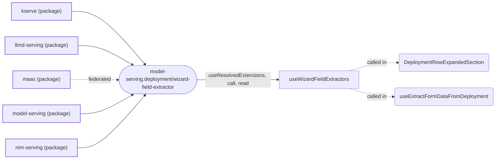

| Node | What | Link |
| --- | --- | --- |
| kserve (package) | contributes extensions of this point | [kserve](../../kserve/docs/extensions.md#contributes-to-model-servingdeploymentwizard-field-extractor) |
| llmd-serving (package) | contributes extensions of this point | [llmd-serving](../../llmd-serving/docs/extensions.md#contributes-to-model-servingdeploymentwizard-field-extractor) |
| maas (package) | contributes extensions of this point | [maas](../../maas/docs/extensions.md#contributes-to-model-servingdeploymentwizard-field-extractor) |
| model-serving (package) | contributes extensions of this point | [model-serving](#contributes-to-model-servingdeploymentwizard-field-extractor) |
| nim-serving (package) | contributes extensions of this point | [nim-serving](../../nim-serving/docs/extensions.md#contributes-to-model-servingdeploymentwizard-field-extractor) |
| model-serving.deployment/wizard-field-extractor | this extension point | [model-serving.deployment/wizard-field-extractor](#model-servingdeploymentwizard-field-extractor) |
| useWizardFieldExtractors | consumer in @odh-dashboard/model-serving — useResolvedExtensions, call, read | [useWizardFieldExtractors](../src/components/deploymentWizard/useWizardFieldExtractors.ts#L19-L60) |
| DeploymentRowExpandedSection | calls useWizardFieldExtractors (one hop up) | calls useWizardFieldExtractors at [DeploymentsTableRowExpandedSection.tsx:247](../src/components/deployments/row/DeploymentsTableRowExpandedSection.tsx#L247) |
| useExtractFormDataFromDeployment | calls useWizardFieldExtractors (one hop up) | calls useWizardFieldExtractors at [useExtractFormDataFromDeployment.ts:89](../src/components/deploymentWizard/useExtractFormDataFromDeployment.ts#L89) |

### model-serving.deployment/wizard-field-override

Declared as [DeploymentWizardFieldOverrideExtension](../extension-points/deployment-wizard.ts#L146-L152), with type parameters `D`.

**Properties:**

| Property | Required | Type | CodeRef of | Description |
| --- | --- | --- | --- | --- |
| `platform` | yes | `D['modelServingPlatformId']` | — |  |
| `field` | yes | `CodeRef<DeploymentWizardFieldOverride>` | `DeploymentWizardFieldOverride` |  |

**Implemented by:** [kserve](../../kserve/docs/extensions.md#contributes-to-model-servingdeploymentwizard-field-override), [llmd-serving](../../llmd-serving/docs/extensions.md#contributes-to-model-servingdeploymentwizard-field-override), [nim-serving](../../nim-serving/docs/extensions.md#contributes-to-model-servingdeploymentwizard-field-override)

**Consumed in:** [model-serving](#consumes-model-servingdeploymentwizard-field-override)

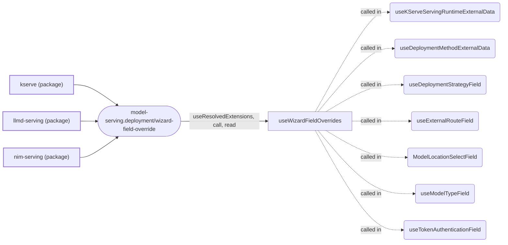

| Node | What | Link |
| --- | --- | --- |
| kserve (package) | contributes extensions of this point | [kserve](../../kserve/docs/extensions.md#contributes-to-model-servingdeploymentwizard-field-override) |
| llmd-serving (package) | contributes extensions of this point | [llmd-serving](../../llmd-serving/docs/extensions.md#contributes-to-model-servingdeploymentwizard-field-override) |
| nim-serving (package) | contributes extensions of this point | [nim-serving](../../nim-serving/docs/extensions.md#contributes-to-model-servingdeploymentwizard-field-override) |
| model-serving.deployment/wizard-field-override | this extension point | [model-serving.deployment/wizard-field-override](#model-servingdeploymentwizard-field-override) |
| useWizardFieldOverrides | consumer in @odh-dashboard/model-serving — useResolvedExtensions, call, read | [useWizardFieldOverrides](../src/components/deploymentWizard/dynamicFormUtils.ts#L15-L40) |
| useKServeServingRuntimeExternalData | calls useWizardFieldOverrides (one hop up) | calls useWizardFieldOverrides at [KServeServingRuntimeField.tsx:231](../../kserve/src/wizardFields/servingRuntime/KServeServingRuntimeField.tsx#L231-L234) |
| useDeploymentMethodExternalData | calls useWizardFieldOverrides (one hop up) | calls useWizardFieldOverrides at [DeploymentMethodSelectField.tsx:70](../src/components/deploymentWizard/fields/DeploymentMethodSelectField.tsx#L70) |
| useDeploymentStrategyField | calls useWizardFieldOverrides (one hop up) | calls useWizardFieldOverrides at [DeploymentStrategyField.tsx:37](../src/components/deploymentWizard/fields/DeploymentStrategyField.tsx#L37-L44) |
| useExternalRouteField | calls useWizardFieldOverrides (one hop up) | calls useWizardFieldOverrides at [ExternalRouteField.tsx:32](../src/components/deploymentWizard/fields/ExternalRouteField.tsx#L32-L36) |
| ModelLocationSelectField | calls useWizardFieldOverrides (one hop up) | calls useWizardFieldOverrides at [ModelLocationSelectField.tsx:72](../src/components/deploymentWizard/fields/ModelLocationSelectField.tsx#L72-L75) |
| useModelTypeField | calls useWizardFieldOverrides (one hop up) | calls useWizardFieldOverrides at [ModelTypeSelectField.tsx:45](../src/components/deploymentWizard/fields/ModelTypeSelectField.tsx#L45) |
| useTokenAuthenticationField | calls useWizardFieldOverrides (one hop up) | calls useWizardFieldOverrides at [TokenAuthenticationField.tsx:63](../src/components/deploymentWizard/fields/TokenAuthenticationField.tsx#L63-L67) |

### model-serving.deployments-table

Declared as [ModelServingDeploymentsTableExtension](../extension-points/index.ts#L206-L212), with type parameters `D`.

**Properties:**

| Property | Required | Type | CodeRef of | Description |
| --- | --- | --- | --- | --- |
| `platform` | yes | `D['modelServingPlatformId']` | — |  |
| `columns` | yes | `CodeRef<() => DeploymentsTableColumn<D>[]>` | `() => DeploymentsTableColumn<D>[]` |  |

**Consumed in:** [model-serving](#consumes-model-servingdeployments-table)

> **No contributors.** No package in this repository contributes an extension of this point.

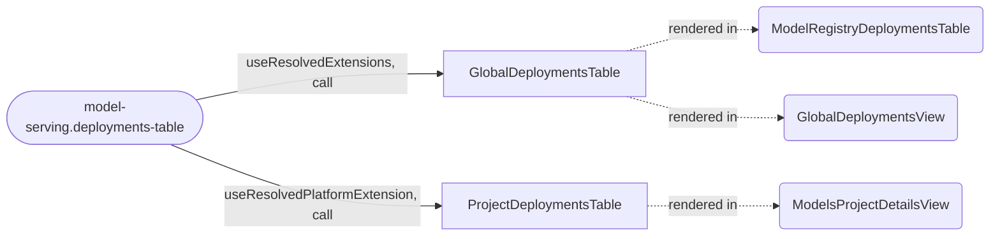

| Node | What | Link |
| --- | --- | --- |
| model-serving.deployments-table | this extension point | [model-serving.deployments-table](#model-servingdeployments-table) |
| GlobalDeploymentsTable | consumer in @odh-dashboard/model-serving — useResolvedExtensions, call | [GlobalDeploymentsTable](../src/components/global/GlobalDeploymentsTable.tsx#L35-L115) |
| ProjectDeploymentsTable | consumer in @odh-dashboard/model-serving — useResolvedPlatformExtension, call | [ProjectDeploymentsTable](../src/components/projectDetails/ProjectDeploymentsTable.tsx#L10-L28) |
| ModelRegistryDeploymentsTable | renders GlobalDeploymentsTable (one hop up) | renders GlobalDeploymentsTable at [ModelRegistryDeploymentsTable.tsx:35](../modelRegistry/ModelRegistryDeploymentsTable.tsx#L35-L41) |
| GlobalDeploymentsView | renders GlobalDeploymentsTable (one hop up) | renders GlobalDeploymentsTable at [GlobalDeploymentsView.tsx:119](../src/components/global/GlobalDeploymentsView.tsx#L119) |
| ModelsProjectDetailsView | renders ProjectDeploymentsTable (one hop up) | renders ProjectDeploymentsTable at [ModelsProjectDetailsView.tsx:112](../src/components/projectDetails/ModelsProjectDetailsView.tsx#L112-L116) |

### model-serving.deployments-table/start-stop-action

Declared as [ModelServingStartStopAction](../extension-points/index.ts#L280-L288), with type parameters `D`.

**Properties:**

| Property | Required | Type | CodeRef of | Description |
| --- | --- | --- | --- | --- |
| `platform` | yes | `D['modelServingPlatformId']` | — |  |
| `patchDeploymentStoppedStatus` | yes | `CodeRef< (deployment: D, isStopped: boolean) => Promise<D['model']> >` | `(deployment: D, isStopped: boolean) => Promise<D["model"]>` |  |

**Implemented by:** [kserve](../../kserve/docs/extensions.md#contributes-to-model-servingdeployments-tablestart-stop-action), [llmd-serving](../../llmd-serving/docs/extensions.md#contributes-to-model-servingdeployments-tablestart-stop-action), [nim-serving](../../nim-serving/docs/extensions.md#contributes-to-model-servingdeployments-tablestart-stop-action)

**Consumed in:** [model-serving](#consumes-model-servingdeployments-tablestart-stop-action)

```mermaid
flowchart LR
  classDef pkg stroke-width:2px
  classDef point stroke-width:1px
  n_pkg__odh_dashboard_kserve_5ec96a["kserve (package)"]:::pkg
  n_pkg__odh_dashboard_llmd_serving_3e146e["llmd-serving (package)"]:::pkg
  n_pkg__odh_dashboard_nim_serving_241793["nim-serving (package)"]:::pkg
  n_model_serving_deployments_table_start_stop_action_ea2e4f(["model-serving.deployments-table/start-stop-action"]):::point
  n_pkg__odh_dashboard_kserve_5ec96a --> n_model_serving_deployments_table_start_stop_action_ea2e4f
  n_pkg__odh_dashboard_llmd_serving_3e146e --> n_model_serving_deployments_table_start_stop_action_ea2e4f
  n_pkg__odh_dashboard_nim_serving_241793 --> n_model_serving_deployments_table_start_stop_action_ea2e4f
  n_symbol_packages_model_serving_src_components_deployments_row_DeploymentsTableRow_tsx_DeploymentRow_4a6253["DeploymentRow"]
  n_model_serving_deployments_table_start_stop_action_ea2e4f -- "useDeploymentExtension, call" --> n_symbol_packages_model_serving_src_components_deployments_row_DeploymentsTableRow_tsx_DeploymentRow_4a6253
  n_symbol_packages_model_serving_src_components_deployments_row_DeploymentsTableRow_tsx_onStart_650205["onStart"]
  n_model_serving_deployments_table_start_stop_action_ea2e4f -- "call" --> n_symbol_packages_model_serving_src_components_deployments_row_DeploymentsTableRow_tsx_onStart_650205
  n_symbol_packages_model_serving_src_components_deployments_row_DeploymentsTableRow_tsx_onStop_e04257["onStop"]
  n_model_serving_deployments_table_start_stop_action_ea2e4f -- "call" --> n_symbol_packages_model_serving_src_components_deployments_row_DeploymentsTableRow_tsx_onStop_e04257
  n_symbol_packages_model_serving_src_components_deployments_DeploymentsTable_tsx_DeploymentsTable_e63685("DeploymentsTable")
  n_symbol_packages_model_serving_src_components_deployments_row_DeploymentsTableRow_tsx_DeploymentRow_4a6253 -. "rendered in" .-> n_symbol_packages_model_serving_src_components_deployments_DeploymentsTable_tsx_DeploymentsTable_e63685
  n_symbol_packages_model_serving_src_components_deployments_row_DeploymentsTableRow_tsx_onStop_e04257 -. "called in" .-> n_symbol_packages_model_serving_src_components_deployments_row_DeploymentsTableRow_tsx_DeploymentRow_4a6253
```

| Node | What | Link |
| --- | --- | --- |
| kserve (package) | contributes extensions of this point | [kserve](../../kserve/docs/extensions.md#contributes-to-model-servingdeployments-tablestart-stop-action) |
| llmd-serving (package) | contributes extensions of this point | [llmd-serving](../../llmd-serving/docs/extensions.md#contributes-to-model-servingdeployments-tablestart-stop-action) |
| nim-serving (package) | contributes extensions of this point | [nim-serving](../../nim-serving/docs/extensions.md#contributes-to-model-servingdeployments-tablestart-stop-action) |
| model-serving.deployments-table/start-stop-action | this extension point | [model-serving.deployments-table/start-stop-action](#model-servingdeployments-tablestart-stop-action) |
| DeploymentRow | consumer in @odh-dashboard/model-serving — useDeploymentExtension, call; calls onStop (one hop up) | [DeploymentRow](../src/components/deployments/row/DeploymentsTableRow.tsx#L58-L345)<br>calls onStop at [DeploymentsTableRow.tsx:330](../src/components/deployments/row/DeploymentsTableRow.tsx#L330) |
| onStart | consumer in @odh-dashboard/model-serving — call | [onStart](../src/components/deployments/row/DeploymentsTableRow.tsx#L128-L137) |
| onStop | consumer in @odh-dashboard/model-serving — call | [onStop](../src/components/deployments/row/DeploymentsTableRow.tsx#L139-L147) |
| DeploymentsTable | renders DeploymentRow (one hop up) | renders DeploymentRow at [DeploymentsTable.tsx:134](../src/components/deployments/DeploymentsTable.tsx#L134-L143) |

### model-serving.deployments/banner

Extension point for platforms to display a banner on the deployments page.

Declared as [ModelServingDeploymentsBannerExtension](../extension-points/index.ts#L382-L388).

**Properties:**

| Property | Required | Type | CodeRef of | Description |
| --- | --- | --- | --- | --- |
| `id` | yes | `string` | — |  |
| `component` | yes | `CodeRef<React.ComponentType>` | `ComponentType<{}>` |  |

**Implemented by:** [maas](../../maas/docs/extensions.md#contributes-to-model-servingdeploymentsbanner)

**Consumed in:** [model-serving](#consumes-model-servingdeploymentsbanner)

```mermaid
flowchart LR
  classDef pkg stroke-width:2px
  classDef point stroke-width:1px
  n_pkg__odh_dashboard_maas_87d494["maas (package)"]:::pkg
  n_model_serving_deployments_banner_1a4c0c(["model-serving.deployments/banner"]):::point
  n_pkg__odh_dashboard_maas_87d494 -. "federated" .-> n_model_serving_deployments_banner_1a4c0c
  n_symbol_packages_model_serving_src_components_deployments_DeploymentsBannerSlot_tsx_DeploymentsBannerSlot_7a088d["DeploymentsBannerSlot"]
  n_model_serving_deployments_banner_1a4c0c -- "useExtensions, lazy-render, read" --> n_symbol_packages_model_serving_src_components_deployments_DeploymentsBannerSlot_tsx_DeploymentsBannerSlot_7a088d
  n_symbol_packages_model_serving_src_components_global_GlobalDeploymentsView_tsx_GlobalDeploymentsView_65ef1e("GlobalDeploymentsView")
  n_symbol_packages_model_serving_src_components_projectDetails_ModelsProjectDetailsView_tsx_ModelsProjectDetailsView_00505c("ModelsProjectDetailsView")
  n_symbol_packages_model_serving_src_components_deployments_DeploymentsBannerSlot_tsx_DeploymentsBannerSlot_7a088d -. "rendered in" .-> n_symbol_packages_model_serving_src_components_global_GlobalDeploymentsView_tsx_GlobalDeploymentsView_65ef1e
  n_symbol_packages_model_serving_src_components_deployments_DeploymentsBannerSlot_tsx_DeploymentsBannerSlot_7a088d -. "rendered in" .-> n_symbol_packages_model_serving_src_components_projectDetails_ModelsProjectDetailsView_tsx_ModelsProjectDetailsView_00505c
```

| Node | What | Link |
| --- | --- | --- |
| maas (package) | contributes extensions of this point | [maas](../../maas/docs/extensions.md#contributes-to-model-servingdeploymentsbanner) |
| model-serving.deployments/banner | this extension point | [model-serving.deployments/banner](#model-servingdeploymentsbanner) |
| DeploymentsBannerSlot | consumer in @odh-dashboard/model-serving — useExtensions, lazy-render, read | [DeploymentsBannerSlot](../src/components/deployments/DeploymentsBannerSlot.tsx#L8-L25) |
| GlobalDeploymentsView | renders DeploymentsBannerSlot (one hop up) | renders DeploymentsBannerSlot at [GlobalDeploymentsView.tsx:118](../src/components/global/GlobalDeploymentsView.tsx#L118) |
| ModelsProjectDetailsView | renders DeploymentsBannerSlot (one hop up) | renders DeploymentsBannerSlot at [ModelsProjectDetailsView.tsx:111](../src/components/projectDetails/ModelsProjectDetailsView.tsx#L111) |

### model-serving.metrics

Declared as [ModelServingMetricsExtension](../extension-points/index.ts#L252-L257), with type parameters `D`.

**Properties:**

| Property | Required | Type | CodeRef of | Description |
| --- | --- | --- | --- | --- |
| `platform` | yes | `D['modelServingPlatformId']` | — |  |

**Implemented by:** [kserve](../../kserve/docs/extensions.md#contributes-to-model-servingmetrics)

**Consumed in:** [model-serving](#consumes-model-servingmetrics)

```mermaid
flowchart LR
  classDef pkg stroke-width:2px
  classDef point stroke-width:1px
  n_pkg__odh_dashboard_kserve_5ec96a["kserve (package)"]:::pkg
  n_model_serving_metrics_8c16bc(["model-serving.metrics"]):::point
  n_pkg__odh_dashboard_kserve_5ec96a --> n_model_serving_metrics_8c16bc
  n_symbol_packages_model_serving_modelRegistry_ModelDetailsDeploymentCard_tsx_DeploymentCardContent_e8e12b["DeploymentCardContent"]
  n_model_serving_metrics_8c16bc -- "useDeploymentExtension" --> n_symbol_packages_model_serving_modelRegistry_ModelDetailsDeploymentCard_tsx_DeploymentCardContent_e8e12b
  n_symbol_packages_model_serving_src_components_deployments_row_DeploymentsTableRow_tsx_DeploymentRow_4a6253["DeploymentRow"]
  n_model_serving_metrics_8c16bc -- "useDeploymentExtension" --> n_symbol_packages_model_serving_src_components_deployments_row_DeploymentsTableRow_tsx_DeploymentRow_4a6253
  n_symbol_packages_model_serving_modelRegistry_ModelDetailsDeploymentCard_tsx_DeploymentCard_dc70f2("DeploymentCard")
  n_symbol_packages_model_serving_src_components_deployments_DeploymentsTable_tsx_DeploymentsTable_e63685("DeploymentsTable")
  n_symbol_packages_model_serving_modelRegistry_ModelDetailsDeploymentCard_tsx_DeploymentCardContent_e8e12b -. "rendered in" .-> n_symbol_packages_model_serving_modelRegistry_ModelDetailsDeploymentCard_tsx_DeploymentCard_dc70f2
  n_symbol_packages_model_serving_src_components_deployments_row_DeploymentsTableRow_tsx_DeploymentRow_4a6253 -. "rendered in" .-> n_symbol_packages_model_serving_src_components_deployments_DeploymentsTable_tsx_DeploymentsTable_e63685
```

| Node | What | Link |
| --- | --- | --- |
| kserve (package) | contributes extensions of this point | [kserve](../../kserve/docs/extensions.md#contributes-to-model-servingmetrics) |
| model-serving.metrics | this extension point | [model-serving.metrics](#model-servingmetrics) |
| DeploymentCardContent | consumer in @odh-dashboard/model-serving — useDeploymentExtension | [DeploymentCardContent](../modelRegistry/ModelDetailsDeploymentCard.tsx#L39-L93) |
| DeploymentRow | consumer in @odh-dashboard/model-serving — useDeploymentExtension | [DeploymentRow](../src/components/deployments/row/DeploymentsTableRow.tsx#L58-L345) |
| DeploymentCard | renders DeploymentCardContent (one hop up) | renders DeploymentCardContent at [ModelDetailsDeploymentCard.tsx:124](../modelRegistry/ModelDetailsDeploymentCard.tsx#L124-L127) |
| DeploymentsTable | renders DeploymentRow (one hop up) | renders DeploymentRow at [DeploymentsTable.tsx:134](../src/components/deployments/DeploymentsTable.tsx#L134-L143) |

### model-serving.platform

Declared as [ModelServingPlatformExtension](../extension-points/index.ts#L115-L149), with type parameters `D`.

**Properties:**

| Property | Required | Type | CodeRef of | Description |
| --- | --- | --- | --- | --- |
| `id` | yes | `D['modelServingPlatformId']` | — |  |
| `manage` | yes | `{ namespaceApplicationCase: NamespaceApplicationCase; priority: number \| 0; // larger numbers are higher priority default?: boolean; // if true, this platform will be the default if no other has priority projectRequirements: { annotations?: { [key: string]: string; }; labels?: { [key: string]: string; }; }; clusterRequirements?: { // for NIM mainly. May change in the future. other types of checks can be added here later. integrationAppName: string; }; }` | — |  |
| `enableCardText` | yes | `{ title: string; description: string; selectText: string; enabledText: string; objectType: ProjectObjectType; }` | — |  |
| `deployedModelsView` | yes | `{ startHintTitle: string; startHintDescription: string; deployButtonText: string; }` | — |  |

**Implemented by:** [kserve](../../kserve/docs/extensions.md#contributes-to-model-servingplatform), [nim-serving](../../nim-serving/docs/extensions.md#contributes-to-model-servingplatform)

**Consumed in:** [model-serving](#consumes-model-servingplatform)

```mermaid
flowchart LR
  classDef pkg stroke-width:2px
  classDef point stroke-width:1px
  n_pkg__odh_dashboard_kserve_5ec96a["kserve (package)"]:::pkg
  n_pkg__odh_dashboard_nim_serving_241793["nim-serving (package)"]:::pkg
  n_model_serving_platform_1d1e44(["model-serving.platform"]):::point
  n_pkg__odh_dashboard_kserve_5ec96a --> n_model_serving_platform_1d1e44
  n_pkg__odh_dashboard_nim_serving_241793 --> n_model_serving_platform_1d1e44
  n_symbol_packages_model_serving_modelRegistry_useAvailablePlatformIds_ts_useAvailablePlatformIds_dbf631["useAvailablePlatformIds"]
  n_model_serving_platform_1d1e44 -- "read" --> n_symbol_packages_model_serving_modelRegistry_useAvailablePlatformIds_ts_useAvailablePlatformIds_dbf631
  n_symbol_packages_model_serving_src_components_global_GlobalDeploymentsView_tsx_GlobalDeploymentsView_65ef1e["GlobalDeploymentsView"]
  n_model_serving_platform_1d1e44 -- "useExtensions" --> n_symbol_packages_model_serving_src_components_global_GlobalDeploymentsView_tsx_GlobalDeploymentsView_65ef1e
  n_symbol_packages_model_serving_src_components_global_GlobalModelsPage_tsx_GlobalModelsPageContent_7e5657["GlobalModelsPageContent"]
  n_model_serving_platform_1d1e44 -- "useExtensions" --> n_symbol_packages_model_serving_src_components_global_GlobalModelsPage_tsx_GlobalModelsPageContent_7e5657
  n_symbol_packages_model_serving_src_components_overview_DeployedModelsSection_tsx_DeployedModelsSection_490432["DeployedModelsSection"]
  n_model_serving_platform_1d1e44 -- "read" --> n_symbol_packages_model_serving_src_components_overview_DeployedModelsSection_tsx_DeployedModelsSection_490432
  n_symbol_packages_model_serving_src_components_overview_ModelPlatformSection_tsx_ModelPlatformSection_243e10["ModelPlatformSection"]
  n_model_serving_platform_1d1e44 -- "read" --> n_symbol_packages_model_serving_src_components_overview_ModelPlatformSection_tsx_ModelPlatformSection_243e10
  n_symbol_packages_model_serving_src_components_platforms_platformSelection_tsx_PlatformSelectionCard_d8db27["PlatformSelectionCard"]
  n_model_serving_platform_1d1e44 -- "read" --> n_symbol_packages_model_serving_src_components_platforms_platformSelection_tsx_PlatformSelectionCard_d8db27
  n_symbol_packages_model_serving_src_components_platforms_platformSelection_tsx_PlatformSelectionGallery_7129c5["PlatformSelectionGallery"]
  n_model_serving_platform_1d1e44 -- "read" --> n_symbol_packages_model_serving_src_components_platforms_platformSelection_tsx_PlatformSelectionGallery_7129c5
  n_symbol_packages_model_serving_src_components_projectDetails_ModelsProjectDetailsView_tsx_ModelsProjectDetailsView_00505c["ModelsProjectDetailsView"]
  n_model_serving_platform_1d1e44 -- "read" --> n_symbol_packages_model_serving_src_components_projectDetails_ModelsProjectDetailsView_tsx_ModelsProjectDetailsView_00505c
  n_symbol_packages_model_serving_src_components_projectDetails_NoModelsView_tsx_NoModelsView_716838["NoModelsView"]
  n_model_serving_platform_1d1e44 -- "read" --> n_symbol_packages_model_serving_src_components_projectDetails_NoModelsView_tsx_NoModelsView_716838
  n_symbol_packages_model_serving_src_concepts_extensionUtils_ts_usePlatformExtension_45c6c4["usePlatformExtension"]
  n_model_serving_platform_1d1e44 -- "read" --> n_symbol_packages_model_serving_src_concepts_extensionUtils_ts_usePlatformExtension_45c6c4
  n_symbol_packages_model_serving_src_concepts_extensionUtils_ts_useResolvedPlatformExtension_b6cb0c["useResolvedPlatformExtension"]
  n_model_serving_platform_1d1e44 -- "read" --> n_symbol_packages_model_serving_src_concepts_extensionUtils_ts_useResolvedPlatformExtension_b6cb0c
  n_symbol_packages_model_serving_src_concepts_resolvePlatformOverride_ts_resolveMultiProjectPlatformOverride_64a9d7["resolveMultiProjectPlatformOverride"]
  n_model_serving_platform_1d1e44 -- "read" --> n_symbol_packages_model_serving_src_concepts_resolvePlatformOverride_ts_resolveMultiProjectPlatformOverride_64a9d7
  n_symbol_packages_model_serving_src_concepts_useAvailableClusterPlatforms_tsx_isPlatformAvailable_cc6767["isPlatformAvailable"]
  n_model_serving_platform_1d1e44 -- "read" --> n_symbol_packages_model_serving_src_concepts_useAvailableClusterPlatforms_tsx_isPlatformAvailable_cc6767
  n_symbol_packages_model_serving_src_concepts_useAvailableClusterPlatforms_tsx_useAvailableClusterPlatforms_b6a87b["useAvailableClusterPlatforms"]
  n_model_serving_platform_1d1e44 -- "useExtensions" --> n_symbol_packages_model_serving_src_concepts_useAvailableClusterPlatforms_tsx_useAvailableClusterPlatforms_b6a87b
  n_symbol_packages_model_serving_src_concepts_useProjectServingPlatform_ts_getProjectServingPlatform_6f27aa["getProjectServingPlatform"]
  n_model_serving_platform_1d1e44 -- "read" --> n_symbol_packages_model_serving_src_concepts_useProjectServingPlatform_ts_getProjectServingPlatform_6f27aa
  n_symbol_packages_model_serving_src_concepts_useProjectServingPlatform_ts_isPlatformEnabled_cde312["isPlatformEnabled"]
  n_model_serving_platform_1d1e44 -- "read" --> n_symbol_packages_model_serving_src_concepts_useProjectServingPlatform_ts_isPlatformEnabled_cde312
  n_symbol_packages_model_serving_src_concepts_useProjectServingPlatform_ts_setProjectPlatform_b0a438["setProjectPlatform"]
  n_model_serving_platform_1d1e44 -- "read" --> n_symbol_packages_model_serving_src_concepts_useProjectServingPlatform_ts_setProjectPlatform_b0a438
  n_symbol_packages_model_serving_src_concepts_useProjectServingPlatform_ts_useProjectServingPlatform_12022d["useProjectServingPlatform"]
  n_model_serving_platform_1d1e44 -- "read" --> n_symbol_packages_model_serving_src_concepts_useProjectServingPlatform_ts_useProjectServingPlatform_12022d
  n_symbol_packages_model_serving_modelRegistry_DeployPrefillAction_tsx_DeployPrefillAction_31dea7("DeployPrefillAction")
  n_symbol_packages_model_serving_src_components_global_GlobalModelsPage_tsx_GlobalModelsPage_bb5336("GlobalModelsPage")
  n_symbol_packages_model_serving_src_ServeModelsSection_tsx_ServeModelsSectionContent_dd77b0("ServeModelsSectionContent")
  n_symbol_packages_model_serving_src_components_projectDetails_SelectPlatformView_tsx_SelectPlatformView_ef4c3c("SelectPlatformView")
  n_symbol_packages_model_serving_src_ModelsProjectDetailsTab_tsx_ModelsProjectDetailsTab_1a8da7("ModelsProjectDetailsTab")
  n_symbol_packages_model_serving_src_components_projectDetails_ProjectDeploymentsTable_tsx_ProjectDeploymentsTable_97a434("ProjectDeploymentsTable")
  n_symbol_packages_model_serving_src_components_deploymentWizard_ModelDeploymentWizardPage_tsx_ModelDeploymentWizardPage_290959("ModelDeploymentWizardPage")
  n_symbol_packages_model_serving_src_ServeModelsSection_tsx_ServeModelsSection_7c0387("ServeModelsSection")
  n_symbol_packages_model_serving_src_concepts_useProjectServingPlatform_ts_getMultiProjectServingPlatforms_abdd3c("getMultiProjectServingPlatforms")
  n_symbol_packages_model_serving_modelRegistry_useAvailablePlatformIds_ts_useAvailablePlatformIds_dbf631 -. "called in" .-> n_symbol_packages_model_serving_modelRegistry_DeployPrefillAction_tsx_DeployPrefillAction_31dea7
  n_symbol_packages_model_serving_src_components_global_GlobalDeploymentsView_tsx_GlobalDeploymentsView_65ef1e -. "rendered in" .-> n_symbol_packages_model_serving_src_components_global_GlobalModelsPage_tsx_GlobalModelsPageContent_7e5657
  n_symbol_packages_model_serving_src_components_global_GlobalModelsPage_tsx_GlobalModelsPageContent_7e5657 -. "rendered in" .-> n_symbol_packages_model_serving_src_components_global_GlobalModelsPage_tsx_GlobalModelsPage_bb5336
  n_symbol_packages_model_serving_src_components_overview_DeployedModelsSection_tsx_DeployedModelsSection_490432 -. "rendered in" .-> n_symbol_packages_model_serving_src_ServeModelsSection_tsx_ServeModelsSectionContent_dd77b0
  n_symbol_packages_model_serving_src_components_overview_ModelPlatformSection_tsx_ModelPlatformSection_243e10 -. "rendered in" .-> n_symbol_packages_model_serving_src_ServeModelsSection_tsx_ServeModelsSectionContent_dd77b0
  n_symbol_packages_model_serving_src_components_platforms_platformSelection_tsx_PlatformSelectionCard_d8db27 -. "rendered in" .-> n_symbol_packages_model_serving_src_components_platforms_platformSelection_tsx_PlatformSelectionGallery_7129c5
  n_symbol_packages_model_serving_src_components_platforms_platformSelection_tsx_PlatformSelectionGallery_7129c5 -. "rendered in" .-> n_symbol_packages_model_serving_src_components_overview_ModelPlatformSection_tsx_ModelPlatformSection_243e10
  n_symbol_packages_model_serving_src_components_platforms_platformSelection_tsx_PlatformSelectionGallery_7129c5 -. "rendered in" .-> n_symbol_packages_model_serving_src_components_projectDetails_SelectPlatformView_tsx_SelectPlatformView_ef4c3c
  n_symbol_packages_model_serving_src_components_projectDetails_ModelsProjectDetailsView_tsx_ModelsProjectDetailsView_00505c -. "rendered in" .-> n_symbol_packages_model_serving_src_ModelsProjectDetailsTab_tsx_ModelsProjectDetailsTab_1a8da7
  n_symbol_packages_model_serving_src_components_projectDetails_NoModelsView_tsx_NoModelsView_716838 -. "rendered in" .-> n_symbol_packages_model_serving_src_components_projectDetails_ModelsProjectDetailsView_tsx_ModelsProjectDetailsView_00505c
  n_symbol_packages_model_serving_src_concepts_extensionUtils_ts_useResolvedPlatformExtension_b6cb0c -. "called in" .-> n_symbol_packages_model_serving_src_components_projectDetails_ProjectDeploymentsTable_tsx_ProjectDeploymentsTable_97a434
  n_symbol_packages_model_serving_src_concepts_resolvePlatformOverride_ts_resolveMultiProjectPlatformOverride_64a9d7 -. "called in" .-> n_symbol_packages_model_serving_src_components_global_GlobalModelsPage_tsx_GlobalModelsPageContent_7e5657
  n_symbol_packages_model_serving_src_concepts_useAvailableClusterPlatforms_tsx_isPlatformAvailable_cc6767 -. "called in" .-> n_symbol_packages_model_serving_src_concepts_useAvailableClusterPlatforms_tsx_useAvailableClusterPlatforms_b6a87b
  n_symbol_packages_model_serving_src_concepts_useAvailableClusterPlatforms_tsx_useAvailableClusterPlatforms_b6a87b -. "called in" .-> n_symbol_packages_model_serving_modelRegistry_useAvailablePlatformIds_ts_useAvailablePlatformIds_dbf631
  n_symbol_packages_model_serving_src_concepts_useAvailableClusterPlatforms_tsx_useAvailableClusterPlatforms_b6a87b -. "called in" .-> n_symbol_packages_model_serving_src_components_deploymentWizard_ModelDeploymentWizardPage_tsx_ModelDeploymentWizardPage_290959
  n_symbol_packages_model_serving_src_concepts_useAvailableClusterPlatforms_tsx_useAvailableClusterPlatforms_b6a87b -. "called in" .-> n_symbol_packages_model_serving_src_ModelsProjectDetailsTab_tsx_ModelsProjectDetailsTab_1a8da7
  n_symbol_packages_model_serving_src_concepts_useAvailableClusterPlatforms_tsx_useAvailableClusterPlatforms_b6a87b -. "called in" .-> n_symbol_packages_model_serving_src_ServeModelsSection_tsx_ServeModelsSection_7c0387
  n_symbol_packages_model_serving_src_concepts_useProjectServingPlatform_ts_getProjectServingPlatform_6f27aa -. "called in" .-> n_symbol_packages_model_serving_src_concepts_useProjectServingPlatform_ts_getMultiProjectServingPlatforms_abdd3c
  n_symbol_packages_model_serving_src_concepts_useProjectServingPlatform_ts_getProjectServingPlatform_6f27aa -. "called in" .-> n_symbol_packages_model_serving_src_concepts_useProjectServingPlatform_ts_useProjectServingPlatform_12022d
  n_symbol_packages_model_serving_src_concepts_useProjectServingPlatform_ts_isPlatformEnabled_cde312 -. "called in" .-> n_symbol_packages_model_serving_src_concepts_useProjectServingPlatform_ts_getProjectServingPlatform_6f27aa
  n_symbol_packages_model_serving_src_concepts_useProjectServingPlatform_ts_useProjectServingPlatform_12022d -. "called in" .-> n_symbol_packages_model_serving_src_components_deploymentWizard_ModelDeploymentWizardPage_tsx_ModelDeploymentWizardPage_290959
  n_symbol_packages_model_serving_src_concepts_useProjectServingPlatform_ts_useProjectServingPlatform_12022d -. "called in" .-> n_symbol_packages_model_serving_src_components_overview_DeployedModelsSection_tsx_DeployedModelsSection_490432
  n_symbol_packages_model_serving_src_concepts_useProjectServingPlatform_ts_useProjectServingPlatform_12022d -. "called in" .-> n_symbol_packages_model_serving_src_components_overview_ModelPlatformSection_tsx_ModelPlatformSection_243e10
  n_symbol_packages_model_serving_src_concepts_useProjectServingPlatform_ts_useProjectServingPlatform_12022d -. "called in" .-> n_symbol_packages_model_serving_src_components_projectDetails_ModelsProjectDetailsView_tsx_ModelsProjectDetailsView_00505c
  n_symbol_packages_model_serving_src_concepts_useProjectServingPlatform_ts_useProjectServingPlatform_12022d -. "called in" .-> n_symbol_packages_model_serving_src_ModelsProjectDetailsTab_tsx_ModelsProjectDetailsTab_1a8da7
  n_symbol_packages_model_serving_src_concepts_useProjectServingPlatform_ts_useProjectServingPlatform_12022d -. "called in" .-> n_symbol_packages_model_serving_src_ServeModelsSection_tsx_ServeModelsSection_7c0387
```

| Node | What | Link |
| --- | --- | --- |
| kserve (package) | contributes extensions of this point | [kserve](../../kserve/docs/extensions.md#contributes-to-model-servingplatform) |
| nim-serving (package) | contributes extensions of this point | [nim-serving](../../nim-serving/docs/extensions.md#contributes-to-model-servingplatform) |
| model-serving.platform | this extension point | [model-serving.platform](#model-servingplatform) |
| useAvailablePlatformIds | consumer in @odh-dashboard/model-serving — read; calls useAvailableClusterPlatforms (one hop up) | [useAvailablePlatformIds](../modelRegistry/useAvailablePlatformIds.ts#L7-L11)<br>calls useAvailableClusterPlatforms at [useAvailablePlatformIds.ts:8](../modelRegistry/useAvailablePlatformIds.ts#L8) |
| GlobalDeploymentsView | consumer in @odh-dashboard/model-serving — useExtensions | [GlobalDeploymentsView](../src/components/global/GlobalDeploymentsView.tsx#L26-L123) |
| GlobalModelsPageContent | consumer in @odh-dashboard/model-serving — useExtensions; renders GlobalDeploymentsView (one hop up); calls resolveMultiProjectPlatformOverride (one hop up) | [GlobalModelsPageContent](../src/components/global/GlobalModelsPage.tsx#L39-L103)<br>renders GlobalDeploymentsView at [GlobalModelsPage.tsx:95](../src/components/global/GlobalModelsPage.tsx#L95-L100)<br>calls resolveMultiProjectPlatformOverride at [GlobalModelsPage.tsx:76](../src/components/global/GlobalModelsPage.tsx#L76) |
| DeployedModelsSection | consumer in @odh-dashboard/model-serving — read; calls useProjectServingPlatform (one hop up) | [DeployedModelsSection](../src/components/overview/DeployedModelsSection.tsx#L236-L296)<br>calls useProjectServingPlatform at [DeployedModelsSection.tsx:238](../src/components/overview/DeployedModelsSection.tsx#L238) |
| ModelPlatformSection | consumer in @odh-dashboard/model-serving — read; renders PlatformSelectionGallery (one hop up); calls useProjectServingPlatform (one hop up) | [ModelPlatformSection](../src/components/overview/ModelPlatformSection.tsx#L30-L135)<br>renders PlatformSelectionGallery at [ModelPlatformSection.tsx:62](../src/components/overview/ModelPlatformSection.tsx#L62-L68)<br>calls useProjectServingPlatform at [ModelPlatformSection.tsx:40](../src/components/overview/ModelPlatformSection.tsx#L40) |
| PlatformSelectionCard | consumer in @odh-dashboard/model-serving — read | [PlatformSelectionCard](../src/components/platforms/platformSelection.tsx#L19-L76) |
| PlatformSelectionGallery | consumer in @odh-dashboard/model-serving — read; renders PlatformSelectionCard (one hop up) | [PlatformSelectionGallery](../src/components/platforms/platformSelection.tsx#L79-L98)<br>renders PlatformSelectionCard at [platformSelection.tsx:89](../src/components/platforms/platformSelection.tsx#L89-L94) |
| ModelsProjectDetailsView | consumer in @odh-dashboard/model-serving — read; renders NoModelsView (one hop up); calls useProjectServingPlatform (one hop up) | [ModelsProjectDetailsView](../src/components/projectDetails/ModelsProjectDetailsView.tsx#L20-L121)<br>renders NoModelsView at [ModelsProjectDetailsView.tsx:103](../src/components/projectDetails/ModelsProjectDetailsView.tsx#L103-L108)<br>calls useProjectServingPlatform at [ModelsProjectDetailsView.tsx:38](../src/components/projectDetails/ModelsProjectDetailsView.tsx#L38) |
| NoModelsView | consumer in @odh-dashboard/model-serving — read | [NoModelsView](../src/components/projectDetails/NoModelsView.tsx#L9-L33) |
| usePlatformExtension | consumer in @odh-dashboard/model-serving — read | [usePlatformExtension](../src/concepts/extensionUtils.ts#L14-L24) |
| useResolvedPlatformExtension | consumer in @odh-dashboard/model-serving — read | [useResolvedPlatformExtension](../src/concepts/extensionUtils.ts#L26-L40) |
| resolveMultiProjectPlatformOverride | consumer in @odh-dashboard/model-serving — read | [resolveMultiProjectPlatformOverride](../src/concepts/resolvePlatformOverride.ts#L15-L28) |
| isPlatformAvailable | consumer in @odh-dashboard/model-serving — read | [isPlatformAvailable](../src/concepts/useAvailableClusterPlatforms.tsx#L12-L23) |
| useAvailableClusterPlatforms | consumer in @odh-dashboard/model-serving — useExtensions; calls isPlatformAvailable (one hop up) | [useAvailableClusterPlatforms](../src/concepts/useAvailableClusterPlatforms.tsx#L34-L59)<br>calls isPlatformAvailable at [useAvailableClusterPlatforms.tsx:42](../src/concepts/useAvailableClusterPlatforms.tsx#L42) |
| getProjectServingPlatform | consumer in @odh-dashboard/model-serving — read; calls isPlatformEnabled (one hop up) | [getProjectServingPlatform](../src/concepts/useProjectServingPlatform.ts#L30-L42)<br>calls isPlatformEnabled at [useProjectServingPlatform.ts:36](../src/concepts/useProjectServingPlatform.ts#L36) |
| isPlatformEnabled | consumer in @odh-dashboard/model-serving — read | [isPlatformEnabled](../src/concepts/useProjectServingPlatform.ts#L8-L24) |
| setProjectPlatform | consumer in @odh-dashboard/model-serving — read | [setProjectPlatform](../src/concepts/useProjectServingPlatform.ts#L93-L114) |
| useProjectServingPlatform | consumer in @odh-dashboard/model-serving — read; calls getProjectServingPlatform (one hop up) | [useProjectServingPlatform](../src/concepts/useProjectServingPlatform.ts#L63-L153)<br>calls getProjectServingPlatform at [useProjectServingPlatform.ts:78](../src/concepts/useProjectServingPlatform.ts#L78)<br>calls getProjectServingPlatform at [useProjectServingPlatform.ts:86](../src/concepts/useProjectServingPlatform.ts#L86) |
| DeployPrefillAction | calls useAvailablePlatformIds (one hop up) | calls useAvailablePlatformIds at [DeployPrefillAction.tsx:19](../modelRegistry/DeployPrefillAction.tsx#L19) |
| GlobalModelsPage | renders GlobalModelsPageContent (one hop up) | renders GlobalModelsPageContent at [GlobalModelsPage.tsx:161](../src/components/global/GlobalModelsPage.tsx#L161)<br>renders GlobalModelsPageContent at [GlobalModelsPage.tsx:186](../src/components/global/GlobalModelsPage.tsx#L186) |
| ServeModelsSectionContent | renders DeployedModelsSection, ModelPlatformSection (one hop up) | renders DeployedModelsSection at [ServeModelsSection.tsx:63](../src/ServeModelsSection.tsx#L63)<br>renders ModelPlatformSection at [ServeModelsSection.tsx:65](../src/ServeModelsSection.tsx#L65) |
| SelectPlatformView | renders PlatformSelectionGallery (one hop up) | renders PlatformSelectionGallery at [SelectPlatformView.tsx:45](../src/components/projectDetails/SelectPlatformView.tsx#L45-L50) |
| ModelsProjectDetailsTab | renders ModelsProjectDetailsView (one hop up); calls useAvailableClusterPlatforms, useProjectServingPlatform (one hop up) | renders ModelsProjectDetailsView at [ModelsProjectDetailsTab.tsx:54](../src/ModelsProjectDetailsTab.tsx#L54)<br>calls useAvailableClusterPlatforms at [ModelsProjectDetailsTab.tsx:29](../src/ModelsProjectDetailsTab.tsx#L29)<br>calls useProjectServingPlatform at [ModelsProjectDetailsTab.tsx:30](../src/ModelsProjectDetailsTab.tsx#L30) |
| ProjectDeploymentsTable | calls useResolvedPlatformExtension (one hop up) | calls useResolvedPlatformExtension at [ProjectDeploymentsTable.tsx:15](../src/components/projectDetails/ProjectDeploymentsTable.tsx#L15-L18) |
| ModelDeploymentWizardPage | calls useAvailableClusterPlatforms, useProjectServingPlatform (one hop up) | calls useAvailableClusterPlatforms at [ModelDeploymentWizardPage.tsx:64](../src/components/deploymentWizard/ModelDeploymentWizardPage.tsx#L64)<br>calls useProjectServingPlatform at [ModelDeploymentWizardPage.tsx:65](../src/components/deploymentWizard/ModelDeploymentWizardPage.tsx#L65) |
| ServeModelsSection | calls useAvailableClusterPlatforms, useProjectServingPlatform (one hop up) | calls useAvailableClusterPlatforms at [ServeModelsSection.tsx:71](../src/ServeModelsSection.tsx#L71)<br>calls useProjectServingPlatform at [ServeModelsSection.tsx:72](../src/ServeModelsSection.tsx#L72) |
| getMultiProjectServingPlatforms | calls getProjectServingPlatform (one hop up) | calls getProjectServingPlatform at [useProjectServingPlatform.ts:50](../src/concepts/useProjectServingPlatform.ts#L50) |

### model-serving.platform/delete-deployment

Declared as [ModelServingDeleteModal](../extension-points/index.ts#L231-L245), with type parameters `D`.

**Properties:**

| Property | Required | Type | CodeRef of | Description |
| --- | --- | --- | --- | --- |
| `platform` | yes | `D['modelServingPlatformId']` | — |  |
| `onDelete` | yes | `CodeRef<(deployment: D, options?: ModelServingDeleteOptions) => Promise<void>>` | `(deployment: D, options?: ModelServingDeleteOptions \| undefined) => Promise<void>` |  |
| `title` | yes | `string` | — |  |
| `submitButtonLabel` | yes | `string` | — |  |
| `isActive` | — | `CodeRef<(deployment: D) => boolean> \| true` | — | Whether this extension applies to the deployment. Active extensions with the highest priority win. |
| `priority` | — | `number` | — | Priority among active delete extensions for the same platform. |
| `DeleteModalComponent` | — | `ComponentCodeRef<ModelServingDeleteModalComponentProps<D>>` | `ComponentCodeRef<ModelServingDeleteModalComponentProps<D>>` | Optional platform-specific modal. It must call onClose(true) only after deletion succeeds. |

**Implemented by:** [kserve](../../kserve/docs/extensions.md#contributes-to-model-servingplatformdelete-deployment), [llmd-serving](../../llmd-serving/docs/extensions.md#contributes-to-model-servingplatformdelete-deployment), [nim-serving](../../nim-serving/docs/extensions.md#contributes-to-model-servingplatformdelete-deployment)

**Consumed in:** [model-serving](#consumes-model-servingplatformdelete-deployment)

```mermaid
flowchart LR
  classDef pkg stroke-width:2px
  classDef point stroke-width:1px
  n_pkg__odh_dashboard_kserve_5ec96a["kserve (package)"]:::pkg
  n_pkg__odh_dashboard_llmd_serving_3e146e["llmd-serving (package)"]:::pkg
  n_pkg__odh_dashboard_nim_serving_241793["nim-serving (package)"]:::pkg
  n_model_serving_platform_delete_deployment_259f2a(["model-serving.platform/delete-deployment"]):::point
  n_pkg__odh_dashboard_kserve_5ec96a --> n_model_serving_platform_delete_deployment_259f2a
  n_pkg__odh_dashboard_llmd_serving_3e146e --> n_model_serving_platform_delete_deployment_259f2a
  n_pkg__odh_dashboard_nim_serving_241793 --> n_model_serving_platform_delete_deployment_259f2a
  n_symbol_packages_model_serving_src_components_deleteModal_DeleteModelServingModal_tsx_DeleteModelServingModal_38884d["DeleteModelServingModal"]
  n_model_serving_platform_delete_deployment_259f2a -- "useResolvedDeploymentExtension, read" --> n_symbol_packages_model_serving_src_components_deleteModal_DeleteModelServingModal_tsx_DeleteModelServingModal_38884d
  n_symbol_packages_model_serving_src_components_deleteModal_DeleteModelServingModal_tsx_deletePrimaryResource_b7172f["deletePrimaryResource"]
  n_model_serving_platform_delete_deployment_259f2a -- "call" --> n_symbol_packages_model_serving_src_components_deleteModal_DeleteModelServingModal_tsx_deletePrimaryResource_b7172f
  n_symbol_packages_model_serving_src_components_deployments_DeploymentsTable_tsx_DeploymentsTable_e63685("DeploymentsTable")
  n_symbol_packages_model_serving_src_components_deleteModal_DeleteModelServingModal_tsx_onDelete_ec9d76("onDelete")
  n_symbol_packages_model_serving_src_components_deleteModal_DeleteModelServingModal_tsx_DeleteModelServingModal_38884d -. "rendered in" .-> n_symbol_packages_model_serving_src_components_deployments_DeploymentsTable_tsx_DeploymentsTable_e63685
  n_symbol_packages_model_serving_src_components_deleteModal_DeleteModelServingModal_tsx_deletePrimaryResource_b7172f -. "called in" .-> n_symbol_packages_model_serving_src_components_deleteModal_DeleteModelServingModal_tsx_onDelete_ec9d76
```

| Node | What | Link |
| --- | --- | --- |
| kserve (package) | contributes extensions of this point | [kserve](../../kserve/docs/extensions.md#contributes-to-model-servingplatformdelete-deployment) |
| llmd-serving (package) | contributes extensions of this point | [llmd-serving](../../llmd-serving/docs/extensions.md#contributes-to-model-servingplatformdelete-deployment) |
| nim-serving (package) | contributes extensions of this point | [nim-serving](../../nim-serving/docs/extensions.md#contributes-to-model-servingplatformdelete-deployment) |
| model-serving.platform/delete-deployment | this extension point | [model-serving.platform/delete-deployment](#model-servingplatformdelete-deployment) |
| DeleteModelServingModal | consumer in @odh-dashboard/model-serving — useResolvedDeploymentExtension, read | [DeleteModelServingModal](../src/components/deleteModal/DeleteModelServingModal.tsx#L26-L107) |
| deletePrimaryResource | consumer in @odh-dashboard/model-serving — call | [deletePrimaryResource](../src/components/deleteModal/DeleteModelServingModal.tsx#L44-L53) |
| DeploymentsTable | renders DeleteModelServingModal (one hop up) | renders DeleteModelServingModal at [DeploymentsTable.tsx:150](../src/components/deployments/DeploymentsTable.tsx#L150-L159) |
| onDelete | calls deletePrimaryResource (one hop up) | calls deletePrimaryResource at [DeleteModelServingModal.tsx:62](../src/components/deleteModal/DeleteModelServingModal.tsx#L62) |

### model-serving.platform/exclude-deployment

Extension point for platforms to declare resources that should be excluded from
another platform's deployment listings. This prevents duplicate entries when a
platform's operator creates child resources that another platform would also list.

`platform` identifies the source platform registering the exclusion.
`excludeFromPlatform` identifies which platform should apply this filter.
`filter` returns true for resources that belong to this platform and should NOT
appear in the target platform's deployment table.

Declared as [ModelServingExcludeDeploymentExtension](../extension-points/index.ts#L362-L369).

**Properties:**

| Property | Required | Type | CodeRef of | Description |
| --- | --- | --- | --- | --- |
| `platform` | yes | `string` | — |  |
| `excludeFromPlatform` | yes | `string` | — |  |
| `filter` | yes | `CodeRef<(resource: K8sResourceCommon) => boolean>` | `(resource: K8sResourceCommon) => boolean` |  |

**Implemented by:** [nim-serving](../../nim-serving/docs/extensions.md#contributes-to-model-servingplatformexclude-deployment)

**Consumed in:** [kserve](../../kserve/docs/extensions.md#consumes-model-servingplatformexclude-deployment)

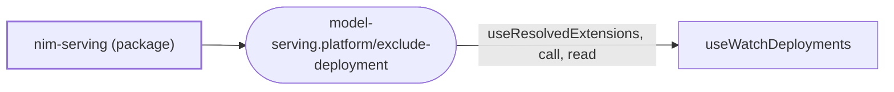

| Node | What | Link |
| --- | --- | --- |
| nim-serving (package) | contributes extensions of this point | [nim-serving](../../nim-serving/docs/extensions.md#contributes-to-model-servingplatformexclude-deployment) |
| model-serving.platform/exclude-deployment | this extension point | [model-serving.platform/exclude-deployment](#model-servingplatformexclude-deployment) |
| useWatchDeployments | consumer in @odh-dashboard/kserve — useResolvedExtensions, call, read | [useWatchDeployments](../../kserve/src/deployments.ts#L36-L130) |

### model-serving.platform/fetch-deployment-status

Declared as [ModelServingPlatformFetchDeploymentStatus](../extension-points/index.ts#L295-L302), with type parameters `D`.

**Properties:**

| Property | Required | Type | CodeRef of | Description |
| --- | --- | --- | --- | --- |
| `platform` | yes | `D['modelServingPlatformId']` | — |  |
| `fetch` | yes | `CodeRef<(name: string, namespace: string) => Promise<D \| null>>` | `(name: string, namespace: string) => Promise<D \| null>` |  |

**Implemented by:** [kserve](../../kserve/docs/extensions.md#contributes-to-model-servingplatformfetch-deployment-status)

**Consumed in:** [model-serving](#consumes-model-servingplatformfetch-deployment-status)

```mermaid
flowchart LR
  classDef pkg stroke-width:2px
  classDef point stroke-width:1px
  n_pkg__odh_dashboard_kserve_5ec96a["kserve (package)"]:::pkg
  n_model_serving_platform_fetch_deployment_status_63d9c2(["model-serving.platform/fetch-deployment-status"]):::point
  n_pkg__odh_dashboard_kserve_5ec96a --> n_model_serving_platform_fetch_deployment_status_63d9c2
  n_symbol_packages_model_serving_src_concepts_useModelDeploymentNotification_ts_useModelDeploymentNotification_2c9f9f["useModelDeploymentNotification"]
  n_model_serving_platform_fetch_deployment_status_63d9c2 -- "useResolvedDeploymentExtension" --> n_symbol_packages_model_serving_src_concepts_useModelDeploymentNotification_ts_useModelDeploymentNotification_2c9f9f
  n_symbol_packages_model_serving_src_concepts_useModelDeploymentNotification_ts_watchDeployment_d23d01["watchDeployment"]
  n_model_serving_platform_fetch_deployment_status_63d9c2 -- "call" --> n_symbol_packages_model_serving_src_concepts_useModelDeploymentNotification_ts_watchDeployment_d23d01
  n_symbol_packages_model_serving_src_components_deployments_row_DeploymentsTableRow_tsx_DeploymentRow_4a6253("DeploymentRow")
  n_symbol_packages_model_serving_src_concepts_useModelDeploymentNotification_ts_useModelDeploymentNotification_2c9f9f -. "called in" .-> n_symbol_packages_model_serving_src_components_deployments_row_DeploymentsTableRow_tsx_DeploymentRow_4a6253
```

| Node | What | Link |
| --- | --- | --- |
| kserve (package) | contributes extensions of this point | [kserve](../../kserve/docs/extensions.md#contributes-to-model-servingplatformfetch-deployment-status) |
| model-serving.platform/fetch-deployment-status | this extension point | [model-serving.platform/fetch-deployment-status](#model-servingplatformfetch-deployment-status) |
| useModelDeploymentNotification | consumer in @odh-dashboard/model-serving — useResolvedDeploymentExtension | [useModelDeploymentNotification](../src/concepts/useModelDeploymentNotification.ts#L21-L156) |
| watchDeployment | consumer in @odh-dashboard/model-serving — call | [watchDeployment](../src/concepts/useModelDeploymentNotification.ts#L38-L153) |
| DeploymentRow | calls useModelDeploymentNotification (one hop up) | calls useModelDeploymentNotification at [DeploymentsTableRow.tsx:87](../src/components/deployments/row/DeploymentsTableRow.tsx#L87) |

### model-serving.platform/global-models-page

Declared as [ModelServingPlatformGlobalModelsPageExtension](../extension-points/index.ts#L339-L346), with type parameters `D`.

**Properties:**

| Property | Required | Type | CodeRef of | Description |
| --- | --- | --- | --- | --- |
| `platform` | yes | `D['modelServingPlatformId']` | — |  |
| `component` | yes | `ComponentCodeRef` | `{ default: ComponentType<AnyObject>; }` |  |

**Implemented by:** [nim-serving](../../nim-serving/docs/extensions.md#contributes-to-model-servingplatformglobal-models-page)

**Consumed in:** [model-serving](#consumes-model-servingplatformglobal-models-page)

```mermaid
flowchart LR
  classDef pkg stroke-width:2px
  classDef point stroke-width:1px
  n_pkg__odh_dashboard_nim_serving_241793["nim-serving (package)"]:::pkg
  n_model_serving_platform_global_models_page_508e89(["model-serving.platform/global-models-page"]):::point
  n_pkg__odh_dashboard_nim_serving_241793 --> n_model_serving_platform_global_models_page_508e89
  n_symbol_packages_model_serving_src_components_global_GlobalModelsPage_tsx_GlobalModelsPageContent_7e5657["GlobalModelsPageContent"]
  n_model_serving_platform_global_models_page_508e89 -- "useExtensions, lazy-render" --> n_symbol_packages_model_serving_src_components_global_GlobalModelsPage_tsx_GlobalModelsPageContent_7e5657
  n_symbol_packages_model_serving_src_components_global_GlobalModelsPage_tsx_GlobalModelsPage_bb5336("GlobalModelsPage")
  n_symbol_packages_model_serving_src_components_global_GlobalModelsPage_tsx_GlobalModelsPageContent_7e5657 -. "rendered in" .-> n_symbol_packages_model_serving_src_components_global_GlobalModelsPage_tsx_GlobalModelsPage_bb5336
```

| Node | What | Link |
| --- | --- | --- |
| nim-serving (package) | contributes extensions of this point | [nim-serving](../../nim-serving/docs/extensions.md#contributes-to-model-servingplatformglobal-models-page) |
| model-serving.platform/global-models-page | this extension point | [model-serving.platform/global-models-page](#model-servingplatformglobal-models-page) |
| GlobalModelsPageContent | consumer in @odh-dashboard/model-serving — useExtensions, lazy-render | [GlobalModelsPageContent](../src/components/global/GlobalModelsPage.tsx#L39-L103) |
| GlobalModelsPage | renders GlobalModelsPageContent (one hop up) | renders GlobalModelsPageContent at [GlobalModelsPage.tsx:161](../src/components/global/GlobalModelsPage.tsx#L161)<br>renders GlobalModelsPageContent at [GlobalModelsPage.tsx:186](../src/components/global/GlobalModelsPage.tsx#L186) |

### model-serving.platform/overview-section

Declared as [ModelServingPlatformOverviewSectionExtension](../extension-points/index.ts#L326-L333), with type parameters `D`.

**Properties:**

| Property | Required | Type | CodeRef of | Description |
| --- | --- | --- | --- | --- |
| `platform` | yes | `D['modelServingPlatformId']` | — |  |
| `component` | yes | `ComponentCodeRef` | `{ default: ComponentType<AnyObject>; }` |  |

**Implemented by:** [nim-serving](../../nim-serving/docs/extensions.md#contributes-to-model-servingplatformoverview-section)

**Consumed in:** [model-serving](#consumes-model-servingplatformoverview-section)

```mermaid
flowchart LR
  classDef pkg stroke-width:2px
  classDef point stroke-width:1px
  n_pkg__odh_dashboard_nim_serving_241793["nim-serving (package)"]:::pkg
  n_model_serving_platform_overview_section_7dcf20(["model-serving.platform/overview-section"]):::point
  n_pkg__odh_dashboard_nim_serving_241793 --> n_model_serving_platform_overview_section_7dcf20
  n_symbol_packages_model_serving_src_ServeModelsSection_tsx_ServeModelsSection_7c0387["ServeModelsSection"]
  n_model_serving_platform_overview_section_7dcf20 -- "useExtensions, lazy-render" --> n_symbol_packages_model_serving_src_ServeModelsSection_tsx_ServeModelsSection_7c0387
```

| Node | What | Link |
| --- | --- | --- |
| nim-serving (package) | contributes extensions of this point | [nim-serving](../../nim-serving/docs/extensions.md#contributes-to-model-servingplatformoverview-section) |
| model-serving.platform/overview-section | this extension point | [model-serving.platform/overview-section](#model-servingplatformoverview-section) |
| ServeModelsSection | consumer in @odh-dashboard/model-serving — useExtensions, lazy-render | [ServeModelsSection](../src/ServeModelsSection.tsx#L68-L99) |

### model-serving.platform/project-details-tab

Declared as [ModelServingPlatformProjectDetailsTabExtension](../extension-points/index.ts#L313-L320), with type parameters `D`.

**Properties:**

| Property | Required | Type | CodeRef of | Description |
| --- | --- | --- | --- | --- |
| `platform` | yes | `D['modelServingPlatformId']` | — |  |
| `component` | yes | `ComponentCodeRef` | `{ default: ComponentType<AnyObject>; }` |  |

**Implemented by:** [nim-serving](../../nim-serving/docs/extensions.md#contributes-to-model-servingplatformproject-details-tab)

**Consumed in:** [model-serving](#consumes-model-servingplatformproject-details-tab)

```mermaid
flowchart LR
  classDef pkg stroke-width:2px
  classDef point stroke-width:1px
  n_pkg__odh_dashboard_nim_serving_241793["nim-serving (package)"]:::pkg
  n_model_serving_platform_project_details_tab_fce2f7(["model-serving.platform/project-details-tab"]):::point
  n_pkg__odh_dashboard_nim_serving_241793 --> n_model_serving_platform_project_details_tab_fce2f7
  n_symbol_packages_model_serving_src_ModelsProjectDetailsTab_tsx_ModelsProjectDetailsTab_1a8da7["ModelsProjectDetailsTab"]
  n_model_serving_platform_project_details_tab_fce2f7 -- "useExtensions, lazy-render" --> n_symbol_packages_model_serving_src_ModelsProjectDetailsTab_tsx_ModelsProjectDetailsTab_1a8da7
```

| Node | What | Link |
| --- | --- | --- |
| nim-serving (package) | contributes extensions of this point | [nim-serving](../../nim-serving/docs/extensions.md#contributes-to-model-servingplatformproject-details-tab) |
| model-serving.platform/project-details-tab | this extension point | [model-serving.platform/project-details-tab](#model-servingplatformproject-details-tab) |
| ModelsProjectDetailsTab | consumer in @odh-dashboard/model-serving — useExtensions, lazy-render | [ModelsProjectDetailsTab](../src/ModelsProjectDetailsTab.tsx#L25-L57) |

### model-serving.platform/watch-deployments

Extension point for a `watch` hook to watch deployments for a given platform.

Declared as [ModelServingPlatformWatchDeploymentsExtension](../extension-points/index.ts#L164-L178), with type parameters `D`.

**Properties:**

| Property | Required | Type | CodeRef of | Description |
| --- | --- | --- | --- | --- |
| `platform` | yes | `D['modelServingPlatformId']` | — |  |
| `watch` | yes | `CodeRef< ( project: ProjectKind, labelSelectors?: { [key: string]: string }, filterFn?: (model: D['model']) => boolean, opts?: K8sAPIOptions, ) => [D[] \| undefined, boolean, Error[] \| undefined] >` | `(project: ProjectKind, labelSelectors?: { [key: string]: string; } \| undefined, filterFn?: ((model: D["model"]) => boole…` |  |

**Implemented by:** [kserve](../../kserve/docs/extensions.md#contributes-to-model-servingplatformwatch-deployments), [llmd-serving](../../llmd-serving/docs/extensions.md#contributes-to-model-servingplatformwatch-deployments), [nim-serving](../../nim-serving/docs/extensions.md#contributes-to-model-servingplatformwatch-deployments)

**Consumed in:** [model-serving](#consumes-model-servingplatformwatch-deployments)

```mermaid
flowchart LR
  classDef pkg stroke-width:2px
  classDef point stroke-width:1px
  n_pkg__odh_dashboard_kserve_5ec96a["kserve (package)"]:::pkg
  n_pkg__odh_dashboard_llmd_serving_3e146e["llmd-serving (package)"]:::pkg
  n_pkg__odh_dashboard_nim_serving_241793["nim-serving (package)"]:::pkg
  n_model_serving_platform_watch_deployments_cf294d(["model-serving.platform/watch-deployments"]):::point
  n_pkg__odh_dashboard_kserve_5ec96a --> n_model_serving_platform_watch_deployments_cf294d
  n_pkg__odh_dashboard_llmd_serving_3e146e --> n_model_serving_platform_watch_deployments_cf294d
  n_pkg__odh_dashboard_nim_serving_241793 --> n_model_serving_platform_watch_deployments_cf294d
  n_symbol_packages_model_serving_src_concepts_ModelDeploymentsContext_tsx_ModelDeploymentsProvider_91ec15["ModelDeploymentsProvider"]
  n_model_serving_platform_watch_deployments_cf294d -- "useResolvedExtensions, read" --> n_symbol_packages_model_serving_src_concepts_ModelDeploymentsContext_tsx_ModelDeploymentsProvider_91ec15
  n_symbol_packages_model_serving_src_concepts_ModelDeploymentsContext_tsx_PlatformDeploymentWatcher_786ac1["PlatformDeploymentWatcher"]
  n_model_serving_platform_watch_deployments_cf294d -- "hook-run" --> n_symbol_packages_model_serving_src_concepts_ModelDeploymentsContext_tsx_PlatformDeploymentWatcher_786ac1
  n_symbol_packages_model_serving_modelRegistry_DeploymentsContextProvider_tsx_DeploymentsContextProvider_40327b("DeploymentsContextProvider")
  n_symbol_packages_model_serving_modelRegistry_ModelDetailsDeploymentCard_tsx_ModelDetailsDeploymentCard_5d8d97("ModelDetailsDeploymentCard")
  n_symbol_packages_model_serving_modelRegistry_ModelWideDeploymentsTab_tsx_ModelWideDeploymentsTab_2700b3("ModelWideDeploymentsTab")
  n_symbol_packages_model_serving_modelRegistry_VersionDeploymentsTab_tsx_VersionDeploymentsTab_d9ab8f("VersionDeploymentsTab")
  n_symbol_packages_model_serving_src_components_deploymentWizard_ModelDeploymentWizardPage_tsx_ModelDeploymentWizardPage_290959("ModelDeploymentWizardPage")
  n_symbol_packages_model_serving_src_components_global_GlobalModelsPage_tsx_GlobalModelsPageContent_7e5657("GlobalModelsPageContent")
  n_symbol_packages_model_serving_src_ModelsProjectDetailsTab_tsx_ModelsProjectDetailsTab_1a8da7("ModelsProjectDetailsTab")
  n_symbol_packages_model_serving_src_ServeModelsSection_tsx_ServeModelsSection_7c0387("ServeModelsSection")
  n_symbol_packages_model_serving_src_concepts_ModelDeploymentsContext_tsx_ModelDeploymentsProvider_91ec15 -. "rendered in" .-> n_symbol_packages_model_serving_modelRegistry_DeploymentsContextProvider_tsx_DeploymentsContextProvider_40327b
  n_symbol_packages_model_serving_src_concepts_ModelDeploymentsContext_tsx_ModelDeploymentsProvider_91ec15 -. "rendered in" .-> n_symbol_packages_model_serving_modelRegistry_ModelDetailsDeploymentCard_tsx_ModelDetailsDeploymentCard_5d8d97
  n_symbol_packages_model_serving_src_concepts_ModelDeploymentsContext_tsx_ModelDeploymentsProvider_91ec15 -. "rendered in" .-> n_symbol_packages_model_serving_modelRegistry_ModelWideDeploymentsTab_tsx_ModelWideDeploymentsTab_2700b3
  n_symbol_packages_model_serving_src_concepts_ModelDeploymentsContext_tsx_ModelDeploymentsProvider_91ec15 -. "rendered in" .-> n_symbol_packages_model_serving_modelRegistry_VersionDeploymentsTab_tsx_VersionDeploymentsTab_d9ab8f
  n_symbol_packages_model_serving_src_concepts_ModelDeploymentsContext_tsx_ModelDeploymentsProvider_91ec15 -. "rendered in" .-> n_symbol_packages_model_serving_src_components_deploymentWizard_ModelDeploymentWizardPage_tsx_ModelDeploymentWizardPage_290959
  n_symbol_packages_model_serving_src_concepts_ModelDeploymentsContext_tsx_ModelDeploymentsProvider_91ec15 -. "rendered in" .-> n_symbol_packages_model_serving_src_components_global_GlobalModelsPage_tsx_GlobalModelsPageContent_7e5657
  n_symbol_packages_model_serving_src_concepts_ModelDeploymentsContext_tsx_ModelDeploymentsProvider_91ec15 -. "rendered in" .-> n_symbol_packages_model_serving_src_ModelsProjectDetailsTab_tsx_ModelsProjectDetailsTab_1a8da7
  n_symbol_packages_model_serving_src_concepts_ModelDeploymentsContext_tsx_ModelDeploymentsProvider_91ec15 -. "rendered in" .-> n_symbol_packages_model_serving_src_ServeModelsSection_tsx_ServeModelsSection_7c0387
  n_symbol_packages_model_serving_src_concepts_ModelDeploymentsContext_tsx_PlatformDeploymentWatcher_786ac1 -. "rendered in" .-> n_symbol_packages_model_serving_src_concepts_ModelDeploymentsContext_tsx_ModelDeploymentsProvider_91ec15
```

| Node | What | Link |
| --- | --- | --- |
| kserve (package) | contributes extensions of this point | [kserve](../../kserve/docs/extensions.md#contributes-to-model-servingplatformwatch-deployments) |
| llmd-serving (package) | contributes extensions of this point | [llmd-serving](../../llmd-serving/docs/extensions.md#contributes-to-model-servingplatformwatch-deployments) |
| nim-serving (package) | contributes extensions of this point | [nim-serving](../../nim-serving/docs/extensions.md#contributes-to-model-servingplatformwatch-deployments) |
| model-serving.platform/watch-deployments | this extension point | [model-serving.platform/watch-deployments](#model-servingplatformwatch-deployments) |
| ModelDeploymentsProvider | consumer in @odh-dashboard/model-serving — useResolvedExtensions, read; renders PlatformDeploymentWatcher (one hop up) | [ModelDeploymentsProvider](../src/concepts/ModelDeploymentsContext.tsx#L68-L167)<br>renders PlatformDeploymentWatcher at [ModelDeploymentsContext.tsx:152](../src/concepts/ModelDeploymentsContext.tsx#L152-L161) |
| PlatformDeploymentWatcher | consumer in @odh-dashboard/model-serving — hook-run | [PlatformDeploymentWatcher](../src/concepts/ModelDeploymentsContext.tsx#L37-L59) |
| DeploymentsContextProvider | renders ModelDeploymentsProvider (one hop up) | renders ModelDeploymentsProvider at [DeploymentsContextProvider.tsx:44](../modelRegistry/DeploymentsContextProvider.tsx#L44-L48) |
| ModelDetailsDeploymentCard | renders ModelDeploymentsProvider (one hop up) | renders ModelDeploymentsProvider at [ModelDetailsDeploymentCard.tsx:163](../modelRegistry/ModelDetailsDeploymentCard.tsx#L163-L167) |
| ModelWideDeploymentsTab | renders ModelDeploymentsProvider (one hop up) | renders ModelDeploymentsProvider at [ModelWideDeploymentsTab.tsx:58](../modelRegistry/ModelWideDeploymentsTab.tsx#L58-L62) |
| VersionDeploymentsTab | renders ModelDeploymentsProvider (one hop up) | renders ModelDeploymentsProvider at [VersionDeploymentsTab.tsx:58](../modelRegistry/VersionDeploymentsTab.tsx#L58-L62) |
| ModelDeploymentWizardPage | renders ModelDeploymentsProvider (one hop up) | renders ModelDeploymentsProvider at [ModelDeploymentWizardPage.tsx:92](../src/components/deploymentWizard/ModelDeploymentWizardPage.tsx#L92) |
| GlobalModelsPageContent | renders ModelDeploymentsProvider (one hop up) | renders ModelDeploymentsProvider at [GlobalModelsPage.tsx:94](../src/components/global/GlobalModelsPage.tsx#L94) |
| ModelsProjectDetailsTab | renders ModelDeploymentsProvider (one hop up) | renders ModelDeploymentsProvider at [ModelsProjectDetailsTab.tsx:53](../src/ModelsProjectDetailsTab.tsx#L53) |
| ServeModelsSection | renders ModelDeploymentsProvider (one hop up) | renders ModelDeploymentsProvider at [ServeModelsSection.tsx:95](../src/ServeModelsSection.tsx#L95) |

### model-serving.runtime-image/install-target

Declared as [RuntimeImageInstallTargetExtension](../extension-points/runtime-image-install-target.ts#L21-L37).

**Properties:**

| Property | Required | Type | CodeRef of | Description |
| --- | --- | --- | --- | --- |
| `id` | yes | `RuntimeImageInstallTargetId` | — |  |
| `label` | yes | `string` | — |  |
| `installTargetName` | yes | `string` | — |  |
| `description` | yes | `string` | — |  |
| `selectedState` | yes | `{ listName: string; description: string; }` | — |  |
| `component` | yes | `ComponentCodeRef<RuntimeImageInstallTargetProps>` | `{ default: ComponentType<RuntimeImageInstallTargetProps>; }` |  |

**Implemented by:** [kserve](../../kserve/docs/extensions.md#contributes-to-model-servingruntime-imageinstall-target), [llmd-serving](../../llmd-serving/docs/extensions.md#contributes-to-model-servingruntime-imageinstall-target)

**Consumed in:** [model-serving](#consumes-model-servingruntime-imageinstall-target)

```mermaid
flowchart LR
  classDef pkg stroke-width:2px
  classDef point stroke-width:1px
  n_pkg__odh_dashboard_kserve_5ec96a["kserve (package)"]:::pkg
  n_pkg__odh_dashboard_llmd_serving_3e146e["llmd-serving (package)"]:::pkg
  n_model_serving_runtime_image_install_target_e22ef9(["model-serving.runtime-image/install-target"]):::point
  n_pkg__odh_dashboard_kserve_5ec96a --> n_model_serving_runtime_image_install_target_e22ef9
  n_pkg__odh_dashboard_llmd_serving_3e146e --> n_model_serving_runtime_image_install_target_e22ef9
  n_symbol_packages_model_serving_src_components_runtimeImageInstall_RuntimeImageInstallAction_tsx_RuntimeImageInstallAction_456df5["RuntimeImageInstallAction"]
  n_model_serving_runtime_image_install_target_e22ef9 -- "useExtensions" --> n_symbol_packages_model_serving_src_components_runtimeImageInstall_RuntimeImageInstallAction_tsx_RuntimeImageInstallAction_456df5
  n_symbol_packages_model_serving_src_components_runtimeImageInstall_RuntimeImageInstallPage_tsx_InstallWizard_d360f2["InstallWizard"]
  n_model_serving_runtime_image_install_target_e22ef9 -- "read" --> n_symbol_packages_model_serving_src_components_runtimeImageInstall_RuntimeImageInstallPage_tsx_InstallWizard_d360f2
  n_symbol_packages_model_serving_src_components_runtimeImageInstall_RuntimeImageInstallPage_tsx_RuntimeImageInstallPage_743349["RuntimeImageInstallPage"]
  n_model_serving_runtime_image_install_target_e22ef9 -- "useExtensions" --> n_symbol_packages_model_serving_src_components_runtimeImageInstall_RuntimeImageInstallPage_tsx_RuntimeImageInstallPage_743349
  n_symbol_packages_model_serving_src_components_runtimeImageInstall_RuntimeImageInstallWizardConfigureStep_tsx_RuntimeImageInstallWizardConfigureStep_ea1acf["RuntimeImageInstallWizardConfigureStep"]
  n_model_serving_runtime_image_install_target_e22ef9 -- "lazy-render" --> n_symbol_packages_model_serving_src_components_runtimeImageInstall_RuntimeImageInstallWizardConfigureStep_tsx_RuntimeImageInstallWizardConfigureStep_ea1acf
  n_symbol_packages_model_serving_src_components_runtimeImageInstall_RuntimeImageInstallWizardTargetStep_tsx_RuntimeImageInstallWizardTargetStep_c9d0c1["RuntimeImageInstallWizardTargetStep"]
  n_model_serving_runtime_image_install_target_e22ef9 -- "read" --> n_symbol_packages_model_serving_src_components_runtimeImageInstall_RuntimeImageInstallWizardTargetStep_tsx_RuntimeImageInstallWizardTargetStep_c9d0c1
  n_symbol_packages_model_serving_src_components_runtimeImageInstall_utils_ts_getAvailableInstallTargets_977d76["getAvailableInstallTargets"]
  n_model_serving_runtime_image_install_target_e22ef9 -- "read" --> n_symbol_packages_model_serving_src_components_runtimeImageInstall_utils_ts_getAvailableInstallTargets_977d76
  n_symbol_packages_model_serving_src_components_runtimeImageInstall_utils_ts_getInstallTargets_f43b79["getInstallTargets"]
  n_model_serving_runtime_image_install_target_e22ef9 -- "read" --> n_symbol_packages_model_serving_src_components_runtimeImageInstall_utils_ts_getInstallTargets_f43b79
  n_symbol_packages_model_serving_src_components_runtimeImageInstall_utils_ts_getMatchingInstallTarget_169405["getMatchingInstallTarget"]
  n_model_serving_runtime_image_install_target_e22ef9 -- "read" --> n_symbol_packages_model_serving_src_components_runtimeImageInstall_utils_ts_getMatchingInstallTarget_169405
  n_symbol_packages_model_serving_src_components_runtimeImageInstall_RuntimeImageInstallPage_tsx_InstallWizard_d360f2 -. "rendered in" .-> n_symbol_packages_model_serving_src_components_runtimeImageInstall_RuntimeImageInstallPage_tsx_RuntimeImageInstallPage_743349
  n_symbol_packages_model_serving_src_components_runtimeImageInstall_RuntimeImageInstallWizardConfigureStep_tsx_RuntimeImageInstallWizardConfigureStep_ea1acf -. "rendered in" .-> n_symbol_packages_model_serving_src_components_runtimeImageInstall_RuntimeImageInstallPage_tsx_InstallWizard_d360f2
  n_symbol_packages_model_serving_src_components_runtimeImageInstall_RuntimeImageInstallWizardTargetStep_tsx_RuntimeImageInstallWizardTargetStep_c9d0c1 -. "rendered in" .-> n_symbol_packages_model_serving_src_components_runtimeImageInstall_RuntimeImageInstallPage_tsx_InstallWizard_d360f2
  n_symbol_packages_model_serving_src_components_runtimeImageInstall_utils_ts_getAvailableInstallTargets_977d76 -. "called in" .-> n_symbol_packages_model_serving_src_components_runtimeImageInstall_RuntimeImageInstallAction_tsx_RuntimeImageInstallAction_456df5
  n_symbol_packages_model_serving_src_components_runtimeImageInstall_utils_ts_getAvailableInstallTargets_977d76 -. "called in" .-> n_symbol_packages_model_serving_src_components_runtimeImageInstall_RuntimeImageInstallPage_tsx_InstallWizard_d360f2
  n_symbol_packages_model_serving_src_components_runtimeImageInstall_utils_ts_getInstallTargets_f43b79 -. "called in" .-> n_symbol_packages_model_serving_src_components_runtimeImageInstall_RuntimeImageInstallPage_tsx_InstallWizard_d360f2
  n_symbol_packages_model_serving_src_components_runtimeImageInstall_utils_ts_getMatchingInstallTarget_169405 -. "called in" .-> n_symbol_packages_model_serving_src_components_runtimeImageInstall_RuntimeImageInstallPage_tsx_InstallWizard_d360f2
  n_symbol_packages_model_serving_src_components_runtimeImageInstall_utils_ts_getMatchingInstallTarget_169405 -. "called in" .-> n_symbol_packages_model_serving_src_components_runtimeImageInstall_utils_ts_getInstallTargets_f43b79
```

| Node | What | Link |
| --- | --- | --- |
| kserve (package) | contributes extensions of this point | [kserve](../../kserve/docs/extensions.md#contributes-to-model-servingruntime-imageinstall-target) |
| llmd-serving (package) | contributes extensions of this point | [llmd-serving](../../llmd-serving/docs/extensions.md#contributes-to-model-servingruntime-imageinstall-target) |
| model-serving.runtime-image/install-target | this extension point | [model-serving.runtime-image/install-target](#model-servingruntime-imageinstall-target) |
| RuntimeImageInstallAction | consumer in @odh-dashboard/model-serving — useExtensions; calls getAvailableInstallTargets (one hop up) | [RuntimeImageInstallAction](../src/components/runtimeImageInstall/RuntimeImageInstallAction.tsx#L11-L50)<br>calls getAvailableInstallTargets at [RuntimeImageInstallAction.tsx:13](../src/components/runtimeImageInstall/RuntimeImageInstallAction.tsx#L13) |
| InstallWizard | consumer in @odh-dashboard/model-serving — read; renders RuntimeImageInstallWizardConfigureStep, RuntimeImageInstallWizardTargetStep (one hop up); calls getAvailableInstallTargets, getInstallTargets, getMatchingInstallTarget (one hop up) | [InstallWizard](../src/components/runtimeImageInstall/RuntimeImageInstallPage.tsx#L70-L146)<br>renders RuntimeImageInstallWizardConfigureStep at [RuntimeImageInstallPage.tsx:137](../src/components/runtimeImageInstall/RuntimeImageInstallPage.tsx#L137-L141)<br>renders RuntimeImageInstallWizardTargetStep at [RuntimeImageInstallPage.tsx:129](../src/components/runtimeImageInstall/RuntimeImageInstallPage.tsx#L129-L134)<br>calls getAvailableInstallTargets at [RuntimeImageInstallPage.tsx:76](../src/components/runtimeImageInstall/RuntimeImageInstallPage.tsx#L76)<br>calls getInstallTargets at [RuntimeImageInstallPage.tsx:75](../src/components/runtimeImageInstall/RuntimeImageInstallPage.tsx#L75)<br>calls getMatchingInstallTarget at [RuntimeImageInstallPage.tsx:87](../src/components/runtimeImageInstall/RuntimeImageInstallPage.tsx#L87) |
| RuntimeImageInstallPage | consumer in @odh-dashboard/model-serving — useExtensions; renders InstallWizard (one hop up) | [RuntimeImageInstallPage](../src/components/runtimeImageInstall/RuntimeImageInstallPage.tsx#L148-L170)<br>renders InstallWizard at [RuntimeImageInstallPage.tsx:164](../src/components/runtimeImageInstall/RuntimeImageInstallPage.tsx#L164-L168) |
| RuntimeImageInstallWizardConfigureStep | consumer in @odh-dashboard/model-serving — lazy-render | [RuntimeImageInstallWizardConfigureStep](../src/components/runtimeImageInstall/RuntimeImageInstallWizardConfigureStep.tsx#L15-L31) |
| RuntimeImageInstallWizardTargetStep | consumer in @odh-dashboard/model-serving — read | [RuntimeImageInstallWizardTargetStep](../src/components/runtimeImageInstall/RuntimeImageInstallWizardTargetStep.tsx#L20-L88) |
| getAvailableInstallTargets | consumer in @odh-dashboard/model-serving — read | [getAvailableInstallTargets](../src/components/runtimeImageInstall/utils.ts#L32-L36) |
| getInstallTargets | consumer in @odh-dashboard/model-serving — read; calls getMatchingInstallTarget (one hop up) | [getInstallTargets](../src/components/runtimeImageInstall/utils.ts#L21-L29)<br>calls getMatchingInstallTarget at [utils.ts:26](../src/components/runtimeImageInstall/utils.ts#L26) |
| getMatchingInstallTarget | consumer in @odh-dashboard/model-serving — read | [getMatchingInstallTarget](../src/components/runtimeImageInstall/utils.ts#L11-L18) |

## Contributes

The extensions this package declares, grouped by the namespace of the extension point they target.

### Namespace `app`

```mermaid
flowchart LR
  classDef pkg stroke-width:2px
  classDef point stroke-width:1px
  n__odh_dashboard_model_serving_548436["model-serving (package)"]:::pkg
  n_packages_model_serving_extensions_odh_ts_3274_20f3b9["model-serving-shell"]
  n__odh_dashboard_model_serving_548436 --> n_packages_model_serving_extensions_odh_ts_3274_20f3b9
  n_packages_model_serving_extensions_odh_ts_3414_a1bf1d["bidirectionalYamlWizardGa"]
  n__odh_dashboard_model_serving_548436 --> n_packages_model_serving_extensions_odh_ts_3414_a1bf1d
  n_packages_model_serving_extensions_odh_ts_3862_1191e4["model-server"]
  n__odh_dashboard_model_serving_548436 --> n_packages_model_serving_extensions_odh_ts_3862_1191e4
  n_packages_model_serving_extensions_odh_ts_3558_3e3996["model-server"]
  n__odh_dashboard_model_serving_548436 --> n_packages_model_serving_extensions_odh_ts_3558_3e3996
  n_packages_model_serving_extensions_odh_ts_4583_ac27c5["ModelDeploymentWizardRoutes"]
  n__odh_dashboard_model_serving_548436 --> n_packages_model_serving_extensions_odh_ts_4583_ac27c5
  n_packages_model_serving_extensions_odh_ts_4856_c8268c["route #2"]
  n__odh_dashboard_model_serving_548436 --> n_packages_model_serving_extensions_odh_ts_4856_c8268c
  n_packages_model_serving_extensions_odh_ts_5189_3a096a["route #3"]
  n__odh_dashboard_model_serving_548436 --> n_packages_model_serving_extensions_odh_ts_5189_3a096a
  n_packages_model_serving_extensions_runtime_image_install_ts_1034_fd6e5e["RuntimeImageInstallPage"]
  n__odh_dashboard_model_serving_548436 --> n_packages_model_serving_extensions_runtime_image_install_ts_1034_fd6e5e
  n_packages_model_serving_extensions_odh_ts_5676_e86769["model-deployment-settings"]
  n__odh_dashboard_model_serving_548436 --> n_packages_model_serving_extensions_odh_ts_5676_e86769
  n_packages_model_serving_extensions_odh_ts_4175_2150f8["deployments"]
  n__odh_dashboard_model_serving_548436 --> n_packages_model_serving_extensions_odh_ts_4175_2150f8
  n_packages_model_serving_extensions_odh_ts_6196_707921["general-settings"]
  n__odh_dashboard_model_serving_548436 --> n_packages_model_serving_extensions_odh_ts_6196_707921
  subgraph n_ns_app_679587 ["app"]
    n_app_area_bcfe23(["area"]):::point
    n_app_project_details_overview_section_fbdb30(["project-details/overview-section"]):::point
    n_app_project_details_tab_621c38(["project-details/tab"]):::point
    n_app_route_2735df(["route"]):::point
    n_app_tab_route_page_976575(["tab-route/page"]):::point
    n_app_tab_route_tab_10b1cd(["tab-route/tab"]):::point
  end
  n_packages_model_serving_extensions_odh_ts_3274_20f3b9 --> n_app_area_bcfe23
  n_packages_model_serving_extensions_odh_ts_3414_a1bf1d --> n_app_area_bcfe23
  n_packages_model_serving_extensions_odh_ts_3862_1191e4 --> n_app_project_details_overview_section_fbdb30
  n_packages_model_serving_extensions_odh_ts_3558_3e3996 --> n_app_project_details_tab_621c38
  n_packages_model_serving_extensions_odh_ts_4583_ac27c5 --> n_app_route_2735df
  n_packages_model_serving_extensions_odh_ts_4856_c8268c --> n_app_route_2735df
  n_packages_model_serving_extensions_odh_ts_5189_3a096a --> n_app_route_2735df
  n_packages_model_serving_extensions_runtime_image_install_ts_1034_fd6e5e --> n_app_route_2735df
  n_packages_model_serving_extensions_odh_ts_5676_e86769 --> n_app_tab_route_page_976575
  n_packages_model_serving_extensions_odh_ts_4175_2150f8 --> n_app_tab_route_tab_10b1cd
  n_packages_model_serving_extensions_odh_ts_6196_707921 --> n_app_tab_route_tab_10b1cd
```

| Node | What | Link |
| --- | --- | --- |
| model-serving (package) | this package | [packages/model-serving](..) |
| model-serving-shell | extension of app.area — bundled and federated | [odh.ts](../extensions/odh.ts#L98-L104) |
| bidirectionalYamlWizardGa | extension of app.area — bundled and federated | [odh.ts](../extensions/odh.ts#L105-L111) |
| model-server | extension of app.project-details/overview-section — bundled and federated | [odh.ts](../extensions/odh.ts#L123-L133) |
| model-server | extension of app.project-details/tab — bundled and federated | [odh.ts](../extensions/odh.ts#L112-L122) |
| ModelDeploymentWizardRoutes | extension of app.route — bundled and federated | [odh.ts](../extensions/odh.ts#L150-L159) |
| route #2 | extension of app.route — bundled and federated | [odh.ts](../extensions/odh.ts#L161-L173) |
| route #3 | extension of app.route — bundled and federated | [odh.ts](../extensions/odh.ts#L174-L186) |
| RuntimeImageInstallPage | extension of app.route — bundled and federated | [runtime-image-install.ts](../extensions/runtime-image-install.ts#L27-L34) |
| model-deployment-settings | extension of app.tab-route/page — bundled and federated | [odh.ts](../extensions/odh.ts#L192-L206) |
| deployments | extension of app.tab-route/tab — bundled and federated | [odh.ts](../extensions/odh.ts#L135-L148) |
| general-settings | extension of app.tab-route/tab — bundled and federated | [odh.ts](../extensions/odh.ts#L208-L220) |
| area | extension point | [app.area](../../plugin-core/docs/extensions.md#apparea) |
| project-details/overview-section | extension point | [app.project-details/overview-section](../../plugin-core/docs/extensions.md#appproject-detailsoverview-section) |
| project-details/tab | extension point | [app.project-details/tab](../../plugin-core/docs/extensions.md#appproject-detailstab) |
| route | extension point | [app.route](../../plugin-core/docs/extensions.md#approute) |
| tab-route/page | extension point | [app.tab-route/page](../../plugin-core/docs/extensions.md#apptab-routepage) |
| tab-route/tab | extension point | [app.tab-route/tab](../../plugin-core/docs/extensions.md#apptab-routetab) |

#### Contributes to app.area

Defined in [app.area](../../plugin-core/docs/extensions.md#apparea).

| devFlags | featureFlags | id | Included in | Source |
| --- | --- | --- | --- | --- |
| — | `'disableModelServing'` | `SupportedArea.MODEL_SERVING` (`'model-serving-shell'`) | host, rhaii (conditional) | [odh.ts](../extensions/odh.ts#L98-L104) |
| `BIDIRECTIONAL_YAML_WIZARD_GA` (`'bidirectionalYamlWizardGa'`) | — | `BIDIRECTIONAL_YAML_WIZARD_GA` (`'bidirectionalYamlWizardGa'`) | host, rhaii (conditional) | [odh.ts](../extensions/odh.ts#L105-L111) |

#### Contributes to app.project-details/overview-section

Defined in [app.project-details/overview-section](../../plugin-core/docs/extensions.md#appproject-detailsoverview-section).

| id | title | Requires | CodeRef target | Included in | Source |
| --- | --- | --- | --- | --- | --- |
| `'model-server'` | `'Serve Models'` | `SupportedArea.MODEL_SERVING` (`'model-serving-shell'`) | [ServeModelsSection#default](../src/ServeModelsSection.tsx#L68-L99) | host, rhaii (conditional) | [odh.ts](../extensions/odh.ts#L123-L133) |

#### Contributes to app.project-details/tab

Defined in [app.project-details/tab](../../plugin-core/docs/extensions.md#appproject-detailstab).

| id | title | Requires | CodeRef target | Included in | Source |
| --- | --- | --- | --- | --- | --- |
| `'model-server'` | `'Deployments'` | `SupportedArea.MODEL_SERVING` (`'model-serving-shell'`) | [ModelsProjectDetailsTab#default](../src/ModelsProjectDetailsTab.tsx#L25-L57) | host, rhaii (conditional) | [odh.ts](../extensions/odh.ts#L112-L122) |

#### Contributes to app.route

Defined in [app.route](../../plugin-core/docs/extensions.md#approute).

| path | Requires | CodeRef target | Included in | Source |
| --- | --- | --- | --- | --- |
| `'/ai-hub/models/deployments/deploy/*'` | `SupportedArea.MODEL_SERVING` (`'model-serving-shell'`) | [ModelDeploymentWizardRoutes#default](../src/ModelDeploymentWizardRoutes.tsx#L5-L9) | host, rhaii (conditional) | [odh.ts](../extensions/odh.ts#L150-L159) |
| `'/ai-hub/deployments/:namespace?/*'` | `SupportedArea.MODEL_SERVING` (`'model-serving-shell'`) | `component`: [not resolved](../extensions/odh.ts#L165-L168) | host, rhaii (conditional) | [odh.ts](../extensions/odh.ts#L161-L173) |
| `'/modelServing/:namespace?/*'` | `SupportedArea.MODEL_SERVING` (`'model-serving-shell'`) | `component`: [not resolved](../extensions/odh.ts#L178-L181) | host, rhaii (conditional) | [odh.ts](../extensions/odh.ts#L174-L186) |
| `'/settings/model-resources-operations/model-deployment-settings/serving-runtime-catalog/:runtimeId/install'` | `SupportedArea.MODEL_SERVING` (`'model-serving-shell'`), `ADMIN_USER` | [RuntimeImageInstallPage#default](../src/components/runtimeImageInstall/RuntimeImageInstallPage.tsx#L148-L170) | host, rhaii (conditional) | [runtime-image-install.ts](../extensions/runtime-image-install.ts#L27-L34) |

**Not resolved** (never drawn in a diagram):

| Contribution | Property | Reason | Source |
| --- | --- | --- | --- |
| route #2 | component | CallExpression is not a resolvable value | [odh.ts:165](../extensions/odh.ts#L165-L168) |
| route #3 | component | CallExpression is not a resolvable value | [odh.ts:178](../extensions/odh.ts#L178-L181) |

#### Contributes to app.tab-route/page

Defined in [app.tab-route/page](../../plugin-core/docs/extensions.md#apptab-routepage).

##### model-deployment-settings

- **id:** `'model-deployment-settings'`
- **title:** `'Model deployment settings'`
- **section:** `'settings-model-resources-and-operations'`
- **group:** `'1_model-resources'`
- **href:** `MODEL_DEPLOYMENT_SETTINGS_PATH` (`'/settings/model-resources-operations/model-deployment-settings'`)
- **breadcrumbTabId:** `'general-settings'`
- **path:** `'/settings/model-resources-operations/model-deployment-settings/*'`
- **Requires:** `SupportedArea.MODEL_SERVING` (`'model-serving-shell'`), `ADMIN_USER`
- **Included in:** host, rhaii (conditional)
- **Source:** [odh.ts](../extensions/odh.ts#L192-L206)

#### Contributes to app.tab-route/tab

Defined in [app.tab-route/tab](../../plugin-core/docs/extensions.md#apptab-routetab).

##### deployments

- **pageId:** `'models-tab-page'`
- **id:** `'deployments'`
- **title:** `'Deployments'`
- **singleTabTitle:** `'Model deployments'`
- **group:** `'3_deployments'`
- **Requires:** `SupportedArea.MODEL_SERVING` (`'model-serving-shell'`)
- **CodeRef target:** [GlobalModelsRoutes#default](../src/GlobalModelsRoutes.tsx#L9-L38)
- **Included in:** host, rhaii (conditional)
- **Source:** [odh.ts](../extensions/odh.ts#L135-L148)

##### general-settings

- **pageId:** `'model-deployment-settings'`
- **id:** `'general-settings'`
- **title:** `'General settings'`
- **singleTabTitle:** —
- **group:** `'1_general'`
- **Requires:** `SupportedArea.MODEL_SERVING` (`'model-serving-shell'`), `ADMIN_USER`
- **CodeRef target:** [GeneralSettingsTab#default](../src/components/settings/GeneralSettingsTab.tsx#L25-L228)
- **Included in:** host, rhaii (conditional)
- **Source:** [odh.ts](../extensions/odh.ts#L208-L220)

### Namespace `core`

```mermaid
flowchart LR
  classDef pkg stroke-width:2px
  classDef point stroke-width:1px
  n__odh_dashboard_model_serving_548436["model-serving (package)"]:::pkg
  n_packages_model_serving_extensions_model_catalog_ts_167_9d3e83["deploy-catalog-model"]
  n__odh_dashboard_model_serving_548436 --> n_packages_model_serving_extensions_model_catalog_ts_167_9d3e83
  n_packages_model_serving_extensions_runtime_image_install_ts_718_bfc32c["runtime-image-install"]
  n__odh_dashboard_model_serving_548436 --> n_packages_model_serving_extensions_runtime_image_install_ts_718_bfc32c
  n_packages_model_serving_extensions_model_registry_ts_1691_69a682["ModelDetailsDeploymentCard"]
  n__odh_dashboard_model_serving_548436 --> n_packages_model_serving_extensions_model_registry_ts_1691_69a682
  n_packages_model_serving_extensions_model_registry_ts_1394_885566["deployments #1"]
  n__odh_dashboard_model_serving_548436 --> n_packages_model_serving_extensions_model_registry_ts_1394_885566
  n_packages_model_serving_extensions_model_registry_ts_809_15c932["deployments #2"]
  n__odh_dashboard_model_serving_548436 --> n_packages_model_serving_extensions_model_registry_ts_809_15c932
  n_packages_model_serving_extensions_model_registry_ts_1945_f16f06["DeploymentsColumn"]
  n__odh_dashboard_model_serving_548436 --> n_packages_model_serving_extensions_model_registry_ts_1945_f16f06
  subgraph n_ns_core_be1303 ["core"]
    n_core_action_c380ca(["action"]):::point
    n_core_detail_card_47898a(["detail-card"]):::point
    n_core_detail_tab_1d8ba9(["detail/tab"]):::point
    n_core_table_column_c42d41(["table-column"]):::point
  end
  n_packages_model_serving_extensions_model_catalog_ts_167_9d3e83 --> n_core_action_c380ca
  n_packages_model_serving_extensions_runtime_image_install_ts_718_bfc32c --> n_core_action_c380ca
  n_packages_model_serving_extensions_model_registry_ts_1691_69a682 --> n_core_detail_card_47898a
  n_packages_model_serving_extensions_model_registry_ts_1394_885566 --> n_core_detail_tab_1d8ba9
  n_packages_model_serving_extensions_model_registry_ts_809_15c932 --> n_core_detail_tab_1d8ba9
  n_packages_model_serving_extensions_model_registry_ts_1945_f16f06 --> n_core_table_column_c42d41
```

| Node | What | Link |
| --- | --- | --- |
| model-serving (package) | this package | [packages/model-serving](..) |
| deploy-catalog-model | extension of core.action — bundled and federated | [model-catalog.ts](../extensions/model-catalog.ts#L5-L16) |
| runtime-image-install | extension of core.action — bundled and federated | [runtime-image-install.ts](../extensions/runtime-image-install.ts#L17-L26) |
| ModelDetailsDeploymentCard | extension of core.detail-card — bundled and federated | [model-registry.ts](../extensions/model-registry.ts#L59-L68) |
| deployments #1 | extension of core.detail/tab — bundled and federated | [model-registry.ts](../extensions/model-registry.ts#L47-L58) |
| deployments #2 | extension of core.detail/tab — bundled and federated | [model-registry.ts](../extensions/model-registry.ts#L25-L36) |
| DeploymentsColumn | extension of core.table-column — bundled and federated | [model-registry.ts](../extensions/model-registry.ts#L69-L78) |
| action | extension point | [core.action](../../plugin-core/docs/extensions.md#coreaction) |
| detail-card | extension point | [core.detail-card](../../plugin-core/docs/extensions.md#coredetail-card) |
| detail/tab | extension point | [core.detail/tab](../../plugin-core/docs/extensions.md#coredetailtab) |
| table-column | extension point | [core.table-column](../../plugin-core/docs/extensions.md#coretable-column) |

#### Contributes to core.action

Defined in [core.action](../../plugin-core/docs/extensions.md#coreaction).

| id | label | group | Requires | CodeRef target | Included in | Source |
| --- | --- | --- | --- | --- | --- | --- |
| `'deploy-catalog-model'` | `'Deploy model'` | `'model-catalog.deploy'` | `SupportedArea.MODEL_SERVING` (`'model-serving-shell'`), `SupportedArea.MODEL_CATALOG` (`'model-catalog'`) | [DeployPrefillAction#default](../modelRegistry/DeployPrefillAction.tsx#L13-L76) | host, rhaii (conditional) | [model-catalog.ts](../extensions/model-catalog.ts#L5-L16) |
| `'runtime-image-install'` | `'Install Runtime image'` | `'runtime-catalog.runtime-image/details-action'` | `SupportedArea.MODEL_SERVING` (`'model-serving-shell'`), `ADMIN_USER` | [RuntimeImageInstallAction#default](../src/components/runtimeImageInstall/RuntimeImageInstallAction.tsx#L11-L50) | host, rhaii (conditional) | [runtime-image-install.ts](../extensions/runtime-image-install.ts#L17-L26) |

#### Contributes to core.detail-card

Defined in [core.detail-card](../../plugin-core/docs/extensions.md#coredetail-card).

| group | Requires | CodeRef target | Included in | Source |
| --- | --- | --- | --- | --- |
| `'model-registry.model-details'` | `SupportedArea.MODEL_SERVING` (`'model-serving-shell'`) | [ModelDetailsDeploymentCard#default](../modelRegistry/ModelDetailsDeploymentCard.tsx#L146-L174) | host, rhaii (conditional) | [model-registry.ts](../extensions/model-registry.ts#L59-L68) |

#### Contributes to core.detail/tab

Defined in [core.detail/tab](../../plugin-core/docs/extensions.md#coredetailtab).

| id | title | group | Requires | CodeRef target | Included in | Source |
| --- | --- | --- | --- | --- | --- | --- |
| `'deployments'` | `'Deployments'` | `'model-registry.details'` | `SupportedArea.MODEL_SERVING` (`'model-serving-shell'`) | [ModelWideDeploymentsTab#default](../modelRegistry/ModelWideDeploymentsTab.tsx#L41-L66) | host, rhaii (conditional) | [model-registry.ts](../extensions/model-registry.ts#L47-L58) |
| `'deployments'` | `'Deployments'` | `'model-registry.version-details'` | `SupportedArea.MODEL_SERVING` (`'model-serving-shell'`) | [VersionDeploymentsTab#default](../modelRegistry/VersionDeploymentsTab.tsx#L39-L66) | host, rhaii (conditional) | [model-registry.ts](../extensions/model-registry.ts#L25-L36) |

#### Contributes to core.table-column

Defined in [core.table-column](../../plugin-core/docs/extensions.md#coretable-column).

| group | Requires | CodeRef target | Included in | Source |
| --- | --- | --- | --- | --- |
| `'model-registry.registered-models'` | `SupportedArea.MODEL_SERVING` (`'model-serving-shell'`) | [DeploymentsColumn#default](../modelRegistry/DeploymentsColumn.tsx#L7-L44) | host, rhaii (conditional) | [model-registry.ts](../extensions/model-registry.ts#L69-L78) |

### Namespace `model-registry`

```mermaid
flowchart LR
  classDef pkg stroke-width:2px
  classDef point stroke-width:1px
  n__odh_dashboard_model_serving_548436["model-serving (package)"]:::pkg
  n_packages_model_serving_extensions_model_registry_ts_412_5ee026["PreWizardDeployModal"]
  n__odh_dashboard_model_serving_548436 --> n_packages_model_serving_extensions_model_registry_ts_412_5ee026
  n_packages_model_serving_extensions_model_registry_ts_1112_7c4876["DeploymentsContextProvider"]
  n__odh_dashboard_model_serving_548436 --> n_packages_model_serving_extensions_model_registry_ts_1112_7c4876
  subgraph n_ns_model_registry_703d53 ["model-registry"]
    n_model_registry_model_version_deploy_modal_74d1d6(["model-version/deploy-modal"]):::point
    n_model_registry_model_version_deployments_context_5e3005(["model-version/deployments-context"]):::point
  end
  n_packages_model_serving_extensions_model_registry_ts_412_5ee026 --> n_model_registry_model_version_deploy_modal_74d1d6
  n_packages_model_serving_extensions_model_registry_ts_1112_7c4876 --> n_model_registry_model_version_deployments_context_5e3005
```

| Node | What | Link |
| --- | --- | --- |
| model-serving (package) | this package | [packages/model-serving](..) |
| PreWizardDeployModal | extension of model-registry.model-version/deploy-modal — bundled and federated | [model-registry.ts](../extensions/model-registry.ts#L13-L24) |
| DeploymentsContextProvider | extension of model-registry.model-version/deployments-context — bundled and federated | [model-registry.ts](../extensions/model-registry.ts#L37-L46) |
| model-version/deploy-modal | extension point | [model-registry.model-version/deploy-modal](../../model-registry/docs/extensions.md#model-registrymodel-versiondeploy-modal) |
| model-version/deployments-context | extension point | [model-registry.model-version/deployments-context](../../model-registry/docs/extensions.md#model-registrymodel-versiondeployments-context) |

#### Contributes to model-registry.model-version/deploy-modal

Defined in [model-registry.model-version/deploy-modal](../../model-registry/docs/extensions.md#model-registrymodel-versiondeploy-modal).

| Requires | CodeRef target | Included in | Source |
| --- | --- | --- | --- |
| `SupportedArea.MODEL_SERVING` (`'model-serving-shell'`) | `modalComponent`: [PreWizardDeployModal#PreWizardDeployModal](../modelRegistry/PreWizardDeployModal.tsx#L46-L228)<br>`useAvailablePlatformIds`: [useAvailablePlatformIds#default](../modelRegistry/useAvailablePlatformIds.ts#L7-L11) | host, rhaii (conditional) | [model-registry.ts](../extensions/model-registry.ts#L13-L24) |

#### Contributes to model-registry.model-version/deployments-context

Defined in [model-registry.model-version/deployments-context](../../model-registry/docs/extensions.md#model-registrymodel-versiondeployments-context).

| Requires | CodeRef target | Included in | Source |
| --- | --- | --- | --- |
| `SupportedArea.MODEL_SERVING` (`'model-serving-shell'`) | [DeploymentsContextProvider#default](../modelRegistry/DeploymentsContextProvider.tsx#L35-L52) | host, rhaii (conditional) | [model-registry.ts](../extensions/model-registry.ts#L37-L46) |

### Namespace `model-serving`

```mermaid
flowchart LR
  classDef pkg stroke-width:2px
  classDef point stroke-width:1px
  n__odh_dashboard_model_serving_548436["model-serving (package)"]:::pkg
  n_packages_model_serving_extensions_odh_ts_1268_0c0fae["modelCapabilitiesFieldExtension"]
  n__odh_dashboard_model_serving_548436 --> n_packages_model_serving_extensions_odh_ts_1268_0c0fae
  n_packages_model_serving_extensions_odh_ts_2598_0fc447["deploymentMethodFieldExtension"]
  n__odh_dashboard_model_serving_548436 --> n_packages_model_serving_extensions_odh_ts_2598_0fc447
  n_packages_model_serving_extensions_odh_ts_1660_92fcfa["modelCapabilitiesApply"]
  n__odh_dashboard_model_serving_548436 --> n_packages_model_serving_extensions_odh_ts_1660_92fcfa
  n_packages_model_serving_extensions_odh_ts_2115_abdf7c["modelCapabilitiesExtract"]
  n__odh_dashboard_model_serving_548436 --> n_packages_model_serving_extensions_odh_ts_2115_abdf7c
  subgraph n_ns_model_serving_eced18 ["model-serving"]
    n_model_serving_deployment_wizard_field_19398b(["deployment/wizard-field"]):::point
    n_model_serving_deployment_wizard_field_apply_b7659a(["deployment/wizard-field-apply"]):::point
    n_model_serving_deployment_wizard_field_extractor_877f9e(["deployment/wizard-field-extractor"]):::point
  end
  n_packages_model_serving_extensions_odh_ts_1268_0c0fae --> n_model_serving_deployment_wizard_field_19398b
  n_packages_model_serving_extensions_odh_ts_2598_0fc447 --> n_model_serving_deployment_wizard_field_19398b
  n_packages_model_serving_extensions_odh_ts_1660_92fcfa --> n_model_serving_deployment_wizard_field_apply_b7659a
  n_packages_model_serving_extensions_odh_ts_2115_abdf7c --> n_model_serving_deployment_wizard_field_extractor_877f9e
```

| Node | What | Link |
| --- | --- | --- |
| model-serving (package) | this package | [packages/model-serving](..) |
| modelCapabilitiesFieldExtension | extension of model-serving.deployment/wizard-field — bundled and federated | [odh.ts](../extensions/odh.ts#L30-L41) |
| deploymentMethodFieldExtension | extension of model-serving.deployment/wizard-field — bundled and federated | [odh.ts](../extensions/odh.ts#L73-L84) |
| modelCapabilitiesApply | extension of model-serving.deployment/wizard-field-apply — bundled and federated | [odh.ts](../extensions/odh.ts#L43-L56) |
| modelCapabilitiesExtract | extension of model-serving.deployment/wizard-field-extractor — bundled and federated | [odh.ts](../extensions/odh.ts#L58-L71) |
| deployment/wizard-field | extension point | [model-serving.deployment/wizard-field](#model-servingdeploymentwizard-field) |
| deployment/wizard-field-apply | extension point | [model-serving.deployment/wizard-field-apply](#model-servingdeploymentwizard-field-apply) |
| deployment/wizard-field-extractor | extension point | [model-serving.deployment/wizard-field-extractor](#model-servingdeploymentwizard-field-extractor) |

#### Contributes to model-serving.deployment/wizard-field

Defined in [model-serving.deployment/wizard-field](#model-servingdeploymentwizard-field).

| Requires | CodeRef target | Included in | Source |
| --- | --- | --- | --- |
| `SupportedArea.MODEL_CAPABILITIES` (`'model-capabilities'`) | [ModelCapabilitiesField#ModelCapabilitiesFieldWizardField](../src/components/deploymentWizard/fields/modelCapabilities/ModelCapabilitiesField.tsx#L293-L305) | host, rhaii (conditional) | [odh.ts](../extensions/odh.ts#L30-L41) |
| `SupportedArea.MODEL_SERVING` (`'model-serving-shell'`) | [DeploymentMethodSelectField#DeploymentMethodSelectFieldWizardField](../src/components/deploymentWizard/fields/DeploymentMethodSelectField.tsx#L151-L178) | host, rhaii (conditional) | [odh.ts](../extensions/odh.ts#L73-L84) |

**Supplies** (what each CodeRef target provides):

| Contribution | Supplies | Value |
| --- | --- | --- |
| modelCapabilitiesFieldExtension | component | [ModelCapabilitiesFieldComponent](../src/components/deploymentWizard/fields/modelCapabilities/ModelCapabilitiesField.tsx#L65-L267) |
| modelCapabilitiesFieldExtension | getReviewSections | [getReviewSections](../src/components/deploymentWizard/fields/modelCapabilities/ModelCapabilitiesField.tsx#L304) |
| modelCapabilitiesFieldExtension | id | `MODEL_CAPABILITIES_FIELD_ID` (`'modelCapabilities'`) |
| modelCapabilitiesFieldExtension | isActive | [isModelCapabilitiesFieldActive](../src/components/deploymentWizard/fields/modelCapabilities/ModelCapabilitiesField.tsx#L271-L273) |
| modelCapabilitiesFieldExtension | reducerFunctions | `{ setFieldData: setFieldData, getInitialFieldData: getInitialFieldData, validationSchema: modelCapabilitiesFieldSchema (code) }` |
| modelCapabilitiesFieldExtension | step | `'advancedOptions'` |
| modelCapabilitiesFieldExtension | type | `'addition'` |
| deploymentMethodFieldExtension | component | [DeploymentMethodSelectField](../src/components/deploymentWizard/fields/DeploymentMethodSelectField.tsx#L102-L147) |
| deploymentMethodFieldExtension | externalDataHook | [useDeploymentMethodExternalData](../src/components/deploymentWizard/fields/DeploymentMethodSelectField.tsx#L59-L84) |
| deploymentMethodFieldExtension | id | `'deploymentMethod'` |
| deploymentMethodFieldExtension | isActive | [isDeploymentMethodFieldActive](../src/components/deploymentWizard/fields/DeploymentMethodSelectField.tsx#L88-L93) |
| deploymentMethodFieldExtension | parentId | `'modelDeployment'` |
| deploymentMethodFieldExtension | reducerFunctions | `{ setFieldData: function, getInitialFieldData: function, validationSchema: deploymentMethodSelectFieldSchema (code) }` |
| deploymentMethodFieldExtension | step | `'modelDeployment'` |
| deploymentMethodFieldExtension | type | `'addition'` |

#### Contributes to model-serving.deployment/wizard-field-apply

Defined in [model-serving.deployment/wizard-field-apply](#model-servingdeploymentwizard-field-apply).

| fieldId | platform | Requires | CodeRef target | Included in | Source |
| --- | --- | --- | --- | --- | --- |
| `'modelCapabilities'` | `'all'` | `SupportedArea.MODEL_CAPABILITIES` (`'model-capabilities'`) | [modelCapabilitiesApplyExtract#applyModelCapabilities](../src/components/deploymentWizard/fields/modelCapabilities/modelCapabilitiesApplyExtract.ts#L4-L18) | host, rhaii (conditional) | [odh.ts](../extensions/odh.ts#L43-L56) |

#### Contributes to model-serving.deployment/wizard-field-extractor

Defined in [model-serving.deployment/wizard-field-extractor](#model-servingdeploymentwizard-field-extractor).

| fieldId | platform | Requires | CodeRef target | Included in | Source |
| --- | --- | --- | --- | --- | --- |
| `'modelCapabilities'` | `'all'` | `SupportedArea.MODEL_CAPABILITIES` (`'model-capabilities'`) | [modelCapabilitiesApplyExtract#extractModelCapabilities](../src/components/deploymentWizard/fields/modelCapabilities/modelCapabilitiesApplyExtract.ts#L23-L38) | host, rhaii (conditional) | [odh.ts](../extensions/odh.ts#L58-L71) |

## Consumes

The extension points this package's code queries or uses, one table per point. A use is a property read from an extension, followed wherever the extension is passed; "rendered in" is one hop up: where the consumer itself is rendered or called.

### Consumes core.detail/tab

Defined in [core.detail/tab](../../plugin-core/docs/extensions.md#coredetailtab).

| Consumer | Query | Uses | Rendered in |
| --- | --- | --- | --- |
| [GlobalModelsPage](../src/components/global/GlobalModelsPage.tsx#L105-L196) | [useExtensions](../src/components/global/GlobalModelsPage.tsx#L109) | `properties.group` — read, direct ([GlobalModelsPage.tsx:113](../src/components/global/GlobalModelsPage.tsx#L113)) | GlobalModelsRoutes ([GlobalModelsRoutes.tsx:22](../src/GlobalModelsRoutes.tsx#L22))<br>GlobalModelsRoutes ([GlobalModelsRoutes.tsx:23](../src/GlobalModelsRoutes.tsx#L23))<br>GlobalModelsRoutes ([GlobalModelsRoutes.tsx:24](../src/GlobalModelsRoutes.tsx#L24))<br>GlobalModelsRoutes ([GlobalModelsRoutes.tsx:25](../src/GlobalModelsRoutes.tsx#L25))<br>GlobalModelsRoutes ([GlobalModelsRoutes.tsx:27](../src/GlobalModelsRoutes.tsx#L27))<br>GlobalModelsRoutes ([GlobalModelsRoutes.tsx:28](../src/GlobalModelsRoutes.tsx#L28)) |

### Consumes model-serving.auth

Defined in [model-serving.auth](#model-servingauth).

| Consumer | Query | Uses | Rendered in |
| --- | --- | --- | --- |
| [useExtractFormDataFromDeployment](../src/components/deploymentWizard/useExtractFormDataFromDeployment.ts#L64-L306) | [useResolvedDeploymentExtension](../src/components/deploymentWizard/useExtractFormDataFromDeployment.ts#L74-L77) → `useResolvedExtensions` | `properties.usePlatformAuthEnabled` — read, direct ([useExtractFormDataFromDeployment.ts:78](../src/components/deploymentWizard/useExtractFormDataFromDeployment.ts#L78)) | useNavigateToDeploymentWizard (called at [useNavigateToDeploymentWizard.ts:75](../src/components/deploymentWizard/useNavigateToDeploymentWizard.ts#L75))<br>useRefreshWizardPage (called at [useRefreshWizardPage.ts:42](../src/components/deploymentWizard/useRefreshWizardPage.ts#L42))<br>useFormYamlResources (called at [useYamlResourcesResult.tsx:72](../src/components/deploymentWizard/yaml/useYamlResourcesResult.tsx#L72)) |
| [TokenAuthenticationItem](../src/components/deployments/row/DeploymentsTableRowExpandedSection.tsx#L105-L141) | [useResolvedDeploymentExtension](../src/components/deployments/row/DeploymentsTableRowExpandedSection.tsx#L106-L109) → `useResolvedExtensions` | `properties.usePlatformAuthEnabled` — read, direct ([DeploymentsTableRowExpandedSection.tsx:112](../src/components/deployments/row/DeploymentsTableRowExpandedSection.tsx#L112)) | DeploymentRowExpandedSection ([DeploymentsTableRowExpandedSection.tsx:289](../src/components/deployments/row/DeploymentsTableRowExpandedSection.tsx#L289)) |

### Consumes model-serving.deployed-model/serving-runtime

Defined in [model-serving.deployed-model/serving-runtime](#model-servingdeployed-modelserving-runtime).

| Consumer | Query | Uses | Rendered in |
| --- | --- | --- | --- |
| [DeployedModelsVersion](../src/components/deployments/DeployedModelsVersion.tsx#L11-L25) | — | `properties.ServingDetailsComponent` — lazy-render, direct ([DeployedModelsVersion.tsx:18](../src/components/deployments/DeployedModelsVersion.tsx#L18)) | DeploymentRow ([DeploymentsTableRow.tsx:209](../src/components/deployments/row/DeploymentsTableRow.tsx#L209-L212))<br>DeployedModelCard ([DeployedModelsSection.tsx:119](../src/components/overview/DeployedModelsSection.tsx#L119-L122)) |
| [DeploymentsTable](../src/components/deployments/DeploymentsTable.tsx#L85-L163) | [usePlatformExtensionDataMap](../src/components/deployments/DeploymentsTable.tsx#L111-L114) → `useExtensions`<br>[PlatformExtensionDataLoader](../src/components/deployments/DeploymentsTable.tsx#L118-L126) → `useExtensions`<br>[PlatformExtensionDataLoader](../src/components/deployments/DeploymentsTable.tsx#L118-L126) → `useResolvedExtensions` | — | GlobalDeploymentsTable ([GlobalDeploymentsTable.tsx:93](../src/components/global/GlobalDeploymentsTable.tsx#L93-L113))<br>ProjectDeploymentsTable ([ProjectDeploymentsTable.tsx:21](../src/components/projectDetails/ProjectDeploymentsTable.tsx#L21-L26)) |
| [DeployedModelsGallery](../src/components/overview/DeployedModelsSection.tsx#L147-L234) | [usePlatformExtensionDataMap](../src/components/overview/DeployedModelsSection.tsx#L156-L159) → `useExtensions`<br>[PlatformExtensionDataLoader](../src/components/overview/DeployedModelsSection.tsx#L191-L199) → `useExtensions`<br>[PlatformExtensionDataLoader](../src/components/overview/DeployedModelsSection.tsx#L191-L199) → `useResolvedExtensions` | — | DeployedModelsSection ([DeployedModelsSection.tsx:287](../src/components/overview/DeployedModelsSection.tsx#L287-L291)) |

### Consumes model-serving.deployment/assemble-model-resource

Defined in [model-serving.deployment/assemble-model-resource](#model-servingdeploymentassemble-model-resource).

| Consumer | Query | Uses | Rendered in |
| --- | --- | --- | --- |
| [useAssembleDeploymentFn](../src/components/deploymentWizard/yaml/useFormToResourcesTransformer.tsx#L18-L36) | [useResolvedExtensions](../src/components/deploymentWizard/yaml/useFormToResourcesTransformer.tsx#L22) | `properties.isActive` — read, direct ([useFormToResourcesTransformer.tsx:24](../src/components/deploymentWizard/yaml/useFormToResourcesTransformer.tsx#L24) (+1 more))<br>`properties.isActive` — call, direct ([useFormToResourcesTransformer.tsx:25](../src/components/deploymentWizard/yaml/useFormToResourcesTransformer.tsx#L25))<br>`properties.priority` — read, direct ([useFormToResourcesTransformer.tsx:29](../src/components/deploymentWizard/yaml/useFormToResourcesTransformer.tsx#L29) (+1 more))<br>`properties.assemble` — read, direct ([useFormToResourcesTransformer.tsx:32](../src/components/deploymentWizard/yaml/useFormToResourcesTransformer.tsx#L32)) | useFormToResourcesTransformer (called at [useFormToResourcesTransformer.tsx:60](../src/components/deploymentWizard/yaml/useFormToResourcesTransformer.tsx#L60)) |

### Consumes model-serving.deployment/deploy

Defined in [model-serving.deployment/deploy](#model-servingdeploymentdeploy).

| Consumer | Query | Uses | Rendered in |
| --- | --- | --- | --- |
| [useDeployMethod](../src/components/deploymentWizard/deploying/useDeployMethod.ts#L14-L42) | [useResolvedExtensions](../src/components/deploymentWizard/deploying/useDeployMethod.ts#L23) | `properties.isActive` — read, direct ([useDeployMethod.ts:28](../src/components/deploymentWizard/deploying/useDeployMethod.ts#L28) (+1 more))<br>`properties.isActive` — call, direct ([useDeployMethod.ts:29](../src/components/deploymentWizard/deploying/useDeployMethod.ts#L29))<br>`properties.priority` — read, direct ([useDeployMethod.ts:32](../src/components/deploymentWizard/deploying/useDeployMethod.ts#L32) (+1 more)) | useIsDRAHardwareProfileSupported (called at [useIsDRAHardwareProfileSupported.ts:7](../src/components/deploymentWizard/deploying/useIsDRAHardwareProfileSupported.ts#L7))<br>useModelDeploymentSubmit (called at [useModelDeploymentSubmit.ts:47](../src/components/deploymentWizard/deploying/useModelDeploymentSubmit.ts#L47-L50)) |
| [useIsDRAHardwareProfileSupported](../src/components/deploymentWizard/deploying/useIsDRAHardwareProfileSupported.ts#L4-L12) | — | `properties.supportsDRAHardwareProfiles` — read, direct ([useIsDRAHardwareProfileSupported.ts:11](../src/components/deploymentWizard/deploying/useIsDRAHardwareProfileSupported.ts#L11)) | useModelDeploymentWizard (called at [useDeploymentWizard.ts:237](../src/components/deploymentWizard/useDeploymentWizard.ts#L237-L239)) |
| [onSave](../src/components/deploymentWizard/deploying/useModelDeploymentSubmit.ts#L76-L177) | — | `properties` — read, direct ([useModelDeploymentSubmit.ts:127](../src/components/deploymentWizard/deploying/useModelDeploymentSubmit.ts#L127)) | useModelDeploymentSubmit (called at [useModelDeploymentSubmit.ts:182](../src/components/deploymentWizard/deploying/useModelDeploymentSubmit.ts#L182)) |
| [useModelDeploymentSubmit](../src/components/deploymentWizard/deploying/useModelDeploymentSubmit.ts#L26-L198) | — | `properties.platform` — read, direct ([useModelDeploymentSubmit.ts:54](../src/components/deploymentWizard/deploying/useModelDeploymentSubmit.ts#L54))<br>`properties.supportsOverwrite` — read, direct ([useModelDeploymentSubmit.ts:182](../src/components/deploymentWizard/deploying/useModelDeploymentSubmit.ts#L182) (+1 more)) | ModelDeploymentWizard (called at [ModelDeploymentWizard.tsx:121](../src/components/deploymentWizard/ModelDeploymentWizard.tsx#L121-L132)) |
| [useCanMakeNewDeployment](../src/concepts/useCanMakeNewDeployment.ts#L7-L31) | [useExtensions](../src/concepts/useCanMakeNewDeployment.ts#L13) | — | DeployButton (called at [DeployButton.tsx:23](../src/components/deploy/DeployButton.tsx#L23)) |

### Consumes model-serving.deployment/form-data

Defined in [model-serving.deployment/form-data](#model-servingdeploymentform-data).

| Consumer | Query | Uses | Rendered in |
| --- | --- | --- | --- |
| [useExtractFormDataFromDeployment](../src/components/deploymentWizard/useExtractFormDataFromDeployment.ts#L64-L306) | [useResolvedDeploymentExtension](../src/components/deploymentWizard/useExtractFormDataFromDeployment.ts#L71) → `useResolvedExtensions` | `properties.extractHuggingFaceApiKey` — call, direct ([useExtractFormDataFromDeployment.ts:91](../src/components/deploymentWizard/useExtractFormDataFromDeployment.ts#L91))<br>`properties.extractHardwareProfileConfig` — call, direct ([useExtractFormDataFromDeployment.ts:163](../src/components/deploymentWizard/useExtractFormDataFromDeployment.ts#L163))<br>`properties.extractReplicas` — call, direct ([useExtractFormDataFromDeployment.ts:164](../src/components/deploymentWizard/useExtractFormDataFromDeployment.ts#L164))<br>`properties.extractModelType` — read, direct ([useExtractFormDataFromDeployment.ts:168](../src/components/deploymentWizard/useExtractFormDataFromDeployment.ts#L168))<br>`properties.extractModelType` — call, direct ([useExtractFormDataFromDeployment.ts:169](../src/components/deploymentWizard/useExtractFormDataFromDeployment.ts#L169))<br>`properties.extractModelFormat` — read, direct ([useExtractFormDataFromDeployment.ts:179](../src/components/deploymentWizard/useExtractFormDataFromDeployment.ts#L179))<br>`properties.extractModelFormat` — call, direct ([useExtractFormDataFromDeployment.ts:180](../src/components/deploymentWizard/useExtractFormDataFromDeployment.ts#L180))<br>`properties.extractModelLocationData` — call, direct ([useExtractFormDataFromDeployment.ts:187](../src/components/deploymentWizard/useExtractFormDataFromDeployment.ts#L187))<br>`properties.extractDeploymentStrategy` — read, direct ([useExtractFormDataFromDeployment.ts:204](../src/components/deploymentWizard/useExtractFormDataFromDeployment.ts#L204))<br>`properties.extractDeploymentStrategy` — call, direct ([useExtractFormDataFromDeployment.ts:205](../src/components/deploymentWizard/useExtractFormDataFromDeployment.ts#L205))<br>`properties.extractRuntimeArgs` — call, direct ([useExtractFormDataFromDeployment.ts:209](../src/components/deploymentWizard/useExtractFormDataFromDeployment.ts#L209))<br>`properties.extractEnvironmentVariables` — call, direct ([useExtractFormDataFromDeployment.ts:213](../src/components/deploymentWizard/useExtractFormDataFromDeployment.ts#L213))<br>`properties.extractModelAvailabilityData` — call, direct ([useExtractFormDataFromDeployment.ts:220](../src/components/deploymentWizard/useExtractFormDataFromDeployment.ts#L220))<br>`properties.extractModelServerTemplate` — call, direct ([useExtractFormDataFromDeployment.ts:224](../src/components/deploymentWizard/useExtractFormDataFromDeployment.ts#L224))<br>`properties.validateExtraction` — read, direct ([useExtractFormDataFromDeployment.ts:265](../src/components/deploymentWizard/useExtractFormDataFromDeployment.ts#L265))<br>`properties.validateExtraction` — call, direct ([useExtractFormDataFromDeployment.ts:267](../src/components/deploymentWizard/useExtractFormDataFromDeployment.ts#L267)) | useNavigateToDeploymentWizard (called at [useNavigateToDeploymentWizard.ts:75](../src/components/deploymentWizard/useNavigateToDeploymentWizard.ts#L75))<br>useRefreshWizardPage (called at [useRefreshWizardPage.ts:42](../src/components/deploymentWizard/useRefreshWizardPage.ts#L42))<br>useFormYamlResources (called at [useYamlResourcesResult.tsx:72](../src/components/deploymentWizard/yaml/useYamlResourcesResult.tsx#L72)) |
| [DeploymentRow](../src/components/deployments/row/DeploymentsTableRow.tsx#L58-L345) | [useResolvedDeploymentExtension](../src/components/deployments/row/DeploymentsTableRow.tsx#L121-L124) → `useResolvedExtensions` | `properties.hardwareProfilePaths` — read, direct ([DeploymentsTableRow.tsx:125](../src/components/deployments/row/DeploymentsTableRow.tsx#L125)) | DeploymentsTable ([DeploymentsTable.tsx:134](../src/components/deployments/DeploymentsTable.tsx#L134-L143)) |
| [DeploymentRowExpandedSection](../src/components/deployments/row/DeploymentsTableRowExpandedSection.tsx#L204-L296) | [useResolvedDeploymentExtension](../src/components/deployments/row/DeploymentsTableRowExpandedSection.tsx#L222-L225) → `useResolvedExtensions` | `properties.extractModelFormat` — read, direct ([DeploymentsTableRowExpandedSection.tsx:228](../src/components/deployments/row/DeploymentsTableRowExpandedSection.tsx#L228))<br>`properties.extractModelFormat` — call, direct ([DeploymentsTableRowExpandedSection.tsx:229](../src/components/deployments/row/DeploymentsTableRowExpandedSection.tsx#L229))<br>`properties.extractReplicas` — call, direct ([DeploymentsTableRowExpandedSection.tsx:234](../src/components/deployments/row/DeploymentsTableRowExpandedSection.tsx#L234))<br>`properties.extractModelAvailabilityData` — call, direct ([DeploymentsTableRowExpandedSection.tsx:243](../src/components/deployments/row/DeploymentsTableRowExpandedSection.tsx#L243)) | DeploymentRow ([DeploymentsTableRow.tsx:298](../src/components/deployments/row/DeploymentsTableRow.tsx#L298-L303)) |

### Consumes model-serving.deployment/tracking-properties

Defined in [model-serving.deployment/tracking-properties](#model-servingdeploymenttracking-properties).

| Consumer | Query | Uses | Rendered in |
| --- | --- | --- | --- |
| [getTrackingProperties](../src/shared/tracking/useWizardTrackingProperties.ts#L22-L44) | — | `properties.platform` — read, direct ([useWizardTrackingProperties.ts:30](../src/shared/tracking/useWizardTrackingProperties.ts#L30))<br>`properties.getProperties` — call, direct ([useWizardTrackingProperties.ts:37](../src/shared/tracking/useWizardTrackingProperties.ts#L37)) | — |
| [useWizardTrackingProperties](../src/shared/tracking/useWizardTrackingProperties.ts#L12-L47) | [useExtensions](../src/shared/tracking/useWizardTrackingProperties.ts#L20) | — | useModelDeployedTracking (called at [useModelDeployedTracking.ts:89](../src/shared/tracking/useModelDeployedTracking.ts#L89)) |

### Consumes model-serving.deployment/wizard-field

Defined in [model-serving.deployment/wizard-field](#model-servingdeploymentwizard-field).

| Consumer | Query | Uses | Rendered in |
| --- | --- | --- | --- |
| [useActiveFields](../src/components/deploymentWizard/dynamicFormUtils.ts#L42-L52) | [useResolvedExtensions](../src/components/deploymentWizard/dynamicFormUtils.ts#L45) | `properties.field.isActive` — call, direct ([dynamicFormUtils.ts:49](../src/components/deploymentWizard/dynamicFormUtils.ts#L49))<br>`properties.field` — read, direct ([dynamicFormUtils.ts:50](../src/components/deploymentWizard/dynamicFormUtils.ts#L50)) | useWizardFieldPostDeploy (called at [useWizardFieldPostDeploy.ts:36](../src/components/deploymentWizard/deploying/useWizardFieldPostDeploy.ts#L36))<br>useWizardFieldPreDeploy (called at [useWizardFieldPreDeploy.ts:35](../src/components/deploymentWizard/deploying/useWizardFieldPreDeploy.ts#L35))<br>useDeploymentWizardReducer (called at [useDeploymentWizardReducer.tsx:141](../src/components/deploymentWizard/useDeploymentWizardReducer.tsx#L141)) |
| [useWizardFieldApply](../src/components/deploymentWizard/useWizardFieldApply.ts#L22-L98) | [useResolvedExtensions](../src/components/deploymentWizard/useWizardFieldApply.ts#L34) | `properties.field` — read, direct ([useWizardFieldApply.ts:40](../src/components/deploymentWizard/useWizardFieldApply.ts#L40)) | useModelDeploymentSubmit (called at [useModelDeploymentSubmit.ts:59](../src/components/deploymentWizard/deploying/useModelDeploymentSubmit.ts#L59-L62))<br>useFormToResourcesTransformer (called at [useFormToResourcesTransformer.tsx:65](../src/components/deploymentWizard/yaml/useFormToResourcesTransformer.tsx#L65)) |

### Consumes model-serving.deployment/wizard-field-apply

Defined in [model-serving.deployment/wizard-field-apply](#model-servingdeploymentwizard-field-apply).

| Consumer | Query | Uses | Rendered in |
| --- | --- | --- | --- |
| [applyAllFieldDataFn](../src/components/deploymentWizard/useWizardFieldApply.ts#L52-L86) | — | `properties.fieldId` — read, direct ([useWizardFieldApply.ts:57](../src/components/deploymentWizard/useWizardFieldApply.ts#L57))<br>`properties.apply` — call, direct ([useWizardFieldApply.ts:65](../src/components/deploymentWizard/useWizardFieldApply.ts#L65)) | — |
| [useWizardFieldApply](../src/components/deploymentWizard/useWizardFieldApply.ts#L22-L98) | [useResolvedExtensions](../src/components/deploymentWizard/useWizardFieldApply.ts#L30-L32) | `properties.fieldId` — read, direct ([useWizardFieldApply.ts:49](../src/components/deploymentWizard/useWizardFieldApply.ts#L49)) | useModelDeploymentSubmit (called at [useModelDeploymentSubmit.ts:59](../src/components/deploymentWizard/deploying/useModelDeploymentSubmit.ts#L59-L62))<br>useFormToResourcesTransformer (called at [useFormToResourcesTransformer.tsx:65](../src/components/deploymentWizard/yaml/useFormToResourcesTransformer.tsx#L65)) |

### Consumes model-serving.deployment/wizard-field-deployment-functions

Defined in [model-serving.deployment/wizard-field-deployment-functions](#model-servingdeploymentwizard-field-deployment-functions).

| Consumer | Query | Uses | Rendered in |
| --- | --- | --- | --- |
| [runPostDeploy](../src/components/deploymentWizard/deploying/useWizardFieldPostDeploy.ts#L46-L70) | — | `properties.fieldId` — read, direct ([useWizardFieldPostDeploy.ts:53](../src/components/deploymentWizard/deploying/useWizardFieldPostDeploy.ts#L53))<br>`properties.postDeploy` — read, direct ([useWizardFieldPostDeploy.ts:56](../src/components/deploymentWizard/deploying/useWizardFieldPostDeploy.ts#L56))<br>`properties.postDeploy` — call, direct ([useWizardFieldPostDeploy.ts:57](../src/components/deploymentWizard/deploying/useWizardFieldPostDeploy.ts#L57)) | — |
| [useWizardFieldPostDeploy](../src/components/deploymentWizard/deploying/useWizardFieldPostDeploy.ts#L26-L82) | [useResolvedExtensions](../src/components/deploymentWizard/deploying/useWizardFieldPostDeploy.ts#L34) | `properties.fieldId` — read, direct ([useWizardFieldPostDeploy.ts:41](../src/components/deploymentWizard/deploying/useWizardFieldPostDeploy.ts#L41)) | useModelDeploymentSubmit (called at [useModelDeploymentSubmit.ts:64](../src/components/deploymentWizard/deploying/useModelDeploymentSubmit.ts#L64)) |
| [runPreDeploy](../src/components/deploymentWizard/deploying/useWizardFieldPreDeploy.ts#L45-L68) | — | `properties.fieldId` — read, direct ([useWizardFieldPreDeploy.ts:53](../src/components/deploymentWizard/deploying/useWizardFieldPreDeploy.ts#L53))<br>`properties.preDeploy` — read, direct ([useWizardFieldPreDeploy.ts:55](../src/components/deploymentWizard/deploying/useWizardFieldPreDeploy.ts#L55))<br>`properties.preDeploy` — call, direct ([useWizardFieldPreDeploy.ts:56](../src/components/deploymentWizard/deploying/useWizardFieldPreDeploy.ts#L56)) | — |
| [useWizardFieldPreDeploy](../src/components/deploymentWizard/deploying/useWizardFieldPreDeploy.ts#L25-L74) | [useResolvedExtensions](../src/components/deploymentWizard/deploying/useWizardFieldPreDeploy.ts#L31-L33) | `properties.fieldId` — read, direct ([useWizardFieldPreDeploy.ts:40](../src/components/deploymentWizard/deploying/useWizardFieldPreDeploy.ts#L40)) | useModelDeploymentSubmit (called at [useModelDeploymentSubmit.ts:63](../src/components/deploymentWizard/deploying/useModelDeploymentSubmit.ts#L63)) |

### Consumes model-serving.deployment/wizard-field-extractor

Defined in [model-serving.deployment/wizard-field-extractor](#model-servingdeploymentwizard-field-extractor).

| Consumer | Query | Uses | Rendered in |
| --- | --- | --- | --- |
| [useWizardFieldExtractors](../src/components/deploymentWizard/useWizardFieldExtractors.ts#L19-L60) | [useResolvedExtensions](../src/components/deploymentWizard/useWizardFieldExtractors.ts#L26-L28) | `properties.platform` — read, direct ([useWizardFieldExtractors.ts:40](../src/components/deploymentWizard/useWizardFieldExtractors.ts#L40) (+1 more))<br>`properties.fieldId` — read, direct ([useWizardFieldExtractors.ts:43](../src/components/deploymentWizard/useWizardFieldExtractors.ts#L43))<br>`properties.extract` — call, direct ([useWizardFieldExtractors.ts:44](../src/components/deploymentWizard/useWizardFieldExtractors.ts#L44)) | DeploymentRowExpandedSection (called at [DeploymentsTableRowExpandedSection.tsx:247](../src/components/deployments/row/DeploymentsTableRowExpandedSection.tsx#L247))<br>useExtractFormDataFromDeployment (called at [useExtractFormDataFromDeployment.ts:89](../src/components/deploymentWizard/useExtractFormDataFromDeployment.ts#L89)) |

### Consumes model-serving.deployment/wizard-field-override

Defined in [model-serving.deployment/wizard-field-override](#model-servingdeploymentwizard-field-override).

| Consumer | Query | Uses | Rendered in |
| --- | --- | --- | --- |
| [useWizardFieldOverrides](../src/components/deploymentWizard/dynamicFormUtils.ts#L15-L40) | [useResolvedExtensions](../src/components/deploymentWizard/dynamicFormUtils.ts#L19) | `properties.field.isActive` — call, direct ([dynamicFormUtils.ts:23](../src/components/deploymentWizard/dynamicFormUtils.ts#L23))<br>`properties.field` — read, direct ([dynamicFormUtils.ts:25](../src/components/deploymentWizard/dynamicFormUtils.ts#L25)) | useKServeServingRuntimeExternalData (called at [KServeServingRuntimeField.tsx:231](../../kserve/src/wizardFields/servingRuntime/KServeServingRuntimeField.tsx#L231-L234))<br>useDeploymentMethodExternalData (called at [DeploymentMethodSelectField.tsx:70](../src/components/deploymentWizard/fields/DeploymentMethodSelectField.tsx#L70))<br>useDeploymentStrategyField (called at [DeploymentStrategyField.tsx:37](../src/components/deploymentWizard/fields/DeploymentStrategyField.tsx#L37-L44))<br>useExternalRouteField (called at [ExternalRouteField.tsx:32](../src/components/deploymentWizard/fields/ExternalRouteField.tsx#L32-L36))<br>ModelLocationSelectField (called at [ModelLocationSelectField.tsx:72](../src/components/deploymentWizard/fields/ModelLocationSelectField.tsx#L72-L75))<br>useModelTypeField (called at [ModelTypeSelectField.tsx:45](../src/components/deploymentWizard/fields/ModelTypeSelectField.tsx#L45))<br>useTokenAuthenticationField (called at [TokenAuthenticationField.tsx:63](../src/components/deploymentWizard/fields/TokenAuthenticationField.tsx#L63-L67)) |

### Consumes model-serving.deployments-table

Defined in [model-serving.deployments-table](#model-servingdeployments-table).

| Consumer | Query | Uses | Rendered in |
| --- | --- | --- | --- |
| [GlobalDeploymentsTable](../src/components/global/GlobalDeploymentsTable.tsx#L35-L115) | [useResolvedExtensions](../src/components/global/GlobalDeploymentsTable.tsx#L70-L72) | `properties.columns` — call, direct ([GlobalDeploymentsTable.tsx:83](../src/components/global/GlobalDeploymentsTable.tsx#L83) (+1 more)) | ModelRegistryDeploymentsTable ([ModelRegistryDeploymentsTable.tsx:35](../modelRegistry/ModelRegistryDeploymentsTable.tsx#L35-L41))<br>GlobalDeploymentsView ([GlobalDeploymentsView.tsx:119](../src/components/global/GlobalDeploymentsView.tsx#L119)) |
| [ProjectDeploymentsTable](../src/components/projectDetails/ProjectDeploymentsTable.tsx#L10-L28) | [useResolvedPlatformExtension](../src/components/projectDetails/ProjectDeploymentsTable.tsx#L15-L18) → `useResolvedExtensions` | `properties.columns` — call, direct ([ProjectDeploymentsTable.tsx:25](../src/components/projectDetails/ProjectDeploymentsTable.tsx#L25)) | ModelsProjectDetailsView ([ModelsProjectDetailsView.tsx:112](../src/components/projectDetails/ModelsProjectDetailsView.tsx#L112-L116)) |

### Consumes model-serving.deployments-table/start-stop-action

Defined in [model-serving.deployments-table/start-stop-action](#model-servingdeployments-tablestart-stop-action).

| Consumer | Query | Uses | Rendered in |
| --- | --- | --- | --- |
| [DeploymentRow](../src/components/deployments/row/DeploymentsTableRow.tsx#L58-L345) | [useDeploymentExtension](../src/components/deployments/row/DeploymentsTableRow.tsx#L77-L80) → `useExtensions` | `properties.patchDeploymentStoppedStatus` — call, direct ([DeploymentsTableRow.tsx:312](../src/components/deployments/row/DeploymentsTableRow.tsx#L312-L313)) | DeploymentsTable ([DeploymentsTable.tsx:134](../src/components/deployments/DeploymentsTable.tsx#L134-L143)) |
| [onStart](../src/components/deployments/row/DeploymentsTableRow.tsx#L128-L137) | — | `properties.patchDeploymentStoppedStatus` — call, direct ([DeploymentsTableRow.tsx:130](../src/components/deployments/row/DeploymentsTableRow.tsx#L130-L131)) | — |
| [onStop](../src/components/deployments/row/DeploymentsTableRow.tsx#L139-L147) | — | `properties.patchDeploymentStoppedStatus` — call, direct ([DeploymentsTableRow.tsx:141](../src/components/deployments/row/DeploymentsTableRow.tsx#L141-L142)) | DeploymentRow (called at [DeploymentsTableRow.tsx:330](../src/components/deployments/row/DeploymentsTableRow.tsx#L330)) |

### Consumes model-serving.deployments/banner

Defined in [model-serving.deployments/banner](#model-servingdeploymentsbanner).

| Consumer | Query | Uses | Rendered in |
| --- | --- | --- | --- |
| [DeploymentsBannerSlot](../src/components/deployments/DeploymentsBannerSlot.tsx#L8-L25) | [useExtensions](../src/components/deployments/DeploymentsBannerSlot.tsx#L9) | `properties.id` — read, direct ([DeploymentsBannerSlot.tsx:19](../src/components/deployments/DeploymentsBannerSlot.tsx#L19))<br>`properties.component` — lazy-render, direct ([DeploymentsBannerSlot.tsx:20](../src/components/deployments/DeploymentsBannerSlot.tsx#L20)) | GlobalDeploymentsView ([GlobalDeploymentsView.tsx:118](../src/components/global/GlobalDeploymentsView.tsx#L118))<br>ModelsProjectDetailsView ([ModelsProjectDetailsView.tsx:111](../src/components/projectDetails/ModelsProjectDetailsView.tsx#L111)) |

### Consumes model-serving.metrics

Defined in [model-serving.metrics](#model-servingmetrics).

| Consumer | Query | Uses | Rendered in |
| --- | --- | --- | --- |
| [DeploymentCardContent](../modelRegistry/ModelDetailsDeploymentCard.tsx#L39-L93) | [useDeploymentExtension](../modelRegistry/ModelDetailsDeploymentCard.tsx#L40) → `useExtensions` | — | DeploymentCard ([ModelDetailsDeploymentCard.tsx:124](../modelRegistry/ModelDetailsDeploymentCard.tsx#L124-L127)) |
| [DeploymentRow](../src/components/deployments/row/DeploymentsTableRow.tsx#L58-L345) | [useDeploymentExtension](../src/components/deployments/row/DeploymentsTableRow.tsx#L75) → `useExtensions` | — | DeploymentsTable ([DeploymentsTable.tsx:134](../src/components/deployments/DeploymentsTable.tsx#L134-L143)) |

### Consumes model-serving.platform

Defined in [model-serving.platform](#model-servingplatform).

| Consumer | Query | Uses | Rendered in |
| --- | --- | --- | --- |
| [useAvailablePlatformIds](../modelRegistry/useAvailablePlatformIds.ts#L7-L11) | — | `properties.id` — read, direct ([useAvailablePlatformIds.ts:10](../modelRegistry/useAvailablePlatformIds.ts#L10)) | DeployPrefillAction (called at [DeployPrefillAction.tsx:19](../modelRegistry/DeployPrefillAction.tsx#L19)) |
| [GlobalDeploymentsView](../src/components/global/GlobalDeploymentsView.tsx#L26-L123) | [useExtensions](../src/components/global/GlobalDeploymentsView.tsx#L35) | — | GlobalModelsPageContent ([GlobalModelsPage.tsx:95](../src/components/global/GlobalModelsPage.tsx#L95-L100)) |
| [GlobalModelsPageContent](../src/components/global/GlobalModelsPage.tsx#L39-L103) | [useExtensions](../src/components/global/GlobalModelsPage.tsx#L43) | — | GlobalModelsPage ([GlobalModelsPage.tsx:161](../src/components/global/GlobalModelsPage.tsx#L161))<br>GlobalModelsPage ([GlobalModelsPage.tsx:186](../src/components/global/GlobalModelsPage.tsx#L186)) |
| [DeployedModelsSection](../src/components/overview/DeployedModelsSection.tsx#L236-L296) | — | `properties.enableCardText.enabledText` — read, direct ([DeployedModelsSection.tsx:241](../src/components/overview/DeployedModelsSection.tsx#L241)) | ServeModelsSectionContent ([ServeModelsSection.tsx:63](../src/ServeModelsSection.tsx#L63)) |
| [ModelPlatformSection](../src/components/overview/ModelPlatformSection.tsx#L30-L135) | — | `properties.id` — read, direct ([ModelPlatformSection.tsx:65](../src/components/overview/ModelPlatformSection.tsx#L65))<br>`properties.enableCardText` — read, direct ([ModelPlatformSection.tsx:92](../src/components/overview/ModelPlatformSection.tsx#L92))<br>`properties.deployedModelsView` — read, direct ([ModelPlatformSection.tsx:93](../src/components/overview/ModelPlatformSection.tsx#L93)) | ServeModelsSectionContent ([ServeModelsSection.tsx:65](../src/ServeModelsSection.tsx#L65)) |
| [PlatformSelectionCard](../src/components/platforms/platformSelection.tsx#L19-L76) | — | `properties.enableCardText.objectType` — read, direct ([platformSelection.tsx:28](../src/components/platforms/platformSelection.tsx#L28))<br>`properties.enableCardText.title` — read, direct ([platformSelection.tsx:30](../src/components/platforms/platformSelection.tsx#L30) (+1 more))<br>`properties.id` — read, direct ([platformSelection.tsx:31](../src/components/platforms/platformSelection.tsx#L31) (+3 more))<br>`properties.enableCardText.description` — read, direct ([platformSelection.tsx:33](../src/components/platforms/platformSelection.tsx#L33) (+1 more))<br>`properties.enableCardText.selectText` — read, direct ([platformSelection.tsx:42](../src/components/platforms/platformSelection.tsx#L42) (+1 more)) | PlatformSelectionGallery ([platformSelection.tsx:89](../src/components/platforms/platformSelection.tsx#L89-L94)) |
| [PlatformSelectionGallery](../src/components/platforms/platformSelection.tsx#L79-L98) | — | `properties.id` — read, direct ([platformSelection.tsx:88](../src/components/platforms/platformSelection.tsx#L88) (+1 more)) | ModelPlatformSection ([ModelPlatformSection.tsx:62](../src/components/overview/ModelPlatformSection.tsx#L62-L68))<br>SelectPlatformView ([SelectPlatformView.tsx:45](../src/components/projectDetails/SelectPlatformView.tsx#L45-L50)) |
| [ModelsProjectDetailsView](../src/components/projectDetails/ModelsProjectDetailsView.tsx#L20-L121) | — | `properties.enableCardText.enabledText` — read, direct ([ModelsProjectDetailsView.tsx:73](../src/components/projectDetails/ModelsProjectDetailsView.tsx#L73))<br>`properties.id` — read, direct ([ModelsProjectDetailsView.tsx:94](../src/components/projectDetails/ModelsProjectDetailsView.tsx#L94)) | ModelsProjectDetailsTab ([ModelsProjectDetailsTab.tsx:54](../src/ModelsProjectDetailsTab.tsx#L54)) |
| [NoModelsView](../src/components/projectDetails/NoModelsView.tsx#L9-L33) | — | `properties.deployedModelsView.startHintTitle` — read, direct ([NoModelsView.tsx:19](../src/components/projectDetails/NoModelsView.tsx#L19))<br>`properties.deployedModelsView.startHintDescription` — read, direct ([NoModelsView.tsx:28](../src/components/projectDetails/NoModelsView.tsx#L28)) | ModelsProjectDetailsView ([ModelsProjectDetailsView.tsx:103](../src/components/projectDetails/ModelsProjectDetailsView.tsx#L103-L108)) |
| [usePlatformExtension](../src/concepts/extensionUtils.ts#L14-L24) | — | `properties.id` — read, direct ([extensionUtils.ts:21](../src/concepts/extensionUtils.ts#L21)) | — |
| [useResolvedPlatformExtension](../src/concepts/extensionUtils.ts#L26-L40) | — | `properties.id` — read, direct ([extensionUtils.ts:34](../src/concepts/extensionUtils.ts#L34)) | ProjectDeploymentsTable (called at [ProjectDeploymentsTable.tsx:15](../src/components/projectDetails/ProjectDeploymentsTable.tsx#L15-L18)) |
| [resolveMultiProjectPlatformOverride](../src/concepts/resolvePlatformOverride.ts#L15-L28) | — | `properties.id` — read, direct ([resolvePlatformOverride.ts:22](../src/concepts/resolvePlatformOverride.ts#L22)) | GlobalModelsPageContent (called at [GlobalModelsPage.tsx:76](../src/components/global/GlobalModelsPage.tsx#L76)) |
| [isPlatformAvailable](../src/concepts/useAvailableClusterPlatforms.tsx#L12-L23) | — | `properties.manage.clusterRequirements.integrationAppName` — read, direct ([useAvailableClusterPlatforms.tsx:16](../src/concepts/useAvailableClusterPlatforms.tsx#L16) (+1 more)) | useAvailableClusterPlatforms (called at [useAvailableClusterPlatforms.tsx:42](../src/concepts/useAvailableClusterPlatforms.tsx#L42)) |
| [useAvailableClusterPlatforms](../src/concepts/useAvailableClusterPlatforms.tsx#L34-L59) | [useExtensions](../src/concepts/useAvailableClusterPlatforms.tsx#L35) | — | useAvailablePlatformIds (called at [useAvailablePlatformIds.ts:8](../modelRegistry/useAvailablePlatformIds.ts#L8))<br>ModelDeploymentWizardPage (called at [ModelDeploymentWizardPage.tsx:64](../src/components/deploymentWizard/ModelDeploymentWizardPage.tsx#L64))<br>ModelsProjectDetailsTab (called at [ModelsProjectDetailsTab.tsx:29](../src/ModelsProjectDetailsTab.tsx#L29))<br>ServeModelsSection (called at [ServeModelsSection.tsx:71](../src/ServeModelsSection.tsx#L71)) |
| [getProjectServingPlatform](../src/concepts/useProjectServingPlatform.ts#L30-L42) | — | `properties.manage.default` — read, direct ([useProjectServingPlatform.ts:36](../src/concepts/useProjectServingPlatform.ts#L36))<br>`properties.manage.priority` — read, direct ([useProjectServingPlatform.ts:39](../src/concepts/useProjectServingPlatform.ts#L39) (+1 more)) | getMultiProjectServingPlatforms (called at [useProjectServingPlatform.ts:50](../src/concepts/useProjectServingPlatform.ts#L50))<br>useProjectServingPlatform (called at [useProjectServingPlatform.ts:78](../src/concepts/useProjectServingPlatform.ts#L78))<br>useProjectServingPlatform (called at [useProjectServingPlatform.ts:86](../src/concepts/useProjectServingPlatform.ts#L86)) |
| [isPlatformEnabled](../src/concepts/useProjectServingPlatform.ts#L8-L24) | — | `properties.manage.projectRequirements` — read, direct ([useProjectServingPlatform.ts:9](../src/concepts/useProjectServingPlatform.ts#L9)) | getProjectServingPlatform (called at [useProjectServingPlatform.ts:36](../src/concepts/useProjectServingPlatform.ts#L36)) |
| [setProjectPlatform](../src/concepts/useProjectServingPlatform.ts#L93-L114) | — | `properties.manage.namespaceApplicationCase` — read, direct ([useProjectServingPlatform.ts:103](../src/concepts/useProjectServingPlatform.ts#L103)) | — |
| [useProjectServingPlatform](../src/concepts/useProjectServingPlatform.ts#L63-L153) | — | `properties.id` — read, direct ([useProjectServingPlatform.ts:87](../src/concepts/useProjectServingPlatform.ts#L87) (+2 more)) | ModelDeploymentWizardPage (called at [ModelDeploymentWizardPage.tsx:65](../src/components/deploymentWizard/ModelDeploymentWizardPage.tsx#L65))<br>DeployedModelsSection (called at [DeployedModelsSection.tsx:238](../src/components/overview/DeployedModelsSection.tsx#L238))<br>ModelPlatformSection (called at [ModelPlatformSection.tsx:40](../src/components/overview/ModelPlatformSection.tsx#L40))<br>ModelsProjectDetailsView (called at [ModelsProjectDetailsView.tsx:38](../src/components/projectDetails/ModelsProjectDetailsView.tsx#L38))<br>ModelsProjectDetailsTab (called at [ModelsProjectDetailsTab.tsx:30](../src/ModelsProjectDetailsTab.tsx#L30))<br>ServeModelsSection (called at [ServeModelsSection.tsx:72](../src/ServeModelsSection.tsx#L72)) |

### Consumes model-serving.platform/delete-deployment

Defined in [model-serving.platform/delete-deployment](#model-servingplatformdelete-deployment).

| Consumer | Query | Uses | Rendered in |
| --- | --- | --- | --- |
| [DeleteModelServingModal](../src/components/deleteModal/DeleteModelServingModal.tsx#L26-L107) | [useResolvedDeploymentExtension](../src/components/deleteModal/DeleteModelServingModal.tsx#L33-L36) → `useResolvedExtensions` | `properties.DeleteModalComponent` — read, direct ([DeleteModelServingModal.tsx:74](../src/components/deleteModal/DeleteModelServingModal.tsx#L74))<br>`properties.title` — read, direct ([DeleteModelServingModal.tsx:90](../src/components/deleteModal/DeleteModelServingModal.tsx#L90) (+1 more))<br>`properties.submitButtonLabel` — read, direct ([DeleteModelServingModal.tsx:91](../src/components/deleteModal/DeleteModelServingModal.tsx#L91) (+1 more)) | DeploymentsTable ([DeploymentsTable.tsx:150](../src/components/deployments/DeploymentsTable.tsx#L150-L159)) |
| [deletePrimaryResource](../src/components/deleteModal/DeleteModelServingModal.tsx#L44-L53) | — | `properties.onDelete` — call, direct ([DeleteModelServingModal.tsx:50](../src/components/deleteModal/DeleteModelServingModal.tsx#L50)) | onDelete (called at [DeleteModelServingModal.tsx:62](../src/components/deleteModal/DeleteModelServingModal.tsx#L62)) |

### Consumes model-serving.platform/fetch-deployment-status

Defined in [model-serving.platform/fetch-deployment-status](#model-servingplatformfetch-deployment-status).

| Consumer | Query | Uses | Rendered in |
| --- | --- | --- | --- |
| [useModelDeploymentNotification](../src/concepts/useModelDeploymentNotification.ts#L21-L156) | [useResolvedDeploymentExtension](../src/concepts/useModelDeploymentNotification.ts#L27-L30) → `useResolvedExtensions` | — | DeploymentRow (called at [DeploymentsTableRow.tsx:87](../src/components/deployments/row/DeploymentsTableRow.tsx#L87)) |
| [watchDeployment](../src/concepts/useModelDeploymentNotification.ts#L38-L153) | — | `properties.fetch` — call, direct ([useModelDeploymentNotification.ts:51](../src/concepts/useModelDeploymentNotification.ts#L51)) | — |

### Consumes model-serving.platform/global-models-page

Defined in [model-serving.platform/global-models-page](#model-servingplatformglobal-models-page).

| Consumer | Query | Uses | Rendered in |
| --- | --- | --- | --- |
| [GlobalModelsPageContent](../src/components/global/GlobalModelsPage.tsx#L39-L103) | [useExtensions](../src/components/global/GlobalModelsPage.tsx#L44) | `properties.component` — lazy-render, direct ([GlobalModelsPage.tsx:83](../src/components/global/GlobalModelsPage.tsx#L83)) | GlobalModelsPage ([GlobalModelsPage.tsx:161](../src/components/global/GlobalModelsPage.tsx#L161))<br>GlobalModelsPage ([GlobalModelsPage.tsx:186](../src/components/global/GlobalModelsPage.tsx#L186)) |

### Consumes model-serving.platform/overview-section

Defined in [model-serving.platform/overview-section](#model-servingplatformoverview-section).

| Consumer | Query | Uses | Rendered in |
| --- | --- | --- | --- |
| [ServeModelsSection](../src/ServeModelsSection.tsx#L68-L99) | [useExtensions](../src/ServeModelsSection.tsx#L73) | `properties.component` — lazy-render, direct ([ServeModelsSection.tsx:88](../src/ServeModelsSection.tsx#L88)) | — |

### Consumes model-serving.platform/project-details-tab

Defined in [model-serving.platform/project-details-tab](#model-servingplatformproject-details-tab).

| Consumer | Query | Uses | Rendered in |
| --- | --- | --- | --- |
| [ModelsProjectDetailsTab](../src/ModelsProjectDetailsTab.tsx#L25-L57) | [useExtensions](../src/ModelsProjectDetailsTab.tsx#L31) | `properties.component` — lazy-render, direct ([ModelsProjectDetailsTab.tsx:46](../src/ModelsProjectDetailsTab.tsx#L46)) | — |

### Consumes model-serving.platform/watch-deployments

Defined in [model-serving.platform/watch-deployments](#model-servingplatformwatch-deployments).

| Consumer | Query | Uses | Rendered in |
| --- | --- | --- | --- |
| [ModelDeploymentsProvider](../src/concepts/ModelDeploymentsContext.tsx#L68-L167) | [useResolvedExtensions](../src/concepts/ModelDeploymentsContext.tsx#L74-L76) | `properties.platform` — read, direct ([ModelDeploymentsContext.tsx:80](../src/concepts/ModelDeploymentsContext.tsx#L80) (+1 more)) | DeploymentsContextProvider ([DeploymentsContextProvider.tsx:44](../modelRegistry/DeploymentsContextProvider.tsx#L44-L48))<br>ModelDetailsDeploymentCard ([ModelDetailsDeploymentCard.tsx:163](../modelRegistry/ModelDetailsDeploymentCard.tsx#L163-L167))<br>ModelWideDeploymentsTab ([ModelWideDeploymentsTab.tsx:58](../modelRegistry/ModelWideDeploymentsTab.tsx#L58-L62))<br>VersionDeploymentsTab ([VersionDeploymentsTab.tsx:58](../modelRegistry/VersionDeploymentsTab.tsx#L58-L62))<br>ModelDeploymentWizardPage ([ModelDeploymentWizardPage.tsx:92](../src/components/deploymentWizard/ModelDeploymentWizardPage.tsx#L92))<br>GlobalModelsPageContent ([GlobalModelsPage.tsx:94](../src/components/global/GlobalModelsPage.tsx#L94))<br>ModelsProjectDetailsTab ([ModelsProjectDetailsTab.tsx:53](../src/ModelsProjectDetailsTab.tsx#L53))<br>ServeModelsSection ([ServeModelsSection.tsx:95](../src/ServeModelsSection.tsx#L95)) |
| [PlatformDeploymentWatcher](../src/concepts/ModelDeploymentsContext.tsx#L37-L59) | — | `properties.watch` — hook-run, direct ([ModelDeploymentsContext.tsx:46](../src/concepts/ModelDeploymentsContext.tsx#L46)) | ModelDeploymentsProvider ([ModelDeploymentsContext.tsx:152](../src/concepts/ModelDeploymentsContext.tsx#L152-L161)) |

### Consumes model-serving.runtime-image/install-target

Defined in [model-serving.runtime-image/install-target](#model-servingruntime-imageinstall-target).

| Consumer | Query | Uses | Rendered in |
| --- | --- | --- | --- |
| [RuntimeImageInstallAction](../src/components/runtimeImageInstall/RuntimeImageInstallAction.tsx#L11-L50) | [useExtensions](../src/components/runtimeImageInstall/RuntimeImageInstallAction.tsx#L12) | — | — |
| [InstallWizard](../src/components/runtimeImageInstall/RuntimeImageInstallPage.tsx#L70-L146) | — | `properties.id` — read, direct ([RuntimeImageInstallPage.tsx:77](../src/components/runtimeImageInstall/RuntimeImageInstallPage.tsx#L77) (+1 more)) | RuntimeImageInstallPage ([RuntimeImageInstallPage.tsx:164](../src/components/runtimeImageInstall/RuntimeImageInstallPage.tsx#L164-L168)) |
| [RuntimeImageInstallPage](../src/components/runtimeImageInstall/RuntimeImageInstallPage.tsx#L148-L170) | [useExtensions](../src/components/runtimeImageInstall/RuntimeImageInstallPage.tsx#L150) | — | — |
| [RuntimeImageInstallWizardConfigureStep](../src/components/runtimeImageInstall/RuntimeImageInstallWizardConfigureStep.tsx#L15-L31) | — | `properties.component` — lazy-render, direct ([RuntimeImageInstallWizardConfigureStep.tsx:26](../src/components/runtimeImageInstall/RuntimeImageInstallWizardConfigureStep.tsx#L26)) | InstallWizard ([RuntimeImageInstallPage.tsx:137](../src/components/runtimeImageInstall/RuntimeImageInstallPage.tsx#L137-L141)) |
| [RuntimeImageInstallWizardTargetStep](../src/components/runtimeImageInstall/RuntimeImageInstallWizardTargetStep.tsx#L20-L88) | — | `properties.id` — read, direct ([RuntimeImageInstallWizardTargetStep.tsx:29](../src/components/runtimeImageInstall/RuntimeImageInstallWizardTargetStep.tsx#L29) (+1 more))<br>`properties.installTargetName` — read, direct ([RuntimeImageInstallWizardTargetStep.tsx:42](../src/components/runtimeImageInstall/RuntimeImageInstallWizardTargetStep.tsx#L42))<br>`properties.description` — read, direct ([RuntimeImageInstallWizardTargetStep.tsx:57](../src/components/runtimeImageInstall/RuntimeImageInstallWizardTargetStep.tsx#L57))<br>`properties.label` — read, direct ([RuntimeImageInstallWizardTargetStep.tsx:57](../src/components/runtimeImageInstall/RuntimeImageInstallWizardTargetStep.tsx#L57))<br>`properties.selectedState` — read, direct ([RuntimeImageInstallWizardTargetStep.tsx:57](../src/components/runtimeImageInstall/RuntimeImageInstallWizardTargetStep.tsx#L57)) | InstallWizard ([RuntimeImageInstallPage.tsx:129](../src/components/runtimeImageInstall/RuntimeImageInstallPage.tsx#L129-L134)) |
| [getAvailableInstallTargets](../src/components/runtimeImageInstall/utils.ts#L32-L36) | — | `properties.id` — read, direct ([utils.ts:36](../src/components/runtimeImageInstall/utils.ts#L36)) | RuntimeImageInstallAction (called at [RuntimeImageInstallAction.tsx:13](../src/components/runtimeImageInstall/RuntimeImageInstallAction.tsx#L13))<br>InstallWizard (called at [RuntimeImageInstallPage.tsx:76](../src/components/runtimeImageInstall/RuntimeImageInstallPage.tsx#L76)) |
| [getInstallTargets](../src/components/runtimeImageInstall/utils.ts#L21-L29) | — | `properties.id` — read, direct ([utils.ts:24](../src/components/runtimeImageInstall/utils.ts#L24)) | InstallWizard (called at [RuntimeImageInstallPage.tsx:75](../src/components/runtimeImageInstall/RuntimeImageInstallPage.tsx#L75)) |
| [getMatchingInstallTarget](../src/components/runtimeImageInstall/utils.ts#L11-L18) | — | `properties.component` — read, direct ([utils.ts:17](../src/components/runtimeImageInstall/utils.ts#L17))<br>`properties.id` — read, direct ([utils.ts:17](../src/components/runtimeImageInstall/utils.ts#L17)) | InstallWizard (called at [RuntimeImageInstallPage.tsx:87](../src/components/runtimeImageInstall/RuntimeImageInstallPage.tsx#L87))<br>getInstallTargets (called at [utils.ts:26](../src/components/runtimeImageInstall/utils.ts#L26)) |

## Diagnostics

What the analysis could not prove, or thought worth reporting, about this package. Warnings are gaps in the generated map; info entries are observations.

| Code | Severity | Message | Source |
| --- | --- | --- | --- |
| `federation-not-loaded` | info | @odh-dashboard/model-serving declares module federation but the host does not load it as a remote: its module-federation config has no remoteEntry. | — |
| `point-no-jsdoc` | warning | Extension point 'model-serving.deployment/form-data' (ModelServingDeploymentFormDataExtension) has no JSDoc. | [deployment-wizard.ts:23](../extension-points/deployment-wizard.ts#L23-L65) |
| `point-no-jsdoc` | warning | Extension point 'model-serving.deployment/deploy' (ModelServingDeploy) has no JSDoc. | [deployment-wizard.ts:85](../extension-points/deployment-wizard.ts#L85-L117) |
| `point-no-jsdoc` | warning | Extension point 'model-serving.deployment/assemble-model-resource' (AssembleModelResourceExtension) has no JSDoc. | [deployment-wizard.ts:129](../extension-points/deployment-wizard.ts#L129-L137) |
| `point-no-jsdoc` | warning | Extension point 'model-serving.deployment/wizard-field-override' (DeploymentWizardFieldOverrideExtension) has no JSDoc. | [deployment-wizard.ts:146](../extension-points/deployment-wizard.ts#L146-L152) |
| `point-no-jsdoc` | warning | Extension point 'model-serving.deployment/wizard-field' (WizardFieldExtension) has no JSDoc. | [deployment-wizard.ts:159](../extension-points/deployment-wizard.ts#L159-L168) |
| `point-no-jsdoc` | warning | Extension point 'model-serving.deployment/transform' (ModelServingDeploymentTransformExtension) has no JSDoc. | [deployment-wizard.ts:177](../extension-points/deployment-wizard.ts#L177-L183) |
| `point-unused` | info | Nothing in this repository contributes an extension of 'model-serving.deployment/transform' or queries or uses it. | [deployment-wizard.ts:177](../extension-points/deployment-wizard.ts#L177-L183) |
| `jsdoc-param-on-type` | warning | @param belongs on a function, not on the type declaration it documents. | [deployment-wizard.ts:211](../extension-points/deployment-wizard.ts#L211) |
| `jsdoc-param-on-type` | warning | @param belongs on a function, not on the type declaration it documents. | [deployment-wizard.ts:211](../extension-points/deployment-wizard.ts#L211) |
| `jsdoc-param-on-type` | warning | @param belongs on a function, not on the type declaration it documents. | [deployment-wizard.ts:211](../extension-points/deployment-wizard.ts#L211) |
| `jsdoc-param-on-type` | warning | @param belongs on a function, not on the type declaration it documents. | [deployment-wizard.ts:242](../extension-points/deployment-wizard.ts#L242) |
| `jsdoc-param-on-type` | warning | @param belongs on a function, not on the type declaration it documents. | [deployment-wizard.ts:281](../extension-points/deployment-wizard.ts#L281-L289) |
| `jsdoc-param-on-type` | warning | @param belongs on a function, not on the type declaration it documents. | [deployment-wizard.ts:281](../extension-points/deployment-wizard.ts#L281-L289) |
| `jsdoc-param-on-type` | warning | @param belongs on a function, not on the type declaration it documents. | [deployment-wizard.ts:281](../extension-points/deployment-wizard.ts#L281-L289) |
| `jsdoc-param-on-type` | warning | @param belongs on a function, not on the type declaration it documents. | [deployment-wizard.ts:281](../extension-points/deployment-wizard.ts#L281-L289) |
| `jsdoc-param-on-type` | warning | @param belongs on a function, not on the type declaration it documents. | [deployment-wizard.ts:281](../extension-points/deployment-wizard.ts#L281-L289) |
| `jsdoc-param-on-type` | warning | @param belongs on a function, not on the type declaration it documents. | [deployment-wizard.ts:303](../extension-points/deployment-wizard.ts#L303-L310) |
| `jsdoc-param-on-type` | warning | @param belongs on a function, not on the type declaration it documents. | [deployment-wizard.ts:303](../extension-points/deployment-wizard.ts#L303-L310) |
| `jsdoc-param-on-type` | warning | @param belongs on a function, not on the type declaration it documents. | [deployment-wizard.ts:303](../extension-points/deployment-wizard.ts#L303-L310) |
| `jsdoc-param-on-type` | warning | @param belongs on a function, not on the type declaration it documents. | [deployment-wizard.ts:303](../extension-points/deployment-wizard.ts#L303-L310) |
| `point-no-jsdoc` | warning | Extension point 'model-serving.platform' (ModelServingPlatformExtension) has no JSDoc. | [index.ts:115](../extension-points/index.ts#L115-L149) |
| `point-no-jsdoc` | warning | Extension point 'model-serving.auth' (ModelServingAuthExtension) has no JSDoc. | [index.ts:189](../extension-points/index.ts#L189-L195) |
| `point-no-contributors` | info | No package in this repository contributes an extension of 'model-serving.deployments-table'. | [index.ts:206](../extension-points/index.ts#L206-L212) |
| `point-no-jsdoc` | warning | Extension point 'model-serving.deployments-table' (ModelServingDeploymentsTableExtension) has no JSDoc. | [index.ts:206](../extension-points/index.ts#L206-L212) |
| `point-no-jsdoc` | warning | Extension point 'model-serving.platform/delete-deployment' (ModelServingDeleteModal) has no JSDoc. | [index.ts:231](../extension-points/index.ts#L231-L245) |
| `point-no-jsdoc` | warning | Extension point 'model-serving.metrics' (ModelServingMetricsExtension) has no JSDoc. | [index.ts:252](../extension-points/index.ts#L252-L257) |
| `point-no-jsdoc` | warning | Extension point 'model-serving.deployed-model/serving-runtime' (DeployedModelServingDetails) has no JSDoc. | [index.ts:263](../extension-points/index.ts#L263-L273) |
| `point-no-jsdoc` | warning | Extension point 'model-serving.deployments-table/start-stop-action' (ModelServingStartStopAction) has no JSDoc. | [index.ts:280](../extension-points/index.ts#L280-L288) |
| `point-no-jsdoc` | warning | Extension point 'model-serving.platform/fetch-deployment-status' (ModelServingPlatformFetchDeploymentStatus) has no JSDoc. | [index.ts:295](../extension-points/index.ts#L295-L302) |
| `point-no-jsdoc` | warning | Extension point 'model-serving.platform/project-details-tab' (ModelServingPlatformProjectDetailsTabExtension) has no JSDoc. | [index.ts:313](../extension-points/index.ts#L313-L320) |
| `point-no-jsdoc` | warning | Extension point 'model-serving.platform/overview-section' (ModelServingPlatformOverviewSectionExtension) has no JSDoc. | [index.ts:326](../extension-points/index.ts#L326-L333) |
| `point-no-jsdoc` | warning | Extension point 'model-serving.platform/global-models-page' (ModelServingPlatformGlobalModelsPageExtension) has no JSDoc. | [index.ts:339](../extension-points/index.ts#L339-L346) |
| `jsdoc-param-on-type` | warning | @param belongs on a function, not on the type declaration it documents. | [index.ts:382](../extension-points/index.ts#L382-L388) |
| `jsdoc-param-on-type` | warning | @param belongs on a function, not on the type declaration it documents. | [index.ts:382](../extension-points/index.ts#L382-L388) |
| `point-no-jsdoc` | warning | Extension point 'model-serving.runtime-image/install-target' (RuntimeImageInstallTargetExtension) has no JSDoc. | [runtime-image-install-target.ts:21](../extension-points/runtime-image-install-target.ts#L21-L37) |
| `unresolved-value` | warning | Cannot resolve 'component' of extension 'app.route': CallExpression is not a resolvable value. | [odh.ts:165](../extensions/odh.ts#L165-L168) |
| `unresolved-value` | warning | Cannot resolve 'component' of extension 'app.route': CallExpression is not a resolvable value. | [odh.ts:178](../extensions/odh.ts#L178-L181) |

## Legend

| Edge | What it means in these diagrams |
| --- | --- |
| `A --> B` | Proven by a declaration or by the type checker. In a Contributes diagram: A is declared by this package and bundled into an app at build time; it may also be exposed through Module Federation, and the node table beside each diagram names every loading path. In a point's flow diagram: package A contributes extensions of point B, bundled into an app at build time. |
| `A -- "how" --> B` | In a point's flow diagram: consumer B queries or uses point A, proven by the type checker. The label names the query hook (or the wrapper it goes through) and the kinds of use: `lazy-render`, `jsx-render`, `hook-run`, `call`, `read`, `filter`, `type-check`. |
| `A -. "federated" .-> B` | A reaches the host only through a Module Federation remote, loaded at runtime. |
| `A ==> B` | Derived: proven through a type or a JSDoc tag rather than a direct reference. |
| `A -. "rendered in" .-> B` | B renders A as a JSX element (one hop up). |
| `A -. "called in" .-> B` | B calls A (one hop up). |
| `A --x B` | A suppresses B. |
| `A -- "patch" --> B` | A patches B. |

A node with a dashed border stands for several extensions of the same point; its `×N` label is
the number of extensions, and the table beside the diagram always lists every one of them.
Anything the analysis could not resolve is never drawn — it is listed in a "Not resolved" table
instead.
