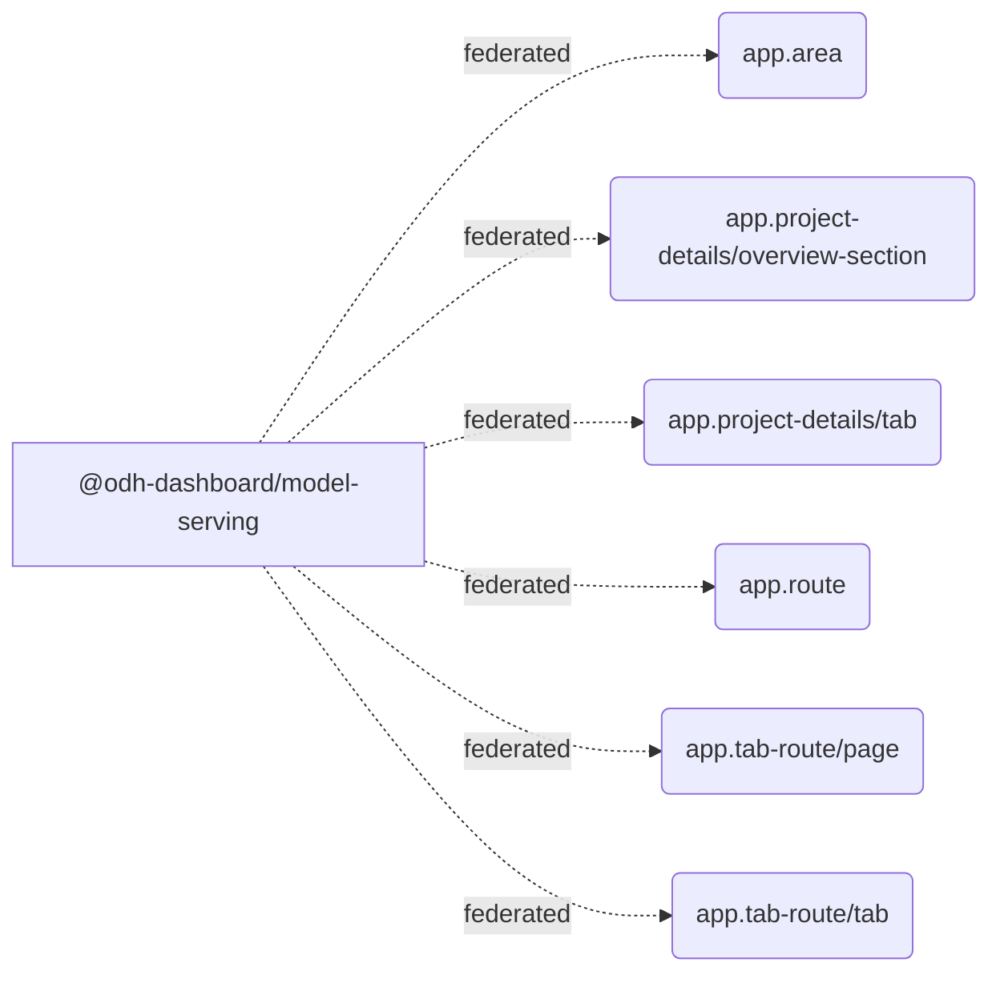
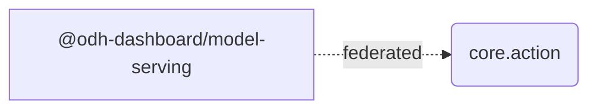
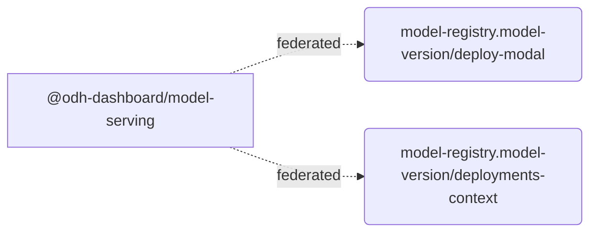
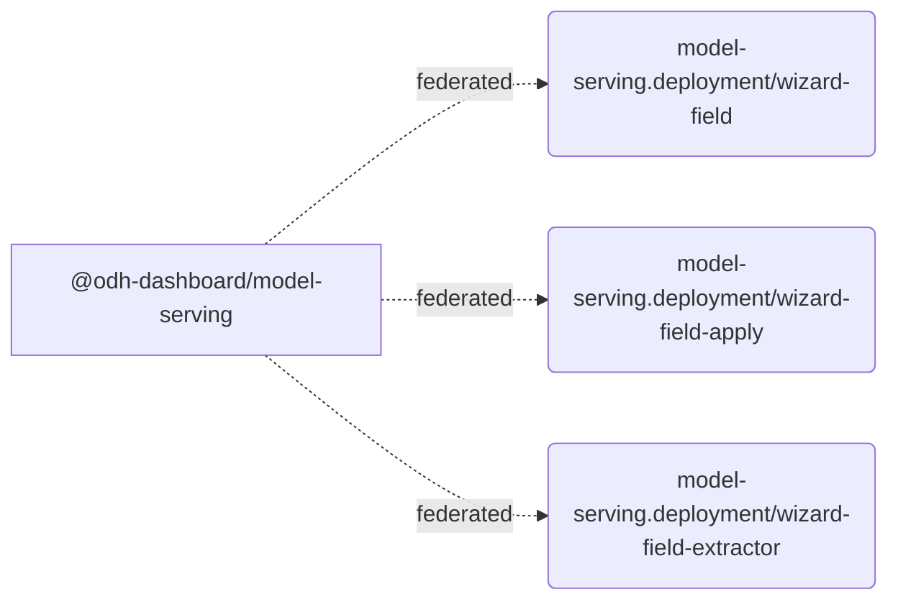

<!-- AUTO-GENERATED by @odh-dashboard/extension-map. Do not edit by hand. -->

> Generated file. Regenerate with `pnpm docs:extension-map`.

## Loading paths

| Entry | Path | Source |
| --- | --- | --- |
| @odh-dashboard/model-serving#./extensions | static | `packages/model-serving/extensions/index.ts` |
| @odh-dashboard/model-serving#mf:./extensions | federated | `packages/model-serving/frontend/src/odh/extensions.ts` |

_Federation declared but not loaded by the host._

## Defines

### model-serving.auth

| Property | Type | Required | Description |
| --- | --- | --- | --- |
| `platform` | `D["modelServingPlatformId"]` | Yes |  |
| `usePlatformAuthEnabled` | `CodeRef<(deployment?: D \| undefined) => boolean>` | Yes |  |

**Implemented by:** [@odh-dashboard/nim-serving](../../nim-serving/docs/extensions.md#model-servingauth)

### model-serving.deployed-model/serving-runtime

| Property | Type | Required | Description |
| --- | --- | --- | --- |
| `platform` | `D["modelServingPlatformId"]` | Yes |  |
| `dataHook` | `CodeRef<() => Data>` | No |  |
| `ServingDetailsComponent` | `ComponentCodeRef<{ deployment: D; data?: Data \| undefined; }>` | Yes |  |

**Implemented by:** [@odh-dashboard/kserve](../../kserve/docs/extensions.md#model-servingdeployed-modelserving-runtime), [@odh-dashboard/llmd-serving](../../llmd-serving/docs/extensions.md#model-servingdeployed-modelserving-runtime), [@odh-dashboard/nim-serving](../../nim-serving/docs/extensions.md#model-servingdeployed-modelserving-runtime)

### model-serving.deployment/assemble-model-resource

| Property | Type | Required | Description |
| --- | --- | --- | --- |
| `platform` | `D["modelServingPlatformId"]` | Yes |  |
| `isActive` | `true \| CodeRef<(wizardData: { project: ProjectSectionType; modelType: ModelTypeField; k8sNameDesc: UseK8sNameDescriptionFieldData; deploymentMethod?: { method: string; } \| undefined; hardwareProfileConfig: UseHardwareProfileConfigResult; modelFormatState: ModelFormatState; modelLocationData: ModelLocationDataField; externalRoute: ExternalRouteFieldHook; tokenAuthentication: TokenAuthenticationFieldHook; numReplicas: NumReplicasFieldHook; runtimeArgs: RuntimeArgsFieldHook; environmentVariables: EnvironmentVariablesFieldHook; modelAvailability: ModelAvailabilityFields; modelServer?: ModelServerSelectField \| undefined; createConnectionData: CreateConnectionDataField; deploymentStrategy: DeploymentStrategyFieldHook; huggingFaceApiKey: HuggingFaceApiKeyFieldHook; requiresHuggingFaceApiKey: boolean; canCreateRoleBindings: boolean; validatedConfigurationSelection: ValidatedConfigurationsFieldHook; devFeatureFlags?: { vLLMDeploymentOnMaaS: boolean; } \| undefined; } & Record<string, unknown>) => boolean>` | Yes |  |
| `priority` | `number` | Yes |  |
| `assemble` | `CodeRef<AssembleModelResourceFn<D>>` | Yes |  |

**Implemented by:** [@odh-dashboard/llmd-serving](../../llmd-serving/docs/extensions.md#model-servingdeploymentassemble-model-resource), [@odh-dashboard/nim-serving](../../nim-serving/docs/extensions.md#model-servingdeploymentassemble-model-resource)

### model-serving.deployment/deploy

| Property | Type | Required | Description |
| --- | --- | --- | --- |
| `platform` | `D["modelServingPlatformId"]` | Yes |  |
| `isActive` | `true \| CodeRef<(wizardData: DeployMethodActivationInput, resources?: DeploymentAssemblyResources<D> \| undefined) => boolean>` | Yes |  |
| `priority` | `number` | Yes |  |
| `supportsOverwrite` | `boolean` | No |  |
| `supportsDRAHardwareProfiles` | `boolean` | No |  |
| `deploy` | `CodeRef<(wizardData: { project: ProjectSectionType; modelType: ModelTypeField; k8sNameDesc: UseK8sNameDescriptionFieldData; deploymentMethod?: { method: string; } \| undefined; hardwareProfileConfig: UseHardwareProfileConfigResult; modelFormatState: ModelFormatState; modelLocationData: ModelLocationDataField; externalRoute: ExternalRouteFieldHook; tokenAuthentication: TokenAuthenticationFieldHook; numReplicas: NumReplicasFieldHook; runtimeArgs: RuntimeArgsFieldHook; environmentVariables: EnvironmentVariablesFieldHook; modelAvailability: ModelAvailabilityFields; modelServer?: ModelServerSelectField \| undefined; createConnectionData: CreateConnectionDataField; deploymentStrategy: DeploymentStrategyFieldHook; huggingFaceApiKey: HuggingFaceApiKeyFieldHook; requiresHuggingFaceApiKey: boolean; canCreateRoleBindings: boolean; validatedConfigurationSelection: ValidatedConfigurationsFieldHook; devFeatureFlags?: { vLLMDeploymentOnMaaS: boolean; } \| undefined; } & Record<string, unknown>, externalData: ExternalDataMap, projectName: string, existingDeployment?: D \| undefined, modelResource?: D["model"] \| undefined, serverResource?: D["server"] \| undefined, serverResourceTemplateName?: string \| undefined, dryRun?: boolean \| undefined, secretName?: string \| undefined, overwrite?: boolean \| undefined, initialWizardData?: InitialWizardFormData \| undefined, applyFieldData?: DeploymentAssemblyFn<D> \| undefined) => Promise<D>>` | Yes |  |

**Implemented by:** [@odh-dashboard/kserve](../../kserve/docs/extensions.md#model-servingdeploymentdeploy), [@odh-dashboard/llmd-serving](../../llmd-serving/docs/extensions.md#model-servingdeploymentdeploy), [@odh-dashboard/nim-serving](../../nim-serving/docs/extensions.md#model-servingdeploymentdeploy)

### model-serving.deployment/form-data

| Property | Type | Required | Description |
| --- | --- | --- | --- |
| `platform` | `D["modelServingPlatformId"]` | Yes |  |
| `isActive` | `true \| CodeRef<(deployment: D) => boolean>` | Yes | Whether this extension is active for the given deployment. When multiple form-data extensions share a `platform`, the active one with the highest `priority` wins. Evaluated at extraction time from an existing deployment, so it must not rely on wizard state. |
| `priority` | `number` | Yes | Priority among active extensions WITH the same `platform`. Higher number wins. |
| `hardwareProfilePaths` | `CodeRef<CrPathConfig>` | Yes |  |
| `extractHardwareProfileConfig` | `CodeRef<(deployment: D) => ExtractionResult<[existingHardwareProfileName?: string \| undefined, resources?: ContainerResources \| undefined, tolerations?: Toleration[] \| undefined, nodeSelector?: NodeSelector \| undefined, visibleIn?: HardwareProfileFeatureVisibility[] \| undefined, resourceNamespace?: string \| undefined, hardwareProfileNamespace?: string \| null \| undefined, options?: { allowDRAProfiles?: boolean \| "pending" \| undefined; project?: string \| undefined; } \| undefined] \| null>>` | Yes |  |
| `extractModelFormat` | `CodeRef<(deployment: D) => SupportedModelFormats \| null>` | No |  |
| `extractReplicas` | `CodeRef<(deployment: D) => ExtractionResult<number \| null>>` | Yes |  |
| `extractRuntimeArgs` | `CodeRef<(deployment: D) => { enabled: boolean; args: string[]; } \| null>` | Yes |  |
| `extractEnvironmentVariables` | `CodeRef<(deployment: D) => { enabled: boolean; variables: EnvironmentVariable[]; } \| null>` | Yes |  |
| `extractModelAvailabilityData` | `CodeRef<(deployment: D) => { saveAsAiAsset: boolean; useCase?: string \| undefined; } \| null>` | Yes |  |
| `extractModelLocationData` | `CodeRef<(deployment: D) => ModelLocationData \| null>` | Yes |  |
| `extractDeploymentStrategy` | `CodeRef<(deployment: D) => "rolling" \| "recreate" \| null>` | No |  |
| `extractModelType` | `CodeRef<(deployment: D) => { type: string; } \| null>` | No |  |
| `extractModelServerTemplate` | `CodeRef<(deployment: D, dashboardNamespace?: string \| undefined) => { data: ModelServerSelectFieldData; } \| null>` | Yes |  |
| `extractHuggingFaceApiKey` | `CodeRef<(deployment: D) => HuggingFaceApiKeyFieldData \| Promise<HuggingFaceApiKeyFieldData \| null> \| null>` | No |  |
| `validateExtraction` | `CodeRef<(deployment: D) => string[]>` | No |  |

**Implemented by:** [@odh-dashboard/kserve](../../kserve/docs/extensions.md#model-servingdeploymentform-data), [@odh-dashboard/llmd-serving](../../llmd-serving/docs/extensions.md#model-servingdeploymentform-data), [@odh-dashboard/nim-serving](../../nim-serving/docs/extensions.md#model-servingdeploymentform-data)

### model-serving.deployment/tracking-properties

Extension for contributing per-platform tracking properties to the Model Deployed event.
Spokes register this extension so the hub can collect platform-specific analytics data
without importing from spoke packages.

| Property | Type | Required | Description |
| --- | --- | --- | --- |
| `platform` | `D["modelServingPlatformId"]` | Yes |  |
| `getProperties` | `CodeRef<(wizardState: { project: ProjectSectionType; modelType: ModelTypeField; k8sNameDesc: UseK8sNameDescriptionFieldData; deploymentMethod?: { method: string; } \| undefined; hardwareProfileConfig: UseHardwareProfileConfigResult; modelFormatState: ModelFormatState; modelLocationData: ModelLocationDataField; externalRoute: ExternalRouteFieldHook; tokenAuthentication: TokenAuthenticationFieldHook; numReplicas: NumReplicasFieldHook; runtimeArgs: RuntimeArgsFieldHook; environmentVariables: EnvironmentVariablesFieldHook; modelAvailability: ModelAvailabilityFields; modelServer?: ModelServerSelectField \| undefined; createConnectionData: CreateConnectionDataField; deploymentStrategy: DeploymentStrategyFieldHook; huggingFaceApiKey: HuggingFaceApiKeyFieldHook; requiresHuggingFaceApiKey: boolean; canCreateRoleBindings: boolean; validatedConfigurationSelection: ValidatedConfigurationsFieldHook; devFeatureFlags?: { vLLMDeploymentOnMaaS: boolean; } \| undefined; } & Record<string, unknown>, externalData?: ExternalDataMap \| undefined) => Record<string, string \| number \| boolean \| undefined>>` | Yes | Extract platform-specific tracking properties from the wizard form state. These are merged into the base Model Deployed / Model Updated event properties. |

**Implemented by:** [@odh-dashboard/llmd-serving](../../llmd-serving/docs/extensions.md#model-servingdeploymenttracking-properties), [@odh-dashboard/nim-serving](../../nim-serving/docs/extensions.md#model-servingdeploymenttracking-properties)

### model-serving.deployment/transform

| Property | Type | Required | Description |
| --- | --- | --- | --- |
| `platform` | `D["modelServingPlatformId"]` | Yes |  |
| `transform` | `CodeRef<(deployment: D, initialWizardData: InitialWizardFormData) => D>` | Yes |  |

**Implemented by:** _Unused: no package contributes to this point._

### model-serving.deployment/wizard-field

| Property | Type | Required | Description |
| --- | --- | --- | --- |
| `platform` | `D["modelServingPlatformId"]` | No |  |
| `field` | `CodeRef<WizardFieldType>` | Yes |  |

**Implemented by:** [@odh-dashboard/kserve](../../kserve/docs/extensions.md#model-servingdeploymentwizard-field), [@odh-dashboard/llmd-serving](../../llmd-serving/docs/extensions.md#model-servingdeploymentwizard-field), [@odh-dashboard/maas](../../maas/docs/extensions.md#model-servingdeploymentwizard-field), [@odh-dashboard/model-serving](extensions.md#model-servingdeploymentwizard-field), [@odh-dashboard/nim-serving](../../nim-serving/docs/extensions.md#model-servingdeploymentwizard-field)

### model-serving.deployment/wizard-field-apply

Extension for applying a wizard field's data to a deployment resource during assembly.
This is executed as part of the deployment assembly process, allowing each field to
contribute its data to the final deployment resource.

The `fieldId` links this apply extension to a specific WizardFieldExtension, ensuring
it is only executed when its associated field is active.

| Property | Type | Required | Description |
| --- | --- | --- | --- |
| `fieldId` | `string` | Yes | The ID of the WizardField this apply extension is associated with |
| `platform` | `D["modelServingPlatformId"] \| "all"` | Yes | The platform this apply extension applies to, or 'all' for platform-agnostic fields |
| `apply` | `CodeRef<(deployment: D, fieldData: T, wizardState: { project: ProjectSectionType; modelType: ModelTypeField; k8sNameDesc: UseK8sNameDescriptionFieldData; deploymentMethod?: { method: string; } \| undefined; hardwareProfileConfig: UseHardwareProfileConfigResult; modelFormatState: ModelFormatState; modelLocationData: ModelLocationDataField; externalRoute: ExternalRouteFieldHook; tokenAuthentication: TokenAuthenticationFieldHook; numReplicas: NumReplicasFieldHook; runtimeArgs: RuntimeArgsFieldHook; environmentVariables: EnvironmentVariablesFieldHook; modelAvailability: ModelAvailabilityFields; modelServer?: ModelServerSelectField \| undefined; createConnectionData: CreateConnectionDataField; deploymentStrategy: DeploymentStrategyFieldHook; huggingFaceApiKey: HuggingFaceApiKeyFieldHook; requiresHuggingFaceApiKey: boolean; canCreateRoleBindings: boolean; validatedConfigurationSelection: ValidatedConfigurationsFieldHook; devFeatureFlags?: { vLLMDeploymentOnMaaS: boolean; } \| undefined; } & Record<string, unknown>) => D>` | Yes | Apply function that modifies the deployment based on the field's data. |

**Implemented by:** [@odh-dashboard/kserve](../../kserve/docs/extensions.md#model-servingdeploymentwizard-field-apply), [@odh-dashboard/llmd-serving](../../llmd-serving/docs/extensions.md#model-servingdeploymentwizard-field-apply), [@odh-dashboard/maas](../../maas/docs/extensions.md#model-servingdeploymentwizard-field-apply), [@odh-dashboard/model-serving](extensions.md#model-servingdeploymentwizard-field-apply), [@odh-dashboard/nim-serving](../../nim-serving/docs/extensions.md#model-servingdeploymentwizard-field-apply)

### model-serving.deployment/wizard-field-deployment-functions

Extension for making side-effect resources before a deployment is saved.
This runs before the inference service is created, in the same phase as other dry runs,
allowing extensions to validate that their associated resources can be created without conflicts.

The `fieldId` links this to a specific WizardFieldExtension so it is only
executed when that field is active.

| Property | Type | Required | Description |
| --- | --- | --- | --- |
| `fieldId` | `string` | Yes | The ID of the WizardField this deployment functions extension is associated with |
| `platform` | `"all" \| D["modelServingPlatformId"]` | Yes | The platform this deployment functions extension applies to, or 'all' for platform-agnostic fields |
| `preDeploy` | `CodeRef<(fieldData: T, wizardState: { project: ProjectSectionType; modelType: ModelTypeField; k8sNameDesc: UseK8sNameDescriptionFieldData; deploymentMethod?: { method: string; } \| undefined; hardwareProfileConfig: UseHardwareProfileConfigResult; modelFormatState: ModelFormatState; modelLocationData: ModelLocationDataField; externalRoute: ExternalRouteFieldHook; tokenAuthentication: TokenAuthenticationFieldHook; numReplicas: NumReplicasFieldHook; runtimeArgs: RuntimeArgsFieldHook; environmentVariables: EnvironmentVariablesFieldHook; modelAvailability: ModelAvailabilityFields; modelServer?: ModelServerSelectField \| undefined; createConnectionData: CreateConnectionDataField; deploymentStrategy: DeploymentStrategyFieldHook; huggingFaceApiKey: HuggingFaceApiKeyFieldHook; requiresHuggingFaceApiKey: boolean; canCreateRoleBindings: boolean; validatedConfigurationSelection: ValidatedConfigurationsFieldHook; devFeatureFlags?: { vLLMDeploymentOnMaaS: boolean; } \| undefined; } & Record<string, unknown>, deployment: DeploymentHookPayloadFor<D>, existingDeployment?: D \| undefined, dryRun?: boolean \| undefined) => Promise<DeploymentHookPayloadFor<D>>> \| null` | Yes | Async function that runs before the deployment is saved. Throw to block the deployment.  Called twice: first with `dryRun === true` alongside the other dry runs to validate, then again with `dryRun !== true` to perform the actual side effects before the deployment is created. |
| `postDeploy` | `CodeRef<(fieldData: T, deployedModel: DeploymentHookPayloadFor<D>, existingDeployment?: D \| undefined, dryRun?: boolean \| undefined) => Promise<void>> \| null` | Yes | Async function that runs after the deployment is saved.  Called twice: first with `dryRun === true` alongside the other dry runs to validate, then again with `dryRun !== true` once the deployment has been created. |

**Implemented by:** [@odh-dashboard/llmd-serving](../../llmd-serving/docs/extensions.md#model-servingdeploymentwizard-field-deployment-functions), [@odh-dashboard/maas](../../maas/docs/extensions.md#model-servingdeploymentwizard-field-deployment-functions), [@odh-dashboard/nim-serving](../../nim-serving/docs/extensions.md#model-servingdeploymentwizard-field-deployment-functions)

### model-serving.deployment/wizard-field-extractor

Extension for extracting initial data from a deployment for a dynamic wizard field.
This is used when editing an existing deployment to populate the wizard field with
the current values from the deployment resource.

The `fieldId` links this extractor to a specific WizardFieldExtension, ensuring the
extracted data is provided to the correct field.

| Property | Type | Required | Description |
| --- | --- | --- | --- |
| `fieldId` | `string` | Yes | The ID of the WizardField this extractor is associated with |
| `platform` | `"all" \| D["modelServingPlatformId"]` | Yes | The platform this extractor applies to, or 'all' for platform-agnostic fields |
| `extract` | `CodeRef<(deployment: D) => T \| undefined>` | Yes | Extract function that retrieves the field's initial data from a deployment. |

**Implemented by:** [@odh-dashboard/kserve](../../kserve/docs/extensions.md#model-servingdeploymentwizard-field-extractor), [@odh-dashboard/llmd-serving](../../llmd-serving/docs/extensions.md#model-servingdeploymentwizard-field-extractor), [@odh-dashboard/maas](../../maas/docs/extensions.md#model-servingdeploymentwizard-field-extractor), [@odh-dashboard/model-serving](extensions.md#model-servingdeploymentwizard-field-extractor), [@odh-dashboard/nim-serving](../../nim-serving/docs/extensions.md#model-servingdeploymentwizard-field-extractor)

### model-serving.deployment/wizard-field-override

| Property | Type | Required | Description |
| --- | --- | --- | --- |
| `platform` | `D["modelServingPlatformId"]` | Yes |  |
| `field` | `CodeRef<DeploymentWizardFieldOverride>` | Yes |  |

**Implemented by:** [@odh-dashboard/kserve](../../kserve/docs/extensions.md#model-servingdeploymentwizard-field-override), [@odh-dashboard/llmd-serving](../../llmd-serving/docs/extensions.md#model-servingdeploymentwizard-field-override), [@odh-dashboard/nim-serving](../../nim-serving/docs/extensions.md#model-servingdeploymentwizard-field-override)

### model-serving.deployments-table

| Property | Type | Required | Description |
| --- | --- | --- | --- |
| `platform` | `D["modelServingPlatformId"]` | Yes |  |
| `columns` | `CodeRef<() => DeploymentsTableColumn<D>[]>` | Yes |  |

**Implemented by:** _Unused: no package contributes to this point._

### model-serving.deployments-table/start-stop-action

| Property | Type | Required | Description |
| --- | --- | --- | --- |
| `platform` | `D["modelServingPlatformId"]` | Yes |  |
| `patchDeploymentStoppedStatus` | `CodeRef<(deployment: D, isStopped: boolean) => Promise<D["model"]>>` | Yes |  |

**Implemented by:** [@odh-dashboard/kserve](../../kserve/docs/extensions.md#model-servingdeployments-tablestart-stop-action), [@odh-dashboard/llmd-serving](../../llmd-serving/docs/extensions.md#model-servingdeployments-tablestart-stop-action), [@odh-dashboard/nim-serving](../../nim-serving/docs/extensions.md#model-servingdeployments-tablestart-stop-action)

### model-serving.deployments/banner

Extension point for platforms to display a banner on the deployments page.

| Property | Type | Required | Description |
| --- | --- | --- | --- |
| `id` | `string` | Yes |  |
| `component` | `CodeRef<ComponentType<{}>>` | Yes |  |

**Implemented by:** [@odh-dashboard/maas](../../maas/docs/extensions.md#model-servingdeploymentsbanner)

### model-serving.metrics

| Property | Type | Required | Description |
| --- | --- | --- | --- |
| `platform` | `D["modelServingPlatformId"]` | Yes |  |

**Implemented by:** [@odh-dashboard/kserve](../../kserve/docs/extensions.md#model-servingmetrics)

### model-serving.platform

| Property | Type | Required | Description |
| --- | --- | --- | --- |
| `id` | `D["modelServingPlatformId"]` | Yes |  |
| `manage` | `{ namespaceApplicationCase: NamespaceApplicationCase; priority: number; default?: boolean \| undefined; projectRequirements: { annotations?: { [key: string]: string; } \| undefined; labels?: { [key: string]: string; } \| undefined; }; clusterRequirements?: { integrationAppName: string; } \| undefined; }` | Yes |  |
| `enableCardText` | `{ title: string; description: string; selectText: string; enabledText: string; objectType: ProjectObjectType; }` | Yes |  |
| `deployedModelsView` | `{ startHintTitle: string; startHintDescription: string; deployButtonText: string; }` | Yes |  |

**Implemented by:** [@odh-dashboard/kserve](../../kserve/docs/extensions.md#model-servingplatform), [@odh-dashboard/nim-serving](../../nim-serving/docs/extensions.md#model-servingplatform)

### model-serving.platform/delete-deployment

| Property | Type | Required | Description |
| --- | --- | --- | --- |
| `platform` | `D["modelServingPlatformId"]` | Yes |  |
| `onDelete` | `CodeRef<(deployment: D, options?: ModelServingDeleteOptions \| undefined) => Promise<void>>` | Yes |  |
| `title` | `string` | Yes |  |
| `submitButtonLabel` | `string` | Yes |  |
| `isActive` | `true \| CodeRef<(deployment: D) => boolean>` | No | Whether this extension applies to the deployment. Active extensions with the highest priority win. |
| `priority` | `number` | No | Priority among active delete extensions for the same platform. |
| `DeleteModalComponent` | `ComponentCodeRef<ModelServingDeleteModalComponentProps<D>>` | No | Optional platform-specific modal. It must call onClose(true) only after deletion succeeds. |

**Implemented by:** [@odh-dashboard/kserve](../../kserve/docs/extensions.md#model-servingplatformdelete-deployment), [@odh-dashboard/llmd-serving](../../llmd-serving/docs/extensions.md#model-servingplatformdelete-deployment), [@odh-dashboard/nim-serving](../../nim-serving/docs/extensions.md#model-servingplatformdelete-deployment)

### model-serving.platform/exclude-deployment

Extension point for platforms to declare resources that should be excluded from
another platform's deployment listings. This prevents duplicate entries when a
platform's operator creates child resources that another platform would also list.

`platform` identifies the source platform registering the exclusion.
`excludeFromPlatform` identifies which platform should apply this filter.
`filter` returns true for resources that belong to this platform and should NOT
appear in the target platform's deployment table.

| Property | Type | Required | Description |
| --- | --- | --- | --- |
| `platform` | `string` | Yes |  |
| `excludeFromPlatform` | `string` | Yes |  |
| `filter` | `CodeRef<(resource: K8sResourceCommon) => boolean>` | Yes |  |

**Implemented by:** [@odh-dashboard/nim-serving](../../nim-serving/docs/extensions.md#model-servingplatformexclude-deployment)

### model-serving.platform/fetch-deployment-status

| Property | Type | Required | Description |
| --- | --- | --- | --- |
| `platform` | `D["modelServingPlatformId"]` | Yes |  |
| `fetch` | `CodeRef<(name: string, namespace: string) => Promise<D \| null>>` | Yes |  |

**Implemented by:** [@odh-dashboard/kserve](../../kserve/docs/extensions.md#model-servingplatformfetch-deployment-status)

### model-serving.platform/global-models-page

| Property | Type | Required | Description |
| --- | --- | --- | --- |
| `platform` | `D["modelServingPlatformId"]` | Yes |  |
| `component` | `ComponentCodeRef` | Yes |  |

**Implemented by:** [@odh-dashboard/nim-serving](../../nim-serving/docs/extensions.md#model-servingplatformglobal-models-page)

### model-serving.platform/overview-section

| Property | Type | Required | Description |
| --- | --- | --- | --- |
| `platform` | `D["modelServingPlatformId"]` | Yes |  |
| `component` | `ComponentCodeRef` | Yes |  |

**Implemented by:** [@odh-dashboard/nim-serving](../../nim-serving/docs/extensions.md#model-servingplatformoverview-section)

### model-serving.platform/project-details-tab

| Property | Type | Required | Description |
| --- | --- | --- | --- |
| `platform` | `D["modelServingPlatformId"]` | Yes |  |
| `component` | `ComponentCodeRef` | Yes |  |

**Implemented by:** [@odh-dashboard/nim-serving](../../nim-serving/docs/extensions.md#model-servingplatformproject-details-tab)

### model-serving.platform/watch-deployments

Extension point for a `watch` hook to watch deployments for a given platform.

| Property | Type | Required | Description |
| --- | --- | --- | --- |
| `platform` | `D["modelServingPlatformId"]` | Yes |  |
| `watch` | `CodeRef<(project: ProjectKind, labelSelectors?: { [key: string]: string; } \| undefined, filterFn?: ((model: D["model"]) => boolean) \| undefined, opts?: K8sAPIOptions \| undefined) => [D[] \| undefined, boolean, Error[] \| undefined]>` | Yes |  |

**Implemented by:** [@odh-dashboard/kserve](../../kserve/docs/extensions.md#model-servingplatformwatch-deployments), [@odh-dashboard/llmd-serving](../../llmd-serving/docs/extensions.md#model-servingplatformwatch-deployments), [@odh-dashboard/nim-serving](../../nim-serving/docs/extensions.md#model-servingplatformwatch-deployments)

### model-serving.runtime-image/install-target

| Property | Type | Required | Description |
| --- | --- | --- | --- |
| `id` | `"servingRuntimeTemplate" \| "llmInferenceServiceConfig"` | Yes |  |
| `label` | `string` | Yes |  |
| `installTargetName` | `string` | Yes |  |
| `description` | `string` | Yes |  |
| `selectedState` | `{ listName: string; description: string; }` | Yes |  |
| `component` | `ComponentCodeRef<RuntimeImageInstallTargetProps>` | Yes |  |

**Implemented by:** [@odh-dashboard/kserve](../../kserve/docs/extensions.md#model-servingruntime-imageinstall-target), [@odh-dashboard/llmd-serving](../../llmd-serving/docs/extensions.md#model-servingruntime-imageinstall-target)

## Contributes

### app

| Node | Link |
| --- | --- |
| @odh-dashboard/model-serving | [@odh-dashboard/model-serving](#contributes) |
| app.area | [app.area](../../plugin-core/docs/extensions.md#apparea) [app.area](../extensions/odh.ts#L98-L104) [app.area](../extensions/odh.ts#L105-L111) |
| app.project-details/overview-section | [app.project-details/overview-section](../../plugin-core/docs/extensions.md#appproject-detailsoverview-section) [app.project-details/overview-section](../extensions/odh.ts#L123-L133) |
| app.project-details/tab | [app.project-details/tab](../../plugin-core/docs/extensions.md#appproject-detailstab) [app.project-details/tab](../extensions/odh.ts#L112-L122) |
| app.route | [app.route](../../plugin-core/docs/extensions.md#approute) [app.route](../extensions/odh.ts#L150-L159) [app.route](../extensions/odh.ts#L161-L173) [app.route](../extensions/odh.ts#L174-L186) [app.route](../extensions/runtime-image-install.ts#L27-L34) |
| app.tab-route/page | [app.tab-route/page](../../plugin-core/docs/extensions.md#apptab-routepage) [app.tab-route/page](../extensions/odh.ts#L192-L206) |
| app.tab-route/tab | [app.tab-route/tab](../../plugin-core/docs/extensions.md#apptab-routetab) [app.tab-route/tab](../extensions/odh.ts#L135-L148) [app.tab-route/tab](../extensions/odh.ts#L208-L220) |

- `-->` declared or type-resolved contribution
- `==>` derived relationship
- `-. "rendered in" .->` rendered in one hop
- `-. "federated" .->` federated contribution
- `--x` suppression
- `-- "patch" -->` patch

### core

| Node | Link |
| --- | --- |
| @odh-dashboard/model-serving | [@odh-dashboard/model-serving](#contributes) |
| core.action | [core.action](../../plugin-core/docs/extensions.md#coreaction) [core.action](../extensions/runtime-image-install.ts#L17-L26) |

- `-->` declared or type-resolved contribution
- `==>` derived relationship
- `-. "rendered in" .->` rendered in one hop
- `-. "federated" .->` federated contribution
- `--x` suppression
- `-- "patch" -->` patch

### model-registry

| Node | Link |
| --- | --- |
| @odh-dashboard/model-serving | [@odh-dashboard/model-serving](#contributes) |
| model-registry.model-version/deploy-modal | [model-registry.model-version/deploy-modal](../../model-registry/docs/extensions.md#model-registrymodel-versiondeploy-modal) [model-registry.model-version/deploy-modal](../extensions/model-registry.ts#L13-L24) |
| model-registry.model-version/deployments-context | [model-registry.model-version/deployments-context](../../model-registry/docs/extensions.md#model-registrymodel-versiondeployments-context) [model-registry.model-version/deployments-context](../extensions/model-registry.ts#L37-L46) |

- `-->` declared or type-resolved contribution
- `==>` derived relationship
- `-. "rendered in" .->` rendered in one hop
- `-. "federated" .->` federated contribution
- `--x` suppression
- `-- "patch" -->` patch

### model-serving

| Node | Link |
| --- | --- |
| @odh-dashboard/model-serving | [@odh-dashboard/model-serving](#contributes) |
| model-serving.deployment/wizard-field | [model-serving.deployment/wizard-field](extensions.md#model-servingdeploymentwizard-field) [model-serving.deployment/wizard-field](../extensions/odh.ts#L30-L41) [model-serving.deployment/wizard-field](../extensions/odh.ts#L73-L84) |
| model-serving.deployment/wizard-field-apply | [model-serving.deployment/wizard-field-apply](extensions.md#model-servingdeploymentwizard-field-apply) [model-serving.deployment/wizard-field-apply](../extensions/odh.ts#L43-L56) |
| model-serving.deployment/wizard-field-extractor | [model-serving.deployment/wizard-field-extractor](extensions.md#model-servingdeploymentwizard-field-extractor) [model-serving.deployment/wizard-field-extractor](../extensions/odh.ts#L58-L71) |

- `-->` declared or type-resolved contribution
- `==>` derived relationship
- `-. "rendered in" .->` rendered in one hop
- `-. "federated" .->` federated contribution
- `--x` suppression
- `-- "patch" -->` patch

#### app.area

- **devFlags**: 
- **featureFlags**: `"disableModelServing"`
- **id**: `SupportedArea.MODEL_SERVING` (`"model-serving-shell"`)
- **Requires**: 
- **Disallows**: 
- **CodeRef target**: 
- **Included in**: 
- **Source**: [app.area](../extensions/odh.ts#L98-L104)

- **devFlags**: `BIDIRECTIONAL_YAML_WIZARD_GA` (`"bidirectionalYamlWizardGa"`)
- **featureFlags**: 
- **id**: `BIDIRECTIONAL_YAML_WIZARD_GA` (`"bidirectionalYamlWizardGa"`)
- **Requires**: 
- **Disallows**: 
- **CodeRef target**: 
- **Included in**: 
- **Source**: [app.area](../extensions/odh.ts#L105-L111)

#### app.project-details/overview-section

- **id**: `"model-server"`
- **title**: `"Serve Models"`
- **component**: packages/model-serving/src/ServeModelsSection.tsx#[ServeModelsSection](../src/ServeModelsSection.tsx#L68-L99)
- **Requires**: `SupportedArea.MODEL_SERVING` (`"model-serving-shell"`)
- **Disallows**: 
- **CodeRef target**: packages/model-serving/src/ServeModelsSection.tsx#[ServeModelsSection](../src/ServeModelsSection.tsx#L68-L99)
- **Included in**: 
- **Source**: [app.project-details/overview-section](../extensions/odh.ts#L123-L133)

#### app.project-details/tab

- **id**: `"model-server"`
- **title**: `"Deployments"`
- **component**: packages/model-serving/src/ModelsProjectDetailsTab.tsx#[ModelsProjectDetailsTab](../src/ModelsProjectDetailsTab.tsx#L25-L57)
- **Requires**: `SupportedArea.MODEL_SERVING` (`"model-serving-shell"`)
- **Disallows**: 
- **CodeRef target**: packages/model-serving/src/ModelsProjectDetailsTab.tsx#[ModelsProjectDetailsTab](../src/ModelsProjectDetailsTab.tsx#L25-L57)
- **Included in**: 
- **Source**: [app.project-details/tab](../extensions/odh.ts#L112-L122)

#### app.route

| component | path | Requires | Disallows | CodeRef target | Included in | Source |
| --- | --- | --- | --- | --- | --- | --- |
| packages/model-serving/src/ModelDeploymentWizardRoutes.tsx#[ModelDeploymentWizardRoutes](../src/ModelDeploymentWizardRoutes.tsx#L5-L9) | `"/ai-hub/models/deployments/deploy/*"` | `SupportedArea.MODEL_SERVING` (`"model-serving-shell"`) |  | packages/model-serving/src/ModelDeploymentWizardRoutes.tsx#[ModelDeploymentWizardRoutes](../src/ModelDeploymentWizardRoutes.tsx#L5-L9) |  | [app.route](../extensions/odh.ts#L150-L159) |
| [not resolved](#diagnostics) | `"/ai-hub/deployments/:namespace?/*"` | `SupportedArea.MODEL_SERVING` (`"model-serving-shell"`) |  |  |  | [app.route](../extensions/odh.ts#L161-L173) |
| [not resolved](#diagnostics) | `"/modelServing/:namespace?/*"` | `SupportedArea.MODEL_SERVING` (`"model-serving-shell"`) |  |  |  | [app.route](../extensions/odh.ts#L174-L186) |
| packages/model-serving/src/components/runtimeImageInstall/RuntimeImageInstallPage.tsx#[RuntimeImageInstallPage](../src/components/runtimeImageInstall/RuntimeImageInstallPage.tsx#L148-L170) | `"/settings/model-resources-operations/model-deployment-settings/serving-runtime-catalog/:runtimeId/install"` | [not resolved](#diagnostics) |  | packages/model-serving/src/components/runtimeImageInstall/RuntimeImageInstallPage.tsx#[RuntimeImageInstallPage](../src/components/runtimeImageInstall/RuntimeImageInstallPage.tsx#L148-L170) |  | [app.route](../extensions/runtime-image-install.ts#L27-L34) |

**Not resolved**

| Location | Reason | Link |
| --- | --- | --- |
| properties.component | expression is not a statically resolvable value | [diagnostics](#diagnostics) |
| properties.component | expression is not a statically resolvable value | [diagnostics](#diagnostics) |
| flags.required[0] | identifier does not resolve to a literal value | [diagnostics](#diagnostics) |

#### app.tab-route/page

- **id**: `"model-deployment-settings"`
- **title**: `"Model deployment settings"`
- **section**: `"settings-model-resources-and-operations"`
- **group**: `"1_model-resources"`
- **href**: `MODEL_DEPLOYMENT_SETTINGS_PATH` (`"/settings/model-resources-operations/model-deployment-settings"`)
- **breadcrumbTabId**: `"general-settings"`
- **path**: `"/settings/model-resources-operations/model-deployment-settings/*"`
- **Requires**: `SupportedArea.MODEL_SERVING` (`"model-serving-shell"`), `ADMIN_USER` (`"ADMIN_USER"`)
- **Disallows**: 
- **CodeRef target**: 
- **Included in**: 
- **Source**: [app.tab-route/page](../extensions/odh.ts#L192-L206)

#### app.tab-route/tab

- **pageId**: `"models-tab-page"`
- **id**: `"deployments"`
- **title**: `"Deployments"`
- **singleTabTitle**: `"Model deployments"`
- **component**: packages/model-serving/src/GlobalModelsRoutes.tsx#[GlobalModelsRoutes](../src/GlobalModelsRoutes.tsx#L9-L38)
- **group**: `"3_deployments"`
- **Requires**: `SupportedArea.MODEL_SERVING` (`"model-serving-shell"`)
- **Disallows**: 
- **CodeRef target**: packages/model-serving/src/GlobalModelsRoutes.tsx#[GlobalModelsRoutes](../src/GlobalModelsRoutes.tsx#L9-L38)
- **Included in**: 
- **Source**: [app.tab-route/tab](../extensions/odh.ts#L135-L148)

- **pageId**: `"model-deployment-settings"`
- **id**: `"general-settings"`
- **title**: `"General settings"`
- **singleTabTitle**: 
- **component**: packages/model-serving/src/components/settings/GeneralSettingsTab.tsx#[GeneralSettingsTab](../src/components/settings/GeneralSettingsTab.tsx#L25-L228)
- **group**: `"1_general"`
- **Requires**: `SupportedArea.MODEL_SERVING` (`"model-serving-shell"`), `ADMIN_USER` (`"ADMIN_USER"`)
- **Disallows**: 
- **CodeRef target**: packages/model-serving/src/components/settings/GeneralSettingsTab.tsx#[GeneralSettingsTab](../src/components/settings/GeneralSettingsTab.tsx#L25-L228)
- **Included in**: 
- **Source**: [app.tab-route/tab](../extensions/odh.ts#L208-L220)

#### core.action

- **id**: `"runtime-image-install"`
- **label**: `"Install Runtime image"`
- **component**: packages/model-serving/src/components/runtimeImageInstall/RuntimeImageInstallAction.tsx#[RuntimeImageInstallAction](../src/components/runtimeImageInstall/RuntimeImageInstallAction.tsx#L11-L50)
- **group**: `"runtime-catalog.runtime-image/details-action"`
- **Requires**: [not resolved](#diagnostics)
- **Disallows**: 
- **CodeRef target**: packages/model-serving/src/components/runtimeImageInstall/RuntimeImageInstallAction.tsx#[RuntimeImageInstallAction](../src/components/runtimeImageInstall/RuntimeImageInstallAction.tsx#L11-L50)
- **Included in**: 
- **Source**: [core.action](../extensions/runtime-image-install.ts#L17-L26)

**Not resolved**

| Location | Reason | Link |
| --- | --- | --- |
| flags.required[0] | identifier does not resolve to a literal value | [diagnostics](#diagnostics) |

#### model-registry.model-version/deploy-modal

| useAvailablePlatformIds | modalComponent | Requires | Disallows | CodeRef target | Included in | Source |
| --- | --- | --- | --- | --- | --- | --- |
| packages/model-serving/modelRegistry/useAvailablePlatformIds.ts#[useAvailablePlatformIds](../modelRegistry/useAvailablePlatformIds.ts#L7-L11) | packages/model-serving/modelRegistry/PreWizardDeployModal.tsx#[PreWizardDeployModal](../modelRegistry/PreWizardDeployModal.tsx#L46-L228) | `SupportedArea.MODEL_SERVING` (`"model-serving-shell"`) |  | packages/model-serving/modelRegistry/useAvailablePlatformIds.ts#[useAvailablePlatformIds](../modelRegistry/useAvailablePlatformIds.ts#L7-L11), packages/model-serving/modelRegistry/PreWizardDeployModal.tsx#[PreWizardDeployModal](../modelRegistry/PreWizardDeployModal.tsx#L46-L228) |  | [model-registry.model-version/deploy-modal](../extensions/model-registry.ts#L13-L24) |

#### model-registry.model-version/deployments-context

| DeploymentsProvider | Requires | Disallows | CodeRef target | Included in | Source |
| --- | --- | --- | --- | --- | --- |
| packages/model-serving/modelRegistry/DeploymentsContextProvider.tsx#[DeploymentsContextProvider](../modelRegistry/DeploymentsContextProvider.tsx#L35-L52) | `SupportedArea.MODEL_SERVING` (`"model-serving-shell"`) |  | packages/model-serving/modelRegistry/DeploymentsContextProvider.tsx#[DeploymentsContextProvider](../modelRegistry/DeploymentsContextProvider.tsx#L35-L52) |  | [model-registry.model-version/deployments-context](../extensions/model-registry.ts#L37-L46) |

#### model-serving.deployment/wizard-field

| field | Requires | Disallows | CodeRef target | Included in | Source |
| --- | --- | --- | --- | --- | --- |
| packages/model-serving/src/components/deploymentWizard/fields/modelCapabilities/ModelCapabilitiesField.tsx#[ModelCapabilitiesFieldWizardField](../src/components/deploymentWizard/fields/modelCapabilities/ModelCapabilitiesField.tsx#L293-L305) | `SupportedArea.MODEL_CAPABILITIES` (`"model-capabilities"`) |  | packages/model-serving/src/components/deploymentWizard/fields/modelCapabilities/ModelCapabilitiesField.tsx#[ModelCapabilitiesFieldWizardField](../src/components/deploymentWizard/fields/modelCapabilities/ModelCapabilitiesField.tsx#L293-L305) |  | [model-serving.deployment/wizard-field](../extensions/odh.ts#L30-L41) |
| packages/model-serving/src/components/deploymentWizard/fields/DeploymentMethodSelectField.tsx#[DeploymentMethodSelectFieldWizardField](../src/components/deploymentWizard/fields/DeploymentMethodSelectField.tsx#L151-L178) | `SupportedArea.MODEL_SERVING` (`"model-serving-shell"`) |  | packages/model-serving/src/components/deploymentWizard/fields/DeploymentMethodSelectField.tsx#[DeploymentMethodSelectFieldWizardField](../src/components/deploymentWizard/fields/DeploymentMethodSelectField.tsx#L151-L178) |  | [model-serving.deployment/wizard-field](../extensions/odh.ts#L73-L84) |

**Not resolved**

| Location | Reason | Link |
| --- | --- | --- |
| properties.field supplies.reducerFunctions.setFieldData | identifier does not resolve to a literal value | [diagnostics](#diagnostics) |
| properties.field supplies.reducerFunctions.getInitialFieldData | identifier does not resolve to a literal value | [diagnostics](#diagnostics) |
| properties.field supplies.reducerFunctions.validationSchema | identifier does not resolve to a literal value | [diagnostics](#diagnostics) |
| properties.field supplies.reducerFunctions.setFieldData | CodeRef body is not a supported dynamic import | [diagnostics](#diagnostics) |
| properties.field supplies.reducerFunctions.getInitialFieldData | CodeRef body is not a supported dynamic import | [diagnostics](#diagnostics) |
| properties.field supplies.reducerFunctions.validationSchema | identifier does not resolve to a literal value | [diagnostics](#diagnostics) |

**Supplies**

| CodeRef | Supply | Value |
| --- | --- | --- |
| ModelCapabilitiesFieldWizardField | id | `MODEL_CAPABILITIES_FIELD_ID` (`"modelCapabilities"`) |
| ModelCapabilitiesFieldWizardField | step | `"advancedOptions"` |
| ModelCapabilitiesFieldWizardField | type | `"addition"` |
| ModelCapabilitiesFieldWizardField | isActive | [isModelCapabilitiesFieldActive](../src/components/deploymentWizard/fields/modelCapabilities/ModelCapabilitiesField.tsx#L271-L273) |
| ModelCapabilitiesFieldWizardField | reducerFunctions | setFieldData: [not resolved](#diagnostics), getInitialFieldData: [not resolved](#diagnostics), validationSchema: [not resolved](#diagnostics) |
| ModelCapabilitiesFieldWizardField | component | [ModelCapabilitiesFieldComponent](../src/components/deploymentWizard/fields/modelCapabilities/ModelCapabilitiesField.tsx#L65-L267) |
| ModelCapabilitiesFieldWizardField | getReviewSections | [getReviewSections](../src/components/deploymentWizard/fields/modelCapabilities/ModelCapabilitiesField.tsx#L304-L304) |
| DeploymentMethodSelectFieldWizardField | id | `"deploymentMethod"` |
| DeploymentMethodSelectFieldWizardField | parentId | `"modelDeployment"` |
| DeploymentMethodSelectFieldWizardField | step | `"modelDeployment"` |
| DeploymentMethodSelectFieldWizardField | type | `"addition"` |
| DeploymentMethodSelectFieldWizardField | isActive | [isDeploymentMethodFieldActive](../src/components/deploymentWizard/fields/DeploymentMethodSelectField.tsx#L88-L93) |
| DeploymentMethodSelectFieldWizardField | reducerFunctions | setFieldData: [not resolved](#diagnostics), getInitialFieldData: [not resolved](#diagnostics), validationSchema: [not resolved](#diagnostics) |
| DeploymentMethodSelectFieldWizardField | component | [DeploymentMethodSelectField](../src/components/deploymentWizard/fields/DeploymentMethodSelectField.tsx#L102-L147) |
| DeploymentMethodSelectFieldWizardField | externalDataHook | [useDeploymentMethodExternalData](../src/components/deploymentWizard/fields/DeploymentMethodSelectField.tsx#L59-L84) |

#### model-serving.deployment/wizard-field-apply

- **fieldId**: `"modelCapabilities"`
- **platform**: `"all"`
- **apply**: packages/model-serving/src/components/deploymentWizard/fields/modelCapabilities/modelCapabilitiesApplyExtract.ts#[applyModelCapabilities](../src/components/deploymentWizard/fields/modelCapabilities/modelCapabilitiesApplyExtract.ts#L4-L18)
- **Requires**: `SupportedArea.MODEL_CAPABILITIES` (`"model-capabilities"`)
- **Disallows**: 
- **CodeRef target**: packages/model-serving/src/components/deploymentWizard/fields/modelCapabilities/modelCapabilitiesApplyExtract.ts#[applyModelCapabilities](../src/components/deploymentWizard/fields/modelCapabilities/modelCapabilitiesApplyExtract.ts#L4-L18)
- **Included in**: 
- **Source**: [model-serving.deployment/wizard-field-apply](../extensions/odh.ts#L43-L56)

#### model-serving.deployment/wizard-field-extractor

- **fieldId**: `"modelCapabilities"`
- **platform**: `"all"`
- **extract**: packages/model-serving/src/components/deploymentWizard/fields/modelCapabilities/modelCapabilitiesApplyExtract.ts#[extractModelCapabilities](../src/components/deploymentWizard/fields/modelCapabilities/modelCapabilitiesApplyExtract.ts#L23-L38)
- **Requires**: `SupportedArea.MODEL_CAPABILITIES` (`"model-capabilities"`)
- **Disallows**: 
- **CodeRef target**: packages/model-serving/src/components/deploymentWizard/fields/modelCapabilities/modelCapabilitiesApplyExtract.ts#[extractModelCapabilities](../src/components/deploymentWizard/fields/modelCapabilities/modelCapabilitiesApplyExtract.ts#L23-L38)
- **Included in**: 
- **Source**: [model-serving.deployment/wizard-field-extractor](../extensions/odh.ts#L58-L71)

## Diagnostics

| Code | Message | Link |
| --- | --- | --- |
| `federation-not-loaded` | the host would not load '@odh-dashboard/model-serving' as a federated remote (no-remoteEntry) | [details](#diagnostics) |
| `point-no-jsdoc` | extension point 'model-serving.deployment/form-data' (ModelServingDeploymentFormDataExtension) has no JSDoc summary | [ModelServingDeploymentFormDataExtension](../extension-points/deployment-wizard.ts#L23-L65) |
| `point-no-jsdoc` | extension point 'model-serving.deployment/deploy' (ModelServingDeploy) has no JSDoc summary | [ModelServingDeploy](../extension-points/deployment-wizard.ts#L85-L117) |
| `point-no-jsdoc` | extension point 'model-serving.deployment/assemble-model-resource' (AssembleModelResourceExtension) has no JSDoc summary | [AssembleModelResourceExtension](../extension-points/deployment-wizard.ts#L129-L137) |
| `point-no-jsdoc` | extension point 'model-serving.deployment/wizard-field-override' (DeploymentWizardFieldOverrideExtension) has no JSDoc summary | [DeploymentWizardFieldOverrideExtension](../extension-points/deployment-wizard.ts#L146-L152) |
| `point-no-jsdoc` | extension point 'model-serving.deployment/wizard-field' (WizardFieldExtension) has no JSDoc summary | [WizardFieldExtension](../extension-points/deployment-wizard.ts#L159-L168) |
| `point-no-jsdoc` | extension point 'model-serving.deployment/transform' (ModelServingDeploymentTransformExtension) has no JSDoc summary | [ModelServingDeploymentTransformExtension](../extension-points/deployment-wizard.ts#L177-L183) |
| `point-no-jsdoc` | extension point 'model-serving.platform' (ModelServingPlatformExtension) has no JSDoc summary | [ModelServingPlatformExtension](../extension-points/index.ts#L115-L149) |
| `point-no-jsdoc` | extension point 'model-serving.auth' (ModelServingAuthExtension) has no JSDoc summary | [ModelServingAuthExtension](../extension-points/index.ts#L189-L195) |
| `point-no-jsdoc` | extension point 'model-serving.deployments-table' (ModelServingDeploymentsTableExtension) has no JSDoc summary | [ModelServingDeploymentsTableExtension](../extension-points/index.ts#L206-L212) |
| `point-no-jsdoc` | extension point 'model-serving.platform/delete-deployment' (ModelServingDeleteModal) has no JSDoc summary | [ModelServingDeleteModal](../extension-points/index.ts#L231-L245) |
| `point-no-jsdoc` | extension point 'model-serving.metrics' (ModelServingMetricsExtension) has no JSDoc summary | [ModelServingMetricsExtension](../extension-points/index.ts#L252-L257) |
| `point-no-jsdoc` | extension point 'model-serving.deployed-model/serving-runtime' (DeployedModelServingDetails) has no JSDoc summary | [DeployedModelServingDetails](../extension-points/index.ts#L263-L273) |
| `point-no-jsdoc` | extension point 'model-serving.deployments-table/start-stop-action' (ModelServingStartStopAction) has no JSDoc summary | [ModelServingStartStopAction](../extension-points/index.ts#L280-L288) |
| `point-no-jsdoc` | extension point 'model-serving.platform/fetch-deployment-status' (ModelServingPlatformFetchDeploymentStatus) has no JSDoc summary | [ModelServingPlatformFetchDeploymentStatus](../extension-points/index.ts#L295-L302) |
| `point-no-jsdoc` | extension point 'model-serving.platform/project-details-tab' (ModelServingPlatformProjectDetailsTabExtension) has no JSDoc summary | [ModelServingPlatformProjectDetailsTabExtension](../extension-points/index.ts#L313-L320) |
| `point-no-jsdoc` | extension point 'model-serving.platform/overview-section' (ModelServingPlatformOverviewSectionExtension) has no JSDoc summary | [ModelServingPlatformOverviewSectionExtension](../extension-points/index.ts#L326-L333) |
| `point-no-jsdoc` | extension point 'model-serving.platform/global-models-page' (ModelServingPlatformGlobalModelsPageExtension) has no JSDoc summary | [ModelServingPlatformGlobalModelsPageExtension](../extension-points/index.ts#L339-L346) |
| `point-no-jsdoc` | extension point 'model-serving.runtime-image/install-target' (RuntimeImageInstallTargetExtension) has no JSDoc summary | [RuntimeImageInstallTargetExtension](../extension-points/runtime-image-install-target.ts#L21-L37) |
| `unresolved-element` | object element is not checker-proven to be an extension value | [unresolved-element](../extensions/model-catalog.ts#L5-L16) |
| `unresolved-element` | object element is not checker-proven to be an extension value | [unresolved-element](../extensions/model-registry.ts#L25-L36) |
| `unresolved-element` | object element is not checker-proven to be an extension value | [unresolved-element](../extensions/model-registry.ts#L47-L58) |
| `unresolved-element` | object element is not checker-proven to be an extension value | [unresolved-element](../extensions/model-registry.ts#L59-L68) |
| `unresolved-element` | object element is not checker-proven to be an extension value | [unresolved-element](../extensions/model-registry.ts#L69-L78) |
| `unresolved-value` | extension property 'field' contains a value that could not be resolved | [field](../extensions/odh.ts#L33-L36) |
| `unresolved-value` | extension property 'field' contains a value that could not be resolved | [field](../extensions/odh.ts#L76-L79) |
| `unresolved-value` | extension property 'component' contains a value that could not be resolved | [component](../extensions/odh.ts#L165-L168) |
| `unresolved-value` | extension property 'component' contains a value that could not be resolved | [component](../extensions/odh.ts#L178-L181) |
| `unresolved-value` | extension property 'flags.required' contains a value that could not be resolved | [unresolved-value](../extensions/runtime-image-install.ts#L17-L26) |
| `unresolved-value` | extension property 'flags.required' contains a value that could not be resolved | [unresolved-value](../extensions/runtime-image-install.ts#L27-L34) |
