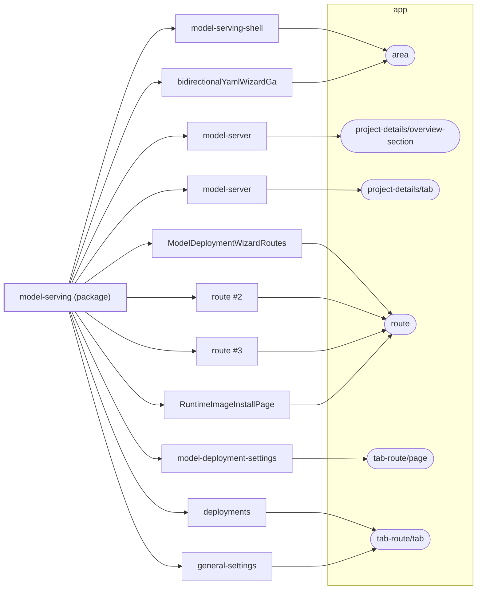
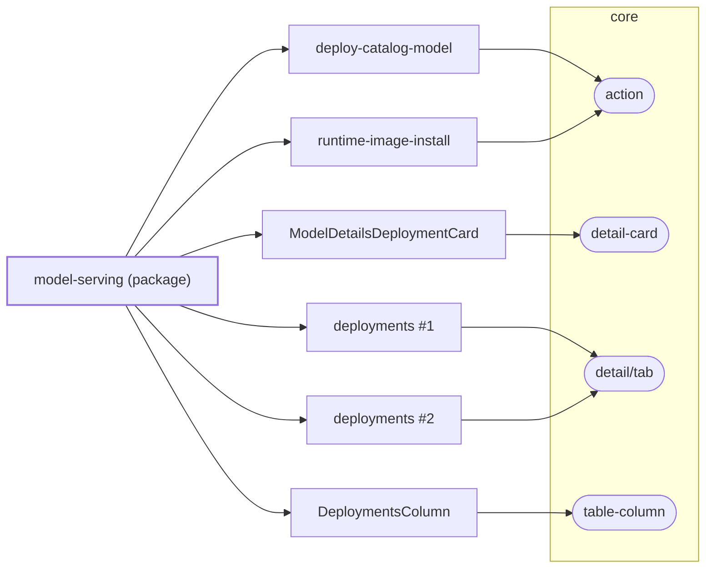
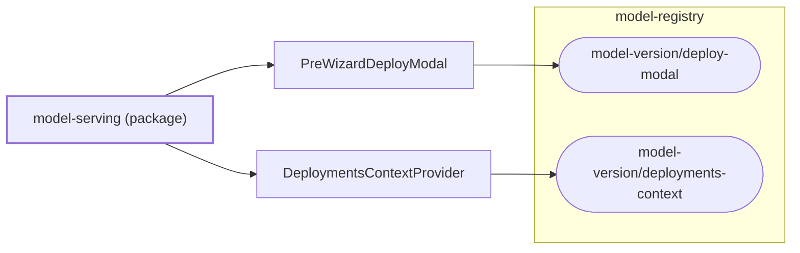
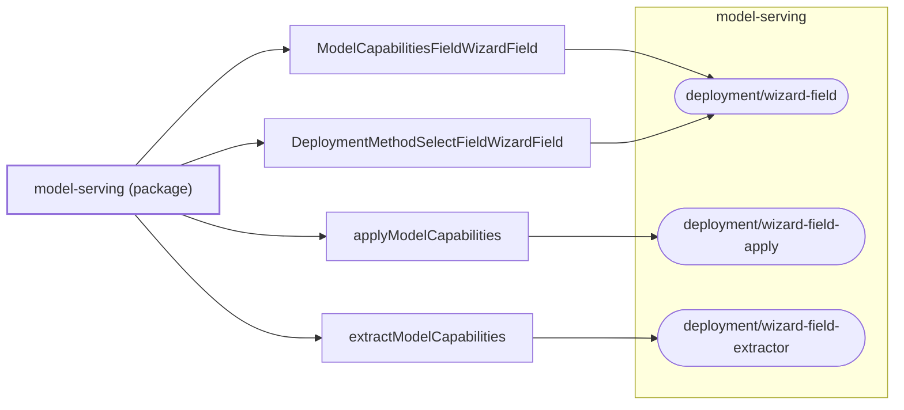

<!-- AUTO-GENERATED by @odh-dashboard/extension-map. Do not edit by hand. -->

> Generated file. Regenerate with `pnpm docs:extension-map`.

# Extensions in model-serving

Package `@odh-dashboard/model-serving` (package) at `packages/model-serving`. Everything below is read out of this repository's sources by static analysis.

## Loading paths

- [index.ts](../extensions/index.ts) (`./extensions`) — bundled into the host at build time (the `./extensions` export)
- [extensions.ts](../frontend/src/odh/extensions.ts) (`mf:./extensions`) — loaded at runtime by the host as a Module Federation remote

> **Federation declared but not loaded.** @odh-dashboard/model-serving declares module federation but the host does not load it as a remote: its module-federation config has no remoteEntry.

## Defines

The extension points this package declares. Each heading is the point ID other packages use as an extension's `type`.

### model-serving.auth

Declared as [ModelServingAuthExtension](../extension-points/index.ts#L189-L195), with type parameters `D`.

**Properties:**

| Property | Required | Type | CodeRef of | Description |
| --- | --- | --- | --- | --- |
| `platform` | yes | `D['modelServingPlatformId']` | — |  |
| `usePlatformAuthEnabled` | yes | `CodeRef<(deployment?: D) => boolean>` | `(deployment?: D \| undefined) => boolean` |  |

**Implemented by:** [nim-serving](../../nim-serving/docs/extensions.md#contributes-to-model-servingauth)

### model-serving.deployed-model/serving-runtime

Declared as [DeployedModelServingDetails](../extension-points/index.ts#L263-L273), with type parameters `D`, `Data`.

**Properties:**

| Property | Required | Type | CodeRef of | Description |
| --- | --- | --- | --- | --- |
| `platform` | yes | `D['modelServingPlatformId']` | — |  |
| `dataHook` | — | `CodeRef<() => Data>` | `CodeRef<() => Data>` |  |
| `ServingDetailsComponent` | yes | `ComponentCodeRef<{ deployment: D; data?: Data }>` | `{ default: ComponentType<{ deployment: D; data?: Data \| undefined; }>; }` |  |

**Implemented by:** [kserve](../../kserve/docs/extensions.md#contributes-to-model-servingdeployed-modelserving-runtime), [llmd-serving](../../llmd-serving/docs/extensions.md#contributes-to-model-servingdeployed-modelserving-runtime), [nim-serving](../../nim-serving/docs/extensions.md#contributes-to-model-servingdeployed-modelserving-runtime)

### model-serving.deployment/assemble-model-resource

Declared as [AssembleModelResourceExtension](../extension-points/deployment-wizard.ts#L129-L137), with type parameters `D`.

**Properties:**

| Property | Required | Type | CodeRef of | Description |
| --- | --- | --- | --- | --- |
| `platform` | yes | `D['modelServingPlatformId']` | — |  |
| `isActive` | yes | `CodeRef<(wizardData: WizardFormData['state']) => boolean> \| true` | — |  |
| `priority` | yes | `number \| 0` | — |  |
| `assemble` | yes | `CodeRef<AssembleModelResourceFn<D>>` | `AssembleModelResourceFn<D>` |  |

**Implemented by:** [llmd-serving](../../llmd-serving/docs/extensions.md#contributes-to-model-servingdeploymentassemble-model-resource), [nim-serving](../../nim-serving/docs/extensions.md#contributes-to-model-servingdeploymentassemble-model-resource)

### model-serving.deployment/deploy

Declared as [ModelServingDeploy](../extension-points/deployment-wizard.ts#L85-L117), with type parameters `D`.

**Properties:**

| Property | Required | Type | CodeRef of | Description |
| --- | --- | --- | --- | --- |
| `platform` | yes | `D['modelServingPlatformId']` | — |  |
| `isActive` | yes | `\| CodeRef< ( wizardData: DeployMethodActivationInput, resources?: DeploymentAssemblyResources<D>, ) => boolean > \| true` | — |  |
| `priority` | yes | `number \| 0` | — |  |
| `supportsOverwrite` | — | `boolean` | — |  |
| `supportsDRAHardwareProfiles` | — | `boolean` | — |  |
| `deploy` | yes | `CodeRef< ( wizardData: WizardFormData['state'], externalData: ExternalDataMap, projectName: string, existingDeployment?: D, modelResource?: D['model'], serverResource?: D['server'], serverResourceTemplateName?: string, dryRun?: boolean, secretName?: string, overwrite?: boolean, initialWizardData?: InitialWizardFormData, applyFieldData?: DeploymentAssemblyFn<D>, ) => Promise<D> >` | `(wizardData: { project: ProjectSectionType; modelType: ModelTypeField; k8sNameDesc: UseK8sNameDescriptionFieldData; depl…` |  |

**Implemented by:** [kserve](../../kserve/docs/extensions.md#contributes-to-model-servingdeploymentdeploy), [llmd-serving](../../llmd-serving/docs/extensions.md#contributes-to-model-servingdeploymentdeploy), [nim-serving](../../nim-serving/docs/extensions.md#contributes-to-model-servingdeploymentdeploy)

### model-serving.deployment/form-data

Declared as [ModelServingDeploymentFormDataExtension](../extension-points/deployment-wizard.ts#L23-L65), with type parameters `D`.

**Properties:**

| Property | Required | Type | CodeRef of | Description |
| --- | --- | --- | --- | --- |
| `platform` | yes | `D['modelServingPlatformId']` | — |  |
| `isActive` | yes | `CodeRef<(deployment: D) => boolean> \| true` | — | Whether this extension is active for the given deployment. When multiple form-data extensions share a `platform`, the active one with the highest `priority` wins. Evaluated at extraction time from an existing deployment, so it must not rely on wizard state. |
| `priority` | yes | `number \| 0` | — | Priority among active extensions WITH the same `platform`. Higher number wins. |
| `hardwareProfilePaths` | yes | `CodeRef<CrPathConfig>` | `CrPathConfig` |  |
| `extractHardwareProfileConfig` | yes | `CodeRef< (deployment: D) => ExtractionResult<Parameters<typeof useHardwareProfileConfig> \| null> >` | `(deployment: D) => ExtractionResult<[existingHardwareProfileName?: string \| undefined, resources?: ContainerResources \| …` |  |
| `extractModelFormat` | — | `CodeRef<(deployment: D) => SupportedModelFormats \| null>` | `CodeRef<(deployment: D) => SupportedModelFormats \| null>` |  |
| `extractReplicas` | yes | `CodeRef<(deployment: D) => ExtractionResult<number \| null>>` | `(deployment: D) => ExtractionResult<number \| null>` |  |
| `extractRuntimeArgs` | yes | `CodeRef<(deployment: D) => { enabled: boolean; args: string[] } \| null>` | `(deployment: D) => { enabled: boolean; args: string[]; } \| null` |  |
| `extractEnvironmentVariables` | yes | `CodeRef< (deployment: D) => { enabled: boolean; variables: EnvironmentVariable[] } \| null >` | `(deployment: D) => { enabled: boolean; variables: EnvironmentVariable[]; } \| null` |  |
| `extractModelAvailabilityData` | yes | `CodeRef< (deployment: D) => { saveAsAiAsset: boolean; useCase?: string } \| null >` | `(deployment: D) => { saveAsAiAsset: boolean; useCase?: string \| undefined; } \| null` |  |
| `extractModelLocationData` | yes | `CodeRef<(deployment: D) => ModelLocationData \| null>` | `(deployment: D) => ModelLocationData \| null` |  |
| `extractDeploymentStrategy` | — | `CodeRef< (deployment: D) => WizardFormData['state']['deploymentStrategy']['data'] \| null >` | `CodeRef< (deployment: D) => WizardFormData['state']['deploymentStrategy']['data'] \| null >` |  |
| `extractModelType` | — | `CodeRef<(deployment: D) => ModelTypeFieldData \| null>` | `CodeRef<(deployment: D) => ModelTypeFieldData \| null>` |  |
| `extractModelServerTemplate` | yes | `CodeRef< (deployment: D, dashboardNamespace?: string) => { data: ModelServerSelectFieldData } \| null >` | `(deployment: D, dashboardNamespace?: string \| undefined) => { data: ModelServerSelectFieldData; } \| null` |  |
| `extractHuggingFaceApiKey` | — | `CodeRef< ( deployment: D, ) => HuggingFaceApiKeyFieldData \| null \| Promise<HuggingFaceApiKeyFieldData \| null> >` | `CodeRef< ( deployment: D, ) => HuggingFaceApiKeyFieldData \| null \| Promise<HuggingFaceApiKeyFieldData \| null> >` |  |
| `validateExtraction` | — | `CodeRef<(deployment: D) => string[]>` | `CodeRef<(deployment: D) => string[]>` |  |

**Implemented by:** [kserve](../../kserve/docs/extensions.md#contributes-to-model-servingdeploymentform-data), [llmd-serving](../../llmd-serving/docs/extensions.md#contributes-to-model-servingdeploymentform-data), [nim-serving](../../nim-serving/docs/extensions.md#contributes-to-model-servingdeploymentform-data)

### model-serving.deployment/tracking-properties

Extension for contributing per-platform tracking properties to the Model Deployed event.
Spokes register this extension so the hub can collect platform-specific analytics data
without importing from spoke packages.

Declared as [WizardTrackingPropertiesExtension](../extension-points/deployment-wizard.ts#L326-L341), with type parameters `D`.

**Properties:**

| Property | Required | Type | CodeRef of | Description |
| --- | --- | --- | --- | --- |
| `platform` | yes | `D['modelServingPlatformId']` | — |  |
| `getProperties` | yes | `CodeRef< ( wizardState: WizardFormData['state'], externalData?: ExternalDataMap, ) => Record<string, string \| number \| boolean \| undefined> >` | `(wizardState: { project: ProjectSectionType; modelType: ModelTypeField; k8sNameDesc: UseK8sNameDescriptionFieldData; dep…` | Extract platform-specific tracking properties from the wizard form state. These are merged into the base Model Deployed / Model Updated event properties. |

**Implemented by:** [llmd-serving](../../llmd-serving/docs/extensions.md#contributes-to-model-servingdeploymenttracking-properties), [nim-serving](../../nim-serving/docs/extensions.md#contributes-to-model-servingdeploymenttracking-properties)

### model-serving.deployment/transform

Declared as [ModelServingDeploymentTransformExtension](../extension-points/deployment-wizard.ts#L177-L183), with type parameters `D`.

**Properties:**

| Property | Required | Type | CodeRef of | Description |
| --- | --- | --- | --- | --- |
| `platform` | yes | `D['modelServingPlatformId']` | — |  |
| `transform` | yes | `CodeRef<(deployment: D, initialWizardData: InitialWizardFormData) => D>` | `(deployment: D, initialWizardData: InitialWizardFormData) => D` |  |

> **Unused.** No package in this repository contributes an extension of this point.

### model-serving.deployment/wizard-field

Declared as [WizardFieldExtension](../extension-points/deployment-wizard.ts#L159-L168), with type parameters `WizardFieldType`, `D`.

**Properties:**

| Property | Required | Type | CodeRef of | Description |
| --- | --- | --- | --- | --- |
| `platform` | — | `D['modelServingPlatformId']` | — |  |
| `field` | yes | `CodeRef<WizardFieldType>` | `WizardFieldType` |  |

**Implemented by:** [kserve](../../kserve/docs/extensions.md#contributes-to-model-servingdeploymentwizard-field), [llmd-serving](../../llmd-serving/docs/extensions.md#contributes-to-model-servingdeploymentwizard-field), [maas](../../maas/docs/extensions.md#contributes-to-model-servingdeploymentwizard-field), [model-serving](#contributes-to-model-servingdeploymentwizard-field), [nim-serving](../../nim-serving/docs/extensions.md#contributes-to-model-servingdeploymentwizard-field)

### model-serving.deployment/wizard-field-apply

Extension for applying a wizard field's data to a deployment resource during assembly.
This is executed as part of the deployment assembly process, allowing each field to
contribute its data to the final deployment resource.

The `fieldId` links this apply extension to a specific WizardFieldExtension, ensuring
it is only executed when its associated field is active.

Declared as [WizardFieldApplyExtension](../extension-points/deployment-wizard.ts#L197-L213), with type parameters `T`, `D`.

**Properties:**

| Property | Required | Type | CodeRef of | Description |
| --- | --- | --- | --- | --- |
| `fieldId` | yes | `string` | — | The ID of the WizardField this apply extension is associated with |
| `platform` | yes | `D['modelServingPlatformId'] \| 'all'` | — | The platform this apply extension applies to, or 'all' for platform-agnostic fields |
| `apply` | yes | `CodeRef<(deployment: D, fieldData: T, wizardState: WizardFormData['state']) => D>` | `(deployment: D, fieldData: T, wizardState: { project: ProjectSectionType; modelType: ModelTypeField; k8sNameDesc: UseK8s…` | Apply function that modifies the deployment based on the field's data. |

**Implemented by:** [kserve](../../kserve/docs/extensions.md#contributes-to-model-servingdeploymentwizard-field-apply), [llmd-serving](../../llmd-serving/docs/extensions.md#contributes-to-model-servingdeploymentwizard-field-apply), [maas](../../maas/docs/extensions.md#contributes-to-model-servingdeploymentwizard-field-apply), [model-serving](#contributes-to-model-servingdeploymentwizard-field-apply), [nim-serving](../../nim-serving/docs/extensions.md#contributes-to-model-servingdeploymentwizard-field-apply)

### model-serving.deployment/wizard-field-deployment-functions

Extension for making side-effect resources before a deployment is saved.
This runs before the inference service is created, in the same phase as other dry runs,
allowing extensions to validate that their associated resources can be created without conflicts.

The `fieldId` links this to a specific WizardFieldExtension so it is only
executed when that field is active.

Declared as [WizardFieldDeploymentFunctionsExtension](../extension-points/deployment-wizard.ts#L258-L312), with type parameters `T`, `D`.

**Properties:**

| Property | Required | Type | CodeRef of | Description |
| --- | --- | --- | --- | --- |
| `fieldId` | yes | `string` | — | The ID of the WizardField this deployment functions extension is associated with |
| `platform` | yes | `D['modelServingPlatformId'] \| 'all'` | — | The platform this deployment functions extension applies to, or 'all' for platform-agnostic fields |
| `preDeploy` | yes | `null \| CodeRef< ( fieldData: T, wizardState: WizardFormData['state'], deployment: DeploymentHookPayloadFor<D>, existingDeployment?: D, dryRun?: boolean, ) => Promise<DeploymentHookPayloadFor<D>> >` | — | Async function that runs before the deployment is saved. Throw to block the deployment. Called twice: first with `dryRun === true` alongside the other dry runs to validate, then again with `dryRun !== true` to perform the actual side effects before the deployment is created. |
| `postDeploy` | yes | `null \| CodeRef< ( fieldData: T, deployedModel: DeploymentHookPayloadFor<D>, existingDeployment?: D, dryRun?: boolean, ) => Promise<void> >` | — | Async function that runs after the deployment is saved. Called twice: first with `dryRun === true` alongside the other dry runs to validate, then again with `dryRun !== true` once the deployment has been created. |

**Implemented by:** [llmd-serving](../../llmd-serving/docs/extensions.md#contributes-to-model-servingdeploymentwizard-field-deployment-functions), [maas](../../maas/docs/extensions.md#contributes-to-model-servingdeploymentwizard-field-deployment-functions), [nim-serving](../../nim-serving/docs/extensions.md#contributes-to-model-servingdeploymentwizard-field-deployment-functions)

### model-serving.deployment/wizard-field-extractor

Extension for extracting initial data from a deployment for a dynamic wizard field.
This is used when editing an existing deployment to populate the wizard field with
the current values from the deployment resource.

The `fieldId` links this extractor to a specific WizardFieldExtension, ensuring the
extracted data is provided to the correct field.

Declared as [WizardFieldExtractorExtension](../extension-points/deployment-wizard.ts#L227-L244), with type parameters `T`, `D`.

**Properties:**

| Property | Required | Type | CodeRef of | Description |
| --- | --- | --- | --- | --- |
| `fieldId` | yes | `string` | — | The ID of the WizardField this extractor is associated with |
| `platform` | yes | `D['modelServingPlatformId'] \| 'all'` | — | The platform this extractor applies to, or 'all' for platform-agnostic fields |
| `extract` | yes | `CodeRef<(deployment: D) => T \| undefined>` | `(deployment: D) => T \| undefined` | Extract function that retrieves the field's initial data from a deployment. |

**Implemented by:** [kserve](../../kserve/docs/extensions.md#contributes-to-model-servingdeploymentwizard-field-extractor), [llmd-serving](../../llmd-serving/docs/extensions.md#contributes-to-model-servingdeploymentwizard-field-extractor), [maas](../../maas/docs/extensions.md#contributes-to-model-servingdeploymentwizard-field-extractor), [model-serving](#contributes-to-model-servingdeploymentwizard-field-extractor), [nim-serving](../../nim-serving/docs/extensions.md#contributes-to-model-servingdeploymentwizard-field-extractor)

### model-serving.deployment/wizard-field-override

Declared as [DeploymentWizardFieldOverrideExtension](../extension-points/deployment-wizard.ts#L146-L152), with type parameters `D`.

**Properties:**

| Property | Required | Type | CodeRef of | Description |
| --- | --- | --- | --- | --- |
| `platform` | yes | `D['modelServingPlatformId']` | — |  |
| `field` | yes | `CodeRef<DeploymentWizardFieldOverride>` | `DeploymentWizardFieldOverride` |  |

**Implemented by:** [kserve](../../kserve/docs/extensions.md#contributes-to-model-servingdeploymentwizard-field-override), [llmd-serving](../../llmd-serving/docs/extensions.md#contributes-to-model-servingdeploymentwizard-field-override), [nim-serving](../../nim-serving/docs/extensions.md#contributes-to-model-servingdeploymentwizard-field-override)

### model-serving.deployments-table

Declared as [ModelServingDeploymentsTableExtension](../extension-points/index.ts#L206-L212), with type parameters `D`.

**Properties:**

| Property | Required | Type | CodeRef of | Description |
| --- | --- | --- | --- | --- |
| `platform` | yes | `D['modelServingPlatformId']` | — |  |
| `columns` | yes | `CodeRef<() => DeploymentsTableColumn<D>[]>` | `() => DeploymentsTableColumn<D>[]` |  |

> **Unused.** No package in this repository contributes an extension of this point.

### model-serving.deployments-table/start-stop-action

Declared as [ModelServingStartStopAction](../extension-points/index.ts#L280-L288), with type parameters `D`.

**Properties:**

| Property | Required | Type | CodeRef of | Description |
| --- | --- | --- | --- | --- |
| `platform` | yes | `D['modelServingPlatformId']` | — |  |
| `patchDeploymentStoppedStatus` | yes | `CodeRef< (deployment: D, isStopped: boolean) => Promise<D['model']> >` | `(deployment: D, isStopped: boolean) => Promise<D["model"]>` |  |

**Implemented by:** [kserve](../../kserve/docs/extensions.md#contributes-to-model-servingdeployments-tablestart-stop-action), [llmd-serving](../../llmd-serving/docs/extensions.md#contributes-to-model-servingdeployments-tablestart-stop-action), [nim-serving](../../nim-serving/docs/extensions.md#contributes-to-model-servingdeployments-tablestart-stop-action)

### model-serving.deployments/banner

Extension point for platforms to display a banner on the deployments page.

Declared as [ModelServingDeploymentsBannerExtension](../extension-points/index.ts#L382-L388).

**Properties:**

| Property | Required | Type | CodeRef of | Description |
| --- | --- | --- | --- | --- |
| `id` | yes | `string` | — |  |
| `component` | yes | `CodeRef<React.ComponentType>` | `ComponentType<{}>` |  |

**Implemented by:** [maas](../../maas/docs/extensions.md#contributes-to-model-servingdeploymentsbanner)

### model-serving.metrics

Declared as [ModelServingMetricsExtension](../extension-points/index.ts#L252-L257), with type parameters `D`.

**Properties:**

| Property | Required | Type | CodeRef of | Description |
| --- | --- | --- | --- | --- |
| `platform` | yes | `D['modelServingPlatformId']` | — |  |

**Implemented by:** [kserve](../../kserve/docs/extensions.md#contributes-to-model-servingmetrics)

### model-serving.platform

Declared as [ModelServingPlatformExtension](../extension-points/index.ts#L115-L149), with type parameters `D`.

**Properties:**

| Property | Required | Type | CodeRef of | Description |
| --- | --- | --- | --- | --- |
| `id` | yes | `D['modelServingPlatformId']` | — |  |
| `manage` | yes | `{ namespaceApplicationCase: NamespaceApplicationCase; priority: number \| 0; // larger numbers are higher priority default?: boolean; // if true, this platform will be the default if no other has priority projectRequirements: { annotations?: { [key: string]: string; }; labels?: { [key: string]: string; }; }; clusterRequirements?: { // for NIM mainly. May change in the future. other types of checks can be added here later. integrationAppName: string; }; }` | — |  |
| `enableCardText` | yes | `{ title: string; description: string; selectText: string; enabledText: string; objectType: ProjectObjectType; }` | — |  |
| `deployedModelsView` | yes | `{ startHintTitle: string; startHintDescription: string; deployButtonText: string; }` | — |  |

**Implemented by:** [kserve](../../kserve/docs/extensions.md#contributes-to-model-servingplatform), [nim-serving](../../nim-serving/docs/extensions.md#contributes-to-model-servingplatform)

### model-serving.platform/delete-deployment

Declared as [ModelServingDeleteModal](../extension-points/index.ts#L231-L245), with type parameters `D`.

**Properties:**

| Property | Required | Type | CodeRef of | Description |
| --- | --- | --- | --- | --- |
| `platform` | yes | `D['modelServingPlatformId']` | — |  |
| `onDelete` | yes | `CodeRef<(deployment: D, options?: ModelServingDeleteOptions) => Promise<void>>` | `(deployment: D, options?: ModelServingDeleteOptions \| undefined) => Promise<void>` |  |
| `title` | yes | `string` | — |  |
| `submitButtonLabel` | yes | `string` | — |  |
| `isActive` | — | `CodeRef<(deployment: D) => boolean> \| true` | — | Whether this extension applies to the deployment. Active extensions with the highest priority win. |
| `priority` | — | `number` | — | Priority among active delete extensions for the same platform. |
| `DeleteModalComponent` | — | `ComponentCodeRef<ModelServingDeleteModalComponentProps<D>>` | `ComponentCodeRef<ModelServingDeleteModalComponentProps<D>>` | Optional platform-specific modal. It must call onClose(true) only after deletion succeeds. |

**Implemented by:** [kserve](../../kserve/docs/extensions.md#contributes-to-model-servingplatformdelete-deployment), [llmd-serving](../../llmd-serving/docs/extensions.md#contributes-to-model-servingplatformdelete-deployment), [nim-serving](../../nim-serving/docs/extensions.md#contributes-to-model-servingplatformdelete-deployment)

### model-serving.platform/exclude-deployment

Extension point for platforms to declare resources that should be excluded from
another platform's deployment listings. This prevents duplicate entries when a
platform's operator creates child resources that another platform would also list.

`platform` identifies the source platform registering the exclusion.
`excludeFromPlatform` identifies which platform should apply this filter.
`filter` returns true for resources that belong to this platform and should NOT
appear in the target platform's deployment table.

Declared as [ModelServingExcludeDeploymentExtension](../extension-points/index.ts#L362-L369).

**Properties:**

| Property | Required | Type | CodeRef of | Description |
| --- | --- | --- | --- | --- |
| `platform` | yes | `string` | — |  |
| `excludeFromPlatform` | yes | `string` | — |  |
| `filter` | yes | `CodeRef<(resource: K8sResourceCommon) => boolean>` | `(resource: K8sResourceCommon) => boolean` |  |

**Implemented by:** [nim-serving](../../nim-serving/docs/extensions.md#contributes-to-model-servingplatformexclude-deployment)

### model-serving.platform/fetch-deployment-status

Declared as [ModelServingPlatformFetchDeploymentStatus](../extension-points/index.ts#L295-L302), with type parameters `D`.

**Properties:**

| Property | Required | Type | CodeRef of | Description |
| --- | --- | --- | --- | --- |
| `platform` | yes | `D['modelServingPlatformId']` | — |  |
| `fetch` | yes | `CodeRef<(name: string, namespace: string) => Promise<D \| null>>` | `(name: string, namespace: string) => Promise<D \| null>` |  |

**Implemented by:** [kserve](../../kserve/docs/extensions.md#contributes-to-model-servingplatformfetch-deployment-status)

### model-serving.platform/global-models-page

Declared as [ModelServingPlatformGlobalModelsPageExtension](../extension-points/index.ts#L339-L346), with type parameters `D`.

**Properties:**

| Property | Required | Type | CodeRef of | Description |
| --- | --- | --- | --- | --- |
| `platform` | yes | `D['modelServingPlatformId']` | — |  |
| `component` | yes | `ComponentCodeRef` | `{ default: ComponentType<AnyObject>; }` |  |

**Implemented by:** [nim-serving](../../nim-serving/docs/extensions.md#contributes-to-model-servingplatformglobal-models-page)

### model-serving.platform/overview-section

Declared as [ModelServingPlatformOverviewSectionExtension](../extension-points/index.ts#L326-L333), with type parameters `D`.

**Properties:**

| Property | Required | Type | CodeRef of | Description |
| --- | --- | --- | --- | --- |
| `platform` | yes | `D['modelServingPlatformId']` | — |  |
| `component` | yes | `ComponentCodeRef` | `{ default: ComponentType<AnyObject>; }` |  |

**Implemented by:** [nim-serving](../../nim-serving/docs/extensions.md#contributes-to-model-servingplatformoverview-section)

### model-serving.platform/project-details-tab

Declared as [ModelServingPlatformProjectDetailsTabExtension](../extension-points/index.ts#L313-L320), with type parameters `D`.

**Properties:**

| Property | Required | Type | CodeRef of | Description |
| --- | --- | --- | --- | --- |
| `platform` | yes | `D['modelServingPlatformId']` | — |  |
| `component` | yes | `ComponentCodeRef` | `{ default: ComponentType<AnyObject>; }` |  |

**Implemented by:** [nim-serving](../../nim-serving/docs/extensions.md#contributes-to-model-servingplatformproject-details-tab)

### model-serving.platform/watch-deployments

Extension point for a `watch` hook to watch deployments for a given platform.

Declared as [ModelServingPlatformWatchDeploymentsExtension](../extension-points/index.ts#L164-L178), with type parameters `D`.

**Properties:**

| Property | Required | Type | CodeRef of | Description |
| --- | --- | --- | --- | --- |
| `platform` | yes | `D['modelServingPlatformId']` | — |  |
| `watch` | yes | `CodeRef< ( project: ProjectKind, labelSelectors?: { [key: string]: string }, filterFn?: (model: D['model']) => boolean, opts?: K8sAPIOptions, ) => [D[] \| undefined, boolean, Error[] \| undefined] >` | `(project: ProjectKind, labelSelectors?: { [key: string]: string; } \| undefined, filterFn?: ((model: D["model"]) => boole…` |  |

**Implemented by:** [kserve](../../kserve/docs/extensions.md#contributes-to-model-servingplatformwatch-deployments), [llmd-serving](../../llmd-serving/docs/extensions.md#contributes-to-model-servingplatformwatch-deployments), [nim-serving](../../nim-serving/docs/extensions.md#contributes-to-model-servingplatformwatch-deployments)

### model-serving.runtime-image/install-target

Declared as [RuntimeImageInstallTargetExtension](../extension-points/runtime-image-install-target.ts#L21-L37).

**Properties:**

| Property | Required | Type | CodeRef of | Description |
| --- | --- | --- | --- | --- |
| `id` | yes | `RuntimeImageInstallTargetId` | — |  |
| `label` | yes | `string` | — |  |
| `installTargetName` | yes | `string` | — |  |
| `description` | yes | `string` | — |  |
| `selectedState` | yes | `{ listName: string; description: string; }` | — |  |
| `component` | yes | `ComponentCodeRef<RuntimeImageInstallTargetProps>` | `{ default: ComponentType<RuntimeImageInstallTargetProps>; }` |  |

**Implemented by:** [kserve](../../kserve/docs/extensions.md#contributes-to-model-servingruntime-imageinstall-target), [llmd-serving](../../llmd-serving/docs/extensions.md#contributes-to-model-servingruntime-imageinstall-target)

## Contributes

The extensions this package declares, grouped by the namespace of the extension point they target.

### Namespace `app`

| Node | What | Link |
| --- | --- | --- |
| model-serving (package) | this package | [packages/model-serving](..) |
| model-serving-shell | extension of app.area — bundled and federated | [odh.ts](../extensions/odh.ts#L98-L104) |
| bidirectionalYamlWizardGa | extension of app.area — bundled and federated | [odh.ts](../extensions/odh.ts#L105-L111) |
| model-server | extension of app.project-details/overview-section — bundled and federated | [odh.ts](../extensions/odh.ts#L123-L133) |
| model-server | extension of app.project-details/tab — bundled and federated | [odh.ts](../extensions/odh.ts#L112-L122) |
| ModelDeploymentWizardRoutes | extension of app.route — bundled and federated | [odh.ts](../extensions/odh.ts#L150-L159) |
| route #2 | extension of app.route — bundled and federated | [odh.ts](../extensions/odh.ts#L161-L173) |
| route #3 | extension of app.route — bundled and federated | [odh.ts](../extensions/odh.ts#L174-L186) |
| RuntimeImageInstallPage | extension of app.route — bundled and federated | [runtime-image-install.ts](../extensions/runtime-image-install.ts#L27-L34) |
| model-deployment-settings | extension of app.tab-route/page — bundled and federated | [odh.ts](../extensions/odh.ts#L192-L206) |
| deployments | extension of app.tab-route/tab — bundled and federated | [odh.ts](../extensions/odh.ts#L135-L148) |
| general-settings | extension of app.tab-route/tab — bundled and federated | [odh.ts](../extensions/odh.ts#L208-L220) |
| area | extension point | [app.area](../../plugin-core/docs/extensions.md#apparea) |
| project-details/overview-section | extension point | [app.project-details/overview-section](../../plugin-core/docs/extensions.md#appproject-detailsoverview-section) |
| project-details/tab | extension point | [app.project-details/tab](../../plugin-core/docs/extensions.md#appproject-detailstab) |
| route | extension point | [app.route](../../plugin-core/docs/extensions.md#approute) |
| tab-route/page | extension point | [app.tab-route/page](../../plugin-core/docs/extensions.md#apptab-routepage) |
| tab-route/tab | extension point | [app.tab-route/tab](../../plugin-core/docs/extensions.md#apptab-routetab) |

#### Contributes to app.area

Defined in [app.area](../../plugin-core/docs/extensions.md#apparea).

| devFlags | featureFlags | id | Source |
| --- | --- | --- | --- |
| — | `'disableModelServing'` | `SupportedArea.MODEL_SERVING` (`'model-serving-shell'`) | [odh.ts](../extensions/odh.ts#L98-L104) |
| `BIDIRECTIONAL_YAML_WIZARD_GA` (`'bidirectionalYamlWizardGa'`) | — | `BIDIRECTIONAL_YAML_WIZARD_GA` (`'bidirectionalYamlWizardGa'`) | [odh.ts](../extensions/odh.ts#L105-L111) |

#### Contributes to app.project-details/overview-section

Defined in [app.project-details/overview-section](../../plugin-core/docs/extensions.md#appproject-detailsoverview-section).

| id | title | Requires | CodeRef target | Source |
| --- | --- | --- | --- | --- |
| `'model-server'` | `'Serve Models'` | `SupportedArea.MODEL_SERVING` (`'model-serving-shell'`) | [ServeModelsSection#default](../src/ServeModelsSection.tsx#L68-L99) | [odh.ts](../extensions/odh.ts#L123-L133) |

#### Contributes to app.project-details/tab

Defined in [app.project-details/tab](../../plugin-core/docs/extensions.md#appproject-detailstab).

| id | title | Requires | CodeRef target | Source |
| --- | --- | --- | --- | --- |
| `'model-server'` | `'Deployments'` | `SupportedArea.MODEL_SERVING` (`'model-serving-shell'`) | [ModelsProjectDetailsTab#default](../src/ModelsProjectDetailsTab.tsx#L25-L57) | [odh.ts](../extensions/odh.ts#L112-L122) |

#### Contributes to app.route

Defined in [app.route](../../plugin-core/docs/extensions.md#approute).

| path | Requires | CodeRef target | Source |
| --- | --- | --- | --- |
| `'/ai-hub/models/deployments/deploy/*'` | `SupportedArea.MODEL_SERVING` (`'model-serving-shell'`) | [ModelDeploymentWizardRoutes#default](../src/ModelDeploymentWizardRoutes.tsx#L5-L9) | [odh.ts](../extensions/odh.ts#L150-L159) |
| `'/ai-hub/deployments/:namespace?/*'` | `SupportedArea.MODEL_SERVING` (`'model-serving-shell'`) | `component`: [not resolved](../extensions/odh.ts#L165-L168) | [odh.ts](../extensions/odh.ts#L161-L173) |
| `'/modelServing/:namespace?/*'` | `SupportedArea.MODEL_SERVING` (`'model-serving-shell'`) | `component`: [not resolved](../extensions/odh.ts#L178-L181) | [odh.ts](../extensions/odh.ts#L174-L186) |
| `'/settings/model-resources-operations/model-deployment-settings/serving-runtime-catalog/:runtimeId/install'` | `SupportedArea.MODEL_SERVING` (`'model-serving-shell'`), `ADMIN_USER` | [RuntimeImageInstallPage#default](../src/components/runtimeImageInstall/RuntimeImageInstallPage.tsx#L148-L170) | [runtime-image-install.ts](../extensions/runtime-image-install.ts#L27-L34) |

**Not resolved** (never drawn in a diagram):

| Contribution | Property | Reason | Source |
| --- | --- | --- | --- |
| route #2 | component | CallExpression is not a resolvable value | [odh.ts:165](../extensions/odh.ts#L165-L168) |
| route #3 | component | CallExpression is not a resolvable value | [odh.ts:178](../extensions/odh.ts#L178-L181) |

#### Contributes to app.tab-route/page

Defined in [app.tab-route/page](../../plugin-core/docs/extensions.md#apptab-routepage).

##### model-deployment-settings

- **id:** `'model-deployment-settings'`
- **title:** `'Model deployment settings'`
- **section:** `'settings-model-resources-and-operations'`
- **group:** `'1_model-resources'`
- **href:** `MODEL_DEPLOYMENT_SETTINGS_PATH` (`'/settings/model-resources-operations/model-deployment-settings'`)
- **breadcrumbTabId:** `'general-settings'`
- **path:** `'/settings/model-resources-operations/model-deployment-settings/*'`
- **Requires:** `SupportedArea.MODEL_SERVING` (`'model-serving-shell'`), `ADMIN_USER`
- **Source:** [odh.ts](../extensions/odh.ts#L192-L206)

#### Contributes to app.tab-route/tab

Defined in [app.tab-route/tab](../../plugin-core/docs/extensions.md#apptab-routetab).

##### deployments

- **pageId:** `'models-tab-page'`
- **id:** `'deployments'`
- **title:** `'Deployments'`
- **singleTabTitle:** `'Model deployments'`
- **group:** `'3_deployments'`
- **Requires:** `SupportedArea.MODEL_SERVING` (`'model-serving-shell'`)
- **CodeRef target:** [GlobalModelsRoutes#default](../src/GlobalModelsRoutes.tsx#L9-L38)
- **Source:** [odh.ts](../extensions/odh.ts#L135-L148)

##### general-settings

- **pageId:** `'model-deployment-settings'`
- **id:** `'general-settings'`
- **title:** `'General settings'`
- **singleTabTitle:** —
- **group:** `'1_general'`
- **Requires:** `SupportedArea.MODEL_SERVING` (`'model-serving-shell'`), `ADMIN_USER`
- **CodeRef target:** [GeneralSettingsTab#default](../src/components/settings/GeneralSettingsTab.tsx#L25-L228)
- **Source:** [odh.ts](../extensions/odh.ts#L208-L220)

### Namespace `core`

| Node | What | Link |
| --- | --- | --- |
| model-serving (package) | this package | [packages/model-serving](..) |
| deploy-catalog-model | extension of core.action — bundled and federated | [model-catalog.ts](../extensions/model-catalog.ts#L5-L16) |
| runtime-image-install | extension of core.action — bundled and federated | [runtime-image-install.ts](../extensions/runtime-image-install.ts#L17-L26) |
| ModelDetailsDeploymentCard | extension of core.detail-card — bundled and federated | [model-registry.ts](../extensions/model-registry.ts#L59-L68) |
| deployments #1 | extension of core.detail/tab — bundled and federated | [model-registry.ts](../extensions/model-registry.ts#L47-L58) |
| deployments #2 | extension of core.detail/tab — bundled and federated | [model-registry.ts](../extensions/model-registry.ts#L25-L36) |
| DeploymentsColumn | extension of core.table-column — bundled and federated | [model-registry.ts](../extensions/model-registry.ts#L69-L78) |
| action | extension point | [core.action](../../plugin-core/docs/extensions.md#coreaction) |
| detail-card | extension point | [core.detail-card](../../plugin-core/docs/extensions.md#coredetail-card) |
| detail/tab | extension point | [core.detail/tab](../../plugin-core/docs/extensions.md#coredetailtab) |
| table-column | extension point | [core.table-column](../../plugin-core/docs/extensions.md#coretable-column) |

#### Contributes to core.action

Defined in [core.action](../../plugin-core/docs/extensions.md#coreaction).

| id | label | group | Requires | CodeRef target | Source |
| --- | --- | --- | --- | --- | --- |
| `'deploy-catalog-model'` | `'Deploy model'` | `'model-catalog.deploy'` | `SupportedArea.MODEL_SERVING` (`'model-serving-shell'`), `SupportedArea.MODEL_CATALOG` (`'model-catalog'`) | [DeployPrefillAction#default](../modelRegistry/DeployPrefillAction.tsx#L13-L76) | [model-catalog.ts](../extensions/model-catalog.ts#L5-L16) |
| `'runtime-image-install'` | `'Install Runtime image'` | `'runtime-catalog.runtime-image/details-action'` | `SupportedArea.MODEL_SERVING` (`'model-serving-shell'`), `ADMIN_USER` | [RuntimeImageInstallAction#default](../src/components/runtimeImageInstall/RuntimeImageInstallAction.tsx#L11-L50) | [runtime-image-install.ts](../extensions/runtime-image-install.ts#L17-L26) |

#### Contributes to core.detail-card

Defined in [core.detail-card](../../plugin-core/docs/extensions.md#coredetail-card).

| group | Requires | CodeRef target | Source |
| --- | --- | --- | --- |
| `'model-registry.model-details'` | `SupportedArea.MODEL_SERVING` (`'model-serving-shell'`) | [ModelDetailsDeploymentCard#default](../modelRegistry/ModelDetailsDeploymentCard.tsx#L146-L174) | [model-registry.ts](../extensions/model-registry.ts#L59-L68) |

#### Contributes to core.detail/tab

Defined in [core.detail/tab](../../plugin-core/docs/extensions.md#coredetailtab).

| id | title | group | Requires | CodeRef target | Source |
| --- | --- | --- | --- | --- | --- |
| `'deployments'` | `'Deployments'` | `'model-registry.details'` | `SupportedArea.MODEL_SERVING` (`'model-serving-shell'`) | [ModelWideDeploymentsTab#default](../modelRegistry/ModelWideDeploymentsTab.tsx#L41-L66) | [model-registry.ts](../extensions/model-registry.ts#L47-L58) |
| `'deployments'` | `'Deployments'` | `'model-registry.version-details'` | `SupportedArea.MODEL_SERVING` (`'model-serving-shell'`) | [VersionDeploymentsTab#default](../modelRegistry/VersionDeploymentsTab.tsx#L39-L66) | [model-registry.ts](../extensions/model-registry.ts#L25-L36) |

#### Contributes to core.table-column

Defined in [core.table-column](../../plugin-core/docs/extensions.md#coretable-column).

| group | Requires | CodeRef target | Source |
| --- | --- | --- | --- |
| `'model-registry.registered-models'` | `SupportedArea.MODEL_SERVING` (`'model-serving-shell'`) | [DeploymentsColumn#default](../modelRegistry/DeploymentsColumn.tsx#L7-L44) | [model-registry.ts](../extensions/model-registry.ts#L69-L78) |

### Namespace `model-registry`

| Node | What | Link |
| --- | --- | --- |
| model-serving (package) | this package | [packages/model-serving](..) |
| PreWizardDeployModal | extension of model-registry.model-version/deploy-modal — bundled and federated | [model-registry.ts](../extensions/model-registry.ts#L13-L24) |
| DeploymentsContextProvider | extension of model-registry.model-version/deployments-context — bundled and federated | [model-registry.ts](../extensions/model-registry.ts#L37-L46) |
| model-version/deploy-modal | extension point | [model-registry.model-version/deploy-modal](../../model-registry/docs/extensions.md#model-registrymodel-versiondeploy-modal) |
| model-version/deployments-context | extension point | [model-registry.model-version/deployments-context](../../model-registry/docs/extensions.md#model-registrymodel-versiondeployments-context) |

#### Contributes to model-registry.model-version/deploy-modal

Defined in [model-registry.model-version/deploy-modal](../../model-registry/docs/extensions.md#model-registrymodel-versiondeploy-modal).

| Requires | CodeRef target | Source |
| --- | --- | --- |
| `SupportedArea.MODEL_SERVING` (`'model-serving-shell'`) | `modalComponent`: [PreWizardDeployModal#PreWizardDeployModal](../modelRegistry/PreWizardDeployModal.tsx#L46-L228) `useAvailablePlatformIds`: [useAvailablePlatformIds#default](../modelRegistry/useAvailablePlatformIds.ts#L7-L11) | [model-registry.ts](../extensions/model-registry.ts#L13-L24) |

#### Contributes to model-registry.model-version/deployments-context

Defined in [model-registry.model-version/deployments-context](../../model-registry/docs/extensions.md#model-registrymodel-versiondeployments-context).

| Requires | CodeRef target | Source |
| --- | --- | --- |
| `SupportedArea.MODEL_SERVING` (`'model-serving-shell'`) | [DeploymentsContextProvider#default](../modelRegistry/DeploymentsContextProvider.tsx#L35-L52) | [model-registry.ts](../extensions/model-registry.ts#L37-L46) |

### Namespace `model-serving`

| Node | What | Link |
| --- | --- | --- |
| model-serving (package) | this package | [packages/model-serving](..) |
| ModelCapabilitiesFieldWizardField | extension of model-serving.deployment/wizard-field — bundled and federated | [odh.ts](../extensions/odh.ts#L30-L41) |
| DeploymentMethodSelectFieldWizardField | extension of model-serving.deployment/wizard-field — bundled and federated | [odh.ts](../extensions/odh.ts#L73-L84) |
| applyModelCapabilities | extension of model-serving.deployment/wizard-field-apply — bundled and federated | [odh.ts](../extensions/odh.ts#L43-L56) |
| extractModelCapabilities | extension of model-serving.deployment/wizard-field-extractor — bundled and federated | [odh.ts](../extensions/odh.ts#L58-L71) |
| deployment/wizard-field | extension point | [model-serving.deployment/wizard-field](#model-servingdeploymentwizard-field) |
| deployment/wizard-field-apply | extension point | [model-serving.deployment/wizard-field-apply](#model-servingdeploymentwizard-field-apply) |
| deployment/wizard-field-extractor | extension point | [model-serving.deployment/wizard-field-extractor](#model-servingdeploymentwizard-field-extractor) |

#### Contributes to model-serving.deployment/wizard-field

Defined in [model-serving.deployment/wizard-field](#model-servingdeploymentwizard-field).

| Requires | CodeRef target | Source |
| --- | --- | --- |
| `SupportedArea.MODEL_CAPABILITIES` (`'model-capabilities'`) | [ModelCapabilitiesField#ModelCapabilitiesFieldWizardField](../src/components/deploymentWizard/fields/modelCapabilities/ModelCapabilitiesField.tsx#L293-L305) | [odh.ts](../extensions/odh.ts#L30-L41) |
| `SupportedArea.MODEL_SERVING` (`'model-serving-shell'`) | [DeploymentMethodSelectField#DeploymentMethodSelectFieldWizardField](../src/components/deploymentWizard/fields/DeploymentMethodSelectField.tsx#L151-L178) | [odh.ts](../extensions/odh.ts#L73-L84) |

**Supplies** (what each CodeRef target provides):

| Contribution | Supplies | Value |
| --- | --- | --- |
| ModelCapabilitiesFieldWizardField | component | [ModelCapabilitiesFieldComponent](../src/components/deploymentWizard/fields/modelCapabilities/ModelCapabilitiesField.tsx#L65-L267) |
| ModelCapabilitiesFieldWizardField | getReviewSections | [getReviewSections](../src/components/deploymentWizard/fields/modelCapabilities/ModelCapabilitiesField.tsx#L304) |
| ModelCapabilitiesFieldWizardField | id | `MODEL_CAPABILITIES_FIELD_ID` (`'modelCapabilities'`) |
| ModelCapabilitiesFieldWizardField | isActive | [isModelCapabilitiesFieldActive](../src/components/deploymentWizard/fields/modelCapabilities/ModelCapabilitiesField.tsx#L271-L273) |
| ModelCapabilitiesFieldWizardField | reducerFunctions | `{ setFieldData: setFieldData, getInitialFieldData: getInitialFieldData, validationSchema: not resolved }` |
| ModelCapabilitiesFieldWizardField | step | `'advancedOptions'` |
| ModelCapabilitiesFieldWizardField | type | `'addition'` |
| DeploymentMethodSelectFieldWizardField | component | [DeploymentMethodSelectField](../src/components/deploymentWizard/fields/DeploymentMethodSelectField.tsx#L102-L147) |
| DeploymentMethodSelectFieldWizardField | externalDataHook | [useDeploymentMethodExternalData](../src/components/deploymentWizard/fields/DeploymentMethodSelectField.tsx#L59-L84) |
| DeploymentMethodSelectFieldWizardField | id | `'deploymentMethod'` |
| DeploymentMethodSelectFieldWizardField | isActive | [isDeploymentMethodFieldActive](../src/components/deploymentWizard/fields/DeploymentMethodSelectField.tsx#L88-L93) |
| DeploymentMethodSelectFieldWizardField | parentId | `'modelDeployment'` |
| DeploymentMethodSelectFieldWizardField | reducerFunctions | `{ setFieldData: function, getInitialFieldData: function, validationSchema: not resolved }` |
| DeploymentMethodSelectFieldWizardField | step | `'modelDeployment'` |
| DeploymentMethodSelectFieldWizardField | type | `'addition'` |

**Not resolved** (never drawn in a diagram):

| Contribution | Property | Reason | Source |
| --- | --- | --- | --- |
| ModelCapabilitiesFieldWizardField | field → reducerFunctions.validationSchema | 'modelCapabilitiesFieldSchema' does not resolve to a literal | [ModelCapabilitiesField.tsx:301](../src/components/deploymentWizard/fields/modelCapabilities/ModelCapabilitiesField.tsx#L301) |
| DeploymentMethodSelectFieldWizardField | field → reducerFunctions.validationSchema | 'deploymentMethodSelectFieldSchema' does not resolve to a literal | [DeploymentMethodSelectField.tsx:174](../src/components/deploymentWizard/fields/DeploymentMethodSelectField.tsx#L174) |

#### Contributes to model-serving.deployment/wizard-field-apply

Defined in [model-serving.deployment/wizard-field-apply](#model-servingdeploymentwizard-field-apply).

| fieldId | platform | Requires | CodeRef target | Source |
| --- | --- | --- | --- | --- |
| `'modelCapabilities'` | `'all'` | `SupportedArea.MODEL_CAPABILITIES` (`'model-capabilities'`) | [modelCapabilitiesApplyExtract#applyModelCapabilities](../src/components/deploymentWizard/fields/modelCapabilities/modelCapabilitiesApplyExtract.ts#L4-L18) | [odh.ts](../extensions/odh.ts#L43-L56) |

#### Contributes to model-serving.deployment/wizard-field-extractor

Defined in [model-serving.deployment/wizard-field-extractor](#model-servingdeploymentwizard-field-extractor).

| fieldId | platform | Requires | CodeRef target | Source |
| --- | --- | --- | --- | --- |
| `'modelCapabilities'` | `'all'` | `SupportedArea.MODEL_CAPABILITIES` (`'model-capabilities'`) | [modelCapabilitiesApplyExtract#extractModelCapabilities](../src/components/deploymentWizard/fields/modelCapabilities/modelCapabilitiesApplyExtract.ts#L23-L38) | [odh.ts](../extensions/odh.ts#L58-L71) |

## Diagnostics

What the analysis could not prove, or thought worth reporting, about this package. Warnings are gaps in the generated map; info entries are observations.

| Code | Severity | Message | Source |
| --- | --- | --- | --- |
| `federation-not-loaded` | info | @odh-dashboard/model-serving declares module federation but the host does not load it as a remote: its module-federation config has no remoteEntry. | — |
| `point-no-jsdoc` | warning | Extension point 'model-serving.deployment/form-data' (ModelServingDeploymentFormDataExtension) has no JSDoc. | [deployment-wizard.ts:23](../extension-points/deployment-wizard.ts#L23-L65) |
| `point-no-jsdoc` | warning | Extension point 'model-serving.deployment/deploy' (ModelServingDeploy) has no JSDoc. | [deployment-wizard.ts:85](../extension-points/deployment-wizard.ts#L85-L117) |
| `point-no-jsdoc` | warning | Extension point 'model-serving.deployment/assemble-model-resource' (AssembleModelResourceExtension) has no JSDoc. | [deployment-wizard.ts:129](../extension-points/deployment-wizard.ts#L129-L137) |
| `point-no-jsdoc` | warning | Extension point 'model-serving.deployment/wizard-field-override' (DeploymentWizardFieldOverrideExtension) has no JSDoc. | [deployment-wizard.ts:146](../extension-points/deployment-wizard.ts#L146-L152) |
| `point-no-jsdoc` | warning | Extension point 'model-serving.deployment/wizard-field' (WizardFieldExtension) has no JSDoc. | [deployment-wizard.ts:159](../extension-points/deployment-wizard.ts#L159-L168) |
| `point-no-jsdoc` | warning | Extension point 'model-serving.deployment/transform' (ModelServingDeploymentTransformExtension) has no JSDoc. | [deployment-wizard.ts:177](../extension-points/deployment-wizard.ts#L177-L183) |
| `jsdoc-param-on-type` | warning | @param belongs on a function, not on the type declaration it documents. | [deployment-wizard.ts:211](../extension-points/deployment-wizard.ts#L211) |
| `jsdoc-param-on-type` | warning | @param belongs on a function, not on the type declaration it documents. | [deployment-wizard.ts:211](../extension-points/deployment-wizard.ts#L211) |
| `jsdoc-param-on-type` | warning | @param belongs on a function, not on the type declaration it documents. | [deployment-wizard.ts:211](../extension-points/deployment-wizard.ts#L211) |
| `jsdoc-param-on-type` | warning | @param belongs on a function, not on the type declaration it documents. | [deployment-wizard.ts:242](../extension-points/deployment-wizard.ts#L242) |
| `jsdoc-param-on-type` | warning | @param belongs on a function, not on the type declaration it documents. | [deployment-wizard.ts:281](../extension-points/deployment-wizard.ts#L281-L289) |
| `jsdoc-param-on-type` | warning | @param belongs on a function, not on the type declaration it documents. | [deployment-wizard.ts:281](../extension-points/deployment-wizard.ts#L281-L289) |
| `jsdoc-param-on-type` | warning | @param belongs on a function, not on the type declaration it documents. | [deployment-wizard.ts:281](../extension-points/deployment-wizard.ts#L281-L289) |
| `jsdoc-param-on-type` | warning | @param belongs on a function, not on the type declaration it documents. | [deployment-wizard.ts:281](../extension-points/deployment-wizard.ts#L281-L289) |
| `jsdoc-param-on-type` | warning | @param belongs on a function, not on the type declaration it documents. | [deployment-wizard.ts:281](../extension-points/deployment-wizard.ts#L281-L289) |
| `jsdoc-param-on-type` | warning | @param belongs on a function, not on the type declaration it documents. | [deployment-wizard.ts:303](../extension-points/deployment-wizard.ts#L303-L310) |
| `jsdoc-param-on-type` | warning | @param belongs on a function, not on the type declaration it documents. | [deployment-wizard.ts:303](../extension-points/deployment-wizard.ts#L303-L310) |
| `jsdoc-param-on-type` | warning | @param belongs on a function, not on the type declaration it documents. | [deployment-wizard.ts:303](../extension-points/deployment-wizard.ts#L303-L310) |
| `jsdoc-param-on-type` | warning | @param belongs on a function, not on the type declaration it documents. | [deployment-wizard.ts:303](../extension-points/deployment-wizard.ts#L303-L310) |
| `point-no-jsdoc` | warning | Extension point 'model-serving.platform' (ModelServingPlatformExtension) has no JSDoc. | [index.ts:115](../extension-points/index.ts#L115-L149) |
| `point-no-jsdoc` | warning | Extension point 'model-serving.auth' (ModelServingAuthExtension) has no JSDoc. | [index.ts:189](../extension-points/index.ts#L189-L195) |
| `point-no-jsdoc` | warning | Extension point 'model-serving.deployments-table' (ModelServingDeploymentsTableExtension) has no JSDoc. | [index.ts:206](../extension-points/index.ts#L206-L212) |
| `point-no-jsdoc` | warning | Extension point 'model-serving.platform/delete-deployment' (ModelServingDeleteModal) has no JSDoc. | [index.ts:231](../extension-points/index.ts#L231-L245) |
| `point-no-jsdoc` | warning | Extension point 'model-serving.metrics' (ModelServingMetricsExtension) has no JSDoc. | [index.ts:252](../extension-points/index.ts#L252-L257) |
| `point-no-jsdoc` | warning | Extension point 'model-serving.deployed-model/serving-runtime' (DeployedModelServingDetails) has no JSDoc. | [index.ts:263](../extension-points/index.ts#L263-L273) |
| `point-no-jsdoc` | warning | Extension point 'model-serving.deployments-table/start-stop-action' (ModelServingStartStopAction) has no JSDoc. | [index.ts:280](../extension-points/index.ts#L280-L288) |
| `point-no-jsdoc` | warning | Extension point 'model-serving.platform/fetch-deployment-status' (ModelServingPlatformFetchDeploymentStatus) has no JSDoc. | [index.ts:295](../extension-points/index.ts#L295-L302) |
| `point-no-jsdoc` | warning | Extension point 'model-serving.platform/project-details-tab' (ModelServingPlatformProjectDetailsTabExtension) has no JSDoc. | [index.ts:313](../extension-points/index.ts#L313-L320) |
| `point-no-jsdoc` | warning | Extension point 'model-serving.platform/overview-section' (ModelServingPlatformOverviewSectionExtension) has no JSDoc. | [index.ts:326](../extension-points/index.ts#L326-L333) |
| `point-no-jsdoc` | warning | Extension point 'model-serving.platform/global-models-page' (ModelServingPlatformGlobalModelsPageExtension) has no JSDoc. | [index.ts:339](../extension-points/index.ts#L339-L346) |
| `jsdoc-param-on-type` | warning | @param belongs on a function, not on the type declaration it documents. | [index.ts:382](../extension-points/index.ts#L382-L388) |
| `jsdoc-param-on-type` | warning | @param belongs on a function, not on the type declaration it documents. | [index.ts:382](../extension-points/index.ts#L382-L388) |
| `point-no-jsdoc` | warning | Extension point 'model-serving.runtime-image/install-target' (RuntimeImageInstallTargetExtension) has no JSDoc. | [runtime-image-install-target.ts:21](../extension-points/runtime-image-install-target.ts#L21-L37) |
| `unresolved-value` | warning | Cannot resolve 'component' of extension 'app.route': CallExpression is not a resolvable value. | [odh.ts:165](../extensions/odh.ts#L165-L168) |
| `unresolved-value` | warning | Cannot resolve 'component' of extension 'app.route': CallExpression is not a resolvable value. | [odh.ts:178](../extensions/odh.ts#L178-L181) |

## Legend

| Edge | What it means in these diagrams |
| --- | --- |
| `A --> B` | A is declared by this package and bundled into an app at build time. It may also be exposed through Module Federation — the node table beside each diagram names every loading path. |
| `A -. "federated" .-> B` | A reaches the host only through a Module Federation remote, loaded at runtime. |
| `A ==> B` | Derived: proven through a type or a JSDoc tag rather than a direct reference. |
| `A -. "rendered in" .-> B` | B renders A (one hop). |
| `A --x B` | A suppresses B. |
| `A -- "patch" --> B` | A patches B. |

A node with a dashed border stands for several extensions of the same point; its `×N` label is
the number of extensions, and the table beside the diagram always lists every one of them.
Anything the analysis could not resolve is never drawn — it is listed in a "Not resolved" table
instead.
