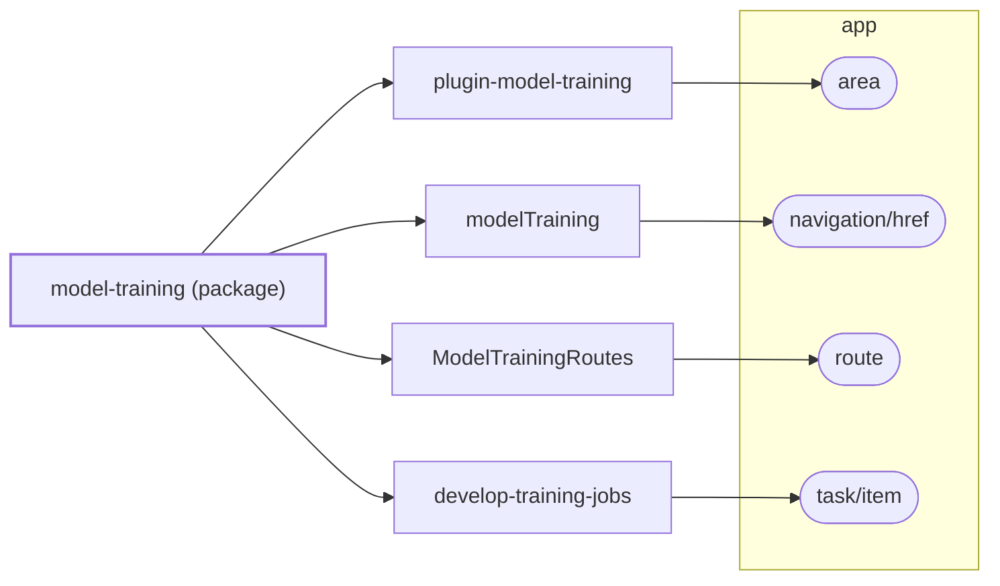

<!-- AUTO-GENERATED by @odh-dashboard/extension-map. Do not edit by hand. -->

> Generated file. Regenerate with `pnpm docs:extension-map`.

# Extensions in model-training

Package `@odh-dashboard/model-training` (package) at `packages/model-training`. Everything below is read out of this repository's sources by static analysis.

## Loading paths

- [extensions.ts](../extensions.ts) (`./extensions`) — bundled into the host at build time (the `./extensions` export)

## Contributes

The extensions this package declares, grouped by the namespace of the extension point they target.

### Namespace `app`

| Node | What | Link |
| --- | --- | --- |
| model-training (package) | this package | [packages/model-training](..) |
| plugin-model-training | extension of app.area — bundled | [extensions.ts](../extensions.ts#L13-L20) |
| modelTraining | extension of app.navigation/href — bundled | [extensions.ts](../extensions.ts#L21-L33) |
| ModelTrainingRoutes | extension of app.route — bundled | [extensions.ts](../extensions.ts#L34-L43) |
| develop-training-jobs | extension of app.task/item — bundled | [extensions.ts](../extensions.ts#L44-L56) |
| area | extension point | [app.area](../../plugin-core/docs/extensions.md#apparea) |
| navigation/href | extension point | [app.navigation/href](../../plugin-core/docs/extensions.md#appnavigationhref) |
| route | extension point | [app.route](../../plugin-core/docs/extensions.md#approute) |
| task/item | extension point | [app.task/item](../../plugin-core/docs/extensions.md#apptaskitem) |

#### Contributes to app.area

Defined in [app.area](../../plugin-core/docs/extensions.md#apparea).

| reliantAreas | featureFlags | id | Source |
| --- | --- | --- | --- |
| `SupportedArea.MODEL_TRAINING` (`'model-training'`), `SupportedArea.RAY_JOBS` (`'ray-jobs'`) | `'trainingJobs'` | `PLUGIN_MODEL_TRAINING` (`'plugin-model-training'`) | [extensions.ts](../extensions.ts#L13-L20) |

#### Contributes to app.navigation/href

Defined in [app.navigation/href](../../plugin-core/docs/extensions.md#appnavigationhref).

| id | title | section | href | path | Requires | Source |
| --- | --- | --- | --- | --- | --- | --- |
| `'modelTraining'` | `'Jobs'` | `'develop-and-train'` | `'/develop-train/training-jobs'` | `'/develop-train/training-jobs/*'` | `PLUGIN_MODEL_TRAINING` (`'plugin-model-training'`) | [extensions.ts](../extensions.ts#L21-L33) |

#### Contributes to app.route

Defined in [app.route](../../plugin-core/docs/extensions.md#approute).

| path | Requires | CodeRef target | Source |
| --- | --- | --- | --- |
| `'/develop-train/training-jobs/*'` | `PLUGIN_MODEL_TRAINING` (`'plugin-model-training'`) | [ModelTrainingRoutes#default](../src/ModelTrainingRoutes.tsx#L7-L21) | [extensions.ts](../extensions.ts#L34-L43) |

#### Contributes to app.task/item

Defined in [app.task/item](../../plugin-core/docs/extensions.md#apptaskitem).

| id | group | title | destination | order | Requires | Source |
| --- | --- | --- | --- | --- | --- | --- |
| `'develop-training-jobs'` | `'develop-and-train'` | `'Manage training jobs'` | `{ href: '/develop-train/training-jobs' }` | `'5_training_jobs'` | `PLUGIN_MODEL_TRAINING` (`'plugin-model-training'`) | [extensions.ts](../extensions.ts#L44-L56) |

## Legend

| Edge | What it means in these diagrams |
| --- | --- |
| `A --> B` | A is declared by this package and bundled into an app at build time. It may also be exposed through Module Federation — the node table beside each diagram names every loading path. |
| `A -. "federated" .-> B` | A reaches the host only through a Module Federation remote, loaded at runtime. |
| `A ==> B` | Derived: proven through a type or a JSDoc tag rather than a direct reference. |
| `A -. "rendered in" .-> B` | B renders A (one hop). |
| `A --x B` | A suppresses B. |
| `A -- "patch" --> B` | A patches B. |

A node with a dashed border stands for several extensions of the same point; its `×N` label is
the number of extensions, and the table beside the diagram always lists every one of them.
Anything the analysis could not resolve is never drawn — it is listed in a "Not resolved" table
instead.
