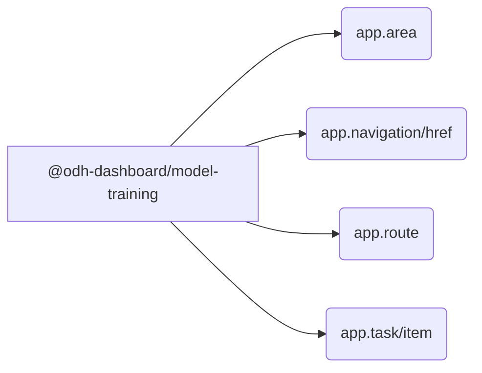

<!-- AUTO-GENERATED by @odh-dashboard/extension-map. Do not edit by hand. -->

> Generated file. Regenerate with `pnpm docs:extension-map`.

## Loading paths

| Entry | Path | Source |
| --- | --- | --- |
| @odh-dashboard/model-training#./extensions | static | `packages/model-training/extensions.ts` |

## Contributes

### app

| Node | Link |
| --- | --- |
| @odh-dashboard/model-training | [@odh-dashboard/model-training](#contributes) |
| app.area | [app.area](../../plugin-core/docs/extensions.md#apparea) [app.area](../extensions.ts#L13-L20) |
| app.navigation/href | [app.navigation/href](../../plugin-core/docs/extensions.md#appnavigationhref) [app.navigation/href](../extensions.ts#L21-L33) |
| app.route | [app.route](../../plugin-core/docs/extensions.md#approute) [app.route](../extensions.ts#L34-L43) |
| app.task/item | [app.task/item](../../plugin-core/docs/extensions.md#apptaskitem) [app.task/item](../extensions.ts#L44-L56) |

- `-->` declared or type-resolved contribution
- `==>` derived relationship
- `-. "rendered in" .->` rendered in one hop
- `-. "federated" .->` federated contribution
- `--x` suppression
- `-- "patch" -->` patch

#### app.area

- **reliantAreas**: `SupportedArea.MODEL_TRAINING` (`"model-training"`), `SupportedArea.RAY_JOBS` (`"ray-jobs"`)
- **featureFlags**: `"trainingJobs"`
- **id**: `PLUGIN_MODEL_TRAINING` (`"plugin-model-training"`)
- **Requires**: 
- **Disallows**: 
- **CodeRef target**: 
- **Included in**: 
- **Source**: [app.area](../extensions.ts#L13-L20)

#### app.navigation/href

- **id**: `"modelTraining"`
- **title**: `"Jobs"`
- **section**: `"develop-and-train"`
- **href**: `"/develop-train/training-jobs"`
- **path**: `"/develop-train/training-jobs/*"`
- **Requires**: `PLUGIN_MODEL_TRAINING` (`"plugin-model-training"`)
- **Disallows**: 
- **CodeRef target**: 
- **Included in**: 
- **Source**: [app.navigation/href](../extensions.ts#L21-L33)

#### app.route

| component | path | Requires | Disallows | CodeRef target | Included in | Source |
| --- | --- | --- | --- | --- | --- | --- |
| packages/model-training/src/ModelTrainingRoutes.tsx#[ModelTrainingRoutes](../src/ModelTrainingRoutes.tsx#L7-L21) | `"/develop-train/training-jobs/*"` | `PLUGIN_MODEL_TRAINING` (`"plugin-model-training"`) |  | packages/model-training/src/ModelTrainingRoutes.tsx#[ModelTrainingRoutes](../src/ModelTrainingRoutes.tsx#L7-L21) |  | [app.route](../extensions.ts#L34-L43) |

#### app.task/item

- **id**: `"develop-training-jobs"`
- **group**: `"develop-and-train"`
- **title**: `"Manage training jobs"`
- **destination**: href: `"/develop-train/training-jobs"`
- **order**: `"5_training_jobs"`
- **Requires**: `PLUGIN_MODEL_TRAINING` (`"plugin-model-training"`)
- **Disallows**: 
- **CodeRef target**: 
- **Included in**: 
- **Source**: [app.task/item](../extensions.ts#L44-L56)
