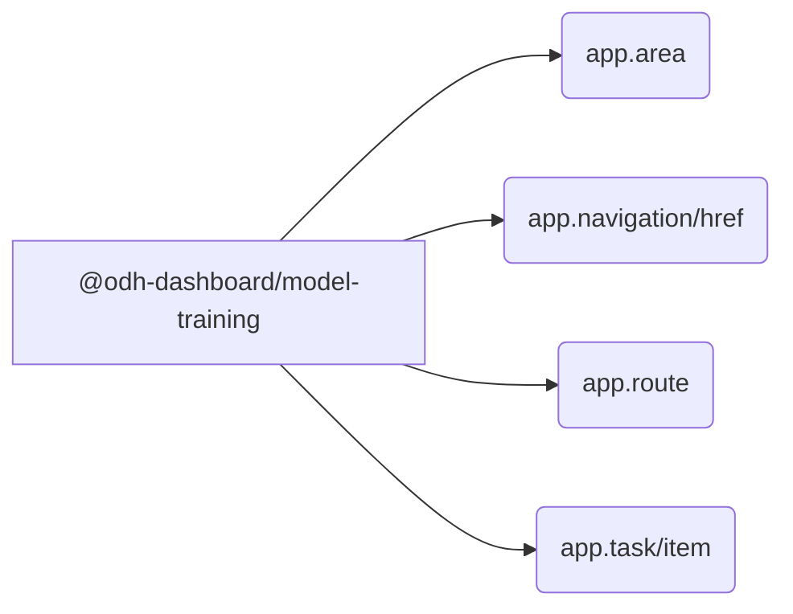

<!-- AUTO-GENERATED by @odh-dashboard/extension-map. Do not edit by hand. -->

> Generated file. Regenerate with `pnpm docs:extension-map`.

## Contents
- [Loading paths](#loading-paths)
- [Contributes](#contributes)
  - [app](#app)
    - [app.area](#apparea)
    - [app.navigation/href](#appnavigationhref)
    - [app.route](#approute)
    - [app.task/item](#apptaskitem)

## Loading paths

| Entry | Path | Source |
| --- | --- | --- |
| @odh-dashboard/model-training#./extensions | static | `packages/model-training/extensions.ts` |

## Contributes

### app

| Node | Contract | Registration sources |
| --- | --- | --- |
| [@odh-dashboard/model-training](#loading-paths) | — | — |
| app.area | [app.area](../../plugin-core/docs/extensions.md#apparea) | [../extensions.ts:13](../extensions.ts#L13-L20) |
| app.navigation/href | [app.navigation/href](../../plugin-core/docs/extensions.md#appnavigationhref) | [../extensions.ts:21](../extensions.ts#L21-L33) |
| app.route | [app.route](../../plugin-core/docs/extensions.md#approute) | [../extensions.ts:34](../extensions.ts#L34-L43) |
| app.task/item | [app.task/item](../../plugin-core/docs/extensions.md#apptaskitem) | [../extensions.ts:44](../extensions.ts#L44-L56) |

- `-->` declared or type-resolved contribution
- `==>` derived relationship
- `-. "rendered in" .->` rendered in one hop
- `-. "federated" .->` federated contribution
- `--x` suppression
- `-- "patch" -->` patch

#### app.area

| reliantAreas | featureFlags | id | Source |
| --- | --- | --- | --- |
| `SupportedArea.MODEL_TRAINING` (`"model-training"`), `SupportedArea.RAY_JOBS` (`"ray-jobs"`) | `"trainingJobs"` | `PLUGIN_MODEL_TRAINING` (`"plugin-model-training"`) | [app.area](../extensions.ts#L13-L20) |

#### app.navigation/href

| id | title | section | href | path | Requires | Source |
| --- | --- | --- | --- | --- | --- | --- |
| `"modelTraining"` | `"Jobs"` | `"develop-and-train"` | `"/develop-train/training-jobs"` | `"/develop-train/training-jobs/*"` | `PLUGIN_MODEL_TRAINING` (`"plugin-model-training"`) | [app.navigation/href](../extensions.ts#L21-L33) |

#### app.route

| component | path | Requires | CodeRef target | Source |
| --- | --- | --- | --- | --- |
| packages/model-training/src/ModelTrainingRoutes.tsx#[ModelTrainingRoutes](../src/ModelTrainingRoutes.tsx#L7-L21) | `"/develop-train/training-jobs/*"` | `PLUGIN_MODEL_TRAINING` (`"plugin-model-training"`) | packages/model-training/src/ModelTrainingRoutes.tsx#[ModelTrainingRoutes](../src/ModelTrainingRoutes.tsx#L7-L21) | [app.route](../extensions.ts#L34-L43) |

#### app.task/item

| id | group | title | destination | order | Requires | Source |
| --- | --- | --- | --- | --- | --- | --- |
| `"develop-training-jobs"` | `"develop-and-train"` | `"Manage training jobs"` | href: `"/develop-train/training-jobs"` | `"5_training_jobs"` | `PLUGIN_MODEL_TRAINING` (`"plugin-model-training"`) | [app.task/item](../extensions.ts#L44-L56) |
