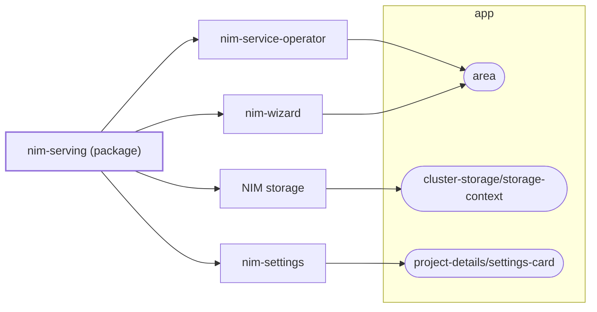

<!-- AUTO-GENERATED by @odh-dashboard/extension-map. Do not edit by hand. -->

> Generated file. Regenerate with `pnpm docs:extension-map`.

# Extensions in nim-serving

Package `@odh-dashboard/nim-serving` (package) at `packages/nim-serving`. Everything below is read out of this repository's sources by static analysis.

## Loading paths

- [index.ts](../extensions/index.ts) (`./extensions`) — bundled into the host at build time (the `./extensions` export)

## Contributes

The extensions this package declares, grouped by the namespace of the extension point they target.

### Namespace `app`

| Node | What | Link |
| --- | --- | --- |
| nim-serving (package) | this package | [packages/nim-serving](..) |
| nim-service-operator | extension of app.area — bundled | [nim-service.ts](../extensions/nim-service.ts#L130-L137) |
| nim-wizard | extension of app.area — bundled | [wizard.ts](../extensions/wizard.ts#L74-L81) |
| NIM storage | extension of app.cluster-storage/storage-context — bundled | [cluster-storage.ts](../extensions/cluster-storage.ts#L6-L19) |
| nim-settings | extension of app.project-details/settings-card — bundled | [project-key.ts](../extensions/project-key.ts#L9-L19) |
| area | extension point | [app.area](../../plugin-core/docs/extensions.md#apparea) |
| cluster-storage/storage-context | extension point | [app.cluster-storage/storage-context](../../plugin-core/docs/extensions.md#appcluster-storagestorage-context) |
| project-details/settings-card | extension point | [app.project-details/settings-card](../../plugin-core/docs/extensions.md#appproject-detailssettings-card) |

#### Contributes to app.area

Defined in [app.area](../../plugin-core/docs/extensions.md#apparea).

| reliantAreas | featureFlags | id | Included in | Source |
| --- | --- | --- | --- | --- |
| `SupportedArea.NIM_MODEL` (`'nim-model'`) | `'nimServiceOperator'` | `SupportedArea.NIM_SERVICE_OPERATOR` (`'nim-service-operator'`) | host | [nim-service.ts](../extensions/nim-service.ts#L130-L137) |
| `SupportedArea.NIM_MODEL` (`'nim-model'`) | `'nimWizard'` | `SupportedArea.NIM_WIZARD` (`'nim-wizard'`) | host | [wizard.ts](../extensions/wizard.ts#L74-L81) |

#### Contributes to app.cluster-storage/storage-context

Defined in [app.cluster-storage/storage-context](../../plugin-core/docs/extensions.md#appcluster-storagestorage-context).

| title | description | Requires | CodeRef target | Included in | Source |
| --- | --- | --- | --- | --- | --- |
| `'NIM storage'` | `'Appropriate for caching NIM models. Enables you to define a subpath for the NIM image.'` | `SupportedArea.NIM_MODEL` (`'nim-model'`) | `PVCStorageContextSettingsFields`: [clusterStorage#default](../src/pages/clusterStorage/clusterStorage.tsx#L13-L34) `isPVCUsingStorageContextType`: [clusterStorage#isNIMPVC](../src/pages/clusterStorage/clusterStorage.tsx#L10-L11) | host | [cluster-storage.ts](../extensions/cluster-storage.ts#L6-L19) |

#### Contributes to app.project-details/settings-card

Defined in [app.project-details/settings-card](../../plugin-core/docs/extensions.md#appproject-detailssettings-card).

| id | title | Requires | CodeRef target | Included in | Source |
| --- | --- | --- | --- | --- | --- |
| `'nim-settings'` | `'NVIDIA NIM'` | `SupportedArea.NIM_WIZARD` (`'nim-wizard'`) | [NIMSettingsCard#default](../src/pages/projectSettings/NIMSettingsCard.tsx#L59-L330) | host | [project-key.ts](../extensions/project-key.ts#L9-L19) |

### Namespace `model-serving`

```mermaid
flowchart LR
  classDef pkg stroke-width:2px
  classDef point stroke-width:1px
  n__odh_dashboard_nim_serving_974017["nim-serving (package)"]:::pkg
  n_packages_nim_serving_extensions_nim_service_ts_8444_d1b9cf["isNIMAuthEnabled"]
  n__odh_dashboard_nim_serving_974017 --> n_packages_nim_serving_extensions_nim_service_ts_8444_d1b9cf
  n_packages_nim_serving_extensions_nim_service_ts_5256_ffdbeb["NIMServingDetails"]
  n__odh_dashboard_nim_serving_974017 --> n_packages_nim_serving_extensions_nim_service_ts_5256_ffdbeb
  n_packages_nim_serving_extensions_nim_service_ts_6283_df8e5a["assembleNIMDeployment"]
  n__odh_dashboard_nim_serving_974017 --> n_packages_nim_serving_extensions_nim_service_ts_6283_df8e5a
  n_packages_nim_serving_extensions_nim_kserve_ts_5272_bb1340["deployNIMKServeDeployment"]
  n__odh_dashboard_nim_serving_974017 --> n_packages_nim_serving_extensions_nim_kserve_ts_5272_bb1340
  n_packages_nim_serving_extensions_nim_service_ts_5854_3e98cf["deployNIMDeployment"]
  n__odh_dashboard_nim_serving_974017 --> n_packages_nim_serving_extensions_nim_service_ts_5854_3e98cf
  n_packages_nim_serving_extensions_nim_kserve_ts_4239_640acc["nimKServeFormDataExtension"]
  n__odh_dashboard_nim_serving_974017 --> n_packages_nim_serving_extensions_nim_kserve_ts_4239_640acc
  n_packages_nim_serving_extensions_nim_service_ts_6702_e871ae["extractNIMEnvironmentVariables"]
  n__odh_dashboard_nim_serving_974017 --> n_packages_nim_serving_extensions_nim_service_ts_6702_e871ae
  n_packages_nim_serving_extensions_nim_kserve_ts_1993_c00dac["nimTrackingPropertiesExtension"]
  n__odh_dashboard_nim_serving_974017 --> n_packages_nim_serving_extensions_nim_kserve_ts_1993_c00dac
  n_packages_nim_serving_extensions_wizard_ts_618_47b345["nimImageFieldExtension"]
  n__odh_dashboard_nim_serving_974017 --> n_packages_nim_serving_extensions_wizard_ts_618_47b345
  n_packages_nim_serving_extensions_wizard_ts_962_e9236d["nimPVCFieldExtension"]
  n__odh_dashboard_nim_serving_974017 --> n_packages_nim_serving_extensions_wizard_ts_962_e9236d
  n_packages_nim_serving_extensions_nim_kserve_ts_1131_dcfdc4["nimPVCApplyExtension #1"]
  n__odh_dashboard_nim_serving_974017 --> n_packages_nim_serving_extensions_nim_kserve_ts_1131_dcfdc4
  n_packages_nim_serving_extensions_nim_kserve_ts_2863_fc90b7["nimImageApplyExtension #1"]
  n__odh_dashboard_nim_serving_974017 --> n_packages_nim_serving_extensions_nim_kserve_ts_2863_fc90b7
  n_packages_nim_serving_extensions_nim_service_ts_1313_a3b29b["nimImageApplyExtension #2"]
  n__odh_dashboard_nim_serving_974017 --> n_packages_nim_serving_extensions_nim_service_ts_1313_a3b29b
  n_packages_nim_serving_extensions_nim_service_ts_2259_c0d4e1["nimPVCApplyExtension #2"]
  n__odh_dashboard_nim_serving_974017 --> n_packages_nim_serving_extensions_nim_service_ts_2259_c0d4e1
  n_packages_nim_serving_extensions_nim_kserve_ts_2407_8a790d["nimPVCDeployFunctionsExtension #1"]
  n__odh_dashboard_nim_serving_974017 --> n_packages_nim_serving_extensions_nim_kserve_ts_2407_8a790d
  n_packages_nim_serving_extensions_nim_service_ts_3207_fe53af["nimPVCDeployFunctionsExtension #2"]
  n__odh_dashboard_nim_serving_974017 --> n_packages_nim_serving_extensions_nim_service_ts_3207_fe53af
  n_packages_nim_serving_extensions_nim_kserve_ts_1554_4720b1["nimPVCExtractorExtension #1"]
  n__odh_dashboard_nim_serving_974017 --> n_packages_nim_serving_extensions_nim_kserve_ts_1554_4720b1
  n_packages_nim_serving_extensions_nim_kserve_ts_3290_d1808e["nimImageExtractExtension"]
  n__odh_dashboard_nim_serving_974017 --> n_packages_nim_serving_extensions_nim_kserve_ts_3290_d1808e
  n_packages_nim_serving_extensions_nim_service_ts_1776_0dd8ae["nimImageExtractorExtension"]
  n__odh_dashboard_nim_serving_974017 --> n_packages_nim_serving_extensions_nim_service_ts_1776_0dd8ae
  n_packages_nim_serving_extensions_nim_service_ts_2718_8179dd["nimPVCExtractorExtension #2"]
  n__odh_dashboard_nim_serving_974017 --> n_packages_nim_serving_extensions_nim_service_ts_2718_8179dd
  n_packages_nim_serving_extensions_wizard_ts_1303_9ce613["nimModelTypeOverride"]
  n__odh_dashboard_nim_serving_974017 --> n_packages_nim_serving_extensions_wizard_ts_1303_9ce613
  n_packages_nim_serving_extensions_wizard_ts_1685_d13286["nimModelLocationOverride"]
  n__odh_dashboard_nim_serving_974017 --> n_packages_nim_serving_extensions_wizard_ts_1685_d13286
  n_packages_nim_serving_extensions_nim_service_ts_8894_112df6["patchDeploymentStoppedStatus"]
  n__odh_dashboard_nim_serving_974017 --> n_packages_nim_serving_extensions_nim_service_ts_8894_112df6
  n_packages_nim_serving_extensions_legacy_ui_ts_1016_210d1b["nvidia-nim"]
  n__odh_dashboard_nim_serving_974017 --> n_packages_nim_serving_extensions_legacy_ui_ts_1016_210d1b
  n_packages_nim_serving_extensions_nim_kserve_ts_5689_3602d2["Delete model deployment?"]
  n__odh_dashboard_nim_serving_974017 --> n_packages_nim_serving_extensions_nim_kserve_ts_5689_3602d2
  n_packages_nim_serving_extensions_nim_service_ts_5545_388372["isNIMOwned"]
  n__odh_dashboard_nim_serving_974017 --> n_packages_nim_serving_extensions_nim_service_ts_5545_388372
  n_packages_nim_serving_extensions_legacy_ui_ts_3251_3d000a["ModelServingRoutes"]
  n__odh_dashboard_nim_serving_974017 --> n_packages_nim_serving_extensions_legacy_ui_ts_3251_3d000a
  n_packages_nim_serving_extensions_legacy_ui_ts_2867_7a974c["ServeModelsSection"]
  n__odh_dashboard_nim_serving_974017 --> n_packages_nim_serving_extensions_legacy_ui_ts_2867_7a974c
  n_packages_nim_serving_extensions_legacy_ui_ts_2514_862415["ModelServingPlatform"]
  n__odh_dashboard_nim_serving_974017 --> n_packages_nim_serving_extensions_legacy_ui_ts_2514_862415
  n_packages_nim_serving_extensions_nim_service_ts_4946_ab7652["useWatchDeployments"]
  n__odh_dashboard_nim_serving_974017 --> n_packages_nim_serving_extensions_nim_service_ts_4946_ab7652
  subgraph n_ns_model_serving_eced18 ["model-serving"]
    n_model_serving_auth_5d7b65(["auth"]):::point
    n_model_serving_deployed_model_serving_runtime_a806c7(["deployed-model/serving-runtime"]):::point
    n_model_serving_deployment_assemble_model_resource_5b5fd4(["deployment/assemble-model-resource"]):::point
    n_model_serving_deployment_deploy_35423a(["deployment/deploy"]):::point
    n_model_serving_deployment_form_data_a37ab2(["deployment/form-data"]):::point
    n_model_serving_deployment_tracking_properties_2845ae(["deployment/tracking-properties"]):::point
    n_model_serving_deployment_wizard_field_19398b(["deployment/wizard-field"]):::point
    n_model_serving_deployment_wizard_field_apply_b7659a(["deployment/wizard-field-apply"]):::point
    n_model_serving_deployment_wizard_field_deployment_functions_dd7c85(["deployment/wizard-field-deployment-functions"]):::point
    n_model_serving_deployment_wizard_field_extractor_877f9e(["deployment/wizard-field-extractor"]):::point
    n_model_serving_deployment_wizard_field_override_756caa(["deployment/wizard-field-override"]):::point
    n_model_serving_deployments_table_start_stop_action_ea2e4f(["deployments-table/start-stop-action"]):::point
    n_model_serving_platform_1d1e44(["platform"]):::point
    n_model_serving_platform_delete_deployment_259f2a(["platform/delete-deployment"]):::point
    n_model_serving_platform_exclude_deployment_af339f(["platform/exclude-deployment"]):::point
    n_model_serving_platform_global_models_page_508e89(["platform/global-models-page"]):::point
    n_model_serving_platform_overview_section_7dcf20(["platform/overview-section"]):::point
    n_model_serving_platform_project_details_tab_fce2f7(["platform/project-details-tab"]):::point
    n_model_serving_platform_watch_deployments_cf294d(["platform/watch-deployments"]):::point
  end
  n_packages_nim_serving_extensions_nim_service_ts_8444_d1b9cf --> n_model_serving_auth_5d7b65
  n_packages_nim_serving_extensions_nim_service_ts_5256_ffdbeb --> n_model_serving_deployed_model_serving_runtime_a806c7
  n_packages_nim_serving_extensions_nim_service_ts_6283_df8e5a --> n_model_serving_deployment_assemble_model_resource_5b5fd4
  n_packages_nim_serving_extensions_nim_kserve_ts_5272_bb1340 --> n_model_serving_deployment_deploy_35423a
  n_packages_nim_serving_extensions_nim_service_ts_5854_3e98cf --> n_model_serving_deployment_deploy_35423a
  n_packages_nim_serving_extensions_nim_kserve_ts_4239_640acc --> n_model_serving_deployment_form_data_a37ab2
  n_packages_nim_serving_extensions_nim_service_ts_6702_e871ae --> n_model_serving_deployment_form_data_a37ab2
  n_packages_nim_serving_extensions_nim_kserve_ts_1993_c00dac --> n_model_serving_deployment_tracking_properties_2845ae
  n_packages_nim_serving_extensions_wizard_ts_618_47b345 --> n_model_serving_deployment_wizard_field_19398b
  n_packages_nim_serving_extensions_wizard_ts_962_e9236d --> n_model_serving_deployment_wizard_field_19398b
  n_packages_nim_serving_extensions_nim_kserve_ts_1131_dcfdc4 --> n_model_serving_deployment_wizard_field_apply_b7659a
  n_packages_nim_serving_extensions_nim_kserve_ts_2863_fc90b7 --> n_model_serving_deployment_wizard_field_apply_b7659a
  n_packages_nim_serving_extensions_nim_service_ts_1313_a3b29b --> n_model_serving_deployment_wizard_field_apply_b7659a
  n_packages_nim_serving_extensions_nim_service_ts_2259_c0d4e1 --> n_model_serving_deployment_wizard_field_apply_b7659a
  n_packages_nim_serving_extensions_nim_kserve_ts_2407_8a790d --> n_model_serving_deployment_wizard_field_deployment_functions_dd7c85
  n_packages_nim_serving_extensions_nim_service_ts_3207_fe53af --> n_model_serving_deployment_wizard_field_deployment_functions_dd7c85
  n_packages_nim_serving_extensions_nim_kserve_ts_1554_4720b1 --> n_model_serving_deployment_wizard_field_extractor_877f9e
  n_packages_nim_serving_extensions_nim_kserve_ts_3290_d1808e --> n_model_serving_deployment_wizard_field_extractor_877f9e
  n_packages_nim_serving_extensions_nim_service_ts_1776_0dd8ae --> n_model_serving_deployment_wizard_field_extractor_877f9e
  n_packages_nim_serving_extensions_nim_service_ts_2718_8179dd --> n_model_serving_deployment_wizard_field_extractor_877f9e
  n_packages_nim_serving_extensions_wizard_ts_1303_9ce613 --> n_model_serving_deployment_wizard_field_override_756caa
  n_packages_nim_serving_extensions_wizard_ts_1685_d13286 --> n_model_serving_deployment_wizard_field_override_756caa
  n_packages_nim_serving_extensions_nim_service_ts_8894_112df6 --> n_model_serving_deployments_table_start_stop_action_ea2e4f
  n_packages_nim_serving_extensions_legacy_ui_ts_1016_210d1b --> n_model_serving_platform_1d1e44
  n_packages_nim_serving_extensions_nim_kserve_ts_5689_3602d2 --> n_model_serving_platform_delete_deployment_259f2a
  n_packages_nim_serving_extensions_nim_service_ts_5545_388372 --> n_model_serving_platform_exclude_deployment_af339f
  n_packages_nim_serving_extensions_legacy_ui_ts_3251_3d000a --> n_model_serving_platform_global_models_page_508e89
  n_packages_nim_serving_extensions_legacy_ui_ts_2867_7a974c --> n_model_serving_platform_overview_section_7dcf20
  n_packages_nim_serving_extensions_legacy_ui_ts_2514_862415 --> n_model_serving_platform_project_details_tab_fce2f7
  n_packages_nim_serving_extensions_nim_service_ts_4946_ab7652 --> n_model_serving_platform_watch_deployments_cf294d
```

| Node | What | Link |
| --- | --- | --- |
| nim-serving (package) | this package | [packages/nim-serving](..) |
| isNIMAuthEnabled | extension of model-serving.auth — bundled | [nim-service.ts](../extensions/nim-service.ts#L242-L252) |
| NIMServingDetails | extension of model-serving.deployed-model/serving-runtime — bundled | [nim-service.ts](../extensions/nim-service.ts#L149-L158) |
| assembleNIMDeployment | extension of model-serving.deployment/assemble-model-resource — bundled | [nim-service.ts](../extensions/nim-service.ts#L183-L194) |
| deployNIMKServeDeployment | extension of model-serving.deployment/deploy — bundled | [nim-kserve.ts](../extensions/nim-kserve.ts#L139-L151) |
| deployNIMDeployment | extension of model-serving.deployment/deploy — bundled | [nim-service.ts](../extensions/nim-service.ts#L170-L182) |
| nimKServeFormDataExtension | extension of model-serving.deployment/form-data — bundled | [nim-kserve.ts](../extensions/nim-kserve.ts#L113-L125) |
| extractNIMEnvironmentVariables | extension of model-serving.deployment/form-data — bundled | [nim-service.ts](../extensions/nim-service.ts#L195-L241) |
| nimTrackingPropertiesExtension | extension of model-serving.deployment/tracking-properties — bundled | [nim-kserve.ts](../extensions/nim-kserve.ts#L47-L57) |
| nimImageFieldExtension | extension of model-serving.deployment/wizard-field — bundled | [wizard.ts](../extensions/wizard.ts#L11-L22) |
| nimPVCFieldExtension | extension of model-serving.deployment/wizard-field — bundled | [wizard.ts](../extensions/wizard.ts#L24-L35) |
| nimPVCApplyExtension #1 | extension of model-serving.deployment/wizard-field-apply — bundled | [nim-kserve.ts](../extensions/nim-kserve.ts#L20-L31) |
| nimImageApplyExtension #1 | extension of model-serving.deployment/wizard-field-apply — bundled | [nim-kserve.ts](../extensions/nim-kserve.ts#L76-L87) |
| nimImageApplyExtension #2 | extension of model-serving.deployment/wizard-field-apply — bundled | [nim-service.ts](../extensions/nim-service.ts#L26-L39) |
| nimPVCApplyExtension #2 | extension of model-serving.deployment/wizard-field-apply — bundled | [nim-service.ts](../extensions/nim-service.ts#L57-L70) |
| nimPVCDeployFunctionsExtension #1 | extension of model-serving.deployment/wizard-field-deployment-functions — bundled | [nim-kserve.ts](../extensions/nim-kserve.ts#L62-L74) |
| nimPVCDeployFunctionsExtension #2 | extension of model-serving.deployment/wizard-field-deployment-functions — bundled | [nim-service.ts](../extensions/nim-service.ts#L90-L107) |
| nimPVCExtractorExtension #1 | extension of model-serving.deployment/wizard-field-extractor — bundled | [nim-kserve.ts](../extensions/nim-kserve.ts#L34-L45) |
| nimImageExtractExtension | extension of model-serving.deployment/wizard-field-extractor — bundled | [nim-kserve.ts](../extensions/nim-kserve.ts#L92-L108) |
| nimImageExtractorExtension | extension of model-serving.deployment/wizard-field-extractor — bundled | [nim-service.ts](../extensions/nim-service.ts#L42-L55) |
| nimPVCExtractorExtension #2 | extension of model-serving.deployment/wizard-field-extractor — bundled | [nim-service.ts](../extensions/nim-service.ts#L72-L85) |
| nimModelTypeOverride | extension of model-serving.deployment/wizard-field-override — bundled | [wizard.ts](../extensions/wizard.ts#L37-L49) |
| nimModelLocationOverride | extension of model-serving.deployment/wizard-field-override — bundled | [wizard.ts](../extensions/wizard.ts#L51-L63) |
| patchDeploymentStoppedStatus | extension of model-serving.deployments-table/start-stop-action — bundled | [nim-service.ts](../extensions/nim-service.ts#L258-L268) |
| nvidia-nim | extension of model-serving.platform — bundled | [legacy-ui.ts](../extensions/legacy-ui.ts#L23-L58) |
| Delete model deployment? | extension of model-serving.platform/delete-deployment — bundled | [nim-kserve.ts](../extensions/nim-kserve.ts#L152-L168) |
| isNIMOwned | extension of model-serving.platform/exclude-deployment — bundled | [nim-service.ts](../extensions/nim-service.ts#L159-L169) |
| ModelServingRoutes | extension of model-serving.platform/global-models-page — bundled | [legacy-ui.ts](../extensions/legacy-ui.ts#L85-L95) |
| ServeModelsSection | extension of model-serving.platform/overview-section — bundled | [legacy-ui.ts](../extensions/legacy-ui.ts#L71-L84) |
| ModelServingPlatform | extension of model-serving.platform/project-details-tab — bundled | [legacy-ui.ts](../extensions/legacy-ui.ts#L59-L70) |
| useWatchDeployments | extension of model-serving.platform/watch-deployments — bundled | [nim-service.ts](../extensions/nim-service.ts#L138-L148) |
| auth | extension point | [model-serving.auth](../../model-serving/docs/extensions.md#model-servingauth) |
| deployed-model/serving-runtime | extension point | [model-serving.deployed-model/serving-runtime](../../model-serving/docs/extensions.md#model-servingdeployed-modelserving-runtime) |
| deployment/assemble-model-resource | extension point | [model-serving.deployment/assemble-model-resource](../../model-serving/docs/extensions.md#model-servingdeploymentassemble-model-resource) |
| deployment/deploy | extension point | [model-serving.deployment/deploy](../../model-serving/docs/extensions.md#model-servingdeploymentdeploy) |
| deployment/form-data | extension point | [model-serving.deployment/form-data](../../model-serving/docs/extensions.md#model-servingdeploymentform-data) |
| deployment/tracking-properties | extension point | [model-serving.deployment/tracking-properties](../../model-serving/docs/extensions.md#model-servingdeploymenttracking-properties) |
| deployment/wizard-field | extension point | [model-serving.deployment/wizard-field](../../model-serving/docs/extensions.md#model-servingdeploymentwizard-field) |
| deployment/wizard-field-apply | extension point | [model-serving.deployment/wizard-field-apply](../../model-serving/docs/extensions.md#model-servingdeploymentwizard-field-apply) |
| deployment/wizard-field-deployment-functions | extension point | [model-serving.deployment/wizard-field-deployment-functions](../../model-serving/docs/extensions.md#model-servingdeploymentwizard-field-deployment-functions) |
| deployment/wizard-field-extractor | extension point | [model-serving.deployment/wizard-field-extractor](../../model-serving/docs/extensions.md#model-servingdeploymentwizard-field-extractor) |
| deployment/wizard-field-override | extension point | [model-serving.deployment/wizard-field-override](../../model-serving/docs/extensions.md#model-servingdeploymentwizard-field-override) |
| deployments-table/start-stop-action | extension point | [model-serving.deployments-table/start-stop-action](../../model-serving/docs/extensions.md#model-servingdeployments-tablestart-stop-action) |
| platform | extension point | [model-serving.platform](../../model-serving/docs/extensions.md#model-servingplatform) |
| platform/delete-deployment | extension point | [model-serving.platform/delete-deployment](../../model-serving/docs/extensions.md#model-servingplatformdelete-deployment) |
| platform/exclude-deployment | extension point | [model-serving.platform/exclude-deployment](../../model-serving/docs/extensions.md#model-servingplatformexclude-deployment) |
| platform/global-models-page | extension point | [model-serving.platform/global-models-page](../../model-serving/docs/extensions.md#model-servingplatformglobal-models-page) |
| platform/overview-section | extension point | [model-serving.platform/overview-section](../../model-serving/docs/extensions.md#model-servingplatformoverview-section) |
| platform/project-details-tab | extension point | [model-serving.platform/project-details-tab](../../model-serving/docs/extensions.md#model-servingplatformproject-details-tab) |
| platform/watch-deployments | extension point | [model-serving.platform/watch-deployments](../../model-serving/docs/extensions.md#model-servingplatformwatch-deployments) |

#### Contributes to model-serving.auth

Defined in [model-serving.auth](../../model-serving/docs/extensions.md#model-servingauth).

| platform | Requires | CodeRef target | Included in | Source |
| --- | --- | --- | --- | --- |
| `NIM_SERVICE_ID` (`'nvidia-nim-service'`) | `SupportedArea.NIM_SERVICE_OPERATOR` (`'nim-service-operator'`) | [extractNIMFormData#isNIMAuthEnabled](../src/pages/deploymentWizard/extractNIMFormData.ts#L89-L98) | host | [nim-service.ts](../extensions/nim-service.ts#L242-L252) |

#### Contributes to model-serving.deployed-model/serving-runtime

Defined in [model-serving.deployed-model/serving-runtime](../../model-serving/docs/extensions.md#model-servingdeployed-modelserving-runtime).

| platform | Requires | CodeRef target | Included in | Source |
| --- | --- | --- | --- | --- |
| `NIM_SERVICE_ID` (`'nvidia-nim-service'`) | `SupportedArea.NIM_SERVICE_OPERATOR` (`'nim-service-operator'`) | [NIMServingDetails#default](../src/pages/deployments/NIMServingDetails.tsx#L3) | host | [nim-service.ts](../extensions/nim-service.ts#L149-L158) |

#### Contributes to model-serving.deployment/assemble-model-resource

Defined in [model-serving.deployment/assemble-model-resource](../../model-serving/docs/extensions.md#model-servingdeploymentassemble-model-resource).

| platform | priority | Requires | CodeRef target | Included in | Source |
| --- | --- | --- | --- | --- | --- |
| `NIM_SERVICE_ID` (`'nvidia-nim-service'`) | `100` | `SupportedArea.NIM_SERVICE_OPERATOR` (`'nim-service-operator'`) | `assemble`: [deploy#assembleNIMDeployment](../src/api/deployments/deploy.ts#L21-L52) `isActive`: [deploy#isNIMDeployActive](../src/api/deployments/deploy.ts#L18-L19) | host | [nim-service.ts](../extensions/nim-service.ts#L183-L194) |

#### Contributes to model-serving.deployment/deploy

Defined in [model-serving.deployment/deploy](../../model-serving/docs/extensions.md#model-servingdeploymentdeploy).

| platform | priority | supportsOverwrite | Requires | CodeRef target | Included in | Source |
| --- | --- | --- | --- | --- | --- | --- |
| `NIM_LEGACY_ID` (`'nvidia-nim'`) | `50` | `true` | `SupportedArea.NIM_WIZARD` (`'nim-wizard'`) | `deploy`: [deploy#deployNIMKServeDeployment](../src/nimKServe/deploy.ts#L33-L96) `isActive`: [deploy#isNIMKServeDeployActive](../src/nimKServe/deploy.ts#L25-L26) | host | [nim-kserve.ts](../extensions/nim-kserve.ts#L139-L151) |
| `NIM_SERVICE_ID` (`'nvidia-nim-service'`) | `100` | `true` | `SupportedArea.NIM_SERVICE_OPERATOR` (`'nim-service-operator'`) | `deploy`: [deploy#deployNIMDeployment](../src/api/deployments/deploy.ts#L68-L107) `isActive`: [deploy#isNIMDeployActive](../src/api/deployments/deploy.ts#L18-L19) | host | [nim-service.ts](../extensions/nim-service.ts#L170-L182) |

#### Contributes to model-serving.deployment/form-data

Defined in [model-serving.deployment/form-data](../../model-serving/docs/extensions.md#model-servingdeploymentform-data).

| platform | priority | Requires | CodeRef target | Included in | Source |
| --- | --- | --- | --- | --- | --- |
| `KSERVE_ID` (`'kserve'`) | `50` | `SupportedArea.NIM_WIZARD` (`'nim-wizard'`) | `extractDeploymentStrategy`: [deployUtils#extractDeploymentStrategy](../../kserve/src/deployUtils.ts#L258-L271) `extractEnvironmentVariables`: [hardware#extractEnvironmentVariables](../../kserve/src/hardware.ts#L56-L67) `extractHardwareProfileConfig`: `hardware#?` `extractHuggingFaceApiKey`: `hfTokenSecret#?` `extractModelAvailabilityData`: [aiAssets#extractModelAvailabilityData](../../kserve/src/aiAssets.ts#L4-L12) `extractModelFormat`: [modelFormat#extractKServeModelFormat](../../kserve/src/modelFormat.ts#L4-L15) `extractModelLocationData`: [extractFormData#extractNIMKServeModelLocationData](../src/nimKServe/extractFormData.ts#L24-L28) `extractModelServerTemplate`: [deployServer#extractModelServerTemplate](../../kserve/src/deployServer.ts#L83-L112) `extractModelType`: [deployUtils#extractModelType](../../kserve/src/deployUtils.ts#L222-L233) `extractReplicas`: `hardware#?` `extractRuntimeArgs`: [hardware#extractRuntimeArgs](../../kserve/src/hardware.ts#L46-L54) `hardwareProfilePaths`: [const#INFERENCE_SERVICE_HARDWARE_PROFILE_PATHS](../../hardware-profiles/shared/const.ts#L18-L23) (via `hardware`) `isActive`: [extractFormData#isNIMKServeDeployment](../src/nimKServe/extractFormData.ts#L18-L20) | host | [nim-kserve.ts](../extensions/nim-kserve.ts#L113-L125) |
| `NIM_SERVICE_ID` (`'nvidia-nim-service'`) | `0` | `SupportedArea.NIM_SERVICE_OPERATOR` (`'nim-service-operator'`) | `extractEnvironmentVariables`: [extractNIMFormData#extractNIMEnvironmentVariables](../src/pages/deploymentWizard/extractNIMFormData.ts#L47-L58) `extractHardwareProfileConfig`: [extractNIMFormData#extractNIMHardwareProfileConfig](../src/pages/deploymentWizard/extractNIMFormData.ts#L21-L41) `extractModelAvailabilityData`: [extractNIMFormData#extractNIMModelAvailabilityData](../src/pages/deploymentWizard/extractNIMFormData.ts#L76-L79) `extractModelLocationData`: [extractNIMFormData#extractNIMModelLocationData](../src/pages/deploymentWizard/extractNIMFormData.ts#L60-L64) `extractModelServerTemplate`: [extractNIMFormData#extractNIMModelServerTemplate](../src/pages/deploymentWizard/extractNIMFormData.ts#L85) `extractModelType`: [extractNIMFormData#extractNIMModelType](../src/pages/deploymentWizard/extractNIMFormData.ts#L81-L83) `extractReplicas`: [extractNIMFormData#extractNIMReplicas](../src/pages/deploymentWizard/extractNIMFormData.ts#L43-L45) `extractRuntimeArgs`: [extractNIMFormData#extractNIMRuntimeArgs](../src/pages/deploymentWizard/extractNIMFormData.ts#L66-L74) `hardwareProfilePaths`: [utils#NIM_SERVICE_HARDWARE_PROFILE_PATHS](../src/api/nimservices/utils.ts#L17-L21) (via `extractNIMFormData`) `isActive`: `true` | host | [nim-service.ts](../extensions/nim-service.ts#L195-L241) |

**Supplies** (what each CodeRef target provides):

| Contribution | Supplies | Value |
| --- | --- | --- |
| nimKServeFormDataExtension | hardwareProfilePaths → containerResourcesPath | `'spec.predictor.model.resources'` |
| nimKServeFormDataExtension | hardwareProfilePaths → nodeSelectorPath | `'spec.predictor.nodeSelector'` |
| nimKServeFormDataExtension | hardwareProfilePaths → podSpecPath | `'spec.predictor'` |
| nimKServeFormDataExtension | hardwareProfilePaths → tolerationsPath | `'spec.predictor.tolerations'` |
| extractNIMEnvironmentVariables | hardwareProfilePaths → containerResourcesPath | `'spec.resources'` |
| extractNIMEnvironmentVariables | hardwareProfilePaths → nodeSelectorPath | `'spec.nodeSelector'` |
| extractNIMEnvironmentVariables | hardwareProfilePaths → tolerationsPath | `'spec.tolerations'` |

**Not resolved** (never drawn in a diagram):

| Contribution | Property | Reason | Source |
| --- | --- | --- | --- |
| nimKServeFormDataExtension | extractHardwareProfileConfig | the code reference resolves to no export | [nim-kserve.ts:113](../extensions/nim-kserve.ts#L113-L125) |
| nimKServeFormDataExtension | extractReplicas | the code reference resolves to no export | [nim-kserve.ts:113](../extensions/nim-kserve.ts#L113-L125) |
| nimKServeFormDataExtension | extractHuggingFaceApiKey | the code reference resolves to no export | [nim-kserve.ts:113](../extensions/nim-kserve.ts#L113-L125) |

#### Contributes to model-serving.deployment/tracking-properties

Defined in [model-serving.deployment/tracking-properties](../../model-serving/docs/extensions.md#model-servingdeploymenttracking-properties).

| platform | Requires | CodeRef target | Included in | Source |
| --- | --- | --- | --- | --- |
| `NIM_LEGACY_ID` (`'nvidia-nim'`) | `SupportedArea.NIM_WIZARD` (`'nim-wizard'`) | [nimWizardTracking#getNIMWizardTrackingProperties](../src/tracking/nimWizardTracking.ts#L76-L101) | host | [nim-kserve.ts](../extensions/nim-kserve.ts#L47-L57) |

#### Contributes to model-serving.deployment/wizard-field

Defined in [model-serving.deployment/wizard-field](../../model-serving/docs/extensions.md#model-servingdeploymentwizard-field).

| Requires | CodeRef target | Included in | Source |
| --- | --- | --- | --- |
| `SupportedArea.NIM_WIZARD` (`'nim-wizard'`) | [NIMImageField#NIMImageFieldWizardField](../src/pages/deploymentWizard/fields/NIMImageField.tsx#L362-L408) | host | [wizard.ts](../extensions/wizard.ts#L11-L22) |
| `SupportedArea.NIM_WIZARD` (`'nim-wizard'`) | [NIMPVCField#NIMPVCFieldWizardField](../src/pages/deploymentWizard/fields/NIMPVCField.tsx#L453-L511) | host | [wizard.ts](../extensions/wizard.ts#L24-L35) |

**Supplies** (what each CodeRef target provides):

| Contribution | Supplies | Value |
| --- | --- | --- |
| nimImageFieldExtension | component | [NIMImageFieldComponent](../src/pages/deploymentWizard/fields/NIMImageField.tsx#L194-L354) |
| nimImageFieldExtension | externalDataHook | [useNIMImageFieldExternalData](../src/pages/deploymentWizard/fields/NIMImageField.tsx#L38-L102) |
| nimImageFieldExtension | getReviewSections | [getReviewSections](../src/pages/deploymentWizard/fields/NIMImageField.tsx#L381-L407) |
| nimImageFieldExtension | id | `NIM_IMAGE_FIELD_ID` (`'nim-serving/nimImage'`) |
| nimImageFieldExtension | isActive | [isActive](../src/pages/deploymentWizard/fields/NIMImageField.tsx#L366-L367) |
| nimImageFieldExtension | reducerFunctions | `{ setFieldData: function, getInitialFieldData: function, validationSchema: nimImageFieldSchema (code), resolveDependencies: function, getFieldOverrides: getNIMHardwareProfileFieldOverrides }` |
| nimImageFieldExtension | step | `'modelSource'` |
| nimImageFieldExtension | type | `'addition'` |
| nimPVCFieldExtension | component | [NIMPVCFieldComponent](../src/pages/deploymentWizard/fields/NIMPVCField.tsx#L242-L449) |
| nimPVCFieldExtension | externalDataHook | [useNIMPVCExternalData](../src/pages/deploymentWizard/fields/NIMPVCField.tsx#L142-L195) |
| nimPVCFieldExtension | getReviewSections | [getReviewSections](../src/pages/deploymentWizard/fields/NIMPVCField.tsx#L474-L510) |
| nimPVCFieldExtension | id | `NIM_PVC_STORAGE_FIELD_ID` (`'nim-serving/pvcStorage'`) |
| nimPVCFieldExtension | isActive | [isActive](../src/pages/deploymentWizard/fields/NIMPVCField.tsx#L457-L458) |
| nimPVCFieldExtension | reducerFunctions | `{ setFieldData: function, getInitialFieldData: function, validationSchema: nimPVCFieldSchema (code), resolveDependencies: function }` |
| nimPVCFieldExtension | step | `'modelDeployment'` |
| nimPVCFieldExtension | type | `'addition'` |

#### Contributes to model-serving.deployment/wizard-field-apply

Defined in [model-serving.deployment/wizard-field-apply](../../model-serving/docs/extensions.md#model-servingdeploymentwizard-field-apply).

| fieldId | platform | Requires | CodeRef target | Included in | Source |
| --- | --- | --- | --- | --- | --- |
| `NIM_PVC_STORAGE_FIELD_ID` (`'nim-serving/pvcStorage'`) | `NIM_LEGACY_ID` (`'nvidia-nim'`) | `SupportedArea.NIM_WIZARD` (`'nim-wizard'`) | [nimPVCApplyExtract#applyNIMPVCFieldData](../src/nimKServe/fields/nimPVCApplyExtract.ts#L87-L91) | host | [nim-kserve.ts](../extensions/nim-kserve.ts#L20-L31) |
| `NIM_IMAGE_FIELD_ID` (`'nim-serving/nimImage'`) | `NIM_LEGACY_ID` (`'nvidia-nim'`) | `SupportedArea.NIM_WIZARD` (`'nim-wizard'`) | [nimImageApplyExtract#applyNIMImageFieldData](../src/nimKServe/fields/nimImageApplyExtract.ts#L79-L94) | host | [nim-kserve.ts](../extensions/nim-kserve.ts#L76-L87) |
| `NIM_IMAGE_FIELD_ID` (`'nim-serving/nimImage'`) | `NIM_SERVICE_ID` (`'nvidia-nim-service'`) | `SupportedArea.NIM_SERVICE_OPERATOR` (`'nim-service-operator'`) | [nimImageApplyExtract#applyNIMImageFieldData](../src/pages/deploymentWizard/fields/nimImageApplyExtract.ts#L4-L20) | host | [nim-service.ts](../extensions/nim-service.ts#L26-L39) |
| `NIM_PVC_STORAGE_FIELD_ID` (`'nim-serving/pvcStorage'`) | `NIM_SERVICE_ID` (`'nvidia-nim-service'`) | `SupportedArea.NIM_SERVICE_OPERATOR` (`'nim-service-operator'`) | [nimPVCApplyExtract#applyNIMPVCFieldData](../src/pages/deploymentWizard/fields/nimPVCApplyExtract.ts#L27-L44) | host | [nim-service.ts](../extensions/nim-service.ts#L57-L70) |

#### Contributes to model-serving.deployment/wizard-field-deployment-functions

Defined in [model-serving.deployment/wizard-field-deployment-functions](../../model-serving/docs/extensions.md#model-servingdeploymentwizard-field-deployment-functions).

| fieldId | platform | Requires | CodeRef target | Included in | Source |
| --- | --- | --- | --- | --- | --- |
| `NIM_PVC_STORAGE_FIELD_ID` (`'nim-serving/pvcStorage'`) | `NIM_LEGACY_ID` (`'nvidia-nim'`) | `SupportedArea.NIM_WIZARD` (`'nim-wizard'`) | `postDeploy`: `null` `preDeploy`: [nimPVCDeployFunctions#nimPVCPreDeploy](../src/nimKServe/fields/nimPVCDeployFunctions.ts#L22-L58) | host | [nim-kserve.ts](../extensions/nim-kserve.ts#L62-L74) |
| `NIM_PVC_STORAGE_FIELD_ID` (`'nim-serving/pvcStorage'`) | `NIM_SERVICE_ID` (`'nvidia-nim-service'`) | `SupportedArea.NIM_SERVICE_OPERATOR` (`'nim-service-operator'`) | `postDeploy`: [nimPVCDeployFunctions#nimPVCPostDeploy](../src/pages/deploymentWizard/fields/nimPVCDeployFunctions.ts#L68-L70) `preDeploy`: [nimPVCDeployFunctions#nimPVCPreDeploy](../src/pages/deploymentWizard/fields/nimPVCDeployFunctions.ts#L16-L66) | host | [nim-service.ts](../extensions/nim-service.ts#L90-L107) |

#### Contributes to model-serving.deployment/wizard-field-extractor

Defined in [model-serving.deployment/wizard-field-extractor](../../model-serving/docs/extensions.md#model-servingdeploymentwizard-field-extractor).

| fieldId | platform | Requires | CodeRef target | Included in | Source |
| --- | --- | --- | --- | --- | --- |
| `NIM_PVC_STORAGE_FIELD_ID` (`'nim-serving/pvcStorage'`) | `KSERVE_ID` (`'kserve'`) | `SupportedArea.NIM_WIZARD` (`'nim-wizard'`) | [nimPVCApplyExtract#extractNIMPVCFieldData](../src/nimKServe/fields/nimPVCApplyExtract.ts#L98-L135) | host | [nim-kserve.ts](../extensions/nim-kserve.ts#L34-L45) |
| `NIM_IMAGE_FIELD_ID` (`'nim-serving/nimImage'`) | `KSERVE_ID` (`'kserve'`) | `SupportedArea.NIM_WIZARD` (`'nim-wizard'`) | [nimImageApplyExtract#extractNIMKServeImageFieldData](../src/nimKServe/fields/nimImageApplyExtract.ts#L104-L112) | host | [nim-kserve.ts](../extensions/nim-kserve.ts#L92-L108) |
| `NIM_IMAGE_FIELD_ID` (`'nim-serving/nimImage'`) | `NIM_SERVICE_ID` (`'nvidia-nim-service'`) | `SupportedArea.NIM_SERVICE_OPERATOR` (`'nim-service-operator'`) | [nimImageApplyExtract#extractNIMImageFieldData](../src/pages/deploymentWizard/fields/nimImageApplyExtract.ts#L22-L30) | host | [nim-service.ts](../extensions/nim-service.ts#L42-L55) |
| `NIM_PVC_STORAGE_FIELD_ID` (`'nim-serving/pvcStorage'`) | `NIM_SERVICE_ID` (`'nvidia-nim-service'`) | `SupportedArea.NIM_SERVICE_OPERATOR` (`'nim-service-operator'`) | [nimPVCApplyExtract#extractNIMPVCFieldData](../src/pages/deploymentWizard/fields/nimPVCApplyExtract.ts#L46-L59) | host | [nim-service.ts](../extensions/nim-service.ts#L72-L85) |

#### Contributes to model-serving.deployment/wizard-field-override

Defined in [model-serving.deployment/wizard-field-override](../../model-serving/docs/extensions.md#model-servingdeploymentwizard-field-override).

| platform | Requires | CodeRef target | Included in | Source |
| --- | --- | --- | --- | --- |
| `'nim-wizard'` | `SupportedArea.NIM_WIZARD` (`'nim-wizard'`) | [NIMModelTypeOverride#NIMModelTypeOverride](../src/wizardFields/overrides/NIMModelTypeOverride.ts#L12-L21) | host | [wizard.ts](../extensions/wizard.ts#L37-L49) |
| `'nim-wizard'` | `SupportedArea.NIM_WIZARD` (`'nim-wizard'`) | [NIMModelLocationOverride#NIMModelLocationOverride](../src/wizardFields/overrides/NIMModelLocationOverride.ts#L7-L15) | host | [wizard.ts](../extensions/wizard.ts#L51-L63) |

**Supplies** (what each CodeRef target provides):

| Contribution | Supplies | Value |
| --- | --- | --- |
| nimModelTypeOverride | extraOption | `{ key: NIM_MODEL_TYPE ('NVIDIA NIM'), label: NIM_MODEL_TYPE ('NVIDIA NIM') }` |
| nimModelTypeOverride | forced | `true` |
| nimModelTypeOverride | id | `'modelType'` |
| nimModelTypeOverride | isActive | [isNIMModelTypeActive](../src/wizardFields/overrides/NIMModelTypeOverride.ts#L9-L10) |
| nimModelTypeOverride | type | `'modifier'` |
| nimModelLocationOverride | disableWhenEditing | `true` |
| nimModelLocationOverride | disabledTooltip | `NIM_EDIT_LOCATION_DISABLED_TOOLTIP` (`'Model location cannot be changed when editing an NVIDIA NIM deployment.'`) |
| nimModelLocationOverride | hideOptionWhenEditingOtherLocation | `true` |
| nimModelLocationOverride | id | `'modelLocation'` |
| nimModelLocationOverride | isActive | [isActive](../src/wizardFields/overrides/NIMModelLocationOverride.ts#L10) |
| nimModelLocationOverride | locationKey | `NIMModelLocationKey` (`'nvidia-nim'`) |
| nimModelLocationOverride | type | `'modifier'` |

#### Contributes to model-serving.deployments-table/start-stop-action

Defined in [model-serving.deployments-table/start-stop-action](../../model-serving/docs/extensions.md#model-servingdeployments-tablestart-stop-action).

| platform | Requires | CodeRef target | Included in | Source |
| --- | --- | --- | --- | --- |
| `NIM_SERVICE_ID` (`'nvidia-nim-service'`) | `SupportedArea.NIM_SERVICE_OPERATOR` (`'nim-service-operator'`) | [status#patchDeploymentStoppedStatus](../src/api/deployments/status.ts#L64-L81) | host | [nim-service.ts](../extensions/nim-service.ts#L258-L268) |

#### Contributes to model-serving.platform

Defined in [model-serving.platform](../../model-serving/docs/extensions.md#model-servingplatform).

##### nvidia-nim

- **id:** `NIM_LEGACY_ID` (`'nvidia-nim'`)
- **manage:** `{ namespaceApplicationCase: NamespaceApplicationCase.KSERVE_NIM_PROMOTION (2), priority: 100, projectRequirements: { annotations: { opendatahub.io/nim-support: 'true' } }, clusterRequirements: { integrationAppName: 'nvidia-nim' } }`
- **enableCardText:** `{ title: 'NVIDIA NIM model serving platform', description: 'Models are deployed using NVIDIA NIM microservices. Choose this option when you want to deploy your model within a NIM container. Please provide the API key to authenticate with the NIM service.', selectText: 'Select NVIDIA NIM', enabledText: 'NVIDIA NIM serving enabled', objectType: ProjectObjectType.modelServer ('model-server') }`
- **deployedModelsView:** `{ startHintTitle: 'Start by adding a model server', startHintDescription: 'Model servers are used to deploy models and to allow apps to send requests to your models. Configuring a model server includes specifying the number of replicas being deployed, the server size, the token authentication, the serving runtime, and how the project that the model server belongs to is accessed. ', deployButtonText: 'Add model server' }`
- **Requires:** `SupportedArea.NIM_MODEL` (`'nim-model'`)
- **Disallows:** `SupportedArea.NIM_WIZARD` (`'nim-wizard'`)
- **Included in:** host
- **Source:** [legacy-ui.ts](../extensions/legacy-ui.ts#L23-L58)

#### Contributes to model-serving.platform/delete-deployment

Defined in [model-serving.platform/delete-deployment](../../model-serving/docs/extensions.md#model-servingplatformdelete-deployment).

##### Delete model deployment?

- **platform:** `KSERVE_ID` (`'kserve'`)
- **title:** `'Delete model deployment?'`
- **submitButtonLabel:** `'Delete model deployment'`
- **priority:** `50`
- **Requires:** `SupportedArea.NIM_WIZARD` (`'nim-wizard'`)
- **CodeRef target:** `DeleteModalComponent`: [NIMKServeDeleteModal#default](../src/nimKServe/NIMKServeDeleteModal.tsx#L16-L171) `isActive`: [extractFormData#isNIMKServeDeployment](../src/nimKServe/extractFormData.ts#L18-L20) `onDelete`: [deployments#deleteDeployment](../../kserve/src/deployments.ts#L161-L200)
- **Included in:** host
- **Source:** [nim-kserve.ts](../extensions/nim-kserve.ts#L152-L168)

#### Contributes to model-serving.platform/exclude-deployment

Defined in [model-serving.platform/exclude-deployment](../../model-serving/docs/extensions.md#model-servingplatformexclude-deployment).

| platform | excludeFromPlatform | Requires | CodeRef target | Included in | Source |
| --- | --- | --- | --- | --- | --- |
| `NIM_SERVICE_ID` (`'nvidia-nim-service'`) | `'kserve'` | `SupportedArea.NIM_SERVICE_OPERATOR` (`'nim-service-operator'`) | [nimOwnership#isNIMOwned](../src/nimOwnership.ts#L8-L11) | host | [nim-service.ts](../extensions/nim-service.ts#L159-L169) |

#### Contributes to model-serving.platform/global-models-page

Defined in [model-serving.platform/global-models-page](../../model-serving/docs/extensions.md#model-servingplatformglobal-models-page).

| platform | Requires | Disallows | CodeRef target | Included in | Source |
| --- | --- | --- | --- | --- | --- |
| `NIM_LEGACY_ID` (`'nvidia-nim'`) | `SupportedArea.NIM_MODEL` (`'nim-model'`) | `SupportedArea.NIM_WIZARD` (`'nim-wizard'`) | [ModelServingRoutes#default](../../../frontend/src/pages/modelServing/ModelServingRoutes.tsx#L13-L44) | host | [legacy-ui.ts](../extensions/legacy-ui.ts#L85-L95) |

#### Contributes to model-serving.platform/overview-section

Defined in [model-serving.platform/overview-section](../../model-serving/docs/extensions.md#model-servingplatformoverview-section).

| platform | Requires | Disallows | CodeRef target | Included in | Source |
| --- | --- | --- | --- | --- | --- |
| `NIM_LEGACY_ID` (`'nvidia-nim'`) | `SupportedArea.NIM_MODEL` (`'nim-model'`) | `SupportedArea.NIM_WIZARD` (`'nim-wizard'`) | [ServeModelsSection#default](../../../frontend/src/pages/projects/screens/detail/overview/serverModels/ServeModelsSection.tsx#L9-L29) | host | [legacy-ui.ts](../extensions/legacy-ui.ts#L71-L84) |

#### Contributes to model-serving.platform/project-details-tab

Defined in [model-serving.platform/project-details-tab](../../model-serving/docs/extensions.md#model-servingplatformproject-details-tab).

| platform | Requires | Disallows | CodeRef target | Included in | Source |
| --- | --- | --- | --- | --- | --- |
| `NIM_LEGACY_ID` (`'nvidia-nim'`) | `SupportedArea.NIM_MODEL` (`'nim-model'`) | `SupportedArea.NIM_WIZARD` (`'nim-wizard'`) | [ModelServingPlatform#default](../../../frontend/src/pages/modelServing/screens/projects/ModelServingPlatform.tsx#L45-L300) | host | [legacy-ui.ts](../extensions/legacy-ui.ts#L59-L70) |

#### Contributes to model-serving.platform/watch-deployments

Defined in [model-serving.platform/watch-deployments](../../model-serving/docs/extensions.md#model-servingplatformwatch-deployments).

| platform | Requires | CodeRef target | Included in | Source |
| --- | --- | --- | --- | --- |
| `NIM_SERVICE_ID` (`'nvidia-nim-service'`) | `SupportedArea.NIM_SERVICE_OPERATOR` (`'nim-service-operator'`) | [useWatchDeployments#useWatchDeployments](../src/api/deployments/useWatchDeployments.ts#L13-L83) | host | [nim-service.ts](../extensions/nim-service.ts#L138-L148) |

## Diagnostics

What the analysis could not prove, or thought worth reporting, about this package. Warnings are gaps in the generated map; info entries are observations.

| Code | Severity | Message | Source |
| --- | --- | --- | --- |
| `unresolved-value` | warning | Cannot resolve 'extractHardwareProfileConfig' of extension 'model-serving.deployment/form-data': the imported module is not re-exported as it is. | [nim-kserve.ts:113](../extensions/nim-kserve.ts#L113-L125) |
| `unresolved-value` | warning | Cannot resolve 'extractHuggingFaceApiKey' of extension 'model-serving.deployment/form-data': the imported module is not re-exported as it is. | [nim-kserve.ts:113](../extensions/nim-kserve.ts#L113-L125) |
| `unresolved-value` | warning | Cannot resolve 'extractReplicas' of extension 'model-serving.deployment/form-data': the imported module is not re-exported as it is. | [nim-kserve.ts:113](../extensions/nim-kserve.ts#L113-L125) |

## Legend

| Edge | What it means in these diagrams |
| --- | --- |
| `A --> B` | Proven by a declaration or by the type checker. In a Contributes diagram: A is declared by this package and bundled into an app at build time; it may also be exposed through Module Federation, and the node table beside each diagram names every loading path. In a point's flow diagram: package A contributes extensions of point B, bundled into an app at build time. |
| `A -- "how" --> B` | In a point's flow diagram: consumer B queries or uses point A, proven by the type checker. The label names the query hook (or the wrapper it goes through) and the kinds of use: `lazy-render`, `jsx-render`, `hook-run`, `call`, `read`, `filter`, `type-check`. |
| `A -. "federated" .-> B` | A reaches the host only through a Module Federation remote, loaded at runtime. |
| `A ==> B` | Derived: proven through a type or a JSDoc tag rather than a direct reference. |
| `A -. "rendered in" .-> B` | B renders A as a JSX element (one hop up). |
| `A -. "called in" .-> B` | B calls A (one hop up). |
| `A --x B` | A suppresses B. |
| `A -- "patch" --> B` | A patches B. |

A node with a dashed border stands for several extensions of the same point; its `×N` label is
the number of extensions, and the table beside the diagram always lists every one of them.
Anything the analysis could not resolve is never drawn — it is listed in a "Not resolved" table
instead.
